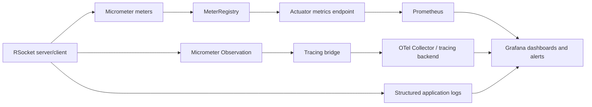

# Tích hợp Micrometer và công cụ giám sát ứng dụng

Một ứng dụng RSocket có thể giữ nhiều connection và stream trong thời gian dài. Chỉ ghi log khi có lỗi sẽ không đủ để biết hệ thống đang chậm ở đâu, một instance có bị quá tải hay không, client có reconnect liên tục hay stream bị hủy trước khi hoàn tất. Micrometer cung cấp API metrics thống nhất để ứng dụng ghi nhận số lượng, thời gian, kích thước và trạng thái tài nguyên; Spring Boot Actuator đưa các số liệu đó ra endpoint quản trị; Prometheus và Grafana giúp thu thập, truy vấn, hiển thị và cảnh báo.

Quan sát hệ thống nên kết hợp ba tín hiệu:

- **Metrics:** xu hướng và mức độ của vấn đề trên toàn hệ thống, ví dụ latency p95, số connection đang mở hoặc tỷ lệ lỗi.
- **Logs:** sự kiện cụ thể có ngữ cảnh, ví dụ connection đóng do peer timeout hoặc request bị từ chối.
- **Traces:** đường đi của một request qua Gateway, RSocket service và dependency phía sau.

Micrometer là facade cho metrics, không phải một hệ thống lưu trữ hay dashboard. `MeterRegistry` ghi nhận meter; registry implementation như Prometheus quyết định cách xuất số liệu. Với tracing, Micrometer Observation/Tracing cung cấp API và tích hợp với backend như OpenTelemetry, Zipkin hoặc Jaeger.

## 1. Kiến trúc quan sát cho một ứng dụng RSocket

Một luồng giám sát điển hình:



Metrics cho biết xu hướng tổng thể; trace và log giúp tìm nguyên nhân của một request cụ thể. Không nên cố biến metric thành log bằng cách thêm connection ID hoặc user ID làm tag, vì cardinality có thể tăng không giới hạn.

## 2. Thêm Micrometer và Spring Boot Actuator

Với Gradle, thêm Actuator và registry của hệ thống thu thập. Ví dụ dùng Prometheus:

```groovy
dependencies {
    implementation 'org.springframework.boot:spring-boot-starter-actuator'
    runtimeOnly 'io.micrometer:micrometer-registry-prometheus'
}
```

Spring Boot dependency management nên quản lý phiên bản Micrometer tương thích với dòng Spring Boot đang dùng. Tránh tự ghim một phiên bản Micrometer khác nếu chưa kiểm tra compatibility.

Actuator cung cấp các endpoint như health, info, metrics và prometheus. Ví dụ cấu hình:

```yaml
management:
  endpoints:
    web:
      exposure:
        include: health,info,metrics,prometheus
  endpoint:
    health:
      probes:
        enabled: true
  metrics:
    tags:
      application: ${spring.application.name}
    distribution:
      percentiles-histogram:
        rsocket.server.requests: true
```

`/actuator/prometheus` xuất metrics theo định dạng Prometheus khi registry dependency đã có. Endpoint `metrics` hỗ trợ kiểm tra một meter cụ thể trong quá trình chẩn đoán. Cấu hình exposure chỉ quyết định endpoint nào được công bố qua web; nó không tự bảo vệ endpoint. Hãy giới hạn truy cập bằng network policy, authentication và authorization. Không expose metrics/configuration nhạy cảm ra Internet công cộng.

Nếu RSocket server chạy trên TCP riêng, Actuator HTTP endpoint vẫn thường được phục vụ qua web server quản trị. Cần cấu hình port, ingress và firewall cho management endpoint độc lập với cổng RSocket.

## 3. Các loại meter của Micrometer

Micrometer cung cấp các meter cơ bản:

| Meter | Đo lường | Ví dụ trong RSocket |
|---|---|---|
| `Counter` | Tổng số sự kiện tăng dần | Reconnect, authorization denied, stream cancelled |
| `Timer` | Số lần và thời gian thực hiện | Request-response latency, connect duration, discovery refresh |
| `Gauge` | Giá trị tại thời điểm quan sát | Active connection, active stream, queue depth |
| `DistributionSummary` | Phân bố giá trị không phải thời gian | Payload size, số phần tử trong batch |
| `LongTaskTimer` | Thời gian và số tác vụ đang chạy lâu | Request-stream hoặc request-channel lifetime |
| `FunctionCounter` / `FunctionTimer` | Đọc số liệu tích lũy từ một đối tượng có sẵn | Tổng số task hoặc thời gian từ thư viện bên ngoài |

Ưu tiên `Timer` thay vì tự tạo cả counter và gauge để đo cùng một request. Timer đã cung cấp count và tổng thời gian, đồng thời có thể xuất histogram hoặc percentile theo registry. Gauge phù hợp với trạng thái hiện tại, không phải tổng số sự kiện trong quá khứ.

## 4. Đặt tên metric và tag có cardinality thấp

Tên metric nên mô tả điều được đo và dùng đơn vị nhất quán. Ví dụ:

- `rsocket.server.requests` — thời gian và số request server xử lý.
- `rsocket.client.connect` — thời gian mở connection.
- `rsocket.connections.active` — connection đang hoạt động.
- `rsocket.streams.active` — stream đang mở.
- `rsocket.payload.size` — kích thước payload theo byte.
- `rsocket.reconnects` — số lần reconnect.
- `rsocket.authorization.denied` — số lần authorization bị từ chối.
- `rsocket.discovery.refresh` — thời gian cập nhật danh sách instance.

Tag là chiều phân loại của meter. Nên dùng tập giá trị hữu hạn, ổn định:

| Tag nên dùng | Ví dụ |
|---|---|
| `route` | `devices.status`, `telemetry.watch` |
| `interaction` | `request-response`, `request-stream`, `request-channel`, `fire-and-forget` |
| `transport` | `tcp`, `websocket` |
| `outcome` | `success`, `error`, `cancelled` |
| `service` | `device-service`, `telemetry-service` |
| `exception` | Tên class exception đã chuẩn hóa hoặc nhóm lỗi hữu hạn |

Không dùng các giá trị thay đổi theo từng request làm tag:

- User ID, tenant ID, device ID hoặc order ID.
- Connection ID, stream ID, trace ID hoặc correlation ID.
- URL đầy đủ, cursor, token, exception message hoặc query string.
- Payload field do client tùy ý gửi.

Mỗi tổ hợp tag tạo một time series riêng. Nếu gắn ID duy nhất cho từng connection hoặc event, số time series có thể tăng theo lượng request và làm Prometheus tốn bộ nhớ, CPU và dung lượng lưu trữ. Đưa ID chi tiết vào structured log hoặc trace thay vì metric label.

## 5. Ghi Timer cho request-response

Một request-response thường có một kết quả hoặc một lỗi. Có thể đo thời gian từ lúc publisher được subscribe đến khi complete/error/cancel bằng `Timer.Sample`:

```java
import java.util.function.Supplier;

@Component
public class RSocketRequestMetrics {
    private final MeterRegistry registry;

    public RSocketRequestMetrics(MeterRegistry registry) {
        this.registry = registry;
    }

    public <T> Mono<T> measureRequestResponse(
            String route,
            Supplier<Mono<T>> resultSupplier) {

        return Mono.defer(() -> {
            Timer.Sample sample = Timer.start(registry);
            return resultSupplier.get().doFinally(signal -> {
                String outcome = switch (signal) {
                    case ON_COMPLETE -> "success";
                    case ON_ERROR -> "error";
                    case CANCEL -> "cancelled";
                    default -> "other";
                };

                sample.stop(Timer.builder("rsocket.server.requests")
                    .description("RSocket server request duration")
                    .tag("route", route)
                    .tag("interaction", "request-response")
                    .tag("outcome", outcome)
                    .register(registry));
            });
        });
    }
}
```

`Mono.defer` tạo sample cho mỗi subscription, tránh dùng chung một sample khi publisher được subscribe nhiều lần. `doFinally` chạy đúng một lần khi subscription kết thúc nên có thể ghi cả complete, error và cancel. Trong code thực tế, chỉ truyền route lấy từ danh sách route đã định nghĩa, không dùng chuỗi tùy ý do client gửi.

Handler có thể dùng wrapper này:

```java
@MessageMapping("devices.status")
public Mono<DeviceStatus> status(@Payload DeviceQuery query) {
    return metrics.measureRequestResponse(
        "devices.status",
        () -> deviceService.getStatus(query.deviceId()));
}
```

Nếu cần phân biệt empty completion với response có dữ liệu, hãy bổ sung outcome ở tầng xử lý kết quả hoặc dùng metric nghiệp vụ riêng. `ON_COMPLETE` chỉ cho biết publisher hoàn tất bình thường, không khẳng định response chứa phần tử.

## 6. Đo connection và vòng đời session

Với connection dài hạn, nên theo dõi:

- Số connection active hiện tại.
- Tổng connection được mở thành công và thất bại.
- Thời gian handshake/setup.
- Số connection đóng bình thường, đóng do peer, timeout hoặc transport error.
- Số lần protocol resume thành công/thất bại và reconnect tạo session mới.
- Số connection đang draining khi shutdown hoặc rollout.

Gauge có thể đọc từ counter trạng thái được cập nhật theo lifecycle:

```java
@Component
public class RSocketConnectionMetrics {
    private final AtomicInteger activeConnections = new AtomicInteger();
    private final Counter opened;
    private final Counter closed;

    public RSocketConnectionMetrics(MeterRegistry registry) {
        Gauge.builder("rsocket.connections.active",
                activeConnections, AtomicInteger::get)
            .description("Active RSocket connections")
            .register(registry);

        opened = Counter.builder("rsocket.connections.opened")
            .register(registry);
        closed = Counter.builder("rsocket.connections.closed")
            .register(registry);
    }

    public void onConnected() {
        activeConnections.incrementAndGet();
        opened.increment();
    }

    public void onClosed() {
        activeConnections.updateAndGet(value -> Math.max(0, value - 1));
        closed.increment();
    }
}
```

Đây là component minh họa; lifecycle owner phải gọi `onConnected()` đúng một lần khi connection được chấp nhận và `onClosed()` đúng một lần khi connection kết thúc. Nếu callback có thể được gọi lặp, hãy bảo vệ bằng trạng thái connection để không giảm gauge hai lần. Gauge cần giữ tham chiếu mạnh tới `AtomicInteger` trong suốt vòng đời bean.

Không chỉ theo dõi số connection. Một connection có thể mang nhiều stream và có lưu lượng rất khác connection khác; hãy kết hợp active streams, request rate và byte rate.

## 7. Đo request-stream và request-channel

Stream thường sống lâu hơn request-response. Một timer thông thường chỉ ghi nhận khi stream kết thúc; để biết stream đang mở bao nhiêu và đã chạy bao lâu, có thể dùng `LongTaskTimer` hoặc gauge active stream.

Ví dụ đo lifetime của request-stream:

```java
public Flux<TelemetryPoint> measureStream(
        Flux<TelemetryPoint> source) {

    return Flux.defer(() -> {
        LongTaskTimer.Sample sample = LongTaskTimer
            .builder("rsocket.streams.duration")
            .tag("route", "telemetry.watch")
            .tag("interaction", "request-stream")
            .register(registry)
            .start();

        return source
            .doOnNext(point -> emittedEvents.increment())
            .doFinally(signal -> sample.stop());
    });
}
```

Đoạn mã giả định `registry` và `emittedEvents` được inject/khởi tạo ở component. Mỗi subscription có một `LongTaskTimer.Sample`; `doFinally` dừng sample khi complete, error hoặc cancel. Tag route/interaction có giá trị hữu hạn.

Với request-channel, nên tách số payload vào và ra:

- `rsocket.channel.messages.in` — payload client gửi lên.
- `rsocket.channel.messages.out` — payload server phát xuống.
- `rsocket.channels.active` — channel đang hoạt động.
- `rsocket.channels.duration` — thời gian channel tồn tại.
- `rsocket.channels.cancelled` — channel bị hủy.

Không gộp hai chiều thành một counter nếu cần chẩn đoán producer/consumer lệch tốc độ. Demand và backpressure có thể được quan sát qua instrumentation của Reactor/transport nếu có; nếu không có hook đáng tin cậy, đừng tự suy ra số demand từ số payload đã phát.

## 8. Fire-and-forget và ý nghĩa của completion

Với fire-and-forget, completion phía client thường chỉ cho biết thao tác gửi theo API/transport đã hoàn tất ở phạm vi được định nghĩa. Nó không chứng minh nghiệp vụ phía server đã commit database hoặc consumer downstream đã xử lý xong.

Nên đo riêng:

- Client publish attempts và send failures.
- Server payloads received và handler execution outcomes.
- Business commands accepted, committed, rejected hoặc failed.
- Outbox backlog và consumer lag nếu command được chuyển sang broker.

Không đặt tên metric client là `commands.committed` nếu client chỉ biết send publisher complete. Metric phản ánh đúng ranh giới nơi sự kiện được quan sát.

## 9. Theo dõi kích thước payload và lưu lượng

`DistributionSummary` phù hợp để ghi phân bố kích thước payload:

```java
DistributionSummary payloadSize = DistributionSummary.builder(
        "rsocket.payload.size")
    .baseUnit("bytes")
    .tag("route", "telemetry.ingest")
    .tag("direction", "inbound")
    .register(registry);

payloadSize.record(payloadBytes);
```

Có thể ghi số byte vào/ra, số payload mỗi stream, batch size và số lần vượt giới hạn. Hãy lấy số byte ở ranh giới có thể đo chính xác; kích thước object Java không nhất thiết bằng số byte sau serialization hoặc số byte truyền trên wire.

Không ghi payload thực tế vào tag hoặc metric. Với dữ liệu nhạy cảm, chỉ ghi kích thước và loại nội dung đã chuẩn hóa. Giới hạn payload cần được thực thi ở transport/decoder/application; metric chỉ giúp quan sát, không thay thế validation.

## 10. Micrometer Observation và Tracing

Metrics tổng hợp nhiều request; tracing theo dõi đường đi của một request qua nhiều thành phần. Micrometer Observation cung cấp API chung để tạo observation và có thể kết nối với metrics/tracing handlers đã cấu hình.

Một observation nên mang low-cardinality key values như:

- `rsocket.route=devices.status`
- `rsocket.interaction=request-response`
- `rsocket.transport=tcp`
- `outcome=success`

Giá trị có cardinality cao như trace ID, connection ID hoặc resource ID có thể hữu ích trong trace/log nhưng không nên trở thành metric label. Hãy phân biệt low-cardinality và high-cardinality values theo quy ước Micrometer Observation.

Spring Boot có thể tự cấu hình một số observation cho các thành phần được hỗ trợ tùy phiên bản và dependency. Không nên mặc định mọi RSocket handler, custom requester hoặc transport đều tự động tạo span. Hãy kiểm tra instrumentation thực tế và bổ sung observation ở ranh giới ứng dụng cho route quan trọng.

Với reactive pipeline, không dùng một wrapper đồng bộ gọi `.block()` chỉ để tạo span. Dùng instrumentation tương thích Reactor/Spring và bảo đảm Observation/trace context được truyền qua Reactor Context khi đổi scheduler. Nếu tự viết observation lifecycle, tạo một observation cho mỗi subscription và dừng nó ở complete/error/cancel; đồng thời kiểm tra scope/context propagation theo phiên bản Micrometer đang dùng.

## 11. Truyền trace context qua RSocket

Một request có thể đi từ HTTP Gateway sang RSocket service rồi tiếp tục gọi service khác. Để trace liên tục, trace context cần được inject vào metadata khi gửi và extract ở phía nhận.

W3C Trace Context thường sử dụng các giá trị như `traceparent` và `tracestate`. Tuy nhiên, RSocket không tự biến metadata thành HTTP header. Cần cấu hình propagation mechanism hoặc metadata convention phù hợp với RSocket requester/responder.

Ví dụ luồng logic:

1. Gateway nhận HTTP request và tạo/tiếp tục trace.
2. RSocket client inject trace context vào metadata của request.
3. RSocket server extract metadata và tiếp tục trace trong handler.
4. Service downstream tiếp tục truyền context theo protocol tương ứng.
5. Logs ghi trace ID/span ID đã được tích hợp với logging context.

Không tự truyền toàn bộ baggage hoặc thông tin người dùng vào metadata nếu không cần. Không đưa bearer token, password hoặc dữ liệu cá nhân vào trace attributes. Trace context là dữ liệu đến từ mạng và phải được giới hạn kích thước, xác thực nguồn theo policy và không được dùng thay cho authentication.

## 12. Chọn tracing backend và exporter

Micrometer Tracing có thể tích hợp với các bridge và exporter tương ứng. Một triển khai thường gặp:

| Thành phần | Vai trò |
|---|---|
| Micrometer Observation | Tạo observation tại application boundary |
| Micrometer Tracing bridge | Kết nối API tracing với implementation như OpenTelemetry hoặc Brave |
| OTLP exporter | Gửi trace tới collector/backend qua OpenTelemetry Protocol |
| OpenTelemetry Collector | Nhận, xử lý, sampling/routing và export telemetry |
| Jaeger, Tempo hoặc Zipkin | Lưu trữ và truy vấn trace tùy stack |
| Prometheus | Thu thập metrics |
| Grafana | Dashboard và cảnh báo trên metrics/traces/logs tùy datasource |

Không cần triển khai tất cả công cụ cùng lúc. Chọn backend phù hợp với hạ tầng sẵn có và chính sách lưu trữ. Cấu hình sampling có kiểm soát để trace volume không tăng vô hạn; giữ tỷ lệ sampling cao hơn cho lỗi hoặc route quan trọng nếu nền tảng hỗ trợ tail-based sampling.

## 13. Prometheus scrape và Grafana dashboard

Prometheus định kỳ scrape endpoint `/actuator/prometheus`. Ví dụ cấu hình rút gọn:

```yaml
scrape_configs:
  - job_name: device-gateway
    metrics_path: /actuator/prometheus
    static_configs:
      - targets:
          - device-gateway-1.internal:8081
          - device-gateway-2.internal:8081
```

Trong Kubernetes, có thể dùng service discovery của Prometheus thay cho danh sách static target. Management port và endpoint cần được expose qua network path chỉ dành cho monitoring.

Dashboard RSocket nên có các nhóm:

- Request rate, error rate và latency p50/p95/p99 theo route/interaction.
- Active connections, active streams và active channels.
- Setup/connect duration, reconnect/resume count và connection close reason.
- Payload bytes, payload size distribution và channel message rate hai chiều.
- Discovery refresh, số endpoint ready, pool size và connection failure.
- Scheduler queue, worker utilization, event-loop delay và blocking detection nếu có instrumentation.
- JVM heap, non-heap/direct memory, GC pause, thread count và CPU.
- Downstream dependency latency, pool saturation và circuit breaker state.

Dashboard phải cho phép drill-down từ service tổng thể đến route và instance mà không tạo metric label có cardinality quá cao. Dùng log/trace để tìm một connection hoặc request cụ thể.

## 14. Thiết kế cảnh báo theo SLI/SLO

Không nên cảnh báo chỉ vì một counter tăng. Hãy xác định SLI phù hợp với nghiệp vụ:

| SLI | Câu hỏi | Ví dụ cảnh báo |
|---|---|---|
| Availability | Tỷ lệ request hợp lệ hoàn tất thành công là bao nhiêu? | Error ratio vượt ngưỡng trong cửa sổ đủ dài |
| Latency | Request-response mất bao lâu? | p95/p99 vượt SLO |
| Stream health | Stream có bị hủy/lỗi bất thường không? | Tỷ lệ stream error/cancel tăng đột biến |
| Connection health | Client có reconnect liên tục không? | Reconnect rate hoặc setup failure tăng |
| Capacity | Pool/queue có gần cạn không? | Active connection, worker hoặc queue chạm ngưỡng |
| Freshness | Consumer có theo kịp dữ liệu realtime không? | Event lag hoặc thời gian dữ liệu cũ vượt giới hạn |

Ngưỡng cụ thể phải dựa trên SLO và baseline của hệ thống. Một stream bị cancel có thể là hành vi bình thường khi người dùng rời màn hình; cần phân biệt cancellation chủ động với lỗi transport. Tương tự, connection close bình thường khi deploy không nên bị cảnh báo như outage.

Ưu tiên cảnh báo symptom ảnh hưởng người dùng: error ratio, latency, stream freshness và không còn endpoint ready. Alert nguyên nhân như GC pause, scheduler saturation hoặc discovery failure giúp điều tra nhưng nên gắn với mức độ ảnh hưởng.

## 15. Kết hợp metrics, logs và traces

Ba tín hiệu cần dùng chung ngữ cảnh:

| Tín hiệu | Nên chứa | Không nên chứa |
|---|---|---|
| Metrics | Route, interaction, transport, outcome, service | User ID, trace ID, connection ID, raw payload |
| Structured logs | Timestamp, route, connection ID nếu cần, trace ID, error class, state transition | Token, password, private key, payload bí mật |
| Traces | Span operation, route, dependency, duration, status, context propagation | Secret, dữ liệu cá nhân không cần thiết, payload đầy đủ |

Log có thể chứa connection ID để điều tra một session; trace có thể liên kết các span của cùng request. Metric chỉ nên có tag cardinality thấp. Dùng correlation ID có thời hạn và chính sách retention phù hợp.

Khi có lỗi, quy trình điều tra thường là:

1. Dashboard cho biết route/instance nào có error hoặc latency tăng.
2. Chọn một khoảng thời gian và trace lỗi tương ứng.
3. Trace cho thấy thời gian ở RSocket handler hay dependency downstream.
4. Structured log cho biết connection state, close reason và business context đã chuẩn hóa.
5. Metrics scheduler/JVM/network xác định nghẽn tài nguyên.

## 16. Bảo mật endpoint monitoring

Actuator và Prometheus endpoint có thể tiết lộ topology, route, dependency, exception hoặc tình trạng nội bộ. Cần:

- Chỉ expose các endpoint cần thiết, thường là health/metrics/prometheus theo yêu cầu vận hành.
- Giới hạn management port bằng private network, firewall hoặc service account.
- Bảo vệ endpoint bằng Spring Security khi có thể truy cập từ mạng không tin cậy.
- Không expose `env`, `configprops`, `heapdump`, `threaddump` hoặc endpoint nhạy cảm nếu không có nhu cầu và kiểm soát riêng.
- Không đưa secret hoặc payload vào tag, log, trace attribute.
- Thiết lập retention, RBAC và audit cho hệ thống monitoring.

Health endpoint công khai cũng cần trả lượng thông tin tối thiểu. Không trả hostname nội bộ, credential status chi tiết hoặc stack trace cho caller bên ngoài.

## 17. Kiểm thử metrics và instrumentation

Có thể dùng `SimpleMeterRegistry` để unit test việc ghi meter mà không cần Prometheus:

```java
SimpleMeterRegistry registry = new SimpleMeterRegistry();
RSocketRequestMetrics metrics = new RSocketRequestMetrics(registry);

StepVerifier.create(metrics.measureRequestResponse(
        "devices.status", () -> Mono.just("ok")))
    .expectNextCount(1)
    .verifyComplete();

Timer timer = registry.find("rsocket.server.requests")
    .tag("route", "devices.status")
    .tag("interaction", "request-response")
    .tag("outcome", "success")
    .timer();

assertThat(timer).isNotNull();
assertThat(timer.count()).isEqualTo(1);
```

Test minh họa kiểm tra một subscription thành công ghi timer. Bộ test thực tế nên bao gồm error, cancel, empty completion, nhiều subscription và tag không tăng theo ID động.

Các kiểm thử tích hợp nên xác minh:

1. `/actuator/prometheus` trả metrics đúng khi registry được cấu hình.
2. Meter có tên, đơn vị và tag đúng convention.
3. Request-response ghi timer ở success/error/cancel.
4. Stream/channel tăng và giảm active count đúng lifecycle.
5. Fire-and-forget client completion không bị ghi nhầm là business commit.
6. Connection open/close không làm gauge âm hoặc tăng mãi.
7. Observation/tracing context đi qua RSocket metadata và reactive scheduler.
8. Metric tag không chứa user ID, connection ID hoặc trace ID.
9. Endpoint monitoring bị từ chối với caller không có quyền.
10. Sampling và exporter lỗi không làm hỏng luồng nghiệp vụ.

## 18. Những lỗi thường gặp

- Chỉ ghi log mà không có metrics về latency, error và active resources.
- Gắn user/device/connection ID vào tag gây cardinality bùng nổ.
- Dùng Gauge cho tổng số sự kiện tích lũy thay vì Counter.
- Đo thời gian tạo publisher thay vì thời gian subscription thực thi.
- Dùng một Timer thông thường cho stream dài hạn nhưng không theo dõi số stream đang mở.
- Ghi nhận fire-and-forget send completion như thể server đã commit nghiệp vụ.
- Giả định Spring Boot tự động instrument mọi RSocket handler và custom requester.
- Giả định trace context HTTP tự động trở thành RSocket metadata.
- Không phân biệt stream cancellation bình thường với lỗi.
- Expose Actuator metrics hoặc management endpoints mà không giới hạn truy cập.
- Tạo metric mới cho mỗi ID động hoặc exception message.
- Bật histogram cho quá nhiều meter/tag mà không tính chi phí lưu trữ.

## 19. Quy tắc thiết kế

1. Dùng Micrometer `MeterRegistry` làm API metrics thống nhất.
2. Dùng Counter cho sự kiện, Timer cho latency, Gauge cho trạng thái, DistributionSummary cho kích thước và LongTaskTimer cho stream dài.
3. Đo RSocket theo connection, route, interaction, outcome, payload và reconnect.
4. Dùng tag cardinality thấp; đưa ID chi tiết vào logs/traces.
5. Bật Actuator và registry exporter phù hợp; bảo vệ management endpoint.
6. Dùng Observation/Tracing ở application boundary và kiểm tra context propagation qua RSocket metadata.
7. Không giả định mọi RSocket path đã được auto-instrument; bổ sung instrumentation có chủ đích.
8. Phân biệt send completion, handler completion và business commit.
9. Dùng Prometheus để scrape, Grafana để dashboard/alert và tracing backend để điều tra request.
10. Kiểm thử meter lifecycle, cardinality, endpoint security và tác động instrumentation.

Micrometer giúp ứng dụng RSocket ghi nhận metrics bằng một API nhất quán; Actuator công bố số liệu; Prometheus thu thập; Grafana hiển thị và cảnh báo. Khi metrics được gắn với Observation/Tracing và structured logs, đội vận hành có thể đi từ triệu chứng ở cấp service tới route, connection và dependency gây ra vấn đề. Điều quan trọng là đo đúng ranh giới nghiệp vụ, kiểm soát cardinality và bảo vệ endpoint giám sát để telemetry hữu ích mà không tạo thêm rủi ro vận hành.
