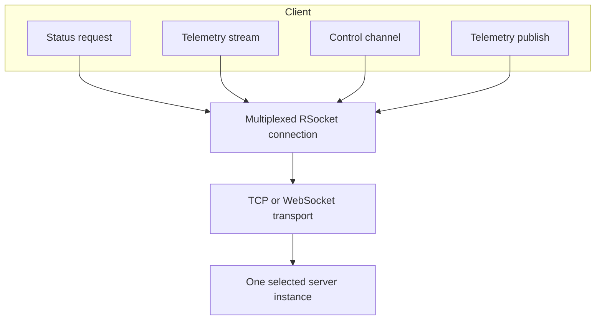

# Đánh đổi giữa dùng chung kết nối và phân tách nhóm lưu lượng

RSocket hỗ trợ multiplex nhiều interaction trên cùng một connection. Một client có thể dùng một kết nối TCP hoặc WebSocket để gửi request-response, mở request-stream và request-channel đồng thời. Cách dùng chung giúp giảm số socket, handshake và tài nguyên quản lý; tuy nhiên các stream vẫn chia sẻ băng thông, TCP congestion window, socket buffer, event loop và failure domain của connection. Khi một nhóm lưu lượng lớn hoặc chậm chiếm tài nguyên, các request nhạy latency trên cùng connection có thể bị ảnh hưởng.

Phân tách connection theo nhóm lưu lượng tạo thêm ranh giới cô lập: ví dụ một pool cho request tương tác nhanh, một pool cho stream/bulk transfer và một pool cho control channel. Đổi lại, ứng dụng phải quản lý nhiều connection, handshake, keepalive, pool capacity và kết nối tới nhiều backend hơn. Không có quy tắc “một connection cho tất cả” hoặc “mỗi route một connection” phù hợp với mọi hệ thống. Cần nhóm các interaction có cùng yêu cầu latency, security, codec và vòng đời, sau đó đo tải thực tế để quyết định mức độ chia tách.

## 1. Multiplexing trong RSocket hoạt động như thế nào?

Sau khi hai peer thiết lập một RSocket connection, nhiều stream có thể cùng tồn tại trên connection đó. Mỗi interaction được định danh bằng stream ID và trao đổi các frame theo protocol. Thay vì mở socket riêng cho từng request, các frame của nhiều stream được truyền qua cùng một transport connection.

Ví dụ một connection có thể đồng thời phục vụ:

- Request-response đọc trạng thái thiết bị.
- Request-stream theo dõi telemetry liên tục.
- Request-channel gửi command và nhận phản hồi hai chiều.
- Fire-and-forget gửi một sự kiện best-effort.



Multiplexing giúp tiết kiệm connection và cho phép nhiều interaction tiến triển đồng thời ở tầng protocol. Nó không tạo ra một đường truyền vật lý riêng cho từng stream. Các frame vẫn đi qua cùng socket và chịu ảnh hưởng của tài nguyên dùng chung.

## 2. Lợi ích khi dùng chung một connection

Chia sẻ connection thường phù hợp khi các interaction có yêu cầu vận hành tương tự:

- Giảm số TCP socket, file descriptor và tài nguyên kernel.
- Giảm số lần TCP/TLS handshake và RSocket SETUP.
- Tái sử dụng connection đã xác thực và đã khởi tạo codec/metadata convention.
- Giảm chi phí keepalive và lifecycle management.
- Multiplex nhiều request nhỏ mà không phải mở connection cho từng request.
- Giảm số endpoint connection mà load balancer và server cần quản lý.
- Giữ các tương tác của cùng một service identity trên một connection có lifecycle rõ ràng.

Ví dụ một Realtime Gateway gọi Device Service với nhiều request-response nhỏ cùng một trust boundary. Một requester được tái sử dụng có thể phục vụ nhiều route mà không cần tạo socket mới cho từng request.

Dùng chung connection cũng đơn giản hóa connection pool: thay vì duy trì nhiều pool nhỏ, ứng dụng có thể quản lý một pool theo remote service và security identity. Tuy nhiên, pool đơn giản chỉ có lợi khi workload tương đối đồng nhất và một stream không thể chiếm quá nhiều tài nguyên chung.

## 3. Chi phí và rủi ro của connection dùng chung

Các stream chia sẻ một số tài nguyên ở nhiều tầng:

| Tài nguyên chung | Tác động có thể xảy ra |
|---|---|
| TCP congestion window và network path | Mất gói hoặc congestion có thể làm chậm việc truyền dữ liệu của mọi stream trên connection |
| TCP send/receive buffer | Một lượng dữ liệu lớn có thể làm tăng queueing và thời gian chờ |
| Socket và file descriptor | Connection lỗi hoặc bị đóng ảnh hưởng tất cả stream trên đó |
| Netty channel/event loop | Callback hoặc xử lý quá nặng có thể làm chậm các channel/stream khác |
| Outbound queue và buffer ứng dụng | Producer nhanh có thể tạo backlog và tăng bộ nhớ |
| Backend instance được chọn | Mọi stream trên connection thường đi tới cùng một instance |
| Connection-scoped security/setup | Các request có thể cùng chia sẻ identity và cấu hình đã thiết lập |

RSocket flow control theo stream giúp một consumer điều tiết demand của stream đó. Tuy vậy, `REQUEST_N` không phải QoS scheduler ở cấp connection và không bảo đảm stream quan trọng luôn được gửi trước stream bulk. Các stream vẫn cạnh tranh băng thông, buffer và CPU. Với TCP và WebSocket chạy trên TCP, mất gói khiến byte stream phải được khôi phục theo thứ tự; head-of-line blocking ở tầng TCP có thể ảnh hưởng tất cả stream multiplexed trên cùng socket.

Một payload lớn không nhất thiết chặn mọi stream ở tầng logic, vì protocol và implementation có thể xử lý frame/fragment theo cách riêng. Nhưng nó vẫn có thể chiếm băng thông, buffer và thời gian xử lý; không nên giả định multiplexing tự tạo ưu tiên cho payload nhỏ.

## 4. Khi nào nên phân tách nhóm lưu lượng?

Nên xem xét connection riêng hoặc pool riêng khi có khác biệt rõ ràng về một hay nhiều tiêu chí:

- **Latency:** request tương tác cần phản hồi nhanh, trong khi bulk stream có thể chiếm băng thông lâu.
- **Throughput:** một stream truyền file hoặc replay lịch sử có tốc độ và kích thước lớn.
- **Reliability:** nhóm control cần tiếp tục hoạt động khi nhóm telemetry/bulk gặp lỗi hoặc quá tải.
- **Security:** các nhóm dùng service identity, credential hoặc setup authentication khác nhau.
- **Codec/metadata:** các peer cần `dataMimeType`, `metadataMimeType` hoặc metadata convention khác nhau.
- **Lifecycle:** stream telemetry sống lâu, còn request tương tác có thời gian ngắn.
- **Capacity:** nhóm tải có quota, connection cap hoặc backend riêng.
- **Failure domain:** một pool bị đầy hoặc connection bị đóng không nên kéo theo mọi loại traffic.

Ví dụ Gateway có thể chia:

| Nhóm | Interaction thường gặp | Mục tiêu |
|---|---|---|
| Interactive | Request-response | Latency thấp, deadline ngắn |
| Realtime control | Request-channel | Hai chiều, giới hạn số session, ưu tiên xử lý command |
| Telemetry | Request-stream hoặc fire-and-forget | Throughput ổn định, backpressure và quota |
| Bulk transfer/replay | Request-stream theo batch | Không chiếm capacity của traffic tương tác |

Không bắt buộc mỗi hàng phải có connection pool riêng. Nếu tải thấp và không có ranh giới security/lifecycle khác biệt, có thể dùng chung. Hãy bắt đầu bằng ít nhóm, sau đó tách khi số liệu chứng minh có contention hoặc khi cần ranh giới bảo mật rõ ràng.

## 5. Shared connection không đồng nghĩa shared identity trong mọi trường hợp

RSocket SETUP có thể mang authentication metadata và cấu hình gắn với connection. Nếu server xác thực principal tại SETUP rồi áp dụng security context đó cho connection, mọi request multiplexed trên connection có thể được xử lý dưới cùng identity.

Vì vậy:

- Một connection setup bằng service identity phù hợp cho các request cùng đại diện cho service đó.
- Không dùng chung connection-scoped user identity cho nhiều người dùng cuối nếu server dựa vào principal của SETUP để phân quyền từng request.
- Nếu gateway đại diện cho nhiều người dùng, có thể dùng request-level authentication metadata theo thiết kế Spring Security RSocket, hoặc tách connection theo identity.
- Khi credential, trust boundary hoặc policy khác nhau, connection riêng giúp ranh giới dễ hiểu và kiểm tra hơn.

Request-level authentication có thể cho phép chia sẻ transport connection giữa nhiều caller, nhưng cần xác minh server thực sự xác thực từng request và không vô tình kế thừa identity của SETUP. Metadata `tenantId` hoặc `userId` do client tự khai không thay thế authentication.

## 6. Setup configuration và MIME type cũng là tiêu chí chia nhóm

Một RSocket connection thiết lập các giá trị mặc định cho data và metadata MIME type, setup metadata và các tham số session. Nếu hai nhóm traffic cần contract khác nhau, không nên giả định một requester có thể tùy ý thay đổi cấu hình connection cho từng request.

Ví dụ:

- Nhóm interactive dùng JSON DTO và Composite Metadata.
- Nhóm bulk transfer dùng binary payload và metadata chứa transfer/chunk information.
- Một service identity dùng setup authentication riêng cho control plane.
- Một connection khác dùng identity dành cho telemetry publisher.

Khi các yêu cầu khác nhau ở cấp setup, hãy tạo connection/pool tương ứng hoặc thiết kế một contract thống nhất có envelope và codec rõ ràng. Không đổi `dataMimeType` hoặc `metadataMimeType` tùy tiện giữa các request trên cùng connection.

## 7. Backpressure theo stream và giới hạn ở cấp connection

RSocket request-stream/request-channel dùng demand để điều tiết số payload. Consumer yêu cầu thêm khi sẵn sàng; producer không nên phát vượt demand theo Reactive Streams semantics. Đây là cơ chế quan trọng để một stream chậm không bắt buộc producer phải đẩy dữ liệu vô hạn vào consumer.

Tuy nhiên, flow control theo stream không tự đặt giới hạn tổng cho connection. Một connection có thể có hàng trăm stream, mỗi stream đều có demand hợp lệ. Tổng số payload, buffer và công việc phát sinh vẫn có thể vượt capacity của process.

Hãy kết hợp các giới hạn:

| Phạm vi | Cơ chế |
|---|---|
| Mỗi stream | Request-N, bounded buffer, cancellation |
| Mỗi connection | Số stream tối đa, tổng in-flight request, outbound queue cap |
| Mỗi traffic class | Concurrency limit, rate limit, pool size, deadline |
| Mỗi caller/tenant | Quota, admission control và fairness |
| Toàn process | Worker pool, memory budget, connection cap, CPU budget |
| Dependency | Database pool, HTTP pool, bulkhead và timeout |

Nếu cần ưu tiên traffic, áp dụng scheduler/queue/admission policy ở tầng ứng dụng hoặc tách connection. Không coi `REQUEST_N` là ưu tiên giữa các stream hay giới hạn byte.

## 8. Phân nhóm theo traffic class

Một cách thiết kế thực tế là định nghĩa traffic class có số lượng nhỏ và ổn định:

```java
public enum TrafficClass {
    INTERACTIVE,
    CONTROL,
    TELEMETRY,
    BULK
}
```

Mỗi class cần mô tả:

- Route nào được phép sử dụng class đó.
- Interaction model được phép.
- Timeout/deadline mặc định.
- Concurrency và rate limit.
- Payload/buffer limit.
- Connection pool min/max.
- Retry và reconnect policy.
- Security identity và codec profile.

Không để caller tự chọn class tùy ý qua metadata mà không có kiểm tra. Server/gateway cần ánh xạ route và policy đã cấu hình sang traffic class. Nếu mọi request đều có thể tự khai `INTERACTIVE`, cơ chế phân loại sẽ không còn ý nghĩa.

## 9. Định nghĩa key cho connection pool

Pool cần phân biệt những connection không thể dùng thay thế cho nhau. Một key có thể bao gồm:

```java
public record ConnectionKey(
    String serviceId,
    String endpointId,
    String transport,
    String securityProfile,
    String codecProfile,
    TrafficClass trafficClass
) {}
```

Không phải hệ thống nào cũng cần mọi trường. `endpointId` có thể là instance ID đã chọn hoặc service target nếu load balancer nằm ở tầng network. `securityProfile` đại diện cho connection identity/trust policy; không đưa raw token vào key hoặc log. `codecProfile` phân biệt data/metadata MIME type và strategies. `trafficClass` phân biệt pool cần isolation.

Nếu authentication diễn ra theo từng request và codec/setup giống nhau, nhiều user request có thể dùng chung connection theo service identity. Nếu authentication gắn với SETUP, connection key phải phản ánh principal/security profile phù hợp để không trộn caller.

## 10. Quản lý pool dùng chung và pool tách biệt

Một connection pool là abstraction do ứng dụng quản lý; `RSocketRequester` không tự quyết định rằng mọi workload phải có một pool riêng. Pool có thể giữ requester/socket theo target và trả connection đang hoạt động cho caller.

Ví dụ cấu hình theo traffic class:

```yaml
app:
  rsocket:
    pools:
      interactive:
        max-connections-per-instance: 2
        max-in-flight: 200
        connect-timeout: 2s
      control:
        max-connections-per-instance: 2
        max-channels: 100
        connect-timeout: 2s
      telemetry:
        max-connections-per-instance: 2
        max-streams: 300
        max-buffered-events: 512
      bulk:
        max-connections-per-instance: 1
        max-in-flight: 4
        max-buffered-bytes: 16777216
```

Các con số chỉ minh họa cấu trúc cấu hình. Hãy sizing theo benchmark, capacity server, giới hạn file descriptor, memory và số replica. Không copy nguyên các con số vào production mà không đo.

Pool manager nên có các trách nhiệm:

1. Chọn pool theo `ConnectionKey`.
2. Tái sử dụng connection còn hoạt động.
3. Giới hạn số connection và số interaction đang hoạt động.
4. Tránh tạo nhiều connection trùng khi nhiều request đến đồng thời.
5. Theo dõi `onClose`/lifecycle và loại requester đã dispose.
6. Reconnect theo backoff/jitter và chỉ retry thao tác an toàn.
7. Drain connection cũ khi endpoint hoặc cấu hình thay đổi.
8. Dispose connection và scheduler khi application shutdown.

## 11. Chọn mức độ chia tách: một pool, vài pool hay nhiều pool?

| Thiết kế | Ưu điểm | Chi phí/rủi ro | Khi nên dùng |
|---|---|---|---|
| Một connection dùng chung | Ít socket, ít handshake, quản lý đơn giản | Contention và failure domain chung | Workload nhỏ, cùng identity/codec/lifecycle |
| Một pool theo service/identity | Tái sử dụng connection nhưng có giới hạn capacity | Các traffic class vẫn chia sẻ tài nguyên | Nhiều request tương tự tới cùng service |
| Một pool theo traffic class | Cô lập bulk/interactive/control ở mức socket | Tăng connection, handshake và cấu hình | Có chênh lệch latency/throughput hoặc yêu cầu isolation |
| Pool riêng theo tenant | Có thể cô lập quota và identity | Số pool tăng nhanh, nhiều connection nhàn rỗi | Tenant lớn/đặc biệt có yêu cầu isolation rõ ràng |
| Instance hoặc network riêng | Failure/capacity isolation mạnh hơn | Chi phí hạ tầng và vận hành cao | Workload quan trọng hoặc yêu cầu compliance |

Không nên tạo pool riêng cho từng route nếu các route có cùng đặc tính. Số pool nên phản ánh các nhóm policy khác biệt thực sự, không phản ánh số lượng API.

## 12. Connection dùng chung ảnh hưởng đến load balancing

Load balancer ở tầng TCP thường chọn backend khi connection được thiết lập. Nhiều stream multiplexed trên cùng connection thường đi tới cùng instance. Nếu một client dùng một connection chung cho interactive và bulk, cả hai nhóm có thể bị pin vào cùng backend.

Điều này tạo ra một số hệ quả:

- Một backend có thể nhận ít connection nhưng nhiều stream/byte rate hơn backend khác.
- Thêm instance mới không tự phân phối các stream đang chạy sang instance mới.
- Pool nhiều connection cho phép client chọn nhiều backend, nhưng tăng socket và handshake.
- Connection pool theo traffic class có thể phân tán workload và giới hạn mức ảnh hưởng giữa các nhóm.

Theo dõi tải theo stream, request, byte và thời gian xử lý thay vì chỉ đếm connection. Round-robin connection không bảo đảm cân bằng byte hoặc CPU nếu một số stream dài và nặng hơn phần còn lại.

## 13. Chọn connection cho request mới

Khi có nhiều connection, lựa chọn nên dựa trên policy của traffic class:

- Interactive: ưu tiên connection khỏe, ít in-flight request và còn capacity.
- Control: ưu tiên connection có latency ổn định, identity đúng và số channel dưới quota.
- Telemetry: phân phối stream theo số stream/byte rate, tránh dồn mọi subscription vào một socket.
- Bulk: giới hạn số transfer đồng thời và giữ chúng trong pool riêng nếu chúng có thể chiếm băng thông lâu.

Không nên chọn connection chỉ theo số stream nếu mỗi stream có chi phí khác nhau. Một stream telemetry nhẹ và một stream replay lịch sử có thể cùng được tính là một stream nhưng tiêu thụ tài nguyên rất khác. Có thể dùng moving average về bytes/sec hoặc in-flight work nếu số liệu đáng tin cậy, nhưng cần tránh tạo policy quá phức tạp trước khi có dữ liệu.

## 14. Tránh starvation và bảo vệ traffic quan trọng

Nếu bulk transfer luôn tạo backlog, request interactive có thể phải chờ outbound queue hoặc worker dù chúng có timeout ngắn. Các cách giảm tác động:

- Dùng connection pool riêng cho bulk và interactive.
- Đặt concurrency cap và byte budget cho bulk.
- Dùng queue bounded và admission control; từ chối sớm khi đã đầy.
- Giới hạn payload và chunk size.
- Dùng scheduler/worker pool chuyên biệt cho tác vụ blocking của bulk.
- Đặt deadline riêng và cancellation khi caller không còn cần dữ liệu.
- Dùng quota theo tenant để một caller không chiếm hết pool.
- Nếu cần QoS mạnh, tách service instance, network class hoặc tài nguyên hạ tầng.

Tách connection chỉ cô lập một phần: hai socket vẫn chia sẻ NIC, CPU, memory, event loop group và network path của máy chủ nếu cùng process/host. Khi cần isolation mạnh, phải xem xét tách worker, process, pod hoặc node, không chỉ tạo thêm socket.

## 15. Failure domain và reconnect

Khi một connection dùng chung bị đóng, mọi stream trên connection đó đều bị ảnh hưởng. Nếu mỗi nhóm traffic có connection riêng, lỗi transport ở pool bulk không nhất thiết đóng connection interactive.

Tuy vậy, tách connection làm tăng số lần reconnect khi rollout hoặc network flap. Cần:

- Backoff có jitter để tránh nhiều client reconnect cùng lúc.
- Connection cap và giới hạn concurrent handshake.
- Timeout setup và xác thực rõ ràng.
- Theo dõi `onClose` và phân biệt graceful close với lỗi.
- Chỉ retry request-response an toàn hoặc command có idempotency key.
- Với stream, xác định reconnect từ cursor/checkpoint nghiệp vụ nếu không thể resume protocol.
- Với channel, lưu outbox/inbox và command ID nếu cần phục hồi message hai chiều.

Không giả định connection mới tương đương session cũ. Setup metadata, security identity, MIME type, resume state và endpoint có thể khác. Connection manager cần tạo requester theo đúng key/policy đã cấu hình.

## 16. Timeout, keepalive và connection lifetime

Nhóm traffic khác nhau có thể cần timeout và lifecycle khác nhau:

| Thuộc tính | Interactive | Stream/Control | Bulk |
|---|---|---|---|
| Connect timeout | Ngắn | Ngắn hoặc vừa | Có thể dài hơn theo mạng |
| Request deadline | Ngắn, theo SLO | Theo lifetime/session policy | Theo chunk/batch hoặc transfer deadline |
| Keepalive | Đủ phát hiện connection chết | Phù hợp stream dài | Tránh giữ connection nhàn rỗi quá lâu |
| Max in-flight | Cao vừa phải, có giới hạn | Theo số stream/channel | Thấp để giới hạn tài nguyên |
| Retry | Chỉ lỗi transient và idempotent | Reconnect + business cursor | Resume transfer từ chunk/checkpoint |

Giá trị phải được xác định theo transport, load balancer và peer. Keepalive quá dày tạo overhead; quá thưa làm phát hiện connection chết chậm. Idle timeout của proxy/load balancer phải tương thích với keepalive và đặc tính stream.

## 17. Quan sát hiệu quả của việc chia tách

Trước và sau khi chia pool, đo cùng một tập chỉ số:

- Request-response p50/p95/p99 theo route và traffic class.
- Stream/channel count và lifetime.
- Bytes/sec, payload size và outbound queue depth.
- TCP retransmission, connection reset và connect latency nếu hạ tầng cung cấp.
- Active connection, handshake rate và file descriptor.
- CPU, heap, direct memory, GC pause và event-loop delay.
- Pool utilization, in-flight request và số lần bị admission control từ chối.
- Error rate, timeout, cancellation và reconnect theo traffic class.

Nếu tách pool mà latency interactive không cải thiện nhưng connection count, CPU và memory tăng đáng kể, có thể số pool quá nhiều hoặc bottleneck nằm ở nơi khác. Nếu latency giảm khi bulk được tách, hãy kiểm tra lợi ích có ổn định dưới tải và trong tình huống failover hay không.

## 18. Benchmark để quyết định

Không quyết định chỉ từ một lần đo. So sánh ít nhất hai topology:

1. **Shared:** một connection/pool phục vụ mọi nhóm traffic.
2. **Separated:** pool riêng cho interactive và bulk; có thể bổ sung control/telemetry nếu cần.

Giữ nguyên server instance count, payload, codec, TLS, network và workload. Tạo tải hỗn hợp gồm request-response nhỏ có latency target, stream telemetry liên tục và một lượng bulk transfer/replay. Chạy cả steady state lẫn burst, packet loss/network delay mô phỏng, server rollout và reconnect storm.

Đo:

- Latency p95/p99 của interactive khi bulk tăng tải.
- Throughput và thời gian hoàn tất bulk.
- Error/timeout và số stream bị gián đoạn.
- Tổng connection, handshake, memory/direct buffer và CPU.
- Mức sử dụng server instance và độ lệch tải giữa instance.
- Thời gian phục hồi sau khi đóng một connection hoặc một instance.

Một benchmark tốt phải kiểm tra cả hiệu năng và hành vi khi lỗi. Nếu chỉ đo throughput tối đa trong điều kiện không có packet loss, bạn có thể bỏ qua lợi ích isolation quan trọng nhất của pool riêng.

## 19. Ví dụ cấu trúc client theo traffic class

Nên để code nghiệp vụ yêu cầu một client theo capability, còn connection manager chọn pool tương ứng:

```java
public interface RSocketClient {
    <T> Mono<T> requestResponse(
        TrafficClass trafficClass,
        String route,
        Object data,
        Class<T> responseType);

    <T> Flux<T> requestStream(
        TrafficClass trafficClass,
        String route,
        Object data,
        Class<T> responseType);
}
```

```java
public Mono<DeviceStatus> status(String deviceId) {
    return rsocketClient.requestResponse(
        TrafficClass.INTERACTIVE,
        "devices.status",
        new DeviceQuery(deviceId),
        DeviceStatus.class);
}

public Flux<TelemetryPoint> replay(String deviceId, String cursor) {
    return rsocketClient.requestStream(
        TrafficClass.BULK,
        "telemetry.replay",
        new ReplayRequest(deviceId, cursor),
        TelemetryPoint.class);
}
```

Đây là abstraction minh họa, không phải API có sẵn của Spring. Implementation sẽ tra policy của `TrafficClass`, chọn pool theo `ConnectionKey`, kiểm tra capacity rồi gọi `RSocketRequester`. Route-to-class mapping nên được cấu hình tập trung và kiểm tra khi startup để route mới không vô tình dùng pool bulk hoặc pool interactive sai mục đích.

## 20. Những lỗi thường gặp

- Dùng một connection cho cả interactive và bulk dù hai nhóm có SLO và tải khác nhau.
- Tạo connection riêng cho từng request khiến handshake và socket count tăng cao.
- Tách pool theo mọi route làm số pool và connection tăng không kiểm soát.
- Nghĩ backpressure của một stream tự bảo vệ mọi stream khác trên cùng connection.
- Coi request-N là giới hạn byte hoặc cơ chế ưu tiên.
- Chia sẻ connection-scoped identity giữa nhiều user cuối.
- Dùng cùng pool cho traffic có codec/setup metadata không tương thích.
- Tách connection nhưng vẫn để tất cả nhóm chia sẻ một queue không giới hạn ở application layer.
- Chỉ cân bằng theo số connection, bỏ qua stream count, byte rate và CPU.
- Đóng connection ngay khi endpoint bị drain, làm gián đoạn stream đang chạy.
- Retry command có side effect mà không có idempotency key.
- Tưởng nhiều connection đồng nghĩa có network/CPU isolation hoàn toàn.
- Không benchmark với tải hỗn hợp và failure scenario.

## 21. Quy trình quyết định và triển khai

1. Liệt kê route, interaction model, latency SLO, throughput và lifetime của từng workload.
2. Xác định security identity, setup metadata, MIME type và trust boundary.
3. Gom route có đặc tính gần nhau thành một số traffic class nhỏ.
4. Bắt đầu bằng connection dùng chung nếu chưa có bằng chứng contention hoặc yêu cầu isolation.
5. Đặt giới hạn stream, in-flight request, buffer, payload và quota ngay cả khi dùng chung.
6. Tách pool khi bulk, control hoặc workload nhạy latency cần capacity/failure boundary riêng.
7. Định nghĩa connection key theo service, endpoint, transport, security/codec profile và traffic class.
8. Quản lý connection reuse, health, reconnect, drain và shutdown theo lifecycle.
9. Đo metrics theo traffic class và benchmark shared so với separated dưới tải hỗn hợp.
10. Tăng mức độ isolation tới process/pod/network riêng nếu socket separation chưa đủ.

## 22. Quy tắc thiết kế

1. Dùng chung connection khi các interaction có cùng identity, codec, lifecycle và đặc tính tải.
2. Nhớ multiplexing tiết kiệm socket nhưng các stream vẫn chia sẻ TCP congestion, buffer, event loop và failure domain.
3. Không coi backpressure per-stream là QoS hoặc giới hạn tài nguyên toàn connection.
4. Tách pool cho traffic có khác biệt đáng kể về latency, throughput, security hoặc failure tolerance.
5. Giữ số traffic class/pool nhỏ và dựa trên workload thực tế, không tạo pool cho từng route.
6. Đưa traffic class vào policy nội bộ; không tin nhãn class do caller tự khai.
7. Phân biệt connection-scoped identity với request-level authentication.
8. Tính codec/MIME type và setup metadata vào điều kiện tái sử dụng connection.
9. Giới hạn connection, stream, in-flight request, buffer, byte rate và handshake.
10. Benchmark cả steady state, burst, packet loss, failover và reconnect.
11. Drain stream trước khi dispose connection; dùng business resume/idempotency cho interaction cần phục hồi.
12. Nếu cần isolation mạnh hơn socket, tách worker, process, pod hoặc network resource.

Dùng chung connection giúp tận dụng multiplexing và giảm overhead, còn phân tách pool giúp giới hạn contention và failure domain giữa các nhóm tải. Thiết kế phù hợp là nhóm theo latency, throughput, identity, codec và lifecycle; sau đó áp dụng quota/backpressure ở từng cấp và kiểm chứng bằng benchmark. Tách kết nối có chủ đích tạo ra isolation hữu ích mà không làm số socket và độ phức tạp vận hành tăng vượt nhu cầu.
