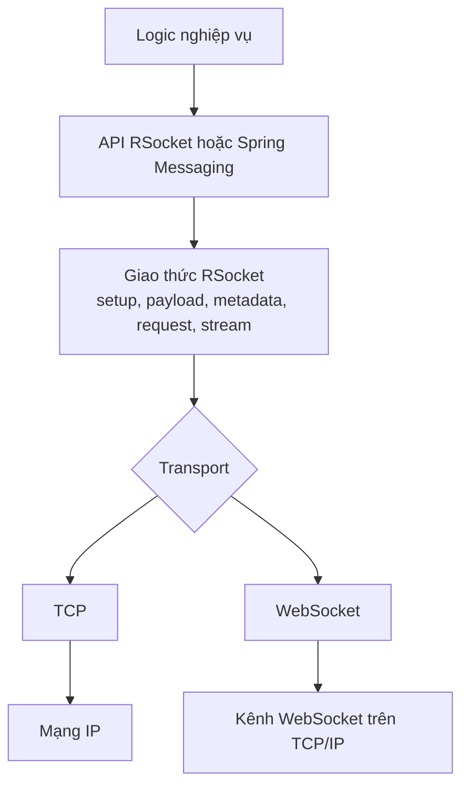
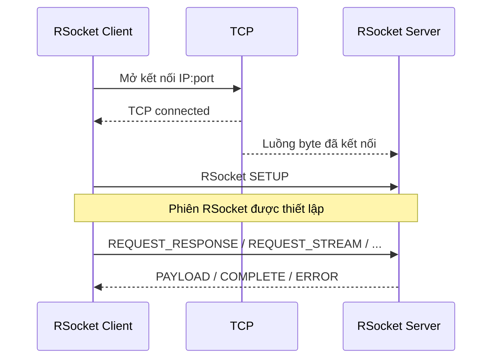
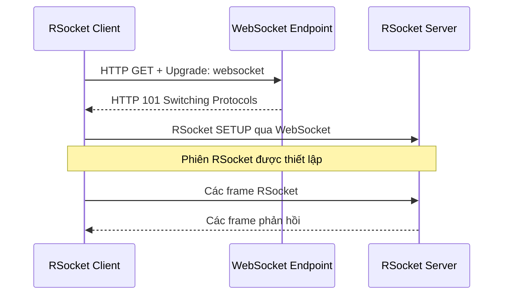

# TCP và WebSocket trong kiến trúc truyền tải RSocket

RSocket định nghĩa cách hai ứng dụng trao đổi thông điệp bất đồng bộ, hai chiều và có điều tiết luồng. Để các thông điệp đó đi qua mạng, RSocket cần một tầng vận chuyển. TCP và WebSocket là hai lựa chọn phổ biến trong ứng dụng Java và Spring.

Transport trả lời câu hỏi dữ liệu được chuyển qua kết nối mạng như thế nào. Nó không quyết định ứng dụng đang dùng request-response, fire-and-forget, request-stream hay request-channel. Các kiểu tương tác thuộc về giao thức RSocket và giữ nguyên ý nghĩa khi đổi từ TCP sang WebSocket. Vì vậy, lựa chọn transport chủ yếu phụ thuộc vào môi trường mạng, loại client, hạ tầng proxy và yêu cầu bảo mật của hệ thống.

## 1. Transport nằm ở đâu trong kiến trúc RSocket?

Một hệ thống RSocket có thể được nhìn theo các tầng sau:



Ứng dụng tạo một tương tác RSocket, chẳng hạn gửi request lấy trạng thái đơn hàng. Thư viện RSocket đóng gói tương tác thành các frame theo giao thức. Transport chuyển các frame đó qua kết nối mạng tới đầu bên kia. Ở phía nhận, transport cung cấp dữ liệu cho implementation RSocket để giải mã frame và phân phối tương tác tới handler.

Với TCP, RSocket sử dụng một kết nối TCP trực tiếp. Với WebSocket, RSocket sử dụng kết nối WebSocket làm kênh truyền hai chiều. WebSocket bản thân chạy trên TCP, nhưng cung cấp cơ chế bắt tay HTTP và định dạng khung WebSocket phù hợp với môi trường web.

Điểm cần nhớ là WebSocket không thay thế giao thức RSocket. Một kết nối WebSocket thông thường chỉ trở thành kênh RSocket khi hai đầu sử dụng implementation RSocket và thực hiện quy trình thiết lập RSocket sau khi transport đã được tạo.

## 2. RSocket qua TCP

TCP là giao thức vận chuyển hướng kết nối, cung cấp luồng byte tin cậy và có thứ tự. Trước khi gửi dữ liệu ứng dụng, hai máy thiết lập kết nối TCP tới địa chỉ IP và cổng của nhau. TCP đảm nhiệm việc truyền byte, sắp xếp lại dữ liệu đến đúng thứ tự và phát hiện một số tình huống mất kết nối.

TCP không tự hiểu ranh giới thông điệp của ứng dụng. Một lần ghi dữ liệu ở phía gửi không nhất thiết tương ứng với một lần đọc ở phía nhận. Implementation RSocket phải đóng khung dữ liệu theo giao thức để phân biệt các frame trên luồng byte TCP. Lập trình viên dùng API RSocket thường không phải tự xử lý việc tách frame này.

### Luồng thiết lập kết nối

Khi dùng RSocket qua TCP, trình tự khái quát như sau:

1. Client mở kết nối TCP tới địa chỉ và cổng của server.
2. Sau khi TCP kết nối thành công, client và server thực hiện trao đổi thiết lập RSocket, bao gồm frame `SETUP` và thông tin khởi tạo cần thiết.
3. Khi phiên RSocket đã được thiết lập, hai bên có thể gửi các tương tác và metadata trên kết nối đó.
4. Kết nối được giữ mở để phục vụ nhiều tương tác; nó đóng khi một bên chủ động đóng hoặc khi lỗi mạng khiến kết nối không còn sử dụng được.



### Khi nào nên chọn TCP?

TCP thường phù hợp với giao tiếp giữa các dịch vụ backend nằm trong cùng mạng nội bộ, mạng riêng hoặc môi trường mà nhóm vận hành kiểm soát được firewall và cổng mạng. Một số tình huống điển hình:

- Các microservice Java trao đổi dữ liệu realtime trong cụm dịch vụ.
- Worker và service cần gửi luồng dữ liệu liên tục qua kết nối lâu dài.
- Hệ thống cần một transport trực tiếp, ít lớp trung gian và không cần endpoint WebSocket cho trình duyệt.
- Hạ tầng đã hỗ trợ cân bằng tải TCP và có quy trình quản lý cổng, chứng thư TLS tương ứng.

TCP thường có ít lớp đóng gói hơn WebSocket trong đường truyền RSocket. Tuy nhiên, không nên kết luận TCP luôn nhanh hơn trong mọi hệ thống. Độ trễ và thông lượng thực tế còn phụ thuộc mạng, proxy, cấu hình TLS, kích thước payload, số lượng kết nối và cách ứng dụng xử lý dữ liệu.

### Những điểm cần vận hành

Vì TCP kết nối trực tiếp tới địa chỉ và cổng, firewall, security group, service mesh hoặc load balancer phải cho phép loại lưu lượng TCP đó. Nếu kết nối thất bại, cần kiểm tra địa chỉ đích, cổng lắng nghe, định tuyến mạng và chính sách firewall trước khi kiểm tra route RSocket.

Kết nối TCP có thể tồn tại lâu dài. Hạ tầng mạng có thể đóng các kết nối không hoạt động sau một khoảng thời gian. Do đó cần đặt chính sách timeout phù hợp và theo dõi việc đóng kết nối. TCP keepalive ở cấp hệ điều hành có thể hỗ trợ phát hiện một số kết nối chết, nhưng nó khác với keepalive của giao thức RSocket.

## 3. RSocket qua WebSocket

WebSocket là giao thức truyền thông hai chiều trên một kết nối TCP, thường được khởi tạo thông qua HTTP Upgrade. Client bắt đầu bằng một HTTP handshake; nếu server chấp nhận, kết nối được nâng cấp thành WebSocket và hai bên tiếp tục gửi nhận dữ liệu hai chiều trên cùng kết nối.

URI thường dùng là `ws://` cho kết nối không mã hóa và `wss://` cho WebSocket được bảo vệ bằng TLS. WebSocket có thể được gắn với một đường dẫn cụ thể, ví dụ `/rsocket`, để reverse proxy hoặc gateway định tuyến tới đúng ứng dụng.

Khi dùng RSocket qua WebSocket, các frame RSocket được truyền qua kênh WebSocket. Quy trình tổng quát gồm hai bước thiết lập:

1. Client thực hiện HTTP Upgrade để tạo kết nối WebSocket.
2. Trên kết nối WebSocket vừa tạo, hai đầu tiếp tục thực hiện thiết lập phiên RSocket và trao đổi frame theo giao thức RSocket.



RSocket qua WebSocket vẫn là kết nối lâu dài và hai chiều. Ứng dụng không gửi một HTTP request mới cho từng phần tử của stream. Sau khi kết nối được thiết lập, các tương tác RSocket được truyền qua kênh WebSocket đang mở.

### Khi nào nên chọn WebSocket?

WebSocket hữu ích khi client chạy trong trình duyệt hoặc khi hệ thống cần đi qua hạ tầng web đã có sẵn. Các trình duyệt phổ biến cung cấp WebSocket API, trong khi JavaScript chạy trong trình duyệt không thể tùy ý mở một socket TCP thô tới server. Một thư viện RSocket dành cho trình duyệt có thể dùng WebSocket làm transport để ứng dụng web giao tiếp với server RSocket.

WebSocket cũng phù hợp khi tổ chức muốn đưa endpoint realtime qua reverse proxy hoặc gateway HTTP. Hạ tầng có thể định tuyến theo hostname và path, đồng thời dùng chứng thư TLS quen thuộc của website. Điều này chỉ hoạt động khi proxy, ingress và load balancer được cấu hình để hỗ trợ WebSocket Upgrade và giữ kết nối mở.

Ví dụ về các tình huống phù hợp:

- Ứng dụng web hiển thị bảng giá, trạng thái giao dịch hoặc thông báo realtime.
- Dashboard trên trình duyệt nhận luồng cập nhật từ server.
- Client bên ngoài mạng nội bộ cần kết nối qua một endpoint WebSocket được công khai.
- Hệ thống đã có reverse proxy HTTP và muốn dùng chung cơ chế định tuyến, chứng thư và quan sát mạng.

### Những điểm cần vận hành

Proxy phải chuyển tiếp đúng các header của WebSocket handshake và chấp nhận mã phản hồi `101 Switching Protocols`. Sau handshake, proxy phải duy trì kết nối hai chiều và không được xử lý nội dung như một HTTP response thông thường. Cần kiểm tra cấu hình idle timeout, giới hạn thời gian kết nối, giới hạn số kết nối đồng thời và chính sách đóng kết nối của load balancer.

Nếu kết nối WebSocket thiết lập thành công nhưng RSocket không hoạt động, hãy kiểm tra tiếp endpoint path, cấu hình transport ở hai phía, frame `SETUP`, metadata và handler. HTTP `101` chỉ xác nhận WebSocket Upgrade thành công; nó không chứng minh phiên RSocket đã thiết lập thành công hay route nghiệp vụ tồn tại.

## 4. So sánh TCP và WebSocket

| Tiêu chí | RSocket qua TCP | RSocket qua WebSocket |
|---|---|---|
| Cách tạo kênh | Kết nối TCP trực tiếp tới IP và port | HTTP Upgrade rồi tạo kết nối WebSocket |
| URI thường gặp | Host và port | `ws://` hoặc `wss://` kèm host và path |
| Tầng vận chuyển bên dưới | TCP/IP | WebSocket trên TCP/IP |
| Môi trường phù hợp | Backend, mạng riêng, dịch vụ nội bộ | Trình duyệt, ứng dụng web, hạ tầng HTTP gateway |
| Yêu cầu mạng | Cho phép kết nối TCP tới port của server | Cho phép HTTP Upgrade và giữ kết nối WebSocket |
| Định tuyến hạ tầng | Thường theo địa chỉ, port hoặc TCP load balancer | Có thể định tuyến theo host và path qua proxy hỗ trợ WebSocket |
| Mã hóa đường truyền | Cần cấu hình TLS cho TCP khi yêu cầu bảo vệ dữ liệu | Dùng `wss://` để bảo vệ WebSocket bằng TLS |
| Kiểu tương tác RSocket | Giữ nguyên | Giữ nguyên |
| Metadata và payload RSocket | Giữ nguyên | Giữ nguyên |

Không có một transport tối ưu cho mọi ứng dụng. TCP thường là lựa chọn tự nhiên cho kết nối service-to-service trong mạng được kiểm soát. WebSocket phù hợp khi cần tương thích với trình duyệt hoặc tận dụng hạ tầng web. Hãy chọn theo đường đi thực tế của kết nối và khả năng vận hành của hệ thống.

## 5. Transport không thay đổi mô hình tương tác RSocket

Một trong những lợi ích của RSocket là API tương tác không bị gắn cứng với transport. Cùng một hợp đồng request có thể được gọi qua TCP hoặc WebSocket nếu client và server thống nhất route, metadata, định dạng payload và cấu hình transport.

| Kiểu tương tác | Qua TCP | Qua WebSocket |
|---|---|---|
| Request-response | Một request, tối đa một response | Một request, tối đa một response |
| Fire-and-forget | Gửi request, không chờ response | Gửi request, không chờ response |
| Request-stream | Một request mở luồng response | Một request mở luồng response |
| Request-channel | Luồng request và luồng response | Luồng request và luồng response |

Ví dụ, một server cung cấp route `stock.updates.ACME` có thể phục vụ client Java qua TCP và client trình duyệt qua WebSocket. Hai client cần tuân theo cùng hợp đồng route và payload. Thay đổi transport không tự chuyển đổi schema, không tạo thêm quyền truy cập và cũng không thay thế việc xác thực người dùng.

Các tương tác có thể được ghép nhiều lần trên cùng một kết nối RSocket. Nhờ vậy, ứng dụng có thể tái sử dụng kết nối thay vì mở một kết nối TCP hoặc WebSocket mới cho từng request. Cần quản lý vòng đời kết nối, số lượng kết nối và tải trên mỗi kết nối phù hợp với quy mô hệ thống.

## 6. Keepalive, timeout và phục hồi kết nối

Các kết nối realtime thường được giữ mở trong thời gian dài. Một số thành phần mạng sẽ đóng kết nối khi không thấy dữ liệu trong một khoảng thời gian. Vì vậy, ứng dụng cần phân biệt các cơ chế kiểm tra kết nối ở từng tầng:

| Cơ chế | Tầng | Vai trò |
|---|---|---|
| TCP keepalive | TCP và hệ điều hành | Phát hiện một số kết nối TCP không còn phản hồi |
| WebSocket Ping/Pong | WebSocket | Kiểm tra khả năng phản hồi của đầu bên kia WebSocket |
| RSocket KEEPALIVE | Giao thức RSocket | Duy trì và kiểm tra trạng thái phiên RSocket |

Các cơ chế này không thay thế nhau. Một kết nối TCP có thể còn tồn tại ở mức hệ điều hành nhưng ứng dụng RSocket đã gặp lỗi. Tương tự, WebSocket Upgrade thành công không có nghĩa mọi frame RSocket sau đó đều được xử lý.

Khi cấu hình keepalive, cần đối chiếu chu kỳ gửi với idle timeout của proxy, load balancer và firewall. Nếu chu kỳ keepalive dài hơn timeout của hạ tầng, kết nối có thể bị đóng trước khi heartbeat tiếp theo được gửi. Nếu đặt quá ngắn, hệ thống sẽ tạo thêm lưu lượng nền và công việc xử lý không cần thiết.

Khi kết nối bị đóng, client cần có chính sách phát hiện lỗi, tạo kết nối mới và quyết định tương tác nào được phép gửi lại. Không phải mọi request đều an toàn để retry: một thao tác tạo thanh toán hoặc ghi dữ liệu có thể bị thực hiện hai lần nếu client không có idempotency key hoặc cơ chế xác nhận phù hợp. Cơ chế resume của RSocket, nếu được implementation và cấu hình hỗ trợ, cũng cần được thiết kế và kiểm thử riêng; không nên mặc định rằng TCP hoặc WebSocket tự khôi phục phiên ứng dụng.

## 7. Bảo mật đường truyền và xác thực ứng dụng

TCP và WebSocket là lựa chọn transport, không phải chính sách bảo mật hoàn chỉnh. Dữ liệu realtime vẫn cần được bảo vệ trên đường truyền và người gửi vẫn cần được xác thực, phân quyền theo nghiệp vụ.

Với WebSocket, dùng `wss://` để mã hóa kết nối bằng TLS. Với TCP, cấu hình TLS cho transport TCP theo khả năng của thư viện và hạ tầng. Chứng thư cần được xác minh đúng hostname, được gia hạn và quản lý phù hợp. Khi đi qua reverse proxy, cần xác định TLS kết thúc ở proxy hay ở ứng dụng và bảo vệ chặng mạng còn lại nếu dữ liệu tiếp tục đi qua mạng không tin cậy.

Xác thực ở tầng ứng dụng là một việc riêng. Ứng dụng RSocket có thể trao đổi thông tin xác thực qua metadata hoặc cơ chế bảo mật tích hợp của framework. Không nên xem việc dùng `wss://` hay TLS TCP là bằng chứng người dùng đã được xác thực hoặc có quyền gọi mọi route. Cũng không đưa mật khẩu, token dài hạn hoặc dữ liệu bí mật vào log khi chẩn đoán kết nối.

Với WebSocket từ trình duyệt, cần kiểm tra origin được phép, chính sách cookie hoặc token, và quy tắc xác thực trong handshake cũng như trong phiên RSocket. Origin giúp giới hạn nguồn trang web khởi tạo kết nối nhưng không thay thế xác thực và phân quyền. Với TCP nội bộ, vẫn cần giới hạn nguồn kết nối ở firewall hoặc mạng dịch vụ và xác thực peer theo yêu cầu hệ thống.

## 8. Cấu hình transport bằng RSocket Java

RSocket Java cung cấp transport adapter để server và client chọn cách tạo kết nối. Phần handler nghiệp vụ có thể dùng chung; điểm thay đổi chính là transport truyền cho server hoặc connector.

Ví dụ dưới đây minh họa server TCP và client TCP. `acceptor` là `SocketAcceptor` đã được định nghĩa để tạo responder cho từng kết nối:

```java
import io.rsocket.RSocket;
import io.rsocket.RSocketConnector;
import io.rsocket.SocketAcceptor;
import io.rsocket.AbstractRSocket;
import io.rsocket.core.RSocketServer;
import io.rsocket.transport.netty.client.TcpClientTransport;
import io.rsocket.transport.netty.server.TcpServerTransport;
import reactor.core.publisher.Mono;

SocketAcceptor acceptor = (setup, sendingSocket) ->
    Mono.just(new AbstractRSocket() {});

// Server lắng nghe TCP trên cổng 7000.
RSocketServer.create(acceptor)
    .bind(TcpServerTransport.create("0.0.0.0", 7000))
    .block();

// Client kết nối tới server TCP.
RSocket socket = RSocketConnector.create()
    .connect(TcpClientTransport.create("localhost", 7000))
    .block();
```

Trong ứng dụng thực tế, responder cần triển khai các phương thức tương tác hoặc được xây dựng từ handler phù hợp. Ví dụ tập trung vào vị trí chọn transport. Địa chỉ `0.0.0.0` cho phép server bind trên mọi interface IPv4; môi trường triển khai cần giới hạn interface và quyền truy cập mạng theo yêu cầu bảo mật.

Với WebSocket, server và client chọn transport WebSocket tương ứng. Ví dụ client dùng URI WebSocket:

```java
import java.net.URI;
import io.rsocket.RSocket;
import io.rsocket.RSocketConnector;
import io.rsocket.transport.netty.client.WebsocketClientTransport;

RSocket socket = RSocketConnector.create()
    .connect(WebsocketClientTransport.create(
        URI.create("ws://localhost:8080/")
    ))
    .block();
```

Phía server có thể bind transport WebSocket như sau; ví dụ dùng endpoint mặc định ở path `/` để khớp với URI client phía trên:

```java
import io.rsocket.core.RSocketServer;
import io.rsocket.transport.netty.server.WebsocketServerTransport;

RSocketServer.create(acceptor)
    .bind(WebsocketServerTransport.create("0.0.0.0", 8080))
    .block();
```

Server và client trong hai ví dụ là hai chương trình riêng, cùng thống nhất host, port và path. Khi triển khai qua TLS, client dùng URI `wss://` cùng cấu hình chứng thư thích hợp. API khởi tạo transport có thể khác đôi chút giữa các phiên bản RSocket Java; hãy dùng đúng phiên bản dependency và kiểm tra constructor hoặc factory method tương ứng trong tài liệu của phiên bản đó.

## 9. Cấu hình transport trong Spring Boot

Spring Boot có thể khởi chạy RSocket server bằng cấu hình ứng dụng. Ví dụ cấu hình TCP trong `application.properties`:

```properties
spring.rsocket.server.transport=tcp
spring.rsocket.server.port=7000
```

Khi muốn cung cấp endpoint WebSocket, cấu hình transport và mapping path:

```properties
spring.rsocket.server.transport=websocket
spring.rsocket.server.port=8080
spring.rsocket.server.mapping-path=/rsocket
```

Client dùng `RSocketRequester` có thể chọn transport tương ứng:

```java
import java.net.URI;
import org.springframework.messaging.rsocket.RSocketRequester;

// Client TCP.
RSocketRequester tcpRequester = RSocketRequester.builder()
    .connectTcp("localhost", 7000)
    .block();

// Client WebSocket: path phải khớp mapping-path phía server.
RSocketRequester websocketRequester = RSocketRequester.builder()
    .connectWebSocket(URI.create("ws://localhost:8080/rsocket"))
    .block();
```

Hai requester ở trên là hai kết nối độc lập để minh họa hai lựa chọn transport. Trong một ứng dụng thực tế, nên quản lý requester theo vòng đời phù hợp, tái sử dụng kết nối và đóng tài nguyên khi ứng dụng dừng. Các thuộc tính Spring Boot và API builder có thể thay đổi theo phiên bản; hãy kiểm tra tài liệu của đúng phiên bản Spring Boot/Spring Framework đang dùng, đặc biệt khi cấu hình TLS, path, authentication hoặc custom transport.

## 10. Chẩn đoán lỗi theo từng giai đoạn

Khi client không giao tiếp được với server, hãy xác định lỗi xuất hiện ở tầng nào trước khi thay đổi route hoặc handler.

| Dấu hiệu | Tầng cần kiểm tra | Hướng kiểm tra |
|---|---|---|
| TCP connection refused hoặc timeout | TCP và mạng | Host, port, server bind, firewall, route mạng và load balancer |
| WebSocket handshake không trả `101` | HTTP/WebSocket | URL, path, Upgrade headers, proxy, origin và TLS certificate |
| WebSocket đã Upgrade nhưng RSocket setup thất bại | RSocket setup | Transport hai phía, frame SETUP, phiên bản thư viện, metadata và cấu hình bảo mật |
| Setup thành công nhưng request lỗi | Giao thức và ứng dụng | Route, payload schema, MIME type, handler và quyền truy cập |
| Kết nối bị đóng sau thời gian nhàn rỗi | Hạ tầng và keepalive | Idle timeout, heartbeat ở từng tầng, proxy và chính sách đóng kết nối |
| Kết nối mất rồi request bị xử lý lặp | Phục hồi và nghiệp vụ | Retry policy, idempotency, acknowledgment và trạng thái xử lý ở server |

Một quy trình chẩn đoán thực tế có thể tiến hành theo thứ tự:

1. Xác nhận server đang lắng nghe đúng transport, địa chỉ và cổng.
2. Kiểm tra client có tới được endpoint ở tầng mạng hay không.
3. Với WebSocket, xác nhận handshake Upgrade và path thành công.
4. Xác nhận RSocket SETUP hoàn tất ở cả hai đầu.
5. Gửi một request đơn giản tới route đã biết và kiểm tra payload, metadata cùng phản hồi.
6. Kiểm thử stream dài, kết nối nhàn rỗi, đóng kết nối và kết nối lại trong điều kiện gần với môi trường triển khai.

Không dùng kết quả kiểm tra ở tầng thấp để kết luận tầng cao đã hoạt động. Ping được tới host không chứng minh port RSocket đang mở; TCP kết nối được không chứng minh WebSocket Upgrade thành công; HTTP `101` không chứng minh RSocket SETUP thành công; SETUP thành công cũng không chứng minh route nghiệp vụ đã được đăng ký.

## 11. Chọn transport cho một hệ thống cụ thể

Hãy bắt đầu từ nơi client chạy và đường đi của kết nối. Nếu client là một service Java trong mạng backend được kiểm soát, TCP thường là lựa chọn đơn giản. Nếu client chạy trong trình duyệt, WebSocket là lựa chọn thực tế để mang RSocket qua mạng web. Nếu kết nối phải đi qua gateway hoặc ingress HTTP, hãy xác nhận hạ tầng hỗ trợ WebSocket Upgrade, timeout và kết nối dài hạn trước khi chọn WebSocket.

Sau đó đánh giá yêu cầu bảo mật và vận hành: TLS kết thúc ở đâu, xác thực được thực hiện ở tầng nào, firewall mở cổng nào, proxy giữ kết nối trong bao lâu, hệ thống quan sát số lượng kết nối và lỗi ra sao. Cuối cùng, kiểm thử độ trễ, thông lượng, tải đồng thời và hành vi khi mạng chập chờn bằng đúng transport dự kiến triển khai.

TCP và WebSocket là hai con đường khác nhau để đưa frame RSocket qua mạng. Khi phân biệt rõ transport với giao thức, nhóm phát triển có thể thay đổi cách kết nối theo môi trường triển khai mà vẫn giữ hợp đồng tương tác RSocket của ứng dụng.
