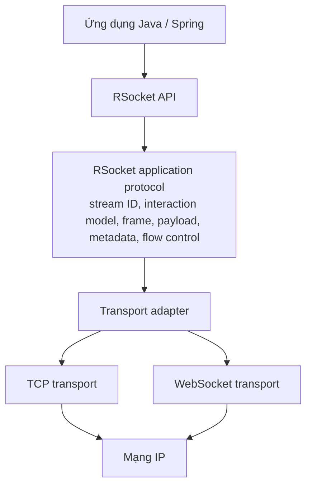
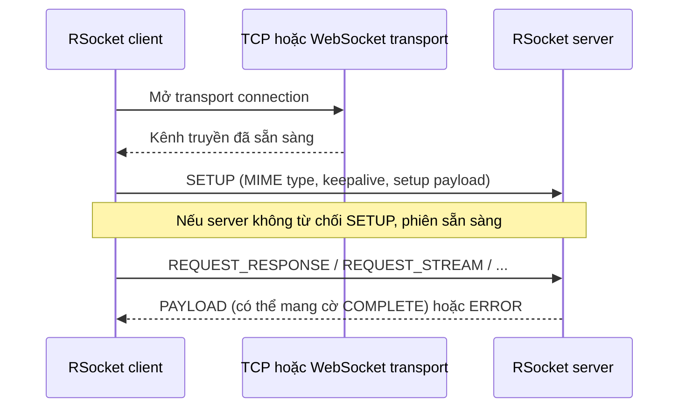
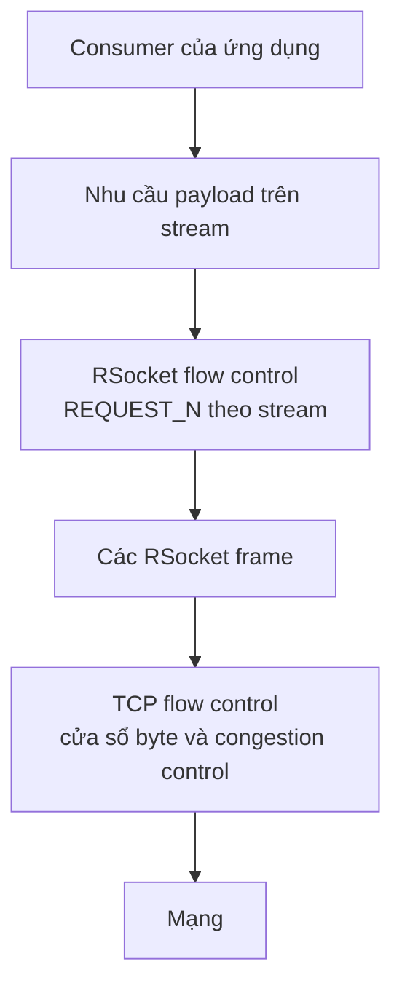

# Ranh giới giữa giao thức ứng dụng và cơ chế truyền tải bên dưới

RSocket là một giao thức ứng dụng cho giao tiếp bất đồng bộ, hai chiều và reactive. Nó định nghĩa cách hai peer mở tương tác, phân biệt các stream, trao đổi payload, điều tiết dữ liệu và báo lỗi. TCP hoặc WebSocket đảm nhiệm việc vận chuyển các frame RSocket qua mạng. Vì vậy, **RSocket protocol và transport là hai lớp có trách nhiệm khác nhau**: ứng dụng chọn kiểu tương tác theo nhu cầu nghiệp vụ, còn transport cung cấp kênh để các frame đi tới peer bên kia.

Hiểu ranh giới này giúp chọn TCP hay WebSocket đúng bối cảnh, cấu hình Spring Boot chính xác, đặt bảo mật ở đúng lớp và xác định lỗi nằm ở kết nối mạng hay ở tương tác RSocket.

## Mục tiêu học tập

Sau bài học, người học có thể:

- Phân biệt trách nhiệm của RSocket application protocol và transport.
- Giải thích TCP và WebSocket đóng gói, chuyển frame RSocket như thế nào.
- Mô tả thứ tự thiết lập transport connection và RSocket session.
- Phân biệt flow control của RSocket với điều tiết ở tầng TCP.
- Xác định vị trí phù hợp cho TLS, xác thực, phân quyền và routing.
- Cấu hình RSocket server/client bằng TCP hoặc WebSocket trong Spring Boot.
- Phân tích tác động của proxy, mất kết nối và chính sách phục hồi tới các stream.

## 1. Hai lớp giải quyết hai bài toán khác nhau

Hãy hình dung ứng dụng giám sát thiết bị cần gửi lệnh, nhận trạng thái và đăng ký dòng số đo realtime. Ứng dụng cần biết một request có thể trả về một kết quả hay nhiều kết quả, request nào thuộc stream nào và khi nào cần nhận thêm dữ liệu. Đó là công việc của RSocket. Ứng dụng cũng cần một kênh để chuyển dữ liệu giữa hai máy; đó là công việc của transport.



| Lớp | Câu hỏi mà lớp giải quyết | Trách nhiệm tiêu biểu |
|---|---|---|
| Ứng dụng | Nghiệp vụ muốn trao đổi dữ liệu gì? | Kiểu dữ liệu, xử lý request, quy tắc nghiệp vụ |
| RSocket application protocol | Hai peer tương tác với nhau theo quy tắc nào? | Request-response, fire-and-forget, stream, channel, stream ID, frame, payload, metadata, flow control và tín hiệu lỗi |
| Transport | Các frame được chuyển giữa hai endpoint bằng cách nào? | Mở kênh, đóng kênh, chuyển byte hoặc message, xử lý đặc tính của TCP/WebSocket |
| Mạng và hệ điều hành | Dữ liệu đi tới máy đích qua hạ tầng nào? | Địa chỉ IP, định tuyến mạng, socket và truyền gói tin |

Ranh giới này cũng giúp phân biệt ba đơn vị thường bị nhầm:

- **Payload** chứa data và metadata mà ứng dụng muốn trao đổi.
- **RSocket frame** là đơn vị của giao thức RSocket, có stream ID, loại frame và phần nội dung tương ứng.
- **TCP segment hoặc WebSocket frame/message** thuộc cơ chế truyền tải bên dưới. Chúng không phải là stream hay payload nghiệp vụ của RSocket.

Một payload có thể được đóng gói trong RSocket frame; frame lại được transport chuyển đi theo cách phù hợp với TCP hoặc WebSocket. Không nên suy ra một request nghiệp vụ tương ứng với một TCP packet. TCP có thể chia nhỏ hoặc gộp dữ liệu khi truyền; ranh giới packet không phải ranh giới message của ứng dụng.

## 2. RSocket application protocol chịu trách nhiệm điều gì?

RSocket định nghĩa cách các peer khởi tạo và điều khiển tương tác. Một peer gửi request frame để mở stream. Stream được nhận diện bằng `stream ID`, nhờ đó nhiều tương tác có thể chạy đồng thời trên cùng connection. Tùy interaction model, peer còn lại trả về một payload, không trả payload phản hồi, phát một chuỗi payload hoặc trao đổi chuỗi payload hai chiều.

Các trách nhiệm chính của RSocket gồm:

| Trách nhiệm | Cơ chế ở RSocket | Ý nghĩa với ứng dụng |
|---|---|---|
| Mô tả tương tác | `REQUEST_RESPONSE`, `REQUEST_FNF`, `REQUEST_STREAM`, `REQUEST_CHANNEL` | Chọn hình dạng trao đổi dữ liệu |
| Phân biệt tương tác | `stream ID` trong frame | Ghép phản hồi và tín hiệu điều khiển đúng stream |
| Mang nội dung | Payload gồm data và metadata | Truyền dữ liệu nghiệp vụ, route hoặc ngữ cảnh |
| Điều tiết chuỗi dữ liệu | `REQUEST_N` và cơ chế flow control | Bên nhận cấp nhu cầu để bên gửi phát payload theo khả năng tiêu thụ |
| Hủy tương tác | `CANCEL` | Dừng công việc của stream khi không còn cần thiết |
| Báo lỗi và hoàn tất | Frame `ERROR` và cờ `COMPLETE` trên frame `PAYLOAD` | Biểu diễn lỗi hoặc việc hoàn tất hướng gửi dữ liệu của stream |
| Quản lý phiên | `SETUP`, `KEEPALIVE` và cơ chế resume khi được hỗ trợ | Thiết lập, giám sát và có thể phục hồi phiên RSocket |

Các khái niệm này vẫn giữ nguyên ý nghĩa dù transport là TCP hay WebSocket. Ví dụ, một `request-stream` vẫn là một request khởi tạo stream và nhận nhiều payload; việc chuyển sang WebSocket không biến nó thành một chuỗi HTTP request riêng lẻ.

### Route và metadata thuộc lớp nào?

Route như `devices.sensor.readings` thường được truyền dưới dạng routing metadata của RSocket. Server dùng metadata đó để chọn handler, chẳng hạn method có `@MessageMapping`. Route này là thông tin định tuyến ở tầng ứng dụng RSocket. Nó không phải địa chỉ IP, TCP port hay đường dẫn mạng của máy chủ.

Trong WebSocket, URL như `ws://host:8080/rsocket` giúp client tìm endpoint và thiết lập WebSocket. Đường dẫn `/rsocket` chọn endpoint WebSocket ở tầng transport/server. Route `devices.sensor.readings` được gửi bên trong tương tác RSocket sau khi transport đã được mở. Hai giá trị có mục đích khác nhau.

## 3. Transport chịu trách nhiệm điều gì?

Transport tạo kênh giao tiếp giữa hai peer và chuyển dữ liệu của giao thức RSocket. Nó quyết định cách kết nối được mở, ranh giới dữ liệu được nhận biết và kênh được đóng. Transport không tự quyết định request nào là request-response hay payload nào thuộc nghiệp vụ thiết bị.

RSocket thường được triển khai trên TCP hoặc WebSocket:

### TCP: byte stream có thứ tự

TCP cung cấp kết nối hai chiều, đáng tin cậy và có thứ tự giữa hai endpoint. Ứng dụng đọc một dòng byte liên tục; TCP không giữ ranh giới message mà chương trình gửi ban đầu tạo ra. Một lần ghi dữ liệu ở phía gửi không đảm bảo tương ứng với một lần đọc ở phía nhận.

Vì vậy, RSocket TCP transport cần cơ chế framing để phía nhận biết điểm bắt đầu và độ dài của từng RSocket frame. Trong transport TCP chuẩn, một tiền tố độ dài 24 bit được đặt trước frame. Tiền tố này thuộc cách đóng gói của TCP transport, không phải stream ID hay payload của ứng dụng.

TCP phù hợp khi:

- Client và server là các dịch vụ hoặc ứng dụng có thể mở kết nối TCP trực tiếp.
- Hạ tầng mạng cho phép mở port TCP dành cho RSocket.
- Muốn giao tiếp trực tiếp qua TCP và không cần HTTP Upgrade để thiết lập kênh.
- Có thể cấu hình firewall, load balancer và TLS cho kết nối TCP tương ứng.

### WebSocket: kênh hai chiều có ranh giới message

WebSocket bắt đầu bằng một HTTP handshake có yêu cầu Upgrade. Khi handshake thành công, kết nối chuyển sang giao thức WebSocket hai chiều. WebSocket có ranh giới message; RSocket WebSocket transport ánh xạ frame RSocket vào message nhị phân WebSocket. Message WebSocket có thể được chia thành nhiều WebSocket frame ở tầng WebSocket, nhưng điều đó không làm thay đổi stream ID hay cấu trúc logic của RSocket frame.

WebSocket phù hợp khi:

- Client chạy trong trình duyệt hoặc môi trường đã hỗ trợ WebSocket.
- Hạ tầng hiện tại cho phép HTTP Upgrade và kết nối WebSocket lâu dài.
- Muốn sử dụng cổng và quy trình triển khai gần với ứng dụng web, ví dụ `wss://` qua cổng HTTPS.
- Proxy hoặc gateway phía trước đã được cấu hình để hỗ trợ WebSocket và thời gian kết nối dài.

WebSocket không biến RSocket thành REST. Sau handshake, ứng dụng trao đổi message nhị phân WebSocket mang frame RSocket. Các interaction model, stream ID và flow control vẫn do RSocket định nghĩa.

### So sánh TCP và WebSocket

| Tiêu chí | RSocket over TCP | RSocket over WebSocket |
|---|---|---|
| Thiết lập transport | Mở kết nối TCP tới host và port | HTTP handshake rồi Upgrade sang WebSocket |
| Đơn vị nền | Dòng byte có thứ tự | Message hai chiều; message có thể gồm nhiều WebSocket frame |
| Nhận biết ranh giới RSocket frame | Transport dùng tiền tố độ dài để phân tách frame trong byte stream | Mỗi RSocket frame được ánh xạ vào message nhị phân WebSocket |
| Môi trường thường gặp | Service-to-service, ứng dụng native | Trình duyệt, ứng dụng web, hạ tầng hỗ trợ WebSocket |
| Định danh endpoint | Host và TCP port | URI `ws://` hoặc `wss://` và path WebSocket |
| Bảo vệ kênh | Có thể dùng TLS trên TCP | Có thể dùng TLS với `wss://` |
| Interaction model RSocket | Giữ nguyên | Giữ nguyên |

Không có lựa chọn nào tự động nhanh hơn trong mọi hệ thống. Hiệu năng còn phụ thuộc mạng, kích thước payload, số stream, proxy, TLS, cấu hình event loop, tải server và cách ứng dụng tiêu thụ dữ liệu. Nên đo trên môi trường triển khai thực tế nếu độ trễ hoặc thông lượng là tiêu chí quyết định.

## 4. Thiết lập transport connection và RSocket session

Transport connection và RSocket session là hai giai đoạn khác nhau. Transport phải sẵn sàng trước khi client gửi frame `SETUP` để khởi tạo phiên RSocket. Frame này mang các thông tin như MIME type, keepalive và setup payload. Nếu server từ chối thiết lập, nó có thể báo lỗi theo giao thức; không có một frame `SETUP_ACK` bắt buộc cho trường hợp chấp nhận thông thường.



Trình tự cụ thể của transport khác nhau:

1. **Với TCP**: client mở socket tới host và port của server. Sau khi TCP connection được thiết lập, RSocket client gửi frame `SETUP` qua kênh đó.
2. **Với WebSocket**: client gửi HTTP handshake tới URI WebSocket. Server chấp nhận Upgrade; sau đó client gửi frame `SETUP` dưới dạng message nhị phân WebSocket.
3. **Ở lớp RSocket**: client gửi `SETUP`; nếu server chấp nhận, hai peer bắt đầu trao đổi các request frame. Mỗi request mở hoặc sử dụng một stream theo interaction model tương ứng.

Do đó, TCP connection thành công hoặc WebSocket handshake thành công chưa chứng minh RSocket session đã được thiết lập. Ngược lại, lỗi `SETUP` không nhất thiết có nghĩa TCP hay WebSocket không kết nối được; transport có thể đã mở nhưng phiên RSocket bị từ chối do cấu hình giao thức hoặc thông tin khởi tạo không phù hợp.

## 5. Backpressure của RSocket và flow control của TCP

Hai lớp đều có cơ chế điều tiết dữ liệu, nhưng chúng bảo vệ những phạm vi khác nhau.

**TCP flow control** điều tiết lượng byte có thể gửi dựa trên khả năng nhận của đầu cuối TCP. Nó vận hành ở mức byte stream và cửa sổ nhận. TCP congestion control cũng điều chỉnh tốc độ gửi dựa trên tình trạng tắc nghẽn mạng.

**RSocket flow control** điều tiết nhu cầu payload trên từng stream. Bên nhận gửi `REQUEST_N` để cho biết muốn nhận thêm bao nhiêu payload. Nhờ đó, một stream có thể được tiêu thụ theo tốc độ phù hợp với ứng dụng, ngay cả khi connection còn mang nhiều stream khác.



Ví dụ, client đang theo dõi số đo của thiết bị bằng `Flux<Reading>`. Client xử lý chậm nên chỉ yêu cầu thêm một lượng nhỏ payload. RSocket flow control giới hạn số payload server được phép phát trên stream đó. TCP tiếp tục quản lý lượng byte có thể đi qua kết nối. Hai cơ chế bổ sung cho nhau; TCP flow control không thay thế backpressure ở mức stream của RSocket.

Với WebSocket, dữ liệu vẫn thường chạy trên TCP ở bên dưới. Vì thế, flow control của TCP vẫn tồn tại, đồng thời RSocket tiếp tục điều tiết payload theo stream. Khi xây dựng ứng dụng reactive, cần giữ publisher có khả năng backpressure và tránh nạp toàn bộ dữ liệu vào bộ nhớ trước khi phát.

## 6. Bảo mật ở đúng ranh giới

Bảo mật có thể xuất hiện ở nhiều lớp. Cần xác định mỗi cơ chế bảo vệ điều gì và nó được áp dụng ở đoạn kết nối nào.

### TLS bảo vệ transport channel

TLS mã hóa dữ liệu trên một kênh truyền và xác thực danh tính endpoint theo cấu hình chứng thư. Với RSocket over TCP, có thể thiết lập TLS trên TCP. Với WebSocket, `wss://` sử dụng TLS để bảo vệ kết nối WebSocket. TLS giúp bảo vệ frame RSocket khi chúng đi qua đoạn kênh được mã hóa, nhưng không tự quyết định người dùng được phép gọi route nghiệp vụ nào.

Nếu TLS kết thúc tại reverse proxy hoặc load balancer, đoạn kết nối từ proxy tới backend cần được xem xét riêng. Mã hóa từ client tới proxy không tự động mã hóa đoạn proxy tới server. Hãy xác định rõ nơi kết thúc TLS, cách xác thực backend và chính sách tin cậy giữa các hop.

### Xác thực và phân quyền ở lớp ứng dụng

RSocket có thể mang thông tin xác thực trong setup payload hoặc metadata của request, tùy cơ chế bảo mật được triển khai. Server xác thực danh tính và kiểm tra quyền truy cập theo người dùng, service, route và dữ liệu. Với WebSocket, hệ thống cũng có thể xác thực ở HTTP handshake; đây là điểm kiểm tra bổ sung ở giai đoạn mở transport, khác với metadata xác thực trong tương tác RSocket.

| Cơ chế | Bảo vệ hoặc quyết định điều gì? | Ví dụ |
|---|---|---|
| TLS | Bảo mật kênh truyền và danh tính endpoint theo chứng thư | `wss://`, TLS trên TCP, mTLS |
| Xác thực ở handshake WebSocket | Ai được phép mở endpoint WebSocket | Cookie phiên, token trong cơ chế handshake phù hợp |
| Xác thực RSocket | Danh tính gắn với phiên hoặc request RSocket | Setup payload hoặc authentication metadata |
| Phân quyền nghiệp vụ | Danh tính được phép thực hiện hành động nào | Chỉ thiết bị thuộc tenant hiện tại mới được đọc số đo |

Không nên coi route là bí mật hoặc dùng route thay cho xác thực. Cũng không nên đặt token nhạy cảm trong query string URL vì URL có thể xuất hiện trong log, lịch sử trình duyệt hoặc hệ thống quan sát. Hãy dùng cơ chế xác thực được hỗ trợ bởi client, server và hạ tầng của ứng dụng.

## 7. Proxy, gateway và định tuyến mạng

Transport ảnh hưởng trực tiếp đến cách hạ tầng trung gian nhìn thấy kết nối:

- **TCP proxy hoặc load balancer lớp 4** có thể chuyển tiếp TCP connection tới backend. Nếu proxy chỉ hoạt động ở lớp transport, nó thường không hiểu route hay stream ID bên trong RSocket.
- **HTTP reverse proxy hoặc gateway** có thể tiếp nhận WebSocket handshake và chuyển tiếp kết nối sau Upgrade. Cần bật WebSocket, cho phép kết nối lâu dài và cấu hình timeout phù hợp với phiên realtime.
- **RSocket-aware gateway** có thể hiểu giao thức và áp dụng chính sách ở cấp stream hoặc route, nhưng cần hỗ trợ đúng phiên bản và tính năng giao thức được dùng.

Vì một connection có thể mang nhiều stream, không nên giả định mỗi request RSocket tạo một HTTP request độc lập mà reverse proxy có thể phân phối lại. Khi connection đã được mở, các stream trên connection đó thường tiếp tục đi qua cùng đường kết nối tới backend tương ứng.

Khi thiết kế triển khai, hãy xác định:

1. Proxy có hỗ trợ TCP passthrough hoặc WebSocket Upgrade đúng transport không?
2. Timeout idle và giới hạn thời gian kết nối có phù hợp với stream dài không?
3. TLS kết thúc ở đâu và đoạn proxy tới backend có cần mã hóa tiếp không?
4. Health check kiểm tra transport, RSocket session hay trạng thái nghiệp vụ?
5. Khi backend bị thay thế, client cần reconnect hay hệ thống có cơ chế resume được cấu hình đầy đủ?

## 8. Cấu hình TCP và WebSocket trong Spring Boot

Spring Boot cho phép chọn transport ở cấu hình server. Ví dụ sau minh họa hai cách triển khai riêng; trong một cấu hình server cụ thể, chọn transport phù hợp với hạ tầng đang dùng.

### Server sử dụng TCP

```yaml
spring:
  rsocket:
    server:
      transport: tcp
      port: 7000
```

Server lắng nghe TCP port `7000`. Client kết nối bằng host và port.

### Server sử dụng WebSocket

```yaml
spring:
  rsocket:
    server:
      transport: websocket
      mapping-path: /rsocket
      port: 8080
```

Server công bố endpoint WebSocket tại path `/rsocket` trên cổng `8080` (địa chỉ thực tế còn phụ thuộc cấu hình web server và môi trường triển khai). Client sử dụng URI `ws://host:8080/rsocket` hoặc `wss://...` khi có TLS.

### Client: chỉ thay cách mở transport

Với `RSocketRequester`, phần gọi route và xử lý payload có thể giữ nguyên. Thay đổi chính là cách tạo requester:

```java
// Kết nối qua TCP
RSocketRequester tcpRequester = RSocketRequester.builder()
        .tcp("localhost", 7000);

// Kết nối qua WebSocket
RSocketRequester websocketRequester = RSocketRequester.builder()
        .websocket(URI.create("ws://localhost:8080/rsocket"));
```

Sau khi có requester, cùng một request có thể được viết theo cùng interaction model:

```java
Mono<DeviceStatus> status = requester
        .route("devices.status")
        .data(new StatusQuery("sensor-17"))
        .retrieveMono(DeviceStatus.class);
```

Biến `requester` trong ví dụ cuối có thể là requester được tạo bằng TCP hoặc WebSocket. Route, kiểu payload và ý nghĩa request-response không phụ thuộc vào transport.

### Handler phía server không cần biết transport

```java
@Controller
public class DeviceController {

    private final DeviceService deviceService;

    public DeviceController(DeviceService deviceService) {
        this.deviceService = deviceService;
    }

    @MessageMapping("devices.status")
    public Mono<DeviceStatus> status(@Payload StatusQuery query) {
        return deviceService.findStatus(query.deviceId());
    }
}
```

Handler xử lý route và payload của RSocket. Nó không cần tự đọc TCP packet hoặc WebSocket frame. Transport adapter cùng runtime RSocket đảm nhiệm việc chuyển đổi dữ liệu giữa giao thức và kênh truyền.

Các ví dụ trên giả định ứng dụng đã có dependency, codec và cấu hình bảo mật cần thiết. Khi triển khai thực tế, hãy kiểm tra phiên bản Spring Boot/Spring Framework đang dùng vì API builder và các tùy chọn cấu hình có thể khác giữa các phiên bản.

## 9. Lỗi xảy ra ở lớp nào?

Phân biệt transport với RSocket protocol giúp khoanh vùng lỗi nhanh hơn:

| Triệu chứng | Lớp cần kiểm tra trước | Ví dụ nguyên nhân |
|---|---|---|
| Không mở được socket | Mạng và TCP transport | Sai host/port, firewall, backend không lắng nghe |
| WebSocket handshake trả lỗi | HTTP/WebSocket transport | Sai path, thiếu Upgrade header, proxy chưa bật WebSocket, xác thực handshake thất bại |
| Transport đã mở nhưng RSocket setup thất bại | RSocket session/protocol | MIME type hoặc thông tin setup không tương thích, server từ chối phiên |
| Kết nối và setup thành công nhưng không tìm thấy handler | Routing ở lớp RSocket/ứng dụng | Route metadata không khớp `@MessageMapping` |
| Một stream báo lỗi trong khi stream khác vẫn chạy | Stream và ứng dụng | Lỗi nghiệp vụ, lỗi giải mã payload hoặc lỗi handler của stream đó |
| Tất cả stream trên cùng connection cùng bị gián đoạn | Transport connection hoặc phiên RSocket | TCP bị reset, WebSocket đóng, proxy timeout hoặc server đóng connection |
| Stream dài bị chậm hoặc dừng phát dữ liệu | RSocket flow control và ứng dụng | Không cấp thêm nhu cầu, consumer chậm, publisher bị lỗi hoặc bị hủy |

### Reconnect không đồng nghĩa với resume

Khi TCP connection hoặc WebSocket bị đóng, các stream đang chạy trên connection đó bị ảnh hưởng. Ứng dụng có thể mở một transport connection mới và thiết lập RSocket session mới; đó là reconnect. Những stream cũ không tự động chuyển sang connection mới.

RSocket có cơ chế resume cho các triển khai hỗ trợ và đã cấu hình phù hợp. Cơ chế này cần trạng thái phiên và khả năng lưu/đối chiếu dữ liệu giao thức ở hai phía; không thể giả định rằng chỉ bật TCP hay WebSocket là có resume. Nếu ứng dụng retry một request sau reconnect, hãy xem xét idempotency, mã định danh thao tác và khả năng server đã thực hiện request trước khi connection mất.

## 10. Kiểm thử ranh giới giữa protocol và transport

Để xác minh ứng dụng không phụ thuộc nhầm vào một transport cụ thể, có thể tổ chức kiểm thử theo các lớp:

1. **Kiểm thử handler**: gọi handler hoặc service với payload nghiệp vụ và xác minh kết quả `Mono`/`Flux`.
2. **Kiểm thử RSocket protocol**: xác minh route, interaction model, metadata, lỗi stream, cancellation và backpressure.
3. **Kiểm thử transport TCP**: mở client tới port TCP, xác minh setup, request và việc đóng connection.
4. **Kiểm thử transport WebSocket**: thực hiện HTTP Upgrade tới đúng path, sau đó xác minh cùng request RSocket hoạt động qua message nhị phân.
5. **Kiểm thử bảo mật và hạ tầng**: kiểm tra chứng thư TLS, xác thực, proxy timeout, kết nối lâu dài và hành vi khi mạng bị ngắt.

Một bộ kiểm thử tích hợp có thể chạy cùng một kịch bản nghiệp vụ qua cả TCP và WebSocket. Nếu kết quả hoặc semantics của request khác nhau, cần kiểm tra cấu hình transport adapter, codec, metadata và phiên bản thư viện. Việc so sánh cũng nên ghi nhận độ trễ, thông lượng, mức sử dụng bộ nhớ và số lượng kết nối trong điều kiện tải tương đương.

## 11. Quy trình chọn transport

Khi bắt đầu một tích hợp RSocket, hãy lần lượt trả lời các câu hỏi sau:

| Câu hỏi | Gợi ý lựa chọn |
|---|---|
| Client có chạy trong trình duyệt không? | WebSocket thường là lựa chọn phù hợp hơn vì trình duyệt hỗ trợ WebSocket trực tiếp |
| Các service có thể mở TCP connection trực tiếp không? | Cân nhắc TCP để giao tiếp service-to-service |
| Hạ tầng chỉ cho phép HTTP/HTTPS và đã hỗ trợ Upgrade? | Cân nhắc WebSocket, xác minh proxy và timeout |
| Cần xác thực ở lúc mở kênh hay theo từng request? | Chọn cơ chế handshake, RSocket authentication metadata hoặc kết hợp theo chính sách bảo mật |
| Có stream chạy lâu? | Kiểm tra timeout, keepalive, khả năng reconnect/resume và giám sát connection |
| Có yêu cầu độ trễ hoặc thông lượng nghiêm ngặt? | Benchmark trên hạ tầng thực tế với payload và số stream đại diện |

Hãy giữ phần xử lý nghiệp vụ độc lập với transport khi có thể. Cách tổ chức này cho phép thay đổi TCP sang WebSocket (hoặc ngược lại) bằng cấu hình và điểm tạo requester/server, trong khi route, payload và interaction model vẫn nhất quán.

## Kết luận

RSocket application protocol định nghĩa ý nghĩa của tương tác: stream, stream ID, frame, payload, metadata, flow control và tín hiệu vòng đời. TCP hoặc WebSocket định nghĩa cách mở kênh và vận chuyển các frame đó. TCP cung cấp byte stream cần framing độ dài; WebSocket cung cấp message hai chiều sau HTTP Upgrade. TLS bảo vệ kênh truyền, còn xác thực và phân quyền RSocket/ứng dụng quyết định ai được phép thực hiện tương tác nào. Khi giữ rõ ranh giới này, việc chọn transport, cấu hình Spring Boot, triển khai proxy và xử lý sự cố sẽ có cơ sở hơn.
