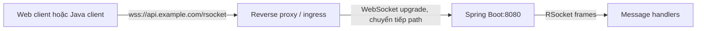

# Cấu hình địa chỉ, cổng và đường dẫn WebSocket

Để hai ứng dụng giao tiếp bằng RSocket, chúng phải thống nhất cách tiếp cận endpoint ở tầng truyền tải. Với TCP, endpoint thường được xác định bằng địa chỉ máy chủ và cổng. Với WebSocket, client còn phải gửi HTTP handshake tới đúng đường dẫn được máy chủ ánh xạ. Cấu hình sai một trong các thành phần này có thể khiến client không kết nối được, dù mã xử lý RSocket và route nghiệp vụ vẫn đúng.

RSocket hỗ trợ giao tiếp bất đồng bộ, hai chiều và reactive trên TCP hoặc WebSocket. Việc chọn transport quyết định cách tạo kết nối và địa chỉ client sử dụng; nó không thay đổi ý nghĩa của các kiểu tương tác như request-response, fire-and-forget, request-stream hay request-channel.

## 1. Phân biệt địa chỉ, cổng và đường dẫn

Một endpoint WebSocket thường có dạng:

```text
ws://host:port/path
wss://host:port/path
```

Trong đó:

| Thành phần | Ý nghĩa | Ví dụ |
|---|---|---|
| Scheme | Chọn WebSocket thường hay WebSocket có TLS | `ws`, `wss` |
| Host | Tên máy, địa chỉ IP hoặc DNS mà client có thể truy cập | `localhost`, `rsocket.example.com` |
| Port | Cổng của dịch vụ nhận kết nối | `8080`, `443` |
| Path | Đường dẫn HTTP được dùng trong WebSocket handshake | `/rsocket` |

Với TCP, địa chỉ client thường chỉ gồm host và port, ví dụ `localhost:7000`. TCP không có HTTP request path. Vì vậy, không thể thêm `/rsocket` vào địa chỉ TCP như thể đó là một URL HTTP.

Ba thành phần cần được cấu hình đúng ở hai phía:

- **Địa chỉ bind của server** cho biết tiến trình lắng nghe trên giao diện mạng nào.
- **Địa chỉ đích của client** cho biết client sẽ kết nối tới máy chủ nào.
- **Cổng và mapping path** cho biết kết nối được tiếp nhận ở đâu; mapping path chỉ áp dụng cho WebSocket.

## 2. Địa chỉ bind của server và host phía client

Địa chỉ bind là địa chỉ cục bộ mà server dùng để lắng nghe. Nó không nhất thiết là địa chỉ mà client nhập vào.

| Giá trị bind | Ý nghĩa | Trường hợp sử dụng |
|---|---|---|
| `127.0.0.1` hoặc `localhost` | Chỉ nhận kết nối từ loopback của chính máy đó | Phát triển và kiểm thử trên cùng máy |
| `0.0.0.0` | Lắng nghe trên tất cả giao diện IPv4 khả dụng | Container hoặc máy chủ cần nhận kết nối từ mạng |
| Một địa chỉ IP cụ thể | Chỉ lắng nghe trên giao diện có địa chỉ đó | Máy có nhiều card mạng và cần giới hạn giao diện |

Ví dụ, nếu server trong container bind vào `127.0.0.1`, một container khác thường không thể truy cập nó qua địa chỉ mạng của container. Trong môi trường triển khai, server thường bind vào `0.0.0.0`, còn client kết nối bằng DNS hoặc địa chỉ mà hạ tầng cung cấp.

Không dùng `0.0.0.0` làm host đích của client. Đây là địa chỉ bind mang ý nghĩa “mọi giao diện”, không phải tên máy chủ để định tuyến kết nối. Client cần dùng hostname, DNS hoặc IP có thể định tuyến tới server, chẳng hạn `rsocket-service` trong cùng mạng container hoặc `rsocket.example.com` từ bên ngoài.

`localhost` luôn trỏ về chính môi trường đang chạy client. Nếu client chạy trong container, `localhost` là container client; nếu chạy trên điện thoại hoặc máy khác, nó là thiết bị đó. Đây là nguyên nhân phổ biến khiến cấu hình chạy được trên máy phát triển nhưng thất bại sau khi triển khai.

## 3. Cấu hình TCP: địa chỉ và cổng

Với RSocket server chạy độc lập qua TCP trong Spring Boot, cấu hình transport, địa chỉ bind và cổng như sau:

```yaml
spring:
  rsocket:
    server:
      transport: tcp
      address: 0.0.0.0
      port: 7000
```

Trong cấu hình này:

- `transport: tcp` chọn TCP làm transport của RSocket server.
- `address: 0.0.0.0` cho phép server lắng nghe trên các giao diện IPv4.
- `port: 7000` là cổng TCP mà RSocket server nhận kết nối.

Client Java có thể kết nối bằng `RSocketRequester`:

```java
Mono<RSocketRequester> requesterMono = RSocketRequester.builder()
    .tcp("localhost", 7000);
```

Địa chỉ `localhost` trong ví dụ chỉ phù hợp khi client chạy trên cùng máy với server. Khi chạy ở máy khác, hãy thay bằng hostname hoặc IP có thể truy cập được, ví dụ `rsocket.example.com`.

TCP phù hợp với các ứng dụng Java có quyền sử dụng socket trực tiếp, chẳng hạn dịch vụ backend giao tiếp nội bộ. Trình duyệt web thông thường không cung cấp API TCP tùy ý cho ứng dụng JavaScript, vì vậy ứng dụng chạy trong trình duyệt thường sử dụng WebSocket.

## 4. Cấu hình WebSocket: cổng HTTP và mapping path

RSocket qua WebSocket được đưa qua HTTP server. Client bắt đầu bằng một HTTP WebSocket handshake tới host, port và path; sau khi handshake thành công, các frame RSocket được truyền trong WebSocket. Vì vậy, cổng thường là cổng của embedded web server trong Spring Boot, còn `mapping-path` là đường dẫn mà server dành cho RSocket WebSocket endpoint.

Ví dụ cấu hình Spring Boot:

```yaml
server:
  address: 0.0.0.0
  port: 8080

spring:
  rsocket:
    server:
      transport: websocket
      mapping-path: /rsocket
```

Ở đây:

- `server.address` và `server.port` cấu hình embedded web server nhận HTTP/WebSocket.
- `spring.rsocket.server.transport: websocket` chọn WebSocket làm transport cho RSocket.
- `spring.rsocket.server.mapping-path: /rsocket` đăng ký endpoint tại đường dẫn `/rsocket`.

Client kết nối tới URL khớp với cấu hình server:

```java
URI endpoint = URI.create("ws://localhost:8080/rsocket");

Mono<RSocketRequester> requesterMono = RSocketRequester.builder()
    .websocket(endpoint);
```

Trong môi trường có TLS, client sử dụng URL `wss://`, ví dụ `wss://rsocket.example.com/rsocket`. TLS có thể được xử lý trực tiếp bởi web server hoặc kết thúc tại reverse proxy/load balancer; cấu hình chứng chỉ và định tuyến phải nhất quán với kiến trúc triển khai.

### Mapping path không phải RSocket route

Đây là hai khái niệm ở hai tầng khác nhau:

| Thành phần | Tầng hoạt động | Ví dụ | Mục đích |
|---|---|---|---|
| WebSocket mapping path | HTTP/WebSocket handshake | `/rsocket` | Chọn endpoint WebSocket mang kết nối RSocket |
| RSocket route | Metadata của yêu cầu RSocket | `orders.find` | Chọn handler xử lý một tương tác sau khi kết nối đã thiết lập |

Ví dụ client có thể kết nối tới `/rsocket`, rồi gửi yêu cầu tới route `orders.find`:

```java
requester.route("orders.find")
    .data(new FindOrderRequest("ORD-1001"))
    .retrieveMono(OrderView.class);
```

Server ánh xạ route này tới handler, chẳng hạn:

```java
@Controller
public class OrderController {

    @MessageMapping("orders.find")
    public Mono<OrderView> find(FindOrderRequest request) {
        return orderService.find(request.orderId());
    }
}
```

Thay đổi mapping path yêu cầu client thay URL WebSocket. Thay đổi route yêu cầu client và handler thống nhất metadata route. Hai cấu hình này không thay thế cho nhau.

## 5. TCP và WebSocket: chọn đúng endpoint

| Tiêu chí | RSocket qua TCP | RSocket qua WebSocket |
|---|---|---|
| Địa chỉ client | Host và port | URL gồm scheme, host, port và path |
| Ví dụ | `rsocket.example.com:7000` | `wss://rsocket.example.com/rsocket` |
| HTTP handshake | Không | Có |
| Mapping path | Không | Có |
| Ứng dụng trình duyệt | Không kết nối TCP tùy ý trực tiếp | Phù hợp với WebSocket API |
| Cấu hình Spring Boot server | `spring.rsocket.server.port` và `address` | `server.port`, `server.address` và `spring.rsocket.server.mapping-path` |

Chọn TCP khi hai dịch vụ backend có thể mở socket trực tiếp và muốn dùng transport TCP. Chọn WebSocket khi cần tích hợp trình duyệt, đi qua hạ tầng HTTP hoặc cần định tuyến endpoint theo path tại reverse proxy. Cả hai transport vẫn sử dụng các mô hình tương tác RSocket giống nhau.

## 6. Định tuyến qua reverse proxy, ingress hoặc load balancer

Trong triển khai thực tế, client có thể không kết nối trực tiếp tới tiến trình Spring Boot. Một reverse proxy hoặc ingress nhận kết nối công khai rồi chuyển tiếp tới dịch vụ nội bộ.

Ví dụ luồng kết nối:



Khi cấu hình proxy, cần kiểm tra các điểm sau:

1. Proxy phải hỗ trợ WebSocket upgrade và chuyển tiếp kết nối đã nâng cấp trong suốt thời gian stream còn hoạt động.
2. Path công khai phải được chuyển tiếp đúng tới `mapping-path` của ứng dụng. Nếu proxy bỏ tiền tố hoặc viết lại path, cần bảo đảm đường dẫn cuối cùng khớp cấu hình Spring Boot.
3. Proxy phải chuyển tiếp tới đúng host và port nội bộ. Cổng công khai `443` có thể được ánh xạ tới cổng web server nội bộ `8080`.
4. Timeout của proxy phải đủ dài cho kết nối realtime; nếu proxy đóng kết nối nhàn rỗi quá sớm, cần điều chỉnh timeout và cấu hình keepalive phù hợp.
5. Nếu dùng `wss`, chứng chỉ TLS phải hợp lệ với hostname client truy cập. Khi TLS kết thúc ở proxy, proxy chuyển tiếp WebSocket tới backend theo chính sách bảo mật của hệ thống.

Ví dụ, client truy cập `wss://api.example.com/realtime/rsocket`, còn ứng dụng đăng ký mapping path `/rsocket`. Proxy phải loại bỏ tiền tố `/realtime` trước khi chuyển request tới backend, hoặc ứng dụng phải được cấu hình path tương ứng. Nếu hai phía không thống nhất, handshake thường trả về HTTP 404.

Trong Docker hoặc Kubernetes, cần phân biệt cổng của tiến trình, cổng container, cổng Service và cổng công khai của ingress. Client phải dùng địa chỉ DNS và cổng của lớp mạng mà nó có thể truy cập; không nên sao chép `localhost` hoặc cổng nội bộ của container vào cấu hình client bên ngoài cụm.

## 7. Quản lý cấu hình theo môi trường

Không nên gắn cứng địa chỉ máy chủ phát triển vào mã nguồn. Có thể đưa host, port và URL WebSocket vào cấu hình theo môi trường hoặc biến môi trường.

Ví dụ với cấu hình client:

```yaml
app:
  rsocket:
    transport: websocket
    endpoint: ${RSOCKET_ENDPOINT:ws://localhost:8080/rsocket}
```

Java đọc URL đã cấu hình và tạo requester:

```java
@Value("${app.rsocket.endpoint}")
private URI rsocketEndpoint;

public Mono<RSocketRequester> connect() {
    return RSocketRequester.builder().websocket(rsocketEndpoint);
}
```

Với TCP, nên cấu hình host và port riêng để tránh nhầm URL WebSocket với địa chỉ socket:

```yaml
app:
  rsocket:
    host: ${RSOCKET_HOST:localhost}
    port: ${RSOCKET_PORT:7000}
```

Giá trị mặc định chỉ nên phục vụ môi trường phát triển. Môi trường kiểm thử và production cần dùng DNS, cổng, scheme và path do hạ tầng cung cấp. Không ghi thông tin xác thực hoặc bí mật TLS trực tiếp vào file cấu hình được commit.

## 8. Kiểm tra kết nối và chẩn đoán lỗi

Khi kết nối thất bại, hãy kiểm tra theo đúng thứ tự các tầng:

| Dấu hiệu | Nguyên nhân thường gặp | Cách kiểm tra |
|---|---|---|
| Connection refused | Không có tiến trình lắng nghe ở host/port, bind sai địa chỉ hoặc port mapping thiếu | Kiểm tra log server, bind address, port và firewall |
| Timeout | DNS sai, route mạng, firewall hoặc proxy không chuyển tiếp | Kiểm tra phân giải DNS, đường mạng và rule ingress |
| HTTP 404 khi dùng WebSocket | Path không khớp `mapping-path` hoặc proxy rewrite sai | Đối chiếu URL client, mapping path và cấu hình proxy |
| HTTP 400/426 khi handshake | Proxy hoặc server không xử lý đúng WebSocket upgrade | Kiểm tra hỗ trợ WebSocket và các header upgrade được chuyển tiếp |
| HTTP 403 | Chính sách xác thực, phân quyền hoặc kiểm tra Origin từ chối | Kiểm tra security filter, token và allowed origins |
| Lỗi chứng chỉ khi dùng `wss` | Hostname không khớp chứng chỉ, chứng chỉ hết hạn hoặc trust chain không hợp lệ | Kiểm tra hostname, thời hạn và chuỗi chứng chỉ |
| Handshake thành công nhưng RSocket không hoạt động | Hai phía không thống nhất giao thức, setup metadata hoặc xử lý frame | Kiểm tra log RSocket SETUP, MIME type và cấu hình client/server |

Với WebSocket, HTTP status `101 Switching Protocols` cho biết handshake đã nâng cấp thành công. Tuy nhiên, điều đó chưa chứng minh tương tác RSocket đã hoạt động: client và server vẫn cần hoàn tất khởi tạo RSocket và trao đổi frame hợp lệ. Công cụ kiểm tra WebSocket có thể xác nhận handshake, nhưng để kiểm thử đầy đủ cần một RSocket client gửi frame theo giao thức.

Với TCP, có thể kiểm tra tiến trình đang lắng nghe đúng địa chỉ và cổng, sau đó thử kết nối từ chính môi trường mà client chạy. Kiểm tra cổng từ máy host không đủ nếu ứng dụng thực tế nằm trong container hoặc mạng riêng.

## 9. Checklist trước khi triển khai

- [ ] Server chọn đúng transport (`tcp` hoặc `websocket`).
- [ ] Địa chỉ bind cho phép nhận kết nối từ mạng dự kiến.
- [ ] Client sử dụng hostname hoặc IP có thể truy cập từ môi trường chạy của nó.
- [ ] Client và server thống nhất cổng thực tế sau khi tính cả port mapping, Service và ingress.
- [ ] Với WebSocket, client dùng đúng `ws`/`wss` và path khớp `mapping-path` sau mọi bước rewrite.
- [ ] RSocket route được cấu hình riêng và khớp metadata mà client gửi.
- [ ] Proxy hỗ trợ WebSocket upgrade, timeout phù hợp và TLS có chứng chỉ hợp lệ khi dùng `wss`.
- [ ] Đã kiểm tra kết nối từ đúng môi trường triển khai, không chỉ từ máy phát triển.

Khi tách rõ địa chỉ bind, địa chỉ đích, cổng và mapping path, việc cấu hình RSocket trở nên dễ kiểm soát hơn. TCP chỉ cần host và port; WebSocket cần thêm scheme và path. Sau khi transport kết nối thành công, RSocket mới xử lý SETUP, metadata và các tương tác reactive trên kết nối đó.
