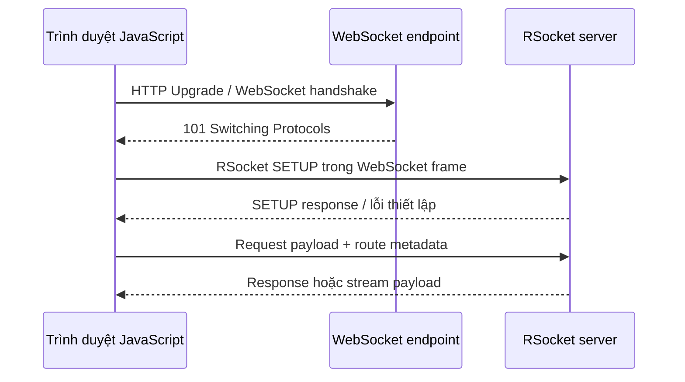

# Trình duyệt kết nối RSocket qua WebSocket

Ứng dụng Java chạy trên máy chủ có thể sử dụng RSocket qua TCP hoặc WebSocket. Trình duyệt không cung cấp API TCP socket tùy ý cho JavaScript phía trang web, nhưng có WebSocket API tiêu chuẩn. Vì vậy, khi giao diện web cần giao tiếp realtime với dịch vụ RSocket, ta thường đặt WebSocket làm lớp truyền tải và giữ nguyên giao thức RSocket ở bên trong.

Trong module `INTEGRATION_REALTIME_RSOCKET`, bài học này tập trung vào đường kết nối từ trình duyệt đến RSocket server qua WebSocket: cấu hình endpoint, khởi tạo client JavaScript, hiểu hai bước bắt tay, gửi metadata định tuyến, bảo vệ kết nối và xử lý mất kết nối. WebSocket chỉ giải quyết đường truyền; các mô hình Request-Response, Fire-and-Forget, Request-Stream và Request-Channel vẫn do RSocket đảm nhiệm.

## 1. Kiến trúc kết nối từ trình duyệt

WebSocket tạo một kết nối hai chiều trên nền HTTP(S). Sau khi bắt tay HTTP thành công, kết nối được nâng cấp và hai bên trao đổi các WebSocket frame. Khi dùng RSocket over WebSocket, các frame nhị phân của RSocket được truyền bên trong WebSocket frame. Dữ liệu không phải là một giao thức JSON-over-WebSocket tự thiết kế.



Có hai giai đoạn cần phân biệt:

1. **WebSocket handshake:** trình duyệt mở URL `ws://` hoặc `wss://`; máy chủ chấp nhận nâng cấp kết nối HTTP thành WebSocket. Mã HTTP `101 Switching Protocols` xác nhận giai đoạn này.
2. **RSocket setup:** sau khi có WebSocket, client gửi frame `SETUP` chứa các thông tin như thời gian keep-alive, lifetime và MIME type cho data/metadata. RSocket server xử lý setup rồi mới có thể nhận các tương tác RSocket.

Vì vậy, thấy WebSocket có trạng thái `101` trong DevTools chưa đủ để kết luận RSocket đã sẵn sàng. Nếu frame SETUP không hợp lệ hoặc hai bên không thống nhất cấu hình, kết nối RSocket vẫn có thể thất bại sau khi WebSocket đã được mở.

## 2. Cấu hình RSocket server dùng WebSocket

Với ứng dụng Spring Boot, có thể cấu hình RSocket server sử dụng WebSocket transport và ánh xạ endpoint vào một đường dẫn HTTP. Ví dụ dưới đây dùng cổng web `8080` và đường dẫn `/rsocket`:

```yaml
server:
  port: 8080

spring:
  rsocket:
    server:
      transport: websocket
      mapping-path: /rsocket
```

Ứng dụng cần có phần phụ thuộc RSocket và máy chủ web hỗ trợ WebSocket, chẳng hạn `spring-boot-starter-rsocket` cùng `spring-boot-starter-webflux` trong cấu hình Spring Boot phù hợp. Hãy dùng các phiên bản thuộc cùng dòng tương thích của Spring Boot và Spring Framework.

Một handler RSocket có thể tiếp tục dùng `@MessageMapping` như khi triển khai với transport khác:

```java
@Controller
public class OrderRSocketController {

    private final OrderService orderService;

    public OrderRSocketController(OrderService orderService) {
        this.orderService = orderService;
    }

    @MessageMapping("orders.find")
    public Mono<OrderView> find(OrderQuery query) {
        return orderService.find(query.id());
    }
}
```

`mapping-path` xác định URL WebSocket, còn `@MessageMapping("orders.find")` xác định route bên trong giao thức RSocket. Đây là hai lớp định tuyến khác nhau: `/rsocket` đưa trình duyệt đến đúng endpoint; `orders.find` chọn handler nghiệp vụ sau khi RSocket setup hoàn tất.

Khi triển khai sau reverse proxy, cần chuyển tiếp đúng đường dẫn WebSocket đến ứng dụng và cho phép HTTP Upgrade. Cổng HTTP của ứng dụng và cổng public có thể khác nhau nếu proxy thực hiện TLS termination hoặc ánh xạ cổng. Hãy kiểm tra cấu hình thực tế để URL mà trình duyệt gọi khớp với endpoint public.

## 3. Tạo RSocket client trong trình duyệt

Trong JavaScript, có thể dùng các package RSocket JS. Cài đặt các package client tương ứng trong ứng dụng frontend:

```bash
npm install rsocket-core rsocket-websocket-client
```

Ví dụ dưới đây khởi tạo một client, cấu hình serializer và mở kết nối WebSocket đến endpoint RSocket:

```javascript
import {
  RSocketClient,
  JsonSerializer,
  IdentitySerializer,
} from "rsocket-core";
import { WebsocketClientTransport } from "rsocket-websocket-client";

const client = new RSocketClient({
  serializers: {
    data: JsonSerializer,
    metadata: IdentitySerializer,
  },
  setup: {
    keepAlive: 30_000,
    lifetime: 90_000,
    dataMimeType: "application/json",
    metadataMimeType: "message/x.rsocket.composite-metadata.v0",
  },
  transport: new WebsocketClientTransport({
    url: "wss://api.example.com/rsocket",
  }),
});

let socket;

client.connect().subscribe({
  onComplete: (connectedSocket) => {
    socket = connectedSocket;
    console.info("RSocket setup completed");
  },
  onError: (error) => {
    console.error("Cannot establish RSocket connection", error);
  },
});

function closeRSocket() {
  socket?.close();
  socket = undefined;
}
```

Các giá trị trong ví dụ có ý nghĩa như sau:

- `WebsocketClientTransport` tạo transport dựa trên WebSocket API của trình duyệt và kết nối đến URL endpoint.
- `keepAlive` là khoảng thời gian client dự kiến gửi keep-alive; `lifetime` là khoảng thời gian tối đa mà client chấp nhận không nhận keep-alive trước khi xem kết nối là hết hạn. Đơn vị của các giá trị này là mili giây.
- `dataMimeType` khai báo cách diễn giải payload nghiệp vụ. Ví dụ dùng JSON để hai phía có thể tuần tự hóa object.
- `metadataMimeType` khai báo định dạng metadata. Ví dụ chọn composite metadata để có thể mang routing metadata cùng các metadata khác.
- `JsonSerializer` và `IdentitySerializer` phải tương thích với serializer và MIME type mà server sử dụng. Nếu server dùng định dạng khác, hai bên cần thống nhất lại.

`onComplete` ở đây có nghĩa client đã hoàn tất kết nối RSocket và có thể sử dụng socket cho các interaction. Sau bước này, client có thể gọi các API như `requestResponse`, `fireAndForget`, `requestStream` hoặc `requestChannel`. Khi gọi handler Spring qua route, payload cần chứa routing metadata theo định dạng mà server hiểu; chỉ đặt URL `/rsocket` là chưa đủ để chọn `@MessageMapping`.

Ví dụ trên minh họa phần mở kết nối. Trong ứng dụng thực tế, hãy quản lý socket theo vòng đời của ứng dụng hoặc dịch vụ frontend, tránh tạo một kết nối mới cho mỗi lần component render. Khi component hoặc phiên đăng nhập kết thúc, hủy subscription đang hoạt động và đóng socket khi không còn nơi nào sử dụng nó.

## 4. WebSocket URL, origin và môi trường triển khai

Hai dạng URL phổ biến là:

| URL | Mục đích |
|---|---|
| `ws://localhost:8080/rsocket` | Phát triển local không mã hóa |
| `wss://api.example.com/rsocket` | Kết nối production qua TLS |

Nếu trang web được tải bằng HTTPS, trình duyệt thường chặn kết nối WebSocket không mã hóa `ws://` như mixed content. Vì vậy, production nên dùng `wss://`; chứng chỉ TLS phải hợp lệ đối với hostname public.

Khi frontend và backend khác origin, máy chủ cần kiểm tra header `Origin` trong WebSocket handshake và chỉ chấp nhận các origin frontend được phép. Cơ chế kiểm tra origin cho WebSocket cần được cấu hình tại endpoint hoặc tầng server/proxy tương ứng. Không nên cho phép mọi origin chỉ để tránh lỗi kết nối. WebSocket handshake không vận hành hoàn toàn giống một request `fetch` thông thường, vì vậy cấu hình CORS HTTP hiện có không tự động thay thế chính sách kiểm tra origin của WebSocket.

Với reverse proxy hoặc ingress, cần bảo đảm:

- Đường dẫn public `/rsocket` được chuyển đến đúng WebSocket endpoint của ứng dụng.
- Proxy hỗ trợ HTTP/1.1 Upgrade và chuyển tiếp các header `Upgrade` cùng `Connection`.
- Idle timeout không ngắn hơn chính sách keep-alive của ứng dụng; nếu proxy đóng kết nối nhàn rỗi, hãy điều chỉnh timeout và keep-alive cho phù hợp.
- TLS được kết thúc ở đúng tầng và trình duyệt sử dụng `wss://` trên môi trường production.
- Giới hạn kích thước frame, tốc độ gửi và số lượng kết nối phù hợp với tải dự kiến.

## 5. Metadata và định tuyến đến handler

Trong RSocket, payload có thể gồm data và metadata. Với Spring RSocket, metadata định tuyến được dùng để ánh xạ thông điệp đến phương thức `@MessageMapping`. Ví dụ handler `@MessageMapping("orders.find")` cần nhận route `orders.find` từ client.

Với JavaScript client, metadata route phải được mã hóa theo định dạng RSocket routing metadata và tương thích với `metadataMimeType` đã khai báo khi setup. Nếu ứng dụng dùng composite metadata, route là một mục metadata trong composite đó. Không nên gửi chuỗi route tùy ý dưới dạng metadata bytes rồi giả định Spring sẽ tự hiểu; cách mã hóa phải thống nhất giữa thư viện client và server.

Data và metadata có mục đích riêng:

- **Data** chứa nội dung nghiệp vụ, ví dụ `OrderQuery`.
- **Metadata** mô tả cách xử lý payload, ví dụ route, authentication hoặc tracing context.

Không nên nhúng route, token hoặc thông tin điều khiển vào JSON data chỉ vì serializer JSON đã được cấu hình. Việc phân tách data và metadata giúp hai bên giữ đúng hợp đồng giao thức và dễ mở rộng hơn.

## 6. Bảo mật khi kết nối từ trình duyệt

WebSocket không tự cung cấp cơ chế xác thực người dùng ở tầng nghiệp vụ. Ứng dụng phải xác định cách xác thực handshake hoặc RSocket interaction, sau đó kiểm tra quyền trên từng route cần bảo vệ.

Một số điểm cần chú ý:

- Dùng `wss://` để mã hóa dữ liệu trên đường truyền.
- Xác thực `Origin` và giới hạn origin được phép kết nối. Kiểm tra origin giúp giảm nguy cơ website không tin cậy mở kết nối thay mặt người dùng đang đăng nhập.
- Trình duyệt không cho phép truyền tùy ý các HTTP header trong lời gọi `new WebSocket(url)`. Nếu cần access token, hãy dùng cơ chế metadata ở RSocket setup hoặc metadata của request mà cả client và server hỗ trợ, hoặc dùng cookie phiên với chính sách `Secure`, `HttpOnly`, `SameSite` phù hợp.
- Tránh đưa bearer token hoặc bí mật vào query string của WebSocket URL vì URL có thể xuất hiện trong log, công cụ giám sát và lịch sử chẩn đoán.
- Xác thực và phân quyền riêng cho từng route. Việc đã mở được WebSocket không có nghĩa người dùng được phép gọi mọi chức năng.
- Không ghi token, dữ liệu cá nhân hoặc payload nhạy cảm vào log frame ở môi trường production.

Nếu dùng cookie cho phiên đăng nhập, hãy kiểm tra chính sách cookie của trình duyệt khi frontend và backend khác site, bao gồm `SameSite`, `Secure`, domain và chính sách cookie bên thứ ba. Nếu dùng authentication metadata, hai bên phải thống nhất MIME type, cách mã hóa và thời điểm gửi metadata. Đặc biệt, không coi metadata do client gửi là đáng tin cậy trước khi server xác thực.

## 7. Mất kết nối, đóng socket và kết nối lại

WebSocket có thể bị đóng khi người dùng chuyển mạng, máy tính ngủ, tab bị tạm dừng, proxy hết timeout hoặc server triển khai phiên bản mới. Ứng dụng frontend nên có trạng thái kết nối rõ ràng, chẳng hạn `connecting`, `connected`, `reconnecting` và `closed`, để giao diện phản ánh đúng tình trạng realtime.

Khi kết nối bị mất, quy trình phục hồi thường gồm:

1. Nhận biết socket hoặc RSocket interaction đã lỗi/kết thúc.
2. Hủy các subscription cũ và giải phóng tài nguyên liên quan.
3. Thử kết nối lại theo chiến lược có giới hạn, dùng exponential backoff và jitter để tránh nhiều client cùng reconnect đồng thời.
4. Sau khi setup thành công, đăng ký lại các stream cần thiết và đồng bộ trạng thái hiện tại với server.
5. Với thao tác có thể được gửi lặp lại, dùng idempotency key hoặc mã sự kiện để tránh thực hiện nghiệp vụ hai lần.

Kết nối lại WebSocket chỉ tạo ra một đường truyền mới. Nó không tự khôi phục mọi RSocket stream trước đó. RSocket có cơ chế Resume, nhưng cơ chế này cần được hỗ trợ và cấu hình ở cả client lẫn server, đồng thời cần lưu giữ trạng thái phiên phù hợp. Nếu không dùng Resume, ứng dụng cần chủ động tạo interaction mới và đồng bộ dữ liệu từ một mốc đã biết, ví dụ sequence number hoặc timestamp.

Không nên tự động retry mọi loại interaction theo cùng một cách. Request-Response đọc dữ liệu thường có thể thử lại khi phù hợp; lệnh ghi dữ liệu cần idempotency; Fire-and-Forget không có phản hồi nghiệp vụ nên client không thể suy ra server đã xử lý hay chưa chỉ từ việc kết nối bị ngắt. Hãy xác định rõ hành vi retry cho từng nghiệp vụ.

## 8. Kiểm tra và gỡ lỗi

Khi trình duyệt không kết nối được, hãy kiểm tra lần lượt từ lớp ngoài vào lớp trong:

| Dấu hiệu | Nguyên nhân có thể | Cách kiểm tra |
|---|---|---|
| Không tạo được WebSocket | URL, DNS, TLS hoặc mạng sai | Kiểm tra URL, chứng chỉ và tab Network |
| HTTP `404` | Sai `mapping-path` hoặc proxy route | Đối chiếu `/rsocket` ở client, server và proxy |
| HTTP `401` hoặc `403` | Chính sách xác thực hoặc origin từ chối | Kiểm tra session, token, origin allow list và log server |
| Không có `101 Switching Protocols` | Server/proxy không chấp nhận Upgrade | Kiểm tra WebSocket support và header Upgrade/Connection |
| Có `101` nhưng RSocket setup thất bại | SETUP, MIME type hoặc cấu hình protocol không tương thích | Kiểm tra log RSocket client/server và setup parameters |
| Setup thành công nhưng không tìm thấy handler | Thiếu hoặc mã hóa sai routing metadata | Kiểm tra route và composite metadata |
| Kết nối đóng sau một khoảng nhàn rỗi | Keep-alive hoặc proxy idle timeout không phù hợp | So sánh `keepAlive`, `lifetime` và timeout proxy |

Trong Chrome hoặc Edge DevTools, mở **Network**, lọc loại kết nối **WS**, chọn endpoint `/rsocket` để xem handshake và các frame. Trạng thái `101` xác nhận WebSocket upgrade; tiếp tục xem frame và log ứng dụng để xác định RSocket SETUP có thành công hay không. Khi chẩn đoán, tránh chia sẻ ảnh chụp hoặc log có chứa token và dữ liệu người dùng.

## 9. Khi nào nên dùng WebSocket cho RSocket?

WebSocket là lựa chọn tự nhiên khi requester là trình duyệt và cần giao tiếp hai chiều với dịch vụ RSocket. Một kiến trúc phổ biến là cung cấp cùng nghiệp vụ RSocket qua nhiều transport: ứng dụng Java native kết nối TCP, còn trình duyệt kết nối WebSocket. Các handler và mô hình tương tác vẫn có thể dùng chung nếu cấu hình giao thức và bảo mật tương thích.

| Bối cảnh | Hướng triển khai phù hợp |
|---|---|
| Ứng dụng trình duyệt cần realtime | RSocket qua WebSocket (`wss://` trong production) |
| Dịch vụ Java giao tiếp nội bộ qua TCP | RSocket TCP nếu hạ tầng cho phép |
| Giao diện web và API khác origin | WebSocket với origin allow list, TLS và authentication phù hợp |
| Mạng có reverse proxy/ingress | Cấu hình Upgrade, path và idle timeout rõ ràng |

Khi thiết kế, hãy coi WebSocket là transport để trình duyệt mang các frame RSocket qua mạng. Endpoint path, RSocket setup, MIME type, routing metadata và chính sách bảo mật phải khớp ở cả hai phía. Khi những phần này được cấu hình nhất quán, frontend có thể sử dụng đầy đủ các mô hình tương tác reactive của RSocket mà không cần tự xây dựng giao thức realtime riêng.
