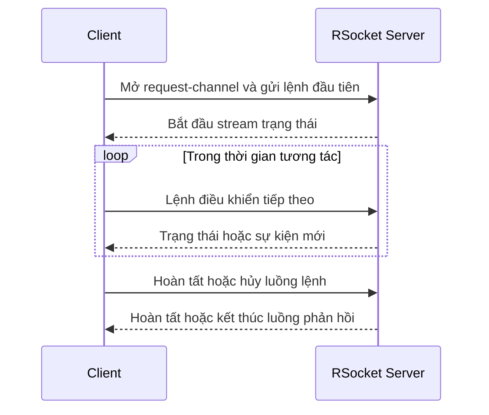
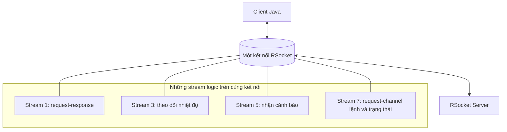

# Giao tiếp hai chiều trên cùng một kết nối

Trong một ứng dụng realtime, client thường cần gửi lệnh đến server đồng thời nhận dữ liệu cập nhật từ server. Ví dụ, một ứng dụng giám sát thiết bị gửi lệnh thay đổi chế độ hoạt động trong khi liên tục nhận nhiệt độ, trạng thái pin và cảnh báo. Nếu mỗi thông điệp phải mở một kết nối mới hoặc chờ chiều truyền trước kết thúc, ứng dụng sẽ tăng độ trễ và chi phí tài nguyên.

RSocket hỗ trợ giao tiếp hai chiều bất đồng bộ trên cùng một kết nối. Một tương tác request-channel cho phép client gửi một luồng thông điệp và server trả về một luồng thông điệp trong cùng tương tác. Đồng thời, RSocket có thể multiplex nhiều tương tác độc lập trên một kết nối vật lý. Hai khả năng này thường được dùng cùng nhau nhưng chúng giải quyết hai vấn đề khác nhau: request-channel tạo một luồng trao đổi hai chiều; multiplexing cho phép nhiều stream cùng chia sẻ một kết nối.

Bài học này giải thích cách giao tiếp hai chiều hình thành ở tầng transport và tầng RSocket, cách request-channel hoạt động, cách nhiều stream cùng tồn tại, và cách triển khai một luồng lệnh/trạng thái bằng Java, Spring Boot và Reactor.

## 1. Hai chiều ở tầng kết nối có nghĩa là gì?

Một kết nối hai chiều cho phép cả hai đầu gửi dữ liệu mà không phải đợi đầu kia kết thúc việc gửi. Trong ngữ cảnh mạng, TCP là giao thức truyền tải full-duplex: sau khi kết nối được thiết lập, hai phía có thể đồng thời ghi và đọc trên cùng một kết nối. Một phía không cần đóng chiều gửi của mình để phía còn lại bắt đầu gửi dữ liệu.

Tuy nhiên, khả năng full-duplex của TCP chỉ nói rằng transport có thể truyền dữ liệu theo hai hướng. Nó không định nghĩa ý nghĩa nghiệp vụ của các byte. Ứng dụng vẫn phải có protocol để biết message nào là lệnh, message nào là kết quả, message nào kết thúc một luồng, và lỗi nào thuộc về một thao tác.

WebSocket cũng cung cấp kênh message hai chiều sau khi handshake hoàn tất. Client có thể gửi frame đến server và server có thể gửi frame về client trên cùng kết nối. Nhưng WebSocket không định nghĩa sẵn mô hình request-response, request-stream hay request-channel. Ứng dụng phải tự quy định cách ghép request với response, đăng ký/hủy subscription, xử lý lỗi và điều tiết tốc độ message.

RSocket bổ sung protocol tương tác ở trên transport. Nó quy định frame, stream ID, kiểu tương tác, tín hiệu hoàn tất/hủy và cơ chế demand cho stream. Nhờ đó, thư viện client và server có thể phối hợp vòng đời của từng tương tác thay vì để ứng dụng tự thiết kế toàn bộ quy ước trên một kênh byte hoặc message.

### 1.1. Phân biệt ba khái niệm

| Khái niệm | Ý nghĩa | Ví dụ |
|---|---|---|
| Kết nối full-duplex | Hai đầu có thể gửi và nhận đồng thời trên cùng kết nối transport. | Client gửi byte TCP trong khi server cũng gửi byte TCP. |
| Tương tác hai chiều | Một thao tác ở tầng ứng dụng có dữ liệu đi từ client đến server và từ server về client. | Client gửi lệnh điều khiển và nhận sự kiện kết quả. |
| Multiplexing | Nhiều tương tác/stream logic độc lập cùng sử dụng một kết nối vật lý. | Một kết nối RSocket mang stream theo dõi nhiệt độ, stream cảnh báo và các request-response khác. |

Một kết nối full-duplex không tự động tạo ra một API tương tác hai chiều có cấu trúc. Ngược lại, một ứng dụng có thể mô phỏng giao tiếp hai chiều bằng hai request riêng, nhưng cách đó không nhất thiết dùng chung một tương tác hoặc một kết nối. Khi thiết kế RSocket, hãy xác định rõ đang cần hai hướng trong cùng một stream hay nhiều stream độc lập cùng chia sẻ kết nối.

## 2. Request-channel: hai luồng trong một tương tác

RSocket định nghĩa bốn kiểu tương tác chính: request-response, fire-and-forget, request-stream và request-channel. Request-channel là kiểu dành cho trường hợp bên khởi tạo gửi một stream payload và bên nhận trả về một stream payload trong cùng tương tác.

Ví dụ, client điều khiển một thiết bị có thể gửi liên tục các lệnh điều chỉnh tốc độ. Trong lúc đó, server gửi lại trạng thái đo được, xác nhận lệnh hoặc cảnh báo. Client không cần chờ server trả về một response rồi mới gửi lệnh kế tiếp; hai hướng dữ liệu có thể hoạt động đồng thời.



Request-channel có một stream ID cho tương tác. Hai hướng dữ liệu thuộc cùng stream đó và có vòng đời liên quan với nhau. Một phía có thể đánh dấu hoàn tất chiều phát của mình trong khi phía kia tiếp tục gửi dữ liệu. `CANCEL` hủy tương tác/stream; lỗi trong tương tác được biểu diễn bằng frame lỗi theo protocol.

### 2.1. Khác với request-response

Request-response phù hợp khi một request tạo ra tối đa một response. Client gửi yêu cầu lấy trạng thái thiết bị, server trả về một snapshot rồi thao tác kết thúc. Nếu cần cập nhật liên tục, client phải gọi lại nhiều lần hoặc chuyển sang một kiểu streaming.

Request-channel phù hợp khi client có một luồng đầu vào và server có một luồng đầu ra gắn với cùng thao tác. Ví dụ, client gửi chuỗi lệnh điều khiển và nhận chuỗi trạng thái trong cùng phiên. Đây là mô hình tự nhiên hơn cho các phiên tương tác kéo dài.

### 2.2. Khác với hai request-stream riêng biệt

Có thể tạo một request-stream từ client đến server để gửi dữ liệu và một request-stream khác từ server về client. Cách này có thể đáp ứng nhu cầu truyền hai chiều ở mức ứng dụng, nhưng hai stream có thể có stream ID, vòng đời, lỗi và thao tác hủy riêng. Nếu hai luồng phải gắn chặt với cùng một phiên nghiệp vụ, request-channel thường diễn đạt ý định rõ hơn.

Request-channel cũng không phải là cách duy nhất để có hai hướng trên một kết nối. RSocket cho phép nhiều stream cùng tồn tại, nên client có thể chạy request-response và request-stream song song. Hãy chọn theo mối quan hệ nghiệp vụ giữa các luồng, không chỉ theo việc có bao nhiêu hướng dữ liệu.

## 3. Multiplexing: nhiều stream dùng chung một kết nối

RSocket gán một stream ID cho từng tương tác. Các frame thuộc cùng tương tác mang stream ID đó, nhờ vậy hai đầu biết payload hoặc tín hiệu điều khiển thuộc stream nào. Trên một kết nối RSocket, nhiều stream có thể được mở và tiến triển độc lập.

Ví dụ một ứng dụng thiết bị có thể dùng một kết nối để:

- Gọi request-response lấy thông tin cấu hình ban đầu.
- Mở request-stream theo dõi nhiệt độ.
- Mở một request-stream khác để nhận cảnh báo.
- Dùng request-channel để gửi lệnh và nhận trạng thái điều khiển.



Sơ đồ chỉ minh họa các stream logic. Stream ID thực tế do protocol quản lý; ví dụ số lẻ trong hình không phải giá trị ứng dụng nên tự gán. Việc multiplexing giúp tránh phải thiết lập một kết nối transport riêng cho mỗi thao tác, đồng thời cho phép các tương tác có vòng đời khác nhau cùng hoạt động.

### 3.1. Multiplexing không phải là gộp mọi dữ liệu vào một stream

Mỗi stream vẫn có ngữ nghĩa và vòng đời riêng. Client có thể hủy stream theo dõi nhiệt độ mà vẫn giữ stream cảnh báo và request-channel điều khiển. Một response hoàn tất không có nghĩa mọi stream trên kết nối đều hoàn tất.

Điều này cũng có nghĩa lỗi cần được phân loại theo phạm vi. Lỗi của một stream có thể chỉ kết thúc tương tác đó; lỗi transport hoặc lỗi kết nối có thể ảnh hưởng đến tất cả stream đang dùng kết nối. Ứng dụng cần quyết định stream nào có thể mở lại, dữ liệu nào phải đồng bộ lại và thao tác nào có thể retry an toàn.

### 3.2. Lợi ích và giới hạn

Multiplexing giảm số lượng kết nối cần thiết và có thể giảm chi phí handshake, socket, TLS và quản lý connection pool. Nó đặc biệt hữu ích khi một client cần nhiều luồng dữ liệu nhỏ và các request ngắn cùng lúc.

Tuy nhiên, nhiều stream dùng chung kết nối cũng tạo một miền lỗi chung ở tầng transport. Nếu kết nối bị đóng, mọi stream trên đó đều mất đường truyền. Với RSocket-over-TCP, các byte được truyền theo thứ tự của TCP; mất gói có thể làm chậm việc giao dữ liệu tiếp theo trên cùng kết nối trong khi TCP phục hồi. Multiplexing ở tầng ứng dụng không loại bỏ hiện tượng head-of-line blocking của TCP.

Vì vậy, cần chọn số lượng kết nối phù hợp với tải và miền lỗi. Một client có thể dùng connection pool hoặc nhiều kết nối khi cần cô lập tải, tăng khả năng song song hoặc giới hạn ảnh hưởng khi một kết nối gặp sự cố. Không nên mặc định một kết nối duy nhất luôn là tối ưu.

## 4. Cách RSocket duy trì hai chiều trên cùng kết nối

Sau khi transport được thiết lập, hai phía khởi tạo phiên RSocket bằng setup frame. Setup mang các thông tin ban đầu như MIME type của data và metadata, payload thiết lập, cùng tham số keepalive. Khi phiên đã sẵn sàng, client và server có thể mở stream theo các kiểu tương tác được hỗ trợ.

Các frame RSocket có header chứa stream ID và loại frame. Một số frame quan trọng trong quá trình trao đổi gồm:

| Frame/tín hiệu | Vai trò |
|---|---|
| `SETUP` | Khởi tạo phiên RSocket trên kết nối. |
| `REQUEST_CHANNEL` | Mở tương tác request-channel và gửi payload khởi đầu. |
| `PAYLOAD` | Mang data và/hoặc metadata của một thông điệp trên stream. |
| `REQUEST_N` | Báo nhu cầu nhận thêm một số lượng payload trên stream. |
| `CANCEL` | Hủy một stream đang hoạt động. |
| `COMPLETE` flag trên `PAYLOAD` | Báo một phía đã hoàn tất việc phát dữ liệu trên stream; phía còn lại có thể tiếp tục phát response. |
| `ERROR` | Báo lỗi và kết thúc stream theo quy tắc protocol. |
| `KEEPALIVE` | Duy trì kết nối và hỗ trợ phát hiện kết nối không còn hoạt động. |

Trong request-channel, hai phía có thể phát payload theo hai hướng. Mỗi phía có thể kết thúc phần dữ liệu mình phát; việc một phía hoàn tất không đồng nghĩa toàn bộ tương tác hoặc kết nối bị đóng, vì phía kia có thể tiếp tục phát dữ liệu. Khi bên khởi tạo không còn cần kết quả, nó có thể gửi `CANCEL` để hủy stream. Các stream khác vẫn có thể tiếp tục nếu kết nối còn hoạt động.

Metadata push là một loại thông điệp ở cấp kết nối, dùng để đẩy metadata mà không gắn với một stream nghiệp vụ thông thường. Nó không thay thế request-channel và cũng không phải một payload phản hồi trong stream.

## 5. Điều tiết luồng ở cả hai hướng

Giao tiếp hai chiều có thể tạo ra hai luồng dữ liệu với tốc độ khác nhau. Client có thể phát lệnh nhanh hơn server xử lý; server có thể phát trạng thái nhanh hơn client hiển thị hoặc lưu trữ. Nếu bên phát gửi không giới hạn, hàng đợi và bộ nhớ có thể tăng liên tục.

RSocket hỗ trợ demand-based flow control cho các tương tác dạng stream. Bên nhận cho biết số lượng payload mà nó sẵn sàng tiếp nhận; `REQUEST_N` biểu diễn yêu cầu thêm một lượng phần tử. Khi đã phát đủ số lượng được yêu cầu, bên phát cần chờ demand tiếp theo trước khi gửi thêm payload thuộc luồng đó. Với request-channel, hai hướng có thể có nhịp demand riêng do bên nhận tương ứng điều tiết.

Trong Spring và Reactor, `Flux` thể hiện một chuỗi bất đồng bộ có thể phát nhiều phần tử. Khi các thành phần downstream yêu cầu dữ liệu theo Reactive Streams, tín hiệu demand được truyền qua pipeline; adapter RSocket ánh xạ cơ chế đó với flow control của protocol. Cơ chế này giúp điều tiết dữ liệu giữa hai đầu, nhưng không tự giải quyết mọi dạng quá tải.

Ví dụ, nếu client tiêu thụ trạng thái chậm, server cần tôn trọng demand thay vì đẩy một lượng payload không giới hạn. Nếu server nhận lệnh chậm, client cũng cần giới hạn tốc độ phát lệnh. Ở tầng nghiệp vụ, vẫn có thể cần buffer có giới hạn, giới hạn số lệnh đang chờ, sampling, batching hoặc từ chối lệnh khi thiết bị quá tải.

Không nên dùng `onBackpressureBuffer()` với hàng đợi không giới hạn cho một stream realtime kéo dài. Nếu cần buffer, hãy đặt giới hạn và định nghĩa hành vi khi đầy: bỏ phần tử cũ, bỏ phần tử mới, gộp các cập nhật, hoặc báo lỗi. Chọn chính sách theo ý nghĩa dữ liệu; ví dụ, trạng thái nhiệt độ mới nhất có thể thay thế trạng thái cũ, trong khi lệnh chuyển tiền không thể tùy tiện bị bỏ.

## 6. Triển khai request-channel bằng Spring Boot

Spring Boot hỗ trợ RSocket qua Spring Messaging. Một phương thức `@MessageMapping` nhận `Flux<T>` và trả về `Flux<R>` có thể ánh xạ một tương tác request-channel. Ví dụ dưới đây mô phỏng client gửi lệnh điều khiển thiết bị, còn server phát các sự kiện trạng thái.

### 6.1. Khai báo payload

```java
public record DeviceCommand(
    String commandId,
    String action,
    Integer targetLevel
) {}

public record DeviceEvent(
    String commandId,
    String state,
    Integer actualLevel,
    String message
) {}
```

`commandId` giúp liên kết sự kiện với lệnh đã gửi ở tầng nghiệp vụ. RSocket quản lý stream ID để định tuyến frame, nhưng stream ID không thay thế mã tương quan nghiệp vụ khi cần lưu vết hoặc đối soát sau reconnect.

### 6.2. Server nhận stream lệnh và trả về stream sự kiện

```java
import org.springframework.messaging.handler.annotation.MessageMapping;
import org.springframework.stereotype.Controller;
import reactor.core.publisher.Flux;

@Controller
public class DeviceController {

    private final DeviceService deviceService;

    public DeviceController(DeviceService deviceService) {
        this.deviceService = deviceService;
    }

    @MessageMapping("device.control")
    public Flux<DeviceEvent> control(Flux<DeviceCommand> commands) {
        return commands.concatMap(deviceService::execute);
    }
}
```

Phương thức nhận một `Flux<DeviceCommand>` từ client và trả về `Flux<DeviceEvent>` cho client. `concatMap` xử lý lần lượt từng lệnh và giữ thứ tự phát kết quả theo thứ tự lệnh được nhận. Nếu nghiệp vụ cho phép xử lý song song, có thể cân nhắc `flatMap` với giới hạn concurrency; khi đó thứ tự sự kiện trả về có thể khác thứ tự lệnh đầu vào.

Đây là ví dụ tối giản về ánh xạ request-channel. Trong ứng dụng thật, `DeviceService` cần xác thực quyền điều khiển thiết bị, kiểm tra phạm vi giá trị, giới hạn tốc độ, ghi nhận kết quả và xử lý lỗi theo từng lệnh. Không nên để exception từ một lệnh làm mất toàn bộ phiên nếu nghiệp vụ mong muốn tiếp tục xử lý các lệnh sau; khi đó hãy chuyển lỗi nghiệp vụ thành một `DeviceEvent` có trạng thái thất bại hoặc dùng chiến lược xử lý lỗi phù hợp.

### 6.3. Client gửi lệnh và nhận sự kiện trên cùng tương tác

Với `RSocketRequester`, client có thể gửi một `Publisher` và nhận nhiều response bằng `retrieveFlux`:

```java
Flux<DeviceCommand> commands = Flux.just(
    new DeviceCommand("cmd-100", "SET_LEVEL", 40),
    new DeviceCommand("cmd-101", "SET_LEVEL", 60),
    new DeviceCommand("cmd-102", "STOP", 0)
);

Flux<DeviceEvent> events = requester
    .route("device.control")
    .data(commands)
    .retrieveFlux(DeviceEvent.class);

events.subscribe(
    event -> System.out.println("Device event: " + event),
    error -> System.err.println("Channel failed: " + error.getMessage()),
    () -> System.out.println("Channel completed")
);
```

Trong ví dụ này, client gửi nhiều lệnh và nhận các sự kiện trả về qua cùng request-channel. `Flux.just` hoàn tất sau ba lệnh nên đây là một phiên hữu hạn. Một giao diện điều khiển liên tục có thể dùng một `Flux` phát lệnh theo thời gian, chẳng hạn từ một nguồn sự kiện người dùng hoặc một `Sinks.Many` được quản lý cẩn thận.

### 6.4. Ví dụ nguồn lệnh phát theo thời gian

```java
Sinks.Many<DeviceCommand> commandSink = Sinks.many()
    .multicast()
    .onBackpressureBuffer(256);

Flux<DeviceEvent> events = requester
    .route("device.control")
    .data(commandSink.asFlux())
    .retrieveFlux(DeviceEvent.class);

Disposable channel = events.subscribe(
    this::handleDeviceEvent,
    this::handleChannelError
);

// Khi người dùng thao tác:
commandSink.tryEmitNext(
    new DeviceCommand("cmd-103", "SET_LEVEL", 75)
);

// Khi kết thúc phiên điều khiển:
commandSink.tryEmitComplete();
```

Đoạn code minh họa nguồn phát lệnh động. Trong ứng dụng thật, cần xử lý kết quả `tryEmitNext`, giới hạn buffer, quyền sở hữu và vòng đời của sink. Khi người dùng rời màn hình hoặc phiên điều khiển hết hạn, hãy hoàn tất/hủy nguồn phát và dispose subscription theo đúng vòng đời. Nếu client hủy subscription, server cần giải phóng các tài nguyên gắn với stream.

## 7. Giao tiếp hai chiều trên TCP và WebSocket

RSocket định nghĩa lớp protocol, còn transport chịu trách nhiệm chuyển frame giữa hai phía. Hai transport thường gặp là TCP và WebSocket.

### 7.1. RSocket over TCP

Với RSocket over TCP, client mở một kết nối TCP đến server. Sau khi setup RSocket hoàn tất, các frame RSocket được truyền qua kết nối đó. TCP cung cấp byte stream full-duplex, còn RSocket phân chia byte thành frame và stream logic.

TCP thường phù hợp cho giao tiếp service-to-service hoặc môi trường kiểm soát được mạng và cổng kết nối. Cần cấu hình TLS nếu dữ liệu đi qua mạng không tin cậy, quản lý connection lifecycle, timeout, keepalive và giới hạn tài nguyên.

### 7.2. RSocket over WebSocket

Với RSocket over WebSocket, ứng dụng thiết lập kết nối WebSocket trước, sau đó trao đổi frame RSocket qua message WebSocket. WebSocket cho phép trình duyệt sử dụng RSocket mà không cần một TCP socket API trực tiếp. URL thường dùng `ws://` trong môi trường phát triển hoặc `wss://` khi có TLS.

WebSocket transport giúp RSocket đi qua nhiều hạ tầng web sẵn có, nhưng reverse proxy, load balancer và gateway phải cho phép WebSocket upgrade và giữ kết nối đủ lâu. Client trình duyệt vẫn cần thư viện RSocket tương thích WebSocket; API WebSocket gốc không tự diễn giải frame RSocket.

### 7.3. Transport nào cũng cần quản lý vòng đời

Không nên nhầm keepalive của RSocket với heartbeat tự định nghĩa ở tầng nghiệp vụ. Keepalive hỗ trợ phát hiện kết nối không còn hoạt động; ping/pong của WebSocket và cơ chế TCP keepalive thuộc các lớp khác nhau. Một hệ thống có thể cần phối hợp timeout ở client, RSocket, proxy và load balancer để tránh các bên có nhận định khác nhau về trạng thái kết nối.

Khi kết nối mất, mọi stream đang multiplex trên kết nối đó mất đường truyền. Client cần tạo kết nối mới và quyết định khởi tạo lại những stream nào. Resume là khả năng tùy chọn của RSocket khi implementation và cấu hình hỗ trợ; nó không thay thế thiết kế lưu trạng thái, replay, idempotency và đối soát nghiệp vụ.

## 8. Quản lý lỗi và kết thúc stream

Giao tiếp hai chiều kéo dài cần quy định rõ khi nào một hướng kết thúc và điều gì xảy ra với hướng còn lại. Các tình huống phổ biến gồm:

| Tình huống | Hành vi cần thiết kế |
|---|---|
| Client hoàn tất việc gửi lệnh | Server có thể tiếp tục phát các sự kiện còn lại rồi hoàn tất response stream. |
| Client không còn quan tâm kết quả | Client hủy tương tác; server giải phóng subscription, tác vụ và tài nguyên liên quan. |
| Một lệnh không hợp lệ | Trả lỗi nghiệp vụ gắn với lệnh hoặc kết thúc stream theo hợp đồng đã chọn. |
| Server không thể tiếp tục xử lý | Phát lỗi cho stream và ghi nhận trạng thái để client quyết định phục hồi. |
| Transport bị ngắt | Client đánh dấu các stream bị ảnh hưởng, reconnect và đồng bộ lại theo chính sách. |
| Người dùng rời phiên | Hoàn tất hoặc hủy nguồn phát, dispose subscription và giải phóng tài nguyên. |

Hãy phân biệt lỗi nghiệp vụ với lỗi protocol/transport. Một lệnh có tham số sai có thể chỉ cần trả về sự kiện từ chối, trong khi lỗi xác thực hoặc lỗi kết nối có thể cần kết thúc toàn bộ tương tác. Việc ánh xạ lỗi phải nhất quán giữa client và server để tránh retry vô hạn hoặc lặp lại một lệnh đã được thực hiện.

Đối với thao tác có tác động không thể lặp tùy ý, hãy dùng command ID hoặc idempotency key và lưu trạng thái xử lý. Sau reconnect, client có thể hỏi trạng thái lệnh cũ trước khi gửi lại. Việc một stream được mở lại không chứng minh lệnh cuối cùng trước khi mất kết nối đã được xử lý hay chưa.

## 9. Bảo mật và vận hành kết nối hai chiều

Kết nối tồn tại lâu làm thay đổi cách quản lý tài nguyên và quyền truy cập. Một số nguyên tắc cần áp dụng:

1. **Bảo vệ transport:** Dùng TLS cho TCP hoặc WSS cho WebSocket khi truyền qua mạng không tin cậy.
2. **Xác thực khi thiết lập phiên:** Xác minh danh tính client và kiểm tra thông tin xác thực trong setup/metadata theo cơ chế mà ứng dụng hỗ trợ.
3. **Ủy quyền theo thao tác:** Kiểm tra quyền trên từng route và từng thiết bị. Một client được phép kết nối không có nghĩa được phép điều khiển mọi thiết bị.
4. **Giới hạn tài nguyên:** Đặt giới hạn số kết nối, số stream trên kết nối, kích thước payload, số lệnh đang chờ, tốc độ phát và thời gian nhàn rỗi.
5. **Quan sát theo stream:** Ghi nhận route, stream lifecycle, thời gian xử lý, số payload, lỗi và số lần reconnect. Tránh log token hoặc dữ liệu nhạy cảm.
6. **Quản lý backpressure:** Chọn buffer có giới hạn và chính sách overflow phù hợp với từng loại dữ liệu.

Trong môi trường có nhiều instance server, cần quyết định kết nối được định tuyến đến instance nào và dữ liệu trạng thái phiên được quản lý ở đâu. Kết nối dài có thể làm giảm tính linh hoạt của load balancing sau khi đã thiết lập. Nếu cần chia sẻ trạng thái hoặc chuyển tiếp sự kiện giữa các instance, hãy dùng cơ chế messaging/broker phù hợp thay vì giả định mọi instance đều nhìn thấy cùng một stream trong bộ nhớ.

## 10. Kiểm thử giao tiếp hai chiều

Một bài kiểm thử tốt cần xác minh cả hai hướng dữ liệu và vòng đời stream. Với request-channel, tối thiểu hãy kiểm tra:

- Client gửi nhiều lệnh và server nhận đúng thứ tự theo hợp đồng.
- Server phát nhiều sự kiện và client nhận được khi stream còn hoạt động.
- Client có thể tiếp tục gửi lệnh trong khi đang nhận sự kiện.
- Demand được tôn trọng khi bên nhận tiêu thụ chậm.
- Hủy stream giải phóng tài nguyên và dừng công việc liên quan.
- Lỗi một lệnh được xử lý theo hợp đồng; lỗi kết nối được phân biệt với lỗi nghiệp vụ.
- Reconnect không khiến lệnh có tác động bị thực thi trùng ngoài ý muốn.
- Nhiều stream độc lập trên cùng kết nối không làm lẫn payload hoặc tín hiệu kết thúc.

Ví dụ kiểm thử đơn vị cho controller có thể dùng Reactor Test để xác minh stream đầu ra:

```java
StepVerifier.create(
        controller.control(Flux.just(
            new DeviceCommand("cmd-1", "SET_LEVEL", 30),
            new DeviceCommand("cmd-2", "STOP", 0)
        ))
    )
    .expectNextMatches(event -> event.commandId().equals("cmd-1"))
    .expectNextMatches(event -> event.commandId().equals("cmd-2"))
    .verifyComplete();
```

Đây là kiểm thử logic xử lý stream ở controller. Để xác minh protocol và transport, cần thêm integration test với RSocket server/client thực tế, sau đó kiểm tra cả TCP lẫn WebSocket nếu ứng dụng triển khai cả hai. Khi đo hiệu năng, hãy dùng tải hai chiều đại diện: tốc độ lệnh, tốc độ sự kiện, kích thước payload, số stream đồng thời, độ trễ mạng và hành vi khi client tiêu thụ chậm.

## 11. Khi nào nên dùng request-channel?

Request-channel phù hợp khi một phiên nghiệp vụ cần cả luồng dữ liệu client → server và server → client, hai luồng có quan hệ với nhau và cần cùng vòng đời. Ví dụ gồm điều khiển thiết bị, phiên cộng tác, xử lý tác vụ có cập nhật tiến độ, hoặc trao đổi dữ liệu cảm biến với lệnh phản hồi.

Nếu client chỉ gửi một lệnh và nhận một kết quả, request-response đơn giản hơn. Nếu server chỉ phát dữ liệu cho client, request-stream thường đủ. Nếu client chỉ gửi một thông điệp và không cần response nghiệp vụ, fire-and-forget có thể phù hợp. Nếu cần nhiều tương tác độc lập cùng lúc, hãy dùng nhiều stream được multiplex trên kết nối và chỉ gom thành request-channel khi hai hướng thực sự thuộc cùng một phiên.

Khi thiết kế, hãy bắt đầu từ vòng đời nghiệp vụ: ai mở phiên, ai có thể kết thúc, dữ liệu nào được gửi theo từng hướng, cách xử lý khi một bên chậm, và điều gì xảy ra khi kết nối bị mất. Sau đó mới ánh xạ nhu cầu đó sang request-channel, request-stream hoặc các tương tác riêng. Cách tiếp cận này giúp protocol phản ánh đúng nghiệp vụ và làm cho việc kiểm thử, phục hồi cũng như vận hành rõ ràng hơn.
