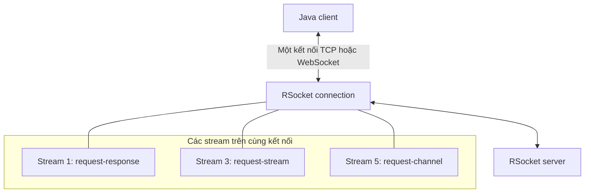
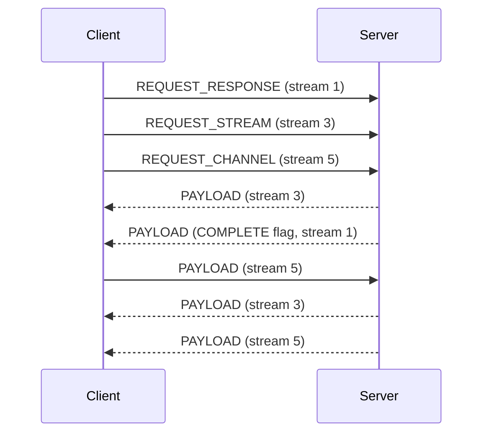

# Ghép nhiều luồng tương tác (multiplexing) và định danh từng luồng

## Mục tiêu bài học

Sau bài này, bạn có thể:

- Phân biệt một kết nối RSocket với các luồng tương tác chạy bên trong kết nối đó.
- Giải thích multiplexing và cách frame được gắn với từng stream ID.
- Mô tả quy tắc cấp stream ID trong mô hình client/server.
- Phân biệt frame ở cấp kết nối với frame ở cấp luồng.
- Hiểu cách các luồng hoạt động đồng thời, kết thúc hoặc bị hủy độc lập.
- Đọc log và thiết kế kiểm thử để xác minh nhiều tương tác đang dùng chung một kết nối.

## Kết nối và luồng là hai khái niệm khác nhau

Một kết nối RSocket được thiết lập trên một transport như TCP hoặc WebSocket. Kết nối đó tạo ra một phiên giao tiếp giữa hai peer. Trong phiên này, hai bên có thể khởi tạo nhiều tương tác độc lập.

Mỗi tương tác được gọi là một **stream**. Stream có thể biểu diễn request-response, fire-and-forget, request-stream hoặc request-channel. Nhiều stream có thể cùng tồn tại trên một kết nối vật lý. Việc ghép các stream đó vào cùng kết nối được gọi là **multiplexing**.

Ví dụ, một ứng dụng theo dõi danh mục đầu tư có thể đồng thời:

- Gửi yêu cầu lấy thông tin tài khoản và chờ một phản hồi.
- Đăng ký luồng giá của một mã chứng khoán.
- Gửi thao tác cập nhật danh mục trong một phiên hai chiều.

Ba tương tác này có thể dùng chung một kết nối RSocket. Mỗi tương tác có stream ID riêng để hai peer biết frame nhận được thuộc về hoạt động nào.



Sơ đồ chỉ minh họa các stream logic. Trong mạng, dữ liệu của chúng vẫn được đóng thành frame và truyền qua cùng transport connection.

## Multiplexing hoạt động như thế nào?

RSocket đóng gói thông tin tương tác thành các frame. Mỗi frame có phần header, trong đó có stream ID và loại frame cùng các cờ liên quan. Phần còn lại tùy loại frame có thể chứa thông tin điều khiển, metadata hoặc data payload.

Ở mức khái niệm, header cho biết:

| Thành phần | Ý nghĩa |
|---|---|
| Stream ID | Xác định stream mà frame thuộc về |
| Frame type | Cho biết đây là frame thiết lập, payload, yêu cầu thêm dữ liệu, hủy hay lỗi |
| Flags | Mang các cờ điều khiển tùy loại frame |

Stream ID giúp bên nhận phân luồng frame tới đúng state machine của tương tác. Khi nhiều tương tác đang hoạt động, frame của chúng có thể xen kẽ nhau trên kết nối.

Ví dụ, client khởi tạo ba tương tác. Server có thể gửi phản hồi của stream 3 trước, sau đó gửi phản hồi của stream 1, rồi tiếp tục phát dữ liệu cho stream 3. Client dựa vào stream ID để ghép từng frame với đúng tương tác.



Đây là ví dụ minh họa thứ tự frame có thể xen kẽ; không có yêu cầu stream 1 phải kết thúc trước khi stream 3 bắt đầu. Một stream có thể tiếp tục hoạt động trong khi stream khác đã hoàn tất hoặc bị hủy.

Multiplexing cũng không có nghĩa mỗi stream sở hữu một socket riêng. Các frame của nhiều stream cùng chia sẻ một kết nối và băng thông của kết nối đó.

## Quy tắc định danh stream

### Stream ID nằm trong header của frame

RSocket dùng stream ID để định danh một tương tác trong phạm vi một kết nối. Theo định dạng frame, stream ID là trường 31 bit trong header. Giá trị **0** được dành cho frame ở cấp kết nối; các tương tác thông thường sử dụng stream ID khác 0.

Stream ID được cấp bởi peer khởi tạo tương tác. Trong mô hình client/server thông thường:

- Client khởi tạo stream bằng các ID lẻ: 1, 3, 5, 7, ...
- Server khởi tạo stream bằng các ID chẵn: 2, 4, 6, 8, ...

Mỗi peer tăng ID của mình thêm 2 khi tạo stream tiếp theo. Quy tắc chẵn/lẻ giúp hai phía có thể khởi tạo tương tác độc lập mà không cấp trùng ID trên cùng kết nối.

| Bên khởi tạo | Các ID minh họa | Quy tắc |
|---|---|---|
| Client | 1, 3, 5, 7, ... | Bắt đầu từ số lẻ và tăng 2 |
| Server | 2, 4, 6, 8, ... | Bắt đầu từ số chẵn và tăng 2 |
| Cấp kết nối | 0 | Không đại diện cho một stream nghiệp vụ |

Trong một tương tác, cả hai phía dùng cùng stream ID để trao đổi các frame thuộc tương tác đó. Ví dụ, client mở request-stream với ID 3 thì các frame phản hồi của server cũng mang ID 3. Nếu server chủ động mở một tương tác mới với client, server cấp một ID chẵn riêng cho stream mới đó.

### Stream ID có phạm vi theo kết nối

Stream ID không phải mã định danh toàn cục. ID 3 trên kết nối A và ID 3 trên kết nối B là hai stream khác nhau. Khi ghi log hoặc truy vết, cần ghép stream ID với định danh kết nối hoặc phiên để tránh nhầm lẫn.

Stream ID cũng không phải:

- Route name dùng để chọn handler.
- ID của người dùng, đơn hàng hoặc giao dịch nghiệp vụ.
- Request ID do ứng dụng tự tạo để chống xử lý trùng.
- Connection ID dùng để nhận diện phiên transport.

Các giá trị này có mục đích khác nhau và có thể cùng xuất hiện trong một lần tương tác.

### Không tự cấp hoặc tái sử dụng stream ID

Stream ID là chi tiết của giao thức và được implementation quản lý. Ứng dụng thường không cần tự tạo hoặc truyền stream ID trong payload. Không nên tự đặt ID theo route hay ID nghiệp vụ.

Trong cùng một kết nối, stream ID đã được dùng không được tái sử dụng cho một tương tác mới. ID tăng dần theo quy tắc của peer khởi tạo. Khi kết nối được tạo mới, không gian định danh stream của kết nối mới cũng được bắt đầu lại theo quy tắc giao thức.

## Frame cấp kết nối và frame cấp stream

Không phải frame nào cũng thuộc về một tương tác riêng. RSocket có các frame điều khiển ở cấp kết nối, thường dùng stream ID bằng 0, và các frame thuộc một stream cụ thể.

| Phạm vi | Ví dụ frame | Vai trò |
|---|---|---|
| Kết nối | SETUP | Khởi tạo phiên RSocket và thương lượng thông tin cần thiết |
| Kết nối | KEEPALIVE | Duy trì hoặc kiểm tra trạng thái kết nối |
| Kết nối | LEASE | Điều tiết quyền khởi tạo tương tác khi cơ chế lease được sử dụng |
| Kết nối | ERROR với stream ID 0 | Báo lỗi ở cấp kết nối |
| Stream | REQUEST_RESPONSE | Khởi tạo tương tác cần một phản hồi |
| Stream | REQUEST_FNF | Khởi tạo tương tác fire-and-forget |
| Stream | REQUEST_STREAM | Khởi tạo tương tác một yêu cầu, nhiều phản hồi |
| Stream | REQUEST_CHANNEL | Khởi tạo tương tác hai luồng dữ liệu |
| Stream | PAYLOAD | Chuyển data và/hoặc metadata của tương tác |
| Stream | REQUEST_N | Yêu cầu thêm số phần tử trong stream có điều tiết demand |
| Stream | CANCEL | Hủy một tương tác cụ thể |
| Stream | ERROR hoặc PAYLOAD có cờ COMPLETE | Kết thúc stream bằng lỗi hoặc báo hoàn tất |

Bảng là phần nhận diện các frame thường gặp; một số loại frame có quy tắc cờ và trạng thái chi tiết riêng trong giao thức.

Một điểm quan trọng: **stream ID bằng 0 không phải stream đầu tiên**. Nó biểu thị phạm vi kết nối. Các frame của tương tác thông thường phải gắn với ID stream tương ứng.

## Vòng đời của một stream

Một stream thường bắt đầu khi một peer gửi frame khởi tạo tương tác. Peer còn lại xử lý yêu cầu và có thể gửi payload, tín hiệu hoàn tất hoặc lỗi theo kiểu tương tác.

Ở mức khái niệm, vòng đời gồm:

1. **Khởi tạo:** một peer cấp stream ID và gửi frame mở đầu tương tác.
2. **Đang hoạt động:** hai bên trao đổi payload và các frame điều khiển thuộc stream.
3. **Kết thúc:** stream hoàn tất, phát sinh lỗi hoặc bị hủy.
4. **Giải phóng trạng thái:** implementation dọn tài nguyên và state liên quan tới stream.

Các stream có vòng đời riêng. Khi stream 3 hoàn tất, stream 5 trên cùng kết nối vẫn có thể tiếp tục. Khi client hủy stream 5, stream 3 không tự động bị hủy theo.

Ngược lại, nếu kết nối vật lý bị đóng hoặc phiên RSocket gặp lỗi cấp kết nối, tất cả stream đang phụ thuộc vào kết nối đó đều bị ảnh hưởng. Đây là ranh giới quan trọng giữa lỗi của một tương tác và lỗi của toàn phiên.

### Hủy một stream không đồng nghĩa đóng kết nối

Ví dụ, client đang nhận dữ liệu giá qua request-stream. Khi người dùng rời màn hình, client có thể hủy subscription tương ứng. Việc hủy được truyền xuống tầng RSocket để kết thúc stream đó. Các request-response khác đang chạy trên cùng kết nối vẫn có thể tiếp tục.

Chỉ đóng requester hoặc kết nối mới tác động đến toàn bộ các tương tác còn gắn với kết nối đó. Vì vậy, quản lý subscription và vòng đời kết nối là hai trách nhiệm khác nhau.

## Điều tiết luồng diễn ra theo từng stream

Multiplexing cho phép nhiều stream chia sẻ kết nối; backpressure giúp điều tiết lượng dữ liệu được phát trong một stream. Với request-stream và request-channel, bên nhận có thể gửi REQUEST_N để yêu cầu thêm một số lượng phần tử. Khi có nhiều stream, demand được theo dõi theo từng stream.

Ví dụ:

- Stream 3 đang theo dõi giá và chỉ yêu cầu thêm 10 phần tử.
- Stream 5 đang trao đổi dữ liệu cộng tác và có demand riêng.
- Việc yêu cầu thêm phần tử ở stream 5 không có nghĩa client đã yêu cầu thêm phần tử ở stream 3.

Điều này cho phép mỗi tương tác thể hiện tốc độ tiêu thụ phù hợp. Tuy nhiên, các stream vẫn dùng chung socket, bộ đệm, băng thông và tài nguyên xử lý. Một consumer chậm không nhất thiết làm mất demand của stream khác, nhưng tải chung hoặc nghẽn ở transport vẫn có thể ảnh hưởng đến toàn kết nối.

Không nên nhầm REQUEST_N với số byte. Demand biểu thị số phần tử mà bên nhận muốn nhận tiếp trong luồng, không phải dung lượng dữ liệu tính bằng byte.

## Ví dụ với Spring RSocketRequester

Trong Spring, một `RSocketRequester` đã kết nối đại diện cho phiên giao tiếp mà ứng dụng dùng để tạo các request. Ta có thể tạo nhiều tương tác từ cùng requester; implementation RSocket sẽ quản lý stream ID và ghép frame trên kết nối tương ứng.

Ví dụ, một client vừa lấy thông tin tài khoản vừa theo dõi giá:

```java
import org.springframework.messaging.rsocket.RSocketRequester;
import reactor.core.Disposable;
import reactor.core.publisher.Flux;
import reactor.core.publisher.Mono;

record Account(String id, String owner) {}
record PriceTick(String symbol, double price) {}

class PortfolioClient {

    private final RSocketRequester requester;

    PortfolioClient(RSocketRequester requester) {
        this.requester = requester;
    }

    Disposable watch(String accountId, String symbol) {
        Mono<Account> account = requester
            .route("accounts.find")
            .data(accountId)
            .retrieveMono(Account.class);

        Flux<PriceTick> ticks = requester
            .route("prices.watch")
            .data(symbol)
            .retrieveFlux(PriceTick.class);

        account.subscribe(
            value -> System.out.println("Account: " + value),
            error -> System.err.println("Account request failed: " + error)
        );

        Disposable priceSubscription = ticks.subscribe(
            value -> System.out.println("Price: " + value),
            error -> System.err.println("Price stream failed: " + error)
        );

        // Khi màn hình theo dõi giá đóng, hủy subscription này.
        // Việc hủy stream không yêu cầu đóng toàn bộ requester.
        // Caller giữ Disposable ở lifecycle owner và gọi dispose()
        // khi không còn cần stream.
        return priceSubscription;
    }
}
```

Hai request được khởi tạo từ cùng requester. Tại tầng giao thức, mỗi tương tác có stream ID riêng: request-response có một stream, request-stream có một stream khác. Các frame phản hồi có thể xen kẽ nhưng vẫn được ghép đúng với subscriber tương ứng.

Đoạn code minh họa cách tạo hai tương tác. Trong ứng dụng thực tế, cần lưu `Disposable` vào đối tượng quản lý vòng đời để hủy subscription đúng lúc. Việc gọi `dispose()` sẽ hủy đăng ký phía client và được chuyển thành tín hiệu hủy stream khi tương tác còn hoạt động.

## Những hiểu lầm thường gặp

| Hiểu lầm | Cách hiểu chính xác |
|---|---|
| Mỗi request cần một TCP connection riêng | Nhiều tương tác có thể dùng chung một RSocket connection |
| Stream ID là ID nghiệp vụ | Stream ID chỉ định danh tương tác trong phạm vi một kết nối |
| Stream ID 0 là stream đầu tiên | 0 dành cho frame ở cấp kết nối |
| Server chỉ có thể phản hồi các stream do client mở | Server cũng có thể khởi tạo tương tác riêng và dùng ID chẵn |
| Request-channel có hai stream ID vì hai chiều | Hai chiều dữ liệu thuộc cùng một stream ID |
| Hủy một stream sẽ đóng socket | Hủy stream chỉ kết thúc tương tác đó; đóng kết nối ảnh hưởng toàn phiên |
| Multiplexing khiến các stream hoàn toàn độc lập về hiệu năng | Các stream vẫn chia sẻ transport và tài nguyên kết nối |

## Quan sát và chẩn đoán multiplexing

Khi debug hệ thống, chỉ ghi stream ID thường chưa đủ vì cùng ID có thể xuất hiện trên nhiều kết nối. Một bản ghi log hữu ích nên có:

- Connection ID hoặc session ID do ứng dụng/implementation cung cấp.
- Stream ID nếu thư viện cho phép quan sát.
- Route hoặc tên thao tác nghiệp vụ.
- Kiểu tương tác: request-response, fire-and-forget, request-stream hay request-channel.
- Thời điểm bắt đầu và kết thúc.
- Kết quả: complete, cancel, error hoặc connection closed.
- Request ID nghiệp vụ nếu cần liên kết log qua nhiều dịch vụ.

Không nên dùng stream ID làm khóa theo dõi lâu dài hoặc đưa nó vào dữ liệu nghiệp vụ. Nó là định danh giao thức có phạm vi và vòng đời gắn với kết nối.

Một số chỉ số có ích khi vận hành:

| Chỉ số | Điều cần quan sát |
|---|---|
| Số kết nối đang mở | Tài nguyên socket và quy mô phiên giao tiếp |
| Số stream đang hoạt động trên mỗi kết nối | Mức độ multiplexing và tải trên từng phiên |
| Thời gian sống của stream | Stream bị treo hoặc kéo dài bất thường |
| Tỷ lệ complete, cancel và error | Chất lượng vòng đời tương tác |
| Số lượng phần tử được yêu cầu và phát | Nhu cầu tiêu thụ và tốc độ dữ liệu |
| Lỗi cấp kết nối | Sự cố ảnh hưởng đồng thời nhiều stream |

Nếu một thao tác thất bại, trước tiên xác định lỗi thuộc stream hay thuộc kết nối. Lỗi stream thường chỉ ảnh hưởng một tương tác. Lỗi kết nối có thể làm gián đoạn tất cả tương tác đang chạy qua phiên đó.

## Kiểm thử nhiều stream trên một kết nối

Một bài kiểm thử multiplexing nên xác minh hành vi quan sát được, không chỉ xác minh từng handler chạy riêng lẻ.

Có thể thực hiện theo trình tự:

1. Thiết lập một kết nối RSocket giữa client và server.
2. Khởi tạo đồng thời một request-response và một request-stream qua cùng requester.
3. Cho server phát nhiều phần tử trong request-stream trong khi request-response vẫn đang chờ xử lý.
4. Xác minh client nhận đúng phản hồi và các phần tử thuộc đúng subscriber.
5. Hủy request-stream và xác minh request-response hoặc tương tác khác vẫn hoạt động.
6. Đóng kết nối và xác minh các stream còn lại nhận được tín hiệu kết thúc hoặc lỗi phù hợp.

Khi kiểm tra ở mức frame, có thể xác minh ID khác 0 của từng tương tác, quy tắc chẵn/lẻ của bên khởi tạo và việc frame phản hồi dùng đúng ID của stream đã mở. Khi chỉ kiểm thử ở API Spring, không nhất thiết phải phụ thuộc vào stream ID nội bộ; hãy tập trung vào việc các tương tác đồng thời được ghép đúng và có vòng đời độc lập.

## Khi thiết kế ứng dụng

Khi một tính năng cần nhiều tương tác realtime, hãy xác định rõ:

- Những thao tác nào nên chia thành các stream độc lập.
- Những dữ liệu nào nên trao đổi hai chiều trong cùng request-channel.
- Stream nào cần demand và giới hạn tốc độ phát.
- Khi nào một stream cần bị hủy và thành phần nào sở hữu subscription.
- Những lỗi nào chỉ kết thúc một stream và lỗi nào buộc phải tạo lại kết nối.
- Log và metric nào giúp liên kết stream với kết nối và nghiệp vụ.

Multiplexing giúp một kết nối phục vụ nhiều tương tác đồng thời và giảm nhu cầu quản lý nhiều kết nối riêng. Để khai thác đúng, ứng dụng cần quản lý stream theo vòng đời, quan sát stream ID trong đúng phạm vi kết nối và tính đến các giới hạn tài nguyên chung của transport.

