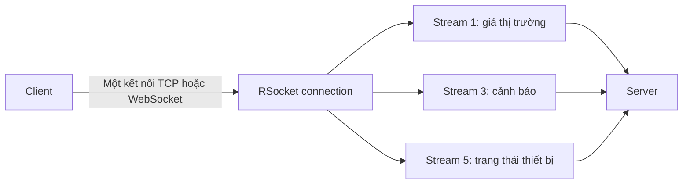
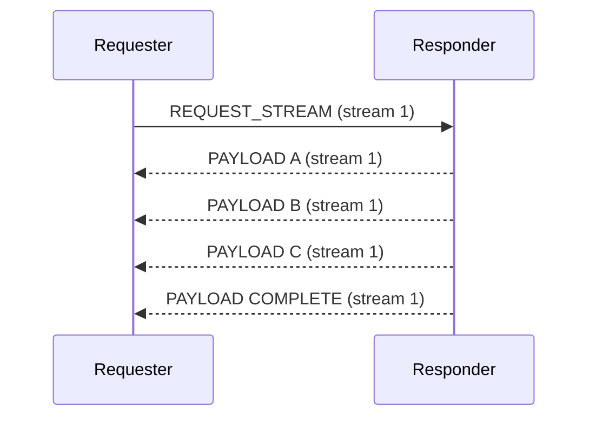
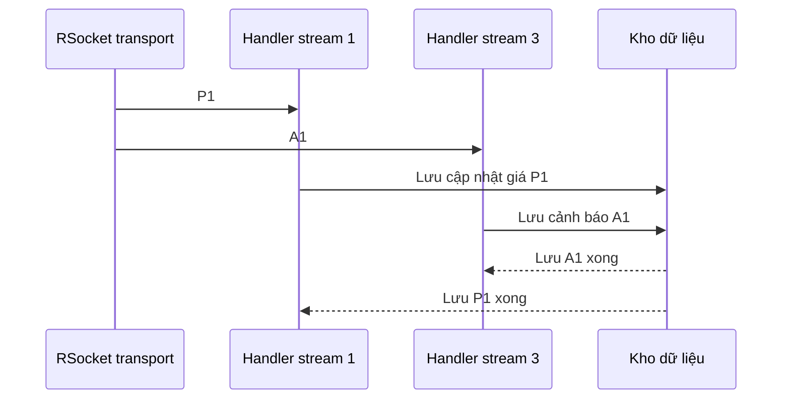
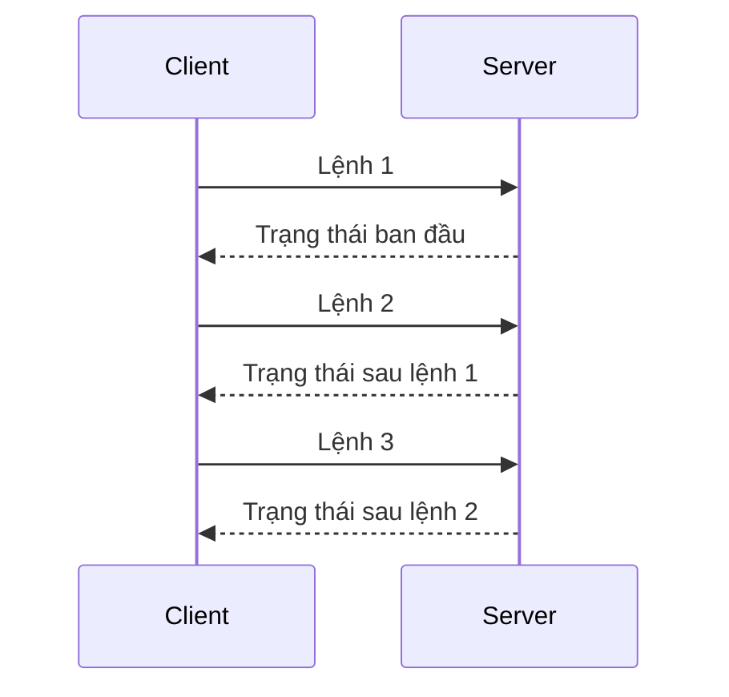

# Thứ tự thông điệp trong từng luồng và giới hạn giữa các luồng

RSocket cho phép nhiều tương tác cùng chạy trên một kết nối TCP hoặc WebSocket. Mỗi tương tác được gắn với một stream ID và có vòng đời riêng. Nhờ multiplexing, một kết nối vật lý có thể đồng thời phục vụ request-response, fire-and-forget, request-stream và request-channel. Tuy nhiên, việc nhiều luồng dùng chung kết nối không có nghĩa là mọi thông điệp đều thuộc về một thứ tự nghiệp vụ toàn cục.

Khi thiết kế ứng dụng realtime, cần phân biệt ba điều: thứ tự frame được truyền trên transport, thứ tự payload trong từng stream và thứ tự công việc hoàn tất ở tầng ứng dụng. TCP và WebSocket bảo toàn thứ tự dữ liệu trên một kết nối; RSocket duy trì thứ tự của các frame thuộc cùng stream; còn các handler độc lập có thể xử lý song song và hoàn tất theo thứ tự khác nhau. Bài học này trình bày phạm vi của từng bảo đảm và cách xây dựng thứ tự nghiệp vụ khi hệ thống cần nó.

## 1. Stream ID và multiplexing trong RSocket

RSocket không mở một kết nối TCP hoặc WebSocket riêng cho mỗi request. Thay vào đó, các tương tác logic được ghép kênh trên một kết nối. Mỗi stream có một ID để receiver biết frame đang thuộc về tương tác nào.

Các điểm cần nhớ về stream ID:

- Stream ID xác định một tương tác trong phạm vi một kết nối RSocket.
- Stream ID bằng `0` được dành cho các frame ở cấp kết nối, chẳng hạn một số thông điệp điều khiển kết nối.
- Các stream do hai đầu kết nối khởi tạo sử dụng hai dải ID chẵn và lẻ riêng biệt. Trong mô hình client/server thông dụng, client khởi tạo stream ID lẻ và server khởi tạo stream ID chẵn.
- Stream ID không phải mã định danh nghiệp vụ, số thứ tự sự kiện hoặc ID có ý nghĩa toàn hệ thống. Khi kết nối mới được tạo, ứng dụng không thể dùng ID cũ để suy ra thứ tự giữa các tương tác ở kết nối mới.

Ví dụ, client có thể mở một stream để nhận giá cổ phiếu và một stream khác để nhận cảnh báo. Cả hai tương tác đi qua cùng một socket, nhưng receiver vẫn phân biệt được frame của từng stream nhờ ID.



Multiplexing giúp giảm số kết nối vật lý và cho phép nhiều tương tác có vòng đời độc lập. Một stream có thể kết thúc trong khi các stream khác vẫn tiếp tục. Hủy một stream cũng không có nghĩa là hủy toàn bộ kết nối.

## 2. Thứ tự frame trong cùng một stream

RSocket bảo toàn thứ tự các frame thuộc cùng một stream. Khi một phía phát nhiều payload trên cùng stream, phía kia quan sát chúng theo đúng thứ tự stream đó. Điều này rất quan trọng với một dòng dữ liệu có quan hệ trước sau, ví dụ các phiên bản cập nhật trạng thái của cùng một thiết bị.

Một stream thường bắt đầu bằng frame yêu cầu tương ứng với mô hình tương tác. Với request-stream, requester gửi yêu cầu ban đầu, sau đó responder phát các frame payload. Mỗi payload có thể mang dữ liệu và cờ cho biết luồng còn tiếp tục hay đã hoàn tất. Các frame điều khiển như yêu cầu thêm phần tử hoặc hủy cũng được gắn với stream tương ứng.



Requester nhận A trước B và B trước C trên stream này. Khi responder đánh dấu hoàn tất, stream kết thúc bình thường. Nếu stream kết thúc bằng lỗi, bên nhận quan sát tín hiệu lỗi theo giao thức thay vì một chuỗi payload tiếp tục.

Thứ tự trong một stream có các ý nghĩa thực tế:

- Subscriber có thể diễn giải phần tử tiếp theo dựa trên trạng thái đã cập nhật từ phần tử trước.
- Các payload không bị tráo vị trí chỉ vì nhiều stream khác đang hoạt động trên cùng kết nối.
- Tín hiệu kết thúc hoặc hủy áp dụng cho stream đó; nó không tự động kết thúc các stream độc lập khác.
- Với request-channel, mỗi chiều phát có thứ tự riêng. Requester giữ thứ tự các payload do requester gửi; responder giữ thứ tự các payload do responder gửi. Hai chiều có thể hoạt động đồng thời nên không tồn tại một thứ tự tổng duy nhất giữa một payload đi lên và một payload đi xuống.

Thứ tự frame ở tầng giao thức là cơ sở quan trọng, nhưng chưa đủ để đảm bảo thứ tự mọi tác vụ nghiệp vụ. Pipeline của ứng dụng vẫn có thể xử lý bất đồng bộ theo cách làm thay đổi thứ tự đầu ra hoặc thứ tự hoàn tất. Phần sau sẽ phân biệt hai lớp này.

## 3. Thứ tự trên TCP và WebSocket

Transport quyết định cách các frame RSocket được chuyển qua mạng. Với TCP, ứng dụng nhận một luồng byte có thứ tự. TCP có thể chia dữ liệu gửi thành nhiều đoạn hoặc gộp nhiều lần ghi vào cùng một lần đọc; ranh giới một lần `write` không tương ứng chắc chắn với ranh giới một lần `read`. Vì vậy, transport RSocket phải đọc phần đóng khung và khôi phục frame hoàn chỉnh trước khi xử lý.

Với WebSocket, RSocket truyền frame trong các thông điệp nhị phân của kết nối WebSocket. Các thông điệp trên cùng một kết nối WebSocket cũng được giao theo thứ tự. Khi WebSocket chạy trên TCP, dữ liệu vẫn chịu đặc tính truyền byte có thứ tự của TCP.

Trên cùng một kết nối TCP hoặc WebSocket, receiver có thể quan sát một chuỗi frame được truyền theo thứ tự trên dây. Ví dụ, sender có thể gửi frame stream 1, sau đó frame stream 3, rồi lại frame stream 1. Receiver quan sát cùng chuỗi frame đó và dùng stream ID để phân phối chúng cho đúng tương tác.

Điều này không tạo ra thứ tự hoàn tất công việc giữa các stream. Sau khi frame được phân phối, server có thể đưa stream 1 và stream 3 vào hai handler hoặc scheduler khác nhau. Handler stream 3 có thể xử lý xong trước handler stream 1 dù frame của stream 1 đã đến trước. Vì vậy, thứ tự byte trên transport không nên được dùng như một cam kết rằng các thay đổi trạng thái nghiệp vụ giữa các stream sẽ hoàn tất theo cùng thứ tự.

| Phạm vi | Điều có thể dựa vào | Điều không nên suy ra |
| --- | --- | --- |
| Byte trên một kết nối TCP | Receiver nhận byte theo thứ tự mà TCP cung cấp. | Một lần đọc tương ứng với đúng một frame hoặc một lần ghi. |
| Thông điệp trên một kết nối WebSocket | Thông điệp được giao theo thứ tự trên kết nối đó. | Handler nghiệp vụ hoàn tất theo thứ tự giao thông điệp. |
| Frame trong cùng một RSocket stream | Thứ tự frame của stream được bảo toàn. | Mọi tác vụ bất đồng bộ phát sinh từ frame đều hoàn tất tuần tự nếu ứng dụng tự chạy song song. |
| Nhiều RSocket stream | Mỗi stream có ID và vòng đời độc lập; frame có thể xen kẽ. | Có một thứ tự nghiệp vụ toàn cục giữa các stream. |
| Nhiều kết nối hoặc phiên kết nối | Mỗi kết nối có transport và stream ID riêng. | Có thứ tự chung giữa các sự kiện đi qua các kết nối khác nhau. |

## 4. Frame có thể xen kẽ giữa các stream

Giả sử client theo dõi hai nguồn dữ liệu. Stream 1 mang các cập nhật giá `P1`, `P2`; stream 3 mang các cảnh báo `A1`, `A2`. Trên kết nối, các frame có thể được xen kẽ như sau:

```text
Thứ tự frame trên kết nối:
  1. stream 1: P1
  2. stream 3: A1
  3. stream 1: P2
  4. stream 3: A2

Thứ tự trong stream 1: P1 -> P2
Thứ tự trong stream 3: A1 -> A2
```

Đây là hành vi bình thường của multiplexing. Stream 1 không cần chờ stream 3 kết thúc mới tiếp tục phát, và ngược lại. Mỗi stream được điều khiển theo nhu cầu và vòng đời của nó.

Một ví dụ xử lý ở server cho thấy sự khác biệt giữa thứ tự frame và thứ tự hoàn tất:



Trong ví dụ, frame P1 đến trước A1 nhưng thao tác lưu A1 hoàn tất trước. Nếu hai thao tác độc lập thì đây có thể là kết quả hoàn toàn hợp lệ. Nếu A1 chỉ có ý nghĩa sau khi P1 đã được áp dụng, ứng dụng phải mô tả quan hệ phụ thuộc đó bằng cơ chế nghiệp vụ.

## 5. Pipeline Reactor có thể làm thay đổi thứ tự đầu ra

RSocket thường dùng `Flux` để biểu diễn stream nhiều phần tử. Các tín hiệu `onNext` từ một publisher tuân theo thứ tự mà publisher phát ra. Tuy nhiên, một toán tử xử lý bất đồng bộ có thể chạy nhiều phần tử đồng thời. Khi các tác vụ hoàn tất với thời gian khác nhau, kết quả đầu ra có thể xuất hiện theo thứ tự hoàn tất thay vì thứ tự đầu vào.

### `flatMap`: ưu tiên xử lý đồng thời

`flatMap` cho phép các publisher con được đăng ký và xử lý đồng thời. Kết quả của publisher con nào hoàn tất trước có thể được phát trước. Đây là lựa chọn phù hợp khi các phần tử độc lập và thông lượng quan trọng hơn thứ tự ban đầu.

```java
Flux<Integer> results = Flux.just(1, 2, 3)
    .flatMap(number -> asyncService.process(number));
```

Nếu xử lý số 2 hoàn tất trước số 1, kết quả 2 có thể được phát trước kết quả 1. Không nên dùng `flatMap` khi thứ tự đầu vào phải được giữ nguyên mà không có thêm cơ chế sắp xếp.

### `concatMap`: xử lý tuần tự

`concatMap` chờ publisher con của phần tử hiện tại hoàn tất trước khi chuyển sang phần tử tiếp theo. Nhờ vậy, thứ tự đầu ra giữ theo thứ tự đầu vào, đổi lại các công việc trong cùng pipeline không được thực hiện đồng thời theo cách của `flatMap`.

```java
Flux<Result> orderedResults = Flux.just(1, 2, 3)
    .concatMap(number -> asyncService.process(number));
```

### `flatMapSequential`: chạy đồng thời, phát theo thứ tự đầu vào

`flatMapSequential` có thể đăng ký và chạy publisher con đồng thời nhưng giữ thứ tự phát kết quả theo thứ tự phần tử đầu vào. Nếu publisher con phía sau hoàn tất sớm, kết quả có thể phải chờ publisher con đứng trước. Điều này duy trì thứ tự đầu ra nhưng có thể tạo bộ đệm khi một phần tử đầu vào xử lý lâu bất thường.

| Toán tử | Cách xử lý | Thứ tự đầu ra |
| --- | --- | --- |
| `flatMap` | Nhiều publisher con có thể chạy đồng thời. | Theo thời điểm các kết quả sẵn sàng; có thể khác thứ tự đầu vào. |
| `concatMap` | Chờ publisher con hiện tại hoàn tất rồi mới xử lý phần tử tiếp theo. | Giữ thứ tự đầu vào. |
| `flatMapSequential` | Cho phép chạy đồng thời nhưng xếp kết quả theo thứ tự đầu vào. | Giữ thứ tự đầu vào; kết quả sau có thể phải chờ. |

Khi xử lý stream RSocket, cần kiểm tra toàn bộ pipeline sau khi nhận payload. Transport có thể giữ thứ tự hoàn hảo trong stream, nhưng `flatMap`, hàng đợi tùy chỉnh hoặc nhiều worker vẫn có thể làm thứ tự nghiệp vụ thay đổi.

## 6. Request-channel và thứ tự hai chiều

Request-channel cho phép requester gửi một dòng payload và đồng thời nhận một dòng payload từ responder. Mỗi hướng là một luồng phát độc lập trong cùng tương tác.

Ví dụ, một client gửi các thao tác điều khiển thiết bị trong khi server gửi trạng thái thiết bị:



Mỗi phía có thể bảo toàn thứ tự payload do chính phía đó gửi. Tuy nhiên, không nên đọc sơ đồ này như một bảo đảm rằng phản hồi thứ hai luôn được tạo ra sau khi lệnh thứ hai đã được xử lý xong, trừ khi giao thức ứng dụng thiết kế phản hồi theo quan hệ đó. Hai chiều có thể tiến triển đồng thời; thời điểm một payload được gửi ở chiều này không tự tạo ra quan hệ nhân quả với payload ở chiều kia.

Nếu cần ghép phản hồi với lệnh cụ thể, hãy đưa mã tương quan vào payload, ví dụ `commandId` hoặc `correlationId`. Server trả lại mã tương ứng trong thông điệp trạng thái hoặc kết quả. Nếu lệnh phụ thuộc vào trạng thái đã xác nhận từ lệnh trước, client cần chờ xác nhận phù hợp trước khi gửi bước kế tiếp hoặc server phải tuần tự hóa việc áp dụng lệnh.

## 7. Backpressure là theo stream; transport vẫn được chia sẻ

Trong Reactive Streams, `Subscription.request(n)` thể hiện nhu cầu của một subscriber đối với publisher cụ thể. Trong RSocket, cơ chế flow control của stream cho phép bên nhận thông báo số payload mà nó sẵn sàng tiếp nhận. Nhu cầu của một stream không phải là một bộ đếm nghiệp vụ dùng chung cho tất cả stream khác.

Ví dụ, client có thể yêu cầu nhiều phần tử từ stream giá thị trường nhưng chỉ yêu cầu một số ít phần tử từ stream cảnh báo. Hai stream có nhịp tiêu thụ khác nhau và có thể tiếp tục độc lập.

Tuy nhiên, các stream vẫn chia sẻ tài nguyên của kết nối vật lý: băng thông, socket buffer, bộ nhớ, event loop và năng lực xử lý của máy chủ. Với TCP, mất một đoạn dữ liệu có thể khiến các byte phía sau trên cùng kết nối phải chờ được truyền lại; multiplexing ở tầng RSocket không loại bỏ hiện tượng head-of-line blocking của TCP. WebSocket chạy trên TCP cũng chịu ảnh hưởng này.

Do đó cần tách hai lớp điều tiết:

- **Flow control của stream:** điều tiết số payload mà subscriber sẵn sàng nhận trong một tương tác.
- **Điều tiết ở transport và hệ thống:** quản lý bộ đệm socket, băng thông, giới hạn kết nối, hàng đợi xử lý, CPU và bộ nhớ dùng chung.

Một stream chậm không nhất thiết làm các stream khác dừng về mặt logic, nhưng nếu nó tạo hàng đợi lớn hoặc chiếm nhiều tài nguyên, nó vẫn có thể ảnh hưởng đến các stream cùng kết nối. Hãy đặt giới hạn buffer, theo dõi độ trễ và tránh đưa công việc blocking lên event loop.

## 8. Khi nào cần thứ tự nghiệp vụ giữa nhiều stream?

Nhiều stream độc lập là cách tốt để tách các loại dữ liệu hoặc các tương tác không phụ thuộc nhau. Nếu các sự kiện có quan hệ trước sau, ứng dụng cần biểu diễn quan hệ đó rõ ràng.

### Dùng một stream cho các sự kiện cần thứ tự

Nếu các sự kiện thuộc cùng một phiên hoặc cùng một thực thể và phải được quan sát tuần tự, hãy cân nhắc gửi chúng qua cùng một stream. Ví dụ, các bản cập nhật trạng thái của một thiết bị có thể được phát trong một request-stream duy nhất. Cách này tận dụng thứ tự payload trong stream và đơn giản hóa xử lý phía nhận.

### Gắn số phiên bản hoặc sequence vào sự kiện

Khi cần dùng nhiều stream hoặc nhiều kết nối, mỗi sự kiện nên mang thông tin thứ tự ở cấp nghiệp vụ. Ví dụ:

```java
public record DeviceEvent(
    String deviceId,
    long sequence,
    String eventId,
    String eventType,
    String value
) {}
```

`sequence` tăng theo từng thiết bị hoặc từng aggregate. Consumer có thể so sánh sequence nhận được với phiên bản đã áp dụng để phát hiện sự kiện đến trễ, bị lặp hoặc bị thiếu. `eventId` hỗ trợ nhận diện sự kiện trùng khi gửi lại. Không nên dùng timestamp từ các máy khác nhau làm thứ tự tuyệt đối vì đồng hồ có thể lệch hoặc có độ phân giải không đủ.

### Tuần tự hóa theo khóa

Nếu nhiều thiết bị hoặc khách hàng có thể xử lý độc lập, có thể phân vùng công việc theo khóa như `deviceId` hoặc `accountId`. Các sự kiện cùng khóa được đưa qua một hàng đợi hoặc actor xử lý tuần tự; các khóa khác nhau vẫn có thể xử lý song song. Cách này giữ thứ tự trong phạm vi cần thiết mà không buộc toàn hệ thống chạy một hàng đợi duy nhất.

### Xác nhận và xử lý idempotent

Khi thứ tự hoặc độ tin cậy quan trọng, hãy xác định thời điểm sự kiện được xem là đã xử lý. Một lần gửi thành công ở tầng transport không nhất thiết đồng nghĩa nghiệp vụ đã commit. Dùng response hoặc acknowledgement ở tầng ứng dụng khi bên gửi cần xác nhận kết quả; thiết kế thao tác idempotent và cơ chế chống trùng khi có retry.

Fire-and-forget phù hợp khi requester không cần response nghiệp vụ. Vì không có response cho từng thông điệp, không dùng riêng việc hoàn tất gửi fire-and-forget làm bằng chứng rằng phía nhận đã áp dụng thay đổi. Nếu cần xác nhận, hãy chọn mô hình tương tác hoặc giao thức ứng dụng có acknowledgement.

## 9. Ví dụ: hai stream độc lập trong Spring Boot

Giả sử client cần theo dõi giá và cảnh báo. Hai route có thể trả về hai `Flux` riêng:

```java
Flux<PriceUpdate> prices = requester
    .route("market.prices")
    .data(marketQuery)
    .retrieveFlux(PriceUpdate.class);

Flux<Alert> alerts = requester
    .route("market.alerts")
    .data(marketQuery)
    .retrieveFlux(Alert.class);
```

Có thể xử lý tuần tự bên trong từng stream:

```java
Disposable priceSubscription = prices
    .concatMap(update -> priceService.persist(update).thenReturn(update))
    .subscribe(this::publishPrice);

Disposable alertSubscription = alerts
    .concatMap(alert -> alertService.persist(alert).thenReturn(alert))
    .subscribe(this::publishAlert);
```

`concatMap` giữ thứ tự xử lý của các phần tử giá trong pipeline giá và các phần tử cảnh báo trong pipeline cảnh báo. Hai subscription vẫn độc lập: một cảnh báo có thể được lưu trước một cập nhật giá đến sớm hơn. Nếu cảnh báo phụ thuộc vào một cập nhật giá cụ thể, hãy đưa khóa hoặc sequence vào dữ liệu và kiểm tra quan hệ đó ở tầng nghiệp vụ.

Khi giao diện kết thúc, cần hủy các subscription để ngừng nhận dữ liệu và giải phóng tài nguyên:

```java
priceSubscription.dispose();
alertSubscription.dispose();
```

Trong ứng dụng thực tế, vòng đời subscription nên gắn với phiên người dùng hoặc thành phần đang hiển thị dữ liệu. Khi hủy, các công việc đã được đưa vào scheduler hoặc hệ thống lưu trữ có thể đã bắt đầu; cancellation không tự động hoàn tác side effect đã thực hiện. Những thao tác cần nhất quán vẫn phải có transaction, kiểm tra phiên bản hoặc cơ chế bù trừ phù hợp.

## 10. Kiểm thử thứ tự và tính độc lập

Kiểm thử stream nên xác minh thứ tự payload trong từng tương tác và kiểm tra ứng dụng xử lý đúng khi nhiều stream hoạt động đồng thời. Với Reactor, `StepVerifier` có thể kiểm tra thứ tự phát của một `Flux`:

```java
import org.junit.jupiter.api.Test;
import reactor.core.publisher.Flux;
import reactor.test.StepVerifier;

class StreamOrderingTest {
    @Test
    void preservesOrderWhenProcessingSequentially() {
        Flux<Integer> values = Flux.just(1, 2, 3)
            .concatMap(value -> Flux.just(value * 10));

        StepVerifier.create(values)
            .expectNext(10, 20, 30)
            .verifyComplete();
    }
}
```

Ngoài kiểm tra đơn stream, nên có kiểm thử tích hợp cho các tình huống sau:

- Hai hoặc nhiều stream dùng chung một kết nối và frame được phân phối đúng theo stream ID.
- Payload trong từng stream được xử lý đúng thứ tự ngay cả khi frame của các stream xen kẽ.
- Một handler hoàn tất chậm hơn handler khác; ứng dụng không dựa nhầm vào thứ tự hoàn tất giữa các stream.
- `flatMap` có thể phát kết quả khác thứ tự đầu vào; `concatMap` hoặc `flatMapSequential` được dùng ở nơi cần giữ thứ tự.
- Request-channel gửi và nhận đồng thời; mã tương quan ghép đúng phản hồi với lệnh.
- Hủy một stream không vô tình đóng các stream độc lập; khi đóng kết nối, tất cả tương tác liên quan được giải phóng.
- Tải cao không làm buffer tăng vô hạn hoặc làm event loop bị chặn.
- Retry hoặc kết nối lại không làm áp dụng trùng sự kiện; sequence và event ID được kiểm tra đúng.

Khi kiểm thử đồng thời, không nên khẳng định thứ tự giữa hai stream bằng cách dựa vào thời gian chạy của máy kiểm thử. Hãy kiểm tra các bất biến được yêu cầu, chẳng hạn sequence tăng trong từng aggregate, mỗi event ID chỉ được áp dụng một lần hoặc phản hồi có đúng correlation ID.

## 11. Những hiểu lầm thường gặp

**Cho rằng một kết nối chỉ có một dòng thông điệp duy nhất.** Kết nối có một chuỗi frame ở tầng transport, nhưng các frame mang stream ID khác nhau và được phân phối cho các tương tác độc lập.

**Cho rằng frame đến trước thì nghiệp vụ chắc chắn hoàn tất trước.** Frame có thể đến theo thứ tự trên transport nhưng handler chạy đồng thời. Thời gian xử lý, I/O và scheduler có thể làm thứ tự hoàn tất thay đổi.

**Cho rằng thứ tự của một `Flux` luôn được giữ dù dùng toán tử nào.** `flatMap` cho phép xử lý đồng thời và có thể phát kết quả theo thứ tự hoàn tất. Chọn `concatMap` hoặc `flatMapSequential` khi cần giữ thứ tự đầu vào.

**Cho rằng request-channel có một thứ tự tổng cho hai chiều.** Mỗi chiều có thứ tự phát riêng; để ghép lệnh với phản hồi cần correlation ID hoặc sequence nghiệp vụ.

**Cho rằng backpressure của một stream bảo vệ toàn bộ kết nối.** Nhu cầu được quản lý theo stream, trong khi socket buffer, băng thông, event loop và bộ nhớ có thể được chia sẻ.

**Cho rằng stream ID là sequence nghiệp vụ.** Stream ID chỉ định danh tương tác trong một kết nối. Hãy dùng event ID, aggregate ID và sequence riêng cho dữ liệu nghiệp vụ.

## 12. Ghi nhớ

- RSocket multiplex nhiều stream logic trên một kết nối TCP hoặc WebSocket; stream ID giúp phân biệt tương tác.
- Frame thuộc cùng stream được bảo toàn thứ tự. Các stream khác nhau có thể xen kẽ frame và có vòng đời độc lập.
- TCP và WebSocket bảo toàn thứ tự dữ liệu trên cùng kết nối, nhưng điều đó không bảo đảm thứ tự hoàn tất của handler nghiệp vụ.
- Request-channel có hai chiều phát đồng thời; mỗi chiều có thứ tự riêng và cần correlation ID nếu phải ghép thông điệp với nhau.
- Pipeline Reactor có thể làm thay đổi thứ tự đầu ra: `flatMap` ưu tiên đồng thời, `concatMap` xử lý tuần tự, `flatMapSequential` chạy đồng thời nhưng phát theo thứ tự nguồn.
- Backpressure điều tiết nhu cầu theo stream, còn transport và tài nguyên máy chủ vẫn được chia sẻ giữa các stream.
- Khi cần thứ tự giữa nhiều stream hoặc nhiều kết nối, hãy dùng sequence nghiệp vụ, xử lý tuần tự theo khóa, xác nhận, idempotency và kiểm thử các bất biến cần bảo vệ.
