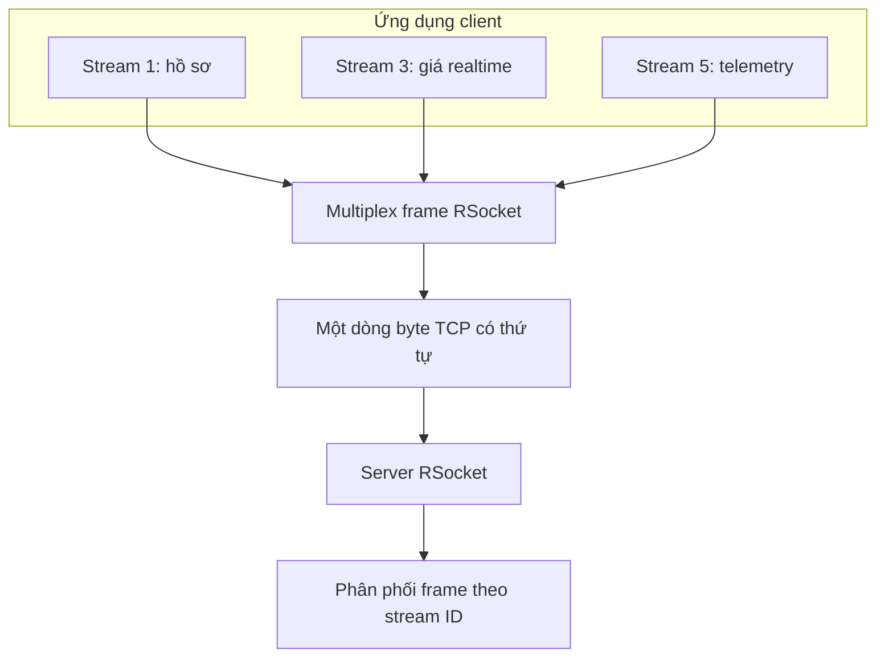

# Ảnh hưởng của TCP head-of-line blocking đến các luồng dùng chung

RSocket cho phép nhiều luồng logic cùng trao đổi dữ liệu trên một kết nối. Cách tổ chức này giảm số lượng kết nối phải mở và giúp client, server trao đổi nhiều loại thông điệp đồng thời. Tuy nhiên, khi transport bên dưới là TCP, các luồng logic vẫn chia sẻ một dòng byte có thứ tự. Một gói TCP bị mất có thể khiến dữ liệu của nhiều luồng phải chờ, kể cả khi các gói chứa dữ liệu đó đã đến máy nhận.

Hiện tượng này gọi là *TCP head-of-line blocking* (TCP HOL blocking, nghẽn đầu dòng). Đây là giới hạn ở tầng transport. Việc RSocket gán stream ID riêng hoặc điều tiết demand riêng cho từng stream không thể loại bỏ thứ tự truyền byte của TCP.

## 1. RSocket multiplex nhiều luồng trên một kết nối

Một kết nối RSocket có thể mang nhiều tương tác logic cùng lúc. Mỗi tương tác được nhận diện bằng stream ID trong frame RSocket. Ví dụ, một client có thể dùng cùng một kết nối để:

- Gửi request-response lấy hồ sơ người dùng.
- Nhận request-stream chứa dữ liệu giá theo thời gian thực.
- Gửi hoặc nhận request-channel để trao đổi sự kiện hai chiều.
- Gửi fire-and-forget để thông báo một sự kiện không cần response nghiệp vụ.

Các frame thuộc những stream khác nhau có thể được multiplex trên cùng kết nối RSocket. Ở tầng ứng dụng, mỗi stream có vòng đời và cơ chế điều tiết nhu cầu riêng. Nhưng khi dùng TCP transport, các frame cuối cùng vẫn được ghi vào cùng một TCP connection theo một thứ tự byte xác định.



Multiplexing giúp chia sẻ một kết nối vật lý. Nó không tạo ra một TCP connection riêng cho từng stream. Vì vậy, một sự cố truyền tải ở connection có thể ảnh hưởng đến nhiều tương tác đang chạy trên connection đó.

## 2. TCP HOL blocking xảy ra như thế nào?

TCP cung cấp một dòng byte tin cậy và có thứ tự cho ứng dụng. Bên nhận chỉ có thể đọc liên tục phần dữ liệu bắt đầu từ byte kế tiếp mà nó đang chờ. Nếu một đoạn byte bị mất, TCP có thể nhận và lưu tạm các đoạn byte đến sau, nhưng không giao phần dữ liệu phía sau khoảng trống đó cho ứng dụng trước khi byte bị thiếu được truyền lại và lắp vào đúng vị trí.

Giả sử client gửi lần lượt các byte của hai frame RSocket:

1. Một phần frame thuộc stream A nằm trong TCP segment có sequence number kế tiếp mà server đang chờ.
2. Segment đó bị mất trên mạng.
3. Các segment sau, chứa phần còn lại của stream A hoặc frame thuộc stream B, vẫn đến server.
4. TCP phía server ghi nhận các byte đến sau nhưng giữ chúng trong bộ đệm ngoài thứ tự. Ứng dụng RSocket chưa thể đọc vượt qua khoảng trống.
5. TCP phía client truyền lại phần byte bị thiếu. Khi khoảng trống được lấp đầy, TCP có thể giao liên tục phần dữ liệu đã được sắp xếp cho RSocket.

Do đó, frame của stream B có thể phải chờ dù segment chứa frame B đã đến máy server. TCP chỉ nhìn thấy thứ tự byte của connection, không biết frame nào quan trọng hơn hoặc thuộc stream RSocket nào.

```mermaid
sequenceDiagram
    participant C as Client
    participant N as Mạng
    participant S as TCP server
    participant R as RSocket server
    C->>N: TCP segment X chứa byte của stream A
    Note over N: Segment X bị mất
    C->>N: TCP segment Y chứa frame stream B
    N->>S: Segment Y đến nơi
    Note over S: Giữ Y trong bộ đệm; còn thiếu byte trước Y
    S-->>C: ACK/SACK báo nhận các byte sau khoảng trống
    C->>N: Truyền lại segment X
    N->>S: Segment X được nhận
    S->>R: Giao dòng byte liên tục đã đủ thứ tự
    Note over R: RSocket mới có thể xử lý frame B
```

TCP có thể dùng duplicate ACK, SACK hoặc cơ chế phục hồi mất gói khác để phát hiện và truyền lại dữ liệu. Những cơ chế này giúp giảm thời gian phục hồi, nhưng không cho phép ứng dụng đọc các byte phía sau khoảng trống trước khi dòng byte trở nên liên tục.

## 3. Vì sao một stream bị ảnh hưởng có thể kéo theo stream khác?

Hãy xét ba stream cùng chạy trên một kết nối RSocket:

| Stream | Công việc | Đặc điểm tải |
| --- | --- | --- |
| A | Lấy thông tin hồ sơ | Ít dữ liệu, cần phản hồi nhanh |
| B | Nhận giá realtime | Dữ liệu liên tục, độ trễ quan trọng |
| C | Nhận telemetry từ server | Nhiều sự kiện, có thể tạo burst |

Giả sử server đang gửi dữ liệu của stream C về client với lưu lượng lớn. Một TCP segment trên chiều server-to-client chứa một phần byte của frame C bị mất. Các byte đến sau segment đó trên cùng chiều có thể chứa frame mới của stream B hoặc response của stream A. Do tất cả byte nằm trên cùng một TCP connection và cùng chiều truyền, dữ liệu phía sau khoảng trống phải đợi phục hồi, dù stream A và B không có lỗi logic.

Điều này có thể tạo ra các biểu hiện sau:

- **Tăng độ trễ đuôi (tail latency):** một response nhỏ của stream A bị chậm vì đứng sau byte bị mất thuộc stream C.
- **Jitter ở luồng realtime:** khoảng cách thời gian giữa các sự kiện của stream B không đều, dù nguồn phát vẫn đều.
- **Thông lượng giảm tạm thời:** TCP phục hồi mất gói và điều chỉnh congestion window. Vì các stream dùng chung connection, giới hạn thông lượng của connection tác động đến tất cả dữ liệu trên đó.
- **Tăng thời gian hoàn thành tương tác:** request-response ngắn cũng có thể chờ dữ liệu trước đó trên cùng chiều TCP được phục hồi.

Một frame đã nằm hoàn toàn trước khoảng trống trong thứ tự byte vẫn có thể được giao cho ứng dụng. HOL blocking chủ yếu giữ các byte nằm sau vị trí bị thiếu; không có nghĩa mọi frame của connection luôn bị dừng ngay khi một gói bất kỳ bị mất. Mức ảnh hưởng phụ thuộc vị trí mất gói, thứ tự byte và cách các frame được ghi vào transport.

## 4. Phạm vi ảnh hưởng theo từng chiều TCP

TCP là giao thức full-duplex. Hai chiều client-to-server và server-to-client có không gian sequence number và cơ chế truyền lại riêng.

Ví dụ, nếu một segment trên chiều client-to-server bị mất, các byte client-to-server nằm sau khoảng trống có thể bị chặn. Bản thân sự mất gói đó không buộc chiều server-to-client phải dừng giao byte. Server vẫn có thể gửi response về client nếu chiều ngược lại hoạt động bình thường.

Tuy vậy, hai chiều vẫn có thể ảnh hưởng lẫn nhau thông qua tài nguyên dùng chung như CPU, event loop, băng thông đường truyền, thiết bị mạng hoặc tải của server. Cần phân biệt giới hạn thứ tự byte của TCP với sự tranh chấp tài nguyên ở các tầng khác.

## 5. Phân biệt TCP HOL với backpressure của RSocket

RSocket và Reactive Streams có cơ chế điều tiết nhu cầu. Subscriber có thể yêu cầu một số lượng phần tử qua `request(n)`; RSocket cũng truyền thông tin demand của stream qua các frame flow-control tương ứng. Cơ chế này giúp producer tránh phát vượt quá khả năng tiêu thụ của stream.

TCP HOL là vấn đề khác:

| Cơ chế | Phạm vi | Điều gì xảy ra? |
| --- | --- | --- |
| Reactive Streams demand | Publisher/subscriber của một pipeline | Subscriber cho biết có thể nhận thêm bao nhiêu phần tử. |
| RSocket flow control | Stream RSocket | Consumer điều tiết số payload được gửi trên stream đó. |
| TCP receive window | Một TCP connection và một chiều nhận | Bên nhận quảng bá lượng dữ liệu có thể nhận thêm ở tầng TCP. |
| TCP congestion control | Một TCP connection | Sender điều chỉnh tốc độ truyền theo tình trạng tắc nghẽn và mất gói. |
| TCP HOL blocking | Thứ tự byte của một chiều TCP connection | Byte phía sau khoảng trống phải chờ byte bị thiếu được phục hồi. |

Vì vậy, một stream có thể có demand bằng không hoặc đang bị giới hạn bởi flow control trong khi các stream khác vẫn có demand. Nhưng nếu một TCP segment bị mất, các byte đến sau nó trên cùng chiều connection vẫn phải chờ theo quy tắc thứ tự của TCP. Demand riêng theo stream không thể yêu cầu TCP bỏ qua khoảng trống byte để giao frame phía sau trước.

## 6. TCP và WebSocket có tránh được vấn đề này không?

Không. RSocket có thể chạy trực tiếp trên TCP hoặc qua WebSocket. WebSocket thông thường cũng chạy trên TCP, nên vẫn kế thừa dòng byte tin cậy, có thứ tự của TCP.

| Transport | Cách đóng gói | Tác động của TCP HOL |
| --- | --- | --- |
| RSocket over TCP | Frame RSocket đi trực tiếp trên TCP connection | Có; các stream multiplex chia sẻ thứ tự byte của connection. |
| RSocket over WebSocket | Frame RSocket được mang trong WebSocket frame, WebSocket chạy trên TCP | Có; mất byte TCP vẫn có thể trì hoãn dữ liệu WebSocket phía sau. |

WebSocket cung cấp cách đi qua hạ tầng HTTP và proxy thuận tiện trong nhiều môi trường, nhưng không biến một connection thành nhiều dòng truyền độc lập ở tầng TCP. Chuyển từ RSocket TCP sang RSocket WebSocket tự nó không loại bỏ TCP HOL.

## 7. Các cách giảm ảnh hưởng trong thiết kế hệ thống

Không có một lựa chọn duy nhất phù hợp cho mọi ứng dụng. Hãy dựa vào độ nhạy độ trễ, lưu lượng, mức độ quan trọng của dữ liệu và chi phí vận hành.

### 7.1. Tách connection theo nhóm chất lượng dịch vụ

Nếu một stream bulk hoặc telemetry có thể tạo burst lớn, cân nhắc đặt nó trên một RSocket connection riêng với các request-response hoặc stream có yêu cầu độ trễ thấp. Khi đó, mất gói trên connection bulk không trực tiếp tạo khoảng trống byte trên connection realtime.

Ví dụ có thể phân nhóm:

- Connection tương tác: request-response và thông báo cần phản hồi nhanh.
- Connection realtime: các stream cần độ trễ ổn định.
- Connection bulk: đồng bộ dữ liệu, telemetry dung lượng lớn hoặc tác vụ nền.

Tách connection làm tăng số socket, chi phí handshake, TLS, keepalive, bộ nhớ và cấu hình quản lý kết nối. Các connection vẫn dùng chung máy chủ và đường truyền vật lý, nên đây là cách giảm phạm vi ảnh hưởng của TCP HOL chứ không đảm bảo cách ly tuyệt đối.

### 7.2. Giới hạn kích thước và tốc độ dữ liệu

Tránh gửi payload quá lớn hoặc burst không cần thiết trên connection đang phục vụ tương tác nhạy độ trễ. Chia nhỏ công việc ở tầng ứng dụng, giới hạn số tác vụ đồng thời và đặt giới hạn cho buffer giúp kiểm soát lượng dữ liệu đang chờ.

RSocket có cơ chế fragmentation cho payload lớn, nhưng fragmentation không thay đổi thứ tự byte của TCP. Nó có thể giúp tổ chức frame và giới hạn kích thước payload theo khả năng của hệ thống; nó không làm cho một frame nằm sau khoảng trống TCP được giao trước.

### 7.3. Dùng backpressure đúng cách

Đặt demand phù hợp với năng lực xử lý của consumer. Không yêu cầu một lượng dữ liệu quá lớn nếu ứng dụng không thể xử lý kịp. Kết hợp giới hạn concurrency, buffer có kích thước hữu hạn và chính sách quá tải rõ ràng.

Backpressure giúp tránh để producer tạo thêm tải không cần thiết. Nó không phục hồi segment TCP bị mất, nhưng có thể giảm áp lực lên connection và hạn chế việc một stream khối lượng lớn chiếm quá nhiều tài nguyên dùng chung.

### 7.4. Giữ event loop không bị chặn

Một event loop bị chặn bởi thao tác đồng bộ, I/O blocking hoặc xử lý CPU dài có thể khiến nhiều stream trên cùng connection phản hồi chậm. Đây là nguyên nhân ở tầng thực thi ứng dụng, không phải TCP HOL, nhưng biểu hiện bên ngoài có thể giống nhau.

Trong Spring WebFlux và Reactor, tránh gọi blocking API trên event-loop thread. Chuyển tác vụ blocking sang scheduler thích hợp, giới hạn concurrency và đo thời gian xử lý callback để phân biệt độ trễ do ứng dụng với độ trễ do transport.

### 7.5. Chọn transport khác khi cần isolation ở tầng truyền tải

Một transport dựa trên QUIC có các stream với thứ tự giao dữ liệu độc lập; mất gói của một stream không nhất thiết chặn việc giao dữ liệu đã nhận đủ của stream khác như TCP HOL. Tuy nhiên, các stream vẫn có thể chia sẻ congestion control và băng thông connection. Hệ thống cũng phải có implementation RSocket và hạ tầng triển khai hỗ trợ transport đó.

Không nên giả định chỉ cần đổi cấu hình Spring Boot là có QUIC. Hãy xác minh khả năng hỗ trợ của thư viện RSocket, proxy, load balancer, môi trường mạng và yêu cầu bảo mật trước khi chọn phương án này.

## 8. Quan sát và chẩn đoán trong môi trường thực tế

Khi nhiều stream cùng chậm, cần tìm hiểu liệu nguyên nhân nằm ở TCP, RSocket flow control, event loop hay dịch vụ phía sau. Nên thu thập dữ liệu ở cả tầng transport và tầng ứng dụng.

Các dấu hiệu cần theo dõi gồm:

- Tỷ lệ retransmission, duplicate ACK/SACK và TCP retransmission timeout.
- RTT, thời gian phục hồi mất gói và biến động độ trễ theo connection.
- Số byte đang chờ trong socket send/receive buffer và tình trạng congestion window nếu công cụ quan sát cho phép.
- Thời gian từ lúc gửi request đến lúc nhận frame, gắn với connection ID và RSocket stream ID.
- Demand, số phần tử đang được yêu cầu, độ dài buffer và số lần drop/error ở từng pipeline.
- Thời gian event loop bị chiếm dụng, thời gian xử lý callback và độ trễ của dependency như database hoặc service khác.

Một tín hiệu hữu ích là nhiều stream không liên quan cùng tăng latency trên một connection đúng thời điểm retransmission tăng. Đây là bằng chứng gợi ý TCP HOL, nhưng vẫn cần đối chiếu với trace và chỉ số ứng dụng. Nếu chỉ một stream chậm trong khi các stream khác trên cùng connection bình thường, hãy kiểm tra flow control, logic xử lý hoặc dependency riêng của stream đó trước.

## 9. Cách kiểm chứng bằng thử nghiệm có kiểm soát

Có thể tạo một thử nghiệm với hai stream trên cùng RSocket connection: stream thứ nhất gửi payload lớn hoặc liên tục, stream thứ hai gửi thông điệp nhỏ theo chu kỳ. Sau đó tạo mất gói và độ trễ có kiểm soát trên đường truyền.

Thực hiện hai lượt so sánh:

1. Cho cả hai stream dùng chung một connection.
2. Chuyển stream tải lớn sang connection thứ hai, giữ stream nhạy độ trễ trên connection thứ nhất.

Ghi lại thời điểm phát payload, thời điểm nhận payload, RTT, retransmission và connection ID. Nếu ở lượt đầu, các message nhỏ phía sau vùng byte bị mất cũng bị trì hoãn, còn ở lượt hai mức ảnh hưởng giảm rõ rệt trên connection còn lại, kết quả minh họa phạm vi HOL theo từng TCP connection.

Khi thử nghiệm, cần giữ tải ứng dụng, kích thước payload và điều kiện mạng tương đương giữa hai lượt. Đồng thời kiểm tra CPU và event loop để tránh kết luận nhầm độ trễ do ứng dụng thành TCP HOL. Không nên chạy thử nghiệm gây mất gói trên môi trường production.

## 10. Kết luận khi thiết kế RSocket

Multiplexing cho phép nhiều stream logic chia sẻ một kết nối RSocket, nhưng nếu transport là TCP thì tất cả byte trong cùng một chiều connection vẫn tuân theo thứ tự truyền. Khi một segment bị mất, TCP phải phục hồi khoảng trống trước khi giao các byte phía sau cho ứng dụng; frame của stream khác nằm phía sau cũng có thể phải chờ.

Khi thiết kế, hãy xác định stream nào nhạy độ trễ, stream nào tạo lưu lượng lớn và chúng có cần dùng chung connection hay không. Kết hợp backpressure, giới hạn buffer, xử lý event loop đúng cách, quan sát retransmission và cân nhắc tách connection theo chất lượng dịch vụ. Nếu cần cách ly ở tầng transport mạnh hơn, hãy đánh giá một transport có semantics phù hợp và được thư viện triển khai hỗ trợ.
