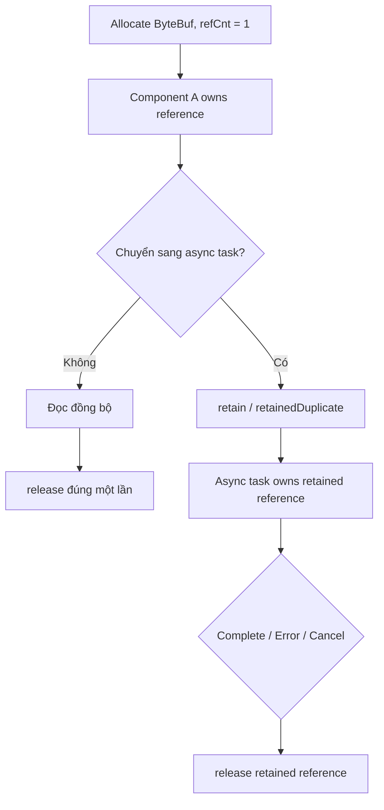
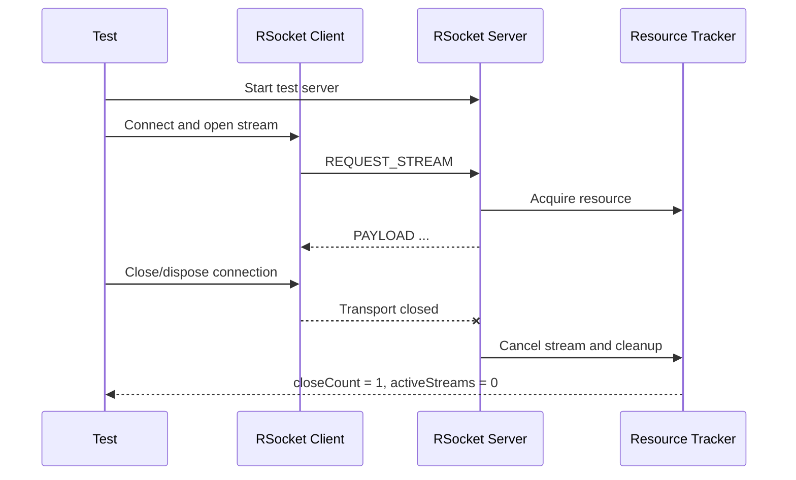

# Kiểm thử giải phóng tài nguyên sau lỗi, hủy và đóng kết nối

Một pipeline RSocket có thể kết thúc theo nhiều cách: xử lý xong bình thường, phát sinh lỗi, subscriber chủ động hủy, hoặc transport/connection bị đóng khi stream vẫn đang chạy. Những đường kết thúc này không tương đương nhau. Một resource được giải phóng đúng ở nhánh complete vẫn có thể bị rò rỉ khi publisher lỗi hoặc khi client disconnect giữa chừng.

Trong ứng dụng Java reactive, tài nguyên cần cleanup có thể là `ByteBuf`/`Payload` được reference-counted, file hoặc channel, database cursor, subscription, timer, scheduler task, queue, session registry entry hoặc connection RSocket. Bài kiểm thử cần chứng minh mỗi tài nguyên được giải phóng đúng một lần khi lifecycle kết thúc, không bị release quá sớm khi downstream còn dùng và không còn tác vụ nền sau khi stream đã đóng.

Bài này hướng dẫn mô hình hóa ownership, dùng `using`, `usingWhen`, `doFinally` và `doOnDiscard`, kiểm tra complete/error/cancel bằng Reactor `StepVerifier`, kiểm tra `ByteBuf`/`Payload`, và viết integration test cho việc đóng connection RSocket.

## 1. Vì sao phải kiểm thử từng đường kết thúc?

Một luồng dữ liệu có thể kết thúc bởi các signal khác nhau:

| Đường kết thúc | Signal hoặc sự kiện | Ví dụ |
|---|---|---|
| Hoàn tất | `onComplete` | Server phát xong một request-stream hữu hạn |
| Lỗi | `onError` | Handler lỗi, codec thất bại hoặc downstream database ném exception |
| Hủy | `cancel` từ subscriber | Client gọi `take(1)`, timeout hoặc người dùng rời màn hình |
| Đóng connection | Transport/RSocket đóng | TCP reset, WebSocket close, peer shutdown hoặc server drain |
| Shutdown ứng dụng | Lifecycle process dừng | Spring context đóng, service dispose các connection và scheduler |

Khi subscriber hủy, publisher không phát `onComplete` như một luồng hoàn tất bình thường. Khi connection đóng, stream có thể nhận lỗi hoặc cancellation tùy vị trí và implementation. Vì vậy, chỉ kiểm tra `verifyComplete()` không đủ để chứng minh cleanup an toàn.

Hãy kiểm tra ba thuộc tính cho từng loại resource:

1. **Không leak:** sau khi lifecycle kết thúc, resource không còn bị giữ ngoài ý muốn.
2. **Không release sớm:** resource vẫn hợp lệ trong toàn bộ thời gian code được phép sử dụng.
3. **Không cleanup lặp:** cùng một ownership không bị release/close nhiều lần do nhiều nhánh cùng chạy.

## 2. Lập bản đồ ownership trước khi viết test

Mỗi tài nguyên cần một hợp đồng ownership rõ ràng. Ba kiểu thường gặp:

- **Own:** component nhận quyền sở hữu và phải giải phóng resource khi xong.
- **Borrow:** component chỉ mượn resource trong phạm vi gọi; không được tự release quyền sở hữu của bên khác.
- **Transfer:** component chuyển quyền sở hữu cho thành phần tiếp theo; bên nhận chịu trách nhiệm cleanup.

Ví dụ với `ByteBuf`:



Với mỗi resource, ghi lại:

- Ai tạo hoặc acquire resource?
- API có chuyển ownership cho caller không?
- Có bao nhiêu reference được retain?
- Nhánh nào chịu trách nhiệm cleanup khi complete, error và cancel?
- Connection close có hủy subscription và giải phóng queue không?
- Resource có được dùng chung giữa nhiều subscriber không?

Không suy đoán ownership chỉ từ tên biến. Đọc contract của API Netty, RSocket, Reactor hoặc thư viện file/database đang sử dụng. Đặc biệt với raw `Payload`/`ByteBuf`, không release một reference do runtime hoặc handler khác đang sở hữu.

## 3. Chọn cơ chế cleanup phù hợp trong Reactor

### 3.1. `using` cho resource đồng bộ

`Mono.using` và `Flux.using` phù hợp khi resource có thể được acquire đồng bộ và cleanup bằng một thao tác đồng bộ như `close()` hoặc `release()`.

```java
Mono<Result> loadReport() {
    return Mono.using(
        reportStore::openCursor,
        cursor -> cursor.readReport(),
        ReportCursor::close
    );
}
```

Reactor gọi resource supplier khi subscription bắt đầu, dùng resource trong publisher được trả về và gọi cleanup khi publisher kết thúc, lỗi hoặc bị cancel. Vì resource được tạo theo subscription, mỗi subscriber có lifecycle riêng.

Không tạo cursor ở ngoài `using` rồi tái sử dụng cho nhiều subscriber nếu cursor không được thiết kế để dùng chung. Cũng không gọi `close()` thủ công ở cả publisher con và cleanup callback nếu cùng một ownership.

### 3.2. `usingWhen` cho cleanup bất đồng bộ

Một số resource cần cleanup bất đồng bộ, ví dụ đóng channel từ service từ xa hoặc trả connection vào reactive pool. Dùng `usingWhen` để định nghĩa cleanup riêng cho complete, error và cancel:

```java
Mono<WriteReceipt> writeFile(UploadRequest request) {
    return Mono.usingWhen(
        fileStore.openAsync(request.fileName()),
        channel -> writeChunks(channel, request.chunks()),
        channel -> channel.closeAsync(),
        (channel, error) -> channel.abortAsync(),
        channel -> channel.closeAsync()
    );
}
```

Trong ví dụ, thành công thì đóng channel; lỗi thì abort để tránh công bố file chưa hoàn chỉnh; cancellation thì đóng channel và dừng thao tác đang chờ. Tùy API storage, cleanup khi cancel có thể cần abort thay vì close bình thường.

Các callback cleanup phải trả publisher hoàn tất khi cleanup xong. Nếu cleanup có thể lỗi, hãy quyết định cách xử lý lỗi cleanup để không che mất lỗi gốc hoặc bỏ qua tài nguyên chưa được giải phóng.

### 3.3. `doFinally` và `doOnCancel`

`doFinally` được gọi khi sequence kết thúc bằng complete, error hoặc cancel. Nó hữu ích để dừng timer, giảm gauge hoặc giải phóng một reference mà operator hiện tại sở hữu:

```java
Mono<DecodedMessage> decodeAsync(ByteBuf inbound) {
    ByteBuf owned = inbound.retainedDuplicate();

    return Mono.fromCallable(() -> decode(owned))
        .doFinally(signal -> owned.release());
}
```

Ví dụ giả định `decode` đọc buffer đồng bộ và trả về object độc lập, không giữ view trỏ vào `owned`. `retainedDuplicate()` tạo thêm một reference cho tác vụ; `doFinally` giải phóng đúng reference đó sau complete/error/cancel.

Hãy compose publisher này ngay vào pipeline, ví dụ `inbound.flatMap(this::decodeAsync)`, để inner publisher được subscribe và cleanup có cơ hội chạy. Vì retain xảy ra khi method được gọi, nếu caller tạo `Mono` rồi bỏ nó mà không subscribe, reference đã retain sẽ không được `doFinally` giải phóng. Nếu publisher có thể bị bỏ trước subscribe, hãy đổi hợp đồng để resource được acquire bên trong lifecycle được quản lý, hoặc copy dữ liệu sang object độc lập ngay trong callback.

`doOnCancel` chỉ chạy khi subscriber cancel. Nó không thay thế cleanup cho complete hoặc error. Nếu chỉ đặt `release()` trong `doOnCancel`, buffer sẽ leak khi xử lý thành công hoặc phát sinh lỗi.

### 3.4. `doOnDiscard` cho phần tử bị loại bỏ

Một số operator có thể loại bỏ phần tử khi filter, drop, overflow, prefetch queue bị cancel hoặc downstream không còn nhận dữ liệu. Nếu phần tử là reference-counted, cần cleanup cho phần tử bị discard:

```java
Flux<ByteBuf> accepted = inboundBuffers
    .filter(this::isValid)
    .doOnDiscard(ByteBuf.class, ReferenceCountUtil::safeRelease);
```

Đặt `doOnDiscard` ở downstream của operator có khả năng discard để hook được truyền ngược qua context đến operator đó. Hook chỉ có tác dụng với operator hỗ trợ discard; nó không tự động bao phủ mọi queue hoặc mọi loại cancellation.

Với operator có callback drop riêng, có thể release phần tử bị drop ngay tại callback:

```java
Flux<ByteBuf> latest = inboundBuffers
    .onBackpressureDrop(ReferenceCountUtil::safeRelease);
```

Chỉ dùng cleanup hook khi pipeline sở hữu reference bị loại bỏ. Không release buffer đang được một subscriber khác sử dụng hoặc reference đã được chuyển ownership.

## 4. Kiểm thử cleanup khi hoàn tất bình thường

Một resource test đơn giản giúp xác nhận cleanup chạy đúng một lần:

```java
final class TrackedResource implements AutoCloseable {
    private final AtomicInteger closeCount;

    TrackedResource(AtomicInteger closeCount) {
        this.closeCount = closeCount;
    }

    String read() {
        return "report";
    }

    @Override
    public void close() {
        closeCount.incrementAndGet();
    }
}
```

Test complete:

```java
@Test
void closesResourceAfterCompletion() {
    AtomicInteger closeCount = new AtomicInteger();

    Mono<String> result = Mono.using(
        () -> new TrackedResource(closeCount),
        TrackedResource::read,
        TrackedResource::close
    );

    StepVerifier.create(result)
        .expectNext("report")
        .verifyComplete();

    assertEquals(1, closeCount.get());
}
```

Test này kiểm tra resource được acquire theo subscription, giá trị được phát và close chạy đúng một lần sau complete.

## 5. Kiểm thử cleanup khi publisher phát sinh lỗi

Cleanup phải chạy cả khi publisher con lỗi. Dùng `Mono.error` để tạo lỗi có kiểm soát:

```java
@Test
void closesResourceAfterError() {
    AtomicInteger closeCount = new AtomicInteger();

    Mono<String> result = Mono.using(
        () -> new TrackedResource(closeCount),
        resource -> Mono.error(new IllegalStateException("storage failed")),
        TrackedResource::close
    );

    StepVerifier.create(result)
        .expectErrorMessage("storage failed")
        .verify();

    assertEquals(1, closeCount.get());
}
```

Test cần xác nhận cả hai điều: lỗi gốc vẫn được truyền đến subscriber và cleanup vẫn chạy đúng một lần. Nếu cleanup tự phát sinh lỗi, cần xác định chính sách của ứng dụng: log/metric lỗi cleanup, giữ lỗi gốc làm nguyên nhân chính hoặc kết hợp lỗi theo semantics Reactor.

Đừng dùng `onErrorResume` để trả kết quả thành công giả chỉ nhằm làm test xanh. Mục tiêu là xác minh tài nguyên được cleanup trong khi tín hiệu lỗi vẫn phản ánh đúng vấn đề.

## 6. Kiểm thử cleanup khi subscriber hủy

Cancellation là đường dễ bị bỏ sót vì không có `onComplete` hoặc `onError` gửi về subscriber. Dùng `Flux.never()` để giữ resource mở cho đến khi test chủ động cancel:

```java
@Test
void closesResourceAfterCancellation() {
    AtomicInteger closeCount = new AtomicInteger();

    Flux<Long> result = Flux.using(
        () -> new TrackedResource(closeCount),
        resource -> Flux.never(),
        TrackedResource::close
    );

    StepVerifier.create(result)
        .thenCancel()
        .verify();

    assertEquals(1, closeCount.get());
}
```

Test chứng minh cleanup được gọi khi subscription bị cancel. Với resource cleanup bất đồng bộ, dùng `usingWhen` và chờ cleanup publisher hoàn tất hoặc xác minh bằng signal/latch có timeout; không chỉ kiểm tra ngay một counter nếu cleanup còn đang chạy.

### 6.1. Phân biệt cancel với complete

Một số operator như `take(1)` có thể phát một phần tử rồi cancel upstream. Downstream có thể quan sát complete do `take` phát ra, trong khi upstream nhận cancellation. Nếu cleanup nằm ở upstream, test cần kiểm tra hành vi cancellation thực tế chứ không chỉ nhìn signal của downstream.

```java
@Test
void takeCancelsUpstreamAndReleasesResource() {
    AtomicInteger closeCount = new AtomicInteger();

    Flux<Integer> source = Flux.using(
        () -> new TrackedResource(closeCount),
        resource -> Flux.range(1, 100),
        TrackedResource::close
    );

    StepVerifier.create(source.take(1))
        .expectNext(1)
        .verifyComplete();

    assertEquals(1, closeCount.get());
}
```

Downstream complete không có nghĩa upstream đã chạy đến hết nguồn; `take(1)` hủy phần còn lại. Resource thuộc upstream vẫn phải được cleanup.

## 7. Kiểm thử `doFinally` cho cả ba signal

`doFinally` nhận `SignalType` để phân biệt `ON_COMPLETE`, `ON_ERROR` và `CANCEL`. Có thể dùng counter riêng trong test để xác minh đường kết thúc:

```java
AtomicReference<SignalType> terminalSignal = new AtomicReference<>();

Mono<String> result = Mono.just("ok")
    .doFinally(terminalSignal::set);

StepVerifier.create(result)
    .expectNext("ok")
    .verifyComplete();

assertEquals(SignalType.ON_COMPLETE, terminalSignal.get());
```

Viết test tương tự với `Mono.error(...)` để xác nhận `ON_ERROR` và `Flux.never()` cùng `thenCancel()` để xác nhận `CANCEL`. Nếu `doFinally` vừa cập nhật metric vừa release resource, hãy bảo đảm test xác minh mỗi side effect chỉ chạy đúng một lần.

Không đặt cleanup của shared resource vào `doFinally` của từng subscriber nếu nhiều subscriber cùng dùng tài nguyên đó. Khi subscriber đầu tiên kết thúc, shared resource có thể bị đóng trong khi subscriber khác vẫn đang dùng. Shared resource cần lifecycle do component sở hữu, reference counting hoặc cơ chế quản lý riêng.

## 8. Kiểm thử ByteBuf và RSocket Payload

### 8.1. Kiểm tra reference count của ByteBuf do test sở hữu

Với buffer do test cấp phát và ownership thuộc test, có thể xác minh reference count sau cleanup:

```java
@Test
void releasesOwnedByteBufAfterDecode() {
    ByteBuf buffer = Unpooled.buffer();
    buffer.writeByte(42);

    try {
        assertEquals(42, decode(buffer));
    } finally {
        buffer.release();
    }

    assertEquals(0, buffer.refCnt());
}
```

Không áp dụng đoạn test này cho buffer mà framework hoặc RSocket runtime đang sở hữu. Nếu pipeline nhận ownership từ upstream, test phải tuân theo contract đó và không release thêm lần nữa.

### 8.2. Kiểm tra retained reference qua tác vụ bất đồng bộ

```java
Mono<String> decodeOnWorker(ByteBuf inbound) {
    ByteBuf owned = inbound.retainedDuplicate();

    return Mono.fromCallable(() -> decodeToString(owned))
        .subscribeOn(Schedulers.boundedElastic())
        .doFinally(signal -> owned.release());
}
```

Test cần kiểm tra:

- Kết quả được decode trước khi retained reference bị release.
- Reference được release khi callable complete.
- Reference được release khi callable ném exception.
- Reference được release nếu subscription bị cancel trước khi tác vụ hoàn tất.
- Không còn callback nào truy cập `owned` sau cleanup.

Trong ví dụ, `decodeOnWorker` retain ngay khi được gọi. Hãy gọi nó từ operator như `flatMap`/`concatMap` để publisher con được subscribe; nếu code có thể tạo rồi bỏ publisher, phải có cleanup cho reference chưa được sử dụng hoặc chuyển sang copy/defer theo lifetime thực tế của buffer gốc.

Với race giữa task đang chạy và cancellation, cần bảo đảm việc cleanup chỉ diễn ra sau khi tác vụ không còn truy cập buffer. `doFinally` của publisher phải bao quanh đúng lifetime của tác vụ; nếu tác vụ bên ngoài không thể bị hủy hoặc tiếp tục chạy sau cancel, cần cơ chế phối hợp dừng task trước khi release buffer.

### 8.3. Payload ở raw RSocket API và DTO Spring

`Payload` của RSocket là tài nguyên reference-counted. Khi handler nhận raw `Payload`, hãy đọc contract của API để xác định ownership. Nếu API chuyển ownership cho handler, release payload sau khi đã chuyển data/metadata sang object độc lập:

```java
String decodePayload(Payload payload) {
    try {
        return payload.getDataUtf8();
    } finally {
        payload.release();
    }
}
```

Ví dụ chỉ đúng khi handler sở hữu reference nhận được. Không release nếu contract nói runtime hoặc thành phần khác sẽ release. Không trả về `ByteBuf` view trỏ vào payload rồi release payload ngay; view có thể mất hiệu lực.

Với Spring `@MessageMapping` nhận DTO đã decode, ứng dụng không trực tiếp sở hữu `Payload`/`ByteBuf` nội bộ của codec. Không gọi release trên DTO. Chỉ kiểm thử ownership trực tiếp khi dùng raw RSocket/Netty API hoặc khi ứng dụng tự tạo reference-counted buffer.

### 8.4. Kiểm thử phần tử bị discard

Nếu pipeline có filter/drop, test cần xác nhận buffer bị loại được giải phóng:

```java
@Test
void releasesDiscardedBuffer() {
    ByteBuf accepted = Unpooled.buffer().writeByte(1);
    ByteBuf discarded = Unpooled.buffer().writeByte(0);

    Flux<ByteBuf> source = Flux.just(accepted, discarded)
        .filter(buffer -> buffer.getByte(0) == 1)
        .doOnDiscard(ByteBuf.class, ReferenceCountUtil::safeRelease);

    StepVerifier.create(source)
        .assertNext(buffer -> {
            assertEquals(1, buffer.getByte(0));
            buffer.release();
        })
        .verifyComplete();

    assertEquals(0, accepted.refCnt());
    assertEquals(0, discarded.refCnt());
}
```

Test này giả định source chuyển quyền sở hữu cả hai buffer cho pipeline. Nhánh được emit được test release; nhánh bị filter loại được `doOnDiscard` release. Nếu source hoặc operator khác đã có cleanup riêng, điều chỉnh fixture để mỗi reference chỉ có một owner.

## 9. Kiểm thử connection RSocket đóng khi stream đang chạy

Một integration test cần chứng minh rằng connection close làm các stream liên quan kết thúc và tài nguyên gắn với connection được dọn. Các resource thường cần kiểm tra:

- Subscription đang chạy trên client và server.
- Queue/prefetch chứa payload chưa xử lý.
- Timer, heartbeat và retry task gắn với connection.
- Registry entry ánh xạ client/session đến requester.
- File/channel hoặc cursor được mở cho stream.
- Reference-counted payload/buffer mà ứng dụng đã retain.

Mô hình test:



Trong fixture thực tế, dùng TCP transport trên port động hoặc transport test phù hợp, mở stream dài hạn, chờ server xác nhận resource đã acquire rồi đóng connection. Sau đó đợi cleanup hoàn tất với timeout và xác minh resource tracker về trạng thái rỗng.

Không chỉ kiểm tra client nhận lỗi. Cần xác minh phía server đã nhận cancellation/connection close và cleanup resource server-side. Nếu stream bị tách khỏi connection bằng `subscribe()` thủ công và không giữ `Disposable`, connection close có thể không hủy tác vụ ứng dụng như mong đợi.

### 9.1. Theo dõi lifecycle connection

Ở nơi sở hữu `RSocket`, có thể quan sát close signal và dọn registry/subscription gắn với connection:

```java
Disposable watchConnection(
        RSocket socket,
        String connectionKey,
        ConnectionRegistry registry) {

    return socket.onClose()
        .doFinally(signal -> registry.remove(connectionKey))
        .subscribe();
}
```

Đây là ví dụ minh họa; component quản lý socket phải giữ và dispose subscription theo lifecycle của chính nó. Nếu `onClose()` đã được compose vào một lifecycle publisher khác, không tạo thêm subscription chỉ để quan sát mà không quản lý `Disposable`.

Khi ứng dụng đóng connection chủ động, hãy dừng nhận công việc mới, cancel stream phụ thuộc, cleanup resource theo policy rồi dispose socket. Khi peer đóng bất ngờ, cần cùng cleanup path nhưng vẫn ghi nhận nguyên nhân transport để chẩn đoán.

## 10. Kiểm thử cleanup khi timeout và retry

Timeout thường được triển khai bằng operator hủy upstream rồi phát lỗi timeout xuống downstream. Resource upstream phải được cleanup như cancellation/error tùy vị trí operator.

```java
Mono<Result> result = Mono.using(
    resourceFactory::open,
    resource -> remoteCall(resource),
    Resource::close
).timeout(Duration.ofSeconds(2));
```

Test cần xác minh timeout xảy ra, upstream được cancel và resource được close đúng một lần. Nếu retry tạo subscription mới, mỗi lần retry có thể acquire resource mới; test phải xác minh resource của lần trước đã cleanup trước hoặc theo đúng semantics retry trước khi lần sau tiếp tục.

Không đặt `using` ngoài một publisher đã materialize resource dùng chung cho mọi retry nếu resource không được thiết kế để tái sử dụng. Thường nên đặt acquisition bên trong `defer`/resource operator để mỗi subscription có ownership riêng.

## 11. TestPublisher, PublisherProbe và StepVerifier

Reactor cung cấp các công cụ giúp kiểm soát tín hiệu và xác minh publisher được subscribe/cancel:

- `StepVerifier`: xác minh phần tử, error, complete, demand và cancellation.
- `TestPublisher`: điều khiển thời điểm phát next/error/complete, hữu ích cho race và cleanup.
- `PublisherProbe`: xác minh publisher nhánh nào được subscribe, request hoặc cancel.
- `withVirtualTime`: kiểm tra timeout/retry/backoff mà không chờ thời gian thực.

Ví dụ kiểm tra cancellation được truyền lên nguồn:

```java
@Test
void propagatesCancellationToSource() {
    PublisherProbe<Integer> probe = PublisherProbe.of(Flux.never());

    StepVerifier.create(probe.flux())
        .thenCancel()
        .verify();

    probe.assertWasSubscribed();
    probe.assertWasCancelled();
}
```

Với resource thật, ghép probe với `using`/`usingWhen` và một tracker đếm acquire/close. Không chỉ assert publisher bị cancel; cần assert resource đã cleanup.

## 12. Ma trận kiểm thử resource lifecycle

Hãy xây ma trận theo loại resource và đường kết thúc:

| Resource | Complete | Error | Cancel | Connection close | Shutdown |
|---|---|---|---|---|---|
| ByteBuf/Payload do ứng dụng sở hữu | Release reference | Release reference | Release retained reference và discard queue | Dừng stream rồi release reference còn giữ | Release mọi reference còn thuộc component |
| File/channel | Close/commit theo policy | Abort/close | Cancel I/O và close | Dừng I/O, close và giữ/xóa partial data theo policy | Flush/close có deadline |
| Database cursor | Close | Close/rollback nếu cần | Cancel query và close | Hủy subscription, close cursor | Đóng cursor trước khi pool shutdown |
| Timer/retry task | Dispose khi không còn cần | Dispose | Dispose | Dispose task gắn connection | Dispose scheduler/task group |
| Subscription | Terminal tự nhiên | Terminal lỗi | Propagate cancel | Cancel stream phụ thuộc | Dispose subscription thuộc service |
| Connection registry | Giữ đến khi close | Remove khi setup/handler lỗi theo policy | Remove khi owner dispose | Remove đúng connection | Clear sau khi drain |
| Queue/buffer | Drain hoặc clear | Clear phần tử còn lại | Release discard | Clear/terminate queue | Drain có giới hạn rồi release |

Ma trận này là checklist thiết kế; hành vi chính xác phụ thuộc hợp đồng nghiệp vụ. Ví dụ, file upload bị cancel có thể được giữ partial để resume hoặc xóa ngay, nhưng test phải xác minh policy đã chọn.

## 13. Các race condition cần tái hiện

Cleanup có thể chạy đồng thời với `onNext`, error, timeout hoặc connection close. Những trường hợp sau nên có test riêng:

1. Connection đóng đúng lúc consumer đang decode một `ByteBuf` đã retain.
2. Timeout xảy ra cùng lúc downstream nhận response.
3. Subscriber cancel trong lúc async file write đang chạy.
4. Error xảy ra sau khi một phần chunk đã được ghi xuống storage.
5. Hai nhánh cleanup cùng cố đóng một resource.
6. Server shutdown trong khi stream request-channel vẫn có payload outstanding.
7. Queue bị overflow cùng lúc consumer cancel.
8. Retry bắt đầu khi cleanup của attempt trước chưa hoàn tất.

Dùng `AtomicBoolean` hoặc cơ chế idempotent close khi resource có thể được nhiều callback yêu cầu cleanup, nhưng đừng dùng cờ để che một ownership model sai. Với async cleanup, `usingWhen` thường giúp ràng buộc thời điểm kết thúc publisher với thời điểm cleanup hoàn tất.

## 14. Phát hiện leak trong test

Ngoài counter cleanup, có thể bật Netty leak detector ở mức mạnh hơn trong test:

```text
-Dio.netty.leakDetection.level=paranoid
```

`PARANOID` có overhead cao; chỉ bật trong test hoặc một phiên điều tra ngắn. Có thể dùng `ADVANCED` khi cần access record với chi phí thấp hơn. Leak detector dựa trên sampling/GC và không bảo đảm một lần test không log leak đồng nghĩa code không có leak.

Kết hợp các kiểm tra:

- Counter acquire và release cân bằng sau test.
- `refCnt()` bằng 0 với buffer mà test sở hữu sau cleanup.
- Active stream/connection registry trở về 0.
- Timer/scheduler task được dispose.
- Queue depth/bytes trở về 0 hoặc trạng thái policy đã định nghĩa.
- Không có `IllegalReferenceCountException` hoặc Netty leak report.
- Memory không tăng qua nhiều chu kỳ test tương đương.

Đừng gọi `System.gc()` liên tục hoặc dùng heap usage tức thời làm assertion duy nhất. Pooled allocator có thể giữ vùng nhớ đã release để tái sử dụng; kiểm tra ownership/counter và xu hướng qua nhiều chu kỳ đáng tin cậy hơn.

## 15. Checklist cho integration test RSocket

- [ ] Client và server thiết lập connection thật bằng transport dùng trong môi trường mục tiêu.
- [ ] Mở request-stream hoặc request-channel có resource được tracker.
- [ ] Test complete xác nhận cleanup đúng một lần ở cả hai peer.
- [ ] Test handler error xác nhận lỗi được truyền và cleanup vẫn chạy.
- [ ] Test client cancel xác nhận upstream/server dừng công việc.
- [ ] Test server/peer đóng connection khi stream còn active.
- [ ] Test timeout và retry không để lại resource từ attempt cũ.
- [ ] Test buffer bị discard/drop giải phóng reference-counted element.
- [ ] Test async task không truy cập buffer sau khi release.
- [ ] Test connection registry, timer và subscription được dọn khi disconnect.
- [ ] Test shutdown có deadline và không để task nền tiếp tục vô hạn.
- [ ] Bật leak detector phù hợp và kiểm tra log sau nhiều lần lặp.

## 16. Quy trình điều tra khi test phát hiện resource chưa được giải phóng

1. Xác định resource và nơi acquire/allocate.
2. Đọc ownership contract của API và ghi lại từng lần retain/release hoặc open/close.
3. Xác định test đang kết thúc bằng complete, error, cancel hay connection close.
4. Kiểm tra cleanup operator nằm ở đúng phạm vi subscription và resource lifetime.
5. Kiểm tra discard hook cho phần tử bị loại khỏi queue/operator.
6. Kiểm tra async task có tiếp tục chạy sau cancellation không.
7. Kiểm tra connection close có thực sự cancel subscription và dispose timer/registry không.
8. Thêm test tái hiện lỗi trước khi sửa code.
9. Sửa tại owner chịu trách nhiệm cleanup; tránh thêm release/close ở nhiều tầng.
10. Chạy lại toàn bộ ma trận complete/error/cancel/disconnect và lặp dưới tải.

Nếu gặp `IllegalReferenceCountException`, tìm double release hoặc use-after-release trước khi thêm `safeRelease()`. Nếu gặp leak report, lần theo allocation/access record để tìm nhánh chưa release. Một lỗi có thể chỉ xuất hiện dưới tải vì race giữa cancellation và async callback; hãy giữ test concurrency đủ nhỏ để tái hiện nhưng vẫn có assertion xác định.

## 17. Kết luận

Kiểm thử giải phóng tài nguyên phải bao phủ mọi đường kết thúc của reactive stream: complete, error, cancel và connection close. `using` phù hợp với resource đồng bộ, `usingWhen` phù hợp với cleanup bất đồng bộ, `doFinally` quan sát cả ba terminal signal và `doOnDiscard` xử lý phần tử bị operator loại bỏ. Với `ByteBuf`/`Payload`, ownership và reference count phải rõ ràng; retain chỉ khi cần kéo dài lifetime và mỗi reference được tạo thêm phải có nơi release tương ứng.

`StepVerifier` xác minh signal và cancellation; `TestPublisher`/`PublisherProbe` giúp điều khiển và quan sát subscription; integration test RSocket xác nhận connection close thực sự dừng stream và cleanup ở cả hai peer. Một bộ test tốt chứng minh resource được giải phóng đúng một lần, không bị release sớm và không còn task/queue/registry entry sau khi connection kết thúc.
