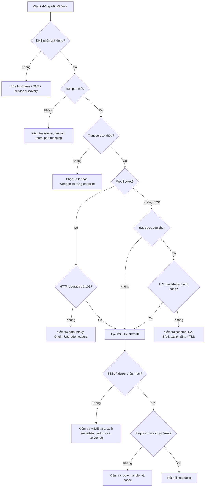

# Kết nối thất bại: sai cổng, transport, đường dẫn hoặc chứng chỉ

Khi client RSocket không kết nối được tới server, lỗi có thể xuất hiện ở nhiều lớp: DNS không phân giải được host, TCP không mở được cổng, client dùng sai transport, WebSocket gọi sai path, proxy không cho phép nâng cấp kết nối, hoặc TLS từ chối chứng chỉ. Cũng có trường hợp TCP/WebSocket đã kết nối nhưng RSocket `SETUP` thất bại do client và server không thống nhất cấu hình.

Hãy chẩn đoán từ ngoài vào trong theo thứ tự:

1. **Host và DNS**: hostname có phân giải tới đúng địa chỉ không?
2. **Cổng và network**: server có lắng nghe đúng cổng, firewall và proxy có cho phép kết nối không?
3. **Transport**: endpoint đang dùng TCP hay WebSocket, client có chọn đúng loại không?
4. **Đường dẫn và HTTP upgrade**: nếu dùng WebSocket, path có khớp `mapping-path` và handshake có trả `101 Switching Protocols` không?
5. **TLS/chứng chỉ**: scheme, certificate chain, hostname/SAN, thời hạn, truststore và mTLS có hợp lệ không?
6. **RSocket SETUP**: sau khi transport mở, server có chấp nhận frame `SETUP` không?

Không nên bắt đầu bằng cách đổi đồng thời cổng, path và chứng chỉ. Mỗi lần chỉ kiểm tra một lớp, ghi lại kết quả và giữ nguyên bằng chứng lỗi để tìm đúng nguyên nhân.

## 1. Hiểu các lớp kết nối

RSocket chạy trên một byte-stream transport như TCP hoặc WebSocket. Hai loại transport có cách mở kết nối khác nhau:

```text
RSocket over TCP
Client ── DNS/TCP host:port ──> RSocket server ── SETUP ──> Ready

RSocket over WebSocket
Client ── DNS/TCP/TLS ──> HTTP endpoint/path
       ── Upgrade: websocket ──> 101 Switching Protocols
       ── RSocket SETUP ──> Ready
```

Với TCP, client kết nối trực tiếp tới host và port của RSocket server. Không có HTTP URL path hoặc HTTP Upgrade.

Với WebSocket, client mở một HTTP(S) request tới endpoint đã cấu hình. Sau khi server nâng cấp thành WebSocket, các frame RSocket mới được trao đổi trên kết nối đó.

Vì vậy, kết nối TCP thành công chưa chắc RSocket `SETUP` thành công; HTTP `101` cũng chưa chứng minh RSocket `SETUP` đã được server chấp nhận.

## 2. Xác định chính xác endpoint của server

Trước khi kiểm tra mạng, hãy lấy bốn thông tin từ cấu hình triển khai:

- Hostname hoặc IP mà client cần truy cập.
- Port thực sự đang listen sau khi triển khai, bao gồm port mapping hoặc Kubernetes Service.
- Transport là TCP hay WebSocket.
- Nếu là WebSocket: scheme (`ws`/`wss`) và path.

Hai kiểu cấu hình Spring Boot thường gặp có endpoint khác nhau.

### Server RSocket TCP độc lập

Với server độc lập, RSocket lắng nghe trên cổng riêng:

```yaml
spring:
  rsocket:
    server:
      transport: tcp
      port: 7000
```

Client phải kết nối tới cổng `7000`:

```java
RSocketRequester requester = RSocketRequester.builder()
    .tcp("rsocket.internal.example", 7000);
```

`server.port` của Spring Boot Web không quyết định cổng TCP RSocket độc lập này. Nếu ứng dụng cũng cung cấp REST API, cổng HTTP và cổng RSocket có thể khác nhau.

### RSocket WebSocket được gắn vào WebFlux server

Với ứng dụng WebFlux dùng Reactor Netty, Spring Boot có thể gắn RSocket vào HTTP server hiện có:

```yaml
server:
  port: 8080

spring:
  rsocket:
    server:
      transport: websocket
      mapping-path: /rsocket
```

Client kết nối tới WebSocket endpoint trên cổng web server:

```java
URI endpoint = URI.create("http://api.example.com:8080/rsocket");

RSocketRequester requester = RSocketRequester.builder()
    .websocket(endpoint);
```

Ở cấu hình này, `server.port` là cổng HTTP/WebSocket. `spring.rsocket.server.mapping-path` là path dành cho WebSocket handshake; nó không phải route của từng request RSocket. Cách gắn vào web server được Spring Boot hỗ trợ cho WebFlux với Reactor Netty.

Trong ví dụ Java, `RSocketRequester.Builder.websocket(URI)` dùng URI HTTP/HTTPS như cách Spring Framework minh họa (`http://` cho kết nối không TLS, `https://` cho TLS). Ở URL WebSocket hiển thị cho browser hoặc công cụ WebSocket thông thường, hai trường hợp tương ứng thường được viết là `ws://` và `wss://`.

### Server WebSocket độc lập

Spring Boot cũng hỗ trợ khởi chạy RSocket WebSocket server độc lập. Khi đó, hãy xác định rõ port của RSocket server và endpoint WebSocket mà server thực sự expose; không suy ra port từ `server.port` của HTTP server khác. Kiểm tra cấu hình transport và mapping path theo phiên bản Spring Boot đang dùng.

## 3. Lập bảng endpoint trước khi chạy kiểm tra

| Kiểu triển khai | Endpoint client | Cấu hình server cần đối chiếu |
|---|---|---|
| RSocket TCP | `host:7000` | `spring.rsocket.server.transport=tcp`, `spring.rsocket.server.port=7000` |
| RSocket TCP có TLS | `host:7001` hoặc port TLS đã chọn | TCP transport phải bật TLS; client cũng phải dùng TLS và trust đúng CA |
| WebSocket trên WebFlux | `ws://host:8080/rsocket` | `server.port=8080`, `transport=websocket`, `mapping-path=/rsocket` |
| WebSocket bảo vệ bằng TLS | `wss://host:8443/rsocket` | HTTPS web server có TLS, WebSocket mapping path khớp |
| Sau reverse proxy/ingress | Host và port công khai cùng path sau rewrite | Proxy chuyển đúng upstream port và giữ WebSocket Upgrade headers |

Hãy ghi cả endpoint nội bộ và endpoint công khai. Ví dụ ứng dụng có thể listen ở `0.0.0.0:8080/rsocket`, nhưng client bên ngoài truy cập `wss://realtime.example.com/socket` vì ingress rewrite `/socket` thành `/rsocket`.

## 4. Kiểm tra DNS và hostname

Nếu hostname không phân giải hoặc phân giải sai IP, mọi bước kiểm tra port/TLS tiếp theo đều có thể gây hiểu nhầm.

Trên Windows:

```powershell
Resolve-DnsName rsocket.internal.example
nslookup rsocket.internal.example
```

Trên Linux/macOS:

```bash
dig +short rsocket.internal.example
getent hosts rsocket.internal.example
```

Kiểm tra:

- DNS record có trỏ tới IP hoặc load balancer đúng môi trường không?
- Client có dùng nhầm hostname staging/production không?
- DNS cache hoặc `/etc/hosts` có giữ địa chỉ cũ không?
- Trong Kubernetes, service name có đúng namespace và cluster domain không?
- Client chạy trong container có dùng DNS resolver khác máy phát triển không?

Nếu kết nối bằng IP hoạt động nhưng bằng hostname thất bại, kiểm tra DNS và cả chứng chỉ: TLS certificate thường xác minh hostname trong SAN, không chỉ địa chỉ IP đã phân giải.

## 5. Kiểm tra cổng TCP và firewall

### Từ máy client

Windows PowerShell:

```powershell
Test-NetConnection rsocket.internal.example -Port 7000 -InformationLevel Detailed
```

Linux/macOS nếu có netcat:

```bash
nc -vz rsocket.internal.example 7000
```

Kết quả `TcpTestSucceeded: True` hoặc `succeeded` chỉ chứng minh TCP handshake tới được endpoint. Nó chưa kiểm tra RSocket `SETUP`, WebSocket path hoặc certificate chain ở tầng ứng dụng.

### Trên máy server

Linux:

```bash
ss -lntp
```

Windows:

```powershell
Get-NetTCPConnection -State Listen |
  Sort-Object LocalPort |
  Format-Table LocalAddress, LocalPort, OwningProcess
```

Xác minh server đang listen đúng port và đúng interface. Nếu server chỉ bind `127.0.0.1`, client từ máy khác hoặc container khác sẽ không truy cập được. Trong môi trường container, cần kiểm tra cả port publish và service `targetPort`.

### Phân biệt các lỗi network

| Triệu chứng | Khả năng thường gặp | Kiểm tra tiếp |
|---|---|---|
| `Connection refused` | Không có process listen, sai port, service chưa ready hoặc proxy từ chối | `ss`/`Get-NetTCPConnection`, service port, container mapping |
| `Connection timed out` | Firewall drop, route mạng, security group, NetworkPolicy hoặc endpoint không phản hồi | DNS, route, firewall, ingress, network policy |
| `UnknownHostException` | DNS/hostname sai hoặc resolver lỗi | `Resolve-DnsName`, `dig`, service discovery |
| `No route to host` | Không có đường mạng hoặc firewall trả lỗi unreachable | Route table, subnet, VPN, NetworkPolicy |
| Kết nối rồi bị reset | Sai protocol/port, proxy đóng socket, server restart hoặc TLS/SETUP bị từ chối | Log server, transport, TLS và RSocket setup |

## 6. Phân biệt TCP và WebSocket bị chọn nhầm

TCP và WebSocket không thể thay thế trực tiếp cho nhau chỉ bằng cách đổi port.

| Client | Server | Kết quả thường thấy |
|---|---|---|
| TCP RSocket | TCP RSocket | Có thể tiếp tục tới RSocket `SETUP` |
| WebSocket RSocket | WebSocket endpoint | Có HTTP Upgrade rồi RSocket `SETUP` |
| TCP RSocket | HTTP/WebSocket port | TCP có thể mở nhưng byte RSocket bị HTTP server/proxy hiểu sai hoặc bị đóng |
| WebSocket RSocket | TCP RSocket port | HTTP handshake thất bại hoặc nhận dữ liệu không phải HTTP response |
| TLS client | Plain TCP endpoint | TLS handshake thất bại, có thể báo `wrong version number` hoặc lỗi record |
| Plain client | TLS endpoint | Server thường đóng kết nối hoặc báo lỗi handshake |

Không kết luận transport đúng chỉ từ việc `Test-NetConnection` thành công. Đối chiếu `transport` phía server với phương thức client:

```java
// Server TCP: client dùng TCP
RSocketRequester tcpRequester = RSocketRequester.builder()
    .tcp("rsocket.internal.example", 7000);

// Server WebSocket: client dùng WebSocket URI
RSocketRequester wsRequester = RSocketRequester.builder()
    .websocket(URI.create("https://api.example.com:8080/rsocket"));
```

Đừng gọi `.tcp(...)` vào cổng HTTP chỉ vì cổng đó đang mở. Tương tự, không gọi `.websocket(...)` vào cổng RSocket TCP.

## 7. Chẩn đoán sai đường dẫn WebSocket

Path của WebSocket endpoint là một phần của HTTP handshake. Với Spring Boot WebFlux, path được khai báo bởi `spring.rsocket.server.mapping-path`.

Ví dụ server:

```yaml
spring:
  rsocket:
    server:
      transport: websocket
      mapping-path: /rsocket
```

Client phải dùng path đó sau khi tính các rewrite của ingress/proxy:

```java
URI endpoint = URI.create("https://realtime.example.com/rsocket");
RSocketRequester requester = RSocketRequester.builder().websocket(endpoint);
```

Các trường hợp sai phổ biến:

- Client gọi `/` trong khi server đăng ký `/rsocket`.
- Client gọi `/rsocket/` nhưng proxy hoặc server chỉ map `/rsocket` và không normalize dấu `/` cuối.
- Ingress strip prefix nhưng upstream lại mong path đầy đủ, hoặc rewrite hai lần.
- Proxy chuyển tới HTTP API port thay vì port WebSocket/RSocket.
- Client gọi endpoint REST như `/api/rsocket` trong khi mapping path là `/rsocket`.
- Proxy không chuyển tiếp `Upgrade` và `Connection` headers.

### Kiểm tra WebSocket Upgrade

Có thể kiểm tra HTTP handshake bằng `curl`:

```bash
curl -i --http1.1 --max-time 5 \
  -H "Connection: Upgrade" \
  -H "Upgrade: websocket" \
  -H "Sec-WebSocket-Version: 13" \
  -H "Sec-WebSocket-Key: dGhlIHNhbXBsZSBub25jZQ==" \
  -H "Origin: https://app.example.com" \
  https://realtime.example.com/rsocket
```

Nếu endpoint cho phép origin đó và path đúng, handshake WebSocket thường trả `101 Switching Protocols`. Kết quả khác cần được diễn giải theo status:

| HTTP status | Khả năng cần kiểm tra |
|---|---|
| `101` | Upgrade đã thành công; tiếp tục kiểm tra RSocket `SETUP` bằng RSocket client |
| `301`/`302` | Redirect, canonical host hoặc HTTP-to-HTTPS; WebSocket client có thể không theo redirect như HTTP browser |
| `400` | Handshake header sai, proxy không hỗ trợ upgrade hoặc request không đúng định dạng |
| `401`/`403` | Xác thực, quyền hoặc origin policy từ chối handshake |
| `404` | Sai path, mapping path hoặc rewrite của proxy |
| `426` | Server/proxy yêu cầu protocol upgrade nhưng request không được xử lý đúng |
| `502`/`503`/`504` | Gateway không kết nối được upstream, upstream chưa sẵn sàng hoặc timeout |

`curl` kiểm tra HTTP upgrade, không gửi RSocket `SETUP` frame. Một WebSocket handshake trả `101` nhưng RSocket client vẫn lỗi có thể là lỗi sau handshake: server không nhận được frame đúng, SETUP bị từ chối hoặc cấu hình RSocket không tương thích.

## 8. Kiểm tra proxy, ingress và load balancer

Nếu kết nối trực tiếp tới server thành công nhưng endpoint công khai thất bại, tập trung vào proxy/ingress:

- Upstream host và port có trỏ đúng service không?
- HTTP version có hỗ trợ WebSocket Upgrade không?
- `Upgrade: websocket` và `Connection: Upgrade` có được chuyển tiếp không?
- Path rewrite có khớp `mapping-path` không?
- Idle timeout có ngắn hơn keepalive hoặc thời gian sống stream không?
- Load balancer có phân phối kết nối lâu dài tới backend khỏe mạnh không?
- Có policy chặn WebSocket hoặc giới hạn thời gian kết nối không?
- Proxy có kết thúc TLS ở edge hay chuyển TLS tới upstream?

Một số proxy kết thúc TLS tại edge rồi dùng plain HTTP/WebSocket tới upstream. Khi đó client dùng `wss://` ở phía ngoài nhưng backend có thể nhận kết nối WebSocket không TLS. Điều này hợp lệ nếu kiến trúc được cấu hình chủ ý; không yêu cầu backend phải dùng TLS chỉ vì client dùng `wss` ở edge.

Với TCP RSocket, HTTP ingress thông thường không thể tự động proxy như WebSocket. Cần TCP load balancer hoặc gateway hỗ trợ TCP passthrough/proxy và cấu hình đúng port/protocol.

## 9. Phân biệt TLS lỗi với RSocket lỗi

TLS xảy ra trước khi RSocket `SETUP` được trao đổi. Nếu TLS handshake chưa hoàn tất, server chưa thể xử lý RSocket request. Hãy xác định endpoint đang dùng TLS ở đâu:

- `wss://` dùng TLS cho HTTP/WebSocket handshake và dữ liệu WebSocket.
- RSocket TCP có TLS cần TLS được bật trực tiếp trên TCP transport.
- Với RSocket server độc lập do Spring Boot quản lý, có thể cấu hình TLS bằng `spring.rsocket.server.ssl.*`.
- TCP thường dùng không tự có TLS chỉ vì port là `443` hoặc `7001`.
- Reverse proxy có thể kết thúc TLS ở edge và chuyển plain traffic tới upstream theo kiến trúc mạng riêng.

### TLS cho WebSocket gắn vào HTTPS WebFlux server

Ví dụ Spring Boot web server phục vụ HTTPS và RSocket WebSocket:

```yaml
server:
  port: 8443
  ssl:
    enabled: true
    key-store: classpath:server.p12
    key-store-type: PKCS12
    key-store-password: ${SERVER_KEYSTORE_PASSWORD}
    key-alias: rsocket

spring:
  rsocket:
    server:
      transport: websocket
      mapping-path: /rsocket
```

Client dùng `wss://`:

```java
RSocketRequester requester = RSocketRequester.builder()
    .websocket(URI.create("https://realtime.example.com:8443/rsocket"));
```

`server.ssl.*` cấu hình TLS cho web server. Nó không tự bật TLS cho một RSocket TCP server độc lập đang listen ở port khác.

### TLS cho RSocket TCP độc lập

Với server RSocket độc lập do Spring Boot quản lý, dùng namespace `spring.rsocket.server.ssl.*`; `server.ssl.*` thuộc web server và không thay thế cấu hình này:

```yaml
spring:
  rsocket:
    server:
      transport: tcp
      port: 7001
      ssl:
        enabled: true
        key-store: classpath:rsocket-server.p12
        key-store-type: PKCS12
        key-store-password: ${RSOCKET_KEYSTORE_PASSWORD}
        key-alias: rsocket
```

Nếu bật mTLS, cấu hình thêm `client-auth` và trust store theo chính sách của server. Client phải tin CA ký certificate server; khi server yêu cầu client certificate, client cũng phải trình certificate phù hợp.

Ở cấu hình thấp hơn hoặc khi cần tùy chỉnh Reactor Netty, TLS được bật trực tiếp trên TCP transport. Reactor Netty hỗ trợ `TcpServer.secure(...)` và `TcpClient.secure(...)`; RSocket Java dùng các transport tương ứng để bọc kết nối TCP.

Ví dụ kiểm tra TLS TCP từ client bằng Reactor Netty:

```java
import io.rsocket.transport.netty.client.TcpClientTransport;
import reactor.netty.tcp.TcpClient;
import reactor.netty.tcp.TcpSslContextSpec;

TcpClient client = TcpClient.create()
    .host("rsocket.example.com")
    .port(7001)
    .secure(spec -> spec.sslContext(TcpSslContextSpec.forClient()));
```

`forClient()` dùng trust mặc định của TLS provider/JVM. Nếu server dùng CA nội bộ, hãy cấu hình trust store hoặc `SslContext` tin CA đó; không tắt certificate/hostname verification để bỏ qua lỗi.

Đưa TCP client đã bật TLS vào RSocket requester:

```java
RSocketRequester requester = RSocketRequester.builder()
    .transport(TcpClientTransport.create(client));
```

Phía server cũng phải bật TLS trên TCP transport. Ví dụ với Reactor Netty và RSocket Java:

```java
import io.rsocket.core.RSocketServer;
import io.rsocket.transport.netty.server.TcpServerTransport;
import reactor.netty.tcp.TcpServer;
import reactor.netty.tcp.TcpSslContextSpec;

TcpServer tcpServer = TcpServer.create()
    .host("0.0.0.0")
    .port(7001)
    .secure(spec -> spec.sslContext(
        TcpSslContextSpec.forServer(certificateFile, privateKeyFile)
    ));

RSocketServer.create(acceptor)
    .bind(TcpServerTransport.create(tcpServer))
    .block();
```

Các biến `certificateFile`, `privateKeyFile` và `acceptor` là cấu hình/đối tượng do ứng dụng cung cấp. Hai peer phải thống nhất CA, hostname/SNI và chính sách mTLS nếu bật xác thực hai chiều.

## 10. Kiểm tra certificate chain, SAN và thời hạn

Các lỗi certificate thường gặp:

- Certificate đã hết hạn hoặc chưa tới `Not Before`.
- Certificate không chứa hostname client đang gọi trong Subject Alternative Name (SAN).
- Server không gửi intermediate certificate cần thiết.
- Client không tin CA nội bộ đã ký certificate.
- SNI gửi hostname khác nên server trả certificate của virtual host khác.
- Certificate/key trên server không khớp.
- TLS version hoặc cipher suite không giao nhau.
- mTLS yêu cầu client certificate nhưng client không gửi hoặc certificate không được server tin.

### Kiểm tra certificate từ xa

```bash
openssl s_client \
  -connect rsocket.example.com:7001 \
  -servername rsocket.example.com \
  -verify_hostname rsocket.example.com \
  -verify_return_error \
  -showcerts
```

Nếu dùng CA nội bộ, thêm `-CAfile /path/to/internal-ca.pem`. Với HTTPS/WebSocket, thay port bằng cổng HTTPS thực tế. Đọc phần `Verify return code` và kiểm tra server có gửi đầy đủ intermediate certificate không.

Nếu đã tải certificate ra file:

```bash
openssl x509 -in server.crt -noout -subject -issuer -dates -ext subjectAltName
```

Hostname trong URL phải khớp SAN. Nếu client gọi IP, certificate cần có IP SAN tương ứng; SAN DNS không tự khớp với IP.

### Kiểm tra truststore Java

```bash
keytool -list -v -keystore client-truststore.p12 -storetype PKCS12
```

Xác nhận CA hoặc certificate cần thiết có trong truststore mà ứng dụng thực sự dùng. Đừng nhầm truststore với keystore: truststore chứa CA/certificate được tin cậy; keystore của server thường chứa private key và certificate chain của server.

## 11. SNI, hostname verification và mTLS

TLS client thường gửi Server Name Indication (SNI) để server chọn certificate đúng hostname. Nếu kết nối bằng IP hoặc qua proxy mà SNI không đúng, server có thể trả certificate không khớp hostname.

Không tắt hostname verification để “sửa nhanh” lỗi certificate. Hãy dùng hostname nằm trong SAN, cấu hình SNI đúng và cấp certificate hợp lệ.

Với mutual TLS (mTLS), cần xác minh cả hai chiều:

- Client tin CA ký certificate của server.
- Server tin CA ký certificate của client.
- Client gửi certificate phù hợp khi server yêu cầu.
- Certificate client có EKU/key usage phù hợp và còn hạn.
- Proxy có kết thúc TLS hay passthrough; mTLS đang được xác thực ở edge hay backend?

Nếu chỉ một môi trường lỗi, so sánh truststore, keystore, certificate chain, SNI, hostname và secret mount giữa các môi trường. Đảm bảo pod/process đã nạp certificate mới sau khi rotate.

## 12. Bật log TLS có kiểm soát

Khi cần điều tra TLS bằng JSSE/JDK provider, có thể bật debug trong môi trường test:

```bash
java -Djavax.net.debug=ssl,handshake,trustmanager -jar app.jar
```

Log có thể rất lớn và chứa thông tin handshake. Tắt sau khi điều tra. Nếu Reactor Netty đang dùng Netty OpenSSL provider, JSSE debug có thể không hiển thị toàn bộ handshake; dùng log của Reactor Netty/Netty và kiểm tra provider thực tế.

Không bật chế độ trust-all hoặc tắt xác minh hostname trong production. Những cấu hình đó che lỗi chứng chỉ và làm mất bảo vệ xác thực server.

## 13. Kiểm tra RSocket SETUP sau khi transport đã mở

Khi TCP đã kết nối hoặc WebSocket trả `101`, client vẫn phải gửi frame `SETUP`. Server có thể từ chối setup do:

- Data MIME type hoặc metadata MIME type không được hỗ trợ.
- Authentication/connection-level metadata không hợp lệ.
- Protocol version hoặc extension không tương thích.
- Server đang đóng hoặc chưa sẵn sàng nhận setup.
- Client gửi RSocket frame tới endpoint chỉ hỗ trợ HTTP/WebSocket nhưng chưa thiết lập RSocket đúng cách.

Phân biệt lỗi setup với lỗi route:

- `SETUP` thất bại: chưa có phiên RSocket sẵn sàng; mọi request tiếp theo không thể chạy bình thường.
- Route không tồn tại: kết nối và setup có thể đã thành công, nhưng một request cụ thể không tìm được handler.
- Payload decode lỗi: phiên vẫn có thể hoạt động, nhưng request lỗi do MIME type/codec/schema.

Không đổi `@MessageMapping` hoặc route khi TCP/HTTP handshake chưa thành công. Route RSocket nằm trong metadata của từng request, không phải port hoặc WebSocket path.

## 14. Thử kết nối bằng RSocketRequester

Tạo một probe request đơn giản để xác minh toàn bộ đường đi sau khi transport đã được chọn:

```java
RSocketRequester requester = RSocketRequester.builder()
    .tcp("rsocket.internal.example", 7000);

Mono<HealthReply> probe = requester
    .route("health.check")
    .data(new HealthRequest("connectivity-probe"))
    .retrieveMono(HealthReply.class)
    .timeout(Duration.ofSeconds(3));
```

Server cần có handler tương ứng:

```java
@Controller
class HealthController {

    @MessageMapping("health.check")
    Mono<HealthReply> check(@Payload HealthRequest request) {
        return Mono.just(new HealthReply("UP", request.probeId()));
    }
}
```

Probe phải dùng đúng transport/endpoint đang điều tra. Một probe TCP không kiểm tra được WebSocket ingress; một probe nội bộ không kiểm tra được certificate hoặc rewrite ở public endpoint.

Nếu `.tcp(...)` hoặc `.websocket(...)` chỉ tạo requester mà chưa phát request, connection có thể được thiết lập lazy ở lần tương tác đầu tiên. Hãy subscribe/await probe và đọc lỗi terminal; đừng chỉ kiểm tra rằng object requester đã được tạo.

## 15. Ma trận triệu chứng và nguyên nhân

| Triệu chứng/log | Lớp lỗi có khả năng | Cách kiểm tra ưu tiên |
|---|---|---|
| `UnknownHostException` | DNS | Resolve hostname từ đúng runtime/container |
| `Connection refused` | Port/listener/service | Kiểm tra port, bind address, service targetPort |
| `ConnectTimeoutException` | Firewall/route/network | Test TCP từ đúng subnet, kiểm tra NetworkPolicy/security group |
| `Connection reset by peer` | Sai protocol, proxy hoặc server đóng | Xác nhận TCP vs WebSocket, port và server logs |
| HTTP `404` khi mở WebSocket | Path/rewrite | So sánh URL path với `mapping-path` và ingress rewrite |
| HTTP `401`/`403` | Auth/origin policy | Kiểm tra cookie/token, handshake filter và Origin allowlist |
| HTTP `502`/`504` | Proxy/upstream | Kiểm tra upstream service, health, timeout và port |
| `WebSocketHandshakeException` | HTTP Upgrade/path/proxy | Xem HTTP status và response headers |
| `NotSslRecordException` hoặc `wrong version number` | TLS/plaintext mismatch | Kiểm tra scheme và TLS listener của port |
| `SSLHandshakeException: PKIX path building failed` | Trust chain | Kiểm tra CA/intermediate và truststore |
| `No subject alternative DNS name matching ...` | SAN/hostname mismatch | Dùng hostname hợp lệ hoặc cấp lại certificate có SAN đúng |
| `certificate_expired` | Certificate hết hạn | Kiểm tra dates, secret rotation và clock |
| `bad_certificate`/`certificate_required` | mTLS | Kiểm tra client certificate và trust phía server |
| RSocket setup rejected | SETUP/MIME/auth/protocol | Kiểm tra server log và setup metadata/config |
| Connect được nhưng request báo route không tồn tại | Route/handler | Kiểm tra `@MessageMapping` và route metadata sau khi setup thành công |

Tên exception có thể khác theo phiên bản Reactor Netty, Netty, JDK hoặc proxy. Hãy đọc nguyên nhân gốc (`Caused by`) và HTTP status/TLS alert thay vì chỉ dựa vào exception ngoài cùng.

## 16. Cây quyết định chẩn đoán



## 17. Quy trình điều tra từ hai phía

Để tránh sửa sai phía, thu thập bằng chứng từ client và server cùng thời điểm:

**Phía client**

- Endpoint thực tế sau khi resolve config/environment variable.
- Transport, scheme, host, port và WebSocket path.
- Thời điểm lỗi, exception gốc, HTTP status hoặc TLS alert.
- DNS result và TCP connectivity từ đúng container/process.
- Truststore, keystore, SNI và client certificate nếu dùng TLS/mTLS.

**Phía server**

- Port/interface đang listen và transport đã khởi tạo.
- Spring Boot profile/config đang active.
- WebFlux server có gắn RSocket WebSocket mapping không.
- Access log/proxy log cho HTTP Upgrade và status.
- TLS certificate đang được serve, chain và ngày hết hạn.
- RSocket server log về `SETUP` rejection hoặc protocol error.
- Health/readiness của pod/instance và service endpoint.

Đồng bộ thời gian giữa client, proxy và server để ghép log. Không gửi private key, token, password hoặc toàn bộ truststore vào ticket/log; chỉ chia sẻ fingerprint, issuer, subject, dates và lỗi đã loại bỏ bí mật.

## 18. Các lỗi cấu hình Spring Boot thường gặp

| Cấu hình | Sai lầm | Kết quả |
|---|---|---|
| `spring.rsocket.server.port` | Dùng nhầm `server.port` cho TCP RSocket độc lập | Client gọi cổng HTTP thay vì cổng RSocket |
| `server.port` | Nghĩ rằng đây là port RSocket TCP | WebSocket/HTTP mở được nhưng TCP client không vào đúng listener |
| `transport` | Server là WebSocket nhưng client dùng `.tcp(...)` | Transport/protocol mismatch |
| `mapping-path` | Path cấu hình khác URL client | WebSocket handshake trả 404 hoặc bị proxy từ chối |
| `mapping-path` | Nghĩ đây là route `@MessageMapping` | Kết nối được nhưng request route không tìm thấy handler |
| `server.ssl.*` | Nghĩ rằng nó bật TLS cho TCP RSocket độc lập | TCP endpoint vẫn plaintext hoặc cấu hình TLS sai lớp |
| `spring.rsocket.server.ssl.*` | Cấu hình TLS RSocket nhưng client lại gọi nhầm port/transport | TLS có thể đúng nhưng kết nối vẫn thất bại do endpoint mismatch |
| Certificate | Cấp cert cho hostname khác endpoint client gọi | Hostname verification thất bại |
| Truststore | Import leaf certificate sai nơi hoặc không có intermediate CA | PKIX path building failed |
| Proxy | Không forward Upgrade headers hoặc timeout quá ngắn | Handshake lỗi hoặc kết nối đóng sau một thời gian |

Sau khi thay đổi config, xác nhận đúng profile đang chạy và container/pod đã được rollout. Đọc config từ môi trường thực tế, không chỉ kiểm tra file `application.yml` trong source.

## 19. Checklist trước khi kết luận sự cố

- [ ] Hostname phân giải tới địa chỉ đúng từ môi trường client thực tế.
- [ ] Server đang listen đúng port và interface.
- [ ] Firewall, security group, NetworkPolicy, service port và targetPort cho phép traffic.
- [ ] Client và server cùng dùng TCP hoặc WebSocket.
- [ ] Nếu WebSocket, URL path khớp `mapping-path` sau proxy rewrite.
- [ ] WebSocket handshake có trả `101 Switching Protocols`.
- [ ] Client dùng `ws://`/`wss://` phù hợp với TLS termination.
- [ ] Certificate còn hạn, chain đầy đủ và SAN khớp hostname.
- [ ] SNI và truststore đúng; mTLS có client certificate nếu cần.
- [ ] TLS được cấu hình ở đúng lớp: web server hay TCP transport.
- [ ] TCP RSocket độc lập dùng `spring.rsocket.server.ssl.*` hoặc TLS custom trên TCP transport.
- [ ] RSocket `SETUP` được server chấp nhận.
- [ ] Request route và codec chỉ được kiểm tra sau khi setup thành công.
- [ ] Client probe thực hiện request thật và đọc kết quả/lỗi terminal.
- [ ] Client/server/proxy logs được ghép theo cùng thời điểm.

## Tài liệu tham khảo

- [Spring Boot — RSocket server auto-configuration](https://docs.spring.io/spring-boot/reference/messaging/rsocket.html)
- [Spring Boot — RSocket application properties](https://docs.spring.io/spring-boot/appendix/application-properties/)
- [Spring Framework — RSocket and RSocketRequester](https://docs.spring.io/spring-framework/reference/rsocket.html)
- [Reactor Netty — TCP Client and SSL/TLS](https://projectreactor.io/docs/netty/release/reference/tcp-client.html)
- [Reactor Netty — TCP Server and SSL/TLS](https://projectreactor.io/docs/netty/release/reference/tcp-server.html)
- [Reactor Netty — HTTP Server and SSL/TLS](https://projectreactor.io/docs/netty/release/reference/http-server.html)
- [OpenSSL — s_client](https://docs.openssl.org/master/man1/openssl-s_client/)
