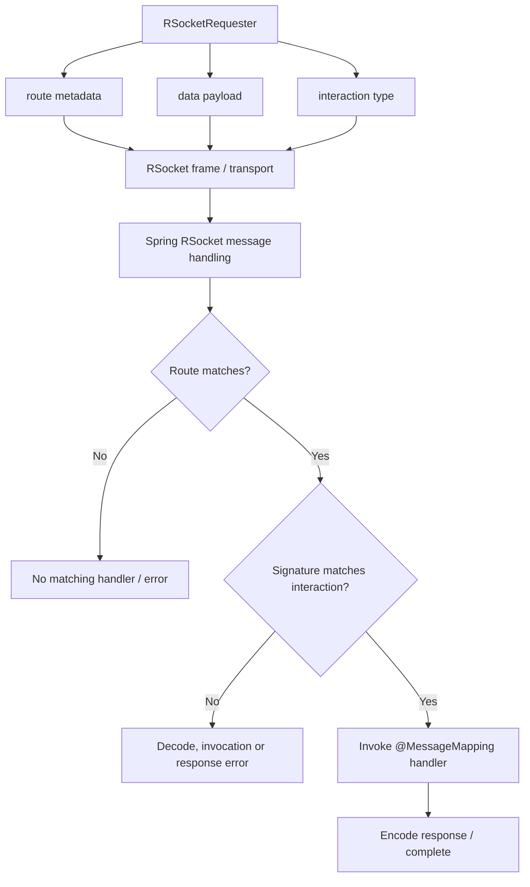

# Route không khớp và mô hình tương tác không đúng chữ ký handler

Một request RSocket có thể kết nối thành công tới server nhưng vẫn không đi vào handler mong đợi. Nguyên nhân thường nằm ở route metadata không khớp, route được cấu hình sai MIME type, interaction model không tương ứng với kiểu tham số/giá trị trả về, hoặc handler không được Spring đăng ký. Những lỗi này dễ bị nhầm với lỗi kết nối vì client chỉ nhìn thấy một request thất bại.

Khi chẩn đoán, hãy tách ba phần của contract: **route** xác định chức năng được gọi, **interaction model** xác định cách trao đổi payload, còn **handler signature** mô tả Spring cần giải mã dữ liệu đầu vào và mã hóa kết quả đầu ra như thế nào. Ba phần phải khớp nhau. `requester.route("devices.status")` không tự biến một request-stream thành request-response; route đúng cũng không giúp Spring giải mã được một payload có kiểu không tương thích.

## 1. Đường đi của một request tới handler

Với Spring RSocket, client tạo payload có data và metadata. Routing metadata chứa destination; data chứa DTO nghiệp vụ. RSocket protocol frame còn thể hiện interaction type như request-response, fire-and-forget, request-stream hoặc request-channel.

Ở phía server, transport nhận frame, RSocket responder xác định interaction, Spring giải mã data/metadata, tìm handler theo route, gọi method và encode kết quả phù hợp với interaction đó.



Thứ tự kiểm tra này giúp khoanh vùng nhanh: trước tiên xác minh server đã nhận connection và request; tiếp theo kiểm tra route; sau đó mới kiểm tra interaction và kiểu payload.

## 2. Route là metadata, không phải data payload

Với `RSocketRequester`, route được khai báo qua `.route(...)`:

```java
Mono<DeviceStatus> result = requester
    .route("devices.status")
    .data(new DeviceQuery("device-42"))
    .retrieveMono(DeviceStatus.class);
```

Trong ví dụ:

- `devices.status` là destination/route trong routing metadata.
- `DeviceQuery` là data payload được encode theo data MIME type.
- `retrieveMono(...)` chọn kiểu interaction request-response và khai báo kiểu response mong đợi.

Handler tương ứng:

```java
@Controller
public class DeviceRSocketController {

    @MessageMapping("devices.status")
    public Mono<DeviceStatus> status(@Payload DeviceQuery query) {
        return deviceService.getStatus(query.deviceId());
    }
}
```

Các lỗi route phổ biến:

- Client gọi `devices.status` nhưng server khai báo `device.status`.
- Route có khác biệt về dấu chấm, dấu gạch ngang, tiền tố hoặc chữ hoa/thường.
- Client quên `.route(...)` hoặc gửi route trong DTO data.
- Server khai báo prefix ở class-level nhưng client gọi route chưa ghép đúng.
- Route pattern được cấu hình nhưng matcher/delimiter không như kỳ vọng.
- Client dùng metadata MIME type không tương thích với routing metadata.

Ưu tiên route tường minh, thống nhất một convention và kiểm thử contract. Không nên sửa bằng cách thêm nhiều handler wildcard rộng nếu chưa xác định route nào thực sự được gửi.

## 3. Đối chiếu bốn interaction model với chữ ký handler

Đây là bảng quan trọng nhất khi route đã đúng nhưng handler không chạy đúng cách:

| Interaction từ client | API requester thường dùng | Chữ ký handler Spring điển hình | Kết quả |
|---|---|---|---|
| Request-response | `.retrieveMono(Response.class)` | `Mono<Response> method(@Payload Request request)` | Một response rồi complete |
| Fire-and-forget | `.send()` | `void method(@Payload Request request)` hoặc `Mono<Void>` | Không có response payload |
| Request-stream | `.retrieveFlux(Response.class)` | `Flux<Response> method(@Payload Request request)` | Một request mở luồng nhiều response |
| Request-channel | `.data(Flux<Request>).retrieveFlux(Response.class)` | `Flux<Response> method(@Payload Flux<Request> requests)` | Hai phía có thể trao đổi nhiều payload |

Đây là các chữ ký điển hình cho payload đơn và DTO typed. Các tham số bổ sung như metadata header, authentication principal hoặc destination variable có thể được thêm nếu Spring hỗ trợ resolver tương ứng và ứng dụng đã cấu hình chúng.

Đừng chọn interaction theo kiểu trả về của Java một cách ngẫu nhiên. Client và server phải thống nhất interaction type trên wire. Ví dụ client dùng `.retrieveFlux(...)` thì server cần cung cấp một stream; handler trả `Mono<T>` chỉ tạo tối đa một response và không diễn đạt được luồng nhiều phần tử.

## 4. Request-response: một request, một response

Client:

```java
Mono<DeviceStatus> status = requester
    .route("devices.status")
    .data(new DeviceQuery("device-42"))
    .retrieveMono(DeviceStatus.class);
```

Server:

```java
@MessageMapping("devices.status")
public Mono<DeviceStatus> status(@Payload DeviceQuery query) {
    return deviceService.getStatus(query.deviceId());
}
```

`Mono<DeviceStatus>` phù hợp vì request-response cần một response payload. Nếu handler trả `Flux<DeviceStatus>`, signature không còn khớp với semantics request-response. Nếu service trả `Mono.empty()`, handler không phát response payload như interaction yêu cầu; tùy adapter/phiên bản, client có thể thấy empty completion hoặc lỗi interaction. Không dựa vào `Mono.empty()` để biểu diễn “không tìm thấy” trong request-response; hãy trả một DTO kết quả có trạng thái `NOT_FOUND` hoặc phát lỗi domain theo contract.

Triệu chứng và cách sửa:

| Triệu chứng | Nguyên nhân có thể | Cách sửa |
|---|---|---|
| Client mong response nhưng handler không trả payload | Handler trả `Mono<Void>` hoặc `void` | Trả `Mono<Response>` hoặc đổi client sang FNF nếu không cần response |
| Handler trả nhiều phần tử nhưng client chỉ đọc một | Dùng request-response cho nghiệp vụ stream | Dùng request-stream và `Flux<Response>` |
| Client báo lỗi khi decode response | `retrieveMono` khai báo sai response class hoặc MIME type | Đồng bộ DTO và codec hai phía |
| Client không nhận response hoặc interaction lỗi | Handler trả `Mono.empty()` | Request-response cần một payload; trả DTO kết quả hoặc lỗi domain |

## 5. Fire-and-forget: gửi một payload, không có response

Client:

```java
Mono<Void> sent = requester
    .route("telemetry.ingest")
    .data(new TelemetryPoint("device-42", 21.5))
    .send();
```

Server:

```java
@MessageMapping("telemetry.ingest")
public Mono<Void> ingest(@Payload TelemetryPoint point) {
    return telemetryService.store(point).then();
}
```

`Mono<Void>` cho phép handler hoàn tất công việc bất đồng bộ mà không tạo response payload. Một handler `void` cũng phù hợp với xử lý không trả kết quả. Client không thể dùng `retrieveMono(TelemetryAck.class)` để đòi một response từ interaction FNF.

Một nhầm lẫn thường gặp là nghĩ `send()` complete nghĩa là dữ liệu đã được commit vào database. Completion của client phản ánh semantics gửi ở phía requester/transport; nó không chứng minh business transaction trên server đã commit. Nếu caller cần biết server đã chấp nhận hoặc hoàn tất, dùng request-response trả `Accepted`, `operationId` hoặc kết quả nghiệp vụ.

## 6. Request-stream: một request mở nhiều response

Client:

```java
Flux<TelemetryPoint> points = requester
    .route("telemetry.watch")
    .data(new TelemetryQuery("device-42"))
    .retrieveFlux(TelemetryPoint.class);
```

Server:

```java
@MessageMapping("telemetry.watch")
public Flux<TelemetryPoint> watch(@Payload TelemetryQuery query) {
    return telemetryService.watch(query.deviceId());
}
```

Request-stream chỉ có một payload mở đầu từ client; server phát nhiều payload. Vì vậy handler thường nhận một DTO `TelemetryQuery`, không phải `Flux<TelemetryQuery>`. Nếu method nhận `Flux<TelemetryQuery>` nhưng client gửi request-stream, chữ ký đang mô tả một luồng đầu vào mà interaction này không cung cấp.

Nếu client cần gửi nhiều payload đầu vào trong khi server cũng phát nhiều payload, đó là request-channel và handler nhận `Flux<Request>`.

## 7. Request-channel: nhiều payload theo cả hai chiều

Client:

```java
Flux<ControlCommand> commands = Flux.just(
    new ControlCommand("cmd-1", "START"),
    new ControlCommand("cmd-2", "SET_LEVEL"));

Flux<ControlReply> replies = requester
    .route("devices.control-session")
    .data(commands)
    .retrieveFlux(ControlReply.class);
```

Server:

```java
@MessageMapping("devices.control-session")
public Flux<ControlReply> control(
        @Payload Flux<ControlCommand> commands) {

    return commands.concatMap(command ->
        deviceService.execute(command)
            .map(result -> new ControlReply(command.commandId(), result)));
}
```

`Flux<ControlCommand>` đầu vào biểu diễn chuỗi payload client gửi. `Flux<ControlReply>` đầu ra biểu diễn chuỗi response server phát. `concatMap` giữ thứ tự xử lý; nếu dùng `flatMap`, nhiều command có thể được xử lý đồng thời và response có thể không theo thứ tự đầu vào.

Các lỗi signature thường gặp:

- Handler nhận `ControlCommand` đơn trong khi client gửi `Flux<ControlCommand>`.
- Handler trả `Mono<ControlReply>` nhưng client mong nhiều reply.
- Client gọi `.data(singleCommand)` nhưng server khai báo `Flux<ControlCommand>`.
- Handler dùng `Flux` raw không khai báo generic nên decoder thiếu kiểu phần tử đích.

## 8. Một route không tự xác định interaction model

Route chỉ xác định destination. Interaction model nằm trong loại request frame được requester tạo ra. Do đó, cùng một route string nhưng client gọi `.retrieveMono(...)`, `.retrieveFlux(...)` hoặc `.send()` đang gửi những interaction khác nhau.

Không nên thiết kế một route có nhiều semantics tùy thuộc caller mà không có contract rõ ràng. Nếu cùng một chức năng cần cả truy vấn đơn và stream, route riêng thường dễ hiểu hơn:

```text
devices.status       -> request-response
devices.status-watch -> request-stream
devices.command      -> request-response
devices.command-feed -> request-channel
telemetry.ingest     -> fire-and-forget
```

Spring có thể map route vào handler rồi responder xử lý interaction tương ứng; việc đặt tên route rõ ràng giúp log, authorization, metrics và client code dễ chẩn đoán hơn. Route khác nhau không thay thế việc chọn đúng interaction API.

## 9. Route prefix ở class và method

Spring hỗ trợ khai báo mapping ở controller và method. Nếu ứng dụng dùng prefix class-level, cần kiểm tra route cuối cùng sau khi ghép prefix và mapping method theo quy tắc matcher của phiên bản Spring đang dùng.

Ví dụ minh họa:

```java
@Controller
@MessageMapping("devices")
public class DeviceController {

    @MessageMapping("status")
    public Mono<DeviceStatus> status(@Payload DeviceQuery query) {
        return deviceService.getStatus(query.deviceId());
    }
}
```

Trong cấu hình dùng mapping prefix, route client cần tuân theo cách Spring kết hợp mapping cấp type và method. Nếu nghi ngờ prefix không được ghép như mong đợi, kiểm tra mapping được đăng ký trong log khởi động hoặc dùng route tường minh `@MessageMapping("devices.status")` để loại bỏ sự mơ hồ trong quá trình chẩn đoán.

Không tự thêm dấu phân cách hoặc wildcard dựa trên suy đoán. Route matcher và delimiter có thể được cấu hình; test trên ứng dụng thực tế là cách xác nhận chính xác.

## 10. Route không khớp: checklist từ client tới server

Khi thấy lỗi không tìm được handler hoặc request bị từ chối, kiểm tra theo thứ tự:

1. Client có gọi đúng host, port và transport của RSocket server không?
2. Connection SETUP có thành công không?
3. `.route(...)` có được gọi trước `.data(...)` không?
4. Route string có đúng từng ký tự, prefix và convention không?
5. Server có controller bean mang `@Controller` và method `@MessageMapping` không?
6. Handler có nằm trong component scan/application context không?
7. Class-level mapping hoặc route pattern có làm destination cuối khác dự kiến không?
8. Routing metadata có được encode bằng metadata MIME type mà server hiểu không?
9. Có custom `RSocketStrategies`, metadata extractor hoặc interceptor nào làm mất/đọc sai routing metadata không?
10. Log phía server có cho thấy destination đã nhận và kết quả mapping không?

Thông báo lỗi cụ thể phụ thuộc Spring/RSocket version và responder configuration. Hãy dùng error code, server log và trace để xác nhận; đừng chỉ dựa vào text exception từ client.

## 11. Phân biệt route metadata với custom metadata

RSocket payload có data và metadata. Routing metadata là một metadata entry có MIME type/convention riêng. Custom metadata có thể mang tenant, trace context hoặc thông tin ứng dụng khác.

Ví dụ:

```java
requester.route("devices.status")
    .metadata(new TenantMetadata("tenant-a"), TENANT_MIME)
    .data(new DeviceQuery("device-42"))
    .retrieveMono(DeviceStatus.class);
```

Trong ví dụ, `.route(...)` tạo routing metadata; `.metadata(...)` thêm entry tùy chỉnh; `.data(...)` gửi payload nghiệp vụ. Không serialize route string vào DTO rồi mong `@MessageMapping` tự đọc field đó.

Nếu custom metadata được dùng cùng routing metadata, metadata MIME type của connection phải hỗ trợ cách đóng gói các entry, thường là Composite Metadata. Cần đăng ký extractor/decoder cho entry tùy chỉnh nếu handler nhận nó dưới dạng header có kiểu. Khi tùy chỉnh `metadataMimeType`, kiểm tra rằng routing entry vẫn được encode và decode đúng.

## 12. Chữ ký tham số không đúng kiểu payload

Sau khi route match, Spring cần decode data thành kiểu tham số handler. Ví dụ client gửi `DeviceQuery` nhưng handler nhận `OrderQuery`, hoặc client gửi JSON nhưng server chỉ có decoder cho CBOR, request có thể thất bại trước khi logic nghiệp vụ chạy.

| Client gửi | Handler nhận | Vấn đề |
|---|---|---|
| `DeviceQuery` JSON | `@Payload OrderQuery` | Sai DTO/schema |
| `DeviceQuery` JSON | `@Payload DeviceQuery` nhưng server thiếu JSON decoder | Codec không hỗ trợ MIME type |
| `Flux<ControlCommand>` | `@Payload ControlCommand` | Sai cardinality: nhiều payload so với một payload |
| Một `DeviceQuery` | `@Payload Flux<DeviceQuery>` | Handler đòi stream đầu vào nhưng interaction không cung cấp |
| JSON object | Raw `Object` hoặc raw `Flux` | Kiểu đích không rõ hoặc decoder không thể chọn kiểu mong muốn |

Ưu tiên DTO cụ thể và generic đầy đủ. Đảm bảo encoder client và decoder server (cũng như chiều response) tương thích về MIME type, schema và cấu hình Jackson/module.

## 13. Raw Mono/Flux và generic type bị mất

Không nên khai báo raw reactive type:

```java
// Không nên: mất kiểu phần tử
@MessageMapping("telemetry.watch")
public Flux watch(@Payload TelemetryQuery query) {
    return telemetryService.watch(query.deviceId());
}
```

Hãy khai báo:

```java
@MessageMapping("telemetry.watch")
public Flux<TelemetryPoint> watch(@Payload TelemetryQuery query) {
    return telemetryService.watch(query.deviceId());
}
```

Generic type giúp framework xác định kiểu response cần encode và giúp compiler kiểm tra contract. Tương tự, `Flux<ControlCommand>` rõ ràng hơn raw `Flux` khi nhận request-channel.

Nếu DTO là generic wrapper như `ApiResponse<DeviceStatus>`, hãy kiểm tra codec có giữ được generic type ở runtime. Trong một số trường hợp cần kiểu cụ thể hoặc `ParameterizedTypeReference` ở phía client để decoder biết kiểu đích.

## 14. `@Payload`, metadata header và `@ConnectMapping`

`@Payload` chỉ định phần data của payload được bind vào tham số. Custom metadata được expose qua header hoặc metadata resolver khi ứng dụng đã đăng ký extractor tương ứng. Không nhầm metadata với data DTO.

`@ConnectMapping` xử lý thông tin ở giai đoạn SETUP/thiết lập connection. Nó không thay thế `@MessageMapping` cho request có route thông thường. Nếu đặt một handler cần route `devices.status` vào `@ConnectMapping`, handler đó sẽ không được gọi theo cách client `.route("devices.status")` mong đợi.

Hãy xác định đúng lifecycle:

- SETUP: xác thực/khởi tạo session và xử lý metadata kết nối.
- `@MessageMapping`: xử lý interaction có route.
- Metadata push: cập nhật metadata cấp connection nếu ứng dụng hỗ trợ và đã cấu hình handler tương ứng.

## 15. Handler không được Spring đăng ký

Route đúng và signature đúng vẫn chưa đủ nếu class không nằm trong application context.

Kiểm tra:

- Class được đánh dấu `@Controller` hoặc được đăng ký theo cơ chế Spring messaging tương ứng.
- Package của controller nằm trong component scan.
- Method có `@MessageMapping` đúng import của Spring Messaging.
- Không có cấu hình RSocket server custom bỏ qua message handler infrastructure.
- Bean khởi tạo thành công; không có lỗi dependency khiến controller không được tạo.
- Server thực sự bật RSocket responder và đang listen đúng transport/port.

Một controller chỉ là Java object được `new` thủ công trong test không đồng nghĩa Spring đã đăng ký route đó. Unit test gọi method trực tiếp có thể pass trong khi request từ RSocket client vẫn không tìm được handler.

## 16. Đọc log và phân loại lỗi theo giai đoạn

Khi request thất bại, phân loại trước khi sửa code:

| Giai đoạn | Dấu hiệu | Hướng kiểm tra |
|---|---|---|
| Transport/connect | Connection refused, timeout, WebSocket upgrade failure | Host, port, TLS, proxy, listener |
| SETUP | Authentication/setup rejected | Setup metadata, auth manager, server interceptor |
| Route mapping | Không tìm được destination/handler | Route string, routing metadata, `@MessageMapping`, bean registration |
| Decode input | Codec/decoding exception | Data MIME type, DTO, decoder, generic type |
| Handler invocation | Exception từ method/service | Log handler, validation, dependency |
| Encode output | Serialization/encoder exception | Return type, response DTO, encoder, MIME type |
| Interaction mismatch | Client chờ response/stream nhưng server hoàn tất hoặc phát sai số lượng | `send`/`retrieveMono`/`retrieveFlux`, handler return type |

Không log raw token hoặc payload nhạy cảm để tìm route. Có thể log route đã chuẩn hóa, interaction type, error category và trace ID.

## 17. Ví dụ một contract đúng cho cả bốn interaction

Server:

```java
@Controller
public class DeviceRSocketController {

    @MessageMapping("devices.status")
    public Mono<DeviceStatus> status(@Payload DeviceQuery query) {
        return deviceService.getStatus(query.deviceId());
    }

    @MessageMapping("telemetry.watch")
    public Flux<TelemetryPoint> watch(@Payload TelemetryQuery query) {
        return telemetryService.watch(query.deviceId());
    }

    @MessageMapping("telemetry.ingest")
    public Mono<Void> ingest(@Payload TelemetryPoint point) {
        return telemetryService.store(point).then();
    }

    @MessageMapping("devices.control-session")
    public Flux<ControlReply> control(
            @Payload Flux<ControlCommand> commands) {
        return commands.concatMap(deviceService::execute);
    }
}
```

Client gọi đúng semantics:

```java
// Request-response
Mono<DeviceStatus> status = requester.route("devices.status")
    .data(new DeviceQuery("device-42"))
    .retrieveMono(DeviceStatus.class);

// Request-stream
Flux<TelemetryPoint> watch = requester.route("telemetry.watch")
    .data(new TelemetryQuery("device-42"))
    .retrieveFlux(TelemetryPoint.class);

// Fire-and-forget
Mono<Void> ingest = requester.route("telemetry.ingest")
    .data(new TelemetryPoint("device-42", 21.5))
    .send();

// Request-channel
Flux<ControlReply> control = requester.route("devices.control-session")
    .data(commands)
    .retrieveFlux(ControlReply.class);
```

Các route độc lập giúp log và policy dễ theo dõi. Handler signature diễn đạt rõ cardinality ở mỗi chiều. Trong ứng dụng thật, thêm validation, authorization, timeout, idempotency và giới hạn demand phù hợp với nghiệp vụ.

## 18. Kiểm thử route và signature

Unit test có thể gọi handler trực tiếp và dùng `StepVerifier` để xác minh publisher. Tuy nhiên, nó không kiểm tra route mapping, codec hay transport. Cần thêm integration test mở RSocket server và dùng `RSocketRequester` thật.

Ví dụ kiểm thử request-response qua server:

```java
@Test
void routesStatusRequestToHandler() {
    Mono<DeviceStatus> result = requester.route("devices.status")
        .data(new DeviceQuery("device-42"))
        .retrieveMono(DeviceStatus.class);

    StepVerifier.create(result)
        .expectNextMatches(status ->
            status.deviceId().equals("device-42"))
        .verifyComplete();
}
```

Test integration nên có các trường hợp:

1. Route chính xác được map tới đúng handler.
2. Route sai hoặc thiếu prefix bị từ chối theo error contract.
3. Request-response trả đúng một payload.
4. Request-stream phát nhiều payload và dừng khi cancel.
5. Fire-and-forget không được client chờ response payload.
6. Request-channel nhận nhiều payload và phát nhiều response.
7. Sai data MIME type hoặc DTO gây lỗi decode rõ ràng.
8. Sai metadata MIME type/routing metadata không bị nhầm thành lỗi nghiệp vụ.
9. Controller không đăng ký hoặc handler sai mapping được phát hiện.
10. Handler lỗi được chuyển thành application error theo contract.

Khi kiểm thử route không khớp, không nên assert nguyên văn message lỗi nếu message phụ thuộc phiên bản. Hãy assert loại lỗi/code hoặc trạng thái thất bại phù hợp với API, đồng thời kiểm tra server log để xác nhận lỗi xuất phát từ mapping.

## 19. Quy trình chẩn đoán nhanh

Khi client gọi route nhưng handler không chạy hoặc lỗi chữ ký:

1. **Xác minh transport:** TCP/WebSocket connection và SETUP có thành công không?
2. **In route:** route client gửi có đúng từng ký tự với `@MessageMapping` không?
3. **Kiểm tra metadata:** routing metadata có thực sự được gửi và được server decode không?
4. **Xác minh bean:** controller có trong Spring context và method mapping được đăng ký không?
5. **Đối chiếu interaction:** client đang gọi `send`, `retrieveMono` hay `retrieveFlux`?
6. **Đối chiếu signature:** handler nhận một DTO hay `Flux<DTO>`; trả `Mono`, `Flux` hay `Mono<Void>`?
7. **Kiểm tra codec:** data/metadata MIME type và DTO có tương thích hai phía không?
8. **Đọc lỗi theo giai đoạn:** mapping, decode, invocation hay encode?
9. **Tạo integration test tối thiểu:** một route, một DTO và một interaction để tái hiện.
10. **Thêm quan sát:** log route/interaction/error category và trace ID đã chuẩn hóa.

## 20. Những lỗi thường gặp và cách khắc phục

| Lỗi | Nguyên nhân gốc | Cách khắc phục |
|---|---|---|
| Không tìm thấy handler | Route mismatch hoặc controller không được scan | Đồng bộ route, kiểm tra `@Controller` và component scan |
| Route string đúng nhưng vẫn không match | Routing metadata MIME type/extractor sai | Kiểm tra Composite Metadata và routing entry |
| `retrieveMono` không nhận response | Handler không phát response hoặc trả `Mono<Void>` | Trả `Mono<Response>` hoặc dùng FNF đúng mục đích |
| `retrieveFlux` chỉ có một phần tử | Handler trả `Mono<T>` | Trả `Flux<T>` cho request-stream/channel |
| Request-stream không decode query | Handler nhận `Flux<Query>` | Nhận một `Query` cho request-stream |
| Request-channel không nhận được nhiều command | Handler nhận DTO đơn | Nhận `Flux<Command>` và trả `Flux<Reply>` |
| Decode exception | MIME type, DTO hoặc generic type sai | Đồng bộ encoder/decoder và kiểu dữ liệu |
| Handler chạy nhưng client decode lỗi | Response encoder/schema không tương thích | Kiểm tra response class, data MIME type và ObjectMapper |
| `@ConnectMapping` không nhận route request | Đặt handler sai lifecycle | Dùng `@MessageMapping` cho interaction có route |
| Unit test pass nhưng client không gọi được | Test gọi method trực tiếp, bỏ qua mapping | Bổ sung integration test qua RSocket transport |

## 21. Quy tắc thiết kế

1. Xem route là routing metadata, data payload là DTO nghiệp vụ.
2. Dùng route tường minh và thống nhất convention giữa client/server.
3. Nhớ route xác định destination, interaction type xác định semantics trao đổi.
4. Request-response dùng một request và `Mono<Response>`.
5. Fire-and-forget dùng `.send()` và handler `void`/`Mono<Void>`.
6. Request-stream dùng một request và `Flux<Response>`.
7. Request-channel dùng `Flux<Request>` đầu vào và thường trả `Flux<Response>`.
8. Khai báo generic đầy đủ; tránh raw `Mono`/`Flux`.
9. Phân biệt `@MessageMapping` cho route request với `@ConnectMapping` cho SETUP.
10. Kiểm tra data MIME type, metadata MIME type và codec khi route/handler đã đúng.
11. Đảm bảo controller là Spring bean và mapping được đăng ký.
12. Kết hợp StepVerifier unit test với integration test qua RSocketRequester thật.

Route không khớp và handler signature sai thường có biểu hiện giống nhau ở phía client nhưng nằm ở các giai đoạn khác nhau. Tách route metadata, interaction type và kiểu đầu vào/đầu ra thành ba phần của một contract giúp xác định lỗi nhanh. Khi route được đăng ký rõ ràng, handler dùng đúng `Mono`/`Flux` theo interaction và hai phía thống nhất MIME type/DTO, request RSocket sẽ được định tuyến và xử lý theo đúng semantics đã thiết kế.
