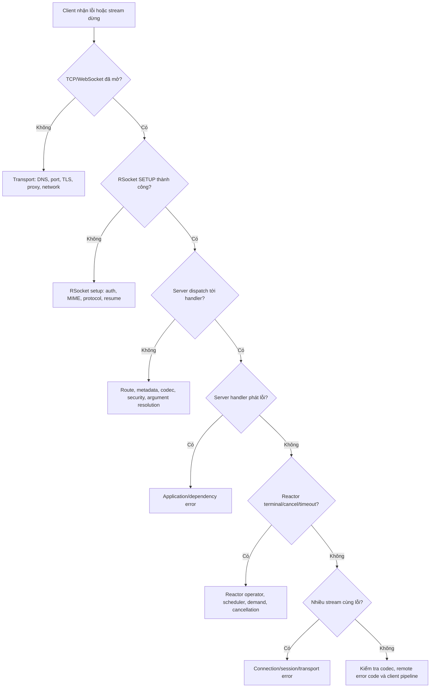

# Phân biệt lỗi ứng dụng, Reactor, RSocket và lớp truyền tải

Một request RSocket có thể thất bại ở nhiều tầng. Cùng một biểu hiện ở client như `onError`, timeout hoặc connection closed có thể bắt nguồn từ logic nghiệp vụ, pipeline Reactor, frame lỗi của RSocket hoặc TCP/WebSocket/TLS. Nếu chỉ nhìn exception ngoài cùng rồi retry, ta dễ che mất nguyên nhân, lặp side effect hoặc làm một sự cố cục bộ thành lỗi toàn hệ thống.

Hãy xác định **lỗi xuất hiện ở tầng nào, ảnh hưởng phạm vi nào và xảy ra ở thời điểm nào**. Bốn nhóm cần phân biệt:

1. **Lỗi ứng dụng**: validation, quyền truy cập, trạng thái nghiệp vụ, database hoặc dịch vụ phụ thuộc.
2. **Lỗi Reactor**: terminal signal, timeout/cancel, backpressure, scheduler, operator hoặc lỗi trong pipeline reactive.
3. **Lỗi RSocket**: SETUP, protocol frame, route interaction, stream rejection, connection-level error hoặc lifecycle session.
4. **Lỗi truyền tải**: DNS, TCP connect/reset, WebSocket handshake, TLS, proxy và network.

Các tầng này có thể nối tiếp nhau. Ví dụ database timeout là lỗi phụ thuộc ở tầng ứng dụng; handler phát exception; Reactor chuyển exception thành `onError`; RSocket gửi `APPLICATION_ERROR`; client nhận một remote error. Cần phân biệt nguyên nhân gốc với cách lỗi được truyền qua từng tầng.

## 1. Nhìn toàn bộ đường đi của một request

Với RSocket chạy trên TCP hoặc WebSocket, một request đi qua các lớp theo thứ tự:

```text
Client application
      │ tạo Mono/Flux và subscribe
      ▼
Reactor pipeline phía client
      │ tạo request payload / metadata
      ▼
RSocket requester và protocol session
      │ frame qua transport
      ▼
TCP hoặc WebSocket (+ TLS / proxy / network)
      │ frame tới peer
      ▼
RSocket responder và route dispatch
      │ giải mã payload / metadata
      ▼
Spring @MessageMapping hoặc RSocket handler
      │ gọi service / database / dependency
      ▼
Reactor pipeline phía server
      │ response hoặc error signal
      ▼
RSocket ERROR / PAYLOAD / CANCEL / COMPLETE frame
      │ transport trả frame
      ▼
Reactor pipeline và application phía client
```

Không phải mọi request đều đi qua Spring. Một ứng dụng có thể dùng RSocket Java trực tiếp, tự dispatch handler hoặc kết hợp framework khác. Nhưng ranh giới protocol và transport vẫn tồn tại.

Một cách khoanh vùng nhanh là kiểm tra ba câu hỏi:

- **Kết nối đã mở và SETUP thành công chưa?** Nếu chưa, chưa cần điều tra route hoặc logic nghiệp vụ.
- **Một request/stream lỗi hay tất cả stream trên connection cùng lỗi?** Một stream thường gợi ý lỗi request-level; nhiều stream cùng rớt gợi ý connection/session/transport-level.
- **Server đã vào handler chưa?** Nếu chưa, kiểm tra SETUP, route, codec, metadata, security và transport; nếu đã vào, kiểm tra handler, Reactor pipeline và dependency.

## 2. Phân loại theo tầng

| Tầng | Dấu hiệu điển hình | Phạm vi thường gặp | Nơi điều tra đầu tiên |
|---|---|---|---|
| Ứng dụng | `ValidationException`, domain exception, database error, HTTP/dependency status | Một request hoặc một nghiệp vụ | Service, repository, validation, security và log nghiệp vụ |
| Reactor | `TimeoutException`, `OverflowException`, scheduler rejection, cancel, `onErrorDropped` | Subscription/pipeline; có thể ảnh hưởng nhiều request nếu dùng chung scheduler | Operator chain, timeout, demand, scheduler và lifecycle subscription |
| RSocket | SETUP rejected, remote `APPLICATION_ERROR`, `REJECTED`, `INVALID`, connection error | Một stream hoặc toàn session tùy frame/code | RSocket frame/error code, stream ID, setup và session lifecycle |
| Transport | DNS, connect refused/timeout, TLS handshake, WebSocket HTTP status, socket reset | Thường là connection hoặc handshake; có thể ảnh hưởng mọi stream trên connection | DNS, port, TLS, proxy, Netty và network |

Đây là cách phân loại theo **nguyên nhân**, không phải theo tên exception. Một `TimeoutException` có thể được tạo bởi Reactor `timeout()`, do client timeout của request, hoặc do dependency bên dưới. Cần tìm operator hoặc thành phần đã phát timeout.

## 3. Lỗi ứng dụng: request tới được handler nhưng nghiệp vụ thất bại

Lỗi ứng dụng xảy ra sau khi request đã được giải mã và dispatch tới code xử lý, hoặc trong bước xác thực/ủy quyền nghiệp vụ. Các ví dụ phổ biến:

- Payload hợp lệ về cấu trúc nhưng vi phạm quy tắc nghiệp vụ.
- Resource không tồn tại hoặc trạng thái không cho phép chuyển tiếp.
- Người dùng không có quyền thao tác.
- Database từ chối transaction, vi phạm constraint hoặc mất kết nối.
- Dịch vụ thanh toán, inventory hoặc identity trả lỗi.
- Serialization/encoding response thất bại khi handler tạo payload.

Ví dụ service trả domain error có chủ đích:

```java
@Controller
class InventoryController {

    private final InventoryService inventoryService;

    InventoryController(InventoryService inventoryService) {
        this.inventoryService = inventoryService;
    }

    @MessageMapping("inventory.reserve")
    Mono<ReservationView> reserve(@Payload ReserveCommand command) {
        return inventoryService.reserve(command);
    }
}
```

Nếu `reserve(...)` phát `InsufficientStockException`, đây là lỗi nghiệp vụ. Nó không tự có nghĩa TCP bị đứt, Reactor bị hỏng hoặc RSocket session đã đóng. Thông thường chỉ request/stream đó thất bại; các request khác trên cùng session vẫn có thể chạy.

### Validation và lỗi không tìm thấy resource

Phân biệt dữ liệu sai với trạng thái nghiệp vụ:

| Lỗi | Ví dụ | Hướng xử lý |
|---|---|---|
| Validation | Số lượng âm, mã đơn hàng rỗng | Trả lỗi input có thể sửa; không retry tự động |
| Not found | Không có sản phẩm hoặc đơn hàng | Trả kết quả not-found theo contract; không retry cùng input |
| Conflict | Đơn hàng đã hoàn tất, phiên bản không khớp | Client đọc trạng thái mới hoặc xử lý conflict |
| Authorization | Người gọi không có quyền | Kiểm tra principal/metadata và policy; không retry |
| Dependency unavailable | Database hoặc dịch vụ phụ thuộc tạm thời không truy cập được | Có thể retry có giới hạn nếu thao tác an toàn |
| Internal defect | Null dereference, invariant bị phá vỡ | Sửa code và giữ trace; không retry mù |

### Exception thành payload hay thành remote error?

Ứng dụng có thể xử lý exception và trả một DTO lỗi như `CommandResult(status="REJECTED")`. Khi đó protocol có thể xem đây là **response payload bình thường**; client phải đọc field `status` để hiểu nghiệp vụ. Nếu exception thoát khỏi handler và framework chuyển thành remote application error, client nhận error signal thay vì DTO.

Hai contract đều có thể hợp lệ, nhưng cần chọn rõ. Đừng lúc trả payload `REJECTED`, lúc ném exception cho cùng một loại lỗi mà không tài liệu hóa. Đặc biệt, không biến mọi exception thành payload HTTP-like rồi để client tưởng request đã thành công.

## 4. Lỗi Reactor: pipeline phát terminal signal hoặc không chạy đúng cách

Reactor định nghĩa ba tín hiệu chính của một Publisher: `onNext`, `onError` và `onComplete`. `onError` là terminal signal: sau khi phát lỗi, subscription đó không phát thêm dữ liệu bình thường. `cancel` là hành động từ downstream yêu cầu dừng subscription; nó không phải một exception và không đồng nghĩa với lỗi nghiệp vụ.

Một số lỗi thường gặp:

| Dấu hiệu | Nguyên nhân có thể | Điều tra |
|---|---|---|
| `TimeoutException` | Operator `timeout`, request timeout hoặc dependency timeout | Xác định timeout được đặt ở lớp nào và thời gian bắt đầu tính |
| `OverflowException` | Producer phát nhanh hơn demand hoặc buffer đầy | Kiểm tra backpressure, prefetch và chiến lược buffer/drop |
| `RejectedExecutionException` | Scheduler/executor đã shutdown hoặc hết capacity | Kiểm tra lifecycle scheduler và queue/thread pool |
| `IllegalStateException` khi gọi `block()` | Blocking trên non-blocking thread/event loop | Tìm `block`, `blockFirst`, `blockLast`, JDBC hoặc I/O blocking |
| `onErrorDropped` | Error đến sau khi downstream đã cancel/terminate hoặc không còn subscriber nhận | Kiểm tra race giữa cancel và async callback, cleanup và hook |
| Stream dừng không có error | `cancel`, `take`, timeout, dispose hoặc complete bình thường | Theo dõi terminal signal và operator tạo cancellation |
| Dữ liệu không tới | Publisher chưa subscribe, demand chưa phát hoặc upstream không emit | Kiểm tra subscription, `request(n)` và nguồn dữ liệu |

### Timeout không tự nói nguyên nhân

Ví dụ:

```java
Mono<OrderView> result = requester
    .route("orders.find")
    .data(new FindOrderRequest("ORD-1001"))
    .retrieveMono(OrderView.class)
    .timeout(Duration.ofSeconds(2))
    .checkpoint("orders.find.client-timeout");
```

Nếu timeout phát ra ở operator này, client đã chờ quá hai giây theo subscription đó. Nó chưa chứng minh server không nhận request. Server có thể đã commit nghiệp vụ nhưng response bị trễ hoặc mất. Với lệnh ghi, phải tra cứu trạng thái bằng operation/idempotency key trước khi gửi lại.

Đặt timeout riêng cho từng boundary nếu cần: connect/SETUP, request-response, dependency call và toàn workflow. Dùng tên metric/log khác nhau để biết timeout nào đã kích hoạt.

### Blocking trên event loop

Không gọi JDBC đồng bộ, `Thread.sleep`, `block()` hoặc I/O blocking trực tiếp trong handler reactive chạy trên event loop. Một thao tác blocking có thể giữ thread xử lý nhiều connection, làm latency tăng hàng loạt và tạo timeout dây chuyền.

Nếu chưa có reactive driver, cô lập thao tác blocking trên scheduler phù hợp:

```java
Mono<Customer> customer = Mono.fromCallable(
        () -> blockingCustomerRepository.findById(customerId)
    )
    .subscribeOn(Schedulers.boundedElastic());
```

Đây là biện pháp cô lập; nó không biến repository blocking thành non-blocking. Cần giới hạn concurrency, timeout và capacity của dependency để tránh dồn quá nhiều công việc vào bounded elastic.

### Backpressure và overflow

`Flux` có thể phát nhiều phần tử hơn consumer xử lý kịp. RSocket hỗ trợ demand-based flow control cho stream/channel, nhưng ứng dụng vẫn có thể tạo buffer không giới hạn hoặc dùng operator làm mất backpressure. Kiểm tra `onBackpressureBuffer`, `publishOn` prefetch, queue size và tốc độ downstream. Nếu dùng drop/latest, xác nhận dữ liệu có được phép mất hay thay thế không.

## 5. Lỗi RSocket: phân biệt SETUP, request error và connection error

RSocket protocol có frame và error code để phân biệt lỗi thiết lập session, lỗi một stream và lỗi kết nối. Không phải mọi remote error đều có nghĩa connection bị đóng.

### Lỗi SETUP

SETUP xảy ra khi peer bắt đầu một RSocket connection. Nếu SETUP bị từ chối, client chưa có session sử dụng được; route handler chưa được gọi. Các nguyên nhân có thể gồm:

- Protocol version hoặc cấu hình SETUP không được hỗ trợ.
- Data MIME type hoặc metadata MIME type không hợp lệ/không được hỗ trợ.
- Authentication hoặc connection-level metadata bị từ chối.
- Server không chấp nhận connection theo chính sách hiện tại.
- Resume được yêu cầu nhưng server không hỗ trợ hoặc không nhận dạng session.

Các mã lỗi ở phạm vi connection setup/resume gồm `INVALID_SETUP`, `UNSUPPORTED_SETUP`, `REJECTED_SETUP` và `REJECTED_RESUME` tùy trường hợp. Hãy đọc error code và log phía responder; không đổi route `@MessageMapping` khi SETUP chưa thành công.

### Lỗi ở một request/stream

Các error code thường gặp ở stream gồm:

| RSocket error code | Ý nghĩa khái quát | Cách diễn giải |
|---|---|---|
| `APPLICATION_ERROR` | Handler hoặc ứng dụng báo lỗi cho stream | Tìm exception/domain error ở responder; session thường vẫn dùng được |
| `REJECTED` | Peer từ chối stream/request | Kiểm tra admission, concurrency, lease hoặc overload policy |
| `CANCELED` | Stream bị hủy theo semantics protocol | Kiểm tra phía nào cancel và lý do lifecycle |
| `INVALID` | Request/frame không hợp lệ | Kiểm tra protocol, stream state, payload/metadata và phiên bản thư viện |

Tên và cách hiển thị exception cụ thể có thể phụ thuộc RSocket Java và Spring version. Khi chẩn đoán, giữ lại protocol error code nếu thư viện cung cấp; đừng chỉ ghi `RuntimeException` hoặc message đã bị wrap.

### Lỗi cấp connection

`CONNECTION_ERROR` là lỗi ở phạm vi connection/session. Nó có thể làm nhiều stream trên cùng connection cùng thất bại. Nếu nhiều request đang chạy đồng loạt nhận lỗi trong một thời điểm, kiểm tra connection error, server shutdown, transport reset và proxy trước khi điều tra từng route riêng lẻ.

Một kết nối đóng có thể là đóng bình thường, server chủ động close, lỗi protocol hoặc transport bị mất. Phân biệt `CONNECTION_CLOSE` (đóng connection theo protocol) với `CONNECTION_ERROR` (lỗi connection), với `ERROR` frame ở stream và với socket exception ở local runtime. Nếu socket bị reset đột ngột, peer có thể không kịp gửi frame close/error.

## 6. Request-level error khác connection-level error

Phạm vi ảnh hưởng là một tín hiệu chẩn đoán quan trọng:

| Quan sát | Khả năng cao hơn | Bằng chứng cần lấy |
|---|---|---|
| Một request-response thất bại, request tiếp theo vẫn thành công | Lỗi ứng dụng hoặc stream-level RSocket error | Route, stream ID, remote error code, handler exception |
| Một request-stream kết thúc bằng error nhưng session vẫn sống | Lỗi nguồn dữ liệu/handler của stream | `onError`, stream lifecycle, source publisher |
| Fire-and-forget không có response và client không biết server lỗi | Semantics của FNF | Server log/metric hoặc đổi contract sang request-response ACK |
| Tất cả stream cùng lỗi trong một thời điểm | Connection/session/transport | Connection ID nội bộ trong log, close reason, Netty exception |
| Không request nào chạy vì SETUP thất bại | Connection setup/auth/protocol | SETUP error code và server setup log |
| Chỉ một instance/region lỗi | Endpoint, certificate, proxy hoặc instance-specific defect | Instance, DNS result, TLS chain và deploy version |

RSocket multiplex nhiều stream trên một connection. Vì thế, đếm số request lỗi mà không đo connection lifecycle sẽ bỏ lỡ lỗi một connection kéo theo hàng trăm stream thất bại.

## 7. Error semantics theo interaction model

| Interaction | Lỗi có thể quan sát ở đâu? | Điều cần nhớ |
|---|---|---|
| Request-response | Client nhận response hoặc error cho stream đó | Remote application error không mặc định đóng session |
| Fire-and-forget | Requester không nhận response nghiệp vụ | Lỗi handler phải quan sát ở responder; `send()` không phải ACK xử lý |
| Request-stream | Client nhận một chuỗi payload rồi complete/error/cancel | Một stream lỗi có thể kết thúc riêng stream đó |
| Request-channel | Hai bên gửi payload trên cùng stream; error/cancel ảnh hưởng channel | Theo dõi cả input và output, half-close và bên khởi tạo cancel |

Đối với fire-and-forget, nếu client cần biết server đã persist hay xử lý xong, dùng request-response ACK hoặc một cơ chế xác nhận bền vững khác. Đừng coi hoàn tất publisher gửi là thành công nghiệp vụ.

Với request-channel, nếu client cancel subscription output, upstream input có thể bị cancel theo cách ứng dụng nối hai chiều. Cần kiểm tra cancellation propagation và giải phóng resource của cả hai phía.

## 8. Lỗi truyền tải: TCP, WebSocket, TLS và proxy

Lỗi transport xảy ra trước khi RSocket có thể trao đổi frame bình thường hoặc làm session đang hoạt động bị mất.

| Lỗi | Dấu hiệu thường gặp | Điều tra |
|---|---|---|
| DNS | `UnknownHostException`, hostname không resolve | Resolver, DNS record, service discovery |
| TCP connect | `Connection refused`, `ConnectTimeoutException` | Port/listener, firewall, route, service targetPort |
| TCP reset/close | `Connection reset`, `PrematureCloseException`, EOF | Server restart, proxy timeout, network reset |
| WebSocket handshake | HTTP `404`, `401`, `403`, `502`, handshake exception | Mapping path, auth filter, Origin, Upgrade header và upstream |
| TLS | `SSLHandshakeException`, PKIX, SAN mismatch, `NotSslRecordException` | CA, chain, hostname, SNI, expiry, TLS/plaintext mismatch |
| Proxy/load balancer | Kết nối được nhưng đóng sau idle timeout hoặc chỉ lỗi qua public endpoint | Idle timeout, keepalive, sticky/session routing và upstream health |

Nếu TCP port mở, điều đó chỉ chứng minh TCP handshake. Nếu WebSocket trả `101`, điều đó chỉ chứng minh HTTP Upgrade. Cần RSocket SETUP thành công mới có session RSocket.

## 9. Codec và payload lỗi ở ranh giới framework

Một lỗi decode/encode có thể xảy ra trước khi handler được gọi hoặc sau khi handler đã tạo kết quả:

- Client encode request thành payload thất bại.
- Server không decode được payload do MIME type, schema hoặc codec mismatch.
- Metadata decoder không đọc được composite metadata hoặc content type.
- Handler trả kiểu dữ liệu không có encoder phù hợp.
- Client không decode được response payload.

Đây là lỗi serialization/codec. Nó có thể được bọc thành remote application error hoặc lỗi decode ở local client tùy điểm xảy ra. Hãy xác định **bên nào encode/decode** và log có cho thấy handler đã được gọi hay chưa.

| Vị trí | Bằng chứng | Hướng xử lý |
|---|---|---|
| Client encode | Exception trước khi frame được gửi | Kiểm tra DTO, encoder và payload type |
| Server decode request | Request tới transport nhưng handler không vào | Kiểm tra data MIME type, codec và payload schema |
| Server encode response | Handler chạy xong nhưng client nhận remote error | Kiểm tra return type, encoder và response MIME type |
| Client decode response | Server log cho thấy trả response nhưng client lỗi decode | Kiểm tra client codec/schema/version |
| Metadata decode | Setup/handler dispatch/auth lỗi | Kiểm tra metadata MIME type và decoder theo từng entry |

Không chữa lỗi codec bằng cách đổi route hoặc retry request. Retry cùng payload/schema không tương thích sẽ tiếp tục thất bại.

## 10. Spring handler dispatch và exception mapping

Với Spring Messaging, cần phân biệt các bước:

1. Transport nhận byte/frame.
2. RSocket xử lý SETUP và session.
3. Request được giải mã payload/metadata.
4. Route metadata được dispatch tới `@MessageMapping`.
5. Spring resolve argument, principal và validation.
6. Handler gọi service/repository.
7. Return value được encode thành response; exception được chuyển thành error theo cơ chế framework.

Nếu log không có dấu vết vào handler, kiểm tra các bước 1–5. Nếu handler đã chạy, kiểm tra service và bước 6–7.

Ví dụ log ranh giới handler:

```java
@Controller
class PaymentController {

    private static final Logger log = LoggerFactory.getLogger(PaymentController.class);
    private final PaymentService paymentService;

    PaymentController(PaymentService paymentService) {
        this.paymentService = paymentService;
    }

    @MessageMapping("payments.create")
    Mono<PaymentView> create(@Payload CreatePayment command) {
        return Mono.defer(() -> paymentService.create(command))
            .doOnError(error -> log.warn(
                "Payment handler failed, route=payments.create, type={}",
                error.getClass().getSimpleName(), error));
    }
}
```

`doOnError` chỉ quan sát lỗi, không chuyển lỗi thành response thành công. Nếu thêm `onErrorResume` để trả fallback, hãy log/đếm lỗi trước khi fallback và chỉ dùng khi fallback có semantics rõ ràng.

Nếu dùng `@MessageExceptionHandler` để chuyển exception thành DTO, client có thể nhận payload bình thường thay vì error signal. Tài liệu hóa DTO lỗi và đảm bảo client kiểm tra trạng thái thay vì chỉ coi việc nhận payload là thành công.

## 11. Theo dõi Reactor terminal signal

`doOnError` không ghi nhận cancellation. `doFinally` nhận cả `ON_COMPLETE`, `ON_ERROR` và `CANCEL`, nên hữu ích để đo lifecycle:

```java
Mono<OrderView> request = requester
    .route("orders.find")
    .data(new FindOrderRequest("ORD-1001"))
    .retrieveMono(OrderView.class)
    .doOnError(error -> log.warn("orders.find failed", error))
    .doFinally(signal -> log.debug("orders.find terminated: {}", signal))
    .checkpoint("rsocket.orders.find");
```

Không log payload hoặc metadata nhạy cảm chỉ để debug. Gắn route template, interaction type, trace ID và error category có cardinality được kiểm soát.

### Khi nào dùng `onErrorResume` và `onErrorMap`?

```java
Mono<CustomerView> result = customerService.find(customerId)
    .onErrorMap(DataAccessException.class,
        error -> new CustomerStoreUnavailableException("Customer store unavailable", error));
```

`onErrorMap` đổi loại exception nhưng giữ nguyên cause; dùng để chuyển lỗi tầng dưới sang lỗi có ý nghĩa ở boundary hiện tại.

```java
Mono<CustomerView> result = customerService.find(customerId)
    .onErrorResume(CustomerNotFoundException.class,
        error -> Mono.just(CustomerView.notFound(customerId)));
```

`onErrorResume` chuyển sang publisher khác và có thể làm downstream thấy complete/success. Chỉ dùng khi fallback đúng contract. Không dùng `onErrorResume(error -> Mono.empty())` trên mọi exception vì sẽ biến lỗi thật thành dữ liệu vắng mặt.

`onErrorContinue` không phải cơ chế phục hồi tổng quát; semantics phụ thuộc operator và có thể làm khó xác định phần tử nào đã bị bỏ qua. Tránh dùng nó để che lỗi của RSocket request.

## 12. Tìm nguyên nhân gốc trong exception chain

Các framework có thể wrap exception qua nhiều lớp. Ví dụ client nhận `RuntimeException`, cause bên trong mới là `SSLHandshakeException`; hoặc nhận Reactor wrapper trong khi root cause là `ConnectException`.

Khi log:

- Giữ stack trace đầy đủ ở log có quyền truy cập phù hợp.
- Ghi class của exception ngoài cùng và root cause.
- Giữ RSocket error code nếu có.
- Ghi interaction, route template, stream/session correlation và endpoint alias.
- Ghi stage: DNS, connect, TLS, WebSocket upgrade, SETUP, dispatch, handler, encode/decode hoặc downstream.

Reactor cung cấp `Exceptions.unwrap(Throwable)` để bóc một số wrapper do Reactor tạo ra. Không giả định mọi wrapper của framework đều được bóc; vẫn cần duyệt `getCause()` và giữ toàn bộ chain.

Ví dụ helper đơn giản:

```java
static Throwable rootCause(Throwable error) {
    Throwable current = Exceptions.unwrap(error);
    while (current.getCause() != null && current.getCause() != current) {
        current = current.getCause();
    }
    return current;
}
```

Helper này chỉ phục vụ log/chẩn đoán; không dùng root cause đơn lẻ để quyết định retry mà bỏ qua context của operation.

## 13. Thêm checkpoint và debug Reactor

Khi stack trace không chỉ ra operator gây lỗi, thêm `checkpoint` tại ranh giới quan trọng:

```java
Mono<InvoiceView> invoice = requester
    .route("invoices.find")
    .data(new FindInvoiceRequest(invoiceId))
    .retrieveMono(InvoiceView.class)
    .checkpoint("invoice-service -> rsocket invoices.find");
```

`checkpoint(String)` thêm assembly marker để hỗ trợ định vị pipeline. Có thể bật `Hooks.onOperatorDebug()` trong môi trường phát triển để thu thập assembly trace rộng hơn, nhưng nó có chi phí và không nên bật toàn cục tùy tiện trên production.

Nếu lỗi xuất hiện ở callback chạy ngoài pipeline hoặc sau khi subscription đã cancel, tìm log `onErrorDropped` và xem race giữa callback, disposal và resource cleanup. Không biến hook dropped-error thành nơi bỏ qua exception không kiểm soát.

## 14. Quy tắc quyết định retry

Không retry chỉ vì client nhận `onError`. Phân loại theo nguyên nhân, semantics của interaction và trạng thái side effect:

| Loại lỗi | Retry? | Điều kiện |
|---|---|---|
| Validation, not found, authorization | Không | Input hoặc quyền không đổi thì retry không giúp |
| Conflict/business state | Thường không | Đọc trạng thái mới hoặc yêu cầu người dùng quyết định |
| Dependency timeout trên thao tác đọc | Có thể | Giới hạn attempts, backoff, deadline và dependency budget |
| Timeout của lệnh ghi | Chỉ khi có bảo vệ | Idempotency key/status lookup; kết quả có thể đã commit |
| RSocket `APPLICATION_ERROR` | Không mặc định | Retry chỉ khi lỗi ứng dụng được phân loại tạm thời |
| RSocket `REJECTED` | Có thể có backoff | Xác định admission/overload policy và thời gian chờ phù hợp |
| RSocket `INVALID` hoặc SETUP invalid | Không | Sửa protocol, payload, MIME hoặc config |
| Connection/transport reset | Có thể reconnect | Xác định operation đã được server xử lý chưa; dùng idempotency với lệnh ghi |
| Reactor cancellation | Không tự retry | Xác định ai cancel và vì sao; cancellation có thể là hành vi bình thường |
| Codec/schema mismatch | Không | Sửa schema, MIME type hoặc phiên bản codec |

Ví dụ retry có lọc cho một thao tác đọc:

```java
Mono<OrderView> findOrder(String orderId) {
    return Mono.defer(() -> requester
        .route("orders.find")
        .data(new FindOrderRequest(orderId))
        .retrieveMono(OrderView.class))
        .retryWhen(Retry.backoff(2, Duration.ofMillis(200))
            .maxBackoff(Duration.ofSeconds(2))
            .jitter(0.5)
            .filter(this::isTransientReadFailure));
}
```

`isTransientReadFailure` phải được triển khai theo exception/code và dependency policy của ứng dụng. Không dùng predicate luôn trả `true`. `Mono.defer` tạo request mới cho mỗi lần subscribe/retry; vì vậy chỉ dùng mẫu này cho thao tác đọc hoặc operation có idempotency rõ ràng.

Với lệnh ghi, giữ cùng idempotency key giữa các lần thử và lưu trạng thái đủ để client tra cứu kết quả sau timeout. Không sinh key mới cho mỗi lần retry.

## 15. Ví dụ phân loại lỗi tại client boundary

Một client boundary có thể log loại lỗi trước khi chuyển tiếp nguyên trạng:

```java
Mono<PaymentView> createPayment(CreatePayment command) {
    return requester
        .route("payments.create")
        .data(command)
        .retrieveMono(PaymentView.class)
        .doOnError(error -> {
            Throwable root = rootCause(error);
            log.warn(
                "RSocket call failed: route={}, errorType={}, rootType={}",
                "payments.create",
                error.getClass().getSimpleName(),
                root.getClass().getSimpleName(),
                error);
        })
        .checkpoint("payments.create requester boundary");
}
```

Boundary này không thể luôn biết chính xác nguyên nhân chỉ từ client exception. Cần ghép log server và protocol code để phân biệt remote application error với connection failure. Tránh parse `error.getMessage()` để quyết định logic vì message có thể thay đổi theo phiên bản hoặc ngôn ngữ.

## 16. Ví dụ kiểm thử phân biệt error và cancellation

`StepVerifier` giúp xác minh contract của publisher:

```java
StepVerifier.create(Mono.error(new InsufficientStockException("SKU-1")))
    .expectError(InsufficientStockException.class)
    .verify();
```

Với cancellation, kiểm tra side effect cleanup:

```java
AtomicBoolean cancelled = new AtomicBoolean();

Mono<Long> source = Mono.never()
    .doFinally(signal -> {
        if (signal == SignalType.CANCEL) {
            cancelled.set(true);
        }
    });

StepVerifier.create(source)
    .thenCancel()
    .verify();

assertThat(cancelled).isTrue();
```

Trong integration test RSocket, xác minh thêm:

- Lỗi handler trả về cho đúng request/stream.
- Session vẫn sử dụng được sau một application error nếu protocol/implementation cho phép.
- SETUP bị từ chối thì handler route không được gọi.
- Connection bị đóng thì các stream đang hoạt động nhận terminal signal phù hợp.
- Request-stream/channel cancel giải phóng resource ở server.
- Fire-and-forget không được test như thể requester nhận ACK nghiệp vụ.

## 17. Log, metric và trace theo ranh giới

Để phân loại được lỗi khi production gặp sự cố, ghi nhận các mốc riêng:

| Ranh giới | Log/metric nên có | Mục đích |
|---|---|---|
| Transport connect | connect attempt, duration, endpoint alias, result | Tách DNS/TCP/TLS khỏi lỗi sau kết nối |
| WebSocket handshake | status, path template, proxy upstream | Nhận biết lỗi HTTP upgrade |
| RSocket SETUP | accepted/rejected, setup error code, auth outcome | Phân biệt setup với request route |
| Request dispatch | route template, interaction, stream outcome | Biết request có tới handler không |
| Handler | duration, domain error category, dependency name | Xác định lỗi nghiệp vụ/downstream |
| Reactor lifecycle | complete/error/cancel, timeout stage, scheduler | Nhận diện cancellation, overflow và starvation |
| Connection lifecycle | active connections, close reason, reconnect | Biết lỗi một stream hay cả session |

Sử dụng trace ID/correlation ID trong log và tracing context; nếu truyền ID qua metadata, xác thực và giới hạn kích thước. Không đưa user ID, token, payload nhạy cảm hoặc connection/stream ID không giới hạn vào metric label.

### Nhìn lỗi theo thời gian

Khi điều tra một incident, ghép timeline:

1. Client bắt đầu request và subscribe.
2. Connection đã tồn tại hay cần connect/SETUP mới?
3. Server nhận frame và dispatch route lúc nào?
4. Handler gọi dependency và dependency trả kết quả/lỗi lúc nào?
5. Server phát response/error hoặc đóng stream lúc nào?
6. Client nhận payload/error/cancel/timeout lúc nào?

Nếu client timeout ở giây thứ hai nhưng server commit ở giây thứ ba, đây là kết quả không xác định từ góc nhìn client, không phải bằng chứng server chưa thực hiện. Đây là lý do idempotency và status lookup quan trọng với command.

## 18. Cây quyết định phân tầng lỗi



Sơ đồ là thứ tự điều tra. Một lỗi có thể đi qua nhiều tầng; ghi lại cả root cause và nơi lỗi được chuyển thành terminal signal.

## 19. Các sai lầm chẩn đoán thường gặp

| Sai lầm | Vì sao sai | Cách làm đúng |
|---|---|---|
| Thấy `onError` và kết luận transport lỗi | `onError` chỉ là terminal signal của Publisher | Tìm root cause, RSocket error code và server log |
| Thấy `TimeoutException` và retry ngay | Server có thể đã commit, response chỉ bị trễ/mất | Phân biệt timeout stage; dùng idempotency/status lookup |
| Một route lỗi nên restart toàn server | Có thể chỉ là domain error của một request | Kiểm tra phạm vi stream/session trước |
| Mọi remote error đều là `APPLICATION_ERROR` | Protocol còn có rejected/invalid/connection/setup errors | Giữ error code và loại lỗi gốc |
| `cancel` được ghi như exception | Cancellation là lifecycle signal, không phải `onError` | Đo `doFinally(CANCEL)` và kiểm tra bên cancel |
| `onErrorResume` trả empty cho mọi lỗi | Che lỗi thật thành kết quả rỗng | Fallback theo loại lỗi cụ thể, log trước khi chuyển |
| Retry mọi `RSocketException` | Có thể retry protocol/config lỗi vĩnh viễn hoặc lệnh ghi không an toàn | Phân loại code, operation và idempotency |
| TCP port mở nên RSocket hoạt động | Chưa chứng minh WebSocket, TLS hoặc SETUP thành công | Kiểm tra lần lượt handshake và SETUP |
| Chỉ xem log client | Không biết handler đã chạy/commit chưa | Correlate log client, server và dependency |
| Log payload đầy đủ để debug | Có thể lộ token, PII và dữ liệu nghiệp vụ | Log metadata an toàn, route template, error category và trace ID |

## 20. Checklist xử lý một lỗi RSocket trong production

- [ ] Ghi route template, interaction model, thời điểm và trace/correlation ID.
- [ ] Xác định lỗi xảy ra khi connect, SETUP, dispatch, handler, encode/decode hay nhận response.
- [ ] Xác định một stream hay toàn connection/session bị ảnh hưởng.
- [ ] Đọc exception chain và root cause; giữ RSocket protocol error code nếu có.
- [ ] Phân biệt `onError`, `onComplete` và `cancel`.
- [ ] Kiểm tra timeout operator, demand, buffer, scheduler và blocking call.
- [ ] Kiểm tra handler, validation, authorization, database và dependency.
- [ ] Kiểm tra codec, MIME type, route metadata và argument resolution.
- [ ] Với transport error, kiểm tra DNS, TCP, WebSocket, TLS, proxy và server lifecycle.
- [ ] Với command timeout, tra cứu trạng thái/idempotency trước khi gửi lại.
- [ ] Chỉ retry lỗi tạm thời theo policy có giới hạn và backoff.
- [ ] Kiểm tra cleanup của stream/channel khi cancel hoặc connection đóng.
- [ ] Ghép timeline client/server/dependency trước khi kết luận nguyên nhân.

Phân biệt đúng tầng lỗi giúp xử lý nhanh và tránh phản ứng sai. Lỗi ứng dụng cần sửa contract hoặc nghiệp vụ; lỗi Reactor cần kiểm tra operator, demand và lifecycle; lỗi RSocket cần đọc SETUP, error code và phạm vi stream/session; lỗi truyền tải cần điều tra DNS, TCP, WebSocket, TLS và proxy. Một exception ở client chỉ là điểm cuối của đường đi này, vì vậy hãy lần theo timeline và bằng chứng ở cả hai peer trước khi retry hoặc thay đổi cấu hình.

## Tài liệu tham khảo

- [RSocket Protocol — Error Frames and Interaction Models](https://rsocket.io/about/protocol/)
- [RSocket — Protocol Overview](https://rsocket.io/)
- [Spring Framework — RSocket](https://docs.spring.io/spring-framework/reference/rsocket.html)
- [Project Reactor — Error Handling](https://projectreactor.io/docs/core/release/reference/coreFeatures/error-handling.html)
- [Project Reactor — Debugging Reactor](https://projectreactor.io/docs/core/release/reference/debugging.html)
- [Project Reactor — StepVerifier](https://projectreactor.io/docs/test/release/api/reactor/test/StepVerifier.html)
