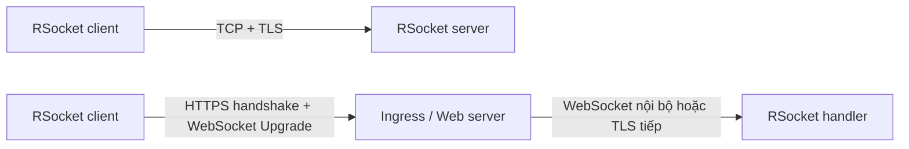
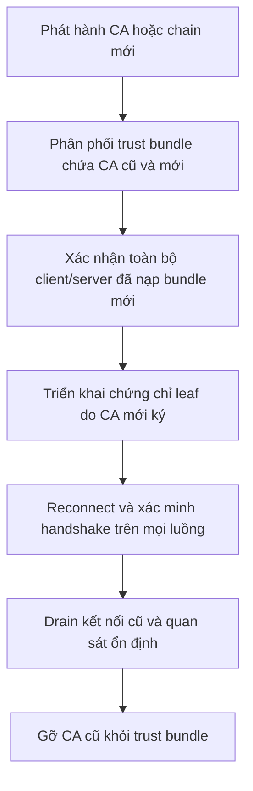

# Cấu hình TLS, quản lý chứng chỉ và thay đổi thông tin bí mật

RSocket tạo các kết nối có thể tồn tại lâu và mang nhiều loại tương tác: request-response, fire-and-forget, request-stream và request-channel. Vì vậy, bảo vệ kết nối ngay từ lớp truyền tải là yêu cầu vận hành cơ bản. TLS mã hóa dữ liệu trên đường truyền, xác thực máy chủ và, khi cần, xác thực cả client bằng mutual TLS (mTLS). Chứng chỉ và khóa riêng phải được cấp phát, phân phối, xoay vòng và thu hồi như những tài sản vận hành có vòng đời rõ ràng.

Bài học này tập trung vào dịch vụ Java/Spring Boot sử dụng RSocket qua TCP hoặc WebSocket. Hai kiểu truyền tải có điểm kết thúc TLS khác nhau, nhưng đều cần quản lý CA tin cậy, kiểm tra tên máy chủ, bảo vệ khóa riêng, xử lý thay chứng chỉ và kiểm thử các trường hợp lỗi. TLS bảo vệ kênh truyền; ứng dụng vẫn phải xác thực người dùng, phân quyền route và bảo vệ metadata hoặc token ở cấp giao thức.

## 1. TLS nằm ở đâu trong kết nối RSocket?

TLS thiết lập một kênh mã hóa trước khi RSocket trao đổi frame. Trong quá trình handshake, hai bên thương lượng phiên bản TLS và bộ thuật toán mật mã, xác thực chứng chỉ theo cấu hình, sau đó tạo khóa phiên. Với TLS một chiều thông thường, client xác thực chứng chỉ của server. Với mTLS, server cũng yêu cầu và xác thực chứng chỉ của client.

| Kiểu truyền tải | Điểm kết thúc TLS | Điều cần chú ý khi vận hành |
| --- | --- | --- |
| RSocket TCP | TLS bao quanh kết nối TCP trước khi trao đổi frame RSocket | Cấu hình TLS trực tiếp cho TCP client/server hoặc tại thiết bị kết thúc TLS; load balancer phải hỗ trợ TCP pass-through nếu TLS kết thúc ở ứng dụng |
| RSocket WebSocket qua `wss://` | TLS bảo vệ kết nối HTTPS/WebSocket và handshake HTTP Upgrade | Chứng chỉ thường được cấu hình ở web server hoặc ingress; cần giữ đúng đường dẫn WebSocket, Upgrade, timeout và chính sách proxy |

Với TCP, client kết nối tới một endpoint RSocket TCP được bảo vệ bằng TLS. Không có HTTP handshake ở lớp ngoài. Với WSS, client bắt đầu bằng HTTPS, sau đó nâng cấp kết nối thành WebSocket; RSocket frame được truyền bên trong WebSocket. Nếu ingress kết thúc TLS, đoạn từ ingress tới ứng dụng có thể tiếp tục dùng TLS hoặc nằm trong mạng riêng được kiểm soát. Không nên mặc định rằng TLS ở ingress đồng nghĩa toàn bộ đường truyền nội bộ đã được mã hóa.

Sơ đồ dưới đây mô tả hai đường đi thường gặp:



Chọn điểm kết thúc TLS theo ranh giới tin cậy. Kết thúc tại ứng dụng giúp ứng dụng trực tiếp kiểm soát chứng chỉ và có thể xác thực mTLS. Kết thúc tại ingress tập trung việc cấp chứng chỉ và cấu hình TLS, nhưng danh tính client từ chứng chỉ chỉ được ứng dụng sử dụng nếu proxy truyền thông tin đã xác thực qua một kênh nội bộ tin cậy. Khi proxy và backend cùng xác thực lẫn nhau bằng TLS, cần cấu hình rõ cả hai chiều.

## 2. Phân biệt keystore và truststore

Hai kho này có mục đích khác nhau:

| Kho | Nội dung chính | Bên thường sử dụng |
| --- | --- | --- |
| Keystore | Khóa riêng và chuỗi chứng chỉ tương ứng với danh tính của chính endpoint | Server trình chứng chỉ của mình; client trình chứng chỉ client khi dùng mTLS |
| Truststore | Chứng chỉ CA hoặc chứng chỉ được tin cậy để xác minh peer | Client xác minh server; server xác minh client trong mTLS |

Keystore của server phải chứa khóa riêng khớp với chứng chỉ leaf và chuỗi intermediate cần gửi cho peer. Truststore thường chứa CA gốc hoặc CA nội bộ được phép phát hành chứng chỉ cho peer. Không đưa khóa riêng vào truststore. Không dùng trust-all hoặc bỏ qua xác minh chứng chỉ để khắc phục lỗi môi trường; cách đó biến TLS thành kênh mã hóa mà không còn xác thực danh tính.

Ưu tiên định dạng PKCS#12 (`.p12` hoặc `.pfx`) cho hệ thống Java hiện đại. JKS vẫn xuất hiện trong hệ thống cũ nhưng không nên tạo thêm nếu không có lý do tương thích. Bảo vệ cả file kho, mật khẩu kho và bản sao lưu. Mật khẩu keystore chỉ là một lớp bảo vệ dữ liệu tại chỗ; quyền đọc file, quyền truy cập secret manager và quyền chạy tiến trình vẫn phải được giới hạn.

Một số lệnh `keytool` minh họa cho quy trình chuẩn bị kho:

```bash
# Tạo cặp khóa và CSR ban đầu cho môi trường thử nghiệm.
# Môi trường production nên nhận chứng chỉ từ CA được tổ chức phê duyệt.
keytool -genkeypair \
  -alias rsocket-server \
  -keyalg RSA -keysize 3072 \
  -storetype PKCS12 \
  -keystore server.p12 \
  -dname "CN=rsocket.example.com" \
  -ext "SAN=dns:rsocket.example.com" \
  -validity 90

# Tạo truststore và nhập CA được dùng để xác minh peer.
keytool -importcert \
  -alias internal-ca-2026 \
  -file internal-ca.pem \
  -storetype PKCS12 \
  -keystore truststore.p12

# Kiểm tra alias, thời hạn và chuỗi chứng chỉ trong kho.
keytool -list -v -storetype PKCS12 -keystore server.p12
```

Lệnh tạo cặp khóa ở trên chỉ minh họa thao tác kho. Trong thực tế, hãy tạo CSR, gửi tới CA nội bộ hoặc CA công khai đã được phê duyệt, nhận chứng chỉ có SAN phù hợp, rồi nhập chứng chỉ leaf và intermediate theo đúng chuỗi. Không dùng chứng chỉ tự ký tạo nhanh làm danh tính production nếu chưa có quy trình tin cậy và phân phối trust anchor được quản lý.

Chứng chỉ server cần có Subject Alternative Name (SAN) chứa DNS name hoặc địa chỉ IP mà client thực sự dùng để kết nối. Không dựa vào Common Name (CN) để thay thế SAN. Kiểm tra Extended Key Usage phù hợp (`serverAuth` cho server, `clientAuth` cho client) và bảo đảm server gửi đủ intermediate certificate. Một chứng chỉ hợp lệ về chữ ký nhưng thiếu SAN, sai mục đích sử dụng hoặc thiếu intermediate vẫn có thể khiến handshake thất bại.

## 3. Bật TLS cho RSocket TCP

Với RSocket TCP chạy trên Reactor Netty, có thể cấu hình `SslContext` cho `TcpServer` và `TcpClient`, rồi truyền transport đã cấu hình vào RSocket server hoặc connector. Ví dụ dưới đây minh họa cấu trúc cấu hình; đường dẫn file, mật khẩu và cách nạp secret cần lấy từ môi trường triển khai.

### 3.1. TLS một chiều ở server

```java
SslContext serverContext = SslContextBuilder
    .forServer(serverCertificateChainFile, serverPrivateKeyFile)
    .protocols("TLSv1.3", "TLSv1.2")
    .build();

TcpServer secureTcpServer = TcpServer.create()
    .secure(ssl -> ssl.sslContext(serverContext));

RSocketServer.create()
    .acceptor(applicationAcceptor)
    .bind(TcpServerTransport.create(secureTcpServer))
    .block();
```

Server trình chứng chỉ và chứng minh quyền sở hữu khóa riêng trong handshake. Chỉ cho phép các phiên bản TLS còn được chính sách bảo mật của tổ chức hỗ trợ; ví dụ trên giới hạn ở TLS 1.2 và 1.3. Phiên bản Netty/Reactor Netty, provider TLS và cấu hình triển khai có thể ảnh hưởng API cụ thể, vì vậy cần đối chiếu với phiên bản thư viện đang dùng.

### 3.2. TLS ở client và xác minh hostname

Client cần tin cậy CA phát hành chứng chỉ server và phải xác minh endpoint mà nó kết nối. Chỉ xác minh chuỗi chứng chỉ mà không xác minh hostname vẫn có thể cho phép kết nối tới một server khác có chứng chỉ do cùng CA phát hành.

```java
SslContext clientContext = SslContextBuilder
    .forClient()
    .trustManager(serverCaCertificateFile)
    .protocols("TLSv1.3", "TLSv1.2")
    .build();

TcpClient secureTcpClient = TcpClient.create()
    .secure(ssl -> ssl
        .sslContext(clientContext)
        .handlerConfigurator(sslHandler -> {
            SSLEngine engine = sslHandler.engine();
            SSLParameters parameters = engine.getSSLParameters();
            parameters.setEndpointIdentificationAlgorithm("HTTPS");
            engine.setSSLParameters(parameters);
        }));

RSocket client = RSocketConnector.create()
    .connect(TcpClientTransport.create(secureTcpClient))
    .block();
```

`HTTPS` ở đây là tên thuật toán kiểm tra endpoint mà JSSE sử dụng; nó có thể được dùng để xác minh hostname cho một kênh TLS TCP không chạy HTTP. Cấu hình cụ thể phụ thuộc phiên bản Reactor Netty và cách tạo `SSLEngine`. Hãy kiểm tra bằng một chứng chỉ có SAN sai hostname để chắc chắn client từ chối kết nối. Không suy luận rằng hostname verification đã bật chỉ vì client đã nạp truststore thành công.

Nếu kết nối bằng DNS name, chứng chỉ phải có SAN DNS khớp tên đó. Nếu kết nối trực tiếp bằng IP, chứng chỉ phải có SAN dạng IP tương ứng. Khi dùng proxy hoặc service discovery, xác định hostname mà TLS client thực sự xác minh và giữ SNI phù hợp với endpoint đó.

## 4. Bật TLS cho RSocket qua WebSocket (`wss://`)

Với WebSocket, TLS thường được cấu hình tại HTTP server hoặc ingress đang phục vụ endpoint WebSocket. Ví dụ cấu hình Spring Boot với transport WebSocket:

```yaml
spring:
  rsocket:
    server:
      transport: websocket
      mapping-path: /rsocket

server:
  port: 8443
  ssl:
    enabled: true
    key-store: file:/run/secrets/rsocket-server.p12
    key-store-type: PKCS12
    key-store-password: ${RSOCKET_KEYSTORE_PASSWORD}
```

Đây là ví dụ cho ứng dụng Spring Boot có embedded web server xử lý TLS. Tên thuộc tính và khả năng cấu hình mTLS có thể thay đổi theo phiên bản Spring Boot, web server và cách triển khai RSocket. Nếu TLS kết thúc ở ingress, chứng chỉ phải được cấu hình tại ingress; ứng dụng cần được bảo vệ bằng TLS nội bộ hoặc một ranh giới mạng và xác thực proxy phù hợp. Không cấu hình hai nơi một cách máy móc khi ingress đã là điểm kết thúc TLS.

Client kết nối bằng URI `wss` tới đúng mapping path:

```java
URI endpoint = URI.create("wss://rsocket.example.com/rsocket");

RSocket client = RSocketConnector.create()
    .connect(WebsocketClientTransport.create(endpoint))
    .block();
```

Client WebSocket cũng phải dùng truststore/SSL context tương ứng với thư viện WebSocket transport đang sử dụng và giữ hostname verification. Không dùng tùy chọn bỏ qua xác minh hostname trong cấu hình production. Nếu WSS đi qua reverse proxy, xác nhận proxy cho phép HTTP Upgrade, chuyển tiếp đúng `Host` và đường dẫn, không buffer hoặc đóng kết nối lâu dài ngoài ý muốn, và có idle timeout phù hợp với keepalive của RSocket.

Một phép thử WebSocket Upgrade thành công chỉ xác nhận lớp WebSocket. Nó chưa chứng minh RSocket SETUP, metadata, route hay các interaction model hoạt động. Cần thêm smoke test bằng RSocket client thực để kiểm tra handshake giao thức và ít nhất một request có ý nghĩa.

## 5. Mutual TLS và danh tính client

Trong mTLS, server yêu cầu client trình chứng chỉ. Server kiểm tra chuỗi chứng chỉ client theo truststore riêng, thời hạn, mục đích sử dụng và chính sách thu hồi nếu hệ thống có triển khai CRL hoặc OCSP. Client đồng thời xác minh chứng chỉ server như trong TLS một chiều.

Ví dụ cấu hình mTLS cho RSocket TCP bằng Netty:

```java
SslContext serverMtlsContext = SslContextBuilder
    .forServer(serverCertificateChainFile, serverPrivateKeyFile)
    .trustManager(clientCaCertificateFile)
    .clientAuth(ClientAuth.REQUIRE)
    .protocols("TLSv1.3", "TLSv1.2")
    .build();

SslContext clientMtlsContext = SslContextBuilder
    .forClient()
    .trustManager(serverCaCertificateFile)
    .keyManager(clientCertificateFile, clientPrivateKeyFile)
    .protocols("TLSv1.3", "TLSv1.2")
    .build();
```

Server có `ClientAuth.REQUIRE` sẽ từ chối client không cung cấp chứng chỉ hợp lệ. Chế độ `OPTIONAL` chỉ phù hợp khi có lý do nghiệp vụ rõ ràng và ứng dụng xử lý an toàn trường hợp không có chứng chỉ. Không nhầm lẫn `OPTIONAL` với việc xác thực client bắt buộc.

Khi handshake thành công, lớp TLS có danh tính peer từ chứng chỉ client. Ứng dụng cần ánh xạ danh tính đó sang principal hoặc định danh workload ổn định, ví dụ dựa trên SAN URI/DNS theo quy ước của tổ chức. Tránh dùng chuỗi CN tự do làm khóa phân quyền. Phân quyền tiếp tục được thực hiện ở tầng ứng dụng: client nào được gọi route nào, được gửi loại metadata nào và được truy cập tài nguyên nào.

TLS không tự động biến mọi trường trong chứng chỉ thành `Principal` của Spring Security. Cần tích hợp thông tin peer certificate từ transport hoặc web server vào security context theo cách được framework hỗ trợ. Với WSS kết thúc TLS ở ingress, backend không nhìn thấy TLS session gốc. Nếu ingress chuyển danh tính qua header, phải xóa header do client gửi từ bên ngoài, chỉ cho ingress tin cậy ghi header đó, bảo vệ đường ingress-backend và xác minh nguồn gửi. Nếu không bảo đảm được các điều kiện này, không dùng header đó làm bằng chứng danh tính.

Chứng chỉ xác thực workload không thay thế token hoặc cơ chế xác thực người dùng khi một kết nối được dùng bởi nhiều người dùng cuối. Một kết nối mTLS thường chứng minh danh tính ứng dụng hoặc thiết bị sở hữu khóa riêng; danh tính người dùng có thể cần được truyền trong metadata và xác minh riêng. Không đưa private key hoặc mật khẩu vào RSocket metadata.

## 6. Quản lý secret và khóa riêng

Secret trong bài toán này gồm private key, mật khẩu keystore/truststore, thông tin truy cập secret manager, token hoặc credential ứng dụng và đôi khi là tài liệu CA nội bộ. Chứng chỉ public không phải bí mật, nhưng tính toàn vẹn và nguồn phát hành của nó vẫn phải được kiểm soát.

Các nguyên tắc vận hành cần áp dụng:

- Lưu private key và mật khẩu trong secret manager hoặc cơ chế secret của nền tảng triển khai đã được phê duyệt. Dùng workload identity hoặc cơ chế cấp quyền tương đương để ứng dụng lấy đúng secret cần thiết.
- Không commit file `.p12`, `.pfx`, private key, mật khẩu hay token vào Git; không đưa chúng vào Docker image, artifact build, log, trace, exception message hoặc ticket không được bảo vệ.
- Cấp quyền tối thiểu: chỉ tiến trình cần dùng mới đọc được secret; mount read-only khi phù hợp; giới hạn người có quyền đọc, tải xuống, sao lưu và xoay vòng.
- Tách môi trường development, staging và production. Không tái sử dụng private key hoặc mật khẩu giữa các môi trường.
- Mã hóa secret khi lưu trữ và truyền tải; bật audit log cho thao tác đọc, tạo, thay và thu hồi secret. Có quy trình xử lý khi secret bị lộ.
- Không truyền mật khẩu qua command line nếu hệ điều hành hoặc công cụ có thể ghi lại process arguments. Ưu tiên cơ chế secret file, file descriptor hoặc tích hợp secret manager được hỗ trợ.
- Không ghi toàn bộ cấu hình TLS hoặc nội dung secret ra log khi khởi động. Log alias, phiên bản secret hoặc fingerprint chứng chỉ ở mức cần thiết để chẩn đoán.

Biến môi trường tiện cho cấu hình, nhưng có giới hạn: giá trị thường được kế thừa khi tiến trình khởi động và không tự thay đổi trong tiến trình đang chạy. Nếu secret được cập nhật trong secret manager nhưng ứng dụng chỉ đọc biến môi trường lúc startup, ứng dụng vẫn dùng giá trị cũ cho đến khi restart. Secret volume được nền tảng cập nhật cũng không bảo đảm ứng dụng tự nạp lại file. Phải có cơ chế reload được kiểm thử hoặc rolling restart có kiểm soát.

Tách vòng đời secret khỏi vòng đời chứng chỉ khi có thể. Ví dụ, mật khẩu keystore có thể được xoay vòng riêng; token ứng dụng nên hỗ trợ giai đoạn hai credential cùng hợp lệ; private key cần được thay khi có lịch xoay vòng hoặc dấu hiệu bị lộ. Mọi thao tác xoay vòng cần ghi nhận phiên bản, thời điểm, chủ thể thực hiện và kết quả xác minh.

## 7. Xoay vòng chứng chỉ mà không gây gián đoạn

RSocket thường giữ kết nối lâu. Chứng chỉ được xác minh trong TLS handshake; một kết nối đã thiết lập không tự động kiểm tra chứng chỉ mới khi file trên đĩa được thay. Vì vậy, thay file chứng chỉ chưa đủ để bảo đảm mọi kết nối đang chạy đã dùng danh tính mới. Cần phối hợp truststore, server, client và quá trình reconnect.

### 7.1. Xoay vòng chứng chỉ leaf cùng CA

Khi chứng chỉ mới được cùng CA phát hành và client đã tin CA đó, quy trình thường gồm:

1. Tạo private key mới và CSR; nhận chứng chỉ mới với SAN, EKU và thời hạn đúng. Kiểm tra chuỗi intermediate và private key khớp public key trong chứng chỉ.
2. Đưa chứng chỉ và private key mới vào secret manager dưới một phiên bản mới. Kiểm tra quyền đọc, định dạng và mật khẩu bằng một tiến trình kiểm tra độc lập.
3. Cập nhật server theo rolling deployment hoặc cơ chế reload TLS đã được hỗ trợ. Mỗi instance mới phải vượt readiness check trước khi instance cũ ngừng nhận kết nối mới.
4. Tạo kết nối RSocket mới từ client và xác minh chứng chỉ mới ở endpoint. Theo dõi handshake failure, reconnect, lỗi SETUP và lưu lượng thực tế.
5. Drain kết nối cũ theo thời gian cho phép. Client phải có retry với backoff và jitter; server cần ngừng nhận kết nối mới trước khi đóng các kết nối cũ theo thời hạn drain.
6. Sau khi xác nhận không còn instance hoặc kết nối cần chứng chỉ cũ, thu hồi hoặc ngừng sử dụng chứng chỉ cũ theo chính sách CA.

### 7.2. Xoay vòng CA

Thay CA có rủi ro cao hơn vì peer phải tin CA mới trước khi nhận chứng chỉ mới. Dùng giai đoạn tin cậy chồng lấp:



Không gỡ CA cũ khỏi truststore trước khi tất cả endpoint đã chuyển sang chain mới và các kết nối cũ đã được xử lý. Trong giai đoạn chồng lấp, truststore có thể chứa cả CA cũ và mới; chính sách cấp chứng chỉ vẫn phải giới hạn CA nào được phép phát hành danh tính cho từng dịch vụ.

### 7.3. Xoay vòng chứng chỉ client mTLS

Với mTLS, server phải tin CA mới phát hành chứng chỉ client trước khi client chuyển sang chứng chỉ đó. Cập nhật trust bundle ở server trước, sau đó xoay chứng chỉ client theo từng nhóm workload. Xác minh principal/SAN mới vẫn ánh xạ đúng quyền. Khi toàn bộ client đã chuyển và kết nối cũ đã được drain, gỡ CA hoặc chứng chỉ cũ khỏi trust policy. Nếu một client có thể giữ kết nối lâu, đặt giới hạn tuổi kết nối hoặc có lịch reconnect để hoàn tất việc chuyển đổi.

### 7.4. Triển khai không downtime

Một quy trình an toàn cần có các điều kiện sau:

- Có ít nhất một instance sẵn sàng phục vụ trong suốt rolling update; readiness phản ánh khả năng nhận kết nối RSocket thực tế.
- Có thể ngừng nhận kết nối mới ở instance cũ, cho phép request đang xử lý hoàn tất trong khoảng drain đã định, rồi đóng kết nối còn lại theo deadline.
- Client xử lý `onClose`, lỗi transport và timeout; tạo kết nối lại với exponential backoff và jitter để tránh thundering herd.
- Các interaction đang chạy có chính sách phục hồi rõ ràng. Request-response có thể retry nếu thao tác idempotent; stream hoặc channel có thể cần resume/checkpoint ở tầng ứng dụng. Không giả định reconnect sẽ tự khôi phục mọi frame hoặc side effect đã gửi.
- Giữ tương thích trong thời gian chuyển tiếp: trust bundle cũ/mới cùng tồn tại, endpoint mới sẵn sàng trước khi endpoint cũ bị loại bỏ.
- Theo dõi lỗi TLS, số kết nối, số lần reconnect, tỷ lệ request thành công và độ trễ trong suốt rollout. Có điều kiện dừng hoặc rollback nếu các chỉ số vượt ngưỡng vận hành.

Với WSS, ingress có thể hỗ trợ reload chứng chỉ mà không restart backend, nhưng kết nối WebSocket đang mở vẫn dùng TLS session cũ. Nếu cần bảo đảm tất cả kết nối chuyển sang chứng chỉ mới, phải drain hoặc đóng các WebSocket cũ có kiểm soát. Với TCP TLS kết thúc trực tiếp ở ứng dụng, kiểm tra xem thư viện và cách quản lý listener có hỗ trợ reload `SslContext` hay không. Nếu không, rolling replacement thường dễ kiểm soát hơn việc sửa file tại chỗ.

## 8. Kiểm tra chứng chỉ và kết nối từ môi trường vận hành

Kiểm tra file chứng chỉ trước khi deploy:

```bash
openssl x509 -in server.crt -noout \
  -subject -issuer -dates -ext subjectAltName -ext extendedKeyUsage
```

Kiểm tra TLS handshake tới endpoint TCP:

```bash
openssl s_client \
  -connect rsocket.example.com:7000 \
  -servername rsocket.example.com \
  -CAfile internal-ca.pem \
  -verify_return_error \
  -showcerts
```

Đối với mTLS, thêm chứng chỉ và private key client đã được cấp:

```bash
openssl s_client \
  -connect rsocket.example.com:7000 \
  -servername rsocket.example.com \
  -CAfile server-ca.pem \
  -cert client.crt \
  -key client.key \
  -verify_return_error
```

Có thể ép thử từng phiên bản TLS bằng `-tls1_2` hoặc `-tls1_3` để xác nhận chính sách tương thích. `openssl s_client` kiểm tra TLS handshake và chuỗi chứng chỉ; nó không gửi RSocket SETUP hay kiểm tra route. Sau bước này, cần smoke test bằng RSocket client thật.

Với WSS, dùng công cụ WebSocket để xác nhận DNS, TLS và HTTP Upgrade tới đúng path, rồi dùng RSocket client để kiểm tra giao thức. Một công cụ WebSocket thuần có thể không tạo RSocket frame hợp lệ. Nếu TLS kết thúc ở ingress, chạy kiểm tra cả public endpoint và kết nối ingress-backend theo đúng mô hình tin cậy.

## 9. Ma trận kiểm thử bảo mật và vận hành

Không chỉ kiểm tra trường hợp thành công. Các bài kiểm thử âm xác nhận hệ thống thực sự từ chối danh tính hoặc cấu hình không hợp lệ.

| Trường hợp | Kết quả mong đợi | Lớp cần kiểm tra |
| --- | --- | --- |
| Chứng chỉ server hợp lệ, đúng SAN và CA tin cậy | TLS handshake thành công | TCP TLS hoặc WSS |
| Chứng chỉ server do CA không tin cậy phát hành | Client từ chối handshake | Truststore phía client |
| Hostname không khớp SAN | Client từ chối kết nối | Endpoint identification / hostname verification |
| Chứng chỉ hết hạn hoặc chưa có hiệu lực | Handshake thất bại | Kiểm tra thời gian hệ thống và validity |
| Thiếu intermediate certificate | Client không xây dựng được chain và từ chối theo chính sách | Cấu hình chain tại server/proxy |
| Client không gửi chứng chỉ trong mTLS bắt buộc | Server từ chối handshake | `ClientAuth.REQUIRE` hoặc cấu hình tương đương |
| Client gửi chứng chỉ do CA không được phép phát hành | Server từ chối handshake | Truststore và trust policy phía server |
| Chứng chỉ client sai EKU hoặc danh tính không được ánh xạ | Bị từ chối theo chính sách xác thực/phân quyền | TLS validation và application security |
| Xoay vòng CA trong giai đoạn chồng lấp | Cả chứng chỉ cũ và mới hoạt động trong cửa sổ chuyển đổi | Trust bundle và rollout |
| Xóa CA cũ sau khi chuyển đổi | Chứng chỉ cũ bị từ chối; chứng chỉ mới vẫn hoạt động | Truststore sau rollout |
| Instance restart hoặc kết nối bị đóng khi rollout | Client reconnect có backoff; request được xử lý theo chính sách retry | Lifecycle và resilience của RSocket |
| WebSocket Upgrade sai path hoặc proxy không chuyển tiếp Upgrade | Kết nối WSS thất bại rõ ràng | Ingress, web server và mapping path |

Kiểm thử tích hợp nên bao gồm cả TCP TLS và WSS nếu production sử dụng cả hai. Với mỗi kiểu transport, xác minh RSocket SETUP, request-response, fire-and-forget, stream/channel cần thiết, xử lý `onClose`, timeout và reconnect. Kiểm tra rằng lỗi TLS được phân biệt với lỗi xác thực route hoặc lỗi nghiệp vụ để vận hành có thể chẩn đoán đúng nguyên nhân.

## 10. Giám sát và xử lý sự cố

Theo dõi các tín hiệu sau, gắn nhãn theo endpoint, transport và phiên bản chứng chỉ ở mức không tiết lộ bí mật:

- Số handshake TLS thành công/thất bại, nguyên nhân lỗi và phiên bản TLS được thương lượng.
- Số kết nối RSocket đang hoạt động, kết nối mới, kết nối bị đóng, reconnect và thời gian drain.
- Thời gian còn lại tới ngày hết hạn của chứng chỉ server và client; cảnh báo trước hạn theo SLA của tổ chức.
- Tỷ lệ SETUP thành công, lỗi route, timeout, request thất bại và độ trễ theo interaction model.
- Phiên bản secret/certificate đang được từng instance sử dụng, thời điểm reload và kết quả reload.

Khi handshake thất bại, kiểm tra theo thứ tự: thời gian hệ thống; DNS và hostname client thực sự kết nối; SAN và thời hạn chứng chỉ; issuer và chuỗi intermediate; truststore đang được tiến trình nạp; EKU; chính sách mTLS; phiên bản TLS và cipher được phép; sau cùng là cấu hình proxy hoặc load balancer. Không khắc phục bằng cách tắt xác minh chứng chỉ. Thu thập log TLS ở mức phù hợp, tránh bật trace nhạy cảm kéo dài hoặc ghi private key, password, token.

Một số dấu hiệu và hướng kiểm tra:

| Dấu hiệu | Nguyên nhân có thể | Hướng xử lý |
| --- | --- | --- |
| `PKIX path building failed` | Thiếu CA tin cậy hoặc thiếu intermediate | Kiểm tra chain server gửi và truststore client đang dùng |
| Hostname verification failed | SAN không khớp DNS/IP client dùng | Cấp lại chứng chỉ với SAN đúng; kiểm tra SNI và service discovery |
| `bad_certificate` hoặc handshake alert liên quan client certificate | Client không gửi chứng chỉ, chain không tin cậy hoặc chứng chỉ sai mục đích | Kiểm tra key manager, client certificate, trust policy và EKU |
| Chỉ một số instance handshake thất bại sau rollout | Instance dùng secret/trust bundle khác phiên bản hoặc chưa reload | Đối chiếu fingerprint/secret version và trạng thái rollout từng instance |
| Kết nối cũ vẫn hoạt động sau khi thay file chứng chỉ | TLS session đã được thiết lập trước khi thay file | Chủ động drain/reconnect theo kế hoạch xoay vòng |
| WSS lỗi 400/404/502 hoặc đóng sớm | Sai mapping path, Upgrade không được proxy, timeout hoặc backend không sẵn sàng | Kiểm tra HTTP Upgrade, route, timeout và health của backend |

## 11. Runbook ngắn cho một lần thay chứng chỉ

Trước khi thay, người vận hành xác nhận chứng chỉ mới có SAN/EKU/thời hạn đúng, chain đầy đủ, private key khớp và secret đã được phân phối tới đúng workload. Nếu thay CA, xác nhận trust bundle mới đã có mặt ở toàn bộ peer trước khi chuyển leaf certificate.

Trong rollout, thay từng nhóm instance, chờ readiness, mở kết nối RSocket mới và xác minh handshake cùng một request nghiệp vụ. Theo dõi handshake failure, reconnect, request error và latency. Chỉ tiếp tục nhóm tiếp theo khi các chỉ số nằm trong ngưỡng đã định. Khi có lỗi, dừng rollout, giữ trust bundle chồng lấp và quay lại phiên bản chứng chỉ/secret trước đó nếu chứng chỉ cũ vẫn hợp lệ.

Sau rollout, xác minh tất cả instance đang dùng fingerprint hoặc phiên bản chứng chỉ mới; drain kết nối cũ theo thời hạn; kiểm tra lại bằng client production-like; sau đó mới thu hồi chứng chỉ hoặc gỡ CA cũ. Ghi lại thời điểm, phiên bản trước/sau, người thực hiện, kết quả kiểm thử và mọi ngoại lệ cần theo dõi.

TLS, chứng chỉ và secret là một phần của vòng đời kết nối RSocket. Cấu hình đúng chỉ là điểm bắt đầu: hệ thống cần xác minh danh tính ở cả hai phía khi phù hợp, kiểm soát quyền truy cập private key, triển khai trust bundle có giai đoạn chồng lấp, drain các kết nối dài hạn và kiểm thử cả tình huống bị từ chối. Khi các bước này được đưa vào quy trình release và runbook, việc thay chứng chỉ có thể diễn ra có kiểm soát mà không làm gián đoạn dịch vụ realtime.
