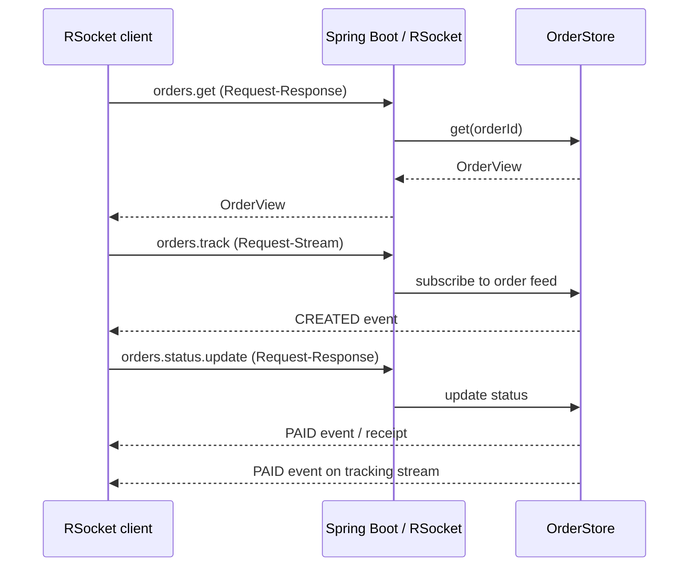

# Xây dựng dịch vụ Spring Boot truy vấn và theo dõi đơn hàng

Trong bài thực hành này, bạn sẽ xây dựng một dịch vụ Spring Boot dùng RSocket để truy vấn trạng thái đơn hàng và theo dõi các thay đổi theo thời gian thực. Client có thể lấy một đơn hàng bằng Request-Response, mở Request-Stream để nhận các sự kiện trạng thái, và gửi yêu cầu cập nhật trạng thái qua một route Request-Response khác.

Project tập trung vào cách kết nối các thành phần đã học trong module `INTEGRATION_REALTIME_RSOCKET`: Java client/server, Spring message handler, route metadata, payload codec, Reactor `Mono`/`Flux`, cancellation, flow control và kiểm thử tích hợp. Bản thực hành dùng kho dữ liệu trong bộ nhớ để có thể chạy nhanh; phần cuối hướng dẫn thay kho này bằng database và event log bền vững khi đưa vào ứng dụng thực tế.

## 1. Mục tiêu và hành vi cần xây dựng

Sau khi hoàn thành, dịch vụ có ba route RSocket:

| Route | Interaction model | Mục đích |
|---|---|---|
| `orders.get` | Request-Response | Trả về trạng thái hiện tại của một đơn hàng. |
| `orders.status.update` | Request-Response | Chuyển đơn hàng sang trạng thái tiếp theo và trả receipt sự kiện. |
| `orders.track` | Request-Stream | Phát trạng thái ban đầu cùng các thay đổi mới của đơn hàng. |

Luồng sử dụng:



Khi client hủy stream theo dõi, subscription của client kết thúc. Trong ví dụ này, replay sink giữ lịch sử gần nhất nên việc một client rời đi không làm mất feed của các client khác.

## 2. Kiến trúc và giới hạn của bản thực hành

Ứng dụng chạy một RSocket server trên TCP port `7000`. Client kết nối tới server bằng `RSocketRequester`. Dữ liệu đơn hàng và feed sự kiện được lưu trong một `OrderStore` singleton.

```text
┌─────────────────────┐       TCP / RSocket        ┌────────────────────────┐
│ Order client        │ ─────────────────────────> │ Spring Boot application │
│                     │                             │                        │
│ orders.get          │                             │ @MessageMapping         │
│ orders.track        │ <─────────────────────────  │ orders.get              │
│ orders.status.update│                             │ orders.track            │
└─────────────────────┘                             │ orders.status.update    │
                                                    │          │             │
                                                    │          v             │
                                                    │      OrderStore        │
                                                    │  order state + feed    │
                                                    └────────────────────────┘
```

Kho trong bộ nhớ phù hợp để học route, stream và cancellation. Dữ liệu sẽ mất khi process restart; nhiều replica sẽ có state khác nhau; replay chỉ giữ số sự kiện giới hạn trong memory. Đây không phải persistence hoặc message broker production. Phần nâng cấp ở cuối bài sẽ thay `OrderStore` bằng database cùng event log/outbox.

## 3. Chuẩn bị project Spring Boot

Dùng Java 21 và một phiên bản Spring Boot còn được dự án hỗ trợ. Để Spring quản lý phiên bản Reactor, RSocket và Spring Framework, dùng dependency management/BOM của Spring Boot thay vì tự ghim các phiên bản transitive không tương thích.

Với Maven, các dependency chính:

```xml
<dependencies>
    <dependency>
        <groupId>org.springframework.boot</groupId>
        <artifactId>spring-boot-starter-rsocket</artifactId>
    </dependency>

    <dependency>
        <groupId>org.springframework.boot</groupId>
        <artifactId>spring-boot-starter-test</artifactId>
        <scope>test</scope>
    </dependency>

    <dependency>
        <groupId>io.projectreactor</groupId>
        <artifactId>reactor-test</artifactId>
        <scope>test</scope>
    </dependency>
</dependencies>
```

`spring-boot-starter-rsocket` cung cấp tích hợp RSocket với Spring messaging. `reactor-test` cung cấp `StepVerifier` để kiểm tra `Mono` và `Flux`. Nếu dự án đã có `spring-boot-starter-test` quản lý `reactor-test` qua dependency khác, tránh khai báo dependency trùng lặp không cần thiết.

Tạo cấu trúc thư mục:

```text
src/
├── main/
│   ├── java/com/example/orders/
│   │   ├── OrdersApplication.java
│   │   ├── api/OrderRSocketController.java
│   │   ├── domain/
│   │   │   ├── OrderStatus.java
│   │   │   ├── OrderView.java
│   │   │   ├── OrderEvent.java
│   │   │   ├── OrderQuery.java
│   │   │   ├── TrackOrderRequest.java
│   │   │   └── UpdateOrderStatusRequest.java
│   │   └── store/OrderStore.java
│   └── resources/application.properties
└── test/
    └── java/com/example/orders/OrderRSocketIntegrationTest.java
```

## 4. Cấu hình RSocket server

Trong `src/main/resources/application.properties`:

```properties
spring.application.name=order-tracking-service

# RSocket server qua TCP
spring.rsocket.server.transport=tcp
spring.rsocket.server.port=7000
```

Khi ứng dụng khởi động, Spring Boot mở RSocket server trên port `7000`. HTTP server không bắt buộc cho bản TCP-only này. Đảm bảo port không bị một process khác chiếm và firewall cho phép client truy cập.

JSON thường là data MIME type mặc định trong cấu hình Spring RSocket phổ biến khi Jackson có mặt. Trong client bên dưới, ta vẫn khai báo `application/json` tường minh để hợp đồng hai phía dễ đọc. Nếu dự án tùy chỉnh `RSocketStrategies`, hãy bảo đảm JSON encoder/decoder có ở cả client và server.

## 5. Khởi tạo ứng dụng

```java
package com.example.orders;

import org.springframework.boot.SpringApplication;
import org.springframework.boot.autoconfigure.SpringBootApplication;

@SpringBootApplication
public class OrdersApplication {
    public static void main(String[] args) {
        SpringApplication.run(OrdersApplication.class, args);
    }
}
```

## 6. Định nghĩa mô hình đơn hàng

Một đơn hàng có ID, khách hàng, trạng thái, version và thời điểm cập nhật. `version` tăng sau mỗi lần thay đổi, giúp client nhận biết thứ tự sự kiện.

### 6.1. Trạng thái đơn hàng

```java
package com.example.orders.domain;

public enum OrderStatus {
    CREATED,
    PAID,
    PACKING,
    SHIPPED,
    DELIVERED,
    CANCELLED
}
```

Luồng trạng thái mẫu:

```text
CREATED ──> PAID ──> PACKING ──> SHIPPED ──> DELIVERED
    │          │
    └──────────┴──────────────> CANCELLED
```

Không cho phép chuyển ngược từ `SHIPPED` về `PAID` hoặc cập nhật đơn đã `DELIVERED`. Quy tắc này được kiểm tra trong store để route không thể bỏ qua invariant nghiệp vụ.

### 6.2. Order view và event

```java
package com.example.orders.domain;

import java.time.Instant;
import java.util.UUID;

public record OrderView(
    UUID orderId,
    String customerId,
    OrderStatus status,
    long version,
    Instant updatedAt
) {}
```

```java
package com.example.orders.domain;

import java.time.Instant;
import java.util.UUID;

public record OrderEvent(
    UUID orderId,
    long sequence,
    OrderStatus status,
    Instant occurredAt
) {}
```

`OrderView` là snapshot trạng thái hiện tại. `OrderEvent` là một thay đổi có sequence tăng dần. Tách hai kiểu dữ liệu giúp client phân biệt kết quả truy vấn với sự kiện được phát trong stream.

### 6.3. Request DTO

```java
package com.example.orders.domain;

import java.util.UUID;

public record OrderQuery(UUID orderId) {}

public record TrackOrderRequest(UUID orderId) {}

public record UpdateOrderStatusRequest(
    UUID orderId,
    OrderStatus newStatus
) {}
```

Client gửi `orderId` trong payload. Route vẫn là tên thao tác ổn định; không nhúng ID đơn hàng vào route string.

## 7. Tạo OrderStore và event feed

Store giữ snapshot đơn hàng và một replay sink cho từng đơn. `Sinks.many().replay().limit(100)` phát lại tối đa 100 event gần nhất cho subscriber mới. Khi seed đơn hàng, store phát event đầu tiên để stream có trạng thái ban đầu.

```java
package com.example.orders.store;

import com.example.orders.domain.OrderEvent;
import com.example.orders.domain.OrderStatus;
import com.example.orders.domain.OrderView;
import org.springframework.stereotype.Component;
import reactor.core.publisher.Flux;
import reactor.core.publisher.Sinks;

import java.time.Instant;
import java.util.HashMap;
import java.util.Map;
import java.util.UUID;

@Component
public class OrderStore {

    public static final UUID SAMPLE_ORDER_ID =
        UUID.fromString("11111111-1111-1111-1111-111111111111");

    private final Map<UUID, OrderView> orders = new HashMap<>();
    private final Map<UUID, Sinks.Many<OrderEvent>> feeds = new HashMap<>();

    public OrderStore() {
        seed(new OrderView(
            SAMPLE_ORDER_ID,
            "customer-001",
            OrderStatus.CREATED,
            1L,
            Instant.now()
        ));
    }

    private void seed(OrderView order) {
        orders.put(order.orderId(), order);

        Sinks.Many<OrderEvent> feed = Sinks.many()
            .replay()
            .limit(100);

        feeds.put(order.orderId(), feed);
        feed.tryEmitNext(new OrderEvent(
            order.orderId(),
            order.version(),
            order.status(),
            order.updatedAt()
        ));
    }

    public synchronized OrderView get(UUID orderId) {
        OrderView order = orders.get(orderId);
        if (order == null) {
            throw new OrderNotFoundException(orderId);
        }
        return order;
    }

    public synchronized Flux<OrderEvent> track(UUID orderId) {
        get(orderId); // kiểm tra đơn tồn tại trước khi trả stream
        return feeds.get(orderId).asFlux();
    }

    public synchronized OrderEvent update(
            UUID orderId,
            OrderStatus newStatus) {

        OrderView current = get(orderId);
        validateTransition(current.status(), newStatus);

        Instant now = Instant.now();
        long nextVersion = current.version() + 1;

        OrderView updated = new OrderView(
            current.orderId(),
            current.customerId(),
            newStatus,
            nextVersion,
            now
        );

        OrderEvent event = new OrderEvent(
            orderId,
            nextVersion,
            newStatus,
            now
        );

        orders.put(orderId, updated);
        Sinks.EmitResult result = feeds.get(orderId).tryEmitNext(event);

        if (result.isFailure()) {
            orders.put(orderId, current);
            throw new IllegalStateException(
                "Cannot publish order event: " + result
            );
        }

        return event;
    }

    private void validateTransition(
            OrderStatus current,
            OrderStatus next) {

        boolean allowed = switch (current) {
            case CREATED -> next == OrderStatus.PAID
                || next == OrderStatus.CANCELLED;
            case PAID -> next == OrderStatus.PACKING
                || next == OrderStatus.CANCELLED;
            case PACKING -> next == OrderStatus.SHIPPED;
            case SHIPPED -> next == OrderStatus.DELIVERED;
            case DELIVERED, CANCELLED -> false;
        };

        if (!allowed) {
            throw new InvalidOrderTransitionException(current, next);
        }
    }
}
```

Hai exception đơn giản:

```java
package com.example.orders.store;

import java.util.UUID;

public class OrderNotFoundException extends RuntimeException {
    public OrderNotFoundException(UUID orderId) {
        super("Order not found: " + orderId);
    }
}
```

```java
package com.example.orders.store;

import com.example.orders.domain.OrderStatus;

public class InvalidOrderTransitionException extends RuntimeException {
    public InvalidOrderTransitionException(
            OrderStatus current,
            OrderStatus next) {
        super("Invalid order transition: " + current + " -> " + next);
    }
}
```

Store dùng `synchronized` để đơn giản hóa tính nhất quán của ví dụ: update snapshot và phát event được tuần tự hóa. Các thao tác trên `HashMap` và `Sinks` trong đoạn này là thao tác trong bộ nhớ, không chờ I/O. Không dùng cách đồng bộ hóa toàn cục này cho tải production lớn; thay bằng transaction ở database và cơ chế event publication bền vững.

### 7.1. Hiểu replay feed

Replay sink giữ tối đa 100 event gần nhất cho mỗi order. Khi subscriber mới mở `orders.track`, nó nhận các event còn trong replay buffer rồi tiếp tục nhận event mới.

Lợi ích của cách này trong demo:

- Subscriber không cần kết nối đúng thời điểm event được phát.
- Client mới có thể nhận trạng thái ban đầu và một phần lịch sử gần nhất.
- Một subscriber cancel không đóng feed của các subscriber khác.
- Sink giữ dữ liệu ngay cả khi chưa có subscriber, trong giới hạn replay.

Giới hạn:

- Replay chỉ tồn tại trong memory của một process.
- Khi server restart, event history mất.
- Khi có hơn 100 thay đổi, event cũ bị loại khỏi replay buffer.
- Nhiều replica có feed riêng, không chia sẻ state.
- Replay sink không thay thế database transaction, broker retention hoặc event store.

## 8. Xây dựng Spring RSocket message handler

Controller ánh xạ route sang ba interaction model. Mỗi handler trả reactive type và không gọi blocking I/O.

```java
package com.example.orders.api;

import com.example.orders.domain.OrderEvent;
import com.example.orders.domain.OrderQuery;
import com.example.orders.domain.OrderView;
import com.example.orders.domain.TrackOrderRequest;
import com.example.orders.domain.UpdateOrderStatusRequest;
import com.example.orders.store.OrderStore;
import org.springframework.messaging.handler.annotation.MessageMapping;
import org.springframework.messaging.handler.annotation.Payload;
import org.springframework.stereotype.Controller;
import reactor.core.publisher.Flux;
import reactor.core.publisher.Mono;

@Controller
public class OrderRSocketController {

    private final OrderStore store;

    public OrderRSocketController(OrderStore store) {
        this.store = store;
    }

    @MessageMapping("orders.get")
    public Mono<OrderView> get(@Payload OrderQuery request) {
        return Mono.fromSupplier(() -> store.get(request.orderId()));
    }

    @MessageMapping("orders.status.update")
    public Mono<OrderEvent> update(
            @Payload UpdateOrderStatusRequest request) {
        return Mono.fromSupplier(() ->
            store.update(request.orderId(), request.newStatus())
        );
    }

    @MessageMapping("orders.track")
    public Flux<OrderEvent> track(@Payload TrackOrderRequest request) {
        return store.track(request.orderId());
    }
}
```

`Mono.fromSupplier` trì hoãn thao tác đọc/cập nhật trong memory cho tới khi có subscription. Trong ví dụ này store chỉ thao tác với map và sink, không gọi database hoặc API đồng bộ. Nếu thay store bằng JDBC/JPA, không giữ nguyên code rồi giả định reactive return type sẽ làm nó non-blocking; hãy dùng R2DBC hoặc cô lập lời gọi blocking trên scheduler dành riêng.

`orders.track` trả `Flux<OrderEvent>`, nên client có thể nhận nhiều event cho tới khi hủy subscription hoặc kết nối kết thúc. Route không tự hoàn tất sau một event.

## 9. Chạy server

Chạy class `OrdersApplication` từ IDE hoặc dùng Maven:

```bash
mvn spring-boot:run
```

Khi log cho biết RSocket server đã lắng nghe trên port `7000`, ứng dụng sẵn sàng nhận client TCP. Nếu port đã được dùng, đổi `spring.rsocket.server.port` trong `application.properties` và dùng cùng port ở client/test.

## 10. Tạo client bằng RSocketRequester

Client Java dùng `RSocketRequester` để gọi route. Đoạn code sau có thể đặt trong một command-line runner hoặc ứng dụng client riêng.

### 10.1. Kết nối và truy vấn đơn hàng

```java
RSocketRequester requester = RSocketRequester.builder()
    .dataMimeType(MimeTypeUtils.APPLICATION_JSON)
    .connectTcp("localhost", 7000)
    .block(Duration.ofSeconds(5));

UUID orderId = OrderStore.SAMPLE_ORDER_ID;

Mono<OrderView> order = requester
    .route("orders.get")
    .data(new OrderQuery(orderId))
    .retrieveMono(OrderView.class);

order.subscribe(System.out::println, Throwable::printStackTrace);
```

`connectTcp(...)` trả `Mono<RSocketRequester>`. Ở ví dụ command-line, `.block(Duration...)` được dùng tại ranh giới khởi động client để lấy requester đồng bộ. Không gọi `block()` bên trong handler hoặc event-loop callback của server.

### 10.2. Mở stream theo dõi

```java
Disposable tracking = requester
    .route("orders.track")
    .data(new TrackOrderRequest(orderId))
    .retrieveFlux(OrderEvent.class)
    .subscribe(
        event -> System.out.println("ORDER EVENT: " + event),
        error -> System.err.println("Tracking failed: " + error),
        () -> System.out.println("Tracking completed")
    );
```

Vì đây là replay stream, subscriber mới nhận event gần nhất đang được giữ, bao gồm event trạng thái ban đầu nếu chưa bị loại khỏi buffer. Khi client không cần theo dõi nữa, gọi `tracking.dispose()` để cancel subscription.

### 10.3. Cập nhật trạng thái đơn hàng

```java
Mono<OrderEvent> update = requester
    .route("orders.status.update")
    .data(new UpdateOrderStatusRequest(orderId, OrderStatus.PAID))
    .retrieveMono(OrderEvent.class);

update.subscribe(
    receipt -> System.out.println("UPDATE ACCEPTED: " + receipt),
    error -> System.err.println("Update failed: " + error)
);
```

Server cập nhật snapshot, tăng version và phát event vào feed. Client đang theo dõi cùng order sẽ nhận event `PAID`; client gọi update cũng nhận một receipt qua Request-Response.

### 10.4. Đóng requester

Khi ứng dụng client kết thúc:

```java
tracking.dispose();
requester.rsocket().dispose();
```

Đóng subscription tracking gửi cancellation cho stream đó. Dispose requester đóng logical connection; trong ứng dụng thật, quản lý requester theo lifecycle và không tạo kết nối mới cho mỗi request nếu có thể tái sử dụng một connection phù hợp.

## 11. Kiểm thử store và state transition

Kiểm tra logic nghiệp vụ trước khi kiểm tra transport. Ví dụ:

```java
class OrderStoreTest {

    private OrderStore store;

    @BeforeEach
    void setUp() {
        store = new OrderStore();
    }

    @Test
    void updatesStatusAndIncrementsVersion() {
        OrderEvent event = store.update(
            OrderStore.SAMPLE_ORDER_ID,
            OrderStatus.PAID
        );

        assertThat(event.sequence()).isEqualTo(2L);
        assertThat(event.status()).isEqualTo(OrderStatus.PAID);

        assertThat(store.get(OrderStore.SAMPLE_ORDER_ID).status())
            .isEqualTo(OrderStatus.PAID);
    }

    @Test
    void rejectsInvalidTransition() {
        store.update(OrderStore.SAMPLE_ORDER_ID, OrderStatus.PAID);

        assertThatThrownBy(() -> store.update(
            OrderStore.SAMPLE_ORDER_ID,
            OrderStatus.CREATED
        )).isInstanceOf(InvalidOrderTransitionException.class);
    }

    @Test
    void trackingReplaysInitialAndUpdatedEvents() {
        store.update(OrderStore.SAMPLE_ORDER_ID, OrderStatus.PAID);

        StepVerifier.create(
                store.track(OrderStore.SAMPLE_ORDER_ID).take(2)
            )
            .assertNext(event -> {
                assertThat(event.sequence()).isEqualTo(1L);
                assertThat(event.status()).isEqualTo(OrderStatus.CREATED);
            })
            .assertNext(event -> {
                assertThat(event.sequence()).isEqualTo(2L);
                assertThat(event.status()).isEqualTo(OrderStatus.PAID);
            })
            .verifyComplete();
    }
}
```

Test `trackingReplaysInitialAndUpdatedEvents` cập nhật trước khi subscribe, sau đó xác nhận replay sink phát lại cả hai event theo sequence. `take(2)` giúp test kết thúc hữu hạn dù route tracking thật là stream dài hạn.

## 12. Integration test qua RSocket TCP

Unit test store chưa chứng minh route mapping, codec và transport hoạt động. Có thể khởi động server trên port ngẫu nhiên bằng Spring Boot test rồi kết nối client thật.

```java
@SpringBootTest(properties = {
    "spring.rsocket.server.transport=tcp",
    "spring.rsocket.server.port=0"
})
class OrderRSocketIntegrationTest {

    @LocalRSocketServerPort
    int port;

    RSocketRequester requester;

    @BeforeEach
    void connect() {
        requester = RSocketRequester.builder()
            .dataMimeType(MimeTypeUtils.APPLICATION_JSON)
            .connectTcp("localhost", port)
            .block(Duration.ofSeconds(5));
    }

    @AfterEach
    void close() {
        if (requester != null) {
            requester.rsocket().dispose();
        }
    }

    @Test
    void queriesUpdatesAndTracksAnOrder() {
        UUID orderId = OrderStore.SAMPLE_ORDER_ID;

        StepVerifier.create(requester
                .route("orders.get")
                .data(new OrderQuery(orderId))
                .retrieveMono(OrderView.class))
            .assertNext(order -> {
                assertThat(order.orderId()).isEqualTo(orderId);
                assertThat(order.status()).isEqualTo(OrderStatus.CREATED);
            })
            .verifyComplete();

        StepVerifier.create(requester
                .route("orders.status.update")
                .data(new UpdateOrderStatusRequest(
                    orderId, OrderStatus.PAID))
                .retrieveMono(OrderEvent.class))
            .assertNext(event -> {
                assertThat(event.sequence()).isEqualTo(2L);
                assertThat(event.status()).isEqualTo(OrderStatus.PAID);
            })
            .verifyComplete();

        StepVerifier.create(requester
                .route("orders.track")
                .data(new TrackOrderRequest(orderId))
                .retrieveFlux(OrderEvent.class)
                .take(2))
            .assertNext(event ->
                assertThat(event.status()).isEqualTo(OrderStatus.CREATED))
            .assertNext(event ->
                assertThat(event.status()).isEqualTo(OrderStatus.PAID))
            .verifyComplete();
    }
}
```

`@LocalRSocketServerPort` lấy port thực tế khi server dùng port `0`. Nếu phiên bản Spring Boot đang dùng không cung cấp annotation này, có thể cấu hình port test cố định hoặc lấy port từ context theo API tương ứng của phiên bản. Đảm bảo test chỉ chạy một lần trên context mới vì `OrderStore` là singleton và trạng thái được thay đổi trong test.

Integration test xác nhận ba điều: route truy vấn trả snapshot, route update thay đổi trạng thái và Request-Stream phát lại event theo thứ tự. Có thể bổ sung test lỗi cho order ID không tồn tại và transition không hợp lệ.

## 13. Kiểm tra cancellation và subscriber chậm

`orders.track` là stream dài hạn. Client nên hủy khi màn hình đóng hoặc người dùng chuyển sang order khác:

```java
Disposable subscription = requester
    .route("orders.track")
    .data(new TrackOrderRequest(orderId))
    .retrieveFlux(OrderEvent.class)
    .subscribe(this::renderOrderEvent);

// Khi màn hình rời đi:
subscription.dispose();
```

Trong bản demo, replay sink không phụ thuộc vòng đời của một subscriber. Hủy một client chỉ hủy nhánh nhận của client đó. Nếu thay nguồn bằng database cursor hoặc broker consumer riêng, hãy xác nhận cancellation đóng cursor/unsubscribe consumer.

Đối với subscriber chậm, replay sink giới hạn lịch sử giữ lại ở 100 event. Subscriber mới chỉ nhận tối đa 100 event gần nhất; không có cam kết giữ mọi event khi lượng thay đổi vượt giới hạn. Trong production, cần chọn rõ một trong các semantics:

- Chỉ cần trạng thái mới nhất: coalesce/drop các trạng thái trung gian theo chính sách.
- Cần một số lịch sử gần nhất: replay có giới hạn số lượng/thời gian.
- Không được mất event: lưu event bền vững và cho client đọc theo cursor/sequence.

Không tăng buffer vô hạn để “sửa” subscriber chậm; điều đó có thể biến backpressure thành tăng memory và OOM.

## 14. Chuyển từ TCP sang WebSocket

Nếu cần browser client hoặc muốn triển khai qua HTTP reverse proxy, có thể chuyển server sang WebSocket. Trong cấu hình Spring Boot hỗ trợ WebSocket transport, dùng transport `websocket` và mapping path rõ ràng:

```properties
spring.rsocket.server.transport=websocket
spring.rsocket.server.mapping-path=/rsocket
```

WebSocket transport cần web server reactive phù hợp trong classpath, thường là Spring WebFlux/Reactor Netty. Client kết nối tới endpoint `ws://host:port/rsocket` trong môi trường phát triển hoặc `wss://host/rsocket` trong production:

```java
RSocketRequester requester = RSocketRequester.builder()
    .dataMimeType(MimeTypeUtils.APPLICATION_JSON)
    .connectWebSocket(URI.create("wss://api.example.com/rsocket"))
    .block(Duration.ofSeconds(5));
```

API kết nối WebSocket và cách cấu hình server cần khớp phiên bản Spring. Khi triển khai browser, còn phải cấu hình TLS, CSP `connect-src`, Origin allowlist, xác thực phù hợp với Browser WebSocket API và reverse proxy hỗ trợ HTTP Upgrade. Không dùng `ws://` từ trang HTTPS.

## 15. Nâng cấp thành dịch vụ production

Bản thực hành dùng memory để làm rõ RSocket. Một dịch vụ đơn hàng thật cần persistence, bảo mật, idempotency, quan sát và khả năng phục hồi.

### 15.1. Thay OrderStore bằng database reactive

Có thể dùng R2DBC và `ReactiveCrudRepository` để lưu `orders`. Một bảng đơn hàng nên có tối thiểu:

| Cột | Mục đích |
|---|---|
| `id` | Primary key của đơn hàng. |
| `customer_id` | Chủ sở hữu đơn hàng để kiểm tra quyền truy cập. |
| `status` | Trạng thái hiện tại. |
| `version` | Sequence/version tăng sau mỗi thay đổi. |
| `updated_at` | Thời điểm cập nhật. |

Không dùng JDBC/JPA đồng bộ trực tiếp trên event loop. Nếu buộc phải dùng API blocking, bọc đúng lời gọi trong `Mono.fromCallable(...)` và `subscribeOn(Schedulers.boundedElastic())`, đồng thời giới hạn scheduler và connection pool.

### 15.2. Lưu event bằng transactional outbox

Khi cập nhật trạng thái, ghi snapshot đơn hàng và outbox event trong cùng transaction. Worker phát outbox sang broker hoặc event feed. Nhờ đó, server không rơi vào tình huống đã cập nhật đơn nhưng crash trước khi phát sự kiện.

```text
RSocket update request
        |
        v
Database transaction
  ├─ update orders (status, version)
  └─ insert order_outbox event
        |
        v
      COMMIT
        |
        v
Outbox publisher / broker
        |
        v
RSocket tracking feed
```

Consumer cần idempotency vì outbox publisher có thể phát lại event sau crash. Mỗi event nên có event ID và sequence ổn định. Client có thể gửi `afterSequence` để tiếp tục từ cursor đã xác nhận.

### 15.3. Bảo vệ dữ liệu đơn hàng

Order ID không phải bằng chứng quyền sở hữu. Trước khi query, track hoặc update, server cần xác thực principal và kiểm tra `customer_id`/tenant có thuộc principal đó hay không. Với RSocket, có thể xác thực ở SETUP hoặc theo từng request tùy kiến trúc; route-level authorization vẫn phải được áp dụng.

Không gửi toàn bộ dữ liệu thanh toán hoặc thông tin cá nhân vào tracking event nếu client chỉ cần status, sequence và timestamp. Không log raw payload, token hoặc authentication metadata.

### 15.4. Idempotency cho cập nhật trạng thái

Request update có thể bị retry sau timeout dù server đã commit. Thêm `commandId`/idempotency key vào `UpdateOrderStatusRequest`; lưu key và kết quả trong transaction. Cùng key và cùng payload trả lại receipt cũ; cùng key nhưng payload khác trả conflict. Điều này ngăn client retry làm lặp side effect.

### 15.5. Quan sát và vận hành

Theo dõi:

- Số RSocket connection và stream đang hoạt động.
- Số subscriber theo order/route, thời gian sống stream và cancellation.
- Số event phát, số event bị drop và độ trễ từ update tới subscriber.
- Request latency p50/p95/p99 theo route.
- Lỗi decode, lỗi authorization, invalid transition và reconnect.
- Outbox backlog, consumer lag và event replay từ cursor.

Log chỉ nên ghi route template, order reference đã được phép, sequence, error code và correlation ID. Tránh log token hoặc payload chứa thông tin cá nhân.

## 16. Bài tập mở rộng

Sau khi hoàn thành phiên bản cơ bản, thực hiện các yêu cầu sau:

1. Thêm route `orders.list` dùng Request-Stream để trả danh sách đơn của một khách hàng đã xác thực.
2. Thêm validation cho `UpdateOrderStatusRequest` và trả lỗi nghiệp vụ có mã ổn định khi chuyển trạng thái không hợp lệ.
3. Thêm `commandId` và kiểm thử retry cùng một command không làm tăng version hai lần.
4. Thay replay sink bằng bảng `order_events` có sequence tăng dần và hỗ trợ `afterSequence`.
5. Thêm authentication/authorization để khách hàng chỉ query và track đơn của mình.
6. Viết test cho cancellation: hủy client stream và xác nhận nguồn phía server cleanup.
7. Mở hai subscriber cho cùng order; xác nhận cả hai nhận cùng event và hủy một subscriber không ảnh hưởng subscriber còn lại.
8. Mô phỏng subscriber chậm; đặt giới hạn buffer và kiểm tra overflow/drop policy.
9. Chuyển transport từ TCP sang WebSocket và kiểm thử qua reverse proxy.
10. Thêm metrics cho số stream, event throughput, latency và cancellation.

## 17. Tiêu chí hoàn thành

- Server Spring Boot khởi động và lắng nghe RSocket TCP trên port cấu hình.
- Client kết nối bằng `RSocketRequester` và truy vấn được đơn hàng mẫu.
- Route update chỉ cho phép chuyển trạng thái hợp lệ và tăng version/sequence.
- Route tracking phát trạng thái ban đầu cùng các event được phát sau đó.
- Client có thể hủy stream mà không làm hỏng subscriber khác.
- Unit test xác minh state transition và replay feed.
- Integration test xác minh Request-Response và Request-Stream qua transport thật.
- MIME type/codec client-server thống nhất.
- Tài liệu production chỉ rõ giới hạn của in-memory state và hướng nâng cấp persistence, outbox, security và idempotency.

## 18. Kết luận

Bạn đã xây dựng một dịch vụ Spring Boot dùng RSocket để truy vấn, cập nhật và theo dõi đơn hàng. Request-Response phù hợp với truy vấn snapshot và receipt cập nhật; Request-Stream phát các thay đổi theo sequence cho nhiều client. `RSocketRequester` giúp client gọi route, còn `Mono`/`Flux` và replay sink minh họa cách tổ chức luồng dữ liệu realtime. Bản demo dùng memory để tập trung vào interaction model; khi triển khai thật, cần thay bằng database và event log/outbox bền vững, thêm authentication/authorization, idempotency, giới hạn buffer và metrics để bảo đảm dữ liệu đơn hàng chính xác qua restart, retry và nhiều replica.
