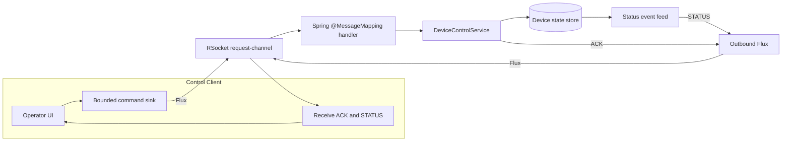

# Xây dựng kênh hai chiều cho điều khiển thiết bị và phản hồi trạng thái

Trong bài thực hành này, bạn xây dựng một phiên điều khiển thiết bị bằng RSocket Request-Channel. Client gửi nhiều lệnh điều khiển trên cùng một interaction; server xử lý lệnh theo thứ tự và đồng thời phát acknowledgement cùng các cập nhật trạng thái thiết bị về client. Client có thể tiếp tục gửi lệnh trong khi nhận trạng thái, sau đó hủy channel khi người dùng đóng màn hình điều khiển.

Project sử dụng Java, Spring Boot, Spring RSocket và Project Reactor. Ban đầu trạng thái thiết bị được mô phỏng trong bộ nhớ để tập trung vào protocol và reactive flow. Sau khi hoàn thành, có thể thay state store bằng adapter phần cứng, database hoặc event broker mà vẫn giữ contract RSocket.

## 1. Mục tiêu thực hành

Sau bài lab, bạn có thể:

- Thiết kế request-channel contract cho command từ client lên server và event từ server xuống client.
- Viết Spring handler nhận `Flux<DeviceCommand>` và trả `Flux<ControlEvent>`.
- Tạo client session bằng `RSocketRequester` và gửi command liên tục.
- Nhận acknowledgement và status update trên cùng channel.
- Giữ thứ tự xử lý command bằng `concatMap`.
- Giới hạn hàng đợi lệnh phía client và xử lý overflow.
- Hủy channel đúng cách khi client rời phiên điều khiển.
- Kiểm tra publisher bằng `StepVerifier` và kiểm thử qua transport RSocket.
- Nhận biết các yêu cầu production như authorization, idempotency, reconnect và checkpoint.

## 2. Kịch bản và yêu cầu nghiệp vụ

Một người vận hành mở màn hình điều khiển thiết bị `pump-17`. Trong khi phiên hoạt động, người dùng có thể gửi các lệnh:

| Lệnh | Ý nghĩa | Trạng thái dự kiến |
|---|---|---|
| `START` | Khởi động thiết bị | `RUNNING` |
| `STOP` | Dừng thiết bị | `STOPPED` |
| `SET_TARGET` | Đổi giá trị mục tiêu | Giữ mode hiện tại, cập nhật target |

Server trả hai loại event trên channel:

- `ACK`: xác nhận command đã được service tiếp nhận/xử lý trong ví dụ mô phỏng, kèm `commandId` và revision.
- `STATUS`: snapshot trạng thái mới nhất của thiết bị, kèm revision tăng dần.

Một channel là một phiên tương tác hai chiều: client gửi `Flux<DeviceCommand>`, server phát `Flux<ControlEvent>`. Server có thể phát status update ngay cả khi client chưa gửi command tiếp theo. Client dùng `commandId` để ghép acknowledgement với lệnh đã gửi và `revision` để nhận biết trạng thái mới hơn.

## 3. Kiến trúc tổng thể



Handler kết hợp hai nguồn output: acknowledgement từ command pipeline và status feed của thiết bị. `Flux.merge` cho phép hai nguồn phát xen kẽ. Vì thứ tự giữa hai nguồn không được bảo đảm, client không nên giả định `ACK` luôn đến trước `STATUS`; hãy dùng `commandId` và `revision` để tương quan dữ liệu.

## 4. Contract của request-channel

Route của project là `devices.control-session`. Payload đầu tiên phải chứa `deviceId`; các payload command tiếp theo trong cùng channel phải tiếp tục dùng cùng thiết bị. Quy tắc này cho phép server mở đúng status feed cho phiên.

**Command từ client lên server:**

```java
public enum CommandAction {
    START,
    STOP,
    SET_TARGET
}
```

```java
public record DeviceCommand(
    String commandId,
    String deviceId,
    CommandAction action,
    Double target
) {}
```

**Snapshot trạng thái thiết bị:**

```java
import java.time.Instant;

public record DeviceStatus(
    String deviceId,
    String mode,
    double target,
    long revision,
    Instant updatedAt
) {}
```

**Event từ server xuống client:**

```java
public record ControlEvent(
    EventType type,
    String commandId,
    long revision,
    DeviceStatus status,
    String message
) {
    public enum EventType {
        ACK,
        STATUS,
        REJECTED
    }

    public static ControlEvent ack(String commandId, long revision) {
        return new ControlEvent(EventType.ACK, commandId,
            revision, null, "accepted");
    }

    public static ControlEvent status(DeviceStatus status) {
        return new ControlEvent(EventType.STATUS, null,
            status.revision(), status, null);
    }

    public static ControlEvent rejected(String commandId, String reason) {
        return new ControlEvent(EventType.REJECTED, commandId,
            0, null, reason);
    }
}
```

`commandId` là định danh ổn định do client tạo cho mỗi lệnh. `revision` tăng sau mỗi lần trạng thái thay đổi. Trong hệ thống thật, không dùng `message` để trả stack trace hoặc thông tin nội bộ; chỉ gửi mã lỗi và thông điệp an toàn cho caller.

## 5. Cấu trúc project

```text
device-control-rsocket/
├── build.gradle
└── src/
    ├── main/
    │   ├── java/com/example/devicecontrol/
    │   │   ├── DeviceControlApplication.java
    │   │   ├── model/
    │   │   │   ├── CommandAction.java
    │   │   │   ├── DeviceCommand.java
    │   │   │   ├── DeviceStatus.java
    │   │   │   └── ControlEvent.java
    │   │   ├── service/
    │   │   │   ├── DeviceStateStore.java
    │   │   │   └── DeviceControlService.java
    │   │   └── rsocket/
    │   │       └── DeviceControlHandler.java
    │   └── resources/application.yml
    └── test/java/com/example/devicecontrol/
        ├── DeviceControlServiceTest.java
        └── DeviceControlChannelIntegrationTest.java
```

## 6. Khởi tạo Spring Boot project

Dùng Spring Boot với Java 21 hoặc Java version mà dòng Spring Boot của project hỗ trợ. Dependency tối thiểu:

```groovy
plugins {
    id 'java'
    id 'org.springframework.boot' version '3.4.0'
    id 'io.spring.dependency-management' version '1.1.6'
}

group = 'com.example'
version = '1.0.0'

java {
    toolchain {
        languageVersion = JavaLanguageVersion.of(21)
    }
}

dependencies {
    implementation 'org.springframework.boot:spring-boot-starter-rsocket'

    testImplementation 'org.springframework.boot:spring-boot-starter-test'
    testImplementation 'io.projectreactor:reactor-test'
}

tasks.named('test') {
    useJUnitPlatform()
}
```

Version plugin chỉ là ví dụ. Với project đã có Spring Boot plugin hoặc version catalog, dùng version do project quản lý và giữ Spring Framework, Reactor và `reactor-test` tương thích.

Application entry point:

```java
@SpringBootApplication
public class DeviceControlApplication {
    public static void main(String[] args) {
        SpringApplication.run(DeviceControlApplication.class, args);
    }
}
```

## 7. Cấu hình RSocket server

Để tập trung vào request-channel, project chạy TCP trên port `7000`:

```yaml
spring:
  application:
    name: device-control-service
  rsocket:
    server:
      transport: tcp
      address: 0.0.0.0
      port: 7000

logging:
  level:
    org.springframework.messaging.rsocket: INFO
```

Client và server cần thống nhất data MIME type. Ví dụ này dùng JSON DTO; Spring Boot cấu hình codec JSON mặc định khi Jackson có trên classpath. Khi thay codec hoặc MIME type, hãy cấu hình hai phía nhất quán.

## 8. Tạo state store và status feed

State store giữ trạng thái mới nhất và phát cập nhật tới các channel đang theo dõi thiết bị. Dùng `Sinks.many().replay().latest()` vì đây là status snapshot: subscriber mới cần nhận trạng thái mới nhất, còn các trạng thái trung gian có thể được coalesce.

```java
@Component
public class DeviceStateStore {
    private final Map<String, DeviceStatus> states =
        new ConcurrentHashMap<>();
    private final Map<String, Sinks.Many<DeviceStatus>> feeds =
        new ConcurrentHashMap<>();

    public DeviceStatus current(String deviceId) {
        return states.computeIfAbsent(deviceId, this::initialStatus);
    }

    public Flux<DeviceStatus> watch(String deviceId) {
        return feedFor(deviceId).asFlux();
    }

    public synchronized DeviceStatus apply(DeviceCommand command) {
        DeviceStatus current = current(command.deviceId());
        Sinks.Many<DeviceStatus> feed = feedFor(command.deviceId());

        String nextMode = current.mode();
        double nextTarget = current.target();

        switch (command.action()) {
            case START -> nextMode = "RUNNING";
            case STOP -> nextMode = "STOPPED";
            case SET_TARGET -> {
                if (command.target() == null
                        || !Double.isFinite(command.target())
                        || command.target() < 0) {
                    throw new IllegalArgumentException(
                        "target must be a non-negative number");
                }
                nextTarget = command.target();
            }
        }

        DeviceStatus next = new DeviceStatus(
            command.deviceId(), nextMode, nextTarget,
            current.revision() + 1, Instant.now());
        states.put(command.deviceId(), next);

        Sinks.EmitResult result = feed.tryEmitNext(next);
        if (result.isFailure()) {
            throw new IllegalStateException(
                "Cannot publish device status: " + result);
        }
        return next;
    }

    private Sinks.Many<DeviceStatus> feedFor(String deviceId) {
        return feeds.computeIfAbsent(deviceId, id -> {
            Sinks.Many<DeviceStatus> sink = Sinks.many().replay().latest();
            sink.tryEmitNext(current(id));
            return sink;
        });
    }

    private DeviceStatus initialStatus(String deviceId) {
        return new DeviceStatus(
            deviceId, "STOPPED", 0.0, 0, Instant.now());
    }
}
```

`apply` được đồng bộ hóa để ví dụ đơn giản giữ revision tăng tuần tự. Không dùng một `synchronized` toàn cục như vậy cho hệ thống có tải lớn: hãy serialize theo từng device hoặc dùng transaction/optimistic locking trong repository. Map và sink trong ví dụ cũng không có eviction; ứng dụng thực tế cần quản lý vòng đời thiết bị và giải phóng feed khi thiết bị không còn được theo dõi.

`replay().latest()` phù hợp với snapshot trạng thái, nơi giá trị mới nhất quan trọng hơn mọi chuyển tiếp trung gian. Nếu mỗi transition là sự kiện kiểm toán hoặc lệnh an toàn phải được giao đủ, dùng durable event log/broker và checkpoint; không dựa vào một sink chỉ giữ giá trị mới nhất.

## 9. Xử lý command và tạo acknowledgement

Service kiểm tra command, áp dụng thay đổi trạng thái rồi trả ACK với revision đã cập nhật:

```java
@Service
public class DeviceControlService {
    private final DeviceStateStore stateStore;

    public DeviceControlService(DeviceStateStore stateStore) {
        this.stateStore = stateStore;
    }

    public Mono<ControlEvent> execute(DeviceCommand command) {
        return Mono.fromSupplier(() -> {
            if (command.commandId() == null
                    || command.commandId().isBlank()) {
                throw new IllegalArgumentException("commandId is required");
            }
            if (command.deviceId() == null
                    || command.deviceId().isBlank()) {
                throw new IllegalArgumentException("deviceId is required");
            }
            if (command.action() == null) {
                throw new IllegalArgumentException("action is required");
            }

            DeviceStatus status = stateStore.apply(command);
            return ControlEvent.ack(
                command.commandId(), status.revision());
        }).onErrorResume(IllegalArgumentException.class, error ->
            Mono.just(ControlEvent.rejected(
                command.commandId(), error.getMessage())));
    }
}
```

Trong lab, state update chạy nhanh trong memory nên `fromSupplier` đủ để minh họa lazy execution. Nếu thao tác thật gọi JDBC, file I/O hoặc SDK thiết bị blocking, chuyển nó sang scheduler phù hợp hoặc dùng reactive driver; không block Netty event loop. Với lỗi không mong muốn, để publisher phát error và ghi log/trace ở boundary phù hợp thay vì biến mọi lỗi thành `REJECTED`.

## 10. Viết Request-Channel handler

Điểm quan trọng của handler là xác định `deviceId` từ command đầu tiên, rồi kết hợp:

- `acknowledgements`: xử lý command tuần tự bằng `concatMap`.
- `statusEvents`: phát trạng thái hiện tại và cập nhật mới của cùng thiết bị.

```java
@Controller
public class DeviceControlHandler {
    private final DeviceControlService controlService;
    private final DeviceStateStore stateStore;

    public DeviceControlHandler(
            DeviceControlService controlService,
            DeviceStateStore stateStore) {
        this.controlService = controlService;
        this.stateStore = stateStore;
    }

    @MessageMapping("devices.control-session")
    public Flux<ControlEvent> controlSession(
            @Payload Flux<DeviceCommand> commands) {

        return commands.switchOnFirst((first, allCommands) -> {
            if (first.isOnError()) {
                return Flux.error(first.getThrowable());
            }
            if (!first.hasValue()) {
                return Flux.empty();
            }

            String deviceId = first.get().deviceId();
            if (deviceId == null || deviceId.isBlank()) {
                return Flux.error(new IllegalArgumentException(
                    "First command must contain deviceId"));
            }

            Flux<ControlEvent> acknowledgements = allCommands
                .concatMap(command -> {
                    if (!deviceId.equals(command.deviceId())) {
                        return Mono.<ControlEvent>error(new IllegalArgumentException(
                            "A control channel can target only one device"));
                    }
                    return controlService.execute(command);
                });

            Flux<ControlEvent> statusEvents = stateStore.watch(deviceId)
                .map(ControlEvent::status);

            return Flux.merge(acknowledgements, statusEvents);
        });
    }
}
```

`switchOnFirst` cho phép lấy thiết bị từ payload đầu tiên trong khi vẫn chuyển tiếp toàn bộ command stream cho pipeline xử lý. Nếu channel không có payload đầu tiên, handler complete rỗng vì không có thiết bị để theo dõi. Nếu client gửi command của thiết bị khác vào cùng channel, handler kết thúc bằng lỗi contract.

`concatMap` giữ thứ tự command và tránh hai lệnh cập nhật cùng device chạy đồng thời trong ví dụ. `Flux.merge` cho phép ACK và STATUS xen kẽ; client phải xử lý chúng theo `type`, `commandId` và `revision`, không phụ thuộc thứ tự tuyệt đối giữa hai nguồn.

Status feed không tự complete khi command input complete. Đây là chủ đích: channel còn sống để gửi trạng thái mới. Client phải cancel subscription khi kết thúc phiên; nếu muốn server tự kết thúc sau một khoảng idle, hãy bổ sung timeout/session policy rõ ràng.

## 11. Mở channel từ client

Client cần một publisher có thể nhận command từ UI trong khi vẫn nhận event từ server. `Sinks.Many` là cầu nối đơn giản giữa imperative event source và reactive pipeline. Dùng unicast sink với queue giới hạn để không tích lũy command vô hạn.

```java
Sinks.Many<DeviceCommand> commands = Sinks.many()
    .unicast()
    .onBackpressureBuffer(new ArrayBlockingQueue<>(128));

Mono<RSocketRequester> requesterMono = RSocketRequester.builder()
    .dataMimeType(MimeTypeUtils.APPLICATION_JSON)
    .connectTcp("localhost", 7000);

Flux<ControlEvent> events = requesterMono.flatMapMany(requester ->
    requester.route("devices.control-session")
        .data(commands.asFlux())
        .retrieveFlux(ControlEvent.class));

Disposable session = events.subscribe(
    this::handleControlEvent,
    this::handleSessionError,
    this::handleSessionComplete);
```

`requesterMono` mở connection; khi publisher được subscribe, client gửi request-channel với `commands.asFlux()` làm luồng payload đầu vào và nhận `ControlEvent` ở đầu ra. Subscribe một lần cho mỗi phiên điều khiển; unicast sink chỉ hỗ trợ một subscriber.

Gửi command:

```java
Sinks.EmitResult result = commands.tryEmitNext(
    new DeviceCommand(
        UUID.randomUUID().toString(),
        "pump-17",
        CommandAction.START,
        null));

if (result.isFailure()) {
    // Queue đầy, sink đã đóng hoặc concurrent emission không hợp lệ.
    handleCommandNotAccepted(result);
}
```

`FAIL_OVERFLOW` có nghĩa queue đã đầy; UI nên báo bận hoặc áp dụng chính sách retry có giới hạn. Không âm thầm bỏ command điều khiển. `FAIL_NON_SERIALIZED` có thể xuất hiện nếu nhiều thread gọi sink đồng thời; serialize producer hoặc dùng API emission có chiến lược retry phù hợp. Không gọi `emitNext` với busy-loop vô hạn trên event loop.

## 12. Xử lý event ở client

Client phân nhánh theo loại event:

```java
void handleControlEvent(ControlEvent event) {
    switch (event.type()) {
        case ACK -> showCommandAccepted(
            event.commandId(), event.revision());
        case STATUS -> updateDeviceView(event.status());
        case REJECTED -> showCommandRejected(
            event.commandId(), event.message());
    }
}
```

Trong UI, giữ map `commandId -> pending command` để cập nhật đúng trạng thái từng nút/lệnh khi ACK hoặc REJECTED đến. Chỉ áp dụng status nếu revision mới hơn revision hiện tại; event cũ hoặc trùng có thể đến do replay/reconnect.

ACK trong lab nghĩa là state store mô phỏng đã áp dụng lệnh. Trong hệ thống phần cứng, cần phân biệt `ACCEPTED` (server nhận command), `DISPATCHED` (đã gửi tới adapter), `APPLIED` (thiết bị xác nhận đã thực thi) và `FAILED`. Không đặt tên ACK là “đã thực thi” nếu service chỉ mới đưa lệnh vào queue.

## 13. Đóng phiên và cancellation

Khi người dùng rời màn hình, client phải hủy subscription nhận event và đóng command publisher:

```java
void closeControlSession(
        Disposable session,
        Sinks.Many<DeviceCommand> commands) {

    session.dispose();
    commands.tryEmitComplete();
}
```

`session.dispose()` hủy request-channel từ phía client; cancellation được truyền tới responder để pipeline phía server có thể dừng và giải phóng subscription status feed. `tryEmitComplete()` kết thúc input sink nếu nó còn mở. Cần gọi cleanup đúng một lần khi UI đóng, user logout hoặc connection mất.

Không chờ `statusEvents` complete tự nhiên nếu nó là feed realtime vô hạn. Nếu client chỉ complete command sink nhưng không cancel response subscription, status stream vẫn có thể giữ channel sống.

## 14. Flow control và giới hạn tài nguyên

Request-channel là hai luồng có demand: client gửi command lên server và server phát event về client. Cần giới hạn cả hai phía.

| Vị trí | Cơ chế trong project | Mục đích |
|---|---|---|
| Client command producer | Unicast sink với queue 128 phần tử | Giới hạn command đang chờ gửi |
| Server command handler | `concatMap` | Xử lý tuần tự, giữ thứ tự command |
| Server status feed | Replay latest | Chỉ cần snapshot mới nhất, tránh backlog status cũ |
| RSocket channel | Reactive Streams demand | Điều tiết payload theo subscriber demand |
| UI consumer | Xử lý event nhanh và cập nhật state theo revision | Tránh nghẽn event loop/UI thread |

Không dùng `onBackpressureBuffer()` không giới hạn cho command stream trong production. Khi queue đầy, phải có admission policy: từ chối command mới, giảm tốc độ UI, hoặc ghi command vào durable outbox. Với trạng thái snapshot, coalesce về giá trị mới nhất có thể hợp lý; với event kiểm toán hoặc lệnh điều khiển, không được tự ý drop.

Backpressure không thay thế quota nghiệp vụ. Cần giới hạn số channel trên mỗi user/device, số command mỗi giây, payload size và thời gian phiên. Một caller có thể mở nhiều channel hợp lệ nhưng vẫn làm server cạn tài nguyên nếu không có quota.

## 15. Bảo mật phiên điều khiển

Điều khiển thiết bị là thao tác có tác dụng vật lý, nên phải kiểm tra quyền ở server. Không tin `deviceId`, `tenantId` hoặc `operatorId` chỉ vì client gửi trong payload.

Các kiểm soát cần có:

- Xác thực caller khi thiết lập RSocket connection hoặc theo request policy.
- Kiểm tra principal hiện tại có quyền điều khiển đúng device/tenant.
- Kiểm tra quyền cho từng loại action: `START`, `STOP`, `SET_TARGET`.
- Kiểm tra giới hạn target, trạng thái thiết bị và interlock an toàn trước khi áp dụng.
- Giới hạn số phiên đồng thời trên mỗi device/operator.
- Bảo vệ transport bằng TLS và quản lý credential ngoài source code.
- Không log token hoặc payload chứa dữ liệu nhạy cảm.

Trong project đơn giản, có thể đặt authorization check trong `DeviceControlService` trước khi gọi state store. Khi tích hợp Spring Security RSocket, cấu hình route authorization ở tầng messaging security và vẫn giữ kiểm tra domain ownership tại service sở hữu thiết bị. Route authorization không thay thế kiểm tra một principal có quyền với một `deviceId` cụ thể hay không.

## 16. Idempotency và command trùng lặp

Client có thể không biết command đã được xử lý hay chưa nếu connection mất sau khi server commit nhưng trước khi ACK tới client. Khi reconnect, gửi lại command với cùng `commandId` để server nhận diện retry.

Thiết kế production nên:

1. Tạo `commandId` duy nhất cho một ý định nghiệp vụ.
2. Lưu command ID, device ID, kết quả và trạng thái xử lý trong inbox/dedup store.
3. Đặt unique constraint phù hợp, ví dụ `(tenant_id, device_id, command_id)`.
4. Nếu command đã xử lý, trả lại kết quả cũ thay vì thực thi lần nữa.
5. Lưu trạng thái command và revision trong transaction khi có thể.
6. Với thiết bị ngoài database, dùng idempotency key ở adapter và cơ chế reconciliation cho kết quả không xác định.

State store trong lab là in-memory nên chưa cung cấp dedup bền vững. Khi process restart, map mất dữ liệu; không dùng mẫu này cho điều khiển thiết bị thật nếu chưa bổ sung persistence, authorization và safety interlock.

## 17. Reconnect và phục hồi phiên

Khi connection đóng, request-channel cũ không thể được xem là tiếp tục tự động nếu protocol session không còn resume được. Client cần:

- Đánh dấu phiên hiện tại disconnected và ngừng nhận command mới hoặc giữ command ở outbox có giới hạn.
- Kết nối lại với backoff và jitter.
- Mở channel mới và gửi command chưa được xác nhận bằng cùng `commandId`.
- Lấy snapshot trạng thái mới nhất trước khi cho phép thao tác tiếp.
- Dùng revision để bỏ qua status cũ và phát hiện khoảng trống nếu nguồn có sequence.
- Tra cứu trạng thái command khi kết quả trước đó không xác định.

Nếu status là snapshot coalesced, client có thể tiếp tục từ trạng thái mới nhất. Nếu cần phát lại mọi event, server phải cung cấp durable event log và business cursor/checkpoint; một `Sinks.Many` trong memory không đủ.

## 18. Kiểm thử service bằng StepVerifier

Kiểm tra command cập nhật trạng thái và trả ACK:

```java
@Test
void startCommandUpdatesDeviceAndReturnsAck() {
    DeviceStateStore store = new DeviceStateStore();
    DeviceControlService service = new DeviceControlService(store);

    DeviceCommand command = new DeviceCommand(
        "cmd-100", "pump-17", CommandAction.START, null);

    StepVerifier.create(service.execute(command))
        .expectNextMatches(event ->
            event.type() == ControlEvent.EventType.ACK
                && event.commandId().equals("cmd-100")
                && event.revision() == 1)
        .verifyComplete();

    assertThat(store.current("pump-17").mode()).isEqualTo("RUNNING");
}
```

Kiểm tra target không hợp lệ bị từ chối:

```java
@Test
void rejectsNegativeTarget() {
    DeviceStateStore store = new DeviceStateStore();
    DeviceControlService service = new DeviceControlService(store);

    StepVerifier.create(service.execute(new DeviceCommand(
            "cmd-101", "pump-17", CommandAction.SET_TARGET, -5.0)))
        .expectNextMatches(event ->
            event.type() == ControlEvent.EventType.REJECTED
                && event.commandId().equals("cmd-101"))
        .verifyComplete();
}
```

## 19. Kiểm thử handler giữ thứ tự và phát status

Có thể test handler trực tiếp trước khi chạy integration test transport:

```java
@Test
void channelReturnsAckForCommand() {
    DeviceStateStore store = new DeviceStateStore();
    DeviceControlService service = new DeviceControlService(store);
    DeviceControlHandler handler = new DeviceControlHandler(service, store);

    Flux<ControlEvent> acknowledgements = handler.controlSession(
        Flux.just(new DeviceCommand(
            "cmd-200", "pump-17", CommandAction.START, null)))
        .filter(event -> event.type() == ControlEvent.EventType.ACK)
        .take(1);

    StepVerifier.create(acknowledgements)
        .expectNextMatches(event ->
            event.commandId().equals("cmd-200")
                && event.revision() == 1)
        .verifyComplete();
}
```

Filter ACK trước khi `take(1)` để test không phụ thuộc việc status snapshot hay ACK đến trước. Khi client cancel sau event cần thiết, cả hai nguồn trong merge được hủy.

## 20. Integration test qua RSocketRequester

Unit test gọi trực tiếp handler không kiểm tra routing, serialization hoặc transport. Integration test nên khởi chạy server trên port ngẫu nhiên theo cách cấu hình của project, kết nối requester thật và gửi channel.

Ví dụ phần client của test sau khi đã có requester kết nối:

```java
Sinks.Many<DeviceCommand> commands = Sinks.many()
    .unicast()
    .onBackpressureBuffer(new ArrayBlockingQueue<>(8));

Flux<ControlEvent> acknowledgements = requester
    .route("devices.control-session")
    .data(commands.asFlux())
    .retrieveFlux(ControlEvent.class)
    .filter(event -> event.type() == ControlEvent.EventType.ACK)
    .take(2);

StepVerifier.create(acknowledgements)
    .then(() -> {
        commands.tryEmitNext(new DeviceCommand(
            "cmd-300", "pump-17", CommandAction.START, null));
        commands.tryEmitNext(new DeviceCommand(
            "cmd-301", "pump-17", CommandAction.STOP, null));
    })
    .expectNextMatches(event ->
        event.commandId().equals("cmd-300") && event.revision() == 1)
    .expectNextMatches(event ->
        event.commandId().equals("cmd-301") && event.revision() == 2)
    .verifyComplete();
```

Trong test hoàn chỉnh, bảo đảm command sink được complete/dispose và requester/server được đóng trong teardown. Thêm test cho sai route, payload sai MIME type, command của device khác trong cùng channel, client cancellation và connection close.

## 21. Chạy project và thử luồng điều khiển

Build và chạy server:

```bash
./gradlew test
./gradlew bootRun
```

Khi server đã listen TCP `7000`, chạy client demo hoặc integration test. Luồng thử nghiệm:

1. Client mở route `devices.control-session` và gửi command đầu tiên cho `pump-17`.
2. Server phát status snapshot hiện tại.
3. Client gửi `START` với command ID mới.
4. Server cập nhật state, phát ACK và status revision mới.
5. Client gửi `SET_TARGET` trong cùng channel.
6. Client nhận ACK/status mới mà không mở request riêng.
7. Client đóng màn hình và dispose subscription.
8. Server nhận cancellation và giải phóng status subscription.

## 22. Tiêu chí hoàn thành

- [ ] Server khởi động và mở RSocket TCP listener.
- [ ] Client kết nối được tới route `devices.control-session`.
- [ ] Một channel nhận được nhiều command liên tiếp.
- [ ] Server xử lý command theo thứ tự và revision tăng đơn điệu.
- [ ] Client nhận được ACK với đúng `commandId`.
- [ ] Client nhận được status snapshot và các cập nhật mới.
- [ ] Command không hợp lệ được trả REJECTED theo contract.
- [ ] Queue phía client có giới hạn và xử lý overflow rõ ràng.
- [ ] Client cancel channel khi kết thúc phiên.
- [ ] Unit test và integration test xác minh cả logic lẫn route/transport.

## 23. Mở rộng thành hệ thống production

Sau khi hoàn thành lab, có thể mở rộng theo các hướng:

- **Thiết bị thật:** thay `DeviceStateStore` bằng adapter giao tiếp MQTT, serial, Modbus hoặc SDK thiết bị; không block event loop.
- **Persistence:** lưu trạng thái, command inbox và revision trong database.
- **Event broker:** phát device event bền vững để nhiều service cùng tiêu thụ.
- **Authorization:** kiểm tra principal, tenant, device ownership và quyền từng action.
- **Idempotency:** deduplicate command theo ID và trả lại kết quả đã lưu khi retry.
- **Business resume:** lưu checkpoint/status revision để reconnect sau khi protocol resume không khả dụng.
- **Observability:** đo active channel, command rate, ACK latency, status lag, rejected command và disconnect reason.
- **Capacity:** giới hạn session/device, queue, payload, stream và số command mỗi giây.
- **Safety:** thêm interlock, range check, command expiry và trạng thái xác nhận từ firmware.

## 24. Quy tắc thiết kế

1. Dùng request-channel khi client và server đều cần trao đổi nhiều payload trong cùng phiên.
2. Dùng command đầu tiên để xác định device/session scope và kiểm tra mọi command sau thuộc cùng scope.
3. Dùng `Flux<Command>` đầu vào và `Flux<Event>` đầu ra; khai báo DTO/generic rõ ràng.
4. Dùng `concatMap` khi command phải được xử lý tuần tự.
5. Dùng `merge` cho ACK và status feed khi client chấp nhận hai nguồn phát xen kẽ.
6. Tương quan command bằng `commandId` và loại status theo `revision`, không dựa vào thứ tự tuyệt đối.
7. Giới hạn queue phía client và áp dụng admission control cho session/command.
8. Chỉ coalesce status snapshot khi nghiệp vụ cho phép; không drop command hoặc audit event.
9. Hủy subscription khi đóng phiên để giải phóng tài nguyên server.
10. Xác thực và phân quyền device/action ở server; không tin identity trong payload.
11. Dùng idempotency key, durable inbox/outbox và checkpoint cho retry/reconnect.
12. Kiểm thử cả StepVerifier ở mức publisher và integration test qua RSocket transport.

Kênh hai chiều gom command và phản hồi trạng thái vào một interaction, giúp client giữ phiên điều khiển realtime mà không phải mở request riêng cho từng cập nhật. Thiết kế an toàn cần contract rõ ràng, command có định danh, xử lý tuần tự, status revision, backpressure và cancellation. Khi chuyển từ mô phỏng sang thiết bị thật, hãy bổ sung authorization, idempotency bền vững, safety interlock và business recovery trước khi dùng channel để điều khiển phần cứng.
