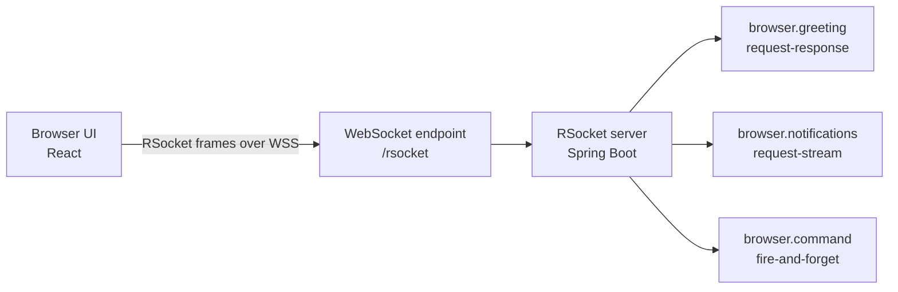

# Tích hợp giao diện trình duyệt qua RSocket over WebSocket

Trong bài thực hành này, chúng ta xây dựng một giao diện trình duyệt kết nối tới ứng dụng Java Spring Boot bằng RSocket over WebSocket. Trình duyệt gửi yêu cầu lấy lời chào, nhận một luồng thông báo realtime và gửi lệnh cập nhật. Backend xử lý các route RSocket, còn giao diện quản lý trạng thái kết nối, hiển thị dữ liệu, hủy subscription khi component không còn dùng và kết nối lại khi mạng phục hồi.

RSocket cung cấp giao tiếp bất đồng bộ, hai chiều và reactive qua TCP hoặc WebSocket, với request-response, fire-and-forget, stream và channel. Khi đưa RSocket vào trình duyệt, WebSocket là lớp vận chuyển phù hợp vì trình duyệt có sẵn WebSocket API. RSocket vẫn đảm nhiệm framing, setup, routing metadata, flow control và các interaction model ở bên trong kết nối đó.

## 1. Kết quả cần đạt

Sau bài thực hành, ứng dụng có các khả năng sau:

1. Trình duyệt mở kết nối WebSocket tới endpoint RSocket `/rsocket` và hoàn tất RSocket SETUP.
2. Người dùng nhập tên, gửi request-response tới route `browser.greeting` và hiển thị kết quả từ server.
3. Giao diện đăng ký request-stream `browser.notifications`, nhận thông báo mới và cập nhật danh sách realtime.
4. Người dùng gửi một lệnh không cần phản hồi qua fire-and-forget tới route `browser.command`; giao diện phân biệt trạng thái đã gửi với trạng thái nghiệp vụ đã được xác nhận.
5. Khi component bị unmount hoặc người dùng rời màn hình, subscription được hủy và kết nối được đóng theo quyền sở hữu của ứng dụng.
6. Khi kết nối mất, giao diện hiển thị trạng thái, thử kết nối lại có backoff và không tạo nhiều kết nối song song.
7. Khi triển khai production, trang HTTPS sử dụng `wss://`, server kiểm soát Origin và xác thực kết nối trước khi cho phép gọi route.

## 2. Kiến trúc tổng thể



Trình duyệt không gọi trực tiếp một phương thức Java. Nó gửi payload cùng routing metadata. Spring ánh xạ route metadata vào phương thức `@MessageMapping`. Hai phía cần thống nhất data MIME type, metadata MIME type, tên route và cấu trúc dữ liệu.

| Thành phần | Trách nhiệm |
| --- | --- |
| React UI | Thu thập thao tác người dùng, hiển thị trạng thái và dữ liệu realtime |
| RSocket JS client | SETUP, serialize payload, thêm routing metadata, quản lý interaction và demand |
| WebSocket transport | Chuyển RSocket frame qua kết nối WebSocket của trình duyệt |
| Spring Boot RSocket server | Nhận frame, xác thực, phân tuyến và gọi handler reactive |
| Service layer | Thực hiện nghiệp vụ, truy cập dữ liệu và phát sự kiện |

WebSocket là một kết nối song công lâu dài. Sau khi HTTP Upgrade hoàn tất, hai phía có thể gửi frame trên cùng kết nối. RSocket chạy bên trong kết nối này và hỗ trợ các mô hình tương tác riêng. Một WebSocket mở thành công chưa có nghĩa RSocket SETUP hoặc xác thực ứng dụng đã thành công.

## 3. Chuẩn bị backend Spring Boot

Backend cần Spring Boot, Spring WebFlux và RSocket. Với Maven, các dependency thường dùng là:

```xml
<dependency>
    <groupId>org.springframework.boot</groupId>
    <artifactId>spring-boot-starter-rsocket</artifactId>
</dependency>
<dependency>
    <groupId>org.springframework.boot</groupId>
    <artifactId>spring-boot-starter-webflux</artifactId>
</dependency>
```

Khai báo RSocket server dùng WebSocket transport trong `application.yml`:

```yaml
server:
  port: 8080

spring:
  rsocket:
    server:
      transport: websocket
      mapping-path: /rsocket
```

Khi chạy local, endpoint là `ws://localhost:8080/rsocket`. Production cần kết thúc TLS ở ứng dụng hoặc reverse proxy và cung cấp endpoint `wss://`. Nếu dùng reverse proxy, proxy phải chuyển tiếp HTTP Upgrade và giữ kết nối đủ lâu cho heartbeat RSocket.

### 3.1. Khai báo các payload

Các record sau mô tả dữ liệu trao đổi. Có thể đặt chúng trong các file Java riêng theo cấu trúc dự án.

```java
public record GreetingRequest(String name) {}

public record GreetingResponse(String message) {}

public record Notification(
    long sequence,
    Instant createdAt,
    String message
) {}

public record BrowserCommand(
    String commandId,
    String action,
    String target
) {}
```

Ví dụ sử dụng `Instant` yêu cầu import `java.time.Instant`. Khi serialize JSON, hai phía phải thống nhất cách biểu diễn thời gian, giá trị null và tên field. Nếu dùng một serializer khác JSON, hãy đổi data MIME type tương ứng và cấu hình serializer tương thích ở cả hai phía.

### 3.2. Viết các route RSocket

```java
import java.time.Duration;
import java.time.Instant;
import java.util.concurrent.atomic.AtomicLong;

import org.springframework.messaging.handler.annotation.MessageMapping;
import org.springframework.stereotype.Controller;
import reactor.core.publisher.Flux;
import reactor.core.publisher.Mono;

@Controller
public class BrowserRSocketController {

    private final AtomicLong sequence = new AtomicLong();
    private final BrowserCommandService commandService;

    public BrowserRSocketController(BrowserCommandService commandService) {
        this.commandService = commandService;
    }

    @MessageMapping("browser.greeting")
    public Mono<GreetingResponse> greeting(GreetingRequest request) {
        String name = request.name() == null || request.name().isBlank()
            ? "bạn"
            : request.name().trim();

        return Mono.just(new GreetingResponse("Xin chào, " + name + "!"));
    }

    @MessageMapping("browser.notifications")
    public Flux<Notification> notifications() {
        return Flux.interval(Duration.ofSeconds(2))
            .onBackpressureLatest()
            .map(tick -> new Notification(
                sequence.incrementAndGet(),
                Instant.now(),
                "Thông báo realtime số " + (tick + 1)
            ));
    }

    @MessageMapping("browser.command")
    public Mono<Void> command(BrowserCommand command) {
        return commandService.execute(command);
    }
}
```

`BrowserCommandService` đại diện cho service nghiệp vụ của ứng dụng. Trong dự án thật, service cần kiểm tra quyền, xác thực dữ liệu và xử lý `commandId` theo cách idempotent nếu client có thể gửi lại lệnh sau khi mất kết nối. Handler trả `Mono<Void>` phù hợp với fire-and-forget: client không nhận kết quả nghiệp vụ từ interaction này. Nếu UI cần biết lệnh đã được chấp nhận hoặc hoàn tất, hãy dùng request-response và trả về một receipt có trạng thái rõ ràng.

`Flux.interval` chỉ là nguồn dữ liệu minh họa. Trong hệ thống thực, thay bằng publisher từ event bus, database change feed hoặc service phát sự kiện. Khi client hủy stream, subscription phía server phải được hủy để giải phóng tài nguyên. Nếu sự kiện cần được phát lại sau reconnect, cần cursor, sequence hoặc cơ chế resume ở tầng ứng dụng; stream mới không tự biết client đã nhận sự kiện nào trước đó.

## 4. Chuẩn bị ứng dụng trình duyệt

Ví dụ sử dụng React, TypeScript và Vite. Tạo ứng dụng Vite theo template React TypeScript, sau đó cài các package RSocket JS và browser buffer encoder:

```bash
npm create vite@latest rsocket-browser -- --template react-ts
cd rsocket-browser
npm install
npm install rsocket-core rsocket-websocket-client rsocket-buffer-utils rsocket-types buffer
```

Các package RSocket JS cần cùng một thế hệ API tương thích. Giữ lockfile trong source control để các môi trường cài lại cùng dependency graph. Nếu dự án dùng phiên bản package đã được khóa, hãy đối chiếu tên export và kiểu TypeScript với phiên bản đó trước khi nâng cấp.

### 4.1. Cấu hình URL WebSocket

Tạo biến môi trường `VITE_RSOCKET_URL`:

```dotenv
# Local development
VITE_RSOCKET_URL=ws://localhost:8080/rsocket
```

Production dùng URL `wss://` của endpoint đã cấu hình TLS, ví dụ `wss://api.example.com/rsocket`. Trang được tải qua HTTPS phải kết nối bằng WSS; trình duyệt chặn kết nối WebSocket không mã hóa tới `ws://` trong ngữ cảnh bảo mật do mixed-content policy.

Nếu frontend và backend chạy hai origin khác nhau, cấu hình allowlist Origin ở WebSocket server hoặc proxy. WebSocket handshake có header `Origin`; server phải kiểm tra Origin theo danh sách domain được phép. CORS HTTP thông thường không thay thế chính sách kiểm tra Origin cho WebSocket.

Trong local development, có thể proxy WebSocket qua Vite để frontend dùng cùng host:

```ts
// vite.config.ts
import { defineConfig } from 'vite';
import react from '@vitejs/plugin-react';

export default defineConfig({
  plugins: [react()],
  server: {
    proxy: {
      '/rsocket': {
        target: 'ws://localhost:8080',
        ws: true,
        changeOrigin: true,
      },
    },
  },
});
```

Khi dùng proxy này, frontend có thể kết nối tới `ws://localhost:5173/rsocket` trong môi trường local. Không đưa địa chỉ development vào bundle production.

## 5. Tạo RSocket JS client

RSocket JS cần biết cách serialize data và metadata. Ví dụ dưới đây dùng JSON cho data và giữ nguyên Buffer metadata. Routing metadata được mã hóa dưới dạng composite metadata với well-known MIME type `MESSAGE_RSOCKET_ROUTING`.

```ts
// src/rsocket/client.ts
import { Buffer } from 'buffer';
import {
  IdentitySerializer,
  JsonSerializer,
  RSocketClient,
  encodeAndAddWellKnownMetadata,
  encodeRoute,
  MESSAGE_RSOCKET_ROUTING,
} from 'rsocket-core';
import RSocketWebSocketClient from 'rsocket-websocket-client';
import { BufferEncoders } from 'rsocket-buffer-utils';

export function routeMetadata(route: string): Buffer {
  return encodeAndAddWellKnownMetadata(
    Buffer.alloc(0),
    MESSAGE_RSOCKET_ROUTING,
    encodeRoute(route),
    BufferEncoders,
  );
}

export function createRSocketClient(url: string) {
  return new RSocketClient({
    serializers: {
      data: JsonSerializer,
      metadata: IdentitySerializer,
    },
    setup: {
      keepAlive: 30_000,
      lifetime: 90_000,
      dataMimeType: 'application/json',
      metadataMimeType: 'message/x.rsocket.composite-metadata.v0',
    },
    transport: new RSocketWebSocketClient(
      { url },
      BufferEncoders,
    ),
  });
}
```

`keepAlive` là khoảng thời gian client gửi tín hiệu keepalive; `lifetime` là giới hạn mà peer dùng để phát hiện kết nối không còn hoạt động theo giao thức. Hai giá trị phải phù hợp với mạng và timeout của proxy. Nếu proxy đóng kết nối nhàn rỗi trước khi keepalive tới, cần điều chỉnh proxy hoặc heartbeat thay vì chỉ tăng retry ở giao diện.

`metadataMimeType` khai báo composite metadata vì routing là một entry trong metadata đó. `routeMetadata` tạo entry routing cho từng request. Tên route phải khớp chính xác với `@MessageMapping` ở backend. Nếu thay đổi MIME type, serializer hoặc định dạng metadata ở một phía mà không cập nhật phía còn lại, SETUP hoặc xử lý route có thể thất bại.

## 6. Quản lý vòng đời kết nối trong React

Không tạo một RSocket connection mới mỗi lần render. Kết nối là tài nguyên dài hạn; hãy tạo nó trong một hook hoặc service có chủ sở hữu rõ ràng, lưu trạng thái kết nối và đóng nó khi chủ sở hữu kết thúc vòng đời.

```tsx
// src/rsocket/useRSocket.ts
import { useEffect, useState } from 'react';
import type { RSocket } from 'rsocket-types';
import { createRSocketClient } from './client';

type ConnectionState = 'connecting' | 'connected' | 'reconnecting' | 'error';
type RetryPolicy = (error: unknown) => boolean;
const retryAll: RetryPolicy = () => true;

export function useRSocket(url: string, shouldRetry: RetryPolicy = retryAll) {
  const [socket, setSocket] = useState<RSocket | null>(null);
  const [state, setState] = useState<ConnectionState>('connecting');
  const [error, setError] = useState<string | null>(null);

  useEffect(() => {
    let disposed = false;
    let attempt = 0;
    let activeSocket: RSocket | null = null;
    let retryTimer: ReturnType<typeof setTimeout> | undefined;
    let stableTimer: ReturnType<typeof setTimeout> | undefined;
    let connectionSubscription: { cancel(): void } | undefined;

    function scheduleReconnect(reason?: unknown) {
      if (disposed) return;
      activeSocket?.close();
      activeSocket = null;
      setSocket(null);
      if (stableTimer) clearTimeout(stableTimer);
      if (reason !== undefined && !shouldRetry(reason)) {
        setState('error');
        setError(String(reason));
        return;
      }

      setState('reconnecting');
      if (reason !== undefined) setError(String(reason));

      const exponentialDelay = Math.min(1_000 * 2 ** attempt, 30_000);
      const delayWithJitter = exponentialDelay * (0.5 + Math.random());
      attempt = Math.min(attempt + 1, 10);
      retryTimer = setTimeout(connect, Math.round(delayWithJitter));
    }

    function connect() {
      if (disposed) return;
      setState(attempt === 0 ? 'connecting' : 'reconnecting');
      const client = createRSocketClient(url);
      connectionSubscription = client.connect().subscribe({
        onSubscribe(subscription) {
          subscription.request(1);
        },
        onComplete(connectedSocket) {
          activeSocket = connectedSocket;
          if (disposed) {
            connectedSocket.close();
            return;
          }

          setSocket(connectedSocket);
          setState('connected');
          setError(null);
          if (stableTimer) clearTimeout(stableTimer);
          stableTimer = setTimeout(() => { attempt = 0; }, 30_000);

          connectedSocket.onClose().subscribe({
            onComplete() { scheduleReconnect(); },
            onError(closeError) { scheduleReconnect(closeError); },
          });
        },
        onError(connectError) {
          scheduleReconnect(connectError);
        },
      });
    }

    connect();

    return () => {
      disposed = true;
      if (retryTimer) clearTimeout(retryTimer);
      if (stableTimer) clearTimeout(stableTimer);
      connectionSubscription?.cancel();
      activeSocket?.close();
    };
  }, [url, shouldRetry]);

  return { socket, state, error };
}
```

Đoạn hook tạo một kết nối và tự thử lại khi transport đóng hoặc connect thất bại. Khoảng chờ tăng theo cấp số nhân, tối đa 30 giây, có jitter; bộ đếm chỉ trở về 0 sau khi kết nối ổn định 30 giây. Truyền `shouldRetry` để dừng retry với lỗi xác thực không thể tự phục hồi, chẳng hạn token hết hạn cần người dùng đăng nhập lại. Khi URL thay đổi hoặc component unmount, timer và subscription bị hủy, socket đang hoạt động được đóng. Type `RSocket` được lấy từ package `rsocket-types` đã cài ở bước chuẩn bị.

Trong ứng dụng lớn, nên đặt connection manager ở cấp provider/context hoặc service singleton có lifecycle được quản lý. Khi đó, mỗi màn hình chỉ đăng ký interaction cần thiết; màn hình không tự đóng socket dùng chung. Quy tắc sở hữu phải rõ ràng để tránh một component đóng kết nối mà component khác vẫn đang sử dụng.

## 7. Gửi request-response từ giao diện

Request-response phù hợp khi UI cần một kết quả cho một yêu cầu, chẳng hạn lấy lời chào, thông tin hồ sơ hoặc chi tiết một tài nguyên.

```tsx
import { useState } from 'react';
import { routeMetadata } from './rsocket/client';
import { useRSocketContext } from './rsocket/RSocketProvider';

export function GreetingPanel() {
  const { socket, state, error } = useRSocketContext();
  const [name, setName] = useState('An');
  const [message, setMessage] = useState('');
  const [pending, setPending] = useState(false);

  function sendGreeting() {
    if (!socket || pending) return;
    setPending(true);
    setMessage('');

    socket.requestResponse({
      data: { name },
      metadata: routeMetadata('browser.greeting'),
    }).subscribe({
      onSubscribe(subscription) {
        subscription.request(1);
      },
      onError(requestError) {
        setMessage(`Không thể lấy lời chào: ${String(requestError)}`);
        setPending(false);
      },
      onComplete(payload) {
        setMessage(payload.data.message);
        setPending(false);
      },
    });
  }

  return (
    <section>
      <p>Trạng thái: {state}</p>
      {error && <p role="alert">{error}</p>}
      <label>
        Tên
        <input value={name} onChange={event => setName(event.target.value)} />
      </label>
      <button disabled={!socket || pending} onClick={sendGreeting}>
        {pending ? 'Đang gửi...' : 'Gửi lời chào'}
      </button>
      <p aria-live="polite">{message}</p>
    </section>
  );
}
```

Trong RSocket JS, request-response trả về một `Single`: callback `onComplete(payload)` nhận payload kết quả, còn `onError` nhận lỗi. Request-stream là `Flowable` và dùng `onNext(payload)` cho từng item. Với yêu cầu có thể mất nhiều thời gian, hiển thị trạng thái pending, đặt timeout phù hợp và cho phép người dùng thử lại. Chỉ retry tự động nếu thao tác an toàn khi thực hiện nhiều lần hoặc có idempotency key.

## 8. Nhận dữ liệu realtime bằng request-stream

Request-stream phù hợp khi client đăng ký một nguồn dữ liệu liên tục, chẳng hạn thông báo, trạng thái xử lý hoặc số liệu dashboard. RSocket dùng demand để điều tiết số payload được phép gửi tới client.

```tsx
import { useEffect, useState } from 'react';
import { routeMetadata } from './rsocket/client';
import { useRSocketContext } from './rsocket/RSocketProvider';

type Notification = {
  sequence: number;
  createdAt: string;
  message: string;
};

export function NotificationPanel() {
  const { socket, state } = useRSocketContext();
  const [items, setItems] = useState<Notification[]>([]);
  const [streamError, setStreamError] = useState<string | null>(null);

  useEffect(() => {
    if (!socket) return;

    let subscriptionRef: { request(n: number): void; cancel(): void } | null = null;
    const stream = socket.requestStream({
      data: {},
      metadata: routeMetadata('browser.notifications'),
    });

    const subscription = stream.subscribe({
      onSubscribe(current) {
        subscriptionRef = current;
        current.request(10);
      },
      onNext(payload) {
        const notification = payload.data as Notification;
        setItems(previous => [...previous, notification].slice(-100));
        // Yêu cầu thêm một item sau khi item hiện tại đã được tiếp nhận.
        subscriptionRef?.request(1);
      },
      onError(error) {
        setStreamError(String(error));
      },
      onComplete() {
        subscriptionRef = null;
      },
    });

    return () => {
      subscription.cancel();
      subscriptionRef = null;
    };
  }, [socket]);

  return (
    <section>
      <p>Trạng thái kết nối: {state}</p>
      {streamError && <p role="alert">Luồng đã lỗi: {streamError}</p>}
      <ul aria-live="polite">
        {items.map(item => (
          <li key={item.sequence}>
            {new Date(item.createdAt).toLocaleTimeString()} — {item.message}
          </li>
        ))}
      </ul>
    </section>
  );
}
```

Ví dụ yêu cầu ban đầu 10 item rồi yêu cầu thêm một item sau mỗi lần nhận. Đây là cách minh họa demand hữu hạn; điều chỉnh số lượng theo khả năng xử lý và kích thước payload. Không yêu cầu vô hạn nếu UI có thể bị nghẽn hoặc dữ liệu đến nhanh hơn tốc độ render. Danh sách trong state được giới hạn 100 phần tử để tránh bộ nhớ tăng mãi. Với tốc độ sự kiện cao, nên gom nhiều event thành một lần cập nhật UI.

Khi component unmount, `subscription.cancel()` dừng stream. Server cần quan sát cancel để dừng công việc upstream. Nếu không hủy, mỗi lần người dùng mở lại màn hình có thể tạo thêm một stream và tăng tải server.

## 9. Gửi lệnh bằng fire-and-forget

Fire-and-forget dùng cho lệnh mà client không cần một payload phản hồi, ví dụ yêu cầu làm mới cache hoặc ghi nhận một tín hiệu không quan trọng. Phía client vẫn có thể quan sát lỗi gửi ở transport, nhưng không nhận xác nhận nghiệp vụ từ handler.

```ts
import { routeMetadata } from './rsocket/client';
import type { RSocket } from 'rsocket-types';

export function sendRefreshCommand(
  socket: RSocket,
  target: string,
  onSent: () => void,
) {
  const command = {
    commandId: crypto.randomUUID(),
    action: 'refresh',
    target,
  };

  return socket.fireAndForget({
    data: command,
    metadata: routeMetadata('browser.command'),
  }).subscribe({
    onSubscribe(subscription) {
      subscription.request(1);
    },
    onComplete() {
      onSent();
    },
    onError(error) {
      console.error('Không gửi được command:', error);
    },
  });
}
```

Hàm subscribe để thực sự khởi chạy interaction; trong UI, truyền callback `onComplete` để hiển thị “đã gửi” và callback `onError` để báo lỗi transport. `RSocket` là type của socket đã được kết nối. Không hiển thị “đã xử lý thành công” vì fire-and-forget không mang acknowledgment nghiệp vụ. Nếu người dùng cần biết kết quả, đổi route thành request-response và trả về `CommandReceipt`, ví dụ `{ commandId, status }`.

`commandId` hỗ trợ idempotency khi ứng dụng cần retry sau lỗi mạng. Backend nên lưu hoặc kiểm tra ID theo phạm vi người dùng/workload và trả cùng kết quả cho lần gửi lặp. Không phải mọi lệnh đều an toàn để gửi lại.

## 10. Request-channel cho trao đổi hai chiều

Request-channel dùng khi client gửi một luồng payload và đồng thời nhận một luồng phản hồi trên cùng interaction. Một ví dụ là giao diện gửi liên tiếp các điểm vị trí hoặc tiến độ nhập liệu và nhận kết quả xử lý theo thời gian thực.

Về phía server, handler nhận một `Flux` đầu vào và trả một `Flux` đầu ra:

```java
@MessageMapping("browser.live-validation")
public Flux<ValidationResult> validateLive(Flux<ValidationInput> inputs) {
    return inputs
        .map(validator::validate)
        .onBackpressureBuffer(100);
}
```

Phía browser truyền một `Flowable` làm nguồn payload cho `requestChannel`. Cách tạo `Flowable` phụ thuộc package và phiên bản RSocket JS đang dùng. Dù dùng API nào, nguồn phải tôn trọng demand và có cơ chế hủy khi người dùng dừng thao tác. Không tạo một vòng lặp phát dữ liệu không giới hạn vào channel. Đặt giới hạn hàng đợi và xác định cách xử lý khi producer nhanh hơn consumer.

Không dùng request-channel chỉ vì cần gửi nhiều request độc lập. Nếu các lệnh không liên quan và cần kết quả riêng, nhiều request-response thường dễ theo dõi hơn. Chọn channel khi hai luồng có quan hệ trong cùng một phiên trao đổi và cần đồng bộ vòng đời.

## 11. Kết hợp các panel thành một màn hình

Một trang dashboard có thể bố trí ba khu vực: trạng thái kết nối ở đầu trang, panel request-response để tải thông tin và panel stream để hiển thị thông báo. Nút gửi lệnh chỉ bật khi socket đã kết nối và dữ liệu đầu vào hợp lệ. Các panel dùng chung một provider để tránh tạo nhiều WebSocket session cho cùng một trang.

```tsx
// src/rsocket/RSocketProvider.tsx
import { createContext, useContext, type PropsWithChildren } from 'react';
import { useRSocket } from './useRSocket';

type RSocketContextValue = ReturnType<typeof useRSocket>;
const RSocketContext = createContext<RSocketContextValue | null>(null);

export function RSocketProvider({
  url,
  children,
}: PropsWithChildren<{ url: string }>) {
  const value = useRSocket(url);
  return (
    <RSocketContext.Provider value={value}>
      {children}
    </RSocketContext.Provider>
  );
}

export function useRSocketContext() {
  const value = useContext(RSocketContext);
  if (!value) {
    throw new Error('useRSocketContext phải nằm trong RSocketProvider');
  }
  return value;
}
```

Ví dụ component gốc:

```tsx
import { RSocketProvider } from './rsocket/RSocketProvider';

const url = import.meta.env.VITE_RSOCKET_URL as string;

export function App() {
  return (
    <RSocketProvider url={url}>
      <main>
        <h1>RSocket realtime dashboard</h1>
        <GreetingPanel />
        <NotificationPanel />
      </main>
    </RSocketProvider>
  );
}
```

Các panel chỉ sở hữu subscription của riêng mình. Khi panel unmount, nó hủy interaction tương ứng; provider đóng socket khi toàn bộ ứng dụng hoặc phiên đăng nhập kết thúc.

Trạng thái UI nên phân biệt ít nhất: `connecting`, `connected`, `reconnecting` và `error`. Không để nút gửi hoạt động khi chưa có socket. Thông báo lỗi cho người dùng nên ngắn gọn; chi tiết kỹ thuật có thể được ghi log ở client/server với correlation ID, nhưng không ghi token hoặc dữ liệu nhạy cảm.

## 12. Kết nối lại khi mạng phục hồi

RSocket/WebSocket connection là một phiên transport. Khi laptop chuyển mạng, tab ngủ, proxy đóng idle connection hoặc server restart, phiên đó có thể kết thúc. Ứng dụng cần một chính sách reconnect rõ ràng.

Một chiến lược thường dùng:

1. Chuyển UI sang `closed` hoặc `error` khi `onClose` báo kết thúc.
2. Chờ exponential backoff, ví dụ 1, 2, 4, 8 giây, có giới hạn tối đa.
3. Thêm jitter ngẫu nhiên để nhiều browser không đồng loạt kết nối lại.
4. Dừng retry khi người dùng đăng xuất, component/provider bị hủy hoặc lỗi xác thực không thể tự phục hồi.
5. Khi kết nối mới thành công, đăng ký lại các stream đang cần và đồng bộ dữ liệu theo cursor/sequence nếu nghiệp vụ yêu cầu.
6. Giới hạn số lần retry hoặc tiếp tục ở nhịp chậm sau khi đạt giới hạn; cung cấp nút thử lại thủ công khi cần.

Không tạo một timer reconnect độc lập trong từng panel. Connection manager nên là nơi duy nhất quyết định thời điểm tạo socket mới. Khi reconnect, hủy stream của socket cũ trước khi đăng ký stream trên socket mới. Nếu server phát thông báo theo sequence, client có thể gửi sequence cuối cùng đã xử lý để lấy phần dữ liệu bị bỏ lỡ. Nếu server không hỗ trợ replay, UI phải thể hiện rằng dữ liệu trong thời gian mất kết nối có thể không được nhận.

## 13. Bảo mật kết nối từ trình duyệt

### 13.1. WSS và kiểm soát Origin

Production nên phục vụ trang qua HTTPS và kết nối `wss://`. Server hoặc reverse proxy phải kiểm tra header `Origin` theo allowlist chính xác, ví dụ chỉ cho phép `https://app.example.com`. Không phản chiếu mọi Origin hoặc cho phép `*` khi endpoint dùng cookie hoặc thông tin xác thực. Origin kiểm soát trang web nào được phép khởi tạo kết nối từ browser; nó không thay thế authentication và authorization.

### 13.2. Xác thực người dùng

Browser WebSocket API không cho JavaScript tự đặt header tùy ý như `Authorization` khi tạo `new WebSocket(url)`. Các lựa chọn thường dùng là:

- Cookie phiên được bảo vệ bằng `Secure`, `HttpOnly` và chính sách `SameSite` phù hợp; kiểm tra Origin và chống các tình huống cross-site WebSocket hijacking.
- Token ngắn hạn được gửi trong RSocket SETUP payload/metadata hoặc metadata của request theo cơ chế Spring Security RSocket mà backend hỗ trợ. Server phải xác thực trước khi cho phép gọi route.
- Vé kết nối dùng một lần, thời hạn ngắn được cấp qua một HTTPS request đã xác thực, sau đó được xác minh khi thiết lập phiên.

Không đặt bearer token hoặc secret dài hạn trong query string: URL có thể xuất hiện trong access log, telemetry và công cụ giám sát. Nếu dùng token trong SETUP metadata, hãy giới hạn thời hạn và quyền, không log metadata nhạy cảm, và đóng kết nối khi xác thực thất bại. Không giả định browser đã được xác thực chỉ vì WebSocket Upgrade thành công.

### 13.3. Phân quyền route và dữ liệu

Xác thực ở cấp kết nối chưa đủ. Mỗi route phải kiểm tra người dùng có quyền thực hiện thao tác hay đọc dữ liệu tương ứng. Kiểm tra quyền sở hữu đối tượng ở backend; không tin `userId`, `tenantId` hoặc role do browser tự gửi trong data payload. Lấy danh tính từ security context đã được xác thực và giới hạn kích thước payload/metadata.

mTLS thường phù hợp hơn cho xác thực workload giữa các service. Trình duyệt không cung cấp API JavaScript để gắn client certificate tùy ý vào từng WebSocket; việc dùng client certificate phụ thuộc cấu hình trình duyệt và thiết bị được quản trị. Với người dùng browser thông thường, dùng cơ chế session/token phù hợp và vẫn bảo vệ TLS server.

### 13.4. Bảo vệ giao diện

- Không lưu private key, mật khẩu keystore hoặc secret server trong frontend bundle.
- Hạn chế token sống lâu trong `localStorage`; ưu tiên cookie HttpOnly hoặc cơ chế cấp token ngắn hạn theo kiến trúc xác thực.
- Áp dụng Content Security Policy với `connect-src` chỉ cho phép các endpoint HTTPS/WSS cần thiết.
- Escape dữ liệu khi hiển thị; không đưa nội dung server gửi vào `innerHTML` nếu chưa sanitize.
- Không ghi payload, cookie, access token hoặc thông tin cá nhân nhạy cảm vào console và telemetry.
- Giới hạn số stream đồng thời, kích thước payload và tốc độ gửi từ browser; server phải có timeout và quota theo người dùng.

## 14. Cấu hình reverse proxy và triển khai

Ví dụ Nginx kết thúc TLS ở proxy và chuyển tiếp WebSocket tới Spring Boot:

```nginx
location /rsocket {
    proxy_pass http://rsocket_backend;
    proxy_http_version 1.1;
    proxy_set_header Upgrade $http_upgrade;
    proxy_set_header Connection "upgrade";
    proxy_set_header Host $host;
    proxy_read_timeout 120s;
    proxy_send_timeout 120s;
    proxy_buffering off;
}
```

Đây là cấu hình minh họa; khai báo upstream, TLS certificate, Origin allowlist, authentication và timeout phải phù hợp hạ tầng thực tế. `proxy_read_timeout` cần lớn hơn khoảng im lặng tối đa dự kiến và phải tương thích với RSocket keepalive. Nếu client gửi keepalive mỗi 30 giây, timeout 120 giây tạo khoảng dự phòng, nhưng cần đo và xác minh trên toàn bộ đường truyền.

Khi TLS kết thúc ở Nginx, trình duyệt kết nối WSS tới Nginx; đoạn Nginx tới Spring Boot là HTTP trong ví dụ. Chỉ dùng đoạn nội bộ không mã hóa khi nó nằm trong ranh giới mạng được kiểm soát và chính sách cho phép. Nếu cần mã hóa end-to-end qua mạng nội bộ, cấu hình TLS giữa proxy và backend.

Kết nối WebSocket lâu dài được gắn với một backend instance trong suốt phiên. Load balancer phân phối các kết nối mới, còn kết nối đang mở không tự chuyển sang instance khác khi deploy. Khi rolling update, cần drain kết nối, cho client reconnect và bảo đảm dữ liệu phiên cần thiết được lưu ở nơi dùng chung nếu có nhiều instance. Không dựa vào state trong bộ nhớ của một instance nếu client có thể reconnect sang instance khác.

## 15. Kiểm thử end-to-end và tình huống lỗi

Kiểm thử cần bao gồm browser thật hoặc công cụ tự động hóa trình duyệt, backend RSocket và proxy nếu production sử dụng proxy. Bảng sau là checklist cho bài thực hành:

| Tình huống | Cách kiểm tra | Kết quả mong đợi |
| --- | --- | --- |
| Mở endpoint WSS hợp lệ | Tải trang HTTPS và quan sát kết nối WebSocket | WSS mở, RSocket SETUP thành công, UI báo connected |
| Request-response | Nhập tên và gửi lời chào | UI hiển thị đúng payload trả về |
| Route không tồn tại | Gửi tới route sai trong môi trường kiểm thử | Client nhận lỗi rõ ràng; server ghi nhận route lỗi |
| Request-stream | Mở panel thông báo | Nhận nhiều payload theo demand; danh sách được giới hạn |
| Hủy stream | Đóng panel hoặc unmount component | Subscription bị cancel và server dừng publisher liên quan |
| Fire-and-forget | Gửi lệnh refresh | Client xác nhận đã gửi; backend ghi nhận xử lý; UI không giả định có business acknowledgment |
| Mạng bị ngắt | Tắt mạng hoặc đóng proxy | UI chuyển trạng thái; reconnect theo backoff và jitter |
| Server restart | Restart backend khi browser đang mở | Kết nối cũ đóng; client kết nối lại và đăng ký lại stream |
| Chứng chỉ không tin cậy/sai hostname | Dùng endpoint kiểm thử có TLS sai | Browser từ chối WSS; UI báo lỗi kết nối phù hợp |
| Origin không được phép | Mở app từ origin khác trong môi trường test | Server/proxy từ chối handshake theo policy |
| Token hết hạn hoặc sai | Kết nối bằng credential không hợp lệ | SETUP hoặc request bị từ chối; route bảo vệ không chạy |
| Payload quá lớn hoặc gửi quá nhanh | Tạo dữ liệu test vượt giới hạn | Server áp quota/giới hạn và hệ thống giữ ổn định |

Ngoài kiểm thử giao diện, viết test cho handler Java: request-response trả dữ liệu đúng, stream dừng khi cancel, lệnh có kiểm tra quyền và idempotency. Integration test cần xác nhận WebSocket mapping path và RSocket SETUP, không chỉ gọi trực tiếp method của controller.

## 16. Quan sát và xử lý sự cố

Theo dõi ở cả browser, proxy và backend:

- Số kết nối WebSocket/RSocket đang hoạt động, kết nối mới, đóng và reconnect.
- Tỷ lệ RSocket SETUP thành công, lỗi handshake, lỗi xác thực và lỗi route.
- Số request-response, fire-and-forget, stream và channel; tỷ lệ lỗi và độ trễ.
- Số stream đang mở, số lần cancel, demand, kích thước payload và hàng đợi upstream.
- Phiên bản frontend/backend, endpoint, Origin đã được chuẩn hóa và correlation ID không chứa dữ liệu nhạy cảm.

| Dấu hiệu | Nguyên nhân thường gặp | Hướng kiểm tra |
| --- | --- | --- |
| HTTP 404 khi mở WebSocket | Sai mapping path hoặc proxy route | Kiểm tra `/rsocket`, `mapping-path` và `proxy_pass` |
| HTTP 400/426 hoặc Upgrade thất bại | Proxy thiếu header Upgrade/Connection hoặc HTTP version sai | Kiểm tra cấu hình WebSocket proxy |
| Trang HTTPS báo mixed content | Frontend vẫn dùng `ws://` | Chuyển endpoint production sang `wss://` |
| WebSocket mở nhưng RSocket SETUP lỗi | MIME type, serializer hoặc SETUP không tương thích | Đối chiếu data/metadata MIME type và phiên bản client/server |
| Unknown route | Routing metadata sai hoặc tên route không khớp | Kiểm tra `routeMetadata` và `@MessageMapping` |
| Client nhận dữ liệu lặp sau reconnect | Stream mới đọc lại dữ liệu mà không có cursor | Dùng sequence/cursor và xử lý idempotent ở client |
| Stream tiếp tục chạy sau khi rời màn hình | Không cancel subscription hoặc server không xử lý cancel | Kiểm tra cleanup trong React và lifecycle publisher |
| Kết nối rớt theo chu kỳ | Proxy idle timeout thấp hơn keepalive hoặc heartbeat không tới | Đối chiếu keepAlive, lifetime và timeout mọi hop |
| Chỉ một số người dùng không kết nối được | Origin, cookie, token hoặc quyền khác nhau | Kiểm tra handshake, authentication và authorization theo correlation ID |

Không ghi access token, cookie, session ID hoặc toàn bộ payload nhạy cảm vào log khi chẩn đoán. Ghi mã lỗi, route, thời điểm, phiên bản client và correlation ID là đủ trong nhiều trường hợp.

## 17. Bài tập mở rộng

Sau khi hoàn thành dashboard cơ bản, thực hiện các phần mở rộng sau:

1. Thay `Flux.interval` bằng stream lấy từ event publisher thật và hỗ trợ lọc thông báo theo tenant.
2. Thêm request-response `browser.notifications.history` nhận cursor để tải lịch sử trước khi mở stream realtime.
3. Bổ sung sequence number, reconnect và replay để UI không bỏ lỡ thông báo trong thời gian mất mạng.
4. Thêm authentication metadata hoặc cookie session, kiểm thử token hết hạn và phân quyền theo route.
5. Bổ sung request-channel cho màn hình nhập liệu có phản hồi validation liên tục.
6. Thêm metrics về active connection, stream cancellation, reconnect và độ trễ end-to-end.
7. Triển khai WSS qua reverse proxy, kiểm thử Origin allowlist, TLS certificate và rolling deployment.

## 18. Tiêu chí hoàn thành

- [ ] Backend Spring Boot phục vụ RSocket qua WebSocket tại mapping path `/rsocket`.
- [ ] Browser kết nối được bằng RSocket JS và thống nhất MIME type với backend.
- [ ] Route `browser.greeting` hoạt động theo request-response.
- [ ] Route `browser.notifications` phát stream và UI cập nhật theo demand.
- [ ] Route `browser.command` nhận fire-and-forget; UI mô tả chính xác mức xác nhận.
- [ ] React cleanup hủy subscription và đóng kết nối đúng chủ sở hữu.
- [ ] Reconnect có backoff/jitter, không tạo nhiều socket hoặc stream trùng.
- [ ] Production dùng WSS, allowlist Origin, authentication và authorization cho route.
- [ ] Kiểm thử được các trường hợp lỗi handshake, route, cancel, mất mạng và chứng chỉ.
- [ ] Log/metrics đủ chẩn đoán nhưng không làm lộ credential hoặc payload nhạy cảm.

Qua dự án này, người học kết hợp RSocket reactive với giao diện browser thực tế. WebSocket giúp trình duyệt vận chuyển frame, còn RSocket cung cấp request-response, fire-and-forget, stream và channel cùng cơ chế flow control. Chất lượng tích hợp phụ thuộc vào việc quản lý đúng lifecycle, demand, reconnect, xác thực, proxy và quan sát vận hành; các yếu tố này cần được thiết kế như một phần của ứng dụng ngay từ đầu.
