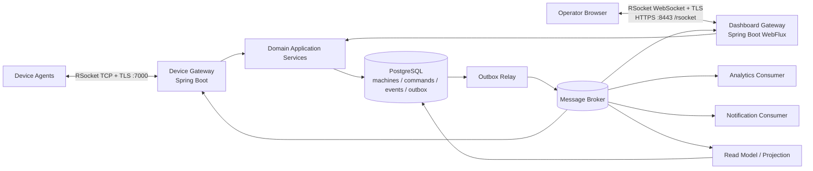
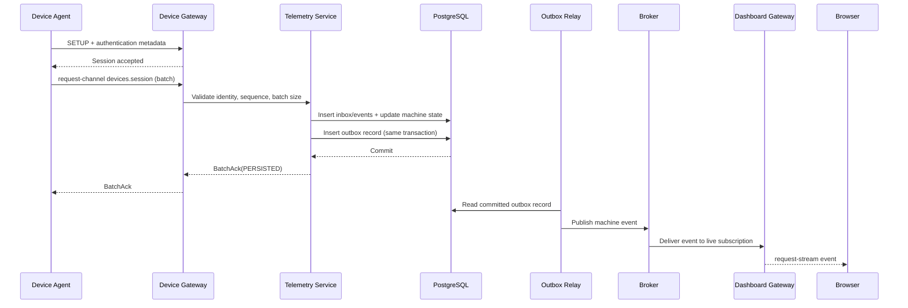
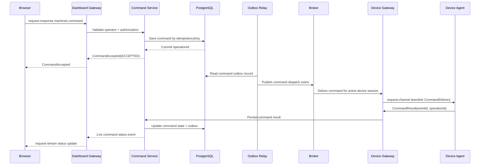
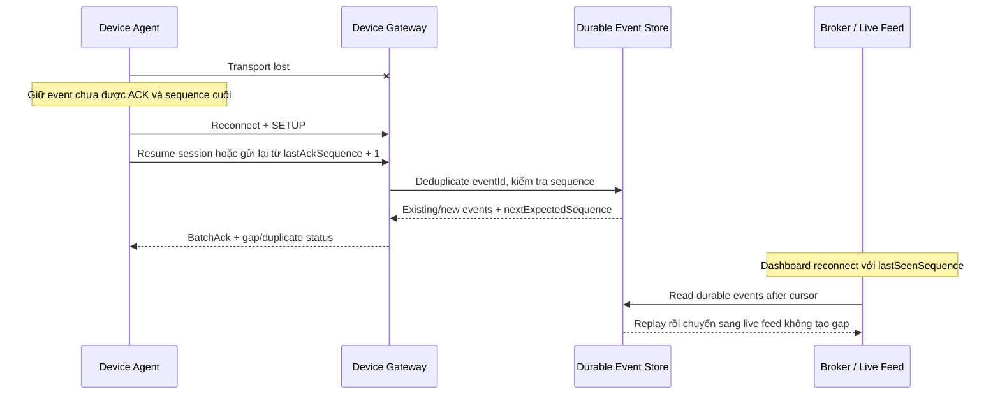

# Hoàn thiện sơ đồ luồng, hợp đồng dữ liệu và tiêu chí nghiệm thu hệ thống

Trong bài thực hành tổng hợp này, bạn sẽ hoàn thiện thiết kế cho một hệ thống giám sát và điều khiển máy móc nhà máy theo thời gian thực. Thiết kế phải cho thấy dữ liệu đi từ thiết bị tới dịch vụ và dashboard như thế nào, mỗi tương tác RSocket dùng contract nào, dữ liệu được xác thực/lưu trữ/phát lại ra sao, và nhóm phát triển chứng minh hệ thống đạt yêu cầu bằng những phép kiểm thử nào.

Đầu ra không chỉ là một sơ đồ kiến trúc. Một thiết kế có thể triển khai cần nối được bốn phần: **luồng dữ liệu**, **hợp đồng request/response/event**, **quy tắc vận hành khi lỗi**, và **tiêu chí nghiệm thu đo được**. Mỗi mũi tên trong sơ đồ phải có producer, consumer, route, schema, semantics giao nhận và cách quan sát.

## 1. Bối cảnh dự án: Factory Live Monitor

Một nhà máy có nhiều máy CNC, băng chuyền và robot. Mỗi thiết bị phát telemetry như nhiệt độ, tốc độ, rung động và trạng thái vận hành. Nhân viên vận hành theo dõi dashboard realtime, gửi lệnh điều khiển có xác nhận, và cần xem lại sự kiện đã xảy ra trong lúc thiết bị hoặc trình duyệt offline.

Hệ thống sử dụng Java, Spring Boot và RSocket qua TCP hoặc WebSocket. Dự án phải thể hiện đủ bốn interaction model:

- **Request-response** để đăng ký thiết bị, gửi lệnh và nhận kết quả tiếp nhận rõ ràng.
- **Fire-and-forget** cho heartbeat hoặc tín hiệu best-effort có thể mất mà không gây sai lệch nghiệp vụ.
- **Request-stream** để dashboard nhận trạng thái và sự kiện máy theo thời gian thực.
- **Request-channel** để thiết bị gửi batch telemetry lên đồng thời nhận ACK và lệnh từ server.

Hệ thống cần tiếp tục hoạt động khi một client reconnect, consumer xử lý chậm hoặc dịch vụ phụ thuộc tạm thời lỗi. Những dữ liệu cần phát lại phải được lưu bền vững; một RSocket connection không được xem như message queue.

### 1.1 Vai trò và nhu cầu

| Vai trò | Nhu cầu | Điều không được xảy ra |
|---|---|---|
| Device Agent | Gửi telemetry, heartbeat; nhận lệnh và gửi kết quả thực thi | Gửi trùng làm nhân đôi dữ liệu hoặc lệnh |
| Operator Dashboard | Xem trạng thái mới nhất, lịch sử và cảnh báo; gửi lệnh | Mất sự kiện trong lúc reconnect mà không phát hiện |
| Device Gateway | Quản lý phiên thiết bị, xác thực, điều tiết và nhận batch | Một thiết bị lỗi làm cạn tài nguyên của gateway |
| Dashboard Gateway | Phục vụ browser qua WebSocket, phân quyền theo máy/nhà máy | Người dùng đọc hoặc điều khiển thiết bị ngoài phạm vi |
| Domain Services | Quản lý trạng thái máy, lệnh, sự kiện và quy tắc nghiệp vụ | ACK trước khi ghi dữ liệu theo semantics đã cam kết |
| Operations Team | Quan sát kết nối, độ trễ, backlog, lỗi và tài nguyên | Không xác định được tầng lỗi hoặc không có runbook |

### 1.2 Phạm vi và giả định thiết kế

Để có thể nghiệm thu, thống nhất các giả định mẫu sau. Khi áp dụng cho môi trường khác, hãy ghi rõ giá trị thay thế và lý do.

| Thuộc tính | Giả định của bài thực hành |
|---|---|
| Số thiết bị hoạt động | 100 thiết bị mô phỏng đồng thời |
| Tần suất telemetry | Trung bình 10 mẫu/giây/thiết bị |
| Dashboard | 20 phiên operator đồng thời |
| Batch telemetry | Tối đa 50 event hoặc 200 ms, điều kiện nào tới trước |
| Payload batch | Tối đa 256 KiB sau encode |
| Lịch sử cần xem | 24 giờ gần nhất trong kho sự kiện của bài thực hành |
| Độ trễ telemetry tới dashboard | p95 không quá 1 giây trong tải mục tiêu |
| Thời gian trả ACK tiếp nhận lệnh | p95 không quá 300 ms, không bao gồm thời gian máy thực thi |
| Khả năng phục hồi | Client reconnect và tiếp tục từ cursor/sequence đã xác nhận |

Các con số này là **mục tiêu nghiệm thu mẫu**, không phải giới hạn mặc định của RSocket hay Spring Boot. Ghi cấu hình phần cứng, số instance, phiên bản JVM, transport và dữ liệu thử nghiệm trong báo cáo kết quả.

## 2. Đầu ra phải hoàn thiện

Nhóm cần nộp một bộ thiết kế nhất quán. Không để sơ đồ, route và DTO mô tả ba hệ thống khác nhau.

| Mã | Đầu ra | Nội dung tối thiểu |
|---|---|---|
| D1 | Sơ đồ kiến trúc | Client, hai endpoint transport, service, database, outbox, broker và consumer |
| D2 | Sơ đồ luồng/sequence | Đăng ký, telemetry, heartbeat, command, dashboard stream và reconnect |
| D3 | Route catalog | Tên route, interaction model, requester/responder, auth và response semantics |
| D4 | Data contract | Envelope, DTO, field, kiểu dữ liệu, đơn vị, version và ví dụ payload |
| D5 | Error contract | Lỗi nghiệp vụ, lỗi protocol, retryability, idempotency và status lookup |
| D6 | Security/flow-control design | TLS, principal, metadata, quyền, giới hạn payload, demand và concurrency |
| D7 | Acceptance matrix | Điều kiện trước, hành động, kết quả mong đợi và bằng chứng đo được |
| D8 | Test/operations plan | Unit, integration, contract, load, fault injection, metrics và runbook |

Mỗi đầu ra phải có owner và liên kết tới tiêu chí nghiệm thu tương ứng. Ví dụ D4 phải được kiểm tra bởi contract test, không chỉ được review bằng mắt.

## 3. Sơ đồ kiến trúc tham chiếu

Thiết kế mẫu tách endpoint TCP của thiết bị và endpoint WebSocket của browser thành hai tiến trình Spring Boot/gateway riêng. Cách này làm rõ transport, cổng và cấu hình TLS của từng phía; không giả định một cấu hình auto-configuration RSocket server duy nhất đồng thời mở cả TCP và WebSocket.



Hai gateway dùng chung domain contract và application service, có thể triển khai từ cùng codebase nhưng chạy với cấu hình transport riêng. Nếu muốn gộp vào một process, nhóm phải chứng minh cách bind hai transport và lifecycle của từng server bằng cấu hình custom; không chỉ khai báo hai giá trị `transport` trong cùng một property.

### 3.1 Trách nhiệm từng thành phần

| Thành phần | Trách nhiệm | Dữ liệu sở hữu |
|---|---|---|
| Device Agent | Kết nối TCP/TLS, gửi batch, nhận command, retry có idempotency | Sequence cục bộ, event chưa ACK, device credential |
| Device Gateway | Xác thực thiết bị, quản lý request-channel, giới hạn tải, kiểm tra sequence | Trạng thái phiên ngắn hạn, không phải lịch sử duy nhất |
| Dashboard Gateway | WebSocket/TLS, xác thực operator, phân quyền route và stream | Subscription theo phiên browser |
| Domain Services | Kiểm tra quyền, lưu telemetry, cập nhật machine state, quản lý command | Quy tắc nghiệp vụ và trạng thái chuẩn |
| PostgreSQL | Lưu trạng thái máy, event, idempotency/inbox, command và outbox | Nguồn dữ liệu bền vững của ứng dụng |
| Outbox Relay | Phát event đã commit sang broker, retry publish | Trạng thái giao event ra broker |
| Broker | Retention/queue, fan-out và consumer độc lập | Message theo retention và cấu hình broker |
| Consumers | Phân tích, thông báo và cập nhật read model | Projection theo consumer |

Không để gateway giữ lịch sử duy nhất trong bộ nhớ. Khi process restart, state cần thiết phải được tái tạo từ database, broker hoặc thiết bị reconnect.

Khi chạy nhiều replica, phải thiết kế fan-out và định tuyến session rõ ràng. Mỗi Dashboard Gateway instance có browser session riêng nên cần nhận được event cho các browser đang kết nối tới instance đó; một consumer group kiểu competing consumers duy nhất có thể chỉ giao event cho một gateway và làm browser ở instance khác không thấy cập nhật. Dùng pub/sub hoặc một consumer group/subscription riêng cho từng gateway instance, rồi lọc theo subscription đang hoạt động. Với device command, duy trì registry `deviceId -> gatewayInstance` có TTL/lease; broker đánh tuyến theo device, gateway đang sở hữu session chuyển command xuống channel. Nếu device offline, command giữ trạng thái `PENDING` trong database và được gateway nạp lại khi thiết bị reconnect, không phụ thuộc một notification broker đã hết hạn.

### 3.2 Chọn transport và endpoint

| Client | Transport | Endpoint mẫu | Mục đích |
|---|---|---|---|
| Device Agent trong mạng nhà máy | RSocket TCP/TLS | `device-gateway.internal:7000` | Kết nối lâu dài, telemetry và downlink command |
| Browser operator | RSocket WebSocket/TLS | `https://live.example.com:8443/rsocket` | Chạy trong môi trường browser qua HTTPS/WebSocket |
| Outbox Relay/consumer | Broker client protocol | Endpoint broker nội bộ | Lưu, phân phối và replay event |

Ví dụ cấu hình riêng cho Device Gateway:

```yaml
spring:
  rsocket:
    server:
      transport: tcp
      port: 7000
      ssl:
        enabled: true
        key-store: file:/run/secrets/device-gateway.p12
        key-store-type: PKCS12
        key-store-password: ${DEVICE_GATEWAY_KEYSTORE_PASSWORD}
```

Ví dụ cấu hình Dashboard Gateway dùng WebFlux WebSocket trên HTTPS:

```yaml
server:
  port: 8443
  ssl:
    enabled: true
    key-store: file:/run/secrets/dashboard-gateway.p12
    key-store-type: PKCS12
    key-store-password: ${DASHBOARD_GATEWAY_KEYSTORE_PASSWORD}

spring:
  rsocket:
    server:
      transport: websocket
      mapping-path: /rsocket
```

Trong ví dụ này, `server.ssl.*` bảo vệ WebFlux HTTP/WebSocket endpoint; `spring.rsocket.server.ssl.*` bảo vệ TCP RSocket server độc lập. Client browser dùng HTTPS/WebSocket; device client phải tin CA ký certificate của TCP gateway và xác minh hostname/SAN. Không tắt hostname verification để vượt qua lỗi TLS.

## 4. Sơ đồ luồng nghiệp vụ

### 4.1 Luồng telemetry từ thiết bị tới dashboard



ACK `PERSISTED` chỉ được gửi sau khi transaction ghi event/inbox và trạng thái cần thiết đã commit. Outbox relay phát event sau commit; nếu relay gửi lại, consumer dedup theo `eventId`.

### 4.2 Luồng gửi lệnh điều khiển



`ACCEPTED` nghĩa là server đã lưu lệnh và nhận trách nhiệm điều phối theo workflow. Nó chưa có nghĩa máy đã thực thi. Dashboard phải hiển thị các trạng thái riêng như `ACCEPTED`, `DISPATCHED`, `SUCCEEDED`, `FAILED`, `EXPIRED`.

### 4.3 Luồng reconnect và phát lại



RSocket Resumption có thể phục hồi một session trong phạm vi resume state còn tồn tại. Phát lại nghiệp vụ sau thời gian offline dài phải dựa trên event store/broker cursor và sequence. Client giữ event chưa ACK ở nguồn bền vững hoặc spool có giới hạn; không chỉ giữ trong RAM nếu yêu cầu không mất dữ liệu.

## 5. Route catalog và interaction contract

Mỗi route phải có một interaction model rõ ràng. Không chọn FNF chỉ vì nó ít overhead nếu client cần biết server đã persist hay chưa.

| Route | Interaction | Requester → Responder | Mục đích | Kết quả/ACK |
|---|---|---|---|---|
| `devices.register` | Request-response | Device → Device Gateway | Đăng ký/đồng bộ phiên bản thiết bị | `DeviceRegistrationResult` |
| `devices.heartbeat` | Fire-and-forget | Device → Device Gateway | Cập nhật tín hiệu sống best-effort | Không có response nghiệp vụ |
| `devices.session` | Request-channel | Device ↔ Device Gateway | Uplink batch telemetry và downlink ACK/command | `DeviceSessionMessage` |
| `machines.{machineId}.watch` | Request-stream | Browser → Dashboard Gateway | Snapshot và event liên tục từ cursor | `MachineStreamMessage` stream |
| `machines.command` | Request-response | Browser → Dashboard Gateway | Tạo lệnh điều khiển có idempotency | `CommandAccepted` |
| `machines.command-status` | Request-response | Browser → Dashboard Gateway | Tra cứu trạng thái lệnh sau timeout/reconnect | `CommandStatus` |

### 5.1 Phác thảo handler Spring

Các method dưới đây thể hiện shape của contract. Service bên trong phải thực hiện xác thực, transaction, dedup và kiểm soát tài nguyên như các phần sau quy định.

```java
@Controller
class DeviceRSocketController {

    private final DeviceService deviceService;
    private final TelemetryService telemetryService;
    private final DeviceCommandFeed commandFeed;

    DeviceRSocketController(DeviceService deviceService,
                            TelemetryService telemetryService,
                            DeviceCommandFeed commandFeed) {
        this.deviceService = deviceService;
        this.telemetryService = telemetryService;
        this.commandFeed = commandFeed;
    }

    @MessageMapping("devices.register")
    Mono<DeviceRegistrationResult> register(
            @Payload DeviceRegistrationRequest request, Principal principal) {
        return deviceService.register(principal.getName(), request);
    }

    @MessageMapping("devices.heartbeat")
    Mono<Void> heartbeat(@Payload Heartbeat heartbeat, Principal principal) {
        return deviceService.touch(principal.getName(), heartbeat);
    }

    @MessageMapping("devices.session")
    Flux<DeviceSessionMessage> session(
            @Payload Flux<DeviceSessionInput> inputs, Principal principal) {
        String devicePrincipal = principal.getName();
        Flux<DeviceSessionMessage> acknowledgements = inputs.concatMap(input ->
            switch (input.type()) {
                case TELEMETRY_BATCH -> telemetryService
                    .persistBatch(devicePrincipal, input.telemetryBatch())
                    .map(DeviceSessionMessage::ack);
                case COMMAND_RESULT -> deviceService
                    .recordResult(devicePrincipal, input.commandResult())
                    .map(DeviceSessionMessage::commandResultAck);
            });
        Flux<DeviceSessionMessage> commands = commandFeed
            .watchForDevice(devicePrincipal)
            .map(DeviceSessionMessage::command);
        return Flux.merge(acknowledgements, commands);
    }
}
```

`Mono<Void>` ở route heartbeat không tạo response payload nghiệp vụ. `devices.session` nhận một publisher từ device và trả một publisher về device; output có thể chứa ACK và command. Mỗi output message phải có discriminator/schema rõ ràng để client phân biệt `BATCH_ACK`, `COMMAND` và `SESSION_NOTICE`.

`persistBatch(...)` phải chỉ phát kết quả ACK `PERSISTED` sau khi transaction commit. Một cách triển khai là hoàn tất transaction trước rồi mới tạo ACK ở publisher bên ngoài transaction; không phát ACK từ một callback trước khi commit hoàn tất. `concatMap` giữ thứ tự xử lý batch của một device. Nếu thay bằng concurrency lớn hơn, sequence và ack contract phải cho phép kết quả hoàn thành không theo thứ tự.

Dashboard Gateway có route stream và command riêng:

```java
@Controller
class DashboardRSocketController {

    private final MachineFeed machineFeed;
    private final CommandService commandService;

    DashboardRSocketController(MachineFeed machineFeed,
                               CommandService commandService) {
        this.machineFeed = machineFeed;
        this.commandService = commandService;
    }

    @MessageMapping("machines.{machineId}.watch")
    Flux<MachineStreamMessage> watch(@DestinationVariable String machineId,
                                     @Payload WatchRequest request,
                                     Principal principal) {
        return machineFeed.watchAuthorized(
            principal.getName(), machineId, request);
    }

    @MessageMapping("machines.command")
    Mono<CommandAccepted> command(@Payload CommandRequest request,
                                  Principal principal) {
        return commandService.accept(principal.getName(), request);
    }

    @MessageMapping("machines.command-status")
    Mono<CommandStatus> commandStatus(@Payload CommandStatusRequest request,
                                      Principal principal) {
        return commandService.findStatus(principal.getName(), request.operationId());
    }
}
```

`watchAuthorized(...)` phải kiểm tra quyền trước khi trả stream. Không chỉ xác thực lúc SETUP rồi cho phép client thay `machineId` trong route để đọc máy khác.

### 5.2 Phác thảo client RSocket

Device client gửi batch qua request-channel và nhận ACK/command trên cùng stream:

```java
Flux<DeviceSessionMessage> sessionMessages = deviceRequester
    .route("devices.session")
    .data(deviceSessionInputs, DeviceSessionInput.class)
    .retrieveFlux(DeviceSessionMessage.class);
```

Heartbeat FNF:

```java
Mono<Void> heartbeatSent = deviceRequester
    .route("devices.heartbeat")
    .data(heartbeat)
    .send();
```

Browser mở stream từ cursor cuối đã hiển thị:

```java
Flux<MachineStreamMessage> liveEvents = dashboardRequester
    .route("machines.{machineId}.watch", machineId)
    .data(new WatchRequest(lastSeenMachineEventSequence, true))
    .retrieveFlux(MachineStreamMessage.class);
```

Gửi command và nhận ACK tiếp nhận:

```java
Mono<CommandAccepted> accepted = dashboardRequester
    .route("machines.command")
    .data(commandRequest)
    .retrieveMono(CommandAccepted.class);
```

Các đoạn code giả định `RSocketRequester` đã được tạo với đúng transport và authentication metadata. Mỗi publisher chỉ thực thi khi được subscribe; kiểm thử phải subscribe và xác minh terminal/result, không chỉ tạo biến `Mono` hoặc `Flux`.

### 5.3 Contract cho từng interaction

**Request-response — `devices.register`**

- Request chứa `deviceModel`, `firmwareVersion`, `capabilities` và `registrationNonce`.
- Device identity lấy từ principal/mTLS/JWT đã xác thực, không tin `deviceId` do payload tự khai báo.
- Response trả `REGISTERED` hoặc `ALREADY_REGISTERED`, `serverTime`, `nextExpectedSequence` và `policyVersion`.

**Fire-and-forget — `devices.heartbeat`**

- Payload tối thiểu gồm `sentAt`, `bootId` và `sequence`.
- Server cập nhật last-seen theo principal đã xác thực.
- Heartbeat có thể mất; trạng thái online dựa trên TTL và nhiều tín hiệu, không dựa vào một message đơn lẻ.
- Không dùng FNF cho command, payment hoặc telemetry cần xác nhận lưu bền vững.

**Request-channel — `devices.session`**

- Device gửi `DeviceSessionInput` trong input stream; discriminator `type` phân biệt `TELEMETRY_BATCH` và `COMMAND_RESULT`.
- Server trả `BatchAck`, `CommandDelivery` hoặc `SessionNotice` trong output stream.
- Mỗi event có ID/sequence; mỗi command có `commandId` và `operationId`.
- Server kiểm tra batch size, sequence, quyền và quota trước khi persist.
- ACK `PERSISTED` chỉ phát sau commit; command downlink có `expiresAt` để thiết bị bỏ qua lệnh quá hạn.

**Request-stream — `machines.{machineId}.watch`**

- Request chứa `afterSequence`, `includeSnapshot` và bộ lọc được cho phép.
- Server xác thực operator có quyền đọc machine thuộc tenant/site đó.
- Response stream phát `MachineStreamMessage` gồm snapshot/version ban đầu rồi các event có sequence lớn hơn cursor.
- Khi client reconnect, client gửi `lastSeenSequence`; server replay phần còn thiếu rồi chuyển sang live feed không tạo gap.

**Command request-response — `machines.command`**

- Request có `idempotencyKey`, `machineId`, `commandType`, `parameters` và `expiresAt`.
- Server kiểm tra role, phạm vi site/machine, trạng thái machine và schema command.
- Response `ACCEPTED` kèm `operationId`; kết quả thực thi đến sau qua event/status stream.
- Cùng key và cùng request hash trả lại kết quả đã lưu; cùng key nhưng nội dung khác trả conflict.

## 6. Hợp đồng dữ liệu chung

### 6.1 Quy tắc envelope

Các event cần lưu hoặc dedup dùng envelope thống nhất:

| Field | Kiểu | Bắt buộc | Quy tắc |
|---|---|---:|---|
| `schemaVersion` | string | Có | Version contract, ví dụ `1.0` |
| `eventId` | UUID/string | Có | Duy nhất cho một event logic, giữ nguyên khi retry |
| `machineId` | string | Có | ID thiết bị; server đối chiếu với principal |
| `sequence` | integer | Có | Tăng đơn điệu theo device/boot epoch |
| `occurredAt` | RFC 3339 UTC | Có | Thời điểm thiết bị tạo event |
| `sentAt` | RFC 3339 UTC | Có | Thời điểm thiết bị gửi batch |
| `eventType` | string | Có | Tập giá trị hữu hạn, có version |
| `payload` | object | Có | Schema theo eventType |
| `traceId` | string | Không | Dùng log/tracing, không dùng làm idempotency key |

`tenantId` và `principalId` được suy ra từ security context đã xác thực. Nếu payload có gửi các trường này để debug, server phải đối chiếu và không dùng chúng làm nguồn quyết định quyền.

Timestamp dùng UTC có timezone. Giá trị đo phải có đơn vị tường minh; ví dụ nhiệt độ `celsius`, tốc độ `rpm`, rung động `mm_per_s`. Không đổi đơn vị mà không tăng version hoặc thay contract.

### 6.1.1 Quy tắc version và tương thích

- Tăng minor version khi thêm field tùy chọn mà consumer cũ có thể bỏ qua.
- Tăng major version hoặc tạo route/schema mới khi đổi ý nghĩa field, kiểu dữ liệu, đơn vị hoặc yêu cầu một field bắt buộc mới.
- Trong giai đoạn rollout, server hỗ trợ phiên bản hiện tại và phiên bản liền trước theo thời hạn đã thống nhất.
- Consumer phải có chính sách cho event type/enum mới: bỏ qua có ghi metric với event không quan trọng, hoặc từ chối rõ ràng với command không hiểu.
- Lưu schema fixture trong contract test; kiểm tra producer mới với consumer cũ trước khi triển khai.

### 6.2 Telemetry event và batch

Ví dụ một batch JSON:

```json
{
  "schemaVersion": "1.0",
  "batchId": "9f2b5b7a-9d30-4db9-a6e6-bf4c16c4a201",
  "machineId": "CNC-014",
  "bootId": "boot-2026-11-22-01",
  "firstSequence": 4201,
  "lastSequence": 4202,
  "sentAt": "2026-11-22T08:15:30.250Z",
  "events": [
    {
      "eventId": "a0b3b31b-4d82-4f92-9c0c-bf56ec83d001",
      "sequence": 4201,
      "occurredAt": "2026-11-22T08:15:30.050Z",
      "eventType": "telemetry.sample",
      "payload": {
        "temperature": {"value": 68.4, "unit": "celsius"},
        "spindleSpeed": {"value": 1450, "unit": "rpm"}
      }
    },
    {
      "eventId": "a0b3b31b-4d82-4f92-9c0c-bf56ec83d002",
      "sequence": 4202,
      "occurredAt": "2026-11-22T08:15:30.150Z",
      "eventType": "telemetry.sample",
      "payload": {
        "temperature": {"value": 68.6, "unit": "celsius"},
        "spindleSpeed": {"value": 1452, "unit": "rpm"}
      }
    }
  ]
}
```

Quy tắc:

- `batchId` định danh batch; `eventId` định danh từng event. Retry batch giữ nguyên cả hai ID.
- `firstSequence`/`lastSequence` phải khớp dãy device sequence bên trong; server kiểm tra gap và duplicate trong cùng `bootId`.
- Một batch chỉ chứa event của một machine và một boot epoch.
- Nếu batch chứa event trùng đã persist và event mới, server dedup event cũ, lưu event mới và ACK rõ số lượng.
- Giới hạn số event và tổng byte sau encode; không chỉ giới hạn số phần tử.

Trên `devices.session`, mỗi payload đầu vào được bọc trong `DeviceSessionInput` để phân biệt batch telemetry và kết quả command. Payload batch ở trên là phần `payload` của variant `TELEMETRY_BATCH`:

```json
{
  "type": "TELEMETRY_BATCH",
  "payload": {
    "schemaVersion": "1.0",
    "batchId": "9f2b5b7a-9d30-4db9-a6e6-bf4c16c4a201",
    "machineId": "CNC-014",
    "bootId": "boot-2026-11-22-01",
    "firstSequence": 4201,
    "lastSequence": 4201,
    "events": [
      {
        "eventId": "a0b3b31b-4d82-4f92-9c0c-bf56ec83d001",
        "sequence": 4201,
        "occurredAt": "2026-11-22T08:15:30.050Z",
        "eventType": "telemetry.sample",
        "payload": {"temperature": {"value": 68.4, "unit": "celsius"}}
      }
    ]
  }
}
```

`DeviceSessionInput` có `type` là enum `TELEMETRY_BATCH` hoặc `COMMAND_RESULT`; `payload` là DTO tương ứng. Variant `COMMAND_RESULT` dùng cùng envelope `type`/`payload`, trong đó payload là DTO kết quả command đã định nghĩa. Decoder phải từ chối trường hợp `type` không biết hoặc payload không khớp variant; không âm thầm bỏ qua message lạ.

### 6.3 Heartbeat

```json
{
  "schemaVersion": "1.0",
  "bootId": "boot-2026-11-22-01",
  "lastTelemetrySequence": 4202,
  "sentAt": "2026-11-22T08:15:31.000Z",
  "health": "OK"
}
```

Identity thiết bị lấy từ principal của connection. Heartbeat không chứa credential mới và không được dùng làm bằng chứng thiết bị đã xử lý command.

### 6.4 Batch acknowledgement

```json
{
  "schemaVersion": "1.0",
  "batchId": "9f2b5b7a-9d30-4db9-a6e6-bf4c16c4a201",
  "status": "PERSISTED",
  "acceptedCount": 2,
  "duplicateCount": 0,
  "nextExpectedSequence": 4203,
  "serverTime": "2026-11-22T08:15:30.310Z"
}
```

Các trạng thái cần định nghĩa tối thiểu: `PERSISTED`, `DUPLICATE`, `GAP_DETECTED`, `REJECTED` và `RETRY_LATER`. `RETRY_LATER` chỉ dùng cho lỗi tạm thời; thiết bị giữ batch và retry cùng ID sau backoff. `GAP_DETECTED` phải trả `nextExpectedSequence` để client biết cách đồng bộ.

### 6.5 Command request và accepted response

Request:

```json
{
  "schemaVersion": "1.0",
  "idempotencyKey": "2c7e1f83-5c5a-46f3-88a2-4c40f34bce31",
  "machineId": "CNC-014",
  "commandType": "SET_SPINDLE_SPEED",
  "parameters": {"rpm": 1200},
  "expiresAt": "2026-11-22T08:16:00Z"
}
```

Response:

```json
{
  "schemaVersion": "1.0",
  "operationId": "op-7c29a0",
  "machineId": "CNC-014",
  "status": "ACCEPTED",
  "acceptedAt": "2026-11-22T08:15:31.100Z"
}
```

`idempotencyKey` scope theo principal và route/operation. Server lưu request hash. Cùng key/cùng hash trả lại response đã lưu; cùng key/hash khác trả `IDEMPOTENCY_KEY_CONFLICT`. Không tin `operatorId` hoặc `tenantId` trong payload để xác định người gửi.

### 6.6 Command delivery và kết quả thiết bị

Command delivery qua output của request-channel:

```json
{
  "schemaVersion": "1.0",
  "commandId": "cmd-51b4",
  "operationId": "op-7c29a0",
  "commandType": "SET_SPINDLE_SPEED",
  "parameters": {"rpm": 1200},
  "issuedAt": "2026-11-22T08:15:31.200Z",
  "expiresAt": "2026-11-22T08:16:00Z"
}
```

Kết quả:

```json
{
  "schemaVersion": "1.0",
  "eventId": "c6d4ac43-5b20-4d55-8a66-4a1c6c3b0c10",
  "commandId": "cmd-51b4",
  "operationId": "op-7c29a0",
  "status": "SUCCEEDED",
  "completedAt": "2026-11-22T08:15:32.450Z"
}
```

Thiết bị phải dedup `commandId` để command delivery lặp không thực thi side effect lần hai. Nếu command hết hạn, thiết bị trả `EXPIRED` hoặc bỏ qua theo contract; server cập nhật operation state và phát event trạng thái.

Output channel dùng `DeviceSessionMessage` với discriminator `type` như `BATCH_ACK`, `COMMAND`, `COMMAND_RESULT_ACK` hoặc `SESSION_NOTICE`; trường `payload` chứa đúng DTO tương ứng. Cả hai phía phải xử lý message type chưa biết theo chính sách versioning, không cast mọi output thành ACK.

Ví dụ output ACK:

```json
{
  "type": "BATCH_ACK",
  "payload": {
    "schemaVersion": "1.0",
    "batchId": "9f2b5b7a-9d30-4db9-a6e6-bf4c16c4a201",
    "status": "PERSISTED",
    "acceptedCount": 2,
    "duplicateCount": 0,
    "nextExpectedSequence": 4203
  }
}
```

### 6.7 Machine event cho dashboard

```json
{
  "schemaVersion": "1.0",
  "machineId": "CNC-014",
  "sequence": 9122,
  "sourceSequence": 4202,
  "eventId": "a0b3b31b-4d82-4f92-9c0c-bf4c16c4d002",
  "eventType": "telemetry.sample",
  "occurredAt": "2026-11-22T08:15:30.150Z",
  "payload": {
    "temperature": {"value": 68.6, "unit": "celsius"},
    "spindleSpeed": {"value": 1452, "unit": "rpm"}
  }
}
```

Trong `MachineStreamMessage`, `sequence` là `machineEventSequence` do server cấp, tăng đơn điệu cho toàn bộ event của một machine (telemetry, alarm và command status). `sourceSequence` tùy chọn giữ lại sequence từ thiết bị để truy vết. Cursor dashboard dùng `machineEventSequence`, không dùng device sequence vì hai bộ đếm có phạm vi khác nhau. `eventId` dùng dedup; `traceId` dùng quan sát. Không dùng timestamp làm cursor duy nhất vì clock thiết bị có thể lệch và nhiều event có cùng timestamp.

Vì stream cần gửi cả snapshot lẫn event, `MachineStreamMessage` bọc một trong hai variant:

```json
{
  "schemaVersion": "1.0",
  "type": "SNAPSHOT",
  "machineId": "CNC-014",
  "sequence": 9122,
  "payload": {
    "status": "RUNNING",
    "temperature": 68.6,
    "spindleSpeed": 1452
  }
}
```

```json
{
  "schemaVersion": "1.0",
  "type": "EVENT",
  "machineId": "CNC-014",
  "sequence": 9123,
  "sourceSequence": 4203,
  "payload": {
    "eventId": "a0b3b31b-4d82-4f92-9c0c-bf4c16c4d003",
    "eventType": "machine.status.changed",
    "occurredAt": "2026-11-22T08:15:31.150Z",
    "status": "IDLE"
  }
}
```

Client cập nhật cursor sau khi áp dụng thành công event/snapshot tương ứng. Nếu client chỉ lưu cursor trước khi cập nhật UI/state bền vững, crash giữa hai bước có thể làm bỏ qua event khi reconnect.

## 7. Error contract và quy tắc idempotency

Phân biệt lỗi protocol với kết quả nghiệp vụ:

| Nhóm | Ví dụ | Cách biểu diễn | Client xử lý |
|---|---|---|---|
| Validation | `INVALID_COMMAND`, field sai | Application error hoặc result `REJECTED` theo contract | Sửa request; không retry |
| Authorization | `FORBIDDEN_MACHINE`, sai tenant | Lỗi bảo mật theo policy | Không retry; ghi audit |
| Conflict | `MACHINE_BUSY`, `IDEMPOTENCY_KEY_CONFLICT` | Domain result/error ổn định | Đọc trạng thái hoặc yêu cầu quyết định mới |
| Temporary overload | `RETRY_LATER` | Result/REJECTED có reason và retry hint | Backoff + jitter, giữ nguyên event/key |
| Persistence failure | Database unavailable | Application error tạm thời | Retry có giới hạn và dedup |
| Connection lost | TCP reset/WebSocket close | Session/transport failure | Reconnect; tra cứu operation và replay từ cursor |
| Protocol invalid | MIME/schema/frame không hợp lệ | RSocket protocol error | Sửa client/server contract; không retry mù |

### 7.1 Inbound event dedup

Tạo unique constraint trên `(authenticated_device_id, event_id)` hoặc khóa tương đương. Inbox claim và ghi event/state cần nằm trong transaction phù hợp. Khi nhận event trùng, không áp dụng lại side effect; trả ACK chỉ ra duplicate hoặc kết quả đã lưu.

### 7.2 Command idempotency

Tạo unique constraint trên `(principal_id, operation, idempotency_key)`. Lưu request hash, trạng thái và response. Retry dùng lại key cũ. Nếu request cùng key nhưng khác hash, trả conflict. Key retention phải dài hơn cửa sổ retry/replay đã cam kết.

### 7.3 Outbox và phát lại

Ghi machine state/event và outbox record trong cùng transaction. Relay có thể publish lại nếu crash sau publish trước khi đánh dấu sent; consumer dedup bằng `eventId`. Replay dùng cursor/sequence bền vững, không dựa vào RSocket Resumption như kho lịch sử.

## 8. Metadata, xác thực và phân quyền

Thiết kế metadata cần ghi rõ phần nào ở SETUP, phần nào theo từng request:

| Metadata | Phạm vi | Mục đích | Quy tắc |
|---|---|---|---|
| Authentication | SETUP hoặc cơ chế xác thực được chọn | Xác thực device/operator | Token ngắn hạn hoặc mTLS; không log credential |
| Routing | Mỗi request | Chọn route `devices.session`, `machines.command`... | Route được allowlist và kiểm tra quyền |
| Trace/correlation | Theo request | Liên kết log/tracing | Giới hạn độ dài, không dùng làm danh tính |
| Content type | SETUP/metadata theo contract | Chọn codec/schema | Chỉ nhận MIME type hỗ trợ |

Với composite metadata, ghi MIME type và entry cụ thể trong contract; ví dụ routing metadata `message/x.rsocket.routing.v0`, authentication metadata theo cơ chế Spring Security/RSocket đã chọn. Không đặt bearer token vào data payload thông thường.

Quy tắc bảo mật:

- Device identity lấy từ certificate/JWT principal; đối chiếu machine được phép.
- Operator chỉ đọc/điều khiển machine trong tenant/site được cấp.
- Authorization được kiểm tra ở từng route và từng machine, không chỉ ở lúc SETUP.
- TLS bắt buộc trên network không tin cậy; quản lý certificate rotation và truststore.
- Giới hạn kích thước metadata/payload, số stream, request rate và session.
- Không tin `tenantId`, `deviceId` hoặc `operatorId` tự khai báo trong payload.
- Audit command gồm principal, machine, operationId, commandType, thời điểm và kết quả; không ghi secret.

## 9. Flow control, batching và quota

Các giới hạn mẫu cho project:

| Tài nguyên | Giới hạn mẫu | Hành vi khi vượt |
|---|---:|---|
| Event trong một batch | 50 | Chia batch ở client hoặc reject batch |
| Payload batch sau encode | 256 KiB | Reject và ghi metric |
| Flush batch | 200 ms | Flush phần đang có khi hết thời gian |
| Batch chưa ACK/device | 4 | Dừng gửi batch mới hoặc chờ demand |
| Concurrent command/device | 2 | Queue hữu hạn hoặc `RETRY_LATER` |
| Dashboard stream/operator | Theo quota role/site | Từ chối có kiểm soát khi hết quota |
| Server inbound queue | Có giới hạn theo instance | Load shed khi đầy, không buffer vô hạn |

`REQUEST_N` là credit theo số payload RSocket, không phải số event bên trong batch. Nếu một payload chứa 50 event, nó vẫn tiêu thụ một đơn vị demand. Vì vậy phải giới hạn cả số batch in-flight, event count và tổng byte.

Với request-channel, server phải xử lý input theo demand và giới hạn concurrency. Nếu dùng `concatMap`, thứ tự được giữ nhưng throughput thấp hơn; nếu dùng `flatMap` có concurrency hữu hạn, phải chấp nhận completion có thể không theo thứ tự và dùng sequence để tái sắp xếp/cập nhật an toàn.

`LEASE` có thể dùng để giới hạn số request mới được khởi tạo trong một khoảng thời gian nếu hai peer hỗ trợ và cấu hình đúng. LEASE không thay thế `REQUEST_N`, rate limiter nghiệp vụ hoặc giới hạn payload.

## 10. Contract reconnect và resumption

Thiết bị giữ `bootId`, `lastAckSequence` và danh sách event chưa ACK. Khi mất kết nối:

1. Client reconnect với exponential backoff và jitter.
2. Thiết lập lại authentication/SETUP; nếu bật RSocket Resumption, thử resume theo chính sách session.
3. Nếu resume không thành công hoặc session state đã hết, mở session mới.
4. Gửi lại event từ `lastAckSequence + 1` với eventId/batchId cũ.
5. Server dedup event đã persist, phát hiện gap và trả `nextExpectedSequence`.
6. Client chỉ xóa event khỏi spool sau ACK `PERSISTED` hoặc trạng thái đã được xác nhận theo contract.

Device giữ `lastAckSequence` theo `bootId`; dashboard giữ `lastSeenMachineEventSequence` theo machine. Khi dashboard reconnect, gửi cursor machine đó; server đọc lịch sử còn retention rồi chuyển sang live stream. Handoff giữa replay và live phải tránh gap: dùng broker offset/cursor liên tục hoặc subscribe live trước, chụp high-watermark, đọc phần lịch sử tới watermark rồi dedup các event live trùng.

Resumption khôi phục session/frame trong giới hạn buffer; cursor/event store khôi phục lịch sử nghiệp vụ. Hai cơ chế bổ sung cho nhau, không thay thế nhau.

## 11. Tiêu chí nghiệm thu chức năng

Mỗi tiêu chí có ID để liên kết với test case và bằng chứng. Nhóm có thể thay đổi ngưỡng theo yêu cầu nhưng phải chốt trước khi chạy nghiệm thu.

| ID | Tiêu chí | Cách kiểm tra | Kết quả đạt |
|---|---|---|---|
| AC-01 | Thiết bị đăng ký thành công | Request-response `devices.register` với credential hợp lệ | Trả `REGISTERED`/`ALREADY_REGISTERED`, principal gắn đúng machine |
| AC-02 | Heartbeat best-effort | Gửi FNF `devices.heartbeat`, kiểm tra last-seen | Server cập nhật last-seen; client không chờ ACK nghiệp vụ |
| AC-03 | Nhận batch telemetry | Gửi batch hợp lệ qua `devices.session` | ACK `PERSISTED` chỉ sau DB commit |
| AC-04 | Chống event trùng | Gửi lại cùng eventId/batchId | Không nhân đôi event/state; ACK duplicate rõ ràng |
| AC-05 | Phát hiện sequence gap | Bỏ qua một sequence rồi gửi sequence tiếp | Server trả `GAP_DETECTED` và `nextExpectedSequence` |
| AC-06 | Dashboard realtime | Subscribe `machines.{machineId}.watch` | Event mới hiển thị trong p95 ≤ 1 giây ở tải mục tiêu |
| AC-07 | Dashboard replay | Ngắt browser, phát sinh event, reconnect từ cursor | Nhận đủ event còn retention, không gap và không áp dụng trùng |
| AC-08 | Gửi command | Request-response `machines.command` | Trả `ACCEPTED` + operationId trong p95 ≤ 300 ms |
| AC-09 | Command result | Thiết bị nhận lệnh và gửi kết quả | Trạng thái chuyển đúng `DISPATCHED` rồi `SUCCEEDED`/`FAILED` |
| AC-10 | Command idempotency | Gửi cùng key/hash nhiều lần | Chỉ tạo một operation; response sau trả lại kết quả đã lưu |
| AC-11 | Key conflict | Cùng key nhưng request hash khác | Từ chối `IDEMPOTENCY_KEY_CONFLICT`, không tạo operation thứ hai |
| AC-12 | Phân quyền tenant/site | Operator/device truy cập machine ngoài phạm vi | Từ chối; không rò dữ liệu và có audit event |
| AC-13 | Payload quá lớn | Gửi batch vượt 256 KiB | Reject có kiểm soát; không làm tăng buffer vô hạn |
| AC-14 | Slow consumer | Giảm demand dashboard/device consumer | Backpressure hoặc chính sách drop/reject đã định nghĩa; memory ổn định |
| AC-15 | Connection loss | Ngắt TCP/WebSocket khi có stream | Client reconnect; các request đang chạy có trạng thái xác định/tra cứu được |
| AC-16 | Outbox publish retry | Dừng relay sau publish trước khi mark sent | Event có thể publish lại nhưng consumer dedup đúng |
| AC-17 | Quan sát hệ thống | Tạo lỗi, rejection, disconnect và tăng tải | Có metric/log/trace theo route và instance, không có label cardinality cao |

## 12. Tiêu chí nghiệm thu phi chức năng

Các ngưỡng dưới đây là baseline cho môi trường kiểm thử mẫu 100 device × 10 event/giây và 20 dashboard clients:

| ID | Chỉ tiêu | Mục tiêu mẫu | Bằng chứng |
|---|---|---|---|
| NFR-01 | Throughput telemetry | Duy trì 1.000 event/giây trong 15 phút | Load-test report và counter persisted |
| NFR-02 | Ingest-to-dashboard latency | p95 ≤ 1 giây, p99 ≤ 2 giây | Histogram từ occurred/received/published/displayed timestamp |
| NFR-03 | Command acceptance | p95 ≤ 300 ms | Timer `machines.command`, không tính thời gian máy thực thi |
| NFR-04 | Duplicate side effect | 0 duplicate command execution trong retry test | Device command ledger và DB unique constraint |
| NFR-05 | Event recovery | Reconnect trong 30 giây và replay đủ event còn retention | Sequence audit, số event missing/duplicate bằng 0 |
| NFR-06 | Resource stability | Heap/direct memory/thread/FD không tăng liên tục trong soak test 2 giờ | Dashboard và baseline đầu/cuối soak |
| NFR-07 | Backpressure | Queue/buffer luôn trong giới hạn đã cấu hình | Queue depth, in-flight batch và memory metrics |
| NFR-08 | Security | Không có truy cập cross-tenant; TLS verify pass | Integration/security test report |
| NFR-09 | Availability probe | Probe kết nối và gọi route health thành công theo SLO nhóm chọn | Synthetic monitoring report |

Khi đo latency, đồng bộ clock giữa các thành phần hoặc dùng timestamp do server ghi tại các mốc. Không lấy timestamp thiết bị làm phép đo tuyệt đối nếu clock thiết bị chưa đồng bộ; có thể đo server receive-to-publish và ghi thêm clock skew.

## 13. Ma trận kiểm thử và bằng chứng

| Nhóm test | Kịch bản tối thiểu | Công cụ/cách thực hiện | Bằng chứng cần lưu |
|---|---|---|---|
| Unit | Validation, sequence, dedup, command state machine | JUnit, Mockito | Test report và branch coverage trọng yếu |
| Reactor | Demand, cancellation, timeout, retry, overflow | StepVerifier, TestPublisher, virtual time | Assertion terminal signal và cleanup |
| Contract | JSON/schema version, required field, enum, units | JSON Schema/contract test hoặc serializer test | Contract fixture và compatibility report |
| RSocket integration | Bốn interaction model, route, metadata, auth | RSocketRequester, Spring Boot test | Test report và server logs |
| Transport | TCP/TLS, WebSocket/TLS, wrong port/path/cert | Integration test và probe | Kết quả handshake/SETUP |
| Recovery | Drop connection, duplicate batch, gap, replay | Fault injection có kiểm soát | Sequence reconciliation và duplicate count |
| Persistence | Crash giữa DB commit/outbox publish/ACK | Testcontainers hoặc môi trường tích hợp | DB rows, outbox state, consumer dedup |
| Load | 1.000 event/s, 20 dashboard clients | Gatling/JMeter/custom device simulator | Throughput, p95/p99, rejection, memory |
| Soak | Duy trì tải ổn định 2 giờ | Load test dài hạn | Heap/direct memory/thread/FD trend |
| Security | Sai token, hết hạn, sai tenant, metadata lớn | Negative integration tests | Audit result và không có data leak |

### 13.1 Các fault scenario bắt buộc

1. Device mất TCP giữa lúc gửi batch nhưng trước khi nhận ACK.
2. Server commit batch rồi connection đóng trước khi ACK tới device.
3. Device gửi lại batch đã persist.
4. Sequence bị thiếu hoặc lặp sau khi reboot và đổi `bootId`.
5. Dashboard reconnect với cursor cũ hơn retention window.
6. Outbox relay publish thành công rồi crash trước khi cập nhật trạng thái sent.
7. Consumer nhận lại cùng event sau khi restart.
8. Operator gửi command timeout nhưng server đã lưu operation.
9. Device nhận command lặp hoặc command đã hết hạn.
10. Slow consumer giữ demand thấp trong khi producer tăng tốc.
11. Token hết hạn khi connection đang mở; xác minh policy re-auth/close.
12. Một operator cố xem/điều khiển machine của tenant khác.

## 14. Observability và runbook tối thiểu

Các metric cần có:

| Metric | Ý nghĩa |
|---|---|
| `rsocket_connections_active` | Số connection đang hoạt động theo transport/gateway |
| `rsocket_setup_failures_total` | SETUP thất bại theo reason hữu hạn |
| `rsocket_requests_total` | Request theo route, interaction và outcome |
| `rsocket_request_duration_seconds` | Latency histogram |
| `telemetry_events_persisted_total` | Event đã commit |
| `telemetry_events_duplicate_total` | Event dedup |
| `telemetry_sequence_gaps_total` | Gap được phát hiện |
| `telemetry_batch_bytes` | Payload batch size |
| `rsocket_streams_active` | Stream đang hoạt động |
| `outbox_pending_records` | Outbox backlog |
| `broker_consumer_lag` | Consumer lag |
| `device_command_duration_seconds` | Thời gian từ accepted tới result |
| `jvm_buffer_memory_used_bytes` | Heap/direct buffer pool theo binder |

Metric label dùng route template, transport, outcome và instance. Không dùng `deviceId`, `eventId`, `commandId`, `streamId` làm label. ID cụ thể chỉ đưa vào log/trace có sampling và quyền truy cập.

Runbook cần trả lời:

- **Không kết nối được**: kiểm tra DNS, port, TCP/TLS, WebSocket path/Upgrade, SETUP và authentication.
- **Telemetry trễ hoặc bị reject**: kiểm tra batch size, demand, in-flight, queue, database và consumer lag.
- **Dashboard thiếu event**: so sánh cursor/sequence, event store retention, outbox và live-feed handoff.
- **Command treo**: tra cứu operationId, command expiry, session thiết bị và command delivery ACK.
- **Tài nguyên tăng**: kiểm tra active streams, cancellation, direct memory, thread, FD và queue.

## 15. Các bước thực hiện dự án

Thực hiện theo thứ tự để mỗi quyết định có thể kiểm tra được:

1. **Chốt bối cảnh và SLO**: ghi số thiết bị, tốc độ event, số dashboard, retention và mục tiêu latency.
2. **Vẽ sơ đồ context/container**: chỉ rõ actor, gateway, transport, domain service, database, outbox, broker và consumer.
3. **Vẽ sequence diagram**: ít nhất telemetry, command và reconnect/replay.
4. **Chốt route catalog**: mỗi route có interaction model, requester/responder và ACK semantics.
5. **Định nghĩa DTO/schema**: field, type, unit, required/optional, version, ID và sample payload.
6. **Định nghĩa error/retry**: error code, retryability, idempotency, sequence gap và status lookup.
7. **Chốt security/flow-control**: TLS, metadata, principal, authorization, size, concurrency, `REQUEST_N` và quota.
8. **Lập acceptance matrix**: mỗi tiêu chí có ID, cách kiểm tra và bằng chứng đạt.
9. **Lập test plan**: unit, protocol, integration, failure, load và soak.
10. **Review traceability**: mỗi mũi tên trong sơ đồ phải có route/schema/test; mỗi SLO phải có metric và alert.

## 16. Mẫu bảng traceability để nhóm hoàn thiện

Sử dụng bảng sau trong báo cáo cuối; không để tiêu chí nghiệm thu không có test hoặc route không có schema:

| Flow ID | Producer → Consumer | Route/interaction | Contract | Persistence/ACK | Acceptance ID | Test ID |
|---|---|---|---|---|---|---|
| F-01 Register | Device → Device Gateway | `devices.register` / RR | `DeviceRegistrationRequest` | Response sau xác thực | AC-01 | IT-REG-01 |
| F-02 Heartbeat | Device → Device Gateway | `devices.heartbeat` / FNF | `Heartbeat` | Best-effort, TTL | AC-02 | IT-HB-01 |
| F-03 Telemetry | Device ↔ Device Gateway | `devices.session` / Channel | `TelemetryBatch`, `BatchAck` | ACK sau commit | AC-03–05 | IT-TEL-01–04 |
| F-04 Live view | Dashboard ← Gateway | `machines.{id}.watch` / Stream | `MachineEvent`, cursor | Replay từ event store | AC-06–07 | IT-WATCH-01–03 |
| F-05 Command | Dashboard → Gateway → Device | `machines.command` / RR + channel downlink | `CommandRequest`, `CommandResult` | Idempotency + status | AC-08–11 | IT-CMD-01–04 |
| F-06 Fan-out | Outbox → Broker → Consumers | Broker topic/queue | `MachineEvent` | Outbox/inbox | AC-16 | IT-OUTBOX-01 |

Nếu thay route hoặc DTO, cập nhật flow ID, acceptance ID và test ID liên quan. Contract version mới cần compatibility rule và migration plan.

## 17. Definition of Done

Chỉ coi phần thiết kế hoàn tất khi tất cả điều kiện sau được đáp ứng:

- [ ] Sơ đồ có đủ actor, gateway, transport, application service, persistence và broker; không có mũi tên vô danh.
- [ ] Có sequence diagram cho telemetry, command và reconnect/replay.
- [ ] Mỗi route có interaction model, request/response DTO, auth và semantics ACK.
- [ ] DTO có schema version, ID, sequence/cursor, timestamp và đơn vị đo rõ ràng.
- [ ] Có quy tắc dedup, idempotency, sequence gap, retention và replay.
- [ ] Có phân biệt RSocket Resumption với replay từ kho dữ liệu bền vững.
- [ ] Có giới hạn batch count/bytes, in-flight, concurrency và queue.
- [ ] Có mô tả `REQUEST_N` và chính sách slow consumer.
- [ ] Có TLS, principal, route authorization và tenant isolation.
- [ ] Mọi tiêu chí AC/NFR có cách đo, test ID và bằng chứng.
- [ ] Có fault test cho lỗi sau commit trước ACK, reconnect, duplicate và outbox replay.
- [ ] Có dashboard metric, alert và runbook cho connection, overload, lag và resource leak.
- [ ] Tất cả giả định và ngưỡng nghiệm thu được nhóm, người hướng dẫn và vận hành thống nhất.

## 18. Câu hỏi review thiết kế

Trước khi nghiệm thu, nhóm phải giải thích được:

1. Vì sao heartbeat dùng FNF nhưng telemetry cần ACK sau persist?
2. Nếu server commit batch rồi mất kết nối trước ACK, thiết bị gửi lại thế nào mà không nhân đôi dữ liệu?
3. Vì sao browser dùng WebSocket còn device dùng TCP? Cổng và TLS được cấu hình ở thành phần nào?
4. Dashboard reconnect bằng cursor nào? Làm sao chứng minh replay/live handoff không có gap?
5. Nếu cùng command được gửi hai lần do timeout, server và device ngăn thực thi lặp bằng cách nào?
6. `REQUEST_N` đếm payload hay event trong batch? Giới hạn byte được đặt ở đâu?
7. Khi một device gửi quá nhanh, hệ thống buffer, throttle, reject hay drop theo chính sách nào?
8. ACK `ACCEPTED` khác `SUCCEEDED` ở điểm nào?
9. Nếu broker giao event hai lần, consumer bảo vệ projection ra sao?
10. Metric nào cho biết lỗi thuộc một stream hay toàn connection?

Nếu chưa trả lời được bằng một contract, một sơ đồ và một test có thể chạy, thiết kế chưa đủ cụ thể để bàn giao cho nhóm triển khai.

## Tài liệu tham khảo

- [RSocket Protocol — Interaction Models, Flow Control and Resumption](https://rsocket.io/about/protocol/)
- [Spring Framework — RSocket Messaging](https://docs.spring.io/spring-framework/reference/rsocket.html)
- [Spring Boot — RSocket Server Configuration](https://docs.spring.io/spring-boot/reference/messaging/rsocket.html)
- [Project Reactor — Reference Guide](https://projectreactor.io/docs/core/release/reference/)
- [Apache Kafka — Design](https://kafka.apache.org/documentation/#design)
- [RabbitMQ — Reliability](https://www.rabbitmq.com/docs/reliability)
