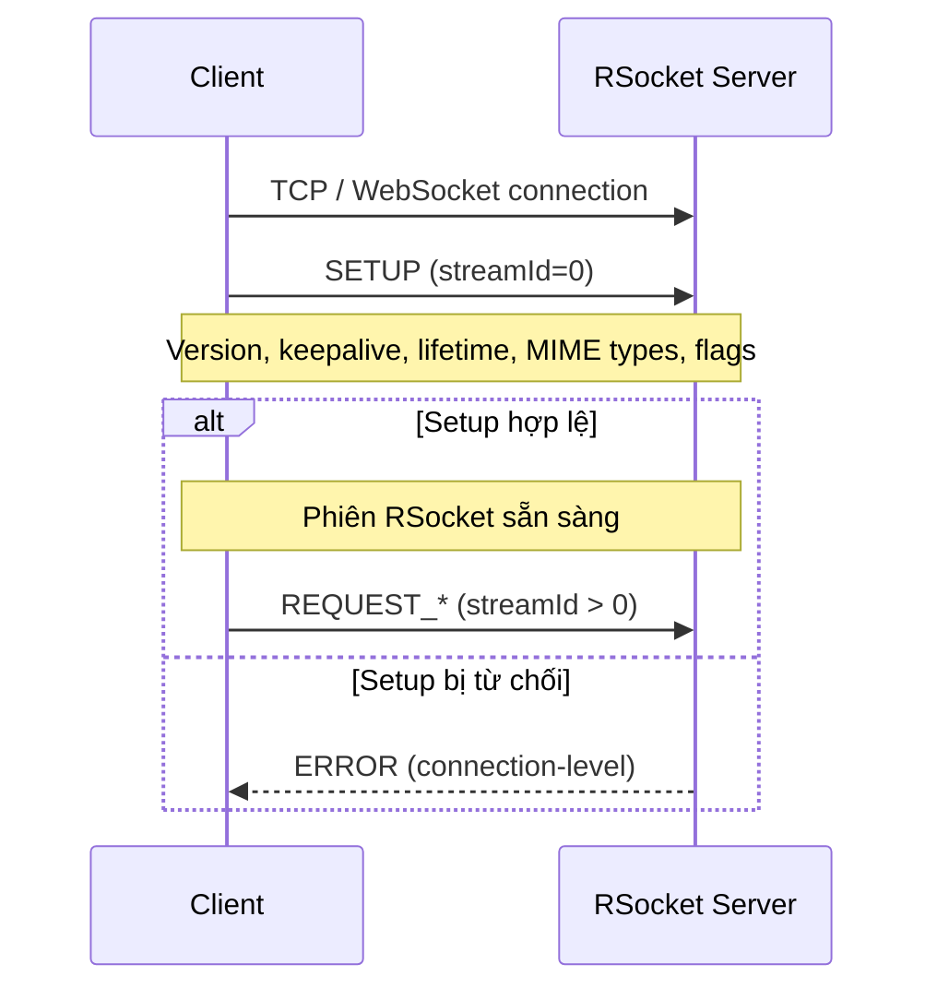
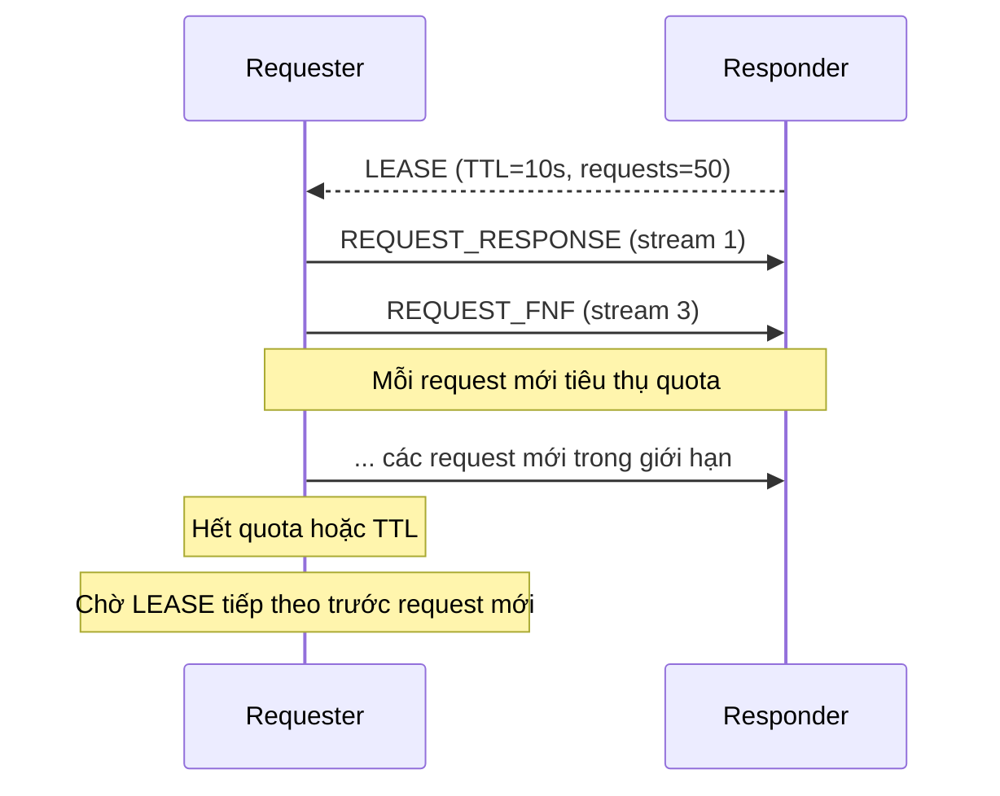
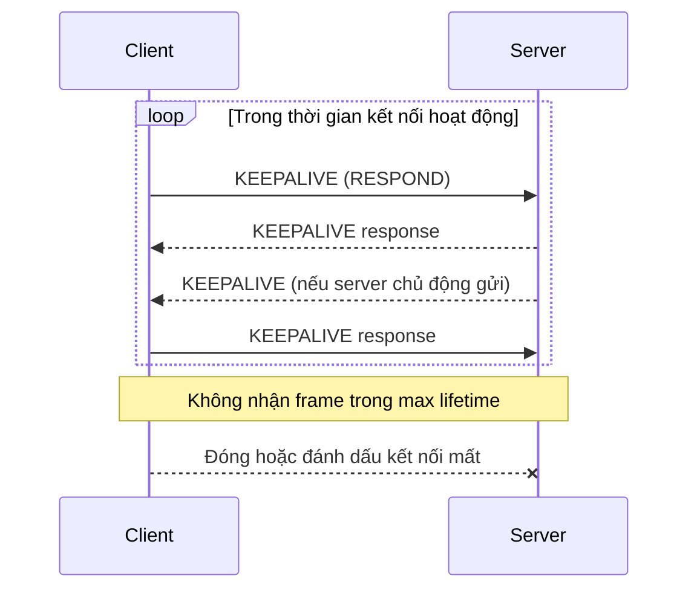
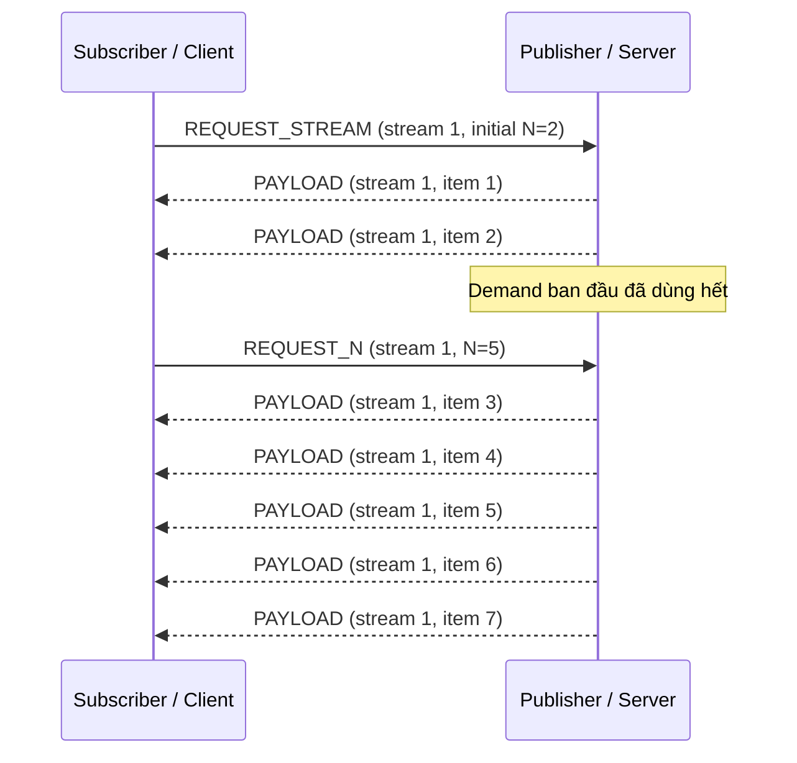
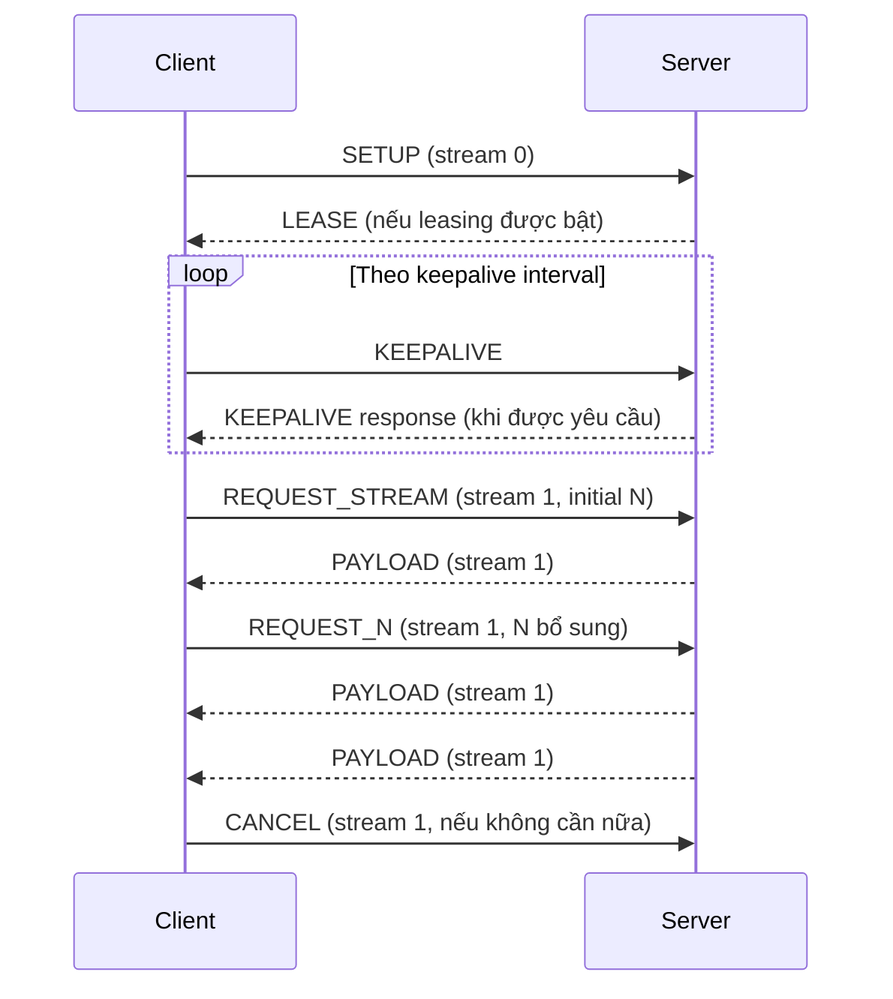

# Nhóm frame khởi tạo bốn mô hình tương tác

RSocket dùng các frame để thiết lập kết nối, mở stream, truyền payload và điều khiển luồng dữ liệu. Trong một kết nối TCP hoặc WebSocket, nhiều stream có thể cùng tồn tại; mỗi stream có vòng đời và nhu cầu dữ liệu riêng. Bên cạnh frame mở request như `REQUEST_RESPONSE`, `REQUEST_FNF`, `REQUEST_STREAM` và `REQUEST_CHANNEL`, giao thức còn có các frame điều khiển giúp hai peer thống nhất cách làm việc và vận hành kết nối.

Bài này tập trung vào bốn frame có vai trò nền tảng: `SETUP`, `LEASE`, `KEEPALIVE` và `REQUEST_N`. Chúng giải quyết bốn câu hỏi khác nhau: kết nối được khởi tạo với tham số nào, peer được phép mở bao nhiêu request, kết nối còn hoạt động hay không, và một stream đang chạy được phép phát thêm bao nhiêu payload. Hiểu ranh giới giữa các nhiệm vụ này giúp triển khai client/server Java và Spring Boot đúng với mô hình reactive, đặc biệt khi hệ thống có stream dài hạn hoặc nhiều client đồng thời.

## 1. Nhìn frame theo phạm vi kết nối và stream

Một RSocket frame có header chung chứa stream ID, loại frame và các flag. Payload của frame phụ thuộc vào loại frame. Trên transport dạng luồng byte như TCP, transport còn cung cấp thông tin độ dài để bên nhận tách được ranh giới frame. Khi dùng WebSocket, RSocket frame được vận chuyển bên trong kết nối WebSocket theo quy tắc của transport tương ứng.

Stream ID cho biết frame tác động đến phạm vi nào:

| Phạm vi | Stream ID | Ví dụ |
|---|---:|---|
| Toàn bộ kết nối | `0` | `SETUP`, `LEASE`, `KEEPALIVE`, `ERROR` cấp kết nối |
| Một tương tác đang chạy | Số dương | `REQUEST_N`, `PAYLOAD`, `CANCEL`, `ERROR` của stream |

Vì vậy, `SETUP`, `LEASE` và `KEEPALIVE` là frame điều khiển ở cấp kết nối. `REQUEST_N` là frame điều khiển ở cấp stream. Cả bốn đều ảnh hưởng đến cách các tương tác hoạt động, nhưng không có nghĩa chúng đều mở một tương tác mới.

Trong kết nối thông thường, peer khởi tạo kết nối gửi `SETUP` trước khi bắt đầu các tương tác. Sau khi kết nối được chấp nhận, các request frame mở stream độc lập. Theo quy ước cấp stream, ID do client khởi tạo thường là số lẻ và ID do server khởi tạo là số chẵn; stream ID `0` luôn dành cho frame cấp kết nối.

## 2. SETUP — thiết lập phiên RSocket

`SETUP` là frame đầu tiên mà peer khởi tạo gửi để bắt đầu một phiên RSocket mới. Frame này dùng stream ID `0` và mang các tham số mà hai bên cần biết trước khi trao đổi request.

Các thông tin quan trọng trong `SETUP` gồm:

- **Phiên bản giao thức:** major và minor version để peer biết phiên bản RSocket mà bên gửi sử dụng.
- **Keepalive interval:** khoảng thời gian dự kiến giữa các lần gửi keepalive.
- **Max lifetime:** giới hạn thời gian một peer chờ frame keepalive từ phía bên kia trước khi coi kết nối đã mất.
- **Data MIME type:** kiểu dữ liệu ứng dụng, ví dụ JSON hoặc định dạng nhị phân riêng.
- **Metadata MIME type:** kiểu mã hóa metadata, nếu ứng dụng có dùng metadata.
- **Setup payload:** payload khởi tạo tùy chọn, có thể mang thông tin cần thiết trước khi xử lý request đầu tiên.
- **Các flag:** cho biết có sử dụng lease, resume hoặc metadata trong setup hay không.

`SETUP` chỉ thiết lập ngữ cảnh của kết nối. Nó không tự mở một stream nghiệp vụ và cũng không tương đương với `REQUEST_RESPONSE`. Sau khi server chấp nhận setup, hai bên mới trao đổi các request frame trên cùng kết nối. Nếu setup không hợp lệ hoặc không được hỗ trợ, peer nhận có thể gửi `ERROR` ở cấp kết nối với mã lỗi phù hợp, chẳng hạn lỗi setup bị từ chối.

Một luồng khởi tạo đơn giản:



Ví dụ, client và server thống nhất JSON làm data MIME type, một định dạng metadata cụ thể và keepalive interval 20 giây. Từ thời điểm setup được chấp nhận, các request frame trên kết nối có thể được giải mã theo những tham số đó. Giá trị cụ thể phải được chọn theo ứng dụng và cấu hình hai phía; ví dụ 20 giây chỉ nhằm minh họa.

Nếu bật resume, setup/resume còn liên quan đến token và vị trí đã nhận của phiên có thể tiếp tục. Resume là cơ chế phục hồi phiên riêng, không nên nhầm với keepalive: keepalive phát hiện kết nối còn hoạt động, còn resume hỗ trợ tiếp tục một phiên khi transport bị gián đoạn nếu cả hai phía và transport hỗ trợ đầy đủ.

## 3. LEASE — cấp quyền mở request

`LEASE` là frame điều khiển cấp kết nối dùng khi cơ chế leasing được bật trong quá trình setup. Peer cấp lease thông báo cho peer còn lại rằng trong một khoảng thời gian nhất định, peer đó được phép khởi tạo một số lượng request mới.

Một `LEASE` mang hai giới hạn chính:

- **TTL (time to live):** thời gian hiệu lực của lease.
- **Number of requests:** số request mới tối đa được phép khởi tạo trong thời gian hiệu lực.

Frame có thể mang thêm metadata để truyền thông tin liên quan đến chính sách cấp quyền. Lease thường được gửi từ phía responder đến requester trong mô hình client/server cơ bản. Client chỉ được mở request mới trong phạm vi số lượng và thời gian đã cấp. Khi số request được dùng hết hoặc TTL hết hạn, client cần đợi lease tiếp theo trước khi mở thêm request.

Ví dụ server cấp lease với TTL 10 giây và quota 50 request. Trong thời gian đó client có thể khởi tạo tối đa 50 request mới. Nếu client đã dùng hết quota sau 3 giây, client phải chờ grant tiếp theo dù TTL chưa hết. Nếu 10 giây trôi qua mà client mới dùng 20 request, phần quota còn lại cũng hết hiệu lực.



Lease kiểm soát khả năng mở **request mới trên kết nối**. Nó không giới hạn số payload của một stream đã mở. Nếu server muốn giới hạn tốc độ payload trong một `REQUEST_STREAM`, cơ chế phù hợp là flow control bằng `REQUEST_N`, không phải cấp lease mới cho từng payload.

Leasing là cơ chế tùy chọn. Nếu client yêu cầu server honor lease trong `SETUP`, hai bên phải triển khai chính sách này nhất quán. Ứng dụng cần xác định hành vi khi chưa có lease, khi lease hết quota hoặc hết hạn: xếp hàng có giới hạn, từ chối sớm hay áp dụng chính sách tải ngược. Không nên âm thầm tích lũy request không giới hạn trong bộ nhớ để chờ lease.

## 4. KEEPALIVE — theo dõi tình trạng kết nối

`KEEPALIVE` là frame điều khiển cấp kết nối, dùng để phát hiện peer hoặc đường truyền đã ngừng phản hồi. Nó có stream ID `0` và có thể được gửi định kỳ trong suốt thời gian kết nối còn hoạt động.

Hai tham số được khai báo trong `SETUP` có ý nghĩa khác nhau:

- **Keepalive interval** cho biết nhịp gửi keepalive mà peer dự kiến duy trì.
- **Max lifetime** xác định khoảng thời gian tối đa chờ frame từ peer trước khi xem kết nối là không còn hoạt động.

Frame `KEEPALIVE` có flag `RESPOND`, trường vị trí đã nhận (last received position) và phần dữ liệu tùy chọn. Khi `RESPOND` được bật, peer nhận phải gửi lại một `KEEPALIVE` phản hồi. Trường vị trí có ý nghĩa đặc biệt trong ngữ cảnh resume; với kết nối không dùng resume, ứng dụng thường không sử dụng nó để khôi phục stream.

Ví dụ: client gửi keepalive định kỳ. Nếu frame có flag yêu cầu phản hồi, server trả một keepalive tương ứng. Nếu một phía không nhận được frame từ peer trong thời gian max lifetime, kết nối được coi là đã mất và tầng transport/session cần thực hiện đóng hoặc phục hồi theo chính sách của ứng dụng.



Keepalive không phải heartbeat nghiệp vụ và không chứng minh rằng database, service downstream hay logic xử lý request đang khỏe. Nó chỉ giúp kiểm tra khả năng trao đổi frame giữa hai peer qua kết nối RSocket. Nếu cần health check nghiệp vụ, ứng dụng nên thiết kế request riêng với timeout và kết quả có ý nghĩa.

Một số lỗi triển khai thường gặp:

- Chọn max lifetime quá ngắn khiến kết nối bị đóng khi mạng có jitter hoặc thiết bị tạm ngừng hoạt động.
- Cấu hình interval quá dài làm phát hiện kết nối chết chậm.
- Dùng keepalive thay cho timeout của từng request, trong khi hai cơ chế đo hai loại thời gian khác nhau.
- Cho rằng có keepalive nghĩa là mọi stream trên kết nối vẫn xử lý tốt.

## 5. REQUEST_N — điều tiết payload trên một stream

`REQUEST_N` là frame điều khiển flow control ở cấp stream. Subscriber gửi frame này để yêu cầu publisher ở phía bên kia phát thêm tối đa `N` payload cho stream tương ứng. Frame có stream ID khác `0`, trường `N` phải là số dương và frame không mang payload nghiệp vụ.

Trong Reactive Streams, subscriber dùng `Subscription.request(n)` để biểu đạt demand. Ở tầng giao thức RSocket, demand đó được truyền qua `REQUEST_N`. Publisher không được gửi nhiều payload hơn lượng demand còn lại mà peer đã cấp. Khi consumer xử lý thêm dữ liệu, nó có thể yêu cầu thêm bằng một `REQUEST_N` khác.

Ví dụ, client mở một request-stream với initial request-N bằng 2. Server chỉ được gửi tối đa hai payload khi chưa có demand bổ sung. Sau khi client xử lý xong và muốn nhận tiếp 5 payload, client gửi `REQUEST_N(N=5)` trên đúng stream ID đó. Server có thể gửi thêm tối đa năm payload theo demand mới.



`REQUEST_N` là demand tăng thêm, không phải thiết lập lại tổng quota từ đầu. Nhiều lần yêu cầu được cộng dồn theo quy tắc demand của giao thức. Nó cũng không có nghĩa server phải gửi ngay đủ N payload; publisher có thể phát ít hơn nếu nguồn chưa có dữ liệu hoặc stream hoàn tất sớm.

### REQUEST_N trong bốn mô hình tương tác

| Mô hình | Frame mở stream | Vai trò của demand |
|---|---|---|
| Request-response | `REQUEST_RESPONSE` | Chỉ có tối đa một response nên không cần chuỗi `REQUEST_N` để lấy thêm payload. |
| Fire-and-forget | `REQUEST_FNF` | Không có response stream nên không có demand response để điều tiết. |
| Request-stream | `REQUEST_STREAM` | Frame mở stream mang initial request-N; các `REQUEST_N` tiếp theo yêu cầu thêm response payload. |
| Request-channel | `REQUEST_CHANNEL` | Frame mở channel mang initial request-N cho chiều response. Hai peer có thể gửi payload; demand được cấp từ phía tiêu thụ cho phía phát ở từng chiều dữ liệu. |

Với request-channel, cần xem mỗi chiều dữ liệu như một luồng producer/consumer riêng. Peer muốn nhận thêm payload từ phía bên kia gửi `REQUEST_N` trên stream tương ứng để cấp demand cho chiều đó. Nhờ vậy, một peer có thể đang gửi dữ liệu trong khi vẫn điều tiết lượng dữ liệu nhận từ peer còn lại.

## 6. Phân biệt LEASE và REQUEST_N

Hai frame thường bị nhầm lẫn vì đều chứa một con số giới hạn, nhưng chúng kiểm soát hai cấp độ khác nhau.

| Tiêu chí | `LEASE` | `REQUEST_N` |
|---|---|---|
| Phạm vi | Toàn bộ kết nối | Một stream |
| Mục tiêu | Cho phép mở request mới | Cho phép phát thêm payload trong stream đang chạy |
| Giới hạn chính | Số request mới và TTL | Số payload bổ sung |
| Thời điểm dùng | Trước hoặc trong quá trình mở request mới | Sau khi stream được tạo, khi consumer cần thêm dữ liệu |
| Stream ID | `0` | Stream ID dương |

Ví dụ, server cấp lease 20 request trong 30 giây. Client dùng một request-stream, và server gửi dữ liệu theo demand của stream. Lease chỉ tiêu thụ một đơn vị khi client mở request-stream đó. Khi stream đang hoạt động, client dùng `REQUEST_N` để yêu cầu thêm payload; những payload này không tiêu thụ thêm quota lease.

Ngược lại, nếu client đã hết lease thì client không thể mở một request-stream mới chỉ vì stream cũ đã gửi hết payload. Nó cần grant mới để bắt đầu request mới. Phân biệt hai lớp này giúp thiết kế hệ thống chịu tải tốt: lease điều tiết admission của request, còn request-N điều tiết tốc độ phát dữ liệu trong từng tương tác.

## 7. Một phiên làm việc kết hợp các frame

Một kết nối realtime có thể dùng các frame trên theo trình tự tổng quát sau:



Đây là ví dụ khái niệm: `LEASE` chỉ xuất hiện khi leasing đã được thương lượng; keepalive được gửi theo cấu hình và có thể theo cả hai hướng; `REQUEST_N` chỉ xuất hiện khi một stream cần thêm demand. Trong hệ thống thực tế, nhiều stream có thể đan xen frame trên cùng kết nối. Header stream ID giúp bên nhận phân phối frame đến đúng stream hoặc xử lý như frame cấp kết nối.

## 8. Ánh xạ frame với API Java và Spring

Khi dùng RSocket Java hoặc Spring Boot, lập trình viên thường thao tác với `Mono`, `Flux` và các API request thay vì tự tạo byte frame. Thư viện chuyển API tương tác thành frame giao thức, quản lý stream ID, demand, payload và cancellation.

Ví dụ với Spring `RSocketRequester`:

```java
// Request-response: một kết quả
Mono<Quote> quote = requester
    .route("quote.latest")
    .data(new QuoteQuery("ACME"))
    .retrieveMono(Quote.class);

// Fire-and-forget: gửi một sự kiện, không chờ response payload
Mono<Void> sent = requester
    .route("audit.record")
    .data(new AuditEvent("USER_LOGIN"))
    .send();

// Request-stream: nhận nhiều kết quả
Flux<Quote> quotes = requester
    .route("quote.stream")
    .data(new QuoteQuery("ACME"))
    .retrieveFlux(Quote.class);

// Request-channel: gửi một luồng và nhận một luồng phản hồi
Flux<ChatReply> replies = requester
    .route("chat.channel")
    .data(outgoingMessages)
    .retrieveFlux(ChatReply.class);
```

Các lời gọi trên minh họa cách chọn interaction model ở tầng ứng dụng. `retrieveMono`, `send`, `retrieveFlux` và luồng hai chiều cho biết kiểu kết quả mong muốn; thư viện chịu trách nhiệm tạo frame tương ứng. Với streaming, demand từ subscriber được chuyển thành flow control ở tầng giao thức. Khi subscriber hủy, thư viện có thể gửi `CANCEL` cho stream đang chạy.

Các tham số `SETUP` như MIME type, keepalive và leasing thường được cấu hình ở lúc tạo client/server hoặc transport. Ứng dụng nên dùng cấu hình của phiên bản Spring Boot/RSocket đang triển khai, thay vì tự đóng gói `SETUP` trong từng lời gọi route. Một kết nối có thể phục vụ nhiều route và nhiều stream sau khi setup thành công.

## 9. Lỗi và tình huống cần kiểm soát

Các frame điều khiển có thể bộc lộ những vấn đề khác nhau:

- **SETUP bị từ chối:** kiểm tra phiên bản giao thức, MIME type, flag leasing/resume và cấu hình transport ở hai phía. Không gửi request nghiệp vụ trước khi setup thành công.
- **Không còn lease:** dừng việc mở request mới hoặc áp dụng hàng đợi có giới hạn; theo dõi TTL và quota còn lại.
- **Keepalive timeout:** xác định kết nối đã mất, giải phóng stream liên quan và áp dụng chính sách reconnect/resume phù hợp.
- **Thiếu demand:** publisher không được gửi thêm payload cho đến khi có `REQUEST_N` bổ sung. Kiểm tra subscriber có tiêu thụ hoặc yêu cầu dữ liệu tiếp hay đã bị treo.
- **Hủy stream:** khi không cần dữ liệu nữa, hủy subscription để thư viện gửi `CANCEL` và giải phóng công việc upstream nếu có thể.
- **Lỗi theo stream:** xử lý lỗi của một stream theo đúng phạm vi; không mặc định mọi lỗi payload đều buộc đóng toàn bộ connection.

Keepalive timeout và request timeout là hai khái niệm riêng. Một kết nối có thể vẫn trao đổi keepalive bình thường trong khi một request cụ thể bị treo vì service downstream. Ngược lại, request có thể đã hoàn tất nhưng kết nối transport sau đó bị mất. Hệ thống cần metric và timeout riêng cho từng tầng.

## 10. Kiểm thử và quan sát

Để kiểm thử đúng hành vi của nhóm frame này, nên xác minh cả logic ứng dụng lẫn hành vi giao thức:

1. **Setup:** kết nối thành công với MIME type mong đợi; setup không hợp lệ phải trả lỗi phù hợp và không cho mở request nghiệp vụ.
2. **Lease:** khi leasing bật, client không mở request mới vượt quota hoặc sau TTL; lease tiếp theo cho phép tiếp tục theo grant mới.
3. **Keepalive:** frame được gửi theo interval; phản hồi được gửi khi có flag yêu cầu; mất peer vượt max lifetime phải kích hoạt xử lý kết nối mất.
4. **Request-N:** publisher không phát vượt demand; demand bổ sung cho phép nhận tiếp; demand của stream này không ảnh hưởng stream khác.
5. **Cancellation:** hủy subscriber dừng việc phát dữ liệu không còn cần thiết và giải phóng tài nguyên upstream.
6. **Request-channel:** kiểm tra demand ở cả chiều gửi và chiều nhận khi hai peer đồng thời phát payload.

Ở tầng Reactor, `StepVerifier` hữu ích để xác minh số phần tử, thứ tự, hoàn tất, lỗi và cancellation. Kiểm thử tích hợp nên mô phỏng client đọc chậm, lease hết hạn, mạng gián đoạn, keepalive timeout và nhiều stream chạy đồng thời. Khi quan sát production, nên theo dõi số kết nối, số stream đang hoạt động, request bị từ chối do lease, keepalive timeout, demand/prefetch, buffer, cancellation và thời gian xử lý từng route.

## 11. Nguyên tắc thiết kế

- Gửi `SETUP` đúng một lần cho phiên mới và thống nhất MIME type cùng tham số keepalive giữa hai phía.
- Bật leasing khi cần kiểm soát số request mới mà peer có thể mở; đặt quota và TTL phù hợp với năng lực xử lý.
- Dùng keepalive để phát hiện kết nối mất, đồng thời dùng timeout riêng cho request và xử lý nghiệp vụ.
- Dùng `REQUEST_N` để điều tiết payload theo từng stream; giới hạn buffer và concurrency trong pipeline ứng dụng.
- Phân biệt frame cấp kết nối (`streamId=0`) với frame cấp stream (`streamId>0`) khi đọc log hoặc packet capture.
- Với request-channel, xem demand của hai chiều dữ liệu độc lập và kiểm thử cả hai chiều khi client/server cùng phát.
- Khi hủy hoặc mất kết nối, giải phóng subscription, stream và tài nguyên liên quan; chỉ dùng resume khi transport và cấu hình hỗ trợ đúng yêu cầu.

`SETUP`, `LEASE`, `KEEPALIVE` và `REQUEST_N` tạo thành những lớp điều khiển bổ sung cho bốn mô hình tương tác của RSocket. Setup xác lập phiên, lease kiểm soát quyền mở request, keepalive theo dõi kết nối và request-N điều tiết payload của stream. Khi mỗi frame được dùng đúng phạm vi, hệ thống realtime có thể duy trì nhiều stream trên một kết nối, kiểm soát tải và phản ứng rõ ràng khi peer hoặc mạng gặp sự cố.
