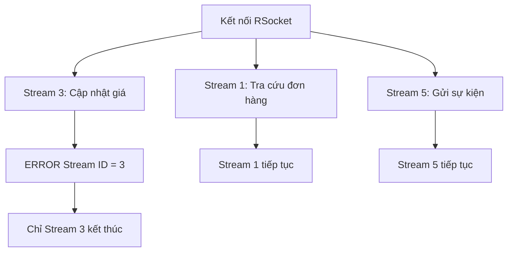

# ERROR và phạm vi lỗi của kết nối hoặc một luồng

RSocket cho phép nhiều tương tác cùng chạy trên một kết nối. Vì vậy, khi một tương tác gặp lỗi, hệ thống cần phân biệt lỗi chỉ kết thúc tương tác đó với lỗi khiến toàn bộ phiên RSocket phải dừng. Frame `ERROR` biểu diễn một lỗi ở tầng giao thức và phạm vi của nó được xác định trước hết bằng `Stream ID` trong header.

Nếu `Stream ID` bằng `0`, lỗi thuộc phạm vi kết nối. Nếu `Stream ID` khác `0`, lỗi thuộc về luồng tương tác có mã đó. Một lỗi ở một luồng không tự động làm hỏng các luồng khác đang dùng cùng kết nối. Ngược lại, lỗi cấp kết nối làm cho mọi tương tác trên kết nối đó không thể tiếp tục.

Đây là điểm quan trọng khi xây dựng ứng dụng realtime bằng RSocket Java hoặc Spring: không phải mọi lỗi nghiệp vụ đều cần đóng kết nối, và không phải mọi lỗi mạng đều có thể được biểu diễn bằng một frame `ERROR` nhận từ peer.

## 1. Frame ERROR có cấu trúc như thế nào?

`ERROR` là một frame của giao thức RSocket, có mã frame type `0x0B`. Frame mang thông tin lỗi để peer biết tương tác hoặc kết nối đã kết thúc vì nguyên nhân nào. Phần header có `Stream ID`; phần nội dung có mã lỗi 32 bit và dữ liệu lỗi.

| Thành phần | Ý nghĩa |
|---|---|
| Stream ID | `0` biểu thị lỗi cấp kết nối; giá trị khác `0` xác định luồng bị lỗi |
| Frame type | `ERROR` (`0x0B`) |
| Error Code | Mã số phân loại lỗi theo giao thức |
| Error Data | Chuỗi UTF-8 mô tả lỗi; nội dung chi tiết do hai ứng dụng thống nhất nếu cần |

Có thể hình dung phần thân frame như sau:

```text
+----------------------+----------------------+----------------------+
| Frame Header         | Error Code (32 bit)  | Error Data (UTF-8)   |
| Stream ID + Type     |                      |                      |
+----------------------+----------------------+----------------------+
```

`ERROR` là tín hiệu kết thúc bất thường. Khi nhận frame này với `Stream ID` khác `0`, bên nhận kết thúc luồng tương ứng bằng lỗi. Khi nhận `ERROR` với `Stream ID = 0`, bên nhận xử lý lỗi ở phạm vi kết nối và đóng phiên RSocket theo quy tắc giao thức.

Nội dung `Error Data` hữu ích để ghi log hoặc hỗ trợ chẩn đoán, nhưng không nên coi đó là một hợp đồng dữ liệu ổn định nếu ứng dụng chưa định nghĩa rõ định dạng. Không gửi stack trace, thông tin đăng nhập, token hoặc dữ liệu nhạy cảm trong trường này.

## 2. Phân biệt lỗi cấp kết nối và lỗi cấp luồng

Một kết nối RSocket có thể multiplex nhiều luồng tương tác. Ví dụ, client có thể đồng thời tra cứu đơn hàng, nhận luồng cập nhật giá và gửi một thông điệp fire-and-forget. Mỗi tương tác có `Stream ID` riêng.



### Lỗi cấp luồng: Stream ID khác 0

Lỗi cấp luồng chỉ ảnh hưởng đến một tương tác cụ thể. Ví dụ, request lấy thông tin đơn hàng có thể thất bại vì mã đơn không hợp lệ, quyền truy cập bị từ chối hoặc dịch vụ nghiệp vụ không xử lý được request. RSocket kết thúc stream mang request đó bằng `ERROR`; các stream khác trên cùng kết nối vẫn có thể tiếp tục.

Điều này phù hợp với kiến trúc realtime vì một request lỗi không nên làm gián đoạn những subscription hoặc request độc lập. Nếu một client đang nhận luồng giá và đồng thời tra cứu hồ sơ, lỗi ở thao tác tra cứu không nhất thiết phải đóng luồng giá.

### Lỗi cấp kết nối: Stream ID bằng 0

Lỗi cấp kết nối ảnh hưởng đến toàn bộ phiên RSocket. Ví dụ, frame `SETUP` không hợp lệ, cấu hình setup không được hỗ trợ hoặc server từ chối thiết lập kết nối. Khi một lỗi cấp kết nối xảy ra sau khi phiên đã được thiết lập, mọi stream đang hoạt động trên kết nối đó đều không thể tiếp tục.

Lỗi cấp kết nối thường đòi hỏi client tạo một kết nối mới nếu muốn tiếp tục giao tiếp. Việc có gửi lại các request cũ hay không là quyết định của ứng dụng; không thể mặc định rằng mọi request đều an toàn để thực hiện lại.

### Bảng so sánh

| Tiêu chí | Lỗi cấp luồng | Lỗi cấp kết nối |
|---|---|---|
| Stream ID trong ERROR | Khác `0` | `0` |
| Phạm vi ảnh hưởng | Một tương tác | Toàn bộ phiên RSocket |
| Các stream khác | Có thể tiếp tục | Bị ảnh hưởng vì kết nối kết thúc |
| Ví dụ | Request không hợp lệ, lỗi nghiệp vụ | Setup bị từ chối, lỗi giao thức kết nối |
| Hướng xử lý | Xử lý lỗi ở request/stream tương ứng | Đóng phiên, tạo kết nối mới nếu cần |

## 3. Các mã lỗi chuẩn thường gặp

RSocket định nghĩa các mã lỗi để hai implementation có thể hiểu loại lỗi ở mức giao thức. Phạm vi thực tế vẫn phải phù hợp với `Stream ID` của frame `ERROR`.

### Mã lỗi cấp kết nối

| Mã | Giá trị hex | Ý nghĩa |
|---|---:|---|
| `INVALID_SETUP` | `0x00000001` | Frame `SETUP` không hợp lệ |
| `UNSUPPORTED_SETUP` | `0x00000002` | Server không hỗ trợ cấu hình hoặc phiên bản setup được yêu cầu |
| `REJECTED_SETUP` | `0x00000003` | Server từ chối thiết lập phiên RSocket |
| `REJECTED_RESUME` | `0x00000004` | Server từ chối khôi phục phiên đã tạm ngắt |
| `CONNECTION_ERROR` | `0x00000101` | Lỗi khiến kết nối RSocket phải kết thúc |
| `CONNECTION_CLOSE` | `0x00000102` | Peer thông báo đóng kết nối |

Các lỗi setup xảy ra trước khi ứng dụng có thể sử dụng phiên RSocket bình thường. Ví dụ, client gửi thông tin setup không hợp lệ hoặc server không chấp nhận cấu hình được đề xuất. Với các mã lỗi này, cần xem lại cấu hình hai đầu, phiên bản giao thức, cơ chế xác thực trong setup và các yêu cầu của server.

`CONNECTION_ERROR` và `CONNECTION_CLOSE` đều có phạm vi kết nối. Chúng không phải mã để báo một request nghiệp vụ đơn lẻ thất bại. Khi nhận lỗi cấp kết nối, client cần xem xét trạng thái toàn bộ session và các stream đang hoạt động.

### Mã lỗi cấp luồng

| Mã | Giá trị hex | Ý nghĩa |
|---|---:|---|
| `APPLICATION_ERROR` | `0x00000201` | Lỗi phát sinh trong xử lý ứng dụng |
| `REJECTED` | `0x00000202` | Request bị từ chối |
| `CANCELED` | `0x00000203` | Tương tác bị hủy |
| `INVALID` | `0x00000204` | Request hoặc dữ liệu tương tác không hợp lệ |

Các mã này giúp phân biệt lỗi xử lý nghiệp vụ, request bị từ chối, tương tác bị hủy hoặc request sai. Chúng không có nghĩa kết nối TCP/WebSocket phải bị đóng. Những stream khác có thể tiếp tục sử dụng cùng phiên RSocket. Mã `CANCELED` trong một frame `ERROR` mô tả một kết thúc stream do hủy; nó khác với frame `CANCEL` mà subscriber gửi để yêu cầu peer dừng một stream đang chạy.

Không nên dùng mã lỗi như một cách thay thế cho mô hình lỗi nghiệp vụ chi tiết. Chẳng hạn, `APPLICATION_ERROR` cho biết có lỗi ứng dụng, nhưng không tự định nghĩa `ORDER_NOT_FOUND`, `PAYMENT_DECLINED` hay `QUOTA_EXCEEDED`. Nếu client cần phân biệt các trường hợp đó, hai bên phải thống nhất hợp đồng cho `Error Data` hoặc thiết kế response nghiệp vụ có cấu trúc.

## 4. ERROR khác COMPLETE và CANCEL như thế nào?

RSocket có nhiều cơ chế điều khiển vòng đời tương tác. `ERROR` và `CANCEL` là các frame riêng; `COMPLETE` là một cờ trên frame `PAYLOAD`, không phải một frame type độc lập:

| Frame | Ý nghĩa | Kết quả đối với stream |
|---|---|---|
| `ERROR` frame | Tương tác kết thúc do lỗi | Kết thúc bất thường, peer nhận lỗi |
| `PAYLOAD` với cờ `COMPLETE` | Bên gửi đã hoàn tất việc phát dữ liệu | Kết thúc bình thường theo hướng phát dữ liệu tương ứng |
| `CANCEL` frame | Bên nhận yêu cầu dừng một tương tác đang chạy | Bên phát dữ liệu hủy công việc của stream đó nếu có thể |

Với request-stream, server có thể gửi nhiều `PAYLOAD` rồi gửi một `PAYLOAD` cuối cùng có cờ `COMPLETE` khi hết dữ liệu. Nếu xử lý thất bại, server gửi `ERROR` cho stream thay vì báo hoàn tất bình thường. Nếu client không còn quan tâm tới luồng, client gửi `CANCEL` để yêu cầu server dừng việc phát dữ liệu.

Trong request-channel, hai phía có thể phát dữ liệu theo hai hướng. Lỗi kết thúc tương tác channel và làm cho phía còn lại nhận được tín hiệu lỗi. Hủy một tương tác cũng cần được xử lý theo vòng đời của stream; nó không đồng nghĩa với việc đóng toàn bộ kết nối.

Một số lỗi xảy ra cục bộ trước khi frame được gửi, chẳng hạn lỗi serialize payload hoặc ứng dụng hủy publisher. Trong trường hợp đó, peer có thể không nhận bất kỳ frame `ERROR` nào. Vì vậy, log `onError` ở phía client không tự chứng minh server đã gửi một frame `ERROR`.

## 5. Một lỗi nghiệp vụ nên tác động đến stream nào?

Giả sử một server RSocket cung cấp hai route:

- `orders.lookup`: tra cứu một đơn hàng và trả về một kết quả.
- `prices.watch`: phát luồng giá liên tục.

Client mở cả hai tương tác trên cùng một kết nối. Nếu `orders.lookup` nhận mã đơn không tồn tại, server nên kết thúc stream tra cứu bằng lỗi cấp luồng. Subscription `prices.watch` vẫn tiếp tục nhận dữ liệu. Đóng toàn bộ kết nối chỉ vì một mã đơn không tồn tại sẽ làm gián đoạn những tương tác độc lập và tạo thêm chi phí reconnect.

Ngược lại, nếu phiên RSocket gặp lỗi giao thức không thể tiếp tục, chẳng hạn peer gửi frame không hợp lệ ở phạm vi kết nối, việc kết thúc session là hợp lý. Các stream đang chạy trên session đó không thể được xem như vẫn hoạt động bình thường.

```mermaid
sequenceDiagram
    participant C as Client
    participant S as Server
    C->>S: SETUP
    Note over C,S: Một kết nối RSocket được thiết lập
    C->>S: REQUEST_STREAM prices.watch (Stream 1)
    C->>S: REQUEST_RESPONSE orders.lookup (Stream 3)
    S-->>C: PAYLOAD (Stream 1)
    S-->>C: ERROR APPLICATION_ERROR (Stream 3)
    Note over C,S: Stream 3 kết thúc; Stream 1 vẫn tiếp tục
    S-->>C: PAYLOAD (Stream 1)
    S-->>C: PAYLOAD (Stream 1)
```

Quy tắc thiết kế là đặt lỗi ở phạm vi nhỏ nhất phù hợp với nguyên nhân. Lỗi dữ liệu đầu vào, quyền truy cập của một request hoặc trạng thái nghiệp vụ riêng thường là lỗi stream. Lỗi làm phiên giao tiếp không còn hợp lệ hoặc không thể tiếp tục mới cần phạm vi kết nối.

## 6. Xử lý lỗi stream trong RSocket Java và Reactor

Ở tầng API Java, tương tác thường được biểu diễn bằng `Mono` hoặc `Flux`. Khi peer gửi `ERROR` cho một stream, publisher tương ứng kết thúc bằng tín hiệu `onError`. Publisher của các stream khác không tự động nhận cùng lỗi đó.

Ví dụ client gọi request-response:

```java
Mono<Order> order = requester.route("orders.lookup")
    .data(new OrderQuery("order-42"))
    .retrieveMono(Order.class)
    .doOnError(error -> log.warn(
        "Không thể tra cứu order-42", error
    ));
```

Nếu server trả lỗi cho stream này, `Mono<Order>` phát `onError`. Ứng dụng có thể xử lý một trường hợp nghiệp vụ đã biết bằng `onErrorResume`, sau khi xác định rõ lỗi đó. Không nên biến mọi lỗi thành giá trị rỗng hoặc giá trị mặc định vì việc đó có thể che giấu lỗi mạng, lỗi xác thực hoặc lỗi lập trình.

Ví dụ xử lý có chọn lọc:

```java
Mono<Order> order = requester.route("orders.lookup")
    .data(new OrderQuery("order-42"))
    .retrieveMono(Order.class)
    .onErrorResume(error -> {
        if (isKnownOrderNotFound(error)) {
            return Mono.empty();
        }
        return Mono.error(error);
    });
```

`isKnownOrderNotFound` là hàm của ứng dụng, dựa trên hợp đồng lỗi mà client và server đã thống nhất. Không nên giả định mọi implementation đều ánh xạ cùng một `Error Data` thành một lớp exception Java cụ thể. Mã lỗi giao thức và nội dung lỗi cần được xem xét theo API của phiên bản thư viện đang dùng.

Ở phía responder, một lỗi terminal trong quá trình xử lý request được chuyển thành lỗi của tương tác. Với lỗi ứng dụng thông thường, RSocket dùng mã `APPLICATION_ERROR` cho frame `ERROR` ở stream tương ứng. Nếu ứng dụng muốn client phân biệt lỗi nghiệp vụ, cần quy định nội dung lỗi có cấu trúc hoặc một cơ chế chuyển đổi lỗi nhất quán.

## 7. Xử lý lỗi cấp kết nối và reconnect

Lỗi cấp kết nối có thể xuất hiện trong lúc thiết lập hoặc sau khi phiên đã hoạt động. Khi kết nối không thể tiếp tục, các request và subscription gắn với kết nối đó đều cần được xem là không còn sử dụng được. Ứng dụng có thể tạo một session mới, nhưng cần quản lý lại các subscription và quyết định request nào được phép gửi lại.

Ví dụ bắt lỗi khi thiết lập client bằng Spring `RSocketRequester`:

```java
Mono<RSocketRequester> requesterMono = RSocketRequester.builder()
    .connectTcp("localhost", 7000)
    .doOnError(error -> log.error(
        "Không thể thiết lập kết nối RSocket", error
    ));
```

Đoạn mã trên xử lý lỗi trong quá trình tạo kết nối. Sau khi kết nối đã được tạo, mỗi publisher request vẫn cần chính sách xử lý lỗi riêng. Khi transport bị ngắt hoặc keepalive hết hạn, ứng dụng có thể nhận lỗi cục bộ mà không có frame `ERROR` từ server.

Reconnect không đồng nghĩa retry tự động. Nếu client không biết server đã xử lý request trước khi kết nối mất hay chưa, gửi lại một thao tác ghi có thể tạo tác dụng phụ hai lần. Với thao tác không idempotent, hãy dùng idempotency key, mã giao dịch duy nhất hoặc cơ chế xác nhận nghiệp vụ. Với stream realtime, cần quyết định có đăng ký lại từ vị trí nào và dữ liệu nào có thể bị bỏ lỡ trong thời gian mất kết nối.

Nếu triển khai RSocket resume, phải cấu hình và kiểm thử cơ chế resume ở cả hai phía. Resume liên quan đến khả năng lưu trạng thái frame và khôi phục phiên; nó không thay thế xử lý lỗi ứng dụng, không đảm bảo mọi thao tác nghiệp vụ được thực hiện đúng một lần và có thể bị từ chối bằng lỗi `REJECTED_RESUME`.

## 8. Lỗi transport không nhất thiết là frame ERROR

Một điểm dễ nhầm là mọi sự cố kết nối đều được gửi dưới dạng `ERROR`. Thực tế, `ERROR` chỉ tồn tại khi một peer còn có thể gửi frame giao thức. Nếu TCP reset, WebSocket bị proxy đóng, máy chủ dừng đột ngột hoặc mạng bị chia cắt, peer có thể không còn đường truyền để gửi frame `ERROR`.

| Tình huống | Có thể nhận ERROR frame? | Phạm vi ảnh hưởng |
|---|---|---|
| Handler trả lỗi cho một request | Có, thường là lỗi stream | Một stream |
| Server từ chối setup | Có, lỗi cấp kết nối | Phiên chưa được thiết lập |
| Peer gửi lỗi giao thức cấp kết nối | Có thể có, nếu còn gửi được frame | Toàn bộ phiên |
| TCP reset hoặc socket đóng đột ngột | Thường không | Mọi stream trên kết nối đó |
| WebSocket bị proxy timeout và đóng | Thường không có ERROR RSocket | Mọi stream trên kết nối đó |
| Client hủy subscription cục bộ | Không nhất thiết có ERROR; thường gửi CANCEL nếu stream đã hoạt động | Stream bị hủy |
| Lỗi encode payload trước khi gửi | Không nhất thiết | Có thể chỉ ở phía local trước khi stream được tạo |

Do đó, khi quan sát log, hãy tách ba nhóm: lỗi giao thức RSocket có mã lỗi, lỗi transport như timeout/reset/close, và lỗi cục bộ của ứng dụng như serialize, validate hoặc cancel. Chúng có cách phục hồi khác nhau.

## 9. Logging và thiết kế hợp đồng lỗi

Khi ghi nhận lỗi, nên lưu các thông tin đủ để xác định phạm vi và tương tác: route, Stream ID nếu thư viện cung cấp, mã lỗi RSocket, thời điểm, correlation ID và loại transport. Tránh ghi toàn bộ payload hoặc nội dung xác thực nếu không cần thiết.

Ở tầng ứng dụng, nên phân loại lỗi thành nhóm mà client có thể xử lý rõ ràng. Ví dụ:

| Nhóm lỗi | Ví dụ | Hướng xử lý phía client |
|---|---|---|
| Dữ liệu không hợp lệ | Thiếu mã đơn, sai định dạng | Sửa request; không retry nguyên trạng |
| Không tìm thấy | Đơn hàng không tồn tại | Hiển thị kết quả phù hợp hoặc xử lý như trạng thái rỗng theo hợp đồng |
| Không được phép | Người dùng không có quyền truy cập | Yêu cầu xác thực/phân quyền phù hợp; không retry liên tục |
| Tạm thời không xử lý được | Dịch vụ phụ thuộc quá tải | Retry có giới hạn nếu thao tác an toàn |
| Kết nối không còn hoạt động | Timeout, reset, connection error | Tạo session mới và khôi phục subscription theo chính sách |

Các nhóm trên là hợp đồng nghiệp vụ của hệ thống, không phải mã lỗi RSocket mới. Có thể truyền mã nghiệp vụ trong `Error Data` theo một schema đã thống nhất, hoặc dùng một response có cấu trúc khi lỗi là kết quả nghiệp vụ bình thường mà client cần xử lý như dữ liệu.

Không dùng `APPLICATION_ERROR` cho mọi tình huống chỉ vì thuận tiện. Mã lỗi giao thức nên phản ánh đúng loại sự cố; mã nghiệp vụ chi tiết nên được định nghĩa riêng ở tầng ứng dụng. Cũng cần tránh trả thông tin nội bộ như tên bảng, câu SQL, stack trace hoặc địa chỉ dịch vụ phụ thuộc ra client.

## 10. Quy trình chẩn đoán khi nhận ERROR

Khi client nhận lỗi từ một tương tác RSocket, có thể phân tích theo thứ tự sau:

1. Xác định lỗi đến từ publisher nào: request-response, stream hay channel.
2. Nếu có thông tin frame, kiểm tra `Stream ID`: `0` là phạm vi kết nối, khác `0` là phạm vi stream.
3. Đọc `Error Code` để xác định nhóm lỗi giao thức.
4. Kiểm tra `Error Data` theo schema đã thống nhất, đồng thời loại bỏ thông tin nhạy cảm khỏi log.
5. Nếu lỗi chỉ thuộc một stream, xử lý publisher đó và kiểm tra các stream khác còn hoạt động hay không.
6. Nếu lỗi cấp kết nối hoặc transport đã đóng, xem toàn bộ session là không còn hoạt động và áp dụng chính sách reconnect.
7. Trước khi retry, xác định thao tác có idempotent không và server có thể đã xử lý request trước lúc kết nối mất hay chưa.

Một kiểm thử quan trọng là mở ít nhất hai stream trên cùng kết nối, chủ động làm một stream phát sinh lỗi ứng dụng và xác nhận stream còn lại tiếp tục hoạt động. Sau đó kiểm thử lỗi cấp kết nối hoặc đóng transport và xác nhận mọi stream đều nhận trạng thái kết thúc phù hợp. Cách kiểm thử này xác nhận ứng dụng thực sự phân biệt phạm vi lỗi thay vì chỉ quan sát một request đơn lẻ.

## 11. Kết luận

Frame `ERROR` giúp RSocket truyền lỗi có cấu trúc ở tầng giao thức. `Stream ID = 0` biểu thị lỗi cấp kết nối; `Stream ID` khác `0` biểu thị lỗi của một tương tác. Lỗi stream kết thúc tương tác liên quan và cho phép các stream độc lập tiếp tục. Lỗi cấp kết nối làm kết thúc phiên và ảnh hưởng đến mọi tương tác trên phiên đó.

Khi triển khai client/server Java hoặc Spring, hãy giữ lỗi nghiệp vụ ở phạm vi stream nếu chỉ một request bị ảnh hưởng. Chỉ xử lý ở phạm vi kết nối khi phiên RSocket thực sự không thể tiếp tục. Đồng thời phân biệt frame `ERROR` với cờ `COMPLETE` trên `PAYLOAD`, frame `CANCEL` và sự cố transport để chọn đúng cách log, phục hồi và retry.
