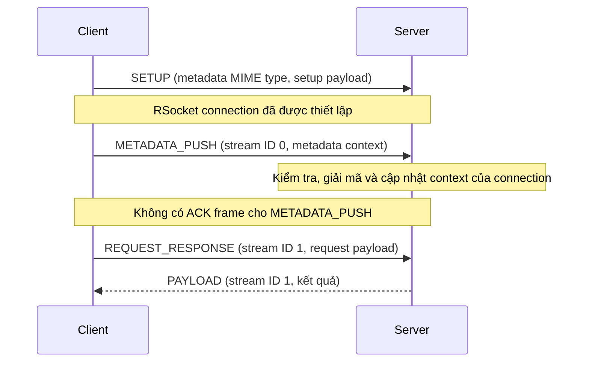
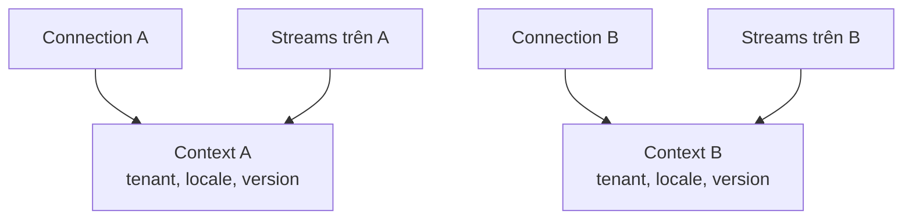

# METADATA_PUSH và metadata ở phạm vi kết nối

RSocket có thể gửi metadata gắn với một request hoặc gửi metadata độc lập ở phạm vi connection. `METADATA_PUSH` là frame dành cho trường hợp thứ hai: một peer gửi metadata tới peer còn lại mà không mở stream request mới. Frame này dùng `stream ID = 0`, chỉ mang metadata và không có payload phản hồi theo giao thức.

Điểm quan trọng là RSocket chỉ vận chuyển metadata tới connection peer. Ý nghĩa của metadata, cách lưu nó thành ngữ cảnh phiên và việc áp dụng nó cho các request tiếp theo do ứng dụng quyết định. Vì vậy, `METADATA_PUSH` hữu ích cho ngữ cảnh thay đổi theo thời gian, nhưng cần thiết kế rõ quyền sở hữu trạng thái, bảo mật và cách xác nhận cập nhật.

## Mục tiêu học tập

Sau bài học, người học có thể:

- Nhận diện `METADATA_PUSH` và giải thích vì sao frame này có `stream ID = 0`.
- Phân biệt metadata trong `SETUP`, metadata của từng request và metadata được đẩy ở phạm vi connection.
- Mô tả nội dung frame, hướng gửi và giới hạn của cơ chế không có phản hồi.
- Thiết kế cách receiver xác thực, diễn giải và lưu metadata connection-scoped.
- Tránh race condition, rò rỉ ngữ cảnh giữa các tenant và lỗi khi reconnect.
- Gọi API `RSocket.metadataPush(...)` và lựa chọn cơ chế request-response khi cần xác nhận cập nhật.

## 1. Vì sao cần metadata ở phạm vi connection?

Hãy hình dung một client mở một RSocket connection tới server để theo dõi nhiều thiết bị. Trên connection đó, client có thể tạo nhiều stream: đọc trạng thái, nhận số đo liên tục và gửi lệnh điều khiển. Một số thông tin có thể áp dụng chung cho các tương tác trên connection, chẳng hạn phiên bản ngữ cảnh client, locale mặc định hoặc một context đã được xác thực.

Nếu thông tin này thay đổi trong khi connection vẫn đang hoạt động, ứng dụng có thể cần gửi cập nhật mà không tạo một request nghiệp vụ mới. `METADATA_PUSH` cung cấp frame connection-level để chuyển metadata đó.

Ví dụ, client có thể thông báo rằng context hiển thị đã chuyển sang locale `vi-VN`. Server nhận metadata, xác thực giá trị và cập nhật context gắn với connection. Các handler sau đó có thể đọc context này nếu ứng dụng được thiết kế để dùng giá trị mặc định theo connection.

Đây là quy ước ở tầng ứng dụng. `METADATA_PUSH` tự nó không tự động thay đổi locale, tenant, danh tính, quyền truy cập hay metadata của các stream đang chạy.

## 2. `METADATA_PUSH` là frame connection-level

`METADATA_PUSH` là một loại frame trong RSocket protocol. Frame này có những đặc điểm cốt lõi:

- **Stream ID bằng 0**: frame không thuộc một stream request/response cụ thể. Trong RSocket, stream ID 0 được dùng cho các frame ở phạm vi connection.
- **Chỉ mang metadata**: frame chứa phần metadata; không có phần data nghiệp vụ như payload của một request thông thường.
- **Không mở stream mới**: gửi frame không cấp một stream ID dương và không tạo một interaction model mới.
- **Không có phản hồi theo giao thức**: receiver xử lý metadata; sender không nhận payload ACK cho frame này.
- **Có thể được gửi bởi một trong hai peer**: client hoặc server có thể đẩy metadata tới peer bên kia sau khi phiên RSocket được thiết lập.

Mô hình rút gọn của frame:

```text
+------------------------------------+
| Stream ID = 0                      |
+------------------------------------+
| Frame Type = METADATA_PUSH         |
+------------------------------------+
| Metadata Length                   |
+------------------------------------+
| Metadata bytes                    |
+------------------------------------+
```

`METADATA_PUSH` có frame type `0x0C` trong RSocket protocol. Trường metadata length cho biết số byte metadata tiếp theo. Cấu trúc chi tiết của header và cách đóng gói trên wire được quy định bởi RSocket protocol; sơ đồ trên chỉ nhấn mạnh các trường liên quan tới ý nghĩa của frame.

Vì stream ID là 0, không được xử lý frame này như một `REQUEST_RESPONSE`, `REQUEST_FNF` hay `PAYLOAD` trên một stream. Nó là tín hiệu metadata riêng ở phạm vi connection.

## 3. Metadata push khác metadata trong SETUP và metadata theo request

Ba vị trí metadata thường gặp có phạm vi và vòng đời khác nhau:

| Loại metadata | Thời điểm gửi | Phạm vi | Cách dùng điển hình |
|---|---|---|---|
| Metadata trong `SETUP` payload | Khi khởi tạo RSocket session | Ngữ cảnh ban đầu của phiên, theo quy ước ứng dụng | Thông tin khởi tạo client hoặc context ban đầu |
| Metadata trong request/payload | Khi gửi một tương tác hoặc payload cụ thể | Request, stream hoặc payload tương ứng | Route, correlation ID, locale riêng của request, thông tin nghiệp vụ |
| `METADATA_PUSH` | Sau khi connection đã thiết lập | Connection | Cập nhật hoặc thông báo metadata chung cho connection |

### Metadata trong SETUP

`SETUP` khởi tạo phiên RSocket và khai báo các MIME type được dùng cho data và metadata. Setup payload có thể mang data và metadata ban đầu. Thông tin này được gửi trong giai đoạn mở phiên; `METADATA_PUSH` là cơ chế gửi metadata mới sau đó.

Không nên giả định mọi metadata trong setup payload tự động trở thành trạng thái dùng chung cho các request. Server phải diễn giải và lưu context ban đầu theo chính sách của ứng dụng.

### Metadata theo request

Metadata theo request gắn với một tương tác cụ thể. Ví dụ, route `devices.sensor.readings` có thể được gửi dưới dạng routing metadata, trong khi data chứa truy vấn khoảng thời gian. Metadata đó thuộc request hiện tại; request khác có thể có route hoặc metadata khác.

### Metadata ở phạm vi connection

`METADATA_PUSH` không có stream ID và không được gắn vào một request đang chạy. Receiver có thể diễn giải nó như một cập nhật cho context của connection, nhưng phải tự quyết định có lưu, hợp nhất, thay thế, bỏ qua hay từ chối metadata đó.

**RSocket không tự động chèn metadata đã push vào mọi request tiếp theo.** Nếu muốn handler đọc metadata connection-scoped, ứng dụng cần lưu context theo đúng connection và cung cấp context đó cho handler một cách an toàn.

## 4. MIME type và cách diễn giải metadata

Metadata không phải chuỗi văn bản tùy ý mà mọi peer đều tự hiểu. Khi thiết lập phiên, hai peer cần thống nhất metadata MIME type trong `SETUP`. Sender phải mã hóa metadata theo định dạng đã khai báo; receiver dùng đúng định dạng đó để giải mã.

Một số dạng metadata thường gặp:

- Metadata đơn theo MIME type đã khai báo, chẳng hạn `application/json` nếu cả hai bên thống nhất dùng JSON.
- Composite metadata, trong đó một payload metadata chứa nhiều entry và mỗi entry có thể chỉ rõ MIME type riêng, ví dụ routing metadata hoặc authentication metadata.

Với composite metadata, receiver phải đọc đúng cấu trúc entry và MIME type tương ứng. Không được coi toàn bộ byte metadata là một chuỗi JSON duy nhất nếu metadata MIME type đã khai báo là composite.

Metadata push sử dụng metadata MIME type của phiên RSocket đã thiết lập. Do đó, hai peer cần cấu hình tương thích trước khi gửi frame. Nếu không có metadata MIME type phù hợp hoặc hai bên hiểu khác định dạng, receiver không thể diễn giải dữ liệu một cách đáng tin cậy.

## 5. Vòng đời của một lần metadata push

Một trình tự đơn giản có thể diễn ra như sau:



Các bước tương ứng:

1. Client và server mở transport, sau đó thiết lập RSocket session bằng `SETUP`.
2. Một peer tạo metadata theo MIME type đã khai báo và gửi `METADATA_PUSH` với stream ID 0.
3. Peer nhận giải mã metadata, kiểm tra schema, xác thực các giá trị có liên quan và cập nhật context gắn với connection nếu chính sách cho phép.
4. Những request tiếp theo có thể tham chiếu context này nếu handler được thiết kế để đọc nó.

Frame metadata push không yêu cầu stream credit `REQUEST_N`, vì nó không phải phần tử dữ liệu trên một request-stream. Tuy nhiên, ứng dụng vẫn phải giới hạn kích thước, tần suất và chi phí xử lý metadata để tránh tiêu hao bộ nhớ hoặc CPU.

## 6. Không có ACK: điều gì sender có thể kết luận?

API gửi metadata push có thể cho biết thao tác gửi đã hoàn tất ở phía client/runtime, nhưng giao thức không cung cấp một response payload để xác nhận rằng server đã áp dụng cập nhật vào context ứng dụng.

Vì vậy, cần phân biệt:

- **Frame đã được gửi qua API**: thao tác gửi ở phía local đã hoàn tất theo semantics của implementation.
- **Peer đã nhận frame**: dữ liệu đã tới peer theo trạng thái transport/giao thức.
- **Ứng dụng đã áp dụng metadata**: receiver đã giải mã, kiểm tra và cập nhật trạng thái thành công.

Hai điều sau không thể được xác nhận chỉ bằng việc `Mono<Void>` gửi metadata push hoàn tất. Nếu nghiệp vụ cần xác nhận, hãy thiết kế một request-response riêng, ví dụ route `session.context.update`, trả về version hoặc trạng thái cập nhật. Request-response này tạo một stream riêng và có thể trả lỗi nghiệp vụ rõ ràng.

Ví dụ, client gửi `METADATA_PUSH` với `contextVersion = 12`, sau đó gửi request-response `session.context.status` để hỏi server đã áp dụng version 12 chưa. Cách này thêm một tương tác có xác nhận, phù hợp khi việc cập nhật context là điều kiện bắt buộc trước thao tác tiếp theo.

## 7. Cập nhật context an toàn và tránh race condition

Transport có thứ tự giúp frame được chuyển theo thứ tự gửi trên cùng connection, nhưng điều đó không đảm bảo công việc xử lý bất đồng bộ ở server đã hoàn tất trước khi một request khác được handler xử lý. Ví dụ, server nhận metadata push rồi lên lịch cập nhật context trên một scheduler; request kế tiếp có thể được dispatch trước khi cập nhật hoàn tất.

Nếu request phụ thuộc vào metadata mới, có ba cách thiết kế thường dùng:

1. **Dùng metadata theo request**: gửi context/version ngay trong request cần nó. Đây là lựa chọn rõ ràng nhất khi context chỉ áp dụng cho một số tương tác.
2. **Dùng request-response để cập nhật**: gửi một request cập nhật context và chờ ACK trước khi phát request phụ thuộc vào context đó.
3. **Dùng version và đồng bộ**: metadata push mang version tăng dần; receiver bỏ qua bản cũ, xử lý bản mới và cung cấp cơ chế xác nhận trạng thái qua một request riêng.

Không nên dựa vào giả định rằng “đã gọi `metadataPush()` trước `requestResponse()`” thì handler chắc chắn đã nhìn thấy context mới. Hãy dùng cơ chế xác nhận nếu thứ tự xử lý là yêu cầu nghiệp vụ.

## 8. Phạm vi lưu trữ và cách ly connection

Nếu ứng dụng quyết định lưu metadata push thành context, trạng thái phải được gắn với đúng RSocket connection. Một thiết kế thường có cấu trúc như sau:



Các nguyên tắc cần giữ:

- Không lưu context connection-scoped vào biến mutable dùng chung toàn ứng dụng nếu nhiều connection có thể mang danh tính hoặc tenant khác nhau.
- Không dùng một connection được chia sẻ giữa các principal không liên quan nếu metadata push thay đổi context bảo mật hoặc tenant.
- Khi một connection đóng, giải phóng context và tài nguyên liên quan.
- Nếu connection được tạo lại, gửi lại metadata cần thiết hoặc tái lập context theo cơ chế xác thực/khởi tạo phiên. Không giả định metadata của connection cũ tự xuất hiện trên connection mới.
- Nếu có nhiều request đồng thời trên một connection, xác định rõ metadata nào là mặc định chung và metadata nào phải được gửi riêng cho từng request.

Đặc biệt, metadata push không nên được xem là cơ chế chuyển tenant tùy ý cho một connection đã xác thực. Nếu client gửi `tenantId`, server phải kiểm tra danh tính đã xác thực có quyền truy cập tenant đó hay không. Không để metadata do client cung cấp tự nâng quyền hoặc thay đổi phạm vi dữ liệu mà không qua authorization.

## 9. Bảo mật và xác thực dữ liệu được push

Metadata có thể chứa dữ liệu nhạy cảm hoặc ảnh hưởng đến quyết định bảo mật. Hãy áp dụng các nguyên tắc sau:

- Dùng TLS để bảo vệ dữ liệu trên transport channel.
- Xác thực peer và kiểm tra quyền trước khi chấp nhận metadata có ảnh hưởng tới danh tính, tenant hoặc chính sách truy cập.
- Xác thực schema, MIME type, kích thước, trường bắt buộc và giá trị cho phép.
- Không ghi token, credential hoặc dữ liệu nhạy cảm vào log ở dạng rõ.
- Giới hạn tần suất push để tránh bị lạm dụng làm tăng tải connection.
- Đặt thời hạn hoặc version cho context có thể thay đổi để tránh dùng trạng thái cũ vô thời hạn.
- Không xem metadata push là bằng chứng xác thực độc lập; nó chỉ là dữ liệu do peer gửi qua connection đã thiết lập.

Ví dụ, nếu metadata push chứa `locale`, server có thể kiểm tra giá trị nằm trong danh sách locale hỗ trợ. Nếu metadata push chứa `tenantId`, server phải đối chiếu với principal đã xác thực và chính sách truy cập. Nếu metadata push chứa token mới, phải dùng quy trình xác thực và luân chuyển credential được thiết kế rõ ràng; không tự động tin token chỉ vì nó đến từ connection hiện tại.

## 10. Gửi metadata push bằng Java

Ở tầng API RSocket Java, `RSocket` cung cấp thao tác `metadataPush(Payload)` trả về `Mono<Void>`. Payload truyền vào phải chứa metadata được mã hóa theo metadata MIME type đã khai báo khi thiết lập phiên. Phần data không được dùng làm nội dung của frame metadata push.

Ví dụ minh họa dưới đây giả định connection đã được thiết lập với metadata MIME type là `application/json`:

```java
import io.rsocket.RSocket;
import io.rsocket.Payload;
import io.rsocket.util.DefaultPayload;
import com.fasterxml.jackson.databind.ObjectMapper;
import java.util.Map;
import reactor.core.publisher.Mono;

// objectMapper được inject từ cấu hình ứng dụng.
private final ObjectMapper objectMapper;

public Mono<Void> pushLocale(RSocket connection, String locale) {
    return Mono.fromCallable(() -> objectMapper.writeValueAsString(
                    Map.of("type", "locale", "value", locale, "version", 3)))
            .flatMap(metadataJson -> {
                // Data rỗng; JSON là metadata theo MIME type đã khai báo.
                Payload metadataOnly = DefaultPayload.create("", metadataJson);
                return connection.metadataPush(metadataOnly);
            });
}
```

Đoạn mã minh họa cách gọi API. Trong ứng dụng thực tế, `locale` nên được kiểm tra và serialize từ đối tượng có cấu trúc thay vì ghép chuỗi; MIME type phải khớp cấu hình SETUP. Với composite metadata, cần tạo metadata theo định dạng composite thay vì gửi JSON thuần.

Không nên gọi `.subscribe()` tùy tiện bên trong service chỉ để kích hoạt push. Hãy trả `Mono<Void>` cho tầng gọi để nó kết hợp với vòng đời reactive, xử lý lỗi và quyết định có cần đợi thao tác gửi hoàn tất hay không. Dù Mono hoàn tất, nó vẫn không phải ACK xác nhận server đã cập nhật context.

### Phía nhận xử lý metadata push

Ở mức RSocket Java thấp hơn, peer nhận có thể xử lý metadata push trong hook `metadataPush(Payload)`. Logic minh họa:

```java
@Override
public Mono<Void> metadataPush(Payload payload) {
    String metadataJson = payload.getMetadataUtf8();

    return connectionContext.apply(metadataJson);
}
```

`connectionContext` ở đây đại diện cho kho context gắn riêng với connection hiện tại. Handler thực tế cần xác thực dữ liệu, quản lý vòng đời `Payload` theo quy tắc reference-count của phiên bản RSocket Java đang dùng và chuyển lỗi giải mã/xác thực thành lỗi vận hành phù hợp. API tích hợp cụ thể trong Spring có thể khác theo phiên bản; `METADATA_PUSH` là frame protocol-level, không phải một route `@MessageMapping` thông thường.

## 11. Khi nào nên dùng METADATA_PUSH?

| Tình huống | Có phù hợp không? | Lý do |
|---|---|---|
| Cập nhật context mặc định cho một connection | Có thể phù hợp | Metadata không cần gắn với một request cụ thể |
| Thông báo locale hoặc capability thay đổi theo phiên | Có thể phù hợp | Receiver có thể cập nhật context connection-scoped |
| Gửi route cho một request | Không phù hợp | Route nên nằm trong metadata của request đó |
| Truyền correlation ID riêng cho từng request | Không phù hợp | Mỗi request có correlation ID riêng, không phải context chung |
| Yêu cầu server xác nhận đã cập nhật thành công | Không đủ nếu dùng riêng | Frame không có ACK; dùng request-response nếu cần xác nhận |
| Thay đổi tenant hoặc principal mà không xác thực lại | Không phù hợp | Metadata do peer gửi không tự cấp quyền truy cập |
| Gửi chuỗi dữ liệu nghiệp vụ | Không phù hợp | Dùng request-stream hoặc request-channel |

`METADATA_PUSH` có giá trị khi dữ liệu thật sự có phạm vi connection và ứng dụng có một chính sách rõ ràng cho việc tiếp nhận. Nếu metadata chỉ dùng một lần, hãy đặt nó trên request. Nếu cần phản hồi hoặc kết quả xử lý, hãy dùng một interaction model có phản hồi.

## 12. Kiểm thử và chẩn đoán

Khi kiểm thử metadata push, cần xác minh cả frame protocol lẫn trạng thái mà ứng dụng xây dựng từ metadata.

1. **Kiểm tra frame**: xác minh loại frame là `METADATA_PUSH`, stream ID bằng 0 và metadata được mã hóa đúng MIME type.
2. **Kiểm tra không mở stream**: việc push không tạo stream ID dương và không sinh response payload.
3. **Kiểm tra hai chiều**: nếu hệ thống cần cả client và server push, kiểm tra từng hướng riêng.
4. **Kiểm tra cập nhật context**: gửi metadata hợp lệ, sau đó kiểm tra handler đọc được context đúng connection.
5. **Kiểm tra dữ liệu không hợp lệ**: sai MIME type, sai schema, metadata quá lớn, version cũ hoặc tenant không được phép.
6. **Kiểm tra đồng thời**: gửi metadata push và request gần nhau để phát hiện race condition.
7. **Kiểm tra vòng đời**: đóng connection, reconnect và xác minh context cũ được giải phóng, context mới được thiết lập lại đúng cách.
8. **Kiểm tra tài nguyên**: push liên tục hoặc metadata lớn để xác minh giới hạn kích thước, rate limit và logging.

| Triệu chứng | Nguyên nhân cần kiểm tra |
|---|---|
| Receiver không giải mã được metadata | MIME type hoặc định dạng metadata không khớp với SETUP |
| Push gửi thành công nhưng request sau vẫn thấy context cũ | Chưa có handler cập nhật context, xử lý bất đồng bộ chưa hoàn tất hoặc context gắn sai connection |
| Context của user/tenant này xuất hiện ở request khác | Dùng chung mutable state giữa các connection hoặc connection pool chia sẻ sai phạm vi |
| Client tưởng cập nhật đã được áp dụng nhưng server chưa xử lý | Nhầm completion của thao tác gửi với ACK ở tầng ứng dụng |
| Sau reconnect context biến mất | Metadata push thuộc connection cũ; ứng dụng chưa khởi tạo lại context cho connection mới |

## Kết luận

`METADATA_PUSH` là frame connection-level của RSocket, có `stream ID = 0`, chỉ mang metadata và không có response ACK theo giao thức. Nó cho phép một peer chuyển metadata tới peer còn lại mà không mở request stream. Metadata được nhận chỉ trở thành context dùng chung khi ứng dụng chủ động xác thực, lưu trữ và áp dụng nó theo đúng connection. Khi cần xác nhận cập nhật, đồng bộ thứ tự hoặc bảo vệ dữ liệu theo tenant, hãy bổ sung request-response, versioning và authorization phù hợp.
