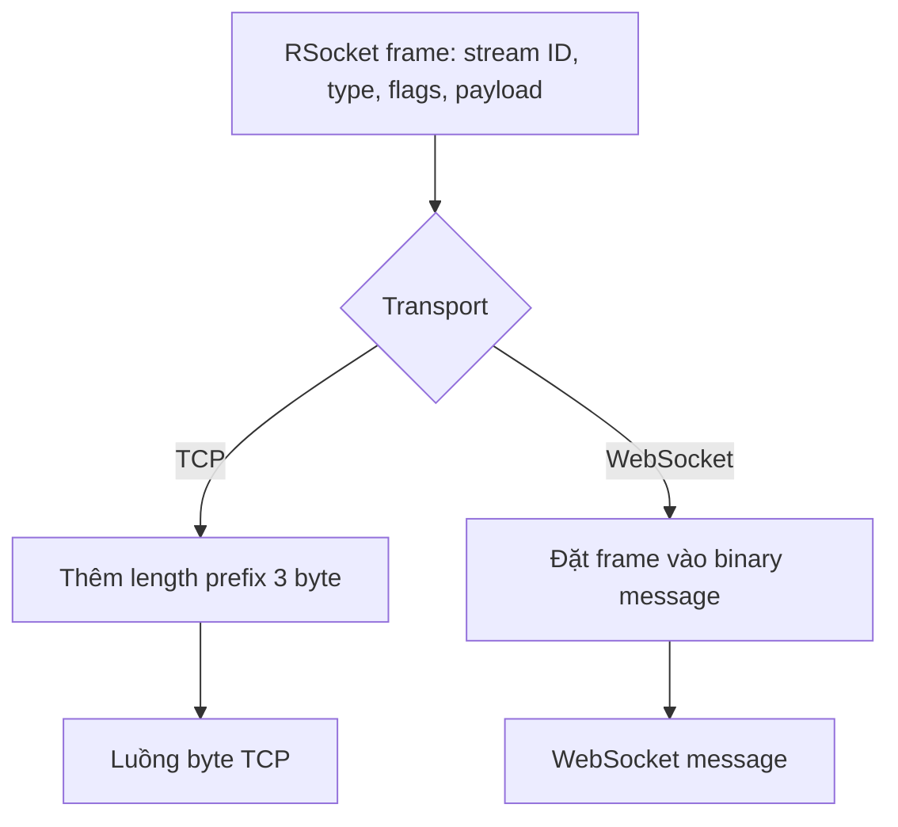

# Khác biệt đóng khung trên TCP và WebSocket

RSocket sử dụng cùng một định dạng frame ở tầng giao thức dù chạy trên TCP hay WebSocket. Điểm khác nhau nằm ở cách transport xác định ranh giới của từng frame khi truyền qua mạng. TCP cung cấp một luồng byte liên tục nên RSocket phải thêm trường độ dài để bên nhận biết frame kết thúc ở đâu. WebSocket đã cung cấp ranh giới message, vì vậy mỗi RSocket frame được mang trong payload của một WebSocket binary message.

Hiểu đúng cách đóng khung giúp đọc packet capture, xử lý dữ liệu đến từng phần, tránh lỗi khi nhiều frame được ghép trong một lần đọc và phân biệt frame của RSocket với frame của WebSocket hoặc segment của TCP.

## 1. Frame RSocket và ranh giới truyền tải

Một frame RSocket là đơn vị dữ liệu của giao thức. Tùy loại frame, nội dung có thể chứa:

- **Stream ID** để xác định tương tác mà frame thuộc về; một số frame điều khiển kết nối dùng stream ID bằng 0.
- **Frame type và flags** để cho biết đây là `SETUP`, `KEEPALIVE`, `REQUEST_RESPONSE`, `REQUEST_STREAM`, `PAYLOAD`, `ERROR` hay loại frame khác.
- **Metadata và data** nếu loại frame đó có payload.

Nội dung frame và ý nghĩa của các loại frame thuộc giao thức RSocket. Transport chỉ cần chuyển frame nguyên vẹn tới peer. Tuy nhiên, cách transport báo cho ứng dụng biết “đã nhận đủ một frame” lại khác nhau:

| Transport | Ranh giới của một RSocket frame được xác định bằng |
|---|---|
| TCP | Trường độ dài 3 byte đứng trước frame |
| WebSocket | Độ dài payload của một WebSocket binary message |



Các frame RSocket sau khi được lấy ra khỏi transport có cùng cấu trúc giao thức. Không cần thay đổi route, stream ID hay kiểu tương tác chỉ vì ứng dụng chuyển từ TCP sang WebSocket.

## 2. Đóng khung RSocket trên TCP

TCP là giao thức hướng luồng byte (*byte stream*). Nó bảo đảm thứ tự byte và truyền lại dữ liệu bị mất theo cơ chế của TCP, nhưng không giữ ranh giới thông điệp mà ứng dụng gửi. Một lần `write` ở phía gửi không tương ứng với một lần `read` ở phía nhận.

Vì vậy, RSocket trên TCP đặt một **length prefix 3 byte** trước mỗi frame. Trường này là số nguyên không dấu 24 bit theo thứ tự byte mạng (*big-endian*) và biểu thị độ dài của frame RSocket, **không tính chính 3 byte length prefix**. Về mặt biểu diễn, trường này có thể mô tả tối đa `2^24 - 1` byte; giới hạn thực tế của ứng dụng thường thấp hơn và cần được cấu hình rõ ràng.

```text
TCP byte stream

  3 byte length       RSocket frame
  +---------------+   +-----------------------------------+
  | 00 00 0A       |   | stream ID | type/flags | payload  |
  +---------------+   +-----------------------------------+
  <---------------- Một đơn vị được đóng khung ------------>

  3 byte length       RSocket frame tiếp theo
  +---------------+   +-----------------------------------+
  | 00 00 08       |   | stream ID | type/flags | payload  |
  +---------------+   +-----------------------------------+
```

Trong hình, `00 00 0A` minh họa frame tiếp theo dài 10 byte; `00 00 08` minh họa frame sau đó dài 8 byte. Các con số chỉ minh họa cách mã hóa độ dài, không đại diện cho một phiên giao thức hoàn chỉnh.

### Vì sao cần bộ tích lũy byte?

Khi nhận TCP, ứng dụng có thể gặp ba tình huống:

1. **Đọc thiếu:** buffer chỉ có một phần của length prefix hoặc mới có prefix và một phần frame. Parser phải giữ lại byte đã nhận và chờ lần đọc tiếp theo.
2. **Đọc vừa đủ:** buffer có đúng một frame hoàn chỉnh.
3. **Đọc nhiều frame:** buffer chứa nhiều frame nối tiếp nhau. Parser phải lặp lại việc đọc prefix và tách từng frame.

Ví dụ, phía gửi ghi hai frame liên tiếp. Phía nhận có thể đọc được 5 byte trong lần đầu, 20 byte ở lần tiếp theo và phần còn lại sau đó. Những ranh giới đọc này do hệ điều hành và lịch truyền dữ liệu quyết định, không phải ranh giới frame RSocket.

Thuật toán parser TCP ở mức khái niệm:

```text
onTcpBytesReceived(newBytes):
    append newBytes to pendingBuffer

    while pendingBuffer has at least 3 bytes:
        length = readUnsigned24BitBigEndian(pendingBuffer[0..2])

        validate length against protocol and configured limits

        if pendingBuffer has fewer than 3 + length bytes:
            stop and wait for more bytes

        frame = remove 3-byte prefix and the next length bytes
        deliver frame to RSocket decoder
```

Parser chỉ loại bỏ prefix sau khi đã có đủ toàn bộ frame. Nếu chưa đủ byte, nó phải giữ nguyên prefix và phần dữ liệu đã nhận để ghép với lần đọc tiếp theo. Nếu buffer chứa nhiều frame, vòng lặp tiếp tục cho đến khi phần còn lại không đủ một frame hoàn chỉnh.

### Ví dụ parser bằng Java

Đoạn mã sau minh họa phần tách frame từ một `ByteBuffer` tích lũy. Buffer được giả định đang ở chế độ ghi sau khi socket vừa đọc thêm dữ liệu. Trong ứng dụng thực tế, cần quản lý việc mở rộng buffer, giới hạn kích thước frame, kiểm tra frame tối thiểu và chuyển lỗi giao thức thành lỗi kết nối.

```java
static List<byte[]> extractFrames(ByteBuffer pending) {
    List<byte[]> frames = new ArrayList<>();
    pending.flip();

    while (pending.remaining() >= 3) {
        pending.mark();

        int length = ((pending.get() & 0xFF) << 16)
                   | ((pending.get() & 0xFF) << 8)
                   |  (pending.get() & 0xFF);

        if (length == 0) {
            throw new IllegalArgumentException("Invalid RSocket frame length");
        }

        if (pending.remaining() < length) {
            pending.reset();
            break;
        }

        byte[] frame = new byte[length];
        pending.get(frame);
        frames.add(frame);
    }

    pending.compact();
    return frames;
}
```

`mark()` và `reset()` giúp quay lại đầu prefix khi frame chưa đến đủ. `compact()` giữ lại phần byte chưa xử lý và đưa buffer về chế độ ghi để lần đọc tiếp theo nối thêm dữ liệu. Ví dụ này không phải một decoder RSocket hoàn chỉnh: parser sản xuất còn phải xác thực kích thước theo giới hạn cấu hình trước khi cấp phát bộ nhớ, xử lý buffer quá nhỏ, kiểm tra header và đóng kết nối khi nhận dữ liệu sai giao thức.

## 3. Đóng khung RSocket trên WebSocket

WebSocket chạy qua HTTP handshake, sau đó duy trì một kênh hai chiều. Khác với TCP thuần, WebSocket có cấu trúc message. RSocket tận dụng ranh giới đó: **mỗi RSocket frame được truyền trong payload của một WebSocket binary message**.

```text
WebSocket connection

  Binary message 1
  +-----------------------------------------------------+
  | Một RSocket frame: header và payload                 |
  +-----------------------------------------------------+

  Binary message 2
  +-----------------------------------------------------+
  | Một RSocket frame tiếp theo                          |
  +-----------------------------------------------------+
```

Ở transport WebSocket, không thêm length prefix TCP 3 byte vào đầu RSocket frame. WebSocket stack đã biết độ dài payload của message và chuyển message hoàn chỉnh cho tầng RSocket. Vì thế, decoder nhận payload binary message có thể chuyển trực tiếp phần byte đó tới bộ giải mã frame RSocket.

WebSocket có khái niệm **frame WebSocket** và **message WebSocket**. Một message có thể được truyền bằng một WebSocket frame hoặc chia thành nhiều WebSocket frame phân mảnh (*fragmentation*). Thư viện WebSocket sẽ ghép các fragment để cung cấp message hoàn chỉnh cho ứng dụng. Do đó, không nên giả định một lần đọc socket tương ứng với một message hoặc một WebSocket frame tương ứng với một RSocket frame.

RSocket qua WebSocket sử dụng binary message. WebSocket text message không phải cách đóng gói frame RSocket. Ứng dụng nên để thư viện WebSocket xử lý masking, fragmentation, độ dài payload và các chi tiết wire-level của WebSocket.

## 4. Phân biệt ba loại đơn vị thường bị gọi lẫn

Từ “frame” xuất hiện ở nhiều tầng, nhưng chúng không cùng ý nghĩa:

| Đơn vị | Thuộc tầng | Vai trò |
|---|---|---|
| TCP segment | TCP/IP | Chia dữ liệu thành đơn vị truyền qua mạng; ranh giới segment không phải ranh giới thông điệp ứng dụng |
| WebSocket frame | WebSocket | Mang dữ liệu hoặc tín hiệu điều khiển của WebSocket; nhiều frame dữ liệu có thể ghép thành một message |
| RSocket frame | RSocket | Mang một sự kiện giao thức như `SETUP`, `REQUEST_STREAM`, `PAYLOAD` hoặc `ERROR` |

Các mối quan hệ cần nhớ:

- Một RSocket frame trên TCP có thể bị chia qua nhiều TCP segment hoặc nhiều lần `read`.
- Một lần `read` TCP có thể chứa nhiều RSocket frame liên tiếp.
- Một RSocket frame trên WebSocket nằm trong một binary message; message đó có thể được phân mảnh thành nhiều WebSocket frame ở tầng dưới.
- TCP segment và WebSocket frame không mang ý nghĩa stream hay request của RSocket.

Ví dụ, nếu packet capture cho thấy một TCP segment chứa một phần length prefix và vài byte payload, đó không phải frame RSocket bị lỗi. Parser phải đợi đủ byte theo độ dài đã khai báo. Tương tự, nếu một WebSocket message được tạo từ nhiều fragment, thư viện WebSocket sẽ tái lắp message trước khi giao payload cho RSocket.

## 5. So sánh hai cách đóng khung

| Khía cạnh | RSocket trên TCP | RSocket trên WebSocket |
|---|---|---|
| Cơ sở truyền dữ liệu | Luồng byte TCP | Message hai chiều của WebSocket |
| Ranh giới RSocket frame | Prefix độ dài 3 byte | Ranh giới binary message |
| Cách biểu diễn độ dài | Số nguyên không dấu 24 bit, big-endian; không tính prefix | Độ dài payload do WebSocket cung cấp |
| Prefix riêng của RSocket transport | Có | Không dùng prefix TCP 3 byte |
| Ghép nhiều frame | Các đơn vị prefix/frame nối tiếp trong byte stream | Nhiều binary message liên tiếp |
| Tách dữ liệu | Parser phải tích lũy và đọc theo prefix | Thư viện WebSocket ghép fragment và giao message |
| Kiểm soát WebSocket | Không có | Có Ping/Pong/Close và handshake HTTP |
| Cấu trúc frame RSocket | Giống nhau | Giống nhau |

Điểm khác biệt quan trọng nhất là nơi lấy thông tin độ dài. Trên TCP, RSocket đọc độ dài từ 3 byte do transport framing quy định. Trên WebSocket, độ dài đến từ ranh giới message mà WebSocket stack đã xử lý.

## 6. Các loại keepalive không giống nhau

Khi phân tích lưu lượng realtime, cần phân biệt ba cơ chế có thể cùng xuất hiện:

| Cơ chế | Tầng | Ý nghĩa |
|---|---|---|
| TCP keepalive | TCP và hệ điều hành | Thăm dò kết nối TCP nhàn rỗi để phát hiện peer không còn phản hồi; hành vi phụ thuộc cấu hình hệ điều hành |
| WebSocket Ping/Pong | WebSocket | Frame điều khiển để kiểm tra peer và duy trì hoạt động của kết nối WebSocket |
| RSocket `KEEPALIVE` | RSocket | Frame giao thức phục vụ keepalive của kết nối RSocket; có thể mang cờ yêu cầu peer phản hồi |

WebSocket Ping/Pong không phải RSocket `KEEPALIVE`, và TCP keepalive cũng không thay thế frame `KEEPALIVE` của RSocket. Mỗi cơ chế hoạt động ở một tầng khác nhau. Khi triển khai qua proxy, timeout nhàn rỗi phải tương thích với nhịp keepalive mà ứng dụng thực sự sử dụng.

## 7. Cấu hình client: cùng tương tác, transport khác nhau

Trong Spring, `RSocketRequester` cung cấp API cấp ứng dụng để gửi yêu cầu. Ứng dụng có thể dùng TCP hoặc WebSocket khi tạo kết nối:

```java
Mono<RSocketRequester> tcpRequester = RSocketRequester.builder()
    .connectTcp("localhost", 7000);

Mono<RSocketRequester> websocketRequester = RSocketRequester.builder()
    .connectWebSocket(URI.create("ws://localhost:8080/rsocket"));
```

Sau khi có requester, cách gửi một yêu cầu theo route vẫn giữ nguyên:

```java
Mono<OrderView> order = requester
    .route("orders.find")
    .data(new FindOrderRequest("ORD-1001"))
    .retrieveMono(OrderView.class);
```

Việc đổi transport làm thay đổi cách thiết lập kết nối và cách đóng khung ở tầng truyền tải. Nó không làm thay đổi route `orders.find`, kiểu tương tác `request-response` hay cấu trúc payload của nghiệp vụ. API cụ thể có thể khác đôi chút theo phiên bản Spring Framework và RSocket connector được sử dụng.

## 8. Đọc packet capture và xử lý lỗi đóng khung

Khi kiểm tra lưu lượng, hãy xác định transport trước rồi mới diễn giải byte:

### Với TCP

1. Xác nhận kết nối TCP đã được thiết lập tới đúng host và port.
2. Theo dõi byte stream theo thứ tự và đọc 3 byte prefix để biết độ dài frame tiếp theo.
3. Chỉ tách frame khi đã nhận đủ số byte được khai báo.
4. Tiếp tục xử lý phần byte còn lại vì một buffer có thể chứa nhiều frame.
5. Kiểm tra prefix bất thường, độ dài vượt giới hạn hoặc frame có header không hợp lệ; không cấp phát bộ nhớ tùy ý theo một giá trị chưa được xác thực.

### Với WebSocket

1. Xác nhận HTTP handshake đã được nâng cấp thành công sang WebSocket.
2. Kiểm tra dữ liệu ứng dụng là binary message.
3. Đọc toàn bộ payload của message như một RSocket frame; không bỏ thêm 3 byte đầu theo quy tắc TCP.
4. Để thư viện WebSocket xử lý fragmentation, masking và control frame.
5. Nếu dùng `wss`, lưu ý packet capture ở đoạn mạng mã hóa không hiển thị trực tiếp payload WebSocket nếu chưa giải mã TLS.

| Dấu hiệu | Khả năng nguyên nhân | Hướng xử lý |
|---|---|---|
| TCP parser thường xuyên chờ thêm byte | Dữ liệu đến theo nhiều lần đọc; hoặc prefix khai báo độ dài không hợp lệ | Giữ buffer và chờ dữ liệu; kiểm tra prefix, giới hạn frame và đồng bộ stream |
| TCP parser tạo frame quá ngắn hoặc quá dài | Đọc sai thứ tự byte, tính cả prefix vào length hoặc mất đồng bộ buffer | Xác nhận big-endian 24 bit và length không tính 3 byte prefix |
| Một lần đọc TCP bị coi là một frame | Giả định sai về ranh giới `read` | Dùng parser tích lũy theo length prefix |
| WebSocket decoder bỏ 3 byte đầu | Áp dụng nhầm quy tắc đóng khung TCP | Dùng nguyên payload binary message làm RSocket frame |
| WebSocket nhận text message | Client hoặc proxy gửi sai loại message | Bảo đảm transport gửi binary message |
| Handshake WebSocket thành công nhưng RSocket báo lỗi frame | Payload sai định dạng hoặc hai bên không thống nhất giao thức | Kiểm tra binary message, RSocket header, SETUP và phiên bản giao thức |

## 9. Quy trình kiểm thử tối thiểu

Một bài kiểm thử đóng khung nên kiểm tra cả dữ liệu bị chia nhỏ và dữ liệu được ghép chung, thay vì chỉ gửi một frame trong một lần ghi.

- **TCP, prefix bị chia:** gửi một phần của 3 byte length prefix, sau đó gửi phần còn lại cùng payload; parser chỉ phát frame sau khi nhận đủ.
- **TCP, frame bị chia:** gửi prefix và một phần frame, rồi gửi phần payload còn lại; parser không được phát frame sớm.
- **TCP, nhiều frame liên tiếp:** gửi hai hoặc nhiều prefix/frame trong cùng một lần ghi; parser phải tách đúng số frame và đúng thứ tự.
- **WebSocket, binary message:** gửi một binary message chứa một RSocket frame; decoder nhận đúng payload frame.
- **WebSocket, fragmentation:** nếu thư viện cho phép tạo message phân mảnh, xác minh ứng dụng chỉ nhận message sau khi thư viện ghép đủ các fragment.
- **Dữ liệu không hợp lệ:** thử độ dài bằng 0, độ dài vượt giới hạn cấu hình, header thiếu hoặc WebSocket text message; hệ thống phải xử lý lỗi có kiểm soát.

Không nên kiểm thử parser TCP bằng cách giả định mỗi lần `write` tương ứng với một lần `read`, vì cách giả định đó có thể vô tình che giấu lỗi tích lũy buffer. Cũng không nên kiểm thử WebSocket bằng cách tự thêm TCP length prefix vào payload, vì WebSocket message đã cung cấp ranh giới cho frame RSocket.

## 10. Kết luận kỹ thuật

RSocket giữ nguyên định dạng frame và ngữ nghĩa giao thức trên TCP lẫn WebSocket. Khác biệt đóng khung nằm ở transport: TCP là byte stream nên cần prefix độ dài 3 byte big-endian trước mỗi frame; WebSocket dùng ranh giới binary message và không thêm prefix TCP đó. TCP parser phải tích lũy byte và tách frame theo độ dài, còn WebSocket stack chịu trách nhiệm tái lắp message trước khi giao payload cho RSocket.

Khi đọc log hoặc packet capture, luôn phân biệt TCP segment, WebSocket frame/message và RSocket frame. Việc tách đúng các tầng này giúp tránh lỗi parse, xử lý fragmentation và keepalive chính xác, đồng thời cho phép ứng dụng chuyển transport mà không phải thay đổi logic tương tác RSocket.
