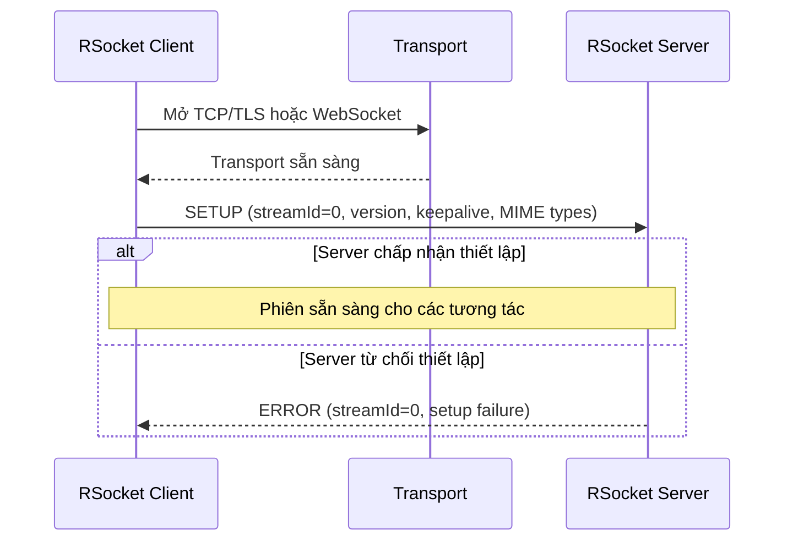
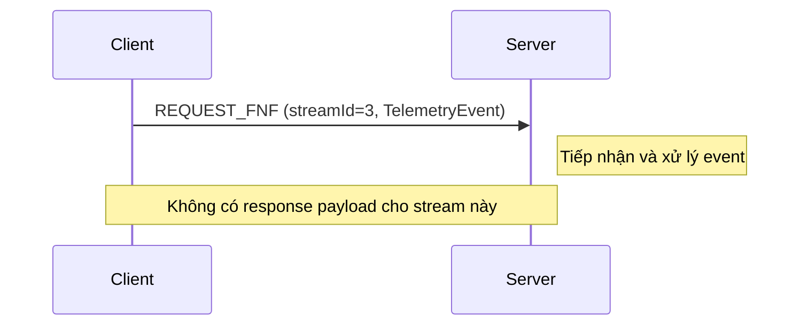
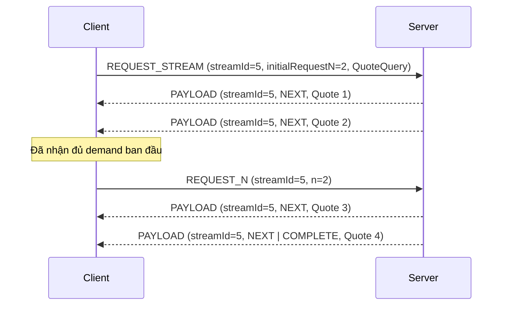
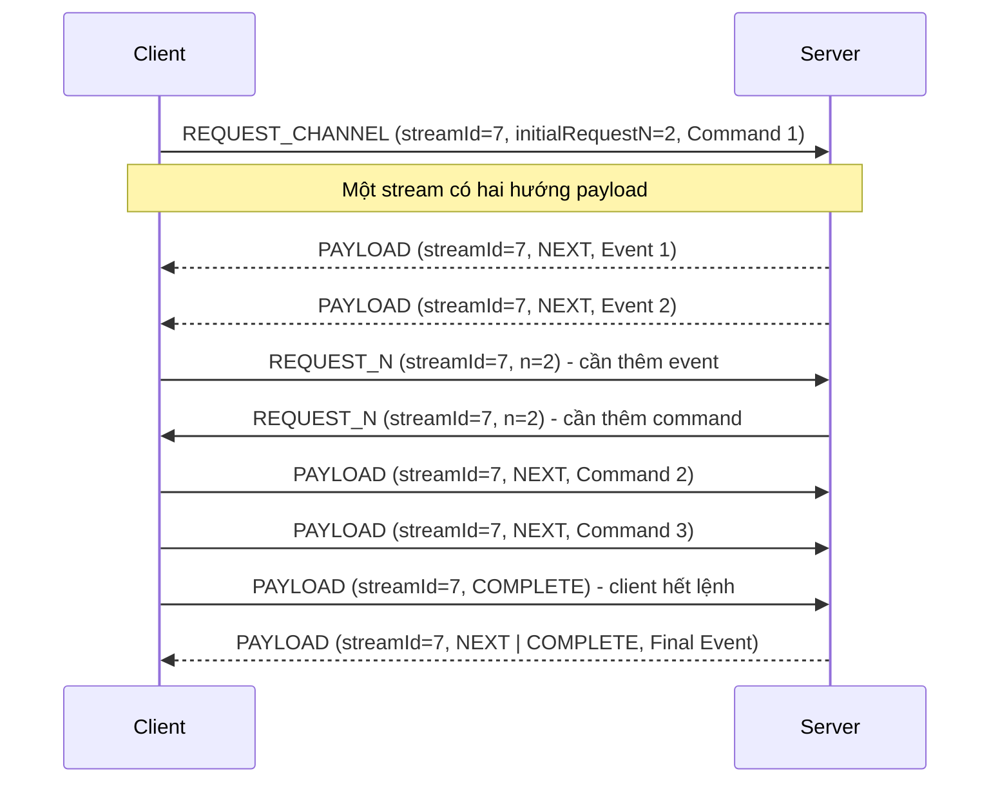
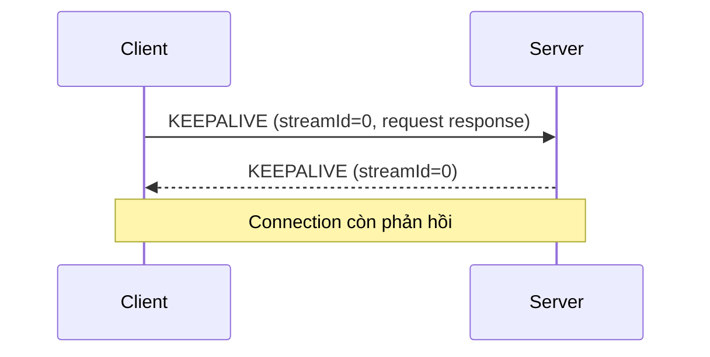

# Đọc sơ đồ trình tự frame để hiểu một lần trao đổi RSocket

Khi xem log hoặc sơ đồ giao tiếp RSocket, ta thường gặp các tên như `SETUP`, `REQUEST_RESPONSE`, `REQUEST_STREAM`, `PAYLOAD`, `REQUEST_N`, `CANCEL` và `ERROR`. Đây là tên các frame hoặc tín hiệu ở tầng protocol. Nếu chỉ nhìn tên mà không biết ai gửi, frame thuộc stream nào và nó làm thay đổi trạng thái gì, rất dễ nhầm một lần trao đổi đơn giản với một phiên streaming kéo dài.

Bài này hướng dẫn cách đọc sơ đồ trình tự frame từ lúc transport được mở, phiên RSocket được thiết lập, đến khi client gửi request, server trả payload, hai bên điều tiết demand và kết thúc stream. Các ví dụ tập trung vào bốn kiểu tương tác RSocket: request-response, fire-and-forget, request-stream và request-channel. Mục tiêu là đọc được luồng trao đổi và lần theo nguyên nhân khi một stream hoàn tất, bị hủy hoặc gặp lỗi.

## 1. Sơ đồ trình tự đang mô tả điều gì?

Sequence diagram đặt các thành phần tham gia theo chiều ngang và thời gian theo chiều dọc. Mỗi mũi tên biểu diễn một hành động hoặc một thông điệp từ bên gửi đến bên nhận. Khi sơ đồ mô tả RSocket ở mức protocol, nhãn trên mũi tên nên cho biết ít nhất:

- **Frame type:** frame nào được gửi, ví dụ `REQUEST_STREAM` hay `PAYLOAD`.
- **Stream ID:** frame thuộc tương tác nào; các frame của cùng một stream dùng cùng ID.
- **Payload/metadata:** dữ liệu nghiệp vụ hoặc metadata được gửi kèm, nếu có.
- **Flags và demand:** payload có phải phần tử tiếp theo hay đã hoàn tất chiều phát; bên nhận đã yêu cầu bao nhiêu phần tử.
- **Kết quả:** stream tiếp tục, hoàn tất, bị hủy hay kết thúc bằng lỗi.

Một sơ đồ ở mức ứng dụng có thể chỉ ghi “client gọi API” và “server trả dữ liệu”. Sơ đồ frame cần chi tiết hơn: lời gọi đó được mở bằng frame nào, response là `PAYLOAD` hay `ERROR`, và stream kết thúc bằng tín hiệu nào. Không phải mọi sơ đồ đều cần vẽ từng byte hoặc từng frame điều khiển; hãy chọn mức chi tiết đủ để trả lời câu hỏi đang điều tra.

### 1.1. Phân biệt transport, phiên và stream

| Lớp | Vai trò | Ví dụ |
|---|---|---|
| Transport | Tạo đường truyền giữa hai đầu và chuyển byte/frame. | TCP/TLS hoặc WebSocket/WSS. |
| RSocket connection/session | Trao đổi setup và các frame điều khiển ở cấp kết nối. | `SETUP`, `KEEPALIVE`, `METADATA_PUSH`. |
| RSocket stream | Đại diện cho một tương tác độc lập trên kết nối. | Request-response lấy trạng thái hoặc request-stream theo dõi giá. |
| Payload nghiệp vụ | Nội dung mà ứng dụng hiểu và xử lý. | `StockQuery`, `PriceUpdate`, `DeviceCommand`. |

Một kết nối RSocket có thể mang nhiều stream đồng thời. Vì vậy, `CANCEL` của một stream không đồng nghĩa đóng transport; một response hoàn tất cũng không có nghĩa toàn bộ session đã kết thúc. Khi đọc sơ đồ, hãy luôn xác định mũi tên đang tác động đến transport, connection hay một stream cụ thể.

## 2. Kết nối và thiết lập phiên RSocket

RSocket chạy trên một transport được hỗ trợ. Với TCP, client mở kết nối TCP và có thể thiết lập TLS trước khi trao đổi frame RSocket. Với WebSocket, hai phía hoàn tất HTTP Upgrade để có kênh WebSocket; khi đó frame RSocket được truyền qua transport WebSocket. Handshake TCP/TLS hoặc HTTP Upgrade thuộc tầng transport, chưa phải là `REQUEST_RESPONSE` hay một tương tác nghiệp vụ.

Sau khi transport sẵn sàng, bên khởi tạo gửi frame `SETUP` để bắt đầu phiên RSocket. `SETUP` dùng stream ID bằng `0` và mang các thông tin ban đầu như phiên bản protocol, keepalive interval, lifetime, MIME type của data và metadata, cùng setup payload nếu có. Nếu server không chấp nhận thiết lập, nó có thể trả `ERROR` ở cấp connection với stream ID `0`; khi đó chưa có stream nghiệp vụ nào được mở.



Trong luồng thông thường, server không cần gửi một frame “SETUP ACK” riêng để xác nhận setup. Client bắt đầu mở stream sau khi phiên được thiết lập thành công theo transport/implementation. Nếu tính năng lease được bật, server có thể gửi `LEASE` để giới hạn số request mà client được phép khởi tạo trong một khoảng thời gian; đây là cơ chế tùy chọn, không phải bước bắt buộc của mọi phiên.

### 2.1. Stream ID giúp ghép frame với tương tác

Mỗi tương tác RSocket có stream ID. Các frame mở đầu do client khởi tạo thường dùng ID lẻ; các tương tác do server khởi tạo dùng ID chẵn. Stream ID `0` được dành cho frame ở cấp connection, chẳng hạn `SETUP`, `KEEPALIVE` hoặc `METADATA_PUSH`.

Ví dụ, client có thể mở request-response với stream ID `1`, request-stream với ID `3` và request-channel với ID `5`. Đây chỉ là ví dụ minh họa; ứng dụng không tự chọn ID tùy ý mà implementation RSocket quản lý việc cấp ID. Response và frame điều khiển của một tương tác tiếp tục mang đúng ID của stream đó.

Khi đọc log, hãy nhóm các frame theo stream ID trước khi suy luận thứ tự nghiệp vụ. Hai frame liên tiếp trên kết nối có thể thuộc hai stream khác nhau. Nếu bỏ qua ID, ta có thể tưởng một payload là response của request khác hoặc cho rằng một stream đã hoàn tất khi thực tế chỉ stream bên cạnh kết thúc.

## 3. Đọc một lần request-response

Request-response là ví dụ đơn giản nhất để bắt đầu đọc frame. Client gửi một request và server trả về tối đa một response. Ở tầng protocol, client mở tương tác bằng `REQUEST_RESPONSE`; server trả một `PAYLOAD` có cờ `NEXT` và `COMPLETE`, hoặc trả `ERROR` nếu xử lý thất bại.

```mermaid
sequenceDiagram
    participant C as Client
    participant S as Server
    C->>S: REQUEST_RESPONSE (streamId=1, StockQuery)
    Note right of S: Xử lý một request
    S-->>C: PAYLOAD (streamId=1, NEXT | COMPLETE, Stock)
    Note over C,S: Stream 1 kết thúc; connection vẫn mở
```

Đọc sơ đồ theo từng bước:

1. `REQUEST_RESPONSE` mở stream `1` và mang payload request ban đầu.
2. Server giải mã payload, định tuyến đến handler và thực hiện nghiệp vụ.
3. Server gửi `PAYLOAD` với `NEXT` để chuyển response; cờ `COMPLETE` cho biết phía server đã hoàn tất chiều phát trên stream.
4. Client nhận response; stream `1` kết thúc, nhưng các stream khác trên cùng connection vẫn có thể hoạt động.

Nếu server không thể xử lý, thay cho response payload nó có thể gửi `ERROR` trên stream `1`. Đây là lỗi của tương tác đó; nó không nhất thiết đóng connection. Nếu transport bị đóng, tất cả stream đang dùng transport mới bị ảnh hưởng.

Trong Spring Boot, handler thường được viết ở mức message thay vì tự tạo frame:

```java
@Controller
class StockController {

    private final StockService stockService;

    StockController(StockService stockService) {
        this.stockService = stockService;
    }

    @MessageMapping("stock.check")
    Mono<Stock> check(StockQuery query) {
        return stockService.find(query.symbol());
    }
}
```

Client dùng `RSocketRequester`:

```java
Mono<Stock> stock = requester
    .route("stock.check")
    .data(new StockQuery("ACME"))
    .retrieveMono(Stock.class);
```

`@MessageMapping` và `retrieveMono` là API ở tầng ứng dụng. Runtime Spring/RSocket chuyển lời gọi đó thành frame `REQUEST_RESPONSE` và `PAYLOAD` tương ứng. Khi debug, có thể đối chiếu log ở tầng ứng dụng với sơ đồ frame để xác định request đã được mở, handler có phản hồi và stream kết thúc như dự kiến hay chưa.

## 4. Đọc fire-and-forget

Fire-and-forget dùng khi bên gửi cần chuyển một payload nhưng không cần response nghiệp vụ. Client mở tương tác bằng `REQUEST_FNF`; server tiếp nhận và xử lý theo chính sách của ứng dụng. Protocol không yêu cầu server gửi response payload cho request đó.



Không có response không đồng nghĩa server đã lưu dữ liệu bền vững hoặc nghiệp vụ chắc chắn thành công. Client không nhận được xác nhận xử lý từ server qua tương tác fire-and-forget. Nếu cần biết kết quả, hãy dùng request-response, request-channel hoặc một cơ chế acknowledgement riêng. Nếu cần gửi sự kiện có thể retry, hãy thiết kế event ID/idempotency để tránh xử lý trùng.

Fire-and-forget cũng không phải cách “bỏ qua backpressure để gửi vô hạn”. Ứng dụng vẫn cần giới hạn tốc độ, bộ đệm và số request đang chờ theo khả năng của hệ thống. Việc không có response chỉ nói về kiểu tương tác, không xóa bỏ giới hạn tài nguyên ở client, server hoặc transport.

## 5. Đọc request-stream và demand

Request-stream được dùng khi client gửi một request ban đầu và muốn nhận nhiều payload từ server. Frame mở đầu là `REQUEST_STREAM`; frame này mang request payload và giá trị `initialRequestN`, tức số payload ban đầu mà client sẵn sàng nhận. Khi cần thêm dữ liệu, client gửi `REQUEST_N` trên cùng stream.



Trong ví dụ, client mở stream `5` và yêu cầu ban đầu hai phần tử. Server gửi hai payload. Khi client yêu cầu thêm hai phần tử bằng `REQUEST_N`, server có thể tiếp tục phát dữ liệu. Cuối cùng server gửi payload cuối cùng với cả `NEXT` và `COMPLETE`, nghĩa là payload đó là một phần tử dữ liệu và cũng kết thúc chiều phát của server.

`REQUEST_N` thể hiện demand từ bên nhận đến bên phát. Nó không phải lệnh “server gửi đúng N frame ngay lập tức”; đó là số phần tử bổ sung mà bên phát được phép phát theo flow control. Server có thể phát ít hơn nếu nguồn dữ liệu chưa có phần tử mới. Nếu client không yêu cầu thêm, server phải tôn trọng demand và không tiếp tục phát payload tùy ý trên stream đó.

Client có thể hủy stream bằng `CANCEL` nếu người dùng không còn cần dữ liệu. Khi đó server cần hủy subscription hoặc công việc liên quan để giải phóng tài nguyên. Nếu server kết thúc bằng lỗi, nó gửi `ERROR` trên stream ID tương ứng.

Trong Spring, handler trả về `Flux<T>` thường biểu diễn response stream:

```java
@MessageMapping("quotes.{symbol}")
Flux<Quote> watch(@DestinationVariable String symbol) {
    return quoteService.watch(symbol);
}
```

Client nhận stream:

```java
Flux<Quote> quotes = requester
    .route("quotes.{symbol}", "ACME")
    .retrieveFlux(Quote.class);
```

Khi downstream tiêu thụ `Flux`, demand của Reactive Streams được runtime ánh xạ sang flow control RSocket. Vì vậy, người viết handler thường không cần tự gửi `REQUEST_N`; cần hiểu frame để quan sát hành vi và thiết kế nguồn dữ liệu tôn trọng demand.

## 6. Đọc request-channel: hai hướng dữ liệu trên cùng stream

Request-channel dùng khi client vừa gửi một stream payload đến server, vừa nhận một stream payload từ server trong cùng tương tác. Frame mở đầu là `REQUEST_CHANNEL`; ngoài payload ban đầu, nó mang `initialRequestN` để client cho server biết nhu cầu ban đầu đối với response stream.

Sau đó, client có thể gửi thêm `PAYLOAD` cho các lệnh tiếp theo. Server có thể gửi `REQUEST_N` để yêu cầu thêm phần tử từ luồng lệnh của client. Ở hướng ngược lại, client có thể gửi `REQUEST_N` để yêu cầu thêm sự kiện từ server. Hai chiều có demand riêng vì mỗi phía vừa là producer của luồng này vừa là consumer của luồng kia.



Cách đọc sơ đồ:

1. Client mở stream `7` bằng `REQUEST_CHANNEL`, gửi lệnh đầu tiên và thông báo demand ban đầu cho response stream.
2. Server gửi các event theo demand ban đầu.
3. Client gửi `REQUEST_N` để yêu cầu thêm event từ server.
4. Server gửi `REQUEST_N` theo chiều ngược lại để yêu cầu thêm command từ client.
5. Client tiếp tục gửi command bằng `PAYLOAD`.
6. Client gửi `PAYLOAD` có cờ `COMPLETE` để báo đã hoàn tất chiều phát command. Server vẫn có thể gửi các event còn lại.
7. Server gửi event cuối cùng với `NEXT | COMPLETE` để kết thúc chiều response.

Sơ đồ cho thấy vì sao `REQUEST_CHANNEL` không chỉ là một request-response kéo dài. Cả hai phía có thể phát nhiều payload và điều tiết demand theo hướng mình đang nhận. Việc một phía hoàn tất chiều phát không tự động đóng chiều còn lại; `CANCEL` mới là tín hiệu hủy stream khi bên khởi tạo không còn muốn tiếp tục nhận tương tác.

Trong Spring Messaging, một phương thức nhận `Flux<Command>` và trả về `Flux<Event>` thường được ánh xạ thành request-channel:

```java
@MessageMapping("device.control")
Flux<DeviceEvent> control(Flux<DeviceCommand> commands) {
    return commands.concatMap(deviceService::execute);
}
```

Client gửi publisher và nhận response stream qua cùng route:

```java
Flux<DeviceEvent> events = requester
    .route("device.control")
    .data(commandPublisher)
    .retrieveFlux(DeviceEvent.class);
```

Đây là API cấp ứng dụng. Runtime chịu trách nhiệm tạo `REQUEST_CHANNEL`, các `PAYLOAD`, `REQUEST_N` và tín hiệu kết thúc tương ứng. Khi đọc log, cần kiểm tra cùng stream ID và cả hai hướng thay vì chỉ nhìn một chiều message.

## 7. Đọc các frame và flag thường gặp

Tên frame cho biết loại hành động protocol. Một số thông tin như `NEXT` và `COMPLETE` là flag trên frame `PAYLOAD`, không phải các frame type độc lập.

| Frame hoặc flag | Ý nghĩa khi đọc sơ đồ | Phạm vi |
|---|---|---|
| `SETUP` | Bắt đầu phiên RSocket, trao đổi tham số ban đầu. | Connection, stream ID `0`. |
| `REQUEST_RESPONSE` | Mở tương tác một request, tối đa một response. | Một stream. |
| `REQUEST_FNF` | Gửi một payload không chờ response nghiệp vụ. | Một stream. |
| `REQUEST_STREAM` | Mở stream response từ server và gửi demand ban đầu. | Một stream. |
| `REQUEST_CHANNEL` | Mở tương tác có stream payload ở cả hai hướng và demand ban đầu cho response. | Một stream. |
| `PAYLOAD` | Mang data, metadata hoặc cả hai; có thể mang các flag. | Một stream. |
| `REQUEST_N` | Consumer yêu cầu producer gửi thêm một số lượng payload. | Một stream. |
| `CANCEL` | Hủy tương tác/stream đang hoạt động. | Một stream. |
| `ERROR` | Báo lỗi; stream ID `0` dùng cho lỗi cấp connection/setup, ID khác dùng cho stream tương ứng. | Connection hoặc stream. |
| `KEEPALIVE` | Duy trì connection và hỗ trợ phát hiện peer không còn phản hồi. | Connection, stream ID `0`. |
| `METADATA_PUSH` | Đẩy metadata ở cấp connection, không mở stream nghiệp vụ. | Connection, stream ID `0`. |
| `LEASE` | Cấp quyền khởi tạo một số request trong thời hạn nhất định nếu lease được bật. | Connection, stream ID `0`. |

### 7.1. Các flag của PAYLOAD

`PAYLOAD` là frame mang nội dung. Các flag quan trọng gồm:

- **`NEXT`:** frame mang một payload tiếp theo trong stream. Payload có thể chứa data, metadata hoặc cả hai.
- **`COMPLETE`:** bên gửi đã hoàn tất chiều phát dữ liệu của mình trên stream.
- **`FOLLOWS`:** payload hiện tại là một phần của payload được phân mảnh; các fragment tiếp theo còn phải được ghép trước khi xử lý như một payload hoàn chỉnh.

`NEXT` và `COMPLETE` có thể xuất hiện cùng nhau. Ví dụ `PAYLOAD(NEXT | COMPLETE)` vừa mang phần tử cuối cùng vừa báo hoàn tất chiều phát. `PAYLOAD(COMPLETE)` không có `NEXT` có thể báo hoàn tất mà không kèm phần tử dữ liệu mới. Vì vậy, đừng đọc `COMPLETE` như một frame riêng hoặc luôn hiểu nó là “đóng toàn bộ connection”.

### 7.2. Data và metadata trong payload

Payload RSocket có thể chứa data và metadata. Data thường là nội dung nghiệp vụ đã serialize, chẳng hạn JSON hoặc một định dạng nhị phân. Metadata có thể chứa route, MIME type hoặc thông tin phụ trợ như tracing và xác thực theo convention của ứng dụng. Cờ metadata cho biết frame có phần metadata; nội dung và cách diễn giải phụ thuộc MIME type cùng thỏa thuận giữa hai phía.

Khi xem log, một frame `PAYLOAD` có thể không hiện nội dung data rõ ràng nếu payload là binary hoặc logger đã ẩn dữ liệu. Khi đó, hãy dùng stream ID, route, loại frame, flags, thời điểm và kích thước payload để suy luận luồng điều khiển. Không nên ghi token hoặc dữ liệu nhạy cảm vào log chỉ để làm sơ đồ dễ đọc hơn.

## 8. Keepalive và các frame ở cấp connection

Không phải mọi frame đều thuộc một stream nghiệp vụ. `KEEPALIVE` và `METADATA_PUSH` dùng stream ID `0`, vì chúng tác động ở cấp connection.

Với keepalive, một phía gửi `KEEPALIVE` theo chu kỳ đã cấu hình. Frame có thể yêu cầu peer phản hồi; peer trả keepalive khi cờ yêu cầu phản hồi được đặt. Nếu không nhận được hoạt động mong đợi trong khoảng thời gian cho phép, implementation có thể xem connection là không còn hoạt động và đóng nó. Keepalive giúp phát hiện kết nối hỏng hoặc peer không phản hồi; nó không xác nhận một lệnh nghiệp vụ đã được xử lý.



`METADATA_PUSH` cho phép gửi metadata ở cấp connection mà không tạo một stream request-response. Nó có thể dùng cho thông tin phiên hoặc metadata mà ứng dụng đã thống nhất, nhưng không nên dùng thay cho payload nghiệp vụ cần acknowledgement hoặc vòng đời stream riêng.

Nếu lease được bật, server có thể gửi `LEASE` để thông báo số request client được phép khởi tạo và thời hạn lease. Khi đọc sơ đồ có `LEASE`, hãy hiểu đây là giới hạn ở cấp connection đối với việc mở request mới; nó không phải demand `REQUEST_N` của một response stream đang chạy.

## 9. Đọc lỗi và kết thúc một tương tác

Khi một stream không đi đến kết quả mong đợi, hãy tìm frame cuối cùng của chính stream đó. Ba trường hợp thường gặp là:

| Dấu hiệu trong sơ đồ/log | Diễn giải | Hướng điều tra |
|---|---|---|
| `PAYLOAD` có `COMPLETE` | Một phía đã hoàn tất chiều phát dữ liệu. | Kiểm tra chiều còn lại có còn hoạt động hay không. |
| `CANCEL` | Stream bị hủy bởi bên khởi tạo tương tác. | Kiểm tra người dùng rời màn hình, timeout hoặc subscription bị dispose. |
| `ERROR` | Stream hoặc connection kết thúc do lỗi protocol/ứng dụng. | Đọc error code/message, stream ID và log handler tương ứng. |

Trong request-channel, một phía có thể hoàn tất chiều phát của mình bằng `PAYLOAD(COMPLETE)` trong khi phía kia vẫn gửi response. Nếu client không còn muốn nhận dữ liệu, client hủy stream bằng `CANCEL`. Trong request-stream, client thường là bên hủy khi không cần nhận tiếp; server có thể kết thúc tự nhiên bằng `PAYLOAD(COMPLETE)` hoặc báo lỗi bằng `ERROR`.

Phân biệt lỗi stream với lỗi connection rất quan trọng. `ERROR` trên stream ID khác `0` gắn với một tương tác cụ thể. `ERROR` trên stream ID `0` là lỗi cấp connection, chẳng hạn setup thất bại. Transport bị đóng có thể làm mọi stream trên connection mất khả năng trao đổi, ngay cả khi không thấy `ERROR` riêng cho từng stream.

Retry cũng cần xét ngữ nghĩa nghiệp vụ. Request đọc dữ liệu thường dễ retry hơn một lệnh tạo giao dịch hoặc thay đổi trạng thái thiết bị. Với thao tác có tác động, hãy dùng command ID/idempotency key và lưu trạng thái xử lý; việc stream bị ngắt không chứng minh server chưa thực hiện lệnh.

## 10. Từ sơ đồ frame đến code Spring Boot

Spring Messaging cho phép viết handler theo kiểu dữ liệu và Reactor mà không cần tự dựng frame. Kiểu trả về và tham số đầu vào gợi ý loại tương tác mà runtime ánh xạ:

| Handler | Tương tác thường được ánh xạ |
|---|---|
| `Mono<Response> method(Request request)` | Request-response. |
| `Mono<Void> method(Request request)` | Fire-and-forget. |
| `Flux<Response> method(Request request)` | Request-stream. |
| `Flux<Response> method(Flux<Request> requests)` | Request-channel. |

Ví dụ một controller có thể cung cấp cả request-response và request-stream:

```java
@Controller
class MarketController {

    private final MarketService marketService;

    MarketController(MarketService marketService) {
        this.marketService = marketService;
    }

    @MessageMapping("market.snapshot")
    Mono<Quote> snapshot(QuoteQuery query) {
        return marketService.snapshot(query.symbol());
    }

    @MessageMapping("market.watch.{symbol}")
    Flux<Quote> watch(@DestinationVariable String symbol) {
        return marketService.watch(symbol);
    }
}
```

Client gọi hai route:

```java
Mono<Quote> snapshot = requester
    .route("market.snapshot")
    .data(new QuoteQuery("ACME"))
    .retrieveMono(Quote.class);

Flux<Quote> updates = requester
    .route("market.watch.{symbol}", "ACME")
    .retrieveFlux(Quote.class);
```

Ở log frame, lời gọi `snapshot` tương ứng một `REQUEST_RESPONSE` và một response `PAYLOAD(NEXT | COMPLETE)`. Lời gọi `watch` tương ứng `REQUEST_STREAM`, các response `PAYLOAD(NEXT)` và một tín hiệu hoàn tất khi nguồn kết thúc hoặc bị hủy. Tên route là thông tin định tuyến ở tầng ứng dụng; nó thường nằm trong metadata chứ không phải stream ID.

Để debug, có thể đối chiếu ba góc nhìn: log ứng dụng cho biết route và payload type; log Reactor cho biết subscription, demand và cancellation; log protocol cho biết frame type, stream ID, flags và thời điểm. Ba góc nhìn này giúp xác định vấn đề nằm ở handler, backpressure hay transport.

## 11. Quy trình đọc một sơ đồ chưa quen

Khi nhận một sequence diagram hoặc trace RSocket, hãy đọc theo thứ tự sau:

1. **Xác định transport:** TCP/TLS hay WebSocket/WSS? Handshake đã hoàn tất chưa?
2. **Tìm `SETUP`:** Phiên RSocket đã được thiết lập chưa? Có `ERROR` với stream ID `0` không?
3. **Nhóm theo stream ID:** Tách các tương tác độc lập trước khi đọc payload.
4. **Tìm frame mở đầu:** `REQUEST_RESPONSE`, `REQUEST_FNF`, `REQUEST_STREAM` hay `REQUEST_CHANNEL`?
5. **Đọc hướng mũi tên:** Ai là producer và ai là consumer ở từng chiều? `REQUEST_N` luôn đi từ consumer đến producer.
6. **Đọc payload flags:** `NEXT` báo phần tử; `COMPLETE` báo chiều phát đã xong; `FOLLOWS` báo còn fragment.
7. **Tìm điểm kết thúc:** Stream hoàn tất tự nhiên, bị `CANCEL`, hay kết thúc bằng `ERROR`?
8. **Kiểm tra connection:** Có `KEEPALIVE`, `METADATA_PUSH`, `LEASE` hoặc transport close ảnh hưởng đến nhiều stream không?
9. **Đối chiếu nghiệp vụ:** Route nào được gọi, payload nào được gửi và handler nào tạo response?

Một checklist ngắn khi trace không như mong đợi:

- Có `SETUP` thành công trước request không?
- Client có mở đúng interaction type không?
- Response có cùng stream ID với request mở đầu không?
- Với streaming, initial request N có lớn hơn 0 và có `REQUEST_N` tiếp theo khi cần không?
- Producer có phát vượt demand hoặc bị kẹt vì không còn demand không?
- `COMPLETE` đang kết thúc chiều nào? Chiều kia có còn hoạt động không?
- Có `CANCEL`, `ERROR` hoặc transport close trước payload mong đợi không?
- Log có che payload nhị phân hoặc metadata khiến việc giải mã route bị thiếu không?

## 12. Những nhầm lẫn thường gặp

| Nhầm lẫn | Cách hiểu đúng |
|---|---|
| `SETUP` là request đầu tiên của nghiệp vụ. | `SETUP` thiết lập phiên RSocket ở cấp connection; request nghiệp vụ mở stream riêng. |
| Mỗi frame là một request mới. | Nhiều frame có thể thuộc cùng stream ID và cùng một tương tác. |
| `PAYLOAD` luôn có nghĩa là response từ server. | Cả client và server đều có thể gửi `PAYLOAD` trong request-channel. |
| `REQUEST_N` do producer gửi để thông báo số phần tử sắp phát. | Consumer gửi `REQUEST_N` để yêu cầu producer phát thêm phần tử. |
| `COMPLETE` là một frame riêng đóng connection. | `COMPLETE` là flag trên `PAYLOAD`, đánh dấu chiều phát đã hoàn tất. |
| `CANCEL` và `COMPLETE` giống nhau. | `COMPLETE` báo producer kết thúc tự nhiên chiều phát; `CANCEL` hủy stream theo yêu cầu của bên khởi tạo. |
| Fire-and-forget bảo đảm server đã xử lý thành công. | Client không nhận response nghiệp vụ; cần acknowledgement riêng nếu cần xác nhận. |
| Một stream kết thúc thì connection cũng đóng. | Chỉ stream đó kết thúc; connection có thể tiếp tục mang các stream khác. |
| Keepalive xác nhận nghiệp vụ thành công. | Keepalive kiểm tra hoạt động của connection, không xác nhận xử lý payload nghiệp vụ. |

## 13. Tóm tắt cách diễn giải

Hãy đọc RSocket theo hai trục: **stream ID cho biết frame thuộc tương tác nào**, còn **frame type và flags cho biết tương tác đang làm gì**. `SETUP` mở phiên ở cấp connection; một trong bốn frame request mở stream nghiệp vụ; `PAYLOAD` mang dữ liệu; `REQUEST_N` điều tiết demand; `COMPLETE`, `CANCEL` và `ERROR` cho biết cách stream kết thúc. Các frame như `KEEPALIVE`, `METADATA_PUSH` và `LEASE` tác động ở cấp connection.

Khi đã tách đúng connection và stream, sequence diagram trở thành công cụ hữu ích để hiểu request-response, fire-and-forget, streaming và channel. Có thể dùng cùng cách đọc này để đối chiếu sơ đồ thiết kế, log RSocket và hành vi thực tế của client/server Java trong một hệ thống realtime.
