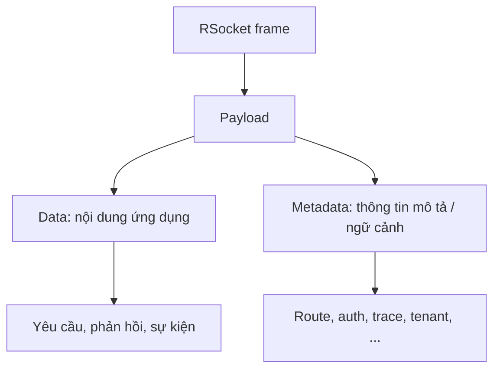

# Cấu trúc payload và vai trò riêng của data, metadata

## Mục tiêu bài học

Sau bài này, bạn có thể:

- Mô tả một RSocket payload gồm phần data và phần metadata tùy chọn.
- Phân biệt dữ liệu nghiệp vụ với thông tin định tuyến và ngữ cảnh của yêu cầu.
- Giải thích MIME type của data, metadata đơn và composite metadata.
- Gửi data cùng metadata từ Java client và hiểu cách Spring ánh xạ metadata vào handler.
- Thiết kế payload gọn, rõ hợp đồng và an toàn khi truyền qua kết nối realtime.

## Payload là đơn vị dữ liệu của RSocket

RSocket cung cấp các kiểu tương tác bất đồng bộ như request-response, fire-and-forget, request-stream và request-channel. Dù chọn kiểu nào, các bên vẫn trao đổi nội dung thông qua **payload**.

Ở mức khái niệm, payload có hai phần độc lập:

- **Data** chứa nội dung chính mà ứng dụng muốn gửi: một yêu cầu, một kết quả, một sự kiện hoặc một phần tử của luồng.
- **Metadata** chứa thông tin mô tả hoặc ngữ cảnh đi kèm payload, chẳng hạn route, thông tin xác thực, trace ID hoặc tenant context.

Metadata là phần tùy chọn. Một payload có thể mang data, metadata hoặc cả hai, tùy mục đích tương tác. Không nên nhầm payload với toàn bộ frame: frame còn có loại frame, cờ và thông tin điều khiển giao thức.



Trong một luồng, mỗi phần tử dữ liệu được truyền có thể mang payload riêng. Vì vậy, metadata có thể được gắn cho từng yêu cầu hoặc từng phần tử của luồng khi ngữ cảnh thay đổi theo thông điệp.

## Vai trò riêng của data và metadata

Điểm quan trọng là xác định thông tin nào thuộc hợp đồng nghiệp vụ và thông tin nào chỉ cung cấp ngữ cảnh cho quá trình xử lý.

| Tiêu chí | Data | Metadata |
|---|---|---|
| Vai trò | Nội dung mà handler cần xử lý | Mô tả hoặc ngữ cảnh đi kèm nội dung |
| Ví dụ | Mã sản phẩm, số lượng, giá, nội dung sự kiện | Route, trace ID, thông tin xác thực, tenant, locale |
| Cách sử dụng | Giải mã thành DTO hoặc kiểu dữ liệu nghiệp vụ | Giải mã theo MIME type hoặc metadata codec |
| Ảnh hưởng tới nghiệp vụ | Thường trực tiếp quyết định kết quả xử lý | Thường hỗ trợ định tuyến, bảo mật, quan sát hoặc chính sách |
| Cách thay đổi | Theo schema của yêu cầu, phản hồi hoặc sự kiện | Theo hợp đồng metadata và quy ước tích hợp |

Ví dụ, khi client yêu cầu báo giá cho mã `ACME`:

- Data có thể là `PriceRequest(symbol = "ACME")`.
- Metadata có thể chứa route `prices.quote`, mã tenant và trace ID.

Server dùng route để chọn handler, dùng metadata để thiết lập ngữ cảnh xử lý, rồi đọc data để thực hiện nghiệp vụ báo giá.

Một trường có thể thuộc data hoặc metadata tùy hợp đồng. Nếu `tenantId` là một phần của nội dung nghiệp vụ mà handler cần xử lý và lưu cùng yêu cầu, nó có thể thuộc data. Nếu nó là ngữ cảnh đa tenant được middleware dùng để xác thực và phân quyền xuyên suốt nhiều handler, metadata thường phù hợp hơn. Hãy quyết định dựa trên trách nhiệm của trường đó, không chỉ dựa vào tên trường.

## Data được mã hóa như thế nào?

Data trong payload được truyền dưới dạng byte. Ứng dụng Java thường làm việc với object như DTO; thư viện RSocket và codec sẽ chuyển object thành byte trước khi gửi và giải mã byte ở đầu nhận.

Các định dạng thường gặp gồm:

- JSON: dễ đọc, dễ kiểm tra khi phát triển và tích hợp.
- CBOR: dạng biểu diễn nhị phân của mô hình dữ liệu tương tự JSON.
- Protocol Buffers: schema rõ ràng và biểu diễn nhị phân gọn.
- Dữ liệu nhị phân tùy chỉnh: phù hợp khi hai phía đã thống nhất một định dạng riêng.

RSocket không bắt buộc data phải là JSON. Hai phía cần thống nhất codec, schema và MIME type để diễn giải cùng một dãy byte theo cùng cách.

### Data MIME type

Khi thiết lập kết nối, hai peer trao đổi MIME type mặc định cho data và metadata trong thông tin SETUP. Data MIME type cho biết định dạng của phần data để implementation chọn codec phù hợp. Ví dụ, một ứng dụng có thể dùng `application/json` cho DTO JSON hoặc một MIME type phù hợp với định dạng nhị phân đã chọn.

MIME type chỉ mô tả định dạng nội dung. Nó không tự định nghĩa đầy đủ schema, không kiểm tra dữ liệu có hợp lệ theo nghiệp vụ hay không và không tự giải quyết tương thích phiên bản. Ứng dụng vẫn cần quản lý schema, validation và quy tắc nâng cấp.

## Metadata được dùng để làm gì?

Metadata bổ sung ngữ cảnh cho payload mà không cần trộn các trường điều khiển vào DTO nghiệp vụ. Một số nhóm metadata phổ biến:

| Nhóm | Ví dụ | Mục đích |
|---|---|---|
| Routing | `prices.quote`, `device.events` | Chọn handler hoặc đích xử lý |
| Authentication | Access token hoặc thông tin xác thực theo chuẩn | Xác định danh tính peer hoặc người gọi |
| Tracing | Trace ID, span ID | Liên kết log và trace giữa các dịch vụ |
| Tenant / context | Tenant ID, locale, phiên bản client | Cung cấp ngữ cảnh xử lý |
| Content / protocol hint | Thông tin định dạng hoặc phiên bản hợp đồng | Hỗ trợ diễn giải nội dung theo thỏa thuận |

Metadata không tự động thực hiện các chức năng này. Ví dụ, gửi một access token trong metadata không có nghĩa server đã xác thực token. Server vẫn cần bộ xác thực kiểm tra chữ ký, thời hạn, issuer, audience và quyền truy cập theo chính sách của ứng dụng.

### Routing metadata

Trong RSocket, routing thường được biểu diễn bằng metadata. Với Spring, client có thể dùng `route(...)` để khai báo route logic:

```java
requester
    .route("prices.quote")
    .data(new PriceRequest("ACME"))
    .retrieveMono(PriceQuote.class);
```

Route cho biết handler nào cần nhận thông điệp. Nó không phải là một trường trong `PriceRequest`, và cũng không phải địa chỉ IP hay port của server. Địa chỉ kết nối xác định peer; route xác định đích xử lý bên trong ứng dụng.

Spring ánh xạ route tới handler có `@MessageMapping` tương ứng:

```java
@Controller
class PriceController {

    @MessageMapping("prices.quote")
    Mono<PriceQuote> quote(PriceRequest request) {
        return priceService.findQuote(request.symbol());
    }
}
```

Ví dụ này chỉ tập trung vào routing và data. Khi bổ sung metadata tùy chỉnh, server cần cấu hình metadata extractor để giải mã mục metadata đó và ánh xạ nó vào tham số hoặc header mà handler sử dụng.

## Metadata đơn và composite metadata

Metadata section của payload có thể được diễn giải theo MIME type metadata đã cấu hình cho kết nối.

### Metadata đơn

Với metadata đơn, toàn bộ metadata section được hiểu theo một định dạng đã thỏa thuận. Cách này đủ dùng khi ứng dụng chỉ cần một kiểu metadata và hai phía kiểm soát được hợp đồng.

Ví dụ, hai peer có thể thống nhất metadata section là một chuỗi JSON chứa ngữ cảnh gọi. Khi đó, cả hai phải dùng cùng quy tắc mã hóa và giải mã JSON cho phần metadata này.

### Composite metadata

Trong thực tế, một payload có thể cần nhiều loại metadata cùng lúc: route, thông tin xác thực và metadata tùy chỉnh của ứng dụng. Composite metadata cho phép metadata section chứa nhiều mục riêng biệt; mỗi mục mang MIME type và nội dung tương ứng.

Ví dụ một metadata section dạng composite có thể gồm:

```text
Composite metadata
├── message/x.rsocket.routing.v0
│   └── prices.quote
├── message/x.rsocket.authentication.v0
│   └── thông tin xác thực theo định dạng đã chọn
└── application/json
    └── {"tenantId":"tenant-42","traceId":"trace-9"}
```

Các MIME type trong sơ đồ minh họa những mục metadata khác nhau; nội dung thực tế phải tuân theo định dạng của từng extension và cấu hình hai phía. Composite metadata có MIME type riêng ở cấp metadata section, còn từng mục bên trong mang MIME type của chính nó.

Composite metadata hữu ích khi cần ghép nhiều extension mà vẫn giữ được ranh giới giữa từng loại thông tin. Tuy nhiên, cả client và server phải hỗ trợ cùng định dạng composite và các extension được sử dụng. Đừng giả định mọi RSocket client đều tự hiểu mọi loại metadata.

## Gửi data và metadata bằng Spring RSocket

Ví dụ dưới đây gửi yêu cầu báo giá. Data chứa thông tin nghiệp vụ; metadata tùy chỉnh mang ngữ cảnh của lời gọi. Route được khai báo riêng bằng `route(...)`.

```java
import org.springframework.util.MimeTypeUtils;
import reactor.core.publisher.Mono;

record PriceRequest(String symbol) {}
record PriceQuote(String symbol, long price) {}
record RequestContext(String tenantId, String traceId) {}

Mono<PriceQuote> quote = requester
    .route("prices.quote")
    .metadata(
        new RequestContext("tenant-42", "trace-9"),
        MimeTypeUtils.APPLICATION_JSON
    )
    .data(new PriceRequest("ACME"))
    .retrieveMono(PriceQuote.class);
```

Ví dụ giả định `requester` đã được cấu hình với codec JSON cho data và metadata, cùng cấu hình composite metadata để route và metadata tùy chỉnh có thể cùng tồn tại. `metadata(...)` khai báo object metadata và MIME type dùng để mã hóa object đó. `data(...)` khai báo object nghiệp vụ gửi trong payload. `retrieveMono(...)` yêu cầu một phản hồi được giải mã thành kiểu đã chỉ định.

Ở phía server, metadata extractor cần biết MIME type nào tương ứng với kiểu dữ liệu và tên header mà ứng dụng muốn sử dụng. Sau khi ánh xạ, handler có thể nhận cả data đã giải mã lẫn metadata đã trích xuất. Cấu hình trích xuất là một phần của hợp đồng giữa hai phía; chỉ gửi metadata ở client chưa đủ để handler tự động nhận được object mong muốn.

## Metadata theo từng payload và metadata lúc thiết lập kết nối

Cần phân biệt hai phạm vi:

- **Metadata trong SETUP:** được trao đổi khi thiết lập kết nối, thường dùng cho thông tin cần thiết ở phạm vi phiên kết nối.
- **Metadata trong payload:** đi cùng một thông điệp hoặc phần tử của luồng, phù hợp với route, context hay thông tin thay đổi theo từng yêu cầu.

Không nên đặt dữ liệu chỉ đúng với một yêu cầu vào metadata ở cấp kết nối rồi giả định mọi yêu cầu sau đó đều có cùng giá trị. Ngược lại, thông tin ổn định cho toàn bộ phiên có thể được cân nhắc ở phạm vi setup nếu implementation và kiến trúc ứng dụng hỗ trợ.

Với request-stream và request-channel, hãy xác định metadata áp dụng cho cả phiên hay từng phần tử. Ví dụ, tenant của một phiên có thể không đổi, trong khi trace context hoặc thông tin định danh của từng sự kiện có thể thay đổi theo từng payload.

## Nguyên tắc thiết kế data và metadata

1. **Để data thể hiện hợp đồng nghiệp vụ.** Người đọc DTO cần hiểu yêu cầu hoặc sự kiện mà ứng dụng đang xử lý.
2. **Để metadata mang ngữ cảnh.** Route, tracing, xác thực và thông tin xuyên suốt nhiều handler thường phù hợp với metadata.
3. **Giữ metadata nhỏ và có cấu trúc.** Metadata lớn làm tăng chi phí truyền trên mỗi payload, đặc biệt trong stream có nhiều phần tử.
4. **Thống nhất MIME type và codec.** Hai phía phải biết cách mã hóa, giải mã và xử lý trường hợp không hỗ trợ định dạng.
5. **Quản lý phiên bản.** Thêm trường metadata hoặc thay đổi schema cần có quy tắc tương thích giữa client và server được triển khai độc lập.
6. **Xác thực dữ liệu ở server.** Không tin route, tenant ID, role hoặc token chỉ vì chúng xuất hiện trong metadata.
7. **Bảo vệ thông tin nhạy cảm.** Dùng TLS cho transport phù hợp, giới hạn quyền của token và tránh ghi token hoặc dữ liệu nhạy cảm vào log.
8. **Không dùng metadata làm kho dữ liệu nghiệp vụ.** Thông tin cần lưu trữ, truy vấn hoặc tái sử dụng như một phần của domain nên có vị trí rõ ràng trong data hoặc hệ thống lưu trữ.

## Lỗi thường gặp khi xử lý payload

| Hiện tượng | Nguyên nhân có thể | Hướng kiểm tra |
|---|---|---|
| Không giải mã được data | Hai phía dùng codec hoặc data MIME type khác nhau | Kiểm tra MIME type, encoder, decoder và schema |
| Không đọc được metadata tùy chỉnh | Metadata extractor chưa ánh xạ MIME type hoặc kiểu đích | Kiểm tra cấu hình extractor và MIME type thực tế |
| Route không tới handler | Route metadata sai hoặc handler mapping không khớp | Kiểm tra tên route ở client và `@MessageMapping` |
| Route hoạt động nhưng thiếu metadata | Metadata chưa được gửi, không dùng composite khi cần nhiều mục, hoặc extractor không nhận diện mục | Kiểm tra metadata section, MIME type và cấu hình composite |
| Lỗi khi nâng cấp client/server | Hai phiên bản không thống nhất schema hoặc metadata contract | Kiểm tra quy tắc tương thích và triển khai theo phiên bản |
| Rò rỉ thông tin qua log | Log toàn bộ payload hoặc metadata | Che token, giới hạn trường log và kiểm soát quyền truy cập log |

Khi điều tra lỗi, hãy kiểm tra riêng ba lớp: byte của data, byte của metadata và cấu hình MIME type/codec. Cách này giúp xác định lỗi nằm ở nội dung nghiệp vụ, metadata hay cách hai peer diễn giải payload.

## Checklist trước khi đưa payload vào sử dụng

- Data có mô tả đúng yêu cầu, phản hồi hoặc sự kiện nghiệp vụ không?
- Route có được khai báo rõ và khớp handler không?
- Metadata nào cần thiết cho xác thực, tracing hoặc context?
- Metadata section dùng một định dạng hay composite metadata?
- Data MIME type và metadata MIME type có thống nhất giữa hai phía không?
- Server có giải mã và kiểm tra metadata trước khi dùng để phân quyền không?
- Metadata có bị lặp quá nhiều hoặc chứa thông tin nhạy cảm không?
- Có kiểm thử trường hợp thiếu metadata, sai MIME type, payload lỗi và client/server lệch phiên bản không?

Khi data và metadata có trách nhiệm riêng, payload trở thành hợp đồng giao tiếp dễ đọc và dễ mở rộng. Đây là nền tảng để triển khai các kiểu tương tác RSocket, bổ sung routing, bảo mật, tracing và điều tiết luồng mà không làm lẫn nội dung nghiệp vụ với thông tin điều khiển.

