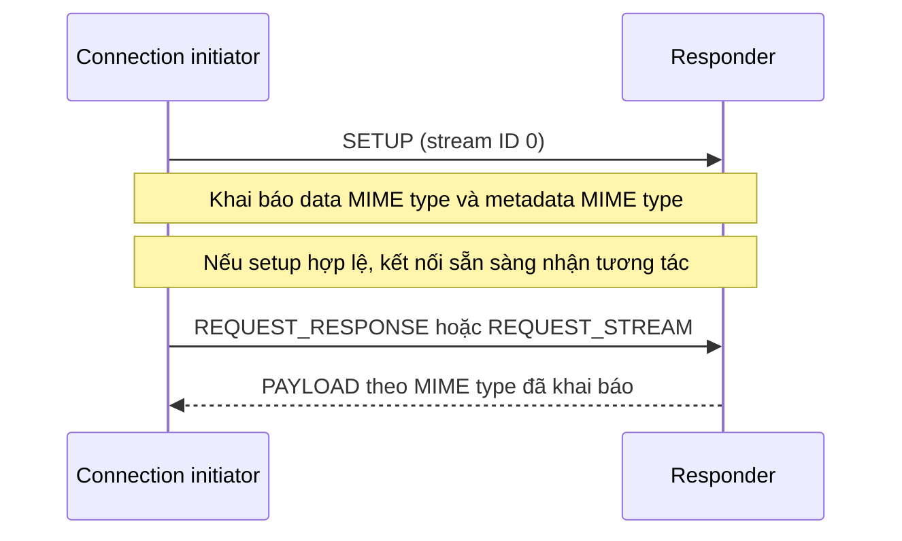

# Khai báo MIME type cho data và metadata trong SETUP

Khi hai ứng dụng mở một kết nối RSocket, chúng cần thống nhất cách diễn giải phần dữ liệu và metadata được gửi qua kết nối đó. RSocket thực hiện việc khai báo này trong frame `SETUP` bằng hai MIME type: một cho data và một cho metadata. Khai báo đúng giúp hai phía chọn đúng codec, giải mã payload nhất quán và hiểu được các thông tin điều khiển như route, correlation ID hoặc thông tin xác thực.

Trong module `INTEGRATION_REALTIME_RSOCKET`, client và server Java thường dùng Spring Boot cùng Reactor để trao đổi payload qua TCP hoặc WebSocket. Vì vậy, cần hiểu `SETUP` mô tả định dạng ở cấp kết nối như thế nào, MIME type của data khác metadata ra sao và khi nào nên dùng composite metadata để mang nhiều loại metadata trong cùng một payload.

## 1. Payload RSocket gồm data và metadata

Một payload RSocket có thể chứa hai phần độc lập:

- **Data:** nội dung chính của thông điệp, chẳng hạn một đối tượng yêu cầu, kết quả truy vấn, sự kiện cảm biến hoặc lệnh điều khiển.
- **Metadata:** thông tin mô tả hoặc điều khiển cách xử lý data, chẳng hạn route, correlation ID, thông tin xác thực, tracing hoặc phiên bản giao thức ứng dụng.

Ví dụ, một request có thể mang data là thông tin tìm đơn hàng và metadata là route `orders.find` cùng mã tương quan để ghép phản hồi với request:

```text
Payload
|-- Data
|     { "orderId": "A-17" }
|
|-- Metadata
      route: orders.find
      correlationId: trace-123
```

Data và metadata có thể dùng các định dạng khác nhau. Data thường được mã hóa thành JSON, CBOR hoặc byte nhị phân. Metadata có thể là một chuỗi đơn giản, một cấu trúc nhị phân hoặc một container chứa nhiều mục metadata với các MIME type riêng.

RSocket truyền payload dưới dạng byte. Giao thức không tự biến một đối tượng Java thành JSON và cũng không tự biết một chuỗi byte là `OrderQuery` hay `DeviceEvent`. Ứng dụng và thư viện codec chịu trách nhiệm mã hóa, giải mã và kiểm tra cấu trúc nội dung.

## 2. Vai trò của frame SETUP

`SETUP` là frame khởi tạo kết nối RSocket. Bên chủ động mở kết nối gửi frame này để thông báo các tham số ban đầu cho peer. Trong mô hình client/server thông dụng, client gửi `SETUP` đến server; về mặt giao thức, RSocket có tính hai chiều nên bên khởi tạo kết nối mới là bên gửi frame này.

`SETUP` là frame ở cấp kết nối và dùng stream ID bằng `0`. Nó được gửi ở giai đoạn bắt đầu kết nối, trước khi các tương tác ứng dụng trên những stream riêng được sử dụng. Ngoài các tham số thời gian sống và keepalive, frame còn khai báo MIME type cho data và metadata.



Các trường quan trọng trong `SETUP` gồm:

| Trường | Ý nghĩa |
| --- | --- |
| Protocol version | Phiên bản giao thức RSocket mà bên khởi tạo sử dụng. |
| Keepalive interval | Khoảng thời gian mà bên khởi tạo đề xuất giữa các frame `KEEPALIVE`. |
| Max lifetime | Ngưỡng thời gian tối đa để peer xem kết nối là không còn hoạt động nếu không nhận được keepalive theo lịch. |
| Metadata MIME type | Định dạng hoặc container được dùng để diễn giải metadata của payload trên kết nối. |
| Data MIME type | Định dạng được dùng để diễn giải phần data của payload trên kết nối. |
| Setup payload | Payload tùy chọn mang data và metadata ngay trong quá trình thiết lập kết nối, ví dụ thông tin khởi tạo hoặc thông tin nhận diện client. |

MIME type trong `SETUP` là khai báo cấp kết nối. Data MIME type áp dụng cho phần data của payload theo cả hai chiều trao đổi; metadata MIME type mô tả cách diễn giải phần metadata. Khai báo metadata MIME type vẫn cần thiết ngay cả khi setup payload không mang metadata. Đây không phải một lần thương lượng mà server tự chọn định dạng thay cho client: bên khởi tạo gửi lựa chọn của mình, còn peer cần hỗ trợ và xử lý tương thích. Nếu hai phía không thể dùng chung định dạng, kết nối có thể bị từ chối hoặc payload không thể giải mã đúng, tùy thời điểm và cách triển khai phát hiện vấn đề.

## 3. Data MIME type

Data MIME type mô tả định dạng của phần data trong payload. Ví dụ phổ biến:

| MIME type | Nội dung thường dùng |
| --- | --- |
| `application/json` | Đối tượng hoặc cấu trúc dữ liệu JSON. |
| `application/cbor` | Dữ liệu CBOR dạng nhị phân, thường gọn hơn JSON trong một số trường hợp. |
| `application/octet-stream` | Byte nhị phân không gắn với một cấu trúc cấp ứng dụng cụ thể. |
| `text/plain` | Văn bản thuần. |
| `application/protobuf` | Thông điệp Protocol Buffers theo quy ước của ứng dụng. |

Ví dụ, nếu bên khởi tạo khai báo `application/json`, cả hai phía cần dùng codec phù hợp để mã hóa và giải mã data theo JSON. Nếu client gửi byte JSON nhưng server giải mã như CBOR, nội dung sẽ không được diễn giải đúng dù kết nối transport vẫn hoạt động.

MIME type chỉ mô tả định dạng nội dung. Nó không tự thực hiện serialization, không xác minh schema và không bảo đảm dữ liệu hợp lệ. Một payload có MIME type `application/json` vẫn có thể chứa JSON sai cú pháp hoặc thiếu trường bắt buộc. Ứng dụng cần kiểm tra dữ liệu sau khi giải mã.

Nếu một kết nối có nhiều loại đối tượng nghiệp vụ, thường nên dùng chung một định dạng data như JSON hoặc CBOR rồi biểu diễn loại thông điệp trong cấu trúc dữ liệu, route hoặc trường discriminator. Không nên gửi byte theo nhiều định dạng tùy ý mà không có quy ước để bên nhận biết cách giải mã.

Ví dụ data JSON:

```json
{
  "deviceId": "sensor-17",
  "sequence": 42,
  "temperature": 27.5
}
```

Đối tượng này có thể được mã hóa thành byte UTF-8 bằng JSON encoder. Bên nhận chọn JSON decoder dựa trên cấu hình MIME type và chuyển nội dung thành kiểu Java tương ứng.

## 4. Metadata MIME type

Metadata MIME type mô tả cách diễn giải phần metadata của payload. Metadata thường chứa thông tin điều khiển hoặc ngữ cảnh để định tuyến và xử lý data, ví dụ:

- Route để chọn handler như `inventory.lookup`.
- Correlation ID để ghép request và response.
- Thông tin xác thực hoặc danh tính đã được xác minh.
- Trace context để theo dõi một request qua nhiều dịch vụ.
- Tenant ID hoặc phiên bản hợp đồng dữ liệu theo quy ước của hệ thống.

Nếu metadata chỉ có một định dạng, kết nối có thể khai báo MIME type tương ứng cho toàn bộ phần metadata. Tuy nhiên, trong ứng dụng RSocket thực tế, một payload có thể cần nhiều mục metadata với mục đích và định dạng khác nhau. Khi đó, composite metadata là lựa chọn phổ biến.

### Metadata đơn

Với metadata đơn, toàn bộ phần metadata được diễn giải theo MIME type đã khai báo trong `SETUP`. Ví dụ, nếu metadata MIME type là `text/plain`, ứng dụng có thể dùng một chuỗi làm metadata. Nếu dùng một MIME type tùy chỉnh, cả hai phía phải hiểu cùng cấu trúc và quy tắc mã hóa.

Kiểu này phù hợp khi ứng dụng có đúng một khối metadata đơn giản. Nó trở nên hạn chế khi cần đồng thời route, authentication, tracing và correlation ID mà mỗi loại có cấu trúc riêng.

### Composite metadata

Composite metadata cho phép một phần metadata chứa nhiều entry. Mỗi entry có MIME type và nội dung riêng. MIME type của container composite là:

```text
message/x.rsocket.composite-metadata.v0
```

Trong `SETUP`, bên khởi tạo khai báo MIME type container này làm metadata MIME type của kết nối. Bên trong composite metadata, mỗi entry có thể biểu diễn một loại metadata riêng, chẳng hạn routing metadata hoặc một mục metadata tùy chỉnh.

```text
Composite metadata
|-- Entry 1
|     MIME type: message/x.rsocket.routing.v0
|     Value: inventory.lookup
|
|-- Entry 2
|     MIME type: text/plain
|     Value: correlation-123
|
|-- Entry 3
      MIME type: application/json
      Value: { "tenant": "north" }
```

Sơ đồ trên mô tả cấu trúc ở mức khái niệm. Trong wire format, composite metadata có quy tắc đóng khung và mã hóa entry riêng; nên dùng encoder/decoder của thư viện RSocket thay vì tự ghép byte theo ví dụ minh họa.

Một số MIME type metadata thường gặp:

| MIME type | Mục đích |
| --- | --- |
| `message/x.rsocket.composite-metadata.v0` | Container chứa nhiều entry metadata. |
| `message/x.rsocket.routing.v0` | Metadata định tuyến, thường mang route. |
| `message/x.rsocket.authentication.v0` | Metadata phục vụ cơ chế xác thực theo quy ước RSocket. |
| `text/plain` | Metadata văn bản đơn giản theo quy ước ứng dụng. |
| `application/json` | Metadata có cấu trúc JSON theo quy ước ứng dụng. |

Composite metadata đặc biệt hữu ích khi route và các thông tin ngữ cảnh khác cùng xuất hiện trong một request. Việc có nhiều entry không có nghĩa mọi entry đều được mọi handler sử dụng; mỗi thành phần chỉ nên đọc các loại metadata mà nó hiểu và có quyền xử lý.

## 5. Phân biệt MIME type trong SETUP với MIME type của từng entry

Một điểm dễ nhầm là MIME type container và MIME type của entry bên trong composite metadata có vai trò khác nhau:

| Vị trí | Ví dụ | Vai trò |
| --- | --- | --- |
| Data MIME type trong SETUP | `application/json` | Chọn cách diễn giải phần data của payload. |
| Metadata MIME type trong SETUP | `message/x.rsocket.composite-metadata.v0` | Báo rằng phần metadata là một container composite. |
| MIME type của entry composite | `message/x.rsocket.routing.v0` | Chỉ định định dạng và ý nghĩa của một mục metadata bên trong container. |

Ví dụ, một request có thể dùng JSON cho data và composite metadata cho metadata. Trong composite metadata, route được mã hóa theo routing MIME type, còn correlation ID được mã hóa theo quy ước văn bản. Không nên đặt metadata MIME type trong `SETUP` thành `message/x.rsocket.routing.v0` nếu ứng dụng muốn gửi nhiều entry composite; khi đó peer sẽ diễn giải toàn bộ phần metadata như một loại routing metadata đơn.

## 6. Setup payload và metadata của từng request

`SETUP` có thể mang một payload khởi tạo tùy chọn. Data của payload này được mã hóa theo data MIME type đã khai báo; metadata được diễn giải theo metadata MIME type đã khai báo. Ứng dụng có thể dùng setup payload để gửi thông tin cần thiết ngay khi kết nối bắt đầu, chẳng hạn phiên bản client hoặc thông tin khởi tạo đã được thỏa thuận.

Setup metadata chỉ được gửi trong giai đoạn thiết lập kết nối. Nó không thay thế metadata riêng của từng request. Ví dụ, client có thể gửi danh tính hoặc ngữ cảnh phiên trong setup payload, sau đó mỗi request vẫn mang route, correlation ID và thông tin nghiệp vụ riêng.

| Loại metadata | Thời điểm | Ví dụ |
| --- | --- | --- |
| Setup metadata | Khi tạo kết nối | Thông tin client, thông tin xác thực ban đầu, capability theo quy ước ứng dụng. |
| Request metadata | Với từng tương tác | Route, correlation ID, trace context, tenant hoặc quyền truy cập theo request. |
| Metadata Push | Trong vòng đời kết nối | Thông tin metadata cấp kết nối được gửi riêng theo cơ chế Metadata Push của RSocket. |

Metadata Push là frame cấp kết nối, khác với metadata gắn vào payload của một stream. MIME type metadata cấp kết nối đã khai báo trong `SETUP` giúp peer biết cách diễn giải metadata được gửi theo cơ chế này. Không nên dùng Metadata Push như cách thay thế cho dữ liệu nghiệp vụ có thứ tự hoặc metadata cần gắn chính xác với từng request.

## 7. Cấu hình MIME type trong Spring Boot

Spring cung cấp `RSocketRequester` để tạo client và `RSocketStrategies` để quản lý encoder/decoder. Khi xây dựng requester, cần đặt data MIME type và metadata MIME type tương ứng với quy ước của server.

Ví dụ dùng JSON cho data và composite metadata cho metadata:

Giả sử biến `rsocketStrategies` đã được cấu hình với encoder/decoder phù hợp cho JSON và các kiểu metadata mà ứng dụng sử dụng.

```java
import org.springframework.messaging.rsocket.RSocketRequester;
import org.springframework.util.MimeType;
import org.springframework.util.MimeTypeUtils;

MimeType compositeMetadata = MimeTypeUtils.parseMimeType(
    "message/x.rsocket.composite-metadata.v0"
);

RSocketRequester requester = RSocketRequester.builder()
    .dataMimeType(MimeTypeUtils.APPLICATION_JSON)
    .metadataMimeType(compositeMetadata)
    .rsocketStrategies(rsocketStrategies)
    .connectTcp("localhost", 7000)
    .block();
```

Trong ví dụ, `dataMimeType` chọn định dạng data. `metadataMimeType` chọn container composite để metadata của request có thể chứa nhiều entry. `rsocketStrategies` cung cấp codec tương ứng để chuyển đổi đối tượng Java thành byte và ngược lại. `connectTcp` mở kết nối TCP; nếu dùng WebSocket, hãy chọn phương thức kết nối WebSocket tương ứng với phiên bản Spring đang sử dụng.

Lệnh `.block()` ở đây minh họa việc chờ hoàn tất tạo requester trong một đoạn khởi tạo đơn giản. Không nên gọi `block()` trên event loop hoặc trong đường xử lý reactive của request, vì thao tác blocking có thể làm giảm khả năng phục vụ các stream khác.

Nếu cần cấu hình codec riêng, hãy bảo đảm encoder và decoder tương thích với MIME type. Ví dụ, `application/json` cần JSON encoder/decoder; `application/cbor` cần codec CBOR. Cấu hình MIME type mà không có codec tương ứng không làm Spring tự biết cách chuyển đổi đối tượng.

## 8. Gửi request có route và metadata bổ sung

Khi metadata MIME type là composite, một request có thể mang route và metadata tùy chỉnh cùng lúc. Ví dụ:

```java
import org.springframework.util.MimeTypeUtils;
import reactor.core.publisher.Mono;

Mono<ProductView> result = requester
    .route("inventory.lookup")
    .metadata("trace-123", MimeTypeUtils.TEXT_PLAIN)
    .data(new ProductQuery("SKU-17"))
    .retrieveMono(ProductView.class);
```

Trong ví dụ:

- `.route("inventory.lookup")` thêm routing metadata để chọn handler tương ứng.
- `.metadata("trace-123", MimeTypeUtils.TEXT_PLAIN)` thêm một entry metadata văn bản.
- `.data(new ProductQuery(...))` cung cấp data được mã hóa theo data MIME type đã cấu hình.
- `.retrieveMono(ProductView.class)` yêu cầu tối đa một response và giải mã response thành `ProductView`.

Route và metadata bổ sung là hai entry metadata khác nhau. Khi sử dụng composite metadata, các entry có thể được mã hóa riêng và được peer đọc theo MIME type của từng entry. Cả client và server cần dùng cùng quy ước cho tên route, kiểu metadata và cách diễn giải giá trị.

## 9. Tính tương thích giữa hai phía

Một kết nối có thể mở thành công ở tầng TCP hoặc WebSocket nhưng vẫn gặp lỗi khi giải mã payload. Nguyên nhân thường là hai phía không thống nhất MIME type, codec hoặc cấu trúc dữ liệu.

Hãy kiểm tra các điểm sau khi thiết kế hợp đồng kết nối:

1. Bên khởi tạo khai báo data MIME type mà server hỗ trợ.
2. Hai phía thống nhất metadata MIME type là một định dạng đơn hay composite metadata.
3. Nếu dùng composite metadata, cả hai phía hiểu MIME type và cấu trúc của từng entry cần thiết.
4. JSON, CBOR hoặc định dạng nhị phân có encoder/decoder tương thích ở cả hai phía.
5. Các trường trong DTO có quy tắc tương thích phiên bản, giá trị mặc định và xử lý trường không nhận diện.
6. Setup payload và request metadata không bị nhầm lẫn về thời điểm và phạm vi áp dụng.

MIME type là một phần của hợp đồng kết nối. Nếu cần thay đổi định dạng data hoặc cách đóng gói metadata, hãy triển khai thay đổi có kiểm soát ở cả hai phía. Không nên chỉ thay encoder ở một dịch vụ rồi kỳ vọng peer tự phát hiện định dạng mới.

### Xử lý khi không tương thích

Nếu peer không chấp nhận setup hoặc không thể sử dụng các tham số trong `SETUP`, kết nối có thể bị từ chối bằng lỗi setup. Nếu setup được chấp nhận nhưng một payload về sau không thể giải mã, lỗi có thể xuất hiện ở tầng xử lý payload hoặc ứng dụng. Vì vậy, cần ghi log thông tin chẩn đoán như data MIME type, metadata MIME type, route và loại lỗi; tránh ghi toàn bộ payload nhạy cảm hoặc token xác thực.

Khi thay đổi hợp đồng, có thể dùng version trong DTO hoặc metadata để hỗ trợ nhiều phiên bản trong giai đoạn chuyển tiếp. Version ứng dụng không thay thế MIME type: MIME type cho biết cách giải mã byte, còn version nghiệp vụ cho biết cấu trúc và ý nghĩa của dữ liệu sau khi giải mã.

## 10. Bảo mật và dữ liệu nhạy cảm trong metadata

Metadata thường được dùng cho thông tin xác thực, tenant, tracing hoặc định tuyến nên có thể chứa dữ liệu nhạy cảm. MIME type chỉ mô tả định dạng; nó không mã hóa, ký hoặc xác thực nội dung metadata.

Một số nguyên tắc cần áp dụng:

- Dùng TLS khi kết nối qua mạng không đáng tin cậy để bảo vệ dữ liệu truyền tải.
- Chỉ đưa vào metadata những trường cần thiết cho định tuyến hoặc xử lý; tránh nhét toàn bộ hồ sơ người dùng hay bí mật ứng dụng vào metadata.
- Không ghi token, mật khẩu hoặc nội dung xác thực đầy đủ vào log.
- Xác minh metadata ở phía server; không xem tenant ID, user ID hoặc role do client gửi là bằng chứng quyền truy cập.
- Giới hạn kích thước metadata và kiểm tra giá trị đầu vào để tránh lạm dụng bộ nhớ hoặc parser.

Thông tin xác thực gửi trong setup metadata có phạm vi gắn với lần tạo kết nối. Nếu thông tin hết hạn hoặc quyền thay đổi, ứng dụng cần có quy tắc làm mới, tạo kết nối mới hoặc xác minh quyền ở từng request tùy mô hình bảo mật. Không nên giả định metadata setup tự cập nhật theo phiên người dùng.

## 11. Kiểm thử MIME type và codec

Kiểm thử không chỉ xác nhận kết nối được tạo thành công. Cần xác nhận data và metadata thực sự được mã hóa, giải mã theo MIME type đã khai báo.

Các trường hợp nên có:

- Client và server cùng dùng `application/json`, gửi và nhận DTO đúng giá trị.
- Data MIME type không tương thích được phát hiện và tạo lỗi có thể chẩn đoán.
- Metadata đơn được giải mã theo đúng MIME type.
- Composite metadata có nhiều entry; route và metadata tùy chỉnh được đọc đúng.
- Setup payload được giải mã theo MIME type đã khai báo trong `SETUP`.
- Request metadata khác setup metadata về phạm vi và thời điểm.
- Dữ liệu sai schema hoặc metadata thiếu trường bắt buộc được xử lý an toàn.
- Log không để lộ token hoặc dữ liệu nhạy cảm khi có lỗi giải mã.

Ví dụ kiểm thử một pipeline JSON bằng Reactor có thể kiểm tra giá trị sau giải mã:

```java
import org.junit.jupiter.api.Test;
import reactor.core.publisher.Mono;
import reactor.test.StepVerifier;
import static org.junit.jupiter.api.Assertions.assertEquals;
import static org.junit.jupiter.api.Assertions.assertNotNull;

class ProductQueryTest {
    @Test
    void returnsDecodedProduct() {
        Mono<ProductView> response = productClient.lookup("SKU-17");

        StepVerifier.create(response)
            .assertNext(product -> {
                assertEquals("SKU-17", product.sku());
                assertNotNull(product.name());
            })
            .verifyComplete();
    }
}
```

Đây là ví dụ kiểm tra ở tầng client sau khi codec đã giải mã response. Với kiểm thử tích hợp, nên chạy cả RSocket server và requester để xác nhận MIME type trong `SETUP`, codec và composite metadata tương thích xuyên suốt.

## 12. Những lỗi thường gặp

**Nhầm MIME type với codec.** Khai báo `application/json` chỉ mô tả định dạng. Cần encoder/decoder thực hiện chuyển đổi byte và đối tượng.

**Dùng metadata MIME type đơn nhưng gửi composite metadata.** Nếu toàn bộ metadata được khai báo là một loại đơn, peer sẽ diễn giải theo loại đó và không tự phân tích các entry composite.

**Nhầm MIME type container với MIME type entry.** `message/x.rsocket.composite-metadata.v0` là định dạng của container; `message/x.rsocket.routing.v0` mô tả một entry routing bên trong container.

**Cho rằng MIME type được thương lượng tự động.** Bên khởi tạo khai báo trong `SETUP`; hai phía phải tương thích theo hợp đồng đã thống nhất.

**Đưa mọi thông tin vào setup metadata.** Setup metadata có phạm vi cấp kết nối. Route và correlation ID thường thuộc từng request và cần được gửi ở metadata của request tương ứng.

**Xem metadata là đáng tin cậy.** Metadata đến từ client vẫn phải được xác thực và phân quyền ở server. MIME type không cung cấp bảo mật.

**Chỉ kiểm tra kết nối TCP mở thành công.** Transport hoạt động không chứng minh codec, schema và metadata đều tương thích. Cần kiểm thử payload thực tế.

## 13. Ghi nhớ

- `SETUP` là frame cấp kết nối, stream ID bằng `0`, do bên khởi tạo gửi khi bắt đầu kết nối RSocket.
- Data MIME type mô tả định dạng phần data; metadata MIME type mô tả cách diễn giải phần metadata.
- MIME type không tự serialize, deserialize, xác thực schema hoặc bảo vệ nội dung.
- `application/json`, `application/cbor` và `application/octet-stream` là các ví dụ data MIME type thường dùng.
- `message/x.rsocket.composite-metadata.v0` cho phép một phần metadata chứa nhiều entry có MIME type riêng.
- Setup payload được gửi khi tạo kết nối; request metadata được gửi theo từng tương tác; Metadata Push là frame cấp kết nối riêng.
- Trong Spring Boot, `RSocketRequester.Builder` cấu hình data MIME type và metadata MIME type; `RSocketStrategies` cung cấp encoder/decoder tương thích.
- Hai phía cần thống nhất MIME type, codec, cấu trúc DTO và quy tắc metadata; cần kiểm thử cả trường hợp không tương thích và bảo vệ thông tin nhạy cảm.
