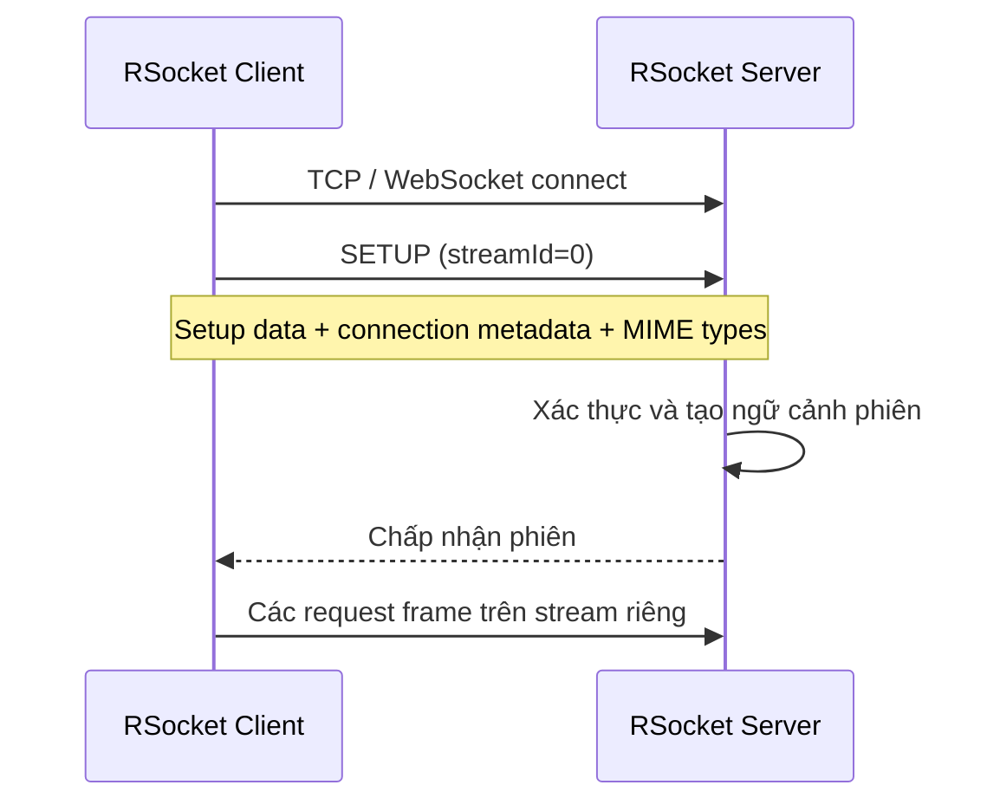
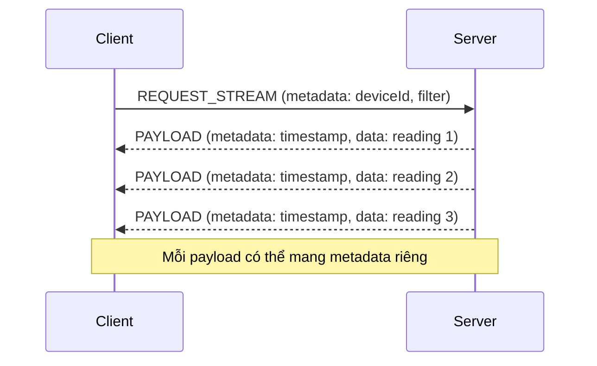

# Phân biệt metadata của kết nối với metadata từng yêu cầu

Trong RSocket, metadata là phần thông tin đi kèm payload để mô tả cách một thông điệp hoặc một phiên kết nối cần được xử lý. Metadata có thể chứa route, danh tính client, tenant, quyền truy cập, trace ID, locale hoặc phiên bản hợp đồng. Data thường chứa nội dung nghiệp vụ như đối tượng đơn hàng, câu hỏi tra cứu hoặc sự kiện telemetry.

Một kết nối RSocket có thể phục vụ nhiều request và nhiều stream cùng lúc. Vì vậy, cần xác định metadata thuộc phạm vi nào. Metadata trong frame `SETUP` mô tả ngữ cảnh ban đầu của kết nối. Frame `METADATA_PUSH` cho phép cập nhật metadata ở cấp kết nối sau khi phiên đã thiết lập. Metadata trong request frame mô tả một request hoặc stream cụ thể; metadata trong các frame `PAYLOAD` tiếp theo có thể mô tả từng thông điệp trong stream. Các phạm vi này có vòng đời và mục đích khác nhau.

Phân biệt đúng phạm vi giúp tránh gửi lặp dữ liệu phiên trên mọi request, tránh dùng nhầm thông tin tenant của kết nối cho request có ngữ cảnh khác, đồng thời làm rõ nơi kiểm tra quyền, định tuyến và truy vết trong hệ thống Java/Spring Boot realtime.

## 1. Data và metadata trong một payload

Một RSocket `Payload` có hai phần độc lập:

- **Data:** bytes chứa nội dung chính của thông điệp. Ví dụ: `OrderQuery`, `ChatMessage`, `Telemetry` hoặc dữ liệu nhị phân.
- **Metadata:** bytes chứa thông tin bổ sung để định tuyến, xác thực, phân loại hoặc cung cấp ngữ cảnh xử lý.

Hai phần này được mã hóa riêng. Ứng dụng có thể thay đổi metadata mà không cần nhúng các trường điều khiển vào cấu trúc data nghiệp vụ. Ngược lại, metadata không nên trở thành nơi chứa toàn bộ nội dung nghiệp vụ lớn.

Ví dụ một request tìm đơn hàng:

| Phần | Nội dung minh họa | Mục đích |
|---|---|---|
| Data | `{ "orderId": "ORD-1008" }` | Dữ liệu đầu vào để tìm đơn hàng |
| Metadata route | `orders.find` | Chọn handler xử lý |
| Metadata tenant | `tenant-42` | Xác định phạm vi dữ liệu được phép truy cập |
| Metadata trace | `trace-abc123` | Liên kết log và trace giữa các dịch vụ |

Data trả lời câu hỏi *nghiệp vụ cần xử lý dữ liệu gì?* Metadata trả lời câu hỏi *thông điệp này cần được định tuyến và xử lý trong ngữ cảnh nào?*

Metadata không tự có ý nghĩa nghiệp vụ. Client và server phải thống nhất MIME type, định dạng, tên trường và quy tắc diễn giải. Nếu server không biết MIME type của một metadata entry, server cần xử lý theo chính sách tương thích đã thiết kế, chẳng hạn bỏ qua entry không bắt buộc hoặc từ chối request nếu entry đó cần thiết cho an toàn.

## 2. Metadata ở cấp kết nối: SETUP

Khi tạo phiên RSocket, peer khởi tạo gửi frame `SETUP`. Frame này có stream ID bằng `0`, mang các tham số giao thức và setup payload. Setup payload có thể gồm cả data lẫn metadata.

Metadata trong `SETUP` thường dùng cho thông tin gắn với phiên hoặc client trong suốt vòng đời kết nối, ví dụ:

- Thông tin nhận diện client hoặc ứng dụng đang kết nối.
- Thông tin xác thực ban đầu để server xác định principal.
- Phiên bản client, khả năng hỗ trợ hoặc cấu hình giao tiếp.
- Locale hoặc ngữ cảnh phiên nếu các request sau dùng chung.
- Metadata định tuyến cho một handler khởi tạo nếu ứng dụng có quy ước như vậy.

`SETUP` cũng khai báo data MIME type và metadata MIME type. Nếu ứng dụng dùng Composite Metadata để đóng gói nhiều loại metadata trong cùng một payload, metadata MIME type của phiên thường được đặt thành `message/x.rsocket.composite-metadata.v0`. Mỗi entry trong composite metadata mang thông tin MIME type riêng để bên nhận giải mã đúng định dạng.

Luồng khởi tạo tổng quát:



Ví dụ client gửi thông tin ứng dụng và thông tin xác thực lúc kết nối bằng Spring `RSocketRequester`:

```java
MimeType AUTH_MIME = MimeType.valueOf(
    "message/x.rsocket.authentication.v0"
);

Mono<RSocketRequester> connection = RSocketRequester.builder()
    .setupRoute("client.connect")
    .setupData(new ClientInfo("mobile-app", "3.2.0"))
    .setupMetadata(new ClientAuth(accessToken), AUTH_MIME)
    .connectTcp("rsocket.example.internal", 7000);
```

Đây là ví dụ cấu hình ở thời điểm mở kết nối; `ClientInfo` và `ClientAuth` là kiểu dữ liệu ứng dụng. Với Spring Boot, cần cấu hình codec và MIME type tương ứng trong `RSocketStrategies`. Không nên coi ví dụ trên là nơi lưu một access token vĩnh viễn: token có thể hết hạn, bị thu hồi hoặc thay đổi trong khi kết nối vẫn còn sống.

Ở phía server, Spring có `@ConnectMapping` để xử lý sự kiện kết nối và setup payload. Đây là vị trí phù hợp để kiểm tra thông tin khởi tạo, xác lập principal hoặc tạo session context. Nếu cần đọc metadata thành các tham số Java, metadata extractor phải được cấu hình để ánh xạ MIME type và kiểu dữ liệu sang tên header mà handler sử dụng.

## 3. Metadata cập nhật ở cấp kết nối: METADATA_PUSH

Sau khi phiên đã thiết lập, RSocket định nghĩa frame `METADATA_PUSH` để requester gửi metadata cho responder mà không mở một request stream mới. Frame này dùng stream ID `0`, chỉ mang metadata và không mang data nghiệp vụ. Nó là thao tác một chiều; không có response payload tương ứng.

Metadata push hữu ích khi thông tin gắn với kết nối thay đổi trong lúc phiên vẫn được giữ mở, ví dụ:

- Cập nhật ngữ cảnh phiên hoặc thông tin client.
- Thay đổi trạng thái subscription chung của kết nối.
- Thông báo thông tin xác thực mới hoặc trạng thái xác thực cần được cập nhật.
- Cập nhật thông tin theo dõi hoặc ngữ cảnh vận hành gắn với phiên.

Ở tầng RSocket Java, API `metadataPush(Payload)` biểu diễn thao tác này. Payload gửi đi cần chứa metadata theo định dạng mà hai phía đã thống nhất; ứng dụng không gửi một request route chỉ để giả lập metadata push.

```java
// metadataPayload là Payload có metadata đã được mã hóa theo MIME type
// mà phiên RSocket đang sử dụng.
Mono<Void> updateSession = rsocket.metadataPush(metadataPayload);
```

`METADATA_PUSH` không tạo stream mới, không trả lời bằng response nghiệp vụ và không tự động chép metadata mới vào mọi request tiếp theo. Server cần có cơ chế nhận và cập nhật connection context tương ứng. Nếu ứng dụng muốn dùng giá trị vừa cập nhật trong request sau, logic phía server phải đọc context đã cập nhật một cách an toàn.

Metadata push có phạm vi kết nối. Nó không phù hợp để truyền tenant, quyền hoặc trace ID riêng cho một request nếu các request khác trên cùng kết nối có thể có ngữ cảnh khác nhau. Với các dữ liệu đó, hãy gửi metadata ở cấp request.

## 4. Metadata của từng request và stream

Khi client mở một tương tác, metadata được đưa vào payload của request frame tương ứng:

- `REQUEST_RESPONSE` mang payload đầu vào cho request-response.
- `REQUEST_FNF` mang payload đầu vào cho fire-and-forget.
- `REQUEST_STREAM` mang payload đầu vào để mở một response stream.
- `REQUEST_CHANNEL` mang payload đầu tiên của chiều client gửi và mở một channel hai chiều.

Metadata ở đây mô tả request hoặc stream đó. Ví dụ, một request tìm đơn hàng có thể mang tenant ID, trace ID và quyền hoặc scope cần thiết. Một request stream telemetry có thể mang device ID, bộ lọc, khoảng thời gian và định dạng mong muốn.

Ví dụ gửi metadata riêng cho từng request bằng Spring `RSocketRequester`:

```java
MimeType TENANT_MIME = MimeType.valueOf(
    "message/vnd.example.tenant.v1"
);
MimeType TRACE_MIME = MimeType.valueOf(
    "message/vnd.example.trace.v1"
);

Mono<Order> order = requester
    .route("orders.find")
    .metadata(new TenantMetadata("tenant-42"), TENANT_MIME)
    .metadata(new TraceMetadata(traceId), TRACE_MIME)
    .data(new OrderQuery("ORD-1008"))
    .retrieveMono(Order.class);
```

Các MIME type `message/vnd.example...` trong ví dụ là loại riêng của ứng dụng. Client và server phải cùng hiểu cấu trúc dữ liệu và cách mã hóa. Khi dùng nhiều loại metadata, Composite Metadata cho phép gói nhiều entry trong metadata section của cùng một payload.

Ở phía server, có thể ánh xạ các entry thành header để handler nhận được bằng `@Header`. Ví dụ cấu hình metadata extractor:

```java
@Bean
RSocketStrategies rsocketStrategies() {
    return RSocketStrategies.builder()
        .metadataExtractorRegistry(registry -> {
            registry.metadataToExtract(
                TENANT_MIME, TenantMetadata.class, "tenant");
            registry.metadataToExtract(
                TRACE_MIME, TraceMetadata.class, "trace");
        })
        .build();
}
```

Handler có thể nhận data và metadata đã được trích xuất:

```java
@MessageMapping("orders.find")
Mono<Order> findOrder(
        @Payload OrderQuery query,
        @Header("tenant") TenantMetadata tenant,
        @Header("trace") TraceMetadata trace) {

    return orderService.findForTenant(query.orderId(), tenant.tenantId());
}
```

Đoạn mã là khung minh họa cho Spring Messaging; các codec cho `TenantMetadata` và `TraceMetadata`, MIME type và `RSocketStrategies` phải được cấu hình tương ứng ở cả client lẫn server. Không nên giả định Spring tự hiểu một MIME type tùy chỉnh nếu chưa đăng ký cách giải mã.

## 5. Metadata trong các PAYLOAD tiếp theo của stream

Metadata không chỉ xuất hiện ở frame mở request. Trong request-stream hoặc request-channel, các frame `PAYLOAD` tiếp theo có thể mang metadata cùng data. Nhờ đó, mỗi phần tử trong stream có thể mang thông tin riêng mà không cần tạo một kết nối mới.

Ví dụ một stream telemetry có thể sử dụng metadata ban đầu để mô tả truy vấn, sau đó mỗi payload mang timestamp, sequence hoặc chất lượng đo riêng. Với request-channel, client và server có thể gửi payload ở cả hai chiều; metadata đi kèm mỗi payload được diễn giải theo quy ước của ứng dụng và chiều truyền.



Metadata trong request frame thường xác lập ngữ cảnh cho tương tác được mở. Metadata trong payload tiếp theo gắn với phần tử hoặc thông điệp cụ thể. Nếu ứng dụng cần một giá trị duy trì xuyên suốt stream, có thể đặt nó trong request metadata ban đầu hoặc lưu trong stream context. Nếu giá trị thay đổi theo từng phần tử, hãy đưa nó vào metadata của từng payload. Cần quy định rõ ưu tiên khi cả stream context và message metadata cùng có một trường.

## 6. So sánh các phạm vi metadata

| Tiêu chí | SETUP metadata | METADATA_PUSH | Request metadata | PAYLOAD metadata |
|---|---|---|---|---|
| Phạm vi | Phiên kết nối lúc khởi tạo | Phiên kết nối đang hoạt động | Một request hoặc stream | Một thông điệp trong stream |
| Frame | `SETUP` | `METADATA_PUSH` | `REQUEST_*` | `PAYLOAD` |
| Stream ID | `0` | `0` | Stream ID mới | Stream ID đang chạy |
| Có data nghiệp vụ cùng frame? | Có thể có setup data | Không | Có thể có | Có thể có |
| Tạo request stream? | Không | Không | Có, tùy interaction model | Không tạo stream mới |
| Ví dụ | Client identity, setup auth | Cập nhật session context | Tenant, route, trace của request | Timestamp hoặc sequence của item |

Một quy tắc thực tế là đặt thông tin ở phạm vi hẹp nhất đủ đáp ứng yêu cầu. Thông tin thực sự cố định theo kết nối có thể đặt trong setup hoặc connection context. Thông tin thay đổi theo request nên nằm trong request metadata. Thông tin thay đổi theo từng item nên nằm trong payload metadata. Cách này giúp nhiều request chạy đồng thời trên một kết nối mà không vô tình dùng chung ngữ cảnh của nhau.

## 7. Composite Metadata và MIME type

Một payload có một metadata section. Khi cần gửi nhiều loại metadata khác nhau, RSocket dùng Composite Metadata. Mỗi entry trong composite metadata chứa định danh MIME type (well-known ID hoặc MIME type đầy đủ) và nội dung metadata tương ứng.

Ví dụ một metadata section có thể chứa:

| Entry | MIME type minh họa | Nội dung |
|---|---|---|
| Routing | `message/x.rsocket.routing.v0` | Route `orders.find` |
| Authentication | `message/x.rsocket.authentication.v0` | Thông tin xác thực theo định dạng chuẩn |
| Tenant | `message/vnd.example.tenant.v1` | Tenant ID |
| Tracing | `message/vnd.example.trace.v1` | Trace ID và span context |

Composite Metadata không có nghĩa mọi metadata đều được tự động giải mã. Bên nhận cần nhận diện MIME type, chọn decoder phù hợp và quyết định entry nào được sử dụng. Một số metadata chuẩn có well-known MIME ID; metadata tùy chỉnh thường dùng MIME type đầy đủ do ứng dụng quản lý.

Trong Spring, `RSocketStrategies` tập hợp encoder, decoder, metadata extractor và các thành phần chuyển đổi. Khi thêm metadata tùy chỉnh, cần đăng ký codec/extractor phù hợp. Cần bảo đảm MIME type trong `setupMetadata` và metadata của request phù hợp với metadata MIME type được thương lượng trong phiên. Với Composite Metadata, các entry bên trong mới chỉ ra MIME type cụ thể cho từng loại metadata.

Không nên tự ghép chuỗi metadata bằng dấu phân cách tùy ý rồi giả định peer sẽ hiểu. Hãy dùng định dạng Composite Metadata của RSocket hoặc một metadata MIME type đơn đã thống nhất và được mã hóa đúng chuẩn.

## 8. Chọn phạm vi metadata theo tình huống

### Danh tính client và thông tin phiên

Client có thể gửi thông tin nhận diện ứng dụng và thông tin xác thực ban đầu trong setup. Server xác thực, tạo principal hoặc session context cho kết nối. Nếu danh tính hoặc trạng thái phiên thay đổi, ứng dụng có thể cập nhật connection context bằng cơ chế metadata push và quy tắc xác thực lại phù hợp.

### Tenant và phân quyền

Nếu mỗi kết nối chỉ phục vụ một tenant đã được xác thực và không thể chuyển tenant, server có thể lưu tenant trong session context. Nếu cùng một kết nối có thể gửi request cho nhiều tenant hoặc nhiều principal, tenant phải được gửi và kiểm tra ở cấp request. Server tuyệt đối không được tin tenant ID do client gửi chỉ vì metadata có trường đó; phải đối chiếu với danh tính và quyền đã xác thực.

### Routing

Route thường được gửi trong metadata của request để chọn handler. Trong Spring, `.route("orders.find")` tạo routing metadata theo cơ chế của framework. Route không nên được xem là quyền truy cập: client biết route không đồng nghĩa client được phép gọi route đó.

### Tracing và correlation

Trace ID thường khác nhau giữa các request, kể cả khi chúng dùng chung một kết nối. Vì vậy, request metadata là vị trí phù hợp để truyền trace context. Với stream dài hạn, có thể giữ trace context ở cấp stream hoặc cập nhật metadata cho từng message nếu mỗi item thuộc một trace riêng. Tránh đặt một trace ID cố định trong connection setup rồi dùng nó cho mọi request về sau.

### Locale và tùy chọn biểu diễn

Nếu locale là thuộc tính cố định của client trong cả phiên, setup metadata có thể phù hợp. Nếu người dùng có thể thay đổi locale hoặc một request cần định dạng khác, hãy gửi locale ở cấp request. Server cần có giá trị mặc định rõ ràng khi metadata không tồn tại.

## 9. Bảo mật và tính nhất quán của ngữ cảnh

Metadata là dữ liệu do peer gửi qua mạng. Nó không tự được tin cậy, không tự mã hóa và không tự bảo đảm tính toàn vẹn ở tầng ứng dụng. Một số nguyên tắc cần tuân thủ:

- **Xác thực nguồn gửi:** kiểm tra credential theo cơ chế xác thực đã chọn; không xem tenant ID, role hoặc user ID trong metadata là bằng chứng xác thực.
- **Ủy quyền theo request:** kiểm tra quyền tại handler hoặc service cho từng thao tác. Xác thực lúc setup không có nghĩa mọi request trong tương lai luôn được phép.
- **Dùng TLS:** sử dụng TCP+TLS hoặc WebSocket Secure khi cần bảo vệ metadata và data trên đường truyền. Metadata có thể chứa thông tin nhạy cảm nên không gửi qua kênh không được bảo vệ.
- **Không ghi bí mật vào log:** che access token, password, session key và dữ liệu định danh nhạy cảm trong log hoặc packet capture.
- **Giới hạn kích thước:** giới hạn metadata section, số entry và độ dài trường để tránh tiêu thụ bộ nhớ hoặc CPU quá mức.
- **Kiểm tra MIME type:** chỉ giải mã các MIME type được hỗ trợ; từ chối dữ liệu sai định dạng hoặc không hợp lệ theo chính sách rõ ràng.
- **Cô lập tenant:** không dùng một biến context dùng chung có thể bị ghi đè giữa các stream đồng thời. Context phải gắn đúng connection, stream hoặc message.

Nếu dùng `METADATA_PUSH` để cập nhật credential, cần xác định rõ thời điểm credential mới có hiệu lực, cách xử lý request đang chạy và hành vi khi cập nhật thất bại. Không được để metadata cũ tiếp tục cấp quyền sau khi credential đã bị thu hồi. Với dữ liệu có thể thay đổi quyền truy cập, server cần kiểm tra trạng thái hiện tại theo chính sách bảo mật.

## 10. Lỗi thường gặp khi thiết kế metadata

1. **Đưa mọi thứ vào setup:** thông tin tenant hoặc trace thay đổi theo request sẽ bị dùng chung sai giữa các stream.
2. **Lặp connection metadata trên mọi request:** tăng kích thước frame và tạo nhiều nguồn dữ liệu có thể mâu thuẫn.
3. **Giả định metadata push tự cập nhật request:** frame push chỉ truyền metadata ở cấp kết nối; ứng dụng phải xử lý và cập nhật context phía nhận.
4. **Không thống nhất MIME type:** peer nhận không biết decoder nào cần dùng hoặc giải mã sai dữ liệu.
5. **Dùng metadata thay cho data:** làm cấu trúc thông điệp khó hiểu và khó kiểm soát kích thước.
6. **Tin giá trị tenant/role do client gửi:** có thể tạo lỗ hổng truy cập chéo tenant hoặc leo thang quyền.
7. **Dùng trace ID cấp kết nối cho mọi request:** làm sai liên kết trace khi nhiều request đồng thời.
8. **Bỏ qua metadata trong payload tiếp theo:** ứng dụng streaming có thể mất timestamp, sequence hoặc ngữ cảnh riêng của từng item.

## 11. Kiểm thử và quan sát

Nên kiểm thử metadata theo đúng phạm vi của nó:

- **Setup metadata:** server nhận đúng thông tin khởi tạo; từ chối setup khi credential hoặc định dạng không hợp lệ.
- **Metadata push:** context kết nối được cập nhật sau push; request tiếp theo sử dụng giá trị mới theo chính sách; thao tác push không tạo response stream.
- **Request metadata:** hai request đồng thời trên cùng kết nối vẫn nhận đúng tenant, trace và route riêng.
- **Payload metadata:** từng item của stream giữ đúng timestamp, sequence hoặc context của nó.
- **Composite Metadata:** nhiều MIME type được giải mã đúng; entry tùy chỉnh không hợp lệ được xử lý có kiểm soát.
- **Security:** metadata giả mạo không thể vượt qua xác thực/ủy quyền; tenant của request này không ảnh hưởng request khác.
- **Kích thước:** metadata quá lớn hoặc có quá nhiều entry bị giới hạn theo chính sách.

Trong kiểm thử reactive, `StepVerifier` có thể xác minh dữ liệu và vòng đời `Mono`/`Flux`; kiểm thử tích hợp RSocket cần xác minh metadata thực sự được chuyển qua frame và được trích xuất ở server. Nên ghi metric về số metadata decode lỗi, MIME type không hỗ trợ, setup bị từ chối, metadata push thất bại và request bị từ chối do thiếu quyền. Khi log, chỉ ghi các trường an toàn như tên MIME type, route đã chuẩn hóa hoặc trace ID đã được phép; tránh ghi toàn bộ metadata thô.

## 12. Quy tắc thiết kế

1. Đặt metadata vào phạm vi nhỏ nhất phù hợp: kết nối, request/stream hoặc từng payload.
2. Dùng `SETUP` cho thông tin khởi tạo và `METADATA_PUSH` cho cập nhật context cấp kết nối.
3. Dùng request metadata cho route, tenant, trace và quyền riêng của từng tương tác.
4. Dùng payload metadata cho thông tin gắn với từng phần tử của stream.
5. Dùng Composite Metadata khi một payload cần nhiều loại metadata; khai báo MIME type rõ ràng và cấu hình codec ở hai phía.
6. Xác thực và ủy quyền ở server; không tin metadata chỉ vì nó đến từ một kết nối đã thiết lập.
7. Bảo vệ transport bằng TLS khi metadata hoặc data có thể nhạy cảm.
8. Kiểm thử nhiều request đồng thời trên cùng kết nối để phát hiện rò rỉ context giữa các stream.

RSocket tách metadata khỏi data và cho phép metadata tồn tại ở nhiều phạm vi. `SETUP` cung cấp ngữ cảnh ban đầu, `METADATA_PUSH` cập nhật ngữ cảnh kết nối, request metadata mô tả một tương tác, còn payload metadata mô tả từng thông điệp trong stream. Khi chọn đúng phạm vi và xác thực dữ liệu ở phía server, ứng dụng có thể tận dụng một kết nối cho nhiều request realtime mà vẫn giữ được routing, bảo mật và tracing chính xác.
