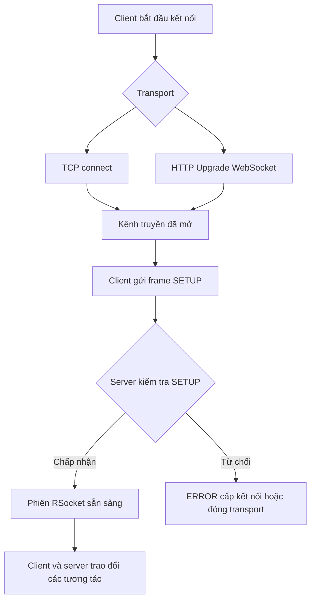
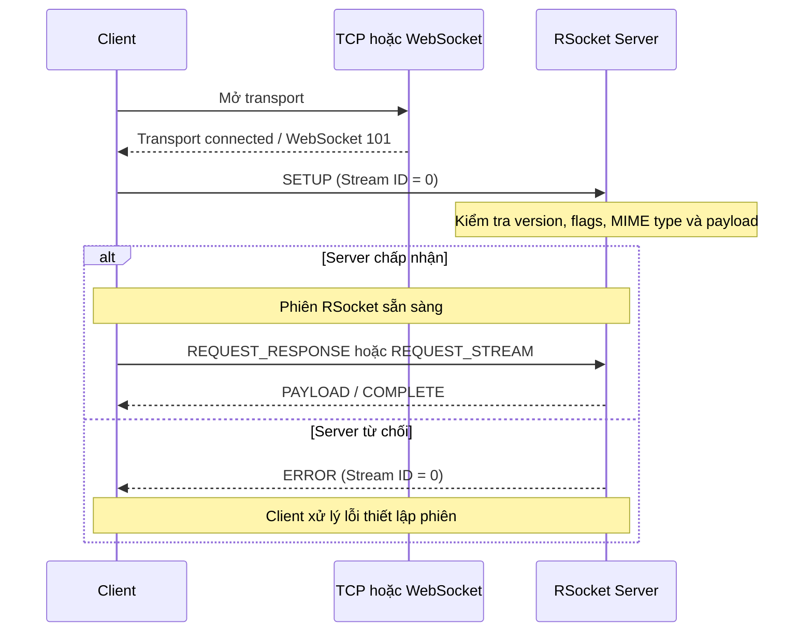

# Trình tự mở kết nối và gửi frame SETUP

Trước khi client và server trao đổi request-response, stream hoặc channel, hai bên phải thiết lập một phiên RSocket trên transport đã chọn. Với một kết nối mới, client gửi frame `SETUP` để giới thiệu phiên bản giao thức, tham số keepalive, định dạng dữ liệu và thông tin khởi tạo cần thiết. Server kiểm tra frame này rồi chấp nhận hoặc từ chối phiên.

`SETUP` là frame ở phạm vi kết nối, có `Stream ID = 0`. Nó không phải một request nghiệp vụ và không tạo một stream thông thường. Khi hiểu đúng trình tự này, lập trình viên có thể phân biệt được lỗi mở socket, lỗi WebSocket handshake, lỗi RSocket setup và lỗi phát sinh sau khi các tương tác đã bắt đầu.

## 1. Hai bước trước khi ứng dụng gửi request

Một kết nối RSocket mới thường trải qua hai giai đoạn. Giai đoạn thứ nhất tạo kênh truyền ở tầng mạng. Giai đoạn thứ hai dùng kênh đó để thiết lập phiên RSocket.



Với TCP, client mở kết nối tới địa chỉ IP và cổng của server. TCP hoàn thành bắt tay kết nối trước khi RSocket gửi dữ liệu. Với WebSocket, client thực hiện HTTP Upgrade và nhận phản hồi `101 Switching Protocols`; sau đó hai bên mới trao đổi frame RSocket trên kênh WebSocket.

Transport mở thành công chưa có nghĩa phiên RSocket đã sẵn sàng. TCP có thể kết nối được nhưng server vẫn từ chối `SETUP`. Tương tự, WebSocket có thể trả về `101` nhưng frame `SETUP` tiếp theo vẫn có thể không hợp lệ hoặc không được server chấp nhận.

## 2. Frame SETUP là gì?

`SETUP` là frame đầu tiên client gửi khi tạo một phiên RSocket mới. Frame có type `SETUP` (`0x01`) và `Stream ID = 0`, vì thông tin trong frame áp dụng cho toàn bộ kết nối. Nó cho server biết client muốn sử dụng phiên bản giao thức nào, các tham số keepalive ra sao, cách diễn giải data và metadata như thế nào, đồng thời có thể gửi payload khởi tạo.

Các nhóm thông tin chính trong `SETUP` gồm:

| Thành phần | Mục đích |
|---|---|
| Protocol version | Phiên bản major/minor của giao thức mà client sử dụng |
| Keepalive interval | Khoảng thời gian client đề xuất giữa các frame keepalive |
| Max lifetime | Thời gian tối đa mà peer có thể chờ trước khi xem kết nối không còn hoạt động theo tham số setup |
| Flags | Các tùy chọn của phiên, ví dụ lease hoặc resume |
| Metadata MIME type | Định dạng metadata mà hai bên sẽ diễn giải |
| Data MIME type | Định dạng phần data của payload |
| Setup payload | Data và metadata khởi tạo do ứng dụng gửi kèm, nếu có |

Frame header chứa Stream ID, frame type và các cờ frame. Phần nội dung của `SETUP` chứa các tham số phiên, các MIME type và payload. Khi resume được bật, phần setup còn có thể chứa thông tin phục vụ nhận diện phiên cần khôi phục.

Có thể hình dung cấu trúc logic như sau:

```text
+------------------------------------------------------+
| Frame Header: Stream ID = 0, Type = SETUP             |
+------------------------------------------------------+
| Protocol Version: Major, Minor                       |
+------------------------------------------------------+
| Keepalive Interval | Max Lifetime                    |
+------------------------------------------------------+
| Setup Flags                                          |
+------------------------------------------------------+
| Metadata MIME Type | Data MIME Type                  |
+------------------------------------------------------+
| Resume information (nếu được bật)                    |
+------------------------------------------------------+
| Setup Payload: Metadata và Data (nếu có)             |
+------------------------------------------------------+
```

Đây là sơ đồ khái niệm để nhận diện các nhóm trường, không phải sơ đồ kích thước byte chính xác. Khi phân tích frame thô, cần dùng đặc tả RSocket tương ứng để đọc độ dài từng trường, bit flag và payload.

## 3. Những thông tin client gửi trong SETUP

### Phiên bản giao thức

Client đưa phiên bản major và minor vào frame `SETUP`. Server kiểm tra phiên bản đó có tương thích với implementation của mình hay không. Nếu phiên bản hoặc cấu hình không được hỗ trợ, server có thể từ chối thiết lập phiên bằng lỗi cấp kết nối.

Việc hai bên cùng dùng thư viện RSocket chưa tự đảm bảo chúng tương thích. Cần kiểm tra phiên bản implementation, phiên bản giao thức và các extension mà ứng dụng bật. Khi nâng cấp thư viện, nên kiểm thử kết nối giữa client và server ở đúng các phiên bản sẽ chạy trong môi trường triển khai.

### Keepalive interval và max lifetime

Hai tham số này giúp hai bên nhận biết kết nối không còn hoạt động. Keepalive interval xác định chu kỳ gửi frame `KEEPALIVE`; max lifetime đặt giới hạn thời gian chờ theo cơ chế keepalive trước khi xem peer hoặc kết nối đã mất phản hồi.

Giá trị cần phù hợp với idle timeout của firewall, reverse proxy và load balancer trên đường truyền. Nếu hạ tầng đóng kết nối sau 60 giây nhàn rỗi, nhưng client chỉ gửi keepalive sau vài phút, kết nối có thể bị đóng trước heartbeat tiếp theo. Nếu đặt chu kỳ quá ngắn, ứng dụng tạo nhiều lưu lượng nền và công việc xử lý hơn mức cần thiết.

Keepalive của RSocket là cơ chế ở tầng giao thức. Nó khác với TCP keepalive của hệ điều hành và Ping/Pong của WebSocket. Một hệ thống có thể dùng nhiều cơ chế cùng lúc; cần cấu hình sao cho chúng không xung đột với timeout của hạ tầng.

### MIME type cho data và metadata

MIME type cho server biết cách diễn giải phần data và metadata trong payload. Ví dụ, data có thể là JSON (`application/json`), còn metadata có thể dùng composite metadata của RSocket để mang route và thông tin xác thực.

MIME type phải thống nhất giữa client và server. Nếu client gửi JSON nhưng server giải mã theo định dạng khác, kết nối vẫn có thể setup thành công nhưng request sau đó thất bại khi giải mã payload. Đây là lý do nên phân biệt lỗi setup với lỗi xử lý tương tác.

### Setup payload

Setup payload là dữ liệu ứng dụng gắn với thời điểm thiết lập phiên. Nó có thể mang thông tin như định danh client, tenant, phiên bản ứng dụng, capability hoặc metadata phục vụ xác thực ban đầu. Server có thể dùng dữ liệu này để kiểm tra chính sách truy cập hoặc khởi tạo trạng thái gắn với kết nối.

Setup payload không phải payload của `REQUEST_RESPONSE` hay `REQUEST_STREAM`. Nó được gửi một lần khi mở phiên mới và không đại diện cho một stream nghiệp vụ. Nếu cần gửi nhiều request sau khi kết nối, client phải tạo các tương tác RSocket thông thường.

Không đưa bí mật vào setup payload nếu đường truyền chưa được bảo vệ. Với token hoặc dữ liệu nhạy cảm, cần sử dụng TLS và chính sách xác thực phù hợp; đồng thời tránh ghi nguyên payload vào log.

### Flags và các khả năng mở rộng

`SETUP` có các flag cho biết client có yêu cầu một số khả năng của phiên hay không. Hai khả năng thường được nhắc đến là lease và resume.

- Lease cho phép server kiểm soát số lượng request mà client được phép khởi tạo trong một khoảng thời gian bằng các frame `LEASE`.
- Resume hỗ trợ khôi phục một phiên đã bị ngắt nếu cả hai phía triển khai và cấu hình cơ chế này. Khi resume được sử dụng, client và server cần quản lý token cùng trạng thái frame để tiếp tục phiên.

Không nên bật flag chỉ vì thư viện có API tương ứng. Server phải hỗ trợ khả năng đó và ứng dụng phải có chiến lược vận hành, lưu trạng thái và kiểm thử phù hợp.

## 4. Trình tự gửi SETUP và thời điểm phiên sẵn sàng

Với một kết nối mới, luồng xử lý khái quát như sau:

1. Client chọn transport và mở kết nối TCP hoặc WebSocket tới server.
2. Sau khi transport sẵn sàng, client tạo frame `SETUP` với version, keepalive, lifetime, flags, MIME type và setup payload.
3. Client gửi `SETUP` với `Stream ID = 0` trên kết nối mới.
4. Server đọc frame, kiểm tra cấu trúc, phiên bản, khả năng được yêu cầu và dữ liệu setup.
5. Nếu chấp nhận, server hoàn tất việc thiết lập phiên. Hai bên có thể bắt đầu các tương tác RSocket thông thường.
6. Nếu từ chối, server có thể gửi frame `ERROR` cấp kết nối với `Stream ID = 0` và mã lỗi phù hợp; trong một số tình huống transport cũng có thể bị đóng.



Một chi tiết quan trọng: giao thức không yêu cầu server gửi một frame `SETUP_ACK` riêng khi chấp nhận setup. `SETUP` là frame mở phiên do client gửi; nếu server từ chối, nó báo lỗi cấp kết nối. API connector của thư viện thường chỉ phát ra đối tượng kết nối sau khi quá trình setup được chấp nhận. Vì vậy, khi dùng API cấp cao, ứng dụng thường quan sát kết quả của thao tác connect thay vì tự đọc một frame xác nhận.

Client chỉ nên gửi request nghiệp vụ sau khi thao tác connect báo thành công. Nếu tự xây dựng tầng protocol hoặc transport, cần bảo đảm `SETUP` đã được xử lý trước khi phát các frame tương tác phụ thuộc vào phiên.

## 5. Xử lý khi server từ chối SETUP

Lỗi setup có phạm vi kết nối vì lúc này phiên RSocket chưa sẵn sàng cho các tương tác thông thường. Một số mã lỗi chuẩn thường gặp:

| Mã lỗi | Giá trị | Trường hợp điển hình |
|---|---:|---|
| `INVALID_SETUP` | `0x00000001` | Frame setup sai cấu trúc hoặc giá trị không hợp lệ |
| `UNSUPPORTED_SETUP` | `0x00000002` | Server không hỗ trợ phiên bản hoặc cấu hình setup được yêu cầu |
| `REJECTED_SETUP` | `0x00000003` | Server chủ động từ chối thiết lập phiên |

Khi nhận `ERROR` với `Stream ID = 0`, client cần xem kết nối đó là chưa được thiết lập hoặc đã kết thúc. Không nên tiếp tục gửi request trên cùng session. Cần đọc mã lỗi và thông tin chẩn đoán, kiểm tra cấu hình hai đầu rồi tạo kết nối mới khi nguyên nhân đã được xử lý.

Không nên retry setup vô hạn với cùng một cấu hình sai. Ví dụ, nếu server không hỗ trợ MIME type mà client gửi, retry liên tục không làm cho cấu hình trở nên tương thích. Nếu lỗi là tạm thời, retry nên có giới hạn, backoff và jitter để tránh tạo một đợt kết nối dồn dập.

## 6. Setup payload và xử lý kết nối trong Spring

Spring RSocket cung cấp `@ConnectMapping` để xử lý thông tin gửi trong frame `SETUP`. Annotation này phục vụ logic gắn với kết nối, ví dụ kiểm tra client context hoặc khởi tạo trạng thái phiên. Nó khác `@MessageMapping`, vốn xử lý các tương tác RSocket sau khi phiên đã được thiết lập.

Ví dụ server xử lý route trong metadata của setup:

```java
import org.springframework.messaging.handler.annotation.Payload;
import org.springframework.messaging.rsocket.annotation.ConnectMapping;
import org.springframework.stereotype.Controller;

@Controller
public class SessionController {

    private final ClientSessionService sessionService;

    public SessionController(ClientSessionService sessionService) {
        this.sessionService = sessionService;
    }

    @ConnectMapping("client.connect")
    public void onConnect(@Payload ClientContext context) {
        sessionService.initialize(context);
    }
}
```

`ClientContext` và `ClientSessionService` là kiểu dữ liệu, service do ứng dụng định nghĩa; ví dụ giả định `initialize` thực hiện kiểm tra đồng bộ. Spring ánh xạ route setup tới phương thức `@ConnectMapping` và chuyển phần data thành đối tượng tương ứng thông qua message conversion. Nếu logic khởi tạo thất bại, ứng dụng cần xử lý lỗi theo chính sách setup của phiên bản Spring đang dùng; không nên nuốt lỗi rồi coi một client chưa được xác thực là đã sẵn sàng.

Phía client có thể gửi route và data cho setup bằng `RSocketRequester.Builder`:

```java
import org.springframework.messaging.rsocket.RSocketRequester;
import reactor.core.publisher.Mono;

Mono<RSocketRequester> requesterMono = RSocketRequester.builder()
    .setupRoute("client.connect")
    .setupData(new ClientContext("web-dashboard", "tenant-42"))
    .connectTcp("localhost", 7000);
```

`setupRoute` và `setupData` tác động tới frame mở phiên. Sau khi `requesterMono` phát ra `RSocketRequester`, client có thể dùng requester đó để gửi các request theo route nghiệp vụ. Ví dụ:

```java
Mono<AccountSummary> summary = requesterMono.flatMap(requester ->
    requester.route("account.summary")
        .data(new AccountQuery("account-42"))
        .retrieveMono(AccountSummary.class)
);
```

Không nên gọi `block()` trong luồng xử lý reactive của ứng dụng chỉ để lấy requester. Hãy ghép publisher kết nối với pipeline sử dụng nó, hoặc quản lý vòng đời requester ở tầng phù hợp. Các API builder và cách xử lý lỗi trong `@ConnectMapping` có thể khác theo phiên bản Spring; cần dùng tài liệu tương ứng với dependency của dự án.

## 7. Gửi SETUP trực tiếp bằng RSocket Java

Khi không dùng Spring, có thể cấu hình setup payload và các tham số phiên trực tiếp qua `RSocketConnector`. Ví dụ dưới đây minh họa client TCP gửi data setup dạng JSON:

```java
import java.time.Duration;
import io.rsocket.RSocket;
import io.rsocket.RSocketConnector;
import io.rsocket.util.DefaultPayload;
import io.rsocket.transport.netty.client.TcpClientTransport;

RSocket socket = RSocketConnector.create()
    .setupPayload(DefaultPayload.create(
        "{\"clientId\":\"web-dashboard\",\"tenant\":\"tenant-42\"}"
    ))
    .dataMimeType("application/json")
    .keepAlive(Duration.ofSeconds(20), Duration.ofMinutes(2))
    .connect(TcpClientTransport.create("localhost", 7000))
    .block();
```

Ví dụ dùng data setup để minh họa nội dung được gửi một lần khi mở phiên. Trong ứng dụng thực tế, cần chọn MIME type và codec phù hợp với payload hai bên, đồng thời cấu hình metadata MIME type nếu gửi metadata. `block()` chỉ phù hợp trong ví dụ chạy ở luồng khởi tạo đồng bộ; trong pipeline reactive, nên giữ kết quả kết nối dưới dạng `Mono<RSocket>`.

Khi kết nối thành công, `socket` đại diện cho phiên RSocket đã được thiết lập. Ứng dụng có thể gọi `requestResponse`, `requestStream`, `fireAndForget` hoặc `requestChannel` tùy hợp đồng. Nếu publisher kết nối phát lỗi, cần xử lý lỗi setup hoặc lỗi transport trước khi sử dụng socket.

## 8. SETUP khác với request nghiệp vụ và RESUME

Ba loại thông điệp này có vai trò khác nhau:

| Thông điệp | Phạm vi | Mục đích | Thời điểm |
|---|---|---|---|
| `SETUP` | Kết nối | Khởi tạo một phiên RSocket mới | Frame đầu tiên trên transport mới |
| `REQUEST_RESPONSE`, `REQUEST_STREAM`, `FNF`, `REQUEST_CHANNEL` | Stream | Thực hiện tương tác nghiệp vụ | Sau khi phiên đã được thiết lập |
| `RESUME` | Kết nối | Yêu cầu tiếp tục một phiên đã bị gián đoạn nếu resume được hỗ trợ | Khi khôi phục một phiên cũ |

`SETUP` không được gửi cho mỗi request. Một kết nối RSocket có thể phục vụ nhiều stream độc lập sau một lần setup. Nếu kết nối bị mất và client tạo một phiên hoàn toàn mới, client thực hiện setup lại. Nếu ứng dụng dùng cơ chế resume, quá trình khôi phục dùng frame `RESUME` cùng thông tin phiên đã lưu thay vì coi đó là một setup mới.

Setup payload cũng không phải cách gửi thông tin cho từng request. Dữ liệu thay đổi theo nghiệp vụ, như mã đơn hàng hoặc truy vấn tài khoản, nên nằm trong payload của tương tác tương ứng. Setup payload dành cho ngữ cảnh gắn với toàn bộ phiên, ví dụ client identity hoặc tenant context, và server vẫn phải kiểm tra quyền truy cập ở các request theo chính sách của ứng dụng.

## 9. Các lỗi thường gặp trong quá trình thiết lập

| Dấu hiệu | Tầng có thể gặp lỗi | Hướng kiểm tra |
|---|---|---|
| TCP connection refused hoặc timeout | Transport TCP | Host, port, server bind, firewall và định tuyến mạng |
| WebSocket không trả `101` | HTTP/WebSocket | URL, mapping path, Upgrade headers, proxy và TLS certificate |
| Transport mở được nhưng setup bị từ chối | RSocket SETUP | Protocol version, flags, MIME type, setup payload và chính sách server |
| Setup thành công nhưng `@ConnectMapping` không chạy | Spring Messaging | Route metadata, annotation, component scan và message conversion |
| Setup thành công nhưng request sau đó không giải mã được | Payload codec | Data/metadata MIME type và encoder/decoder ở hai phía |
| Kết nối bị đóng sau một thời gian nhàn rỗi | Keepalive và hạ tầng | Keepalive interval, max lifetime và idle timeout của proxy/load balancer |

Nên chẩn đoán theo thứ tự tầng thấp tới tầng cao:

1. Xác nhận server đang lắng nghe đúng transport, host, port và path.
2. Kiểm tra client mở được TCP hoặc WebSocket handshake hay chưa.
3. Kiểm tra frame `SETUP`, protocol version, flags và MIME type.
4. Xác nhận server chấp nhận setup và API connect hoàn tất.
5. Nếu dùng Spring, kiểm tra `@ConnectMapping` cùng setup route và setup data.
6. Gửi một request nghiệp vụ đơn giản để kiểm tra route, payload codec và handler.
7. Kiểm thử keepalive, timeout và hành vi reconnect trong điều kiện mạng thực tế.

Đừng suy ra setup thành công chỉ từ việc cổng TCP mở hoặc WebSocket trả `101`. Cũng đừng suy ra request nghiệp vụ hoạt động chỉ từ việc setup thành công; hai giai đoạn có cấu hình và lỗi riêng.

## 10. Lưu ý bảo mật khi thiết lập phiên

Setup payload và metadata có thể chứa thông tin nhận diện client hoặc thông tin xác thực. Nếu truyền qua mạng không tin cậy, cần bật TLS ở transport: TLS cho TCP hoặc `wss://` cho WebSocket. Chứng thư phải được xác minh đúng hostname và cấu hình proxy phải bảo vệ cả chặng mạng sau khi TLS kết thúc nếu dữ liệu tiếp tục đi qua mạng không tin cậy.

Server không nên tin một giá trị `tenantId` hoặc `clientId` chỉ vì nó xuất hiện trong setup payload. Những giá trị đó có thể do client tự gửi. Cần xác thực danh tính và kiểm tra quyền truy cập trước khi gắn ngữ cảnh vào session. Với hệ thống đa tenant, phải bảo đảm trạng thái theo kết nối không bị dùng nhầm giữa các client.

Không ghi token, mật khẩu hoặc toàn bộ setup payload vào log. Khi cần chẩn đoán, chỉ ghi các trường không nhạy cảm như loại client, phiên bản ứng dụng, kết quả setup, mã lỗi và correlation ID. Nếu setup bị từ chối, log nên giúp phân biệt lỗi cấu hình với lỗi xác thực mà không tiết lộ thông tin bí mật cho client.

## 11. Kết luận

Trình tự mở một phiên RSocket mới gồm mở transport, gửi frame `SETUP` ở `Stream ID = 0`, để server kiểm tra các tham số phiên và chỉ bắt đầu tương tác nghiệp vụ sau khi setup được chấp nhận. `SETUP` mang phiên bản giao thức, keepalive, lifetime, flags, MIME type và setup payload; các thông tin này định hình cách hai bên giao tiếp trên toàn bộ kết nối.

Khi triển khai bằng RSocket Java hoặc Spring, hãy xem setup là giai đoạn khởi tạo phiên riêng biệt. Kiểm tra transport, setup, `@ConnectMapping` và request handler theo đúng thứ tự sẽ giúp xác định lỗi nhanh hơn, đồng thời tránh gửi request khi phiên chưa sẵn sàng hoặc đặt nhầm dữ liệu theo request vào setup payload.
