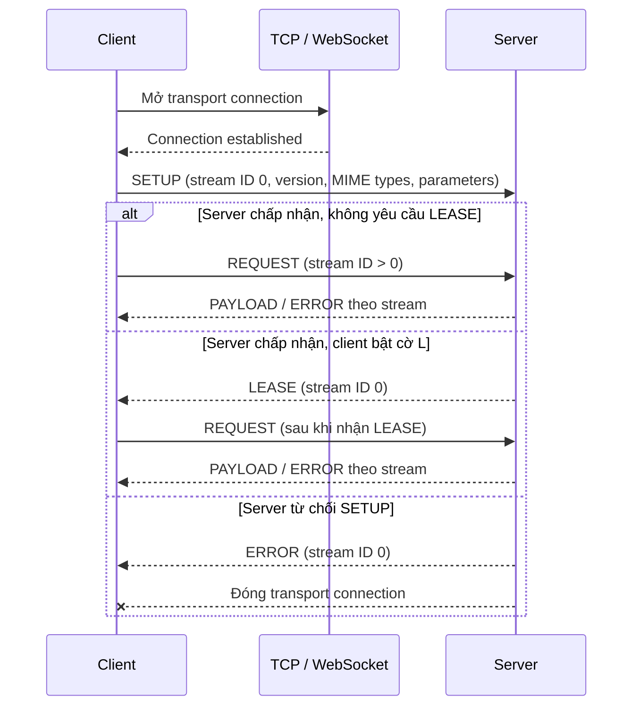
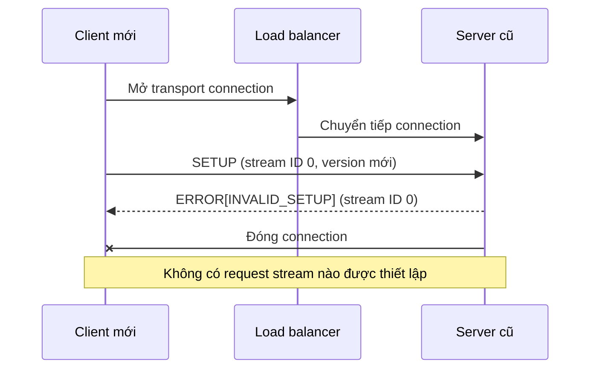

# Phiên bản giao thức và xử lý thiết lập không tương thích

Khi client mở transport connection tới RSocket server, client gửi frame `SETUP` để khai báo phiên bản giao thức và các tham số kết nối mà nó muốn sử dụng. Server kiểm tra thông tin này rồi quyết định chấp nhận hoặc từ chối thiết lập. Nếu phiên bản hay tham số không tương thích, server trả frame `ERROR` ở phạm vi connection và đóng kết nối.

RSocket không thực hiện một quy trình trao đổi nhiều vòng để hai bên tự tìm phiên bản chung. Client gửi phiên bản mà implementation của nó hỗ trợ; server quyết định có thể phục vụ phiên bản đó hay không. Vì vậy, quản lý phiên bản thư viện client/server và kiểm thử tương thích là một phần quan trọng khi nâng cấp hệ thống realtime.

## Mục tiêu học tập

Sau bài học, người học có thể:

- Xác định vị trí major version và minor version trong frame `SETUP`.
- Giải thích cách RSocket quy định tương thích giữa các phiên bản.
- Phân biệt lỗi `INVALID_SETUP`, `UNSUPPORTED_SETUP` và `REJECTED_SETUP`.
- Mô tả trình tự thiết lập thành công, thiết lập bị từ chối và trường hợp sử dụng LEASE.
- Phân biệt lỗi phiên bản giao thức với lỗi transport, MIME type hoặc setup parameter.
- Lập kế hoạch nâng cấp client/server và xử lý lỗi thiết lập trong Java/Spring Boot.

## 1. Vì sao SETUP cần mang phiên bản giao thức?

Transport như TCP hoặc WebSocket chỉ cung cấp kênh chuyển dữ liệu. Sau khi kênh được mở, hai peer vẫn cần thống nhất cách diễn giải frame RSocket: header có ý nghĩa gì, interaction model hoạt động ra sao, metadata được mã hóa thế nào và các tham số phiên được hiểu theo quy tắc nào.

Frame `SETUP` mang thông tin khởi tạo để server biết client muốn sử dụng cách vận hành nào. Phiên bản giao thức là một phần của thông tin này. Nếu client và server hiểu các quy tắc khác nhau, việc tiếp tục trao đổi frame có thể khiến một bên giải mã sai hoặc thực thi sai semantics.

Do đó, cần tách hai câu hỏi:

- **Transport có kết nối được không?** Ví dụ TCP socket đã mở hoặc WebSocket handshake đã thành công.
- **RSocket session có được chấp nhận không?** Server đã kiểm tra `SETUP` và chấp nhận phiên bản cùng các tham số hay chưa.

Một kết nối TCP/WebSocket thành công chưa chứng minh RSocket session đã được thiết lập.

## 2. Major và minor version trong SETUP

`SETUP` là frame đầu tiên client gửi sau khi transport connection được thiết lập thành công. Frame này luôn dùng `stream ID = 0`, vì nó khởi tạo toàn bộ connection chứ không thuộc một request stream riêng.

Trong header của `SETUP`, phiên bản giao thức gồm hai trường số nguyên không dấu:

| Trường | Kích thước | Ý nghĩa |
|---|---:|---|
| Major Version | 16 bit | Thành phần phiên bản major mà client khai báo |
| Minor Version | 16 bit | Thành phần phiên bản minor mà client khai báo |

Hai trường được mã hóa trong `SETUP` frame. Client gửi cặp version mà protocol implementation của nó sử dụng; server đọc cặp giá trị đó để quyết định có chấp nhận hay không.

### Quy tắc tương thích của RSocket

Quy tắc versioning trong đặc tả RSocket cần được hiểu cẩn thận: **đặc tả giả định mọi thay đổi phiên bản, cả major lẫn minor, đều không tương thích ngược**. Không nên áp dụng mặc định giả định SemVer phổ biến rằng minor version luôn chỉ bổ sung tính năng và tương thích với phiên bản trước.

Client truyền phiên bản mà nó hỗ trợ trong `SETUP`. Server có quyền chấp nhận client dùng phiên bản thấp hơn phiên bản server hỗ trợ. Việc chấp nhận phụ thuộc vào khả năng thực sự của server; không có bảo đảm rằng mọi phiên bản cũ đều được hỗ trợ vô thời hạn.

Ví dụ minh họa, không phải số phiên bản hiện hành của RSocket:

| Client gửi | Server hỗ trợ | Cách server có thể xử lý |
|---|---|---|
| Phiên bản thấp hơn | Phiên bản cao hơn và còn hỗ trợ phiên bản client | Có thể chấp nhận client cũ |
| Phiên bản cao hơn | Server chưa hỗ trợ phiên bản client | Có thể từ chối vì SETUP không hợp lệ đối với server cũ |
| Cùng phiên bản | Một tham số trong SETUP không được hỗ trợ | Từ chối vì tham số không được hỗ trợ |
| Cùng phiên bản | SETUP sai cấu trúc hoặc sai giá trị bắt buộc | Từ chối vì SETUP không hợp lệ |

Server là bên quyết định chấp nhận phiên bản client. Client không gửi một danh sách phiên bản để server chọn, và server không trả một frame riêng để thông báo “phiên bản đã thương lượng” trong luồng SETUP thông thường.

## 3. Những thông tin khác trong SETUP

Phiên bản chỉ là một phần của frame. Server còn phải kiểm tra các tham số khác mà client muốn dùng.

| Thành phần | Vai trò |
|---|---|
| Frame type `SETUP` (`0x01`) | Cho biết đây là frame khởi tạo phiên |
| Stream ID `0` | Đánh dấu phạm vi connection |
| Major/Minor Version | Phiên bản giao thức client khai báo |
| Time Between KEEPALIVE Frames | Khoảng thời gian client dự kiến gửi keepalive, tính bằng mili giây; giá trị phải lớn hơn 0 |
| Max Lifetime | Khoảng thời gian client chờ phản hồi keepalive trước khi xem peer là không còn hoạt động; giá trị phải lớn hơn 0 |
| Metadata MIME type | Định dạng metadata mà client sẽ gửi |
| Data MIME type | Định dạng data mà client sẽ gửi |
| Setup payload | Data và metadata ban đầu mô tả ngữ cảnh hoặc khả năng của endpoint |

Một số cờ trong `SETUP`:

- `M` (Metadata): setup payload có metadata.
- `R` (Resume Enable): client yêu cầu khả năng resume và cung cấp resume identification token.
- `L` (Lease): client thông báo sẽ tuân thủ cơ chế LEASE của peer.

Metadata MIME type và data MIME type được khai báo riêng. RSocket protocol không tự diễn giải schema hoặc nội dung MIME type; việc giải mã data/metadata là trách nhiệm của ứng dụng và codec đã cấu hình.

Nếu client bật cờ `R` nhưng server không hỗ trợ resume, server phải từ chối SETUP bằng `ERROR[REJECTED_SETUP]`. Đây là ví dụ cho thấy phiên bản giao thức có thể khớp nhưng một capability được yêu cầu vẫn không được server hỗ trợ.

## 4. SETUP được chấp nhận như thế nào?

Sau khi transport connection mở, client phải gửi `SETUP` hoặc `RESUME` với stream ID 0 trước các frame khác. Bài học này tập trung vào thiết lập phiên mới bằng `SETUP`.

Nếu server chấp nhận `SETUP`:

- Nếu client không bật cờ `L`, client có thể bắt đầu gửi request ngay sau `SETUP`.
- Nếu client bật cờ `L`, server phải gửi frame `LEASE`; client phải chờ LEASE trước khi gửi request.
- Server cũng có thể khởi tạo request theo quy tắc requester/responder của RSocket sau khi phiên được chấp nhận.

Không có một frame `SETUP_ACK` chung bắt buộc cho mọi phiên thành công. Client có thể xem SETUP đã được chấp nhận khi nhận được response cho request, một frame `LEASE`, hoặc một request do peer gửi. Nếu nhận `ERROR` trong giai đoạn này, client xem SETUP đã bị từ chối.

Client không được gửi request trước khi quá trình thiết lập hoàn tất. Server cũng không được phát payload response trước khi connection establishment hoàn tất.

## 5. Ba loại lỗi từ chối thiết lập

Khi server không chấp nhận nội dung `SETUP`, server gửi frame `ERROR` với `stream ID = 0`, sau đó đóng connection. Đặc tả phân biệt các mã lỗi sau:

| Error code | Giá trị | Ý nghĩa | Ví dụ tình huống |
|---|---:|---|---|
| `INVALID_SETUP` | `0x00000001` | Frame SETUP không hợp lệ đối với server | SETUP sai cấu trúc hoặc client dùng phiên bản quá mới so với server cũ |
| `UNSUPPORTED_SETUP` | `0x00000002` | Một hoặc nhiều tham số client yêu cầu không được server hỗ trợ | MIME type hoặc capability mà server không hỗ trợ |
| `REJECTED_SETUP` | `0x00000003` | Server chủ động từ chối thiết lập và có thể nêu lý do trong Error Data | Chính sách server không cho phép phiên hoặc client yêu cầu resume nhưng server không hỗ trợ |

Ba mã trên đều là lỗi ở phạm vi connection nên stream ID phải bằng 0. Error Data thường là chuỗi UTF-8 mô tả lý do. Client nên ghi nhận mã lỗi và thông tin chẩn đoán, nhưng không nên dựa vào nội dung văn bản tự do để điều khiển logic tương thích vì định dạng thông điệp có thể phụ thuộc implementation.

### Phân biệt ba trường hợp

**`INVALID_SETUP`** thường chỉ ra dữ liệu SETUP không thể được server hiểu hoặc chấp nhận theo giao thức. Đặc tả nêu ví dụ client quá mới đối với server cũ.

**`UNSUPPORTED_SETUP`** cho biết server hiểu yêu cầu nhưng không hỗ trợ một hoặc một số tham số được khai báo. Ví dụ, server có thể không hỗ trợ một MIME type hoặc capability cụ thể.

**`REJECTED_SETUP`** cho biết server quyết định từ chối phiên. Lý do có thể do chính sách, trạng thái vận hành hoặc một capability cụ thể; Error Data có thể giải thích thêm.

Không nên gộp mọi lỗi thành “sai version”. Một lỗi setup có thể đến từ version, MIME type, resume, lease, tham số keepalive hoặc chính sách server.

## 6. Trình tự khi version không tương thích

Ví dụ, client đã được nâng cấp lên phiên bản giao thức mới hơn, trong khi một node server trong cụm vẫn chạy implementation cũ. Client mở TCP hoặc WebSocket thành công rồi gửi `SETUP` với version mới. Node server cũ không hỗ trợ phiên bản đó và từ chối thiết lập.

Client có thể nhìn thấy transport đã mở nhưng không tạo được RSocket session. Nếu log chỉ ghi “connection refused” hoặc “connect failed”, thông tin chẩn đoán sẽ thiếu chính xác. Nên phân biệt giai đoạn lỗi: TCP/WebSocket connect, SETUP validation hay request sau khi session đã sẵn sàng.

## 7. Cách xử lý ở client Java

Trong ứng dụng Java, protocol library thường chịu trách nhiệm tạo header `SETUP` và ghi version mà implementation hỗ trợ. Với Spring Boot, `RSocketRequester` hoặc connector tương ứng tạo phiên và gửi các thông tin setup. Ứng dụng thường cấu hình setup payload, data MIME type, metadata MIME type, keepalive hoặc resume theo API của phiên bản thư viện đang dùng; không nên tự sửa byte version trong frame.

Khi kết nối thất bại ở giai đoạn setup, client nên:

1. Phân loại lỗi là lỗi transport hay lỗi RSocket setup.
2. Ghi endpoint, thời điểm, phiên bản ứng dụng/thư viện client, mã lỗi RSocket và server node nếu có.
3. Nếu là `INVALID_SETUP`, kiểm tra version protocol mà client library gửi và khả năng hỗ trợ của server.
4. Nếu là `UNSUPPORTED_SETUP`, kiểm tra MIME type, resume, lease và các tham số khác được yêu cầu.
5. Nếu là `REJECTED_SETUP`, đọc Error Data theo hướng chẩn đoán và kiểm tra chính sách server.
6. Chỉ retry sau khi có thay đổi có ý nghĩa, chẳng hạn kết nối tới node tương thích hoặc tắt một capability tùy chọn mà server không hỗ trợ.

Không nên retry liên tục cùng một SETUP không đổi. Việc mở lại TCP/WebSocket không làm phiên bản giao thức trở nên tương thích.

### Khi nào có thể fallback version?

Fallback chỉ hợp lệ nếu client implementation thực sự hỗ trợ tạo frame theo phiên bản cũ và server xác nhận phiên bản đó được hỗ trợ. Không phải mọi thư viện cho phép ứng dụng chọn tùy ý major/minor version. Nếu API không cung cấp cấu hình version, không tự giả lập fallback bằng cách thay byte trên wire; hãy dùng phiên bản thư viện tương thích hoặc nâng cấp server.

Nếu lỗi đến từ một tham số tùy chọn, client có thể thử lại với cấu hình tối giản hơn chỉ khi việc bỏ tham số đó vẫn bảo toàn yêu cầu nghiệp vụ và protocol implementation cho phép. Ví dụ, không bật resume nếu server không hỗ trợ resume và ứng dụng chấp nhận mất khả năng resume. Việc fallback phải được ghi log rõ ràng để tránh âm thầm hạ cấp hành vi bảo mật hoặc độ tin cậy.

## 8. Cách xử lý ở server

Server nên kiểm tra SETUP theo trình tự dễ chẩn đoán:

1. Kiểm tra frame type, stream ID và cấu trúc bắt buộc.
2. Kiểm tra major/minor version mà client gửi.
3. Kiểm tra data MIME type và metadata MIME type.
4. Kiểm tra keepalive interval, max lifetime và các giá trị bắt buộc.
5. Kiểm tra capability như resume và lease theo cấu hình server.
6. Áp dụng chính sách xác thực hoặc chấp nhận connection của ứng dụng.
7. Chấp nhận phiên hoặc gửi ERROR connection-level phù hợp rồi đóng connection.

Thông tin log server nên gồm:

- Version client khai báo trong SETUP.
- Version và build của RSocket implementation phía server.
- Error code đã gửi (`INVALID_SETUP`, `UNSUPPORTED_SETUP` hoặc `REJECTED_SETUP`).
- Tham số/capability bị từ chối ở mức đủ để vận hành chẩn đoán.
- Transport, endpoint, node và correlation ID của lần kết nối nếu có.

Không ghi token resume, credential, setup metadata nhạy cảm hoặc payload xác thực ở dạng rõ. Khi trả Error Data cho client, chỉ đưa thông tin cần thiết; không gửi stack trace nội bộ hoặc chi tiết hạ tầng có thể bị khai thác.

## 9. Chiến lược nâng cấp client/server

Vì đặc tả RSocket xem mọi thay đổi major và minor đều không tương thích ngược, việc nâng cấp cần được kiểm thử như một thay đổi giao thức.

### Duy trì ma trận tương thích

Tạo ma trận ghi rõ phiên bản RSocket implementation ở client và server, version giao thức mà mỗi bên phát trong SETUP, các capability được bật và kết quả kiểm thử. Không suy ra protocol version chỉ từ version của Spring Boot; cần xác định dependency RSocket thực tế được resolve trong build.

### Nâng cấp theo giai đoạn

Một quy trình thường dùng:

1. Kiểm tra phiên bản client đang chạy và server đang hỗ trợ.
2. Nâng cấp server để chấp nhận các client version cần duy trì trong giai đoạn chuyển tiếp.
3. Kiểm thử kết nối từ client cũ và client mới vào từng loại node server.
4. Nâng cấp client theo từng nhóm, theo dõi tỷ lệ `INVALID_SETUP`, `UNSUPPORTED_SETUP` và `REJECTED_SETUP`.
5. Chỉ loại bỏ hỗ trợ client cũ sau khi đã xác minh không còn client phụ thuộc.

Nếu không thể triển khai server tương thích trước, cần điều phối rollout để client mới không kết nối tới node server cũ. Load balancer có thể cần định tuyến theo pool hoặc phiên bản client trong giai đoạn chuyển tiếp, nhưng phải dựa trên thông tin xác thực/định danh đáng tin cậy và cấu hình vận hành rõ ràng.

### Kiểm thử ma trận

| Kịch bản | Điều cần xác minh |
|---|---|
| Client và server cùng version | SETUP được chấp nhận và request cơ bản hoạt động |
| Client cũ, server mới | Server chấp nhận nếu còn hỗ trợ version cũ |
| Client mới, server cũ | Server từ chối rõ ràng nếu không hỗ trợ version client |
| Version hợp lệ nhưng MIME type không hỗ trợ | `UNSUPPORTED_SETUP` hoặc mã lỗi phù hợp theo implementation/spec |
| Client yêu cầu resume nhưng server không hỗ trợ | `REJECTED_SETUP` |
| SETUP thiếu/sai trường bắt buộc | `INVALID_SETUP` |
| Một node trong cụm chạy server cũ | Theo dõi lỗi theo node để phát hiện rollout chưa đồng nhất |

## 10. Phân biệt lỗi setup với lỗi ở các giai đoạn khác

| Triệu chứng | Giai đoạn | Nơi cần kiểm tra |
|---|---|---|
| Không mở được TCP socket | Transport connect | Host, port, DNS, firewall, listener |
| WebSocket handshake thất bại | Transport handshake | URL/path, HTTP Upgrade, proxy, TLS và xác thực handshake |
| Nhận `ERROR` stream ID 0 ngay sau SETUP | RSocket connection establishment | Version, MIME type, tham số setup, resume/lease và chính sách server |
| SETUP thành công nhưng route không tồn tại | Request/stream | Routing metadata, `@MessageMapping` và handler |
| Một stream trả `APPLICATION_ERROR` | Xử lý request | Logic nghiệp vụ và dữ liệu payload |
| Connection mất sau khi hoạt động | Transport/session lifecycle | Keepalive, proxy timeout, mạng, server restart và resume |

Reconnect chỉ tạo một lần thiết lập mới. Nếu nguyên nhân là version không tương thích, reconnect tới cùng node với cùng client library sẽ tiếp tục thất bại. Cần thay đổi version/capability hoặc kết nối tới server tương thích trước khi thử lại.

## 11. Checklist trước khi phát hành

- Xác định chính xác RSocket implementation và protocol version mà client gửi trong SETUP.
- Ghi nhận các version server đang hỗ trợ trong toàn bộ cụm.
- Kiểm tra cả major và minor; không giả định minor luôn tương thích ngược.
- Đồng bộ data MIME type và metadata MIME type giữa hai phía.
- Kiểm tra các cờ resume/lease và tham số keepalive.
- Có log phân biệt lỗi transport với `INVALID_SETUP`, `UNSUPPORTED_SETUP`, `REJECTED_SETUP`.
- Có kiểm thử client cũ/client mới với server cũ/server mới.
- Có kế hoạch rollback và định tuyến tránh node chưa tương thích trong quá trình rollout.
- Không fallback version hoặc tắt capability một cách âm thầm.

## Kết luận

Client khai báo major/minor version trong `SETUP` với stream ID 0. Đặc tả RSocket xem mọi thay đổi major và minor đều không tương thích ngược; server quyết định có chấp nhận phiên bản client hay không. Khi từ chối, server gửi `ERROR` connection-level như `INVALID_SETUP`, `UNSUPPORTED_SETUP` hoặc `REJECTED_SETUP`, rồi đóng connection. Muốn nâng cấp an toàn, cần quản lý version thực tế của thư viện, kiểm tra MIME type và capability, kiểm thử ma trận client/server, đồng thời theo dõi mã lỗi trong quá trình rollout.

## Tài liệu tham khảo

- [RSocket Protocol – Versioning Scheme, SETUP Frame và Connection Establishment](https://rsocket.io/about/protocol/)
