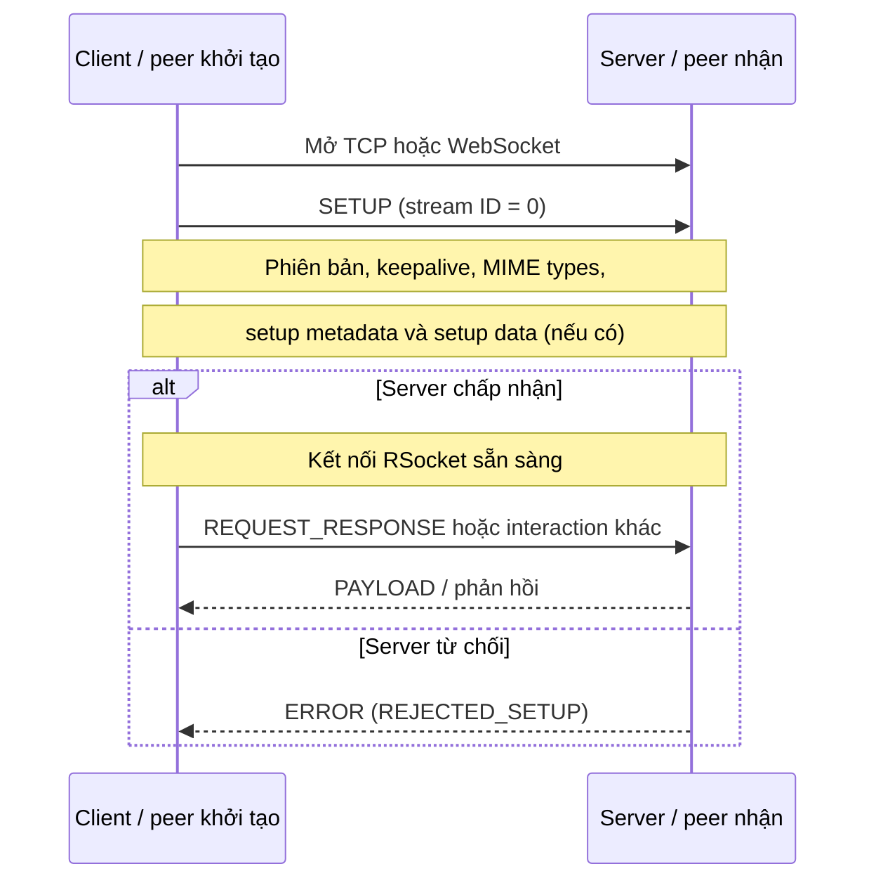

# Setup data và setup metadata dùng để trao đổi thông tin ban đầu

Khi một kết nối RSocket mới được tạo, hai peer cần thống nhất các tham số giao thức trước khi trao đổi những yêu cầu nghiệp vụ. Peer khởi tạo kết nối gửi frame `SETUP` để thông báo phiên bản giao thức, chính sách keepalive và cách mã hóa data/metadata. Trong frame này, ứng dụng có thể gửi thêm **setup data** và **setup metadata** để giới thiệu thông tin ban đầu của kết nối.

Hai phần dữ liệu này thuộc phạm vi **toàn bộ kết nối**. Chúng giúp responder nhận diện ngữ cảnh của peer ngay khi kết nối bắt đầu, chẳng hạn phiên bản ứng dụng, khả năng client, tenant hoặc thông tin xác thực ở cấp kết nối. Chúng không thay thế payload và metadata của từng request.

## 1. SETUP frame xuất hiện ở thời điểm nào?

Với kết nối RSocket mới, trình tự cơ bản là:

1. Client mở transport TCP hoặc WebSocket tới server.
2. Client gửi frame `SETUP` với stream ID bằng `0`.
3. Server kiểm tra khả năng tương thích và chính sách tiếp nhận kết nối. Server có thể từ chối bằng lỗi `REJECTED_SETUP` nếu không chấp nhận thiết lập.
4. Khi thiết lập thành công, hai peer có thể bắt đầu các tương tác RSocket, trừ khi cơ chế leasing yêu cầu chờ `LEASE`.



`SETUP` là frame điều khiển ở cấp kết nối, không phải một request nghiệp vụ. Nó được gửi một lần khi khởi tạo kết nối mới. Các request sau đó dùng stream ID riêng và mang payload riêng.

## 2. SETUP mang những thông tin gì?

Ngoài setup data và setup metadata, frame `SETUP` còn chứa các tham số cần thiết để hai đầu vận hành cùng một giao thức:

| Thành phần | Ý nghĩa |
|---|---|
| Protocol version | Phiên bản major và minor mà client muốn sử dụng |
| Time between KEEPALIVE frames | Khoảng thời gian client dự kiến gửi keepalive, tính bằng mili giây |
| Max lifetime | Khoảng thời gian tối đa client chờ keepalive từ peer trước khi xem kết nối đã mất, tính bằng mili giây |
| Metadata MIME type | Định dạng mã hóa metadata trên kết nối |
| Data MIME type | Định dạng mã hóa data trên kết nối |
| Setup metadata | Metadata tùy chọn gắn với lúc thiết lập kết nối |
| Setup data | Data tùy chọn gắn với lúc thiết lập kết nối |

Frame cũng có các cờ cho những khả năng như resumption và leasing. Nếu bật resumption, thông tin nhận diện phiên phục hồi được gửi theo quy tắc của giao thức. Những trường này thuộc phần điều khiển kết nối; không nên nhầm chúng với nội dung ứng dụng đặt trong setup data hoặc setup metadata.

Điểm cần nhớ là **MIME type được khai báo riêng cho data và metadata**. Hai peer phải có encoder/decoder tương ứng với định dạng đã thống nhất. MIME type chỉ mô tả cách diễn giải byte; bản thân tên MIME không tự thực hiện serialize hoặc deserialize dữ liệu.

## 3. Setup data: nội dung ứng dụng ban đầu

Setup data là phần data tùy chọn trong frame `SETUP`. Ứng dụng dùng nó để gửi một payload ban đầu mô tả peer hoặc khả năng mà peer cung cấp. Ví dụ:

- Tên và phiên bản ứng dụng client.
- Nền tảng chạy như web, desktop hoặc mobile.
- Danh sách tính năng mà client hỗ trợ.
- Thông tin phiên bản schema hoặc capability cần thương lượng trước khi nhận request.

Ví dụ một payload văn bản đơn giản:

```text
app=mobile;version=2.4.0;features=chat,typing-indicator
```

Trong hệ thống thực tế, setup data có thể là JSON, CBOR hoặc một cấu trúc đã định nghĩa. Khi dùng object Java, cần đăng ký encoder và decoder phù hợp ở cả hai phía. Không nên đặt payload quá lớn trong `SETUP`; đây là thông tin khởi tạo kết nối, không phải kênh truyền dữ liệu nghiệp vụ liên tục.

Setup data thường phù hợp với thông tin mô tả hoặc capability. Thông tin định danh và quyền truy cập nên được xử lý theo cơ chế xác thực riêng, không dựa vào một trường văn bản do client tự khai báo.

## 4. Setup metadata: ngữ cảnh và thông tin điều khiển

Setup metadata là phần metadata tùy chọn gắn với frame `SETUP`. Nó thường mang thông tin phục vụ việc thiết lập hoặc áp dụng chính sách cho toàn bộ kết nối, ví dụ:

- Thông tin xác thực ở cấp kết nối.
- Tenant hoặc phạm vi tổ chức mà kết nối đại diện.
- Ngữ cảnh tracing hoặc thông tin tương quan kết nối.
- Route dành riêng cho bước xử lý `@ConnectMapping`.

Metadata có thể dùng định dạng khác với data. Với composite metadata, một frame có thể mang nhiều mục metadata độc lập; mỗi mục có MIME type riêng. Đây là cách phổ biến để kết hợp routing, authentication và các metadata mở rộng.

Trong Spring, `RSocketRequester.Builder` hỗ trợ:

- `setupMetadata(value, mimeType)` để thêm một mục metadata vào `SETUP`.
- `setupRoute(route, routeVars...)` để thêm route dành cho bước kết nối.
- `metadataMimeType(mimeType)` để chọn định dạng metadata tổng thể của kết nối.

Nếu cần nhiều mục metadata hoặc vừa dùng setup route vừa thêm metadata khác, hãy sử dụng composite metadata. Spring Framework dùng `message/x.rsocket.composite-metadata.v0` làm mặc định cho metadata trong `RSocketRequester`.

## 5. Phân biệt setup data, setup metadata và request payload

| Tiêu chí | Setup data | Setup metadata | Data của request | Metadata của request |
|---|---|---|---|---|
| Thời điểm gửi | Khi thiết lập kết nối mới | Khi thiết lập kết nối mới | Khi khởi tạo từng request hoặc gửi payload tiếp theo | Gắn với request/payload tương ứng |
| Phạm vi | Toàn bộ kết nối | Toàn bộ kết nối | Một stream hoặc một payload | Một stream hoặc một payload |
| Mục đích thường gặp | Mô tả client, version, capability | Xác thực/ngữ cảnh kết nối, setup route | Dữ liệu nghiệp vụ | Route, token, trace ID, context của request |
| API Spring tiêu biểu | `setupData(...)` | `setupMetadata(...)`, `setupRoute(...)` | `data(...)` | `metadata(...)`, `route(...)` |

Ví dụ: ứng dụng mobile gửi `version=2.4.0` trong setup data khi kết nối. Sau đó, mỗi request lấy đơn hàng vẫn gửi `orderId` trong request data và route `orders.find` trong metadata. Phiên bản client không cần lặp lại trong mọi request nếu chính sách ứng dụng xem nó là thuộc tính của kết nối.

Setup metadata cũng không tự động được gắn vào mọi request sau đó. Nếu một request cần token, trace ID hoặc context riêng, requester phải gửi metadata trong request đó hoặc ứng dụng cần có cơ chế truyền ngữ cảnh rõ ràng.

## 6. Cấu hình setup data và metadata bằng Spring RSocketRequester

Ví dụ sau gửi một chuỗi làm setup data và một mục metadata văn bản. Cả hai đều dùng `text/plain`; metadata tổng thể dùng composite metadata để có thể chứa nhiều mục độc lập.

```java
import org.springframework.messaging.rsocket.RSocketRequester;
import org.springframework.util.MimeType;
import reactor.core.publisher.Mono;

MimeType textPlain = MimeType.valueOf("text/plain");
MimeType compositeMetadata = MimeType.valueOf(
    "message/x.rsocket.composite-metadata.v0"
);

RSocketRequester requester = RSocketRequester.builder()
    .dataMimeType(textPlain)
    .metadataMimeType(compositeMetadata)
    .setupRoute("client.connect")
    .setupData("app=mobile;version=2.4.0")
    .setupMetadata("locale=vi-VN", textPlain)
    .tcp("localhost", 7000);
```

Trong ví dụ này:

- `dataMimeType` khai báo định dạng data mà hai peer dùng trên kết nối.
- `metadataMimeType` khai báo định dạng metadata tổng thể.
- `setupRoute` thêm route `client.connect` để server có thể chọn handler kết nối phù hợp.
- `setupData` gửi thông tin ứng dụng ban đầu.
- `setupMetadata` gửi mục metadata `locale=vi-VN`.
- `tcp` tạo requester sử dụng transport TCP. Với WebSocket, dùng phương thức WebSocket tương ứng của phiên bản Spring đang sử dụng.

Trong ví dụ này, `text/plain` được dùng cho data ở cả hai chiều. Nếu ứng dụng chuyển sang gửi object JSON hoặc CBOR, hãy cấu hình `RSocketStrategies` với encoder/decoder tương ứng và bảo đảm phía nhận hỗ trợ cùng định dạng.

Việc gọi `tcp(...)` tạo requester nhưng trong Spring, kết nối dùng chung thường được thiết lập một cách lazy khi có request đầu tiên. Vì vậy, chỉ tạo biến `requester` chưa chắc đã gửi frame `SETUP`; một thao tác request được subscribe mới kích hoạt quá trình kết nối.

Ví dụ request đầu tiên:

```java
Mono<String> serverInfo = requester.route("system.info")
    .retrieveMono(String.class);

serverInfo.subscribe(info -> log.info("Connected to {}", info));
```

Phía server có thể trả về chuỗi tương ứng bằng handler đơn giản:

```java
@MessageMapping("system.info")
Mono<String> systemInfo() {
    return Mono.just("rsocket-service");
}
```

Khi request được thực thi, client thiết lập transport, gửi `SETUP` chứa data/metadata đã cấu hình, rồi mới gửi request `system.info`.

## 7. Nhận setup data và metadata ở phía server

Trong Spring, `@ConnectMapping` xử lý sự kiện ở cấp kết nối, bao gồm frame `SETUP` và các thông báo metadata push sau đó. Handler có thể nhận payload setup, metadata đã được trích xuất và `RSocketRequester` đại diện cho peer vừa kết nối.

Để đọc metadata tùy chỉnh dưới dạng header, phía nhận cần đăng ký MIME type và decoder tương ứng với `MetadataExtractor`. Ví dụ với metadata `text/plain`:

```java
@Configuration
class RSocketMetadataConfig {

    @Bean
    RSocketStrategies rsocketStrategies() {
        MimeType textPlain = MimeType.valueOf("text/plain");

        return RSocketStrategies.builder()
            .metadataExtractorRegistry(registry ->
                registry.metadataToExtract(
                    textPlain,
                    String.class,
                    "connectionContext"
                )
            )
            .build();
    }
}
```

Handler có thể nhận setup data và metadata đã ánh xạ:

```java
@Controller
class ClientConnectionController {

    @ConnectMapping("client.connect")
    Mono<Void> onConnect(
            @Payload String setupData,
            @Header("connectionContext") String connectionContext) {

        return Mono.fromRunnable(() ->
            log.info("Peer setup: {}, context: {}", setupData, connectionContext)
        );
    }
}
```

Ở đây `@ConnectMapping("client.connect")` khớp với `setupRoute("client.connect")`; `@Payload` nhận setup data; `@Header` nhận giá trị metadata sau khi `MetadataExtractor` ánh xạ MIME type `text/plain` thành key `connectionContext`. Trong ứng dụng thật, hãy cấu hình encoder/decoder và extractor phù hợp với MIME type đang dùng ở cả hai đầu.

`@ConnectMapping` là bước xử lý trước khi các request trên kết nối được phục vụ. Handler này chỉ trả `void` hoặc `Mono<Void>`, không trả payload response như `@MessageMapping`. Nếu kiểm tra setup thất bại và handler phát lỗi, server có thể từ chối kết nối. Tránh giữ việc xử lý setup quá lâu để chờ một request RSocket khác trên chính kết nối đó; nếu cần chủ động gọi peer, hãy tách việc gọi thành xử lý bất đồng bộ sau khi setup hoàn tất.

## 8. Khi nào dùng setup metadata và khi nào dùng METADATA_PUSH?

Setup metadata phù hợp với thông tin có sẵn ngay lúc kết nối được tạo. Tuy nhiên, một số ngữ cảnh cấp kết nối có thể thay đổi trong vòng đời kết nối, chẳng hạn trạng thái hiện diện hoặc cấu hình tracing. RSocket có frame `METADATA_PUSH` để gửi thông báo metadata ở cấp kết nối sau khi setup hoàn tất.

| Cơ chế | Thời điểm | Phạm vi |
|---|---|---|
| Setup metadata | Trong `SETUP` | Thông tin ban đầu của kết nối |
| `METADATA_PUSH` | Sau khi kết nối đã thiết lập | Cập nhật/thông báo metadata cấp kết nối |
| Request metadata | Trong frame request hoặc payload | Ngữ cảnh riêng của request/stream |

Trong Spring, `@ConnectMapping` cũng có thể xử lý metadata push. Hãy dùng `METADATA_PUSH` cho thông tin kết nối thay đổi sau setup, và dùng request metadata khi thông tin chỉ có ý nghĩa đối với một thao tác cụ thể.

## 9. Lưu ý bảo mật và khả năng tương thích

Setup metadata thường được dùng để gửi thông tin xác thực ở cấp kết nối, nhưng việc đặt token vào metadata không tự tạo ra cơ chế xác thực. Server vẫn phải kiểm tra chữ ký, thời hạn, audience, tenant và quyền tương ứng. Với transport qua mạng không tin cậy, cần bảo vệ kết nối bằng TLS (ví dụ WSS) để tránh lộ token và nội dung metadata.

Một số nguyên tắc thực hành:

- Không xem `setupData` là nguồn xác thực. Các trường như `clientId`, `version` hoặc `device` do peer tự khai báo chỉ là dữ liệu mô tả.
- Không ghi token hoặc metadata nhạy cảm vào log. Khi log, chỉ ghi định danh đã được che hoặc dấu vết an toàn.
- Thống nhất MIME type, định dạng serialize và schema giữa hai đầu. Có MIME type giống nhau nhưng schema khác nhau vẫn có thể gây lỗi decode hoặc sai nghĩa dữ liệu.
- Chỉ gửi thông tin cần thiết cho vòng đời kết nối; dữ liệu thay đổi theo request nên đặt ở request metadata hoặc payload tương ứng.
- Giữ setup data gọn nhẹ. Nếu payload lớn hoặc cần truyền dữ liệu lặp lại, hãy dùng một request phù hợp sau khi kết nối sẵn sàng.
- Xử lý trường hợp server từ chối setup, codec không hỗ trợ MIME type, token hết hạn hoặc client gửi schema không tương thích.

## 10. Checklist kiểm tra SETUP

- [ ] Client và server thống nhất phiên bản giao thức mà hai bên hỗ trợ.
- [ ] Data MIME type và metadata MIME type được khai báo đúng.
- [ ] Encoder/decoder cần thiết đã được đăng ký ở cả hai phía.
- [ ] Setup data chỉ chứa thông tin khởi tạo kết nối, có schema và kích thước hợp lý.
- [ ] Setup metadata dùng định dạng mà server có thể giải mã và trích xuất.
- [ ] Nếu dùng `setupRoute`, route khớp với mẫu `@ConnectMapping` phía nhận.
- [ ] Thông tin xác thực được kiểm tra ở server và kết nối được bảo vệ bằng TLS khi đi qua mạng không tin cậy.
- [ ] Đã phân biệt setup metadata với metadata gắn trên từng request và `METADATA_PUSH`.
- [ ] Đã kiểm tra trường hợp `REJECTED_SETUP`, lỗi MIME type và lỗi decode.

Setup data và setup metadata giúp hai peer trao đổi ngữ cảnh ngay ở thời điểm tạo kết nối. Data thường mô tả peer hoặc capability; metadata mang thông tin điều khiển, routing hoặc bảo mật. Khi tách rõ phạm vi kết nối với phạm vi request, ứng dụng có thể thiết lập phiên nhất quán, giảm dữ liệu lặp và kiểm soát xác thực tốt hơn.

## Tài liệu tham khảo

- [RSocket Protocol — SETUP Frame](https://rsocket.io/about/protocol/)
- [Spring Framework — RSocketRequester và Connection Setup](https://docs.spring.io/spring-framework/reference/rsocket.html)
- [Spring Framework — RSocket MetadataExtractor](https://docs.spring.io/spring-framework/reference/rsocket.html#rsocket-metadata-extractor)
