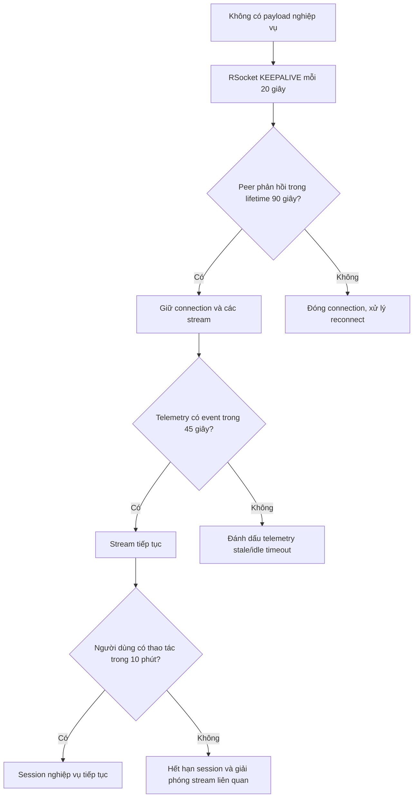

# Phân biệt keepalive giao thức với TCP keepalive và timeout nghiệp vụ

Một kết nối RSocket có thể tồn tại trong nhiều phút hoặc nhiều giờ để phục vụ các stream realtime. Trong khoảng thời gian đó, có thể không có payload nghiệp vụ nào được gửi. Mạng di động có thể chuyển vùng, máy chủ có thể khởi động lại, NAT hoặc load balancer có thể đóng kết nối nhàn rỗi, và một thao tác nghiệp vụ có thể cần thời hạn xử lý riêng. Nếu gom tất cả những tình huống này thành một khái niệm “timeout”, hệ thống rất dễ đóng kết nối quá sớm, phát hiện lỗi quá muộn hoặc hủy một request trong khi phiên vẫn khỏe.

RSocket keepalive, TCP keepalive và timeout nghiệp vụ giải quyết ba phạm vi khác nhau. RSocket keepalive kiểm tra hoạt động của peer ở tầng protocol RSocket; TCP keepalive kiểm tra kết nối ở tầng transport; timeout nghiệp vụ giới hạn thời gian chờ hoặc thời gian không hoạt động của một thao tác hay phiên do ứng dụng định nghĩa. Chúng có thể cùng được bật, nhưng không thay thế nhau.

Bài này giải thích từng cơ chế, cách phối hợp với timeout của proxy/load balancer, cách cấu hình và quan sát trong ứng dụng Java/Spring Boot, cùng các tình huống kiểm thử thường gặp.

## 1. Vì sao cần phân biệt các loại timeout?

Giả sử một ứng dụng giám sát thiết bị mở kết nối RSocket qua TCP. Client nhận dữ liệu cảm biến theo stream, đồng thời gửi lệnh điều khiển. Khi thiết bị không có thay đổi, server có thể không phát payload trong một thời gian. Trong lúc đó:

- RSocket cần biết peer còn phản hồi ở cấp protocol hay không.
- Hệ điều hành cần phát hiện một TCP peer hoặc đường mạng đã mất nhưng chưa gửi FIN/RST.
- Load balancer có thể có giới hạn thời gian kết nối không truyền dữ liệu.
- Một request lấy snapshot cần trả kết quả trong thời hạn vài giây.
- Một phiên điều khiển có thể hết hạn nếu người dùng không thao tác trong một khoảng thời gian.

Đây là những đồng hồ khác nhau. Một kết nối có thể vẫn khỏe trong khi request đã quá hạn; một request có thể hoàn tất nhanh dù TCP keepalive chưa từng gửi probe; hoặc một proxy có thể đóng kết nối trước khi ứng dụng phát hiện peer mất kết nối.

### 1.1. Ba phạm vi cần nhớ

| Cơ chế | Phạm vi | Câu hỏi mà nó trả lời |
|---|---|---|
| RSocket keepalive | Phiên/kết nối RSocket | Peer RSocket còn trao đổi frame và phản hồi theo thời hạn protocol không? |
| TCP keepalive | Kết nối TCP | TCP peer hoặc đường truyền còn phản hồi với các probe ở tầng transport không? |
| Timeout nghiệp vụ | Request, stream hoặc phiên ứng dụng | Thao tác này có hoàn thành hoặc còn hoạt động trong thời hạn nghiệp vụ cho phép không? |

RSocket keepalive và TCP keepalive thường được xem là cơ chế phát hiện kết nối, còn timeout nghiệp vụ kiểm soát hành vi ứng dụng. Cả ba có thể chạy đồng thời trên cùng một kết nối.

## 2. RSocket keepalive hoạt động như thế nào?

Sau khi transport được thiết lập và phiên RSocket hoàn tất `SETUP`, hai phía có thể trao đổi các frame nghiệp vụ. Khi không có payload, RSocket vẫn có thể gửi frame `KEEPALIVE` ở cấp connection để duy trì hoạt động và phát hiện peer không còn phản hồi.

`KEEPALIVE` dùng stream ID `0`, vì nó tác động lên connection chứ không thuộc một stream nghiệp vụ cụ thể. Frame này có thể yêu cầu peer phản hồi. Nếu cờ yêu cầu phản hồi được đặt, peer nhận phải gửi một frame keepalive phản hồi theo protocol. Một số implementation cũng dùng frame keepalive để mang vị trí frame đã nhận khi bật khả năng resume; phần vị trí này phục vụ phục hồi phiên, không phải mã xác nhận xử lý nghiệp vụ.

Khi cấu hình RSocket, thường có hai giá trị thời gian:

- **Keepalive interval:** khoảng thời gian giữa các lần gửi keepalive khi kết nối cần được duy trì.
- **Keepalive max lifetime:** khoảng thời gian tối đa mà endpoint chấp nhận không nhận được hoạt động/frame phù hợp từ peer trước khi xem kết nối là không còn hợp lệ.

Tên API có thể khác nhau giữa các thư viện, nhưng ý nghĩa cấu hình thường tương ứng với chu kỳ gửi và thời hạn phát hiện peer mất phản hồi. Giá trị cụ thể cần được kiểm tra theo implementation và phiên bản đang dùng.

```mermaid
sequenceDiagram
    participant C as RSocket Client
    participant S as RSocket Server
    Note over C,S: Phiên đã SETUP; không có payload nghiệp vụ
    C->>S: KEEPALIVE (streamId=0, yêu cầu phản hồi)
    S-->>C: KEEPALIVE (streamId=0)
    Note over C,S: Peer phản hồi; connection tiếp tục hoạt động
    C->>S: KEEPALIVE (lần tiếp theo sau interval)
    S-->>C: KEEPALIVE
```

Nếu endpoint không nhận được frame/hoạt động cần thiết trong giới hạn lifetime, implementation có thể đóng connection và báo lỗi cho các stream đang sử dụng nó. Việc đóng connection làm ảnh hưởng đến nhiều stream cùng lúc; nó không có nghĩa mọi request riêng lẻ đều đã hết business deadline.

### 2.1. Keepalive không phải heartbeat nghiệp vụ

Một frame `KEEPALIVE` chỉ cho biết peer ở tầng protocol vẫn có thể trao đổi frame. Nó không chứng minh rằng:

- Handler của một route cụ thể vẫn xử lý tốt.
- Database hoặc message broker đang sẵn sàng.
- Một lệnh điều khiển đã được thực thi.
- Người dùng còn đang hoạt động trên giao diện.
- Một stream đang phát đúng dữ liệu hoặc đáp ứng SLA.

Ví dụ, event loop của server vẫn gửi keepalive đều đặn trong khi một truy vấn database bị treo. Kết nối RSocket có thể vẫn khỏe nhưng request lấy dữ liệu đã vượt quá thời hạn nghiệp vụ. Ngược lại, server có thể không có payload vì thiết bị không thay đổi, nhưng keepalive vẫn xác nhận connection đang hoạt động.

## 3. TCP keepalive hoạt động ở tầng nào?

TCP keepalive là cơ chế của hệ điều hành/network stack. Khi được bật trên một socket, hệ điều hành có thể gửi các TCP probe sau một khoảng thời gian kết nối không có dữ liệu. Nếu peer hoặc đường truyền không phản hồi sau số lần thử và khoảng cách được cấu hình, TCP stack có thể báo kết nối lỗi cho ứng dụng.

TCP keepalive hữu ích khi một kết nối rơi vào trạng thái half-open: một đầu đã mất hoặc bị tắt đột ngột nhưng đầu còn lại chưa nhận FIN/RST. Nếu không có dữ liệu ứng dụng đi qua, một socket có thể nằm trong trạng thái tưởng như còn mở trong thời gian dài. TCP keepalive cung cấp một cách phát hiện ở tầng transport.

Các tham số phổ biến trên hệ điều hành gồm:

| Tham số | Ý nghĩa |
|---|---|
| Enable/SO_KEEPALIVE | Bật probe TCP keepalive cho socket. |
| Idle time | Thời gian kết nối không có dữ liệu trước probe đầu tiên. |
| Probe interval | Khoảng cách giữa các probe khi chưa nhận phản hồi. |
| Probe count | Số probe thất bại trước khi TCP stack kết luận kết nối không còn hoạt động. |

Tên và cách cấu hình tham số phụ thuộc hệ điều hành. Java có thể bật tùy chọn socket `SO_KEEPALIVE`, nhưng thời gian idle, interval và số probe thường cần cấu hình ở tầng OS hoặc thông qua các tùy chọn nền tảng/network stack mà runtime hỗ trợ. Bật `SO_KEEPALIVE` không đồng nghĩa đã có một thời hạn phát hiện lỗi ngắn phù hợp với realtime.

### 3.1. TCP keepalive không hiểu RSocket

TCP chỉ biết byte và trạng thái kết nối. Nó không biết `REQUEST_STREAM`, `PAYLOAD`, `CANCEL`, route hay nội dung metadata. Một TCP probe thành công không xác nhận server RSocket đã xử lý một frame; nó chỉ cho biết TCP peer/đường truyền phản hồi ở tầng transport.

Ngược lại, RSocket keepalive là frame nằm bên trong kết nối transport. Nó kiểm tra khả năng trao đổi ở tầng protocol. Nếu ứng dụng chạy RSocket over TCP, cả TCP keepalive và RSocket keepalive có thể cùng tồn tại. Nếu chạy RSocket over WebSocket, RSocket keepalive vẫn có thể được dùng trong frame RSocket; ngoài ra còn có cơ chế ping/pong của WebSocket tùy implementation.

### 3.2. TCP keepalive và timeout của thiết bị mạng

NAT, firewall, reverse proxy và load balancer có thể xóa trạng thái hoặc đóng kết nối nhàn rỗi theo bộ đếm riêng. TCP keepalive probe có thể giữ một số trạng thái NAT/firewall nếu thiết bị xem probe là traffic hợp lệ, nhưng không nên giả định mọi proxy đều reset idle timer dựa trên TCP ACK. Một proxy ở tầng ứng dụng có thể chỉ xem dữ liệu WebSocket/RSocket hoặc HTTP là hoạt động; chính sách thực tế phụ thuộc loại thiết bị và cấu hình.

Nếu hạ tầng đóng kết nối sau một khoảng idle nhất định, cần bảo đảm traffic keepalive mà hạ tầng quan sát được xuất hiện thường xuyên hơn ngưỡng đó, có đủ khoảng đệm cho jitter và lịch chạy. Khi không kiểm soát được hạ tầng, cần kiểm thử trên đúng đường mạng triển khai thay vì chỉ dựa vào cấu hình local.

## 4. Timeout nghiệp vụ: giới hạn của request và phiên

Timeout nghiệp vụ được ứng dụng định nghĩa theo yêu cầu của sản phẩm. Nó có thể áp dụng cho một lần gọi, một stream hoặc một phiên người dùng.

Ví dụ:

- Request lấy snapshot phải trả kết quả trong 3 giây.
- Một stream telemetry không được im lặng quá 45 giây nếu thiết bị được kỳ vọng gửi dữ liệu thường xuyên.
- Một phiên điều khiển hết hạn sau 10 phút không có thao tác người dùng.
- Một lệnh cập nhật firmware phải hoàn tất trong tối đa 20 phút.

Các giới hạn này không đồng nghĩa connection bị lỗi. Ứng dụng có thể hủy một request quá hạn trong khi vẫn giữ kết nối RSocket để xử lý request khác.

### 4.1. Request deadline

Deadline là thời điểm cuối cùng mà một thao tác được phép hoàn tất. Khi hết deadline, client có thể ngừng chờ và hủy subscription. Server nên nhận biết việc hủy và dừng công việc không còn cần thiết nếu có thể. Với thao tác có tác động, việc client hết thời gian chờ không chứng minh server chưa thực hiện thao tác; cần idempotency key hoặc API truy vấn trạng thái để đối soát.

Trong Reactor, `Mono.timeout` có thể giới hạn thời gian chờ response:

```java
Mono<Quote> quote = requester
    .route("quote.snapshot")
    .data(new QuoteQuery("ACME"))
    .retrieveMono(Quote.class)
    .timeout(Duration.ofSeconds(3));
```

Nếu không có tín hiệu trong 3 giây, publisher phát lỗi timeout và hủy upstream subscription theo semantics của Reactor. Đây là deadline ở tầng ứng dụng; nó không tự đóng RSocket connection và không thay thế keepalive.

### 4.2. Idle timeout của stream

Một stream dài có thể cần giới hạn khoảng thời gian giữa hai event. Trong Reactor, `Flux.timeout(Duration)` áp dụng thời hạn chờ tín hiệu tiếp theo; thời gian chờ được tính lại sau mỗi tín hiệu. Vì vậy, đây thường là timeout giữa các phần tử/idle timeout, không phải giới hạn tổng tuổi thọ stream.

```java
Flux<Quote> updates = requester
    .route("quote.watch.{symbol}", "ACME")
    .retrieveFlux(Quote.class)
    .timeout(Duration.ofSeconds(45));
```

Đoạn code trên phù hợp nếu hệ thống kỳ vọng stream phải phát ít nhất một event trong mỗi khoảng 45 giây. Nếu dữ liệu hợp lệ có thể im lặng lâu hơn, timeout này sẽ tạo false positive. Khi đó, cần chọn ngưỡng dựa trên nhịp dữ liệu, hoặc phát heartbeat nghiệp vụ riêng nếu client cần biết trạng thái của nguồn dữ liệu.

Nếu muốn giới hạn tổng thời gian sống của stream, hãy dùng một giới hạn vòng đời riêng, ví dụ `take(Duration.ofMinutes(10))`, hoặc một deadline được quản lý ở tầng ứng dụng. Không nên nhầm giới hạn thời gian giữa hai event với giới hạn tổng thời gian của phiên.

### 4.3. Session idle timeout

Session idle timeout thường dựa trên hoạt động người dùng hoặc thao tác nghiệp vụ, chẳng hạn không có lệnh điều khiển nào trong 10 phút. Nó có thể hết hạn dù RSocket keepalive và TCP keepalive vẫn hoạt động đều đặn.

Một phiên có thể chứa nhiều stream. Khi phiên nghiệp vụ hết hạn, ứng dụng cần quyết định đóng những stream nào, giải phóng subscription nào và liệu kết nối RSocket có được giữ lại để phục vụ các phiên khác hay không. Không nên tự động đóng toàn bộ transport chỉ vì một người dùng hết hạn nếu kết nối còn được chia sẻ cho những tương tác độc lập khác.

## 5. So sánh ba cơ chế

| Tiêu chí | RSocket keepalive | TCP keepalive | Timeout nghiệp vụ |
|---|---|---|---|
| Lớp hoạt động | RSocket protocol | TCP/OS network stack | Application/domain |
| Đơn vị được theo dõi | Connection/session RSocket | TCP socket connection | Request, stream, user session hoặc business operation |
| Tín hiệu | Frame `KEEPALIVE` | TCP probe/ACK | Timer, deadline, idle event hoặc domain rule |
| Có hiểu payload nghiệp vụ? | Không | Không | Có thể có, tùy logic ứng dụng |
| Mục tiêu | Phát hiện peer protocol không còn hoạt động và duy trì phiên | Phát hiện kết nối TCP half-open | Đảm bảo thao tác/phiên đáp ứng thời hạn sản phẩm |
| Khi hết hạn | RSocket connection có thể bị đóng; nhiều stream bị ảnh hưởng | Socket có thể báo lỗi/đóng | Request/stream/session liên quan bị timeout hoặc hết hạn |
| Có thể chạy khi không có payload? | Có | Có, khi socket idle và được bật | Có, nếu timer/idle rule được cấu hình |
| Thay thế cơ chế khác? | Không | Không | Không |

Một ví dụ giúp phân biệt: thiết bị không phát nhiệt độ mới trong 60 giây. Nếu RSocket keepalive vẫn phản hồi và TCP socket vẫn khỏe, kết nối vẫn hoạt động. Nhưng nếu SLA yêu cầu cảm biến phải báo dữ liệu mỗi 30 giây, ứng dụng có thể đánh dấu stream telemetry là stale hoặc hết idle timeout. Đây là quyết định nghiệp vụ, không phải bằng chứng TCP hay RSocket connection đã chết.

## 6. Cấu hình RSocket keepalive trong Java

Với rsocket-java, `RSocketConnector` cho phép cấu hình chu kỳ keepalive và thời gian tối đa chờ hoạt động. Ví dụ:

```java
import java.time.Duration;
import io.rsocket.core.RSocketConnector;
import io.rsocket.transport.netty.client.TcpClientTransport;

RSocketConnector connector = RSocketConnector.create()
    .keepAlive(
        Duration.ofSeconds(20),  // keepalive interval
        Duration.ofSeconds(90)   // keepalive max lifetime
    );

Mono<RSocket> connection = connector.connect(
    TcpClientTransport.create("localhost", 7000)
);
```

Đây là ví dụ cấu hình phía client với TCP transport. Server cũng cần cấu hình keepalive phù hợp theo API của implementation đang dùng. Không nên sao chép nguyên các con số 20/90 giây vào production mà chưa xét timeout của load balancer, firewall, proxy và yêu cầu phát hiện lỗi của hệ thống.

Với Spring Boot, có thể cấu hình connector thông qua builder/callback mà phiên bản Spring Boot và Spring Messaging đang dùng cung cấp. Cần kiểm tra đúng API của phiên bản dependency trong dự án; các phiên bản thư viện có thể khác nhau về cách truyền `RSocketConnector` và transport options.

### 6.1. Cấu hình TCP keepalive riêng

TCP keepalive là tùy chọn của socket. Ở mức Java socket, `SO_KEEPALIVE` có thể được bật như sau:

```java
socket.setKeepAlive(true);
```

Nếu ứng dụng dùng Reactor Netty hoặc transport TCP khác, hãy bật tùy chọn tương ứng ở channel/socket được tạo bởi transport. Sau đó, quản trị viên cần kiểm tra giá trị idle time, probe interval và probe count của hệ điều hành hoặc runtime. Cách đặt các giá trị này không đồng nhất giữa Linux, Windows và các môi trường container.

Chỉ bật `SO_KEEPALIVE` mà không điều chỉnh thông số hệ điều hành có thể khiến thời gian phát hiện kết nối chết dài hơn yêu cầu realtime. Hãy đo thời gian thực tế từ lúc cắt mạng đến lúc ứng dụng nhận được lỗi socket.

### 6.2. Cấu hình timeout nghiệp vụ

Timeout nghiệp vụ nên được đặt gần thao tác cần bảo vệ. Ví dụ, request lấy snapshot có deadline 3 giây; stream telemetry có idle timeout 45 giây; phiên điều khiển có thời hạn không hoạt động 10 phút.

```java
Mono<Quote> snapshot = requester
    .route("quote.snapshot")
    .data(new QuoteQuery("ACME"))
    .retrieveMono(Quote.class)
    .timeout(Duration.ofSeconds(3));

Flux<Quote> telemetry = requester
    .route("device.telemetry.{id}", "device-42")
    .retrieveFlux(Quote.class)
    .timeout(Duration.ofSeconds(45)); // thời gian tối đa giữa các event

Flux<Quote> boundedSession = telemetry
    .take(Duration.ofMinutes(10)); // tuổi thọ tối đa của stream trong ví dụ
```

Trong ứng dụng thực tế, không nhất thiết dùng cùng một kiểu dữ liệu `Quote` cho telemetry thiết bị; đoạn code tập trung vào vị trí đặt các loại timeout. Khi kết hợp idle timeout và max lifetime, cần xác định rõ publisher nào sở hữu vòng đời để tránh hủy subscription ngoài ý muốn.

## 7. Phối hợp với proxy, load balancer và firewall

Một kết nối có thể đi qua nhiều lớp: client, NAT, firewall, load balancer, reverse proxy, service mesh và server. Mỗi lớp có thể có idle timeout hoặc giới hạn thời gian kết nối riêng. Nếu một lớp đóng kết nối trước khi RSocket phát hiện, client có thể thấy lỗi transport thay vì lỗi timeout protocol.

Hãy lập bảng các giới hạn thực tế của đường truyền:

| Lớp | Cấu hình cần tìm | Câu hỏi cần trả lời |
|---|---|---|
| Client runtime | RSocket keepalive, connect timeout, request timeout | Client phát hiện peer mất phản hồi trong bao lâu? |
| Server runtime | RSocket keepalive, connection limits, idle policy | Server có chủ động đóng connection nhàn rỗi không? |
| TCP/OS | `SO_KEEPALIVE`, idle, interval, probe count | TCP stack mất bao lâu để báo lỗi? |
| NAT/firewall | TCP connection idle timeout | Thiết bị có xóa mapping khi không có traffic không? |
| Load balancer/proxy | TCP hoặc WebSocket idle timeout, max connection age | Traffic nào được tính là hoạt động? Có đóng kết nối dài không? |
| Application | Request deadline, stream idle timeout, session expiration | Thao tác hoặc phiên còn hợp lệ trong bao lâu? |

Một nguyên tắc thực hành là đặt chu kỳ RSocket keepalive ngắn hơn idle timeout của hạ tầng có thể đóng kết nối, với khoảng đệm đủ cho jitter, tải CPU và thời gian lập lịch. Keepalive max lifetime phải đủ dài để không coi một lần trễ mạng bình thường là lỗi, nhưng vẫn đáp ứng mục tiêu phát hiện connection hỏng. TCP keepalive có thể dùng như lớp phát hiện bổ sung, đặc biệt cho kết nối TCP idle, nhưng không nên là cơ chế duy nhất nếu cần phát hiện nhanh.

Không có một thứ tự cố định đúng cho mọi loại timeout. Request deadline có thể ngắn hơn nhiều so với connection lifetime; session idle timeout có thể dài hơn request deadline; TCP keepalive có thể phát hiện lỗi chậm hơn RSocket keepalive. Hãy chọn theo mục tiêu của từng lớp thay vì cố đặt mọi giá trị bằng nhau.

### 7.1. Ví dụ phối hợp thời gian

Giả sử hạ tầng đóng kết nối nếu không thấy traffic trong 120 giây. Ứng dụng có thể chọn RSocket keepalive interval 20 giây và max lifetime 90 giây, sau khi xác nhận server/client và proxy thực sự truyền các frame này qua đường kết nối. Request lấy snapshot vẫn có deadline 3 giây; stream telemetry có idle timeout 45 giây; phiên người dùng hết hạn sau 10 phút không thao tác.



Các con số trong ví dụ chỉ minh họa cách tách phạm vi. Trước khi áp dụng, cần kiểm tra idle timeout thật của từng hop, mức jitter, lưu lượng nền, chính sách proxy và yêu cầu SLA. Một keepalive frame không nhất thiết reset mọi bộ đếm của thiết bị trung gian nếu thiết bị không xem frame đó là traffic phù hợp.

## 8. Phân biệt timeout với reconnect và resume

Timeout là quyết định một khoảng chờ đã vượt giới hạn. Reconnect là hành động tạo lại transport/connection sau khi connection cũ bị mất. Resume là khả năng tùy chọn để tiếp tục một phiên RSocket có thể khôi phục nếu implementation, hai phía và cấu hình hỗ trợ.

Ba việc này có quan hệ nhưng không đồng nghĩa:

1. RSocket keepalive hết lifetime có thể khiến connection bị đóng.
2. Client phát hiện connection đóng và bắt đầu reconnect theo retry/backoff policy.
3. Nếu resume được bật và trạng thái còn khả dụng, client có thể thử tiếp tục phiên; nếu không, ứng dụng phải mở phiên mới và khôi phục các stream cần thiết.

TCP keepalive thất bại cũng có thể làm socket báo lỗi và kích hoạt cùng quy trình reconnect. Timeout nghiệp vụ của một request có thể hết hạn trong khi connection vẫn khỏe; trường hợp đó thường chỉ cần kết thúc request, không cần reconnect toàn bộ connection.

### 8.1. Retry cần xét tác động nghiệp vụ

Không nên tự động gửi lại mọi request sau timeout hoặc mất kết nối. Một lệnh có thể đã đến server và được thực hiện, nhưng response bị mất trên đường về. Nếu client gửi lại mà không có idempotency key, thao tác có thể chạy hai lần.

Với thao tác thay đổi trạng thái, nên dùng command ID/idempotency key, lưu kết quả xử lý và cung cấp cách truy vấn trạng thái. Với stream telemetry, client có thể cần đăng ký lại và dùng sequence number hoặc event offset để phát hiện khoảng dữ liệu bị thiếu. Resume của RSocket không thay thế chính sách lưu bền vững và đối soát nghiệp vụ.

### 8.2. Hủy subscription có thực sự dừng công việc?

Khi Reactor timeout một publisher, nó hủy subscription upstream. RSocket runtime có thể chuyển cancellation thành tín hiệu hủy stream. Server handler nên phản ứng với cancellation bằng cách dừng công việc, hủy truy vấn hoặc giải phóng subscription khi có thể.

Tuy nhiên, cancellation không thể tự động dừng một tác vụ blocking hoặc một hệ thống bên ngoài không hỗ trợ hủy. Nếu handler gọi một API blocking mà không có timeout riêng, việc client hết deadline có thể chỉ làm client ngừng chờ trong khi công việc phía server vẫn tiếp tục. Hãy truyền deadline hoặc cancellation token đến các tầng xử lý có thể hỗ trợ chúng.

## 9. Quan sát và chẩn đoán

Để biết timeout nào đã xảy ra, log và metric phải ghi rõ phạm vi. Một log chỉ ghi `TimeoutException` thường không đủ để phân biệt request deadline, stream idle timeout hay kết nối đã mất.

Nên theo dõi các thông tin sau:

- **RSocket connection:** thời điểm setup, keepalive gửi/nhận, số lần lifetime hết hạn, connection close reason và reconnect.
- **TCP socket:** trạng thái socket, lỗi reset/timeout, thời gian phát hiện mất mạng và cấu hình keepalive của OS.
- **Hạ tầng:** idle timeout của proxy/load balancer, WebSocket close code, thời điểm đóng connection và số lần upstream reset.
- **Request/stream:** route, thời gian xử lý, deadline, idle gap giữa event, cancellation, error type và số payload.
- **Session nghiệp vụ:** thời điểm hoạt động gần nhất, thời điểm hết hạn và số stream bị đóng theo session.

Không ghi token, thông tin xác thực hoặc payload nhạy cảm vào log keepalive. Frame keepalive không mang ý nghĩa nghiệp vụ; metric đếm frame chỉ nên dùng để quan sát sức khỏe connection và lưu lượng protocol.

### 9.1. Bảng chẩn đoán nhanh

| Triệu chứng | Khả năng cần kiểm tra |
|---|---|
| Connection đóng sau một khoảng im lặng cố định | Idle timeout của proxy/load balancer/firewall; RSocket keepalive interval có đi qua hop đó không? |
| RSocket báo lifetime timeout dù TCP socket chưa báo lỗi | Peer không gửi/không xử lý frame RSocket đúng hạn; event loop bị nghẽn; frame bị chặn hoặc delay. |
| TCP báo reset/timeout trước RSocket lifetime | TCP peer, mạng hoặc OS phát hiện lỗi trước; kiểm tra probe và network path. |
| Request timeout nhưng stream khác vẫn hoạt động | Deadline nghiệp vụ của request đã hết; connection có thể vẫn khỏe. |
| Telemetry timeout nhưng keepalive vẫn bình thường | Nguồn dữ liệu hoặc handler không phát event; kiểm tra thiết bị, broker và SLA dữ liệu. |
| Người dùng bị đăng xuất dù connection vẫn hoạt động | Session idle timeout hoặc domain expiration. |
| Client retry khiến lệnh chạy hai lần | Thiếu idempotency key hoặc trạng thái đối soát sau timeout/reconnect. |

## 10. Kiểm thử các cơ chế timeout

Không nên chỉ kiểm tra rằng kết nối có thể mở và gửi một request. Cần kiểm thử các tình huống mạng và nghiệp vụ riêng biệt:

1. **Không có payload nhưng connection khỏe:** tạm ngừng event nghiệp vụ trong khi keepalive vẫn chạy; xác minh connection không bị đóng.
2. **Peer ngừng phản hồi protocol:** mô phỏng server/client bị treo hoặc chặn xử lý frame; xác minh RSocket lifetime timeout theo cấu hình.
3. **TCP half-open:** cắt đường mạng hoặc làm peer mất đột ngột mà không gửi FIN/RST; đo thời gian TCP keepalive phát hiện lỗi.
4. **Proxy idle timeout:** đi qua đúng load balancer/reverse proxy production-like; xác minh frame keepalive có giữ connection hay không.
5. **Request chậm:** làm handler phản hồi chậm hơn deadline; xác minh client timeout và server xử lý cancellation.
6. **Stream không có event:** ngừng nguồn telemetry nhưng giữ connection; xác minh idle timeout nghiệp vụ hoạt động riêng.
7. **Session hết hạn:** giữ connection khỏe nhưng không tạo hoạt động người dùng; xác minh domain session hết hạn và giải phóng đúng stream.
8. **Reconnect và retry:** ngắt connection sau khi server nhận lệnh nhưng trước khi client nhận response; xác minh idempotency và đối soát.

Trong unit test, nên dùng `StepVerifier.withVirtualTime` cho timer Reactor để kiểm tra timeout mà không phải chờ thời gian thực. Integration test vẫn cần kết nối RSocket thực tế và môi trường transport/proxy phù hợp để kiểm tra keepalive ở tầng protocol và TCP. Không nên kết luận TCP keepalive hoạt động chỉ từ một unit test publisher.

## 11. Checklist thiết kế timeout

Trước khi đưa một kết nối RSocket dài hạn vào production, hãy xác định:

- Keepalive interval và max lifetime của từng endpoint là bao nhiêu?
- Peer có phản hồi keepalive đúng theo protocol không?
- TCP keepalive có được bật không; OS đang dùng idle, interval và probe count nào?
- NAT, firewall, proxy và load balancer có idle timeout hoặc max connection age nào?
- Request nào có deadline; deadline có được truyền qua các tầng xử lý không?
- Stream nào cần idle timeout; nguồn dữ liệu có thể im lặng hợp lệ trong bao lâu?
- Session nghiệp vụ hết hạn theo hoạt động nào và khi hết hạn phải đóng những stream nào?
- Khi timeout, client có retry không; thao tác có idempotent hoặc có command ID không?
- Metric/log có phân biệt connection timeout, request deadline, stream idle và session expiration không?
- Có integration test cho mạng chập chờn, half-open và proxy timeout không?

## 12. Kết luận

RSocket keepalive, TCP keepalive và timeout nghiệp vụ đều liên quan đến thời gian, nhưng chúng quan sát các lớp khác nhau. RSocket keepalive dùng frame `KEEPALIVE` để kiểm tra khả năng hoạt động của peer ở cấp protocol và duy trì connection. TCP keepalive dùng probe ở tầng hệ điều hành để phát hiện socket half-open hoặc peer không phản hồi. Timeout nghiệp vụ giới hạn thời gian chờ, khoảng im lặng hoặc tuổi thọ của request, stream hay phiên theo yêu cầu sản phẩm.

Khi triển khai Java/Spring Boot, hãy cấu hình và quan sát từng loại timeout độc lập, sau đó kiểm tra chúng cùng proxy, load balancer và network path thực tế. Một connection khỏe không có nghĩa request thành công; một request hết hạn không có nghĩa connection chết; và reconnect không bảo đảm một lệnh chưa được thực hiện. Phân biệt đúng ba phạm vi giúp hệ thống realtime phát hiện lỗi đúng lúc, tránh đóng kết nối không cần thiết và xử lý retry an toàn.
