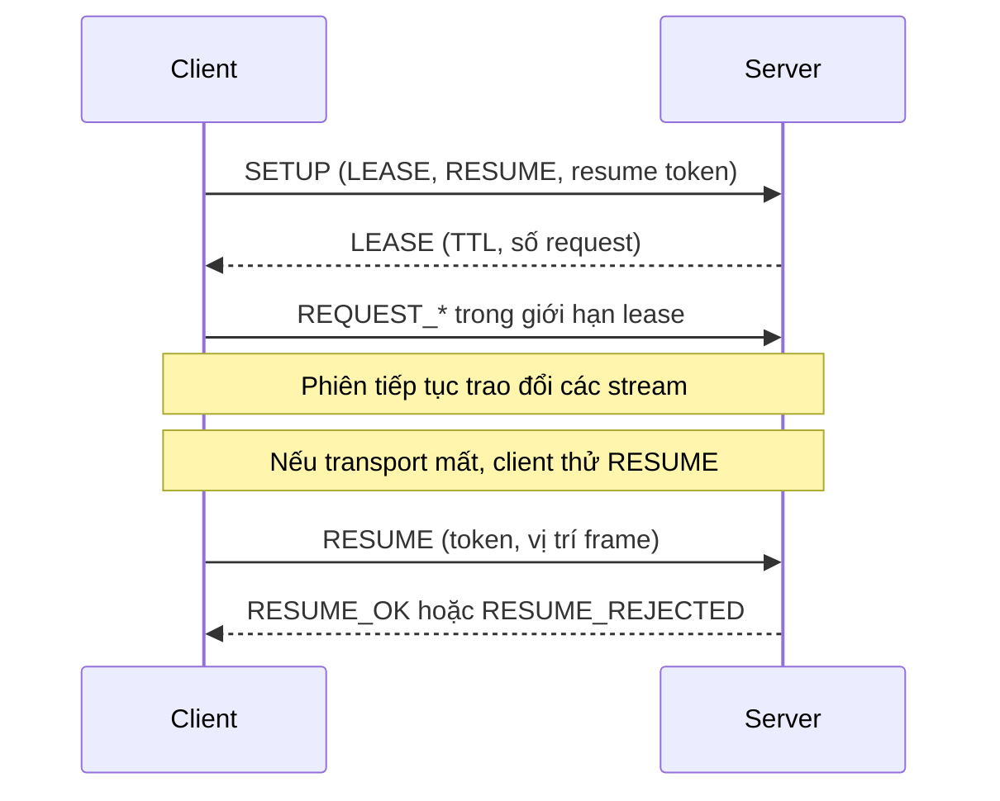
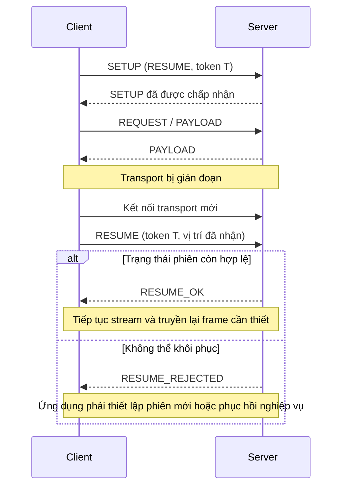

# Đăng ký dùng leasing và resumption trong bước thiết lập

## Mục tiêu bài học

Sau bài này, bạn có thể:

- Giải thích vai trò của các cờ `LEASE` và `RESUME` trong frame `SETUP` của RSocket.
- Mô tả cách một peer cấp lease với thời hạn và số request được phép.
- Giải thích cách resume token và thông tin vị trí frame giúp khôi phục một phiên sau khi transport bị gián đoạn.
- Phân biệt leasing, backpressure và resumption để chọn đúng cơ chế.
- Xác định các điều kiện cấu hình, giới hạn vận hành và trường hợp cần kiểm thử khi dùng hai tính năng này trong Java/Spring Boot.

## Vì sao cần đăng ký tính năng trong bước SETUP?

Khi một kết nối RSocket mới được tạo, peer khởi tạo gửi frame `SETUP` để bắt đầu một phiên giao tiếp. Frame này mang phiên bản giao thức, thông số keepalive, MIME type của metadata và data, cùng payload khởi tạo nếu ứng dụng cần truyền dữ liệu ban đầu.

`SETUP` cũng có các cờ tùy chọn để thông báo khả năng hoặc nhu cầu sử dụng một số phần mở rộng của giao thức. Trong bài này, hai cờ quan trọng là:

- **LEASE:** peer gửi `SETUP` muốn nhận quyền gửi request do peer còn lại cấp. Peer cấp quyền sẽ gửi frame `LEASE` với thời hạn và số request được phép.
- **RESUME:** peer gửi `SETUP` muốn hỗ trợ tiếp tục phiên khi kết nối transport bị mất. Frame `SETUP` khi đó có kèm resume token để nhận diện phiên có thể khôi phục.

Hai tính năng này độc lập. Một ứng dụng có thể dùng leasing mà không dùng resumption, dùng resumption mà không dùng leasing, hoặc bật cả hai nếu thư viện và kiến trúc triển khai hỗ trợ.

Sơ đồ khái quát:



Các cờ trong `SETUP` chỉ thể hiện việc đăng ký sử dụng phần mở rộng. Ứng dụng vẫn phải cấu hình chính sách cấp lease, thời gian giữ phiên, bộ đệm và hành vi reconnect tương ứng.

## Leasing: cấp quyền khởi tạo request theo hạn mức

### Lease hoạt động như thế nào?

Leasing là cơ chế admission control ở cấp kết nối. Peer nhận lease chỉ được khởi tạo số request tối đa trong một khoảng thời gian do peer cấp lease quy định.

Một frame `LEASE` mang hai thông tin chính:

- **TTL (time to live):** thời gian lease còn hiệu lực.
- **Request count:** số request tối đa peer nhận lease được phép khởi tạo trong thời hạn đó.

Ví dụ, server cấp cho client lease có TTL 10 giây và request count bằng 20. Trong thời hạn này, client có thể khởi tạo tối đa 20 request thuộc các kiểu tương tác được tính là request. Khi hết số lượng hoặc lease hết hạn, client phải chờ lease tiếp theo trước khi gửi thêm request nếu phiên đang sử dụng cơ chế leasing.

Request count đếm lần khởi tạo tương tác, không đếm số payload trả về trong một stream. Chẳng hạn, một request-stream có thể tạo ra hàng trăm phần tử phản hồi nhưng vẫn là một request được khởi tạo.

Luồng cơ bản:

1. Client gửi `SETUP` với cờ `LEASE` để báo rằng nó muốn nhận lease.
2. Server quyết định có cấp lease hay không và gửi frame `LEASE` chứa TTL cùng request count.
3. Client theo dõi số request còn lại và thời điểm hết hạn.
4. Khi không còn quyền gửi request, client chờ lease mới hoặc áp dụng chính sách chờ/từ chối ở tầng ứng dụng.

Nếu client đã đăng ký leasing, nó không được tự ý gửi request vượt hạn mức hoặc khi lease không còn hiệu lực. Việc xếp hàng request, giới hạn thời gian chờ hay trả lỗi cho người dùng là quyết định của ứng dụng.

### Ví dụ về chính sách cấp lease

Giả sử một dịch vụ xử lý đơn hàng có năng lực xử lý thay đổi theo tải. Server có thể cấp lease nhỏ khi hệ thống gần quá tải và cấp lease lớn hơn khi còn nhiều tài nguyên.

| Trạng thái server | TTL | Request count | Ý nghĩa |
|---|---:|---:|---|
| Đang tải cao | 5 giây | 5 | Giới hạn tốc độ khởi tạo request |
| Tải ổn định | 10 giây | 20 | Cho phép lượng request vừa phải |
| Còn nhiều tài nguyên | 10 giây | 50 | Tăng hạn mức tạm thời |

Các con số chỉ minh họa chính sách. Trong hệ thống thật, cần xác định hạn mức dựa trên năng lực xử lý, độ trễ mục tiêu, số client đồng thời và mức tiêu thụ tài nguyên.

### Leasing kiểm soát điều gì?

Leasing giới hạn số lần khởi tạo request trong một khoảng thời gian. Nó hữu ích để kiểm soát lượng tương tác mới đi vào một peer, đặc biệt khi nhiều client cùng kết nối tới một dịch vụ.

Leasing không giới hạn trực tiếp số byte của payload, tốc độ phát từng phần tử trong một stream hay lượng dữ liệu mà subscriber đang yêu cầu. Vì vậy, một request-stream được phép khởi tạo vẫn có thể phát ra nhiều dữ liệu. Ứng dụng cần kết hợp giới hạn kích thước payload, timeout, giới hạn tài nguyên và cơ chế backpressure.

## Resumption: tiếp tục phiên sau khi mất kết nối

### Vấn đề khi transport bị gián đoạn

Một kết nối TCP hoặc WebSocket có thể bị ngắt do mạng chập chờn, thiết bị chuyển mạng, proxy đóng kết nối hoặc một instance được triển khai lại. Nếu chỉ thiết lập một phiên mới, trạng thái của các stream đang chạy và những frame chưa được xác nhận có thể không còn.

Resumption cho phép hai peer tiếp tục một phiên RSocket đã được đăng ký trước đó, nếu trạng thái phiên vẫn còn được lưu và cả hai phía chấp nhận khôi phục.

### Resume token và quá trình khôi phục

Trong lần thiết lập ban đầu, client bật cờ `RESUME` và cung cấp một resume token. Token là định danh opaque để hai phía tìm lại trạng thái phiên. Khi transport bị mất, client thiết lập một kết nối transport mới và gửi frame `RESUME` cùng token và thông tin vị trí frame mà hai phía đã trao đổi.

Server kiểm tra token, trạng thái phiên và dữ liệu frame còn được giữ. Nếu có thể tiếp tục, server trả `RESUME_OK`; hai phía đồng bộ vị trí và truyền lại những frame cần thiết. Nếu không thể khôi phục, server trả `RESUME_REJECTED`.



Resume token phải được giữ ổn định trong các lần thử resume của cùng một phiên. Không tạo token mới cho mỗi lần reconnect nếu mục tiêu là khôi phục phiên cũ. Khi bắt đầu một phiên hoàn toàn mới, ứng dụng sử dụng token mới theo cơ chế của implementation.

### Resumption cần lưu những gì?

Để khôi phục, hai peer cần duy trì trạng thái giao thức và dữ liệu frame cần thiết trong một khoảng thời gian. Các thành phần thường phải được tính đến gồm:

- Resume token và trạng thái phiên tương ứng.
- Vị trí frame đã gửi, đã nhận hoặc đã được xác nhận ở mỗi hướng.
- Các frame đã gửi nhưng chưa được peer xác nhận để có thể truyền lại.
- Thời gian lưu phiên và giới hạn dung lượng bộ đệm.
- Chính sách reconnect và thời điểm dừng thử resume.

Việc giữ frame và trạng thái phiên tiêu tốn bộ nhớ. Nếu client mất kết nối quá lâu, phiên hết thời gian lưu, token không còn hợp lệ hoặc bộ đệm không còn đủ dữ liệu cần thiết, yêu cầu resume có thể bị từ chối.

Resumption là khả năng của phiên giao thức, không phải cơ chế lưu trữ nghiệp vụ bền vững. Nếu ứng dụng cần khôi phục trạng thái đơn hàng, lịch sử sự kiện hoặc dữ liệu sau khi cả tiến trình server bị mất, hãy lưu dữ liệu đó trong database, event log hoặc message broker phù hợp.

## Leasing và resumption có thể dùng cùng nhau

Hai cơ chế giải quyết hai vấn đề khác nhau:

| Cơ chế | Câu hỏi được giải quyết | Dữ liệu/chính sách chính |
|---|---|---|
| Leasing | Peer được phép khởi tạo bao nhiêu request trong thời gian nào? | TTL và request count |
| Resumption | Có thể tiếp tục phiên cũ sau khi transport bị gián đoạn không? | Resume token, vị trí frame, trạng thái phiên và bộ đệm |
| Backpressure | Subscriber muốn nhận thêm bao nhiêu phần tử trong stream? | Demand trên từng stream |

Khi dùng đồng thời, client có thể được server cấp lease để kiểm soát lượng request mới, đồng thời sử dụng resumption để tiếp tục các stream đang chạy khi mạng gián đoạn. Sau khi resume thành công, ứng dụng vẫn phải tuân thủ hạn mức lease còn hiệu lực theo trạng thái giao thức của phiên và implementation đang dùng; không tự suy luận rằng reconnect đồng nghĩa được cấp thêm hạn mức.

Cần đặc biệt phân biệt ba khái niệm:

- **Leasing** điều tiết số tương tác mới được khởi tạo.
- **Backpressure** điều tiết số phần tử được yêu cầu trong một stream.
- **Resumption** khôi phục trạng thái trao đổi frame của phiên sau gián đoạn.

Không cơ chế nào thay thế hoàn toàn hai cơ chế còn lại.

## Thiết kế trong ứng dụng Java và Spring Boot

Trong ứng dụng Java, phần cấu hình leasing và resumption thường nằm ở tầng tạo kết nối RSocket hoặc cấu hình server/client, bên cạnh cấu hình transport và keepalive. `RSocketRequester` giúp gửi request theo route; phần đăng ký extension và chính sách phiên cần được cấu hình ở connector/server tương ứng.

Các API cụ thể thay đổi theo phiên bản `rsocket-java`, Spring Framework và Spring Boot. Khi triển khai, hãy đối chiếu phiên bản dependency thực tế để xác nhận cách bật lease, cách cấp lease ở server, cách tạo resume token, cấu hình bộ đệm và chiến lược reconnect. Không nên sao chép cấu hình từ phiên bản khác mà chưa kiểm tra.

Có thể mô tả luồng cấu hình ở mức khái niệm như sau:

```text
Tạo RSocket client
  ├─ Chọn transport: TCP hoặc WebSocket
  ├─ Cấu hình keepalive và timeout
  ├─ Đăng ký nhận LEASE nếu client cần hạn mức từ server
  ├─ Đăng ký RESUME và cung cấp resume token
  ├─ Cấu hình thời gian giữ phiên và giới hạn resume buffer
  └─ Cấu hình chiến lược reconnect/resume

Tạo RSocket server
  ├─ Chọn transport và endpoint
  ├─ Xác định chính sách cấp LEASE
  ├─ Cấu hình hỗ trợ resumption và lưu trạng thái phiên
  └─ Theo dõi tải, bộ đệm và vòng đời kết nối
```

Trong triển khai thật, hãy cấu hình rõ ai là bên cấp lease, ai là bên nhận lease, giới hạn request count/TTL, thời gian lưu phiên, dung lượng buffer và hành vi khi resume thất bại. Các giá trị này cần phù hợp với tải và tài nguyên của hệ thống.

### Xử lý khi không có lease

Nếu client đã yêu cầu leasing nhưng chưa nhận được lease hợp lệ, tầng gửi request cần có một chính sách rõ ràng:

- Chờ lease tiếp theo trong một khoảng thời gian giới hạn.
- Đưa request vào hàng đợi có giới hạn và xử lý khi lease được cấp.
- Từ chối sớm khi hàng đợi đầy hoặc thời gian chờ đã hết.

Không nên để hàng đợi tăng vô hạn vì điều đó chỉ chuyển tình trạng quá tải từ server sang bộ nhớ của client.

### Xử lý khi resume bị từ chối

Khi nhận `RESUME_REJECTED`, client cần coi phiên cũ không thể tiếp tục ở cấp giao thức. Tùy nghiệp vụ, ứng dụng có thể:

- Thiết lập một phiên RSocket mới.
- Đăng ký lại các stream cần thiết.
- Đọc lại trạng thái hiện tại từ API hoặc database.
- Dùng offset, event ID hoặc sequence nghiệp vụ để tiếp tục từ điểm an toàn.
- Bỏ qua hoặc xử lý lại thao tác đang ở trạng thái chưa xác định theo chính sách idempotency.

Không nên tự động phát lại mọi lệnh nghiệp vụ mà không xem xét tác dụng phụ. Resumption không đảm bảo exactly-once cho toàn bộ nghiệp vụ.

## Bảo mật và vận hành

Resume token là thông tin định danh phiên. Không ghi token đầy đủ vào log, không đưa token vào telemetry công khai và cần bảo vệ đường truyền bằng TLS hoặc WSS khi đi qua mạng không tin cậy. Token cũng không thay thế xác thực và phân quyền: sau khi kết nối được khôi phục, ứng dụng vẫn phải bảo đảm danh tính và quyền truy cập phù hợp.

Với leasing, cần theo dõi số lease được cấp, TTL, số request còn lại, request bị chặn do hết hạn mức và độ dài hàng đợi chờ lease.

Với resumption, cần theo dõi số lần thử resume, tỷ lệ thành công/từ chối, thời gian reconnect, dung lượng resume buffer, số frame phải truyền lại và số phiên hết hạn. Các chỉ số này giúp phát hiện cấu hình buffer quá nhỏ, thời gian lưu phiên không phù hợp hoặc mạng thường xuyên gián đoạn.

Keepalive có vai trò phát hiện kết nối không còn hoạt động theo chu kỳ đã cấu hình. Keepalive hỗ trợ phát hiện sự cố để bắt đầu quy trình phục hồi, nhưng không tự bảo đảm phiên sẽ resume thành công.

## Các tình huống cần kiểm thử

| Tình huống | Điều cần xác nhận |
|---|---|
| Client bật LEASE và server cấp lease | Client chỉ khởi tạo request trong giới hạn TTL và request count |
| Lease hết số request trước TTL | Request mới được chờ hoặc từ chối theo chính sách |
| Lease hết TTL | Client không dùng hạn mức đã hết hiệu lực |
| Server cấp lease tiếp theo | Client cập nhật quyền gửi theo lease mới |
| Client bật RESUME, kết nối bị ngắt ngắn hạn | Phiên được khôi phục khi token và buffer còn hợp lệ |
| Phiên hết thời gian lưu | Server từ chối resume và client chuyển sang phục hồi nghiệp vụ |
| Resume buffer không đủ | Hành vi từ chối/khởi tạo phiên mới được xử lý rõ ràng |
| Client không bật RESUME | Không giả định có thể tiếp tục phiên cũ sau reconnect |
| Bật đồng thời LEASE và RESUME | Sau khi resume, trạng thái lease và các stream được xử lý nhất quán |

Nên kiểm thử cả lỗi mạng có chủ đích, chẳng hạn ngắt socket giữa lúc stream đang phát, trì hoãn reconnect, làm đầy buffer và để lease hết hạn trong khi ứng dụng có request đang chờ.

## Checklist trước khi đưa vào môi trường thật

- [ ] Hai phía dùng phiên bản thư viện có hỗ trợ extension cần thiết.
- [ ] Client bật đúng cờ LEASE nếu cần nhận lease từ server.
- [ ] Chính sách cấp lease có TTL và request count phù hợp.
- [ ] Ứng dụng có giới hạn hàng đợi khi hết lease.
- [ ] RESUME được đăng ký từ phiên ban đầu và token được giữ ổn định cho lần khôi phục.
- [ ] Thời gian lưu phiên và resume buffer được cấu hình theo thời gian gián đoạn dự kiến.
- [ ] Có chính sách khi `RESUME_REJECTED` hoặc phiên hết hạn.
- [ ] Nghiệp vụ có cơ chế phục hồi trạng thái và idempotency khi cần.
- [ ] TLS/WSS, xác thực, phân quyền và bảo vệ token đã được cấu hình.
- [ ] Có metric và log đủ để theo dõi lease, reconnect và resumption.

## Kết luận

Leasing giúp peer kiểm soát lượng request mới được khởi tạo trong một khoảng thời gian. Resumption giúp hai peer tiếp tục phiên RSocket khi transport bị gián đoạn và trạng thái phiên vẫn còn khả dụng. Cả hai đều cần được đăng ký ngay từ bước thiết lập ban đầu, được cấu hình cùng chính sách vận hành và được kiểm thử với các tình huống quá tải hoặc mất kết nối thực tế.

Khi thiết kế client/server Java hoặc Spring Boot, hãy xem leasing là hạn mức admission control, resumption là khả năng khôi phục phiên giao thức, còn backpressure là điều tiết dữ liệu trên từng stream. Phân biệt đúng ba cơ chế sẽ giúp ứng dụng realtime có hành vi dễ dự đoán hơn khi tải thay đổi hoặc kết nối không ổn định.

