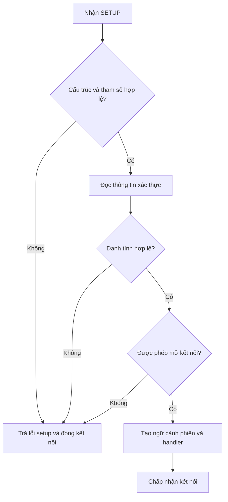

# Từ chối SETUP, kiểm tra quyền kết nối và giải phóng tài nguyên

Trước khi một client có thể gửi request-response, request-stream hoặc request-channel, hai phía phải hoàn tất giai đoạn thiết lập kết nối RSocket. Ở giai đoạn này, server cần kiểm tra thông tin khởi tạo, xác thực danh tính và quyết định có chấp nhận kết nối hay không. Nếu thiết lập không hợp lệ hoặc client không có quyền kết nối, server có thể từ chối `SETUP` và kết thúc kết nối ngay từ đầu.

Trong ứng dụng Java và Spring Boot, quyết định chấp nhận kết nối cần được gắn với vòng đời tài nguyên. Một kết nối bị từ chối không nên để lại subscription, timer, phiên cơ sở dữ liệu hoặc tác vụ nền. Một kết nối đã được chấp nhận cũng cần giải phóng tài nguyên khi peer đóng kết nối, khi có lỗi hoặc khi ứng dụng chủ động dừng phiên.

## 1. Giai đoạn SETUP và quyết định chấp nhận kết nối

`SETUP` là frame cấp kết nối được bên khởi tạo gửi khi bắt đầu một phiên RSocket. Frame có stream ID bằng `0`, chứa các tham số kết nối như phiên bản giao thức, keepalive, lifetime, data MIME type, metadata MIME type và có thể kèm setup payload.

Server xử lý giai đoạn này trước khi nhận các tương tác ứng dụng trên những stream thông thường. Đây là thời điểm thích hợp để:

- Kiểm tra phiên bản giao thức và các tham số setup có được hỗ trợ hay không.
- Kiểm tra data MIME type và metadata MIME type có phù hợp với hợp đồng kết nối hay không.
- Đọc thông tin xác thực từ setup payload hoặc metadata theo quy ước đã thống nhất.
- Xác thực danh tính và kiểm tra chính sách cho phép mở kết nối.
- Tạo ngữ cảnh phiên và handler chỉ sau khi các bước kiểm tra cần thiết thành công.



Không phải mọi lỗi kết nối đều là lỗi từ chối `SETUP`. DNS, TCP handshake hoặc TLS handshake có thể thất bại trước khi RSocket nhận được frame `SETUP`. Khi đó, client chỉ quan sát lỗi kết nối hoặc lỗi TLS ở tầng transport. Từ chối `SETUP` là quyết định ở tầng giao thức RSocket sau khi kết nối transport đã được tạo.

## 2. Các trường hợp từ chối SETUP

RSocket dùng frame `ERROR` với stream ID bằng `0` để báo lỗi cấp kết nối. Nếu responder từ chối thiết lập, kết nối không được đưa vào trạng thái sẵn sàng cho các tương tác ứng dụng. Một số mã lỗi setup thường gặp:

| Mã lỗi | Khi sử dụng |
| --- | --- |
| `INVALID_SETUP` | Frame setup hoặc các trường bắt buộc không hợp lệ, sai định dạng hay vi phạm ràng buộc giao thức. |
| `UNSUPPORTED_SETUP` | Bên nhận không hỗ trợ phiên bản giao thức, MIME type hoặc tính năng được yêu cầu. |
| `REJECTED_SETUP` | Bên nhận chủ động từ chối thiết lập theo chính sách, ví dụ danh tính không được phép mở kết nối. |
| `REJECTED_RESUME` | Một yêu cầu resume không được chấp nhận; đây là trường hợp khôi phục phiên, không phải từ chối setup thông thường. |

Phân loại lỗi đúng giúp client biết hướng xử lý. Lỗi cấu hình hoặc phiên bản thường cần điều chỉnh cấu hình client. Lỗi xác thực hoặc quyền truy cập cần làm mới thông tin xác thực hoặc yêu cầu cấp quyền. Lỗi mạng tạm thời có thể được thử kết nối lại theo chính sách retry có giới hạn.

Không nên dùng `REJECTED_SETUP` cho mọi lỗi. Nếu frame sai cấu trúc, dùng lỗi setup không hợp lệ; nếu phiên bản hoặc tính năng không được hỗ trợ, dùng lỗi unsupported tương ứng. Việc phân loại nhất quán giúp log, metric và hành vi retry có ý nghĩa.

### Nội dung lỗi trả về cho client

Server nên trả thông tin đủ để client phân loại lỗi nhưng không tiết lộ chi tiết nội bộ. Ví dụ, client có thể nhận thông báo chung như `Connection setup rejected`. Không nên đưa vào error data các thông tin như token đã nhận, chữ ký token sai ở vị trí nào, tên tài khoản tồn tại hay không, chính sách nội bộ hoặc chi tiết hệ thống xác thực.

Thông tin chi tiết hơn có thể được ghi trong log bảo mật ở phía server với mã tương quan, thời điểm, loại lỗi và danh tính đã được xác minh nếu có. Cần tránh ghi bí mật hoặc toàn bộ setup payload.

## 3. Xác thực danh tính ở thời điểm thiết lập

Xác thực (authentication) trả lời câu hỏi client đang kết nối là ai. Thông tin xác thực có thể đến từ TLS client certificate, token trong metadata hoặc một cơ chế xác thực đã được hai phía thống nhất.

Các cách triển khai thường gặp:

- **TLS/mTLS:** TLS bảo vệ dữ liệu trên đường truyền; với mutual TLS, server có thể xác minh chứng thư client và gắn kết nối với danh tính tương ứng.
- **Bearer token:** client gửi token trong setup metadata hoặc setup payload. Server xác minh chữ ký, issuer, audience, thời hạn và các claim cần thiết.
- **Thông tin xác thực theo hệ thống:** ứng dụng có thể dùng API key hoặc credential riêng, nhưng phải lưu trữ và so sánh an toàn, có cơ chế xoay vòng và thu hồi.

MIME type của metadata chỉ mô tả định dạng byte. Nó không tự xác thực token và không làm cho metadata trở nên đáng tin cậy. Server phải xác minh credential bằng thành phần xác thực có thẩm quyền.

Không xem các trường như `userId`, `tenantId` hoặc `role` do client tự gửi là bằng chứng danh tính. Những giá trị đó có thể bị giả mạo. Server nên lấy danh tính và quyền từ credential đã xác minh hoặc nguồn dữ liệu tin cậy, sau đó chỉ dùng metadata client gửi làm dữ liệu tham chiếu nếu chính sách cho phép.

## 4. Kiểm tra quyền mở kết nối

Ủy quyền (authorization) trả lời câu hỏi danh tính đã xác thực có được phép thực hiện hành động hay không. Ở bước setup, server có thể kiểm tra quyền mở một phiên RSocket hoặc quyền sử dụng một nhóm chức năng ở cấp kết nối.

Ví dụ, một ứng dụng realtime có thể có các chính sách:

| Danh tính hoặc loại client | Chính sách kết nối |
| --- | --- |
| Thiết bị đã đăng ký | Được mở kết nối để gửi telemetry của chính thiết bị. |
| Dashboard nội bộ | Được mở kết nối để đăng ký các stream giám sát đã được cấp quyền. |
| Client hết hạn credential | Bị từ chối trước khi tạo session. |
| Client bị thu hồi hoặc khóa | Bị từ chối dù token vẫn còn thời hạn nếu trạng thái thu hồi được kiểm tra. |

Quyền mở kết nối không thay thế kiểm tra quyền cho từng request. Một kết nối có thể gửi nhiều route và nhiều loại thao tác. Ví dụ, một dashboard có quyền đọc dữ liệu thiết bị nhưng không có quyền gửi lệnh điều khiển. Server vẫn cần kiểm tra quyền ở handler hoặc tầng dịch vụ cho từng hành động.

Với kết nối dài hạn, quyền có thể thay đổi sau khi setup đã được chấp nhận. Ứng dụng cần quy định cách xử lý khi token hết hạn, người dùng bị thu hồi quyền hoặc tenant bị vô hiệu hóa: kiểm tra lại theo từng request, đóng kết nối, hoặc yêu cầu client thiết lập phiên mới. Không nên giả định quyền đã kiểm tra một lần sẽ hợp lệ mãi mãi.

## 5. Tách logic xác thực khỏi adapter RSocket

Nên đặt quy tắc xác thực và quyền kết nối trong một service có thể kiểm thử độc lập. Adapter RSocket đọc setup payload/metadata, chuyển chúng thành một yêu cầu xác thực và ánh xạ kết quả sang quyết định accept hoặc reject.

Ví dụ dưới đây mô tả phần logic nghiệp vụ; `SetupRequest`, `Principal`, `Authenticator` và `ConnectionAuthorizer` là kiểu của ứng dụng:

```java
Mono<Principal> authenticateAndAuthorize(SetupRequest request) {
    return authenticator.authenticate(request.credentials())
        .flatMap(principal ->
            connectionAuthorizer.canOpenConnection(principal)
                .flatMap(allowed -> {
                    if (allowed) {
                        return Mono.just(principal);
                    }
                    return Mono.error(
                        new ConnectionNotAllowedException("Connection rejected")
                    );
                })
        );
}
```

Socket acceptor của RSocket gọi service này trong quá trình xử lý `ConnectionSetupPayload`. Nếu service trả về danh tính hợp lệ và được cấp quyền, acceptor mới tạo `RSocket` handler cho phiên. Nếu xác thực hoặc ủy quyền thất bại, adapter chuyển kết quả thành lỗi từ chối setup ở tầng giao thức, thường là `REJECTED_SETUP` đối với quyết định từ chối theo chính sách.

Không nên tạo handler hoặc subscription dài hạn trước khi hoàn tất kiểm tra. Cách này giảm nguy cơ một client chưa được phép vẫn tiêu thụ tài nguyên ứng dụng.

## 6. Thực hiện kiểm tra an toàn và có giới hạn

Setup là một điểm vào mạng có thể bị gọi bởi client không tin cậy. Ngoài xác thực và quyền truy cập, server cần giới hạn chi phí xử lý trước khi chấp nhận kết nối.

Các kiểm tra nên cân nhắc:

- **Timeout:** giới hạn thời gian đọc credential, gọi dịch vụ xác thực và kiểm tra quyền. Một dịch vụ xác thực bị treo không nên giữ vô hạn tài nguyên kết nối.
- **Kích thước payload:** giới hạn data và metadata trong setup để tránh cấp phát bộ nhớ quá lớn hoặc parser bị lạm dụng.
- **Giới hạn kết nối:** giới hạn tổng số kết nối, số kết nối theo IP, danh tính hoặc tenant theo năng lực hệ thống.
- **Rate limit:** hạn chế tốc độ setup thất bại từ một nguồn để giảm nguy cơ brute force hoặc DoS.
- **Kiểm tra MIME type:** chỉ chấp nhận định dạng đã hỗ trợ; không cố giải mã dữ liệu tùy ý.
- **TLS:** yêu cầu TLS khi thông tin xác thực hoặc dữ liệu đi qua mạng không đáng tin cậy; dùng mTLS nếu cần xác minh client ở tầng transport.
- **Quan sát:** ghi metric cho setup thành công, bị từ chối, timeout và lỗi xác thực mà không ghi bí mật.

Nếu xác thực cần gọi hệ thống bên ngoài, hãy đặt timeout và giới hạn concurrency cho các cuộc gọi đó. Không nên để một lượng lớn setup đồng thời tạo ra số lượng truy vấn xác thực không giới hạn.

## 7. Giải phóng tài nguyên khi SETUP bị từ chối

Nếu setup bị từ chối, server không nên để lại tài nguyên đã cấp phát cho một phiên không được chấp nhận. Cách tốt nhất là trì hoãn việc cấp phát tài nguyên dài hạn cho đến sau khi xác thực và ủy quyền thành công.

Trước khi chấp nhận, có thể chỉ cần đọc payload, kiểm tra MIME type, xác minh token và truy vấn chính sách. Tránh tạo các tài nguyên như:

- Subscription tới broker hoặc luồng dữ liệu thiết bị.
- Timer, scheduler task hoặc tác vụ polling.
- Session cơ sở dữ liệu hoặc transaction dài hạn.
- Buffer lớn, hàng đợi riêng hoặc cache theo kết nối.
- Đăng ký listener vào registry toàn cục.

Nếu quá trình xác thực đã mở một tài nguyên tạm thời, chẳng hạn client gọi dịch vụ identity hoặc lấy lease, phải đóng tài nguyên đó khi xác thực thất bại, timeout hoặc bị hủy. Các thao tác bất đồng bộ nên có nhánh cleanup cho cả lỗi và cancellation.

Một trình tự an toàn là:

1. Đọc và kiểm tra setup payload/metadata trong giới hạn kích thước.
2. Xác thực credential và lấy principal đã được xác minh.
3. Kiểm tra chính sách mở kết nối.
4. Nếu bị từ chối, phát lỗi setup phù hợp và kết thúc quá trình xử lý; giải phóng tài nguyên tạm đã tạo.
5. Nếu được chấp nhận, tạo session context và các tài nguyên cần cho kết nối.
6. Gắn cleanup với vòng đời kết nối để giải phóng khi kết nối đóng hoặc lỗi.

## 8. Giải phóng tài nguyên khi kết nối đã được chấp nhận

Sau khi accept, một kết nối có thể tồn tại trong thời gian dài. Server có thể đã đăng ký các stream nguồn, listener, timer và tài nguyên theo từng principal. Các tài nguyên này phải được đóng khi kết nối kết thúc.

Các sự kiện kết thúc cần xử lý gồm:

- Client chủ động đóng hoặc dispose kết nối.
- Peer đóng kết nối hoặc transport bị ngắt.
- Keepalive/lifetime phát hiện peer không còn hoạt động.
- Lỗi kết nối cấp transport hoặc lỗi giao thức nghiêm trọng.
- Server chủ động đóng phiên do thu hồi quyền, bảo trì hoặc giới hạn tài nguyên.
- Ứng dụng dừng và cần đóng các kết nối đang hoạt động.

Một session context có thể quản lý danh sách tài nguyên đã cấp phát:

```java
final class ConnectionResources implements AutoCloseable {
    private final List<AutoCloseable> resources = new ArrayList<>();

    void register(AutoCloseable resource) {
        resources.add(resource);
    }

    @Override
    public void close() {
        for (int i = resources.size() - 1; i >= 0; i--) {
            try {
                resources.get(i).close();
            } catch (Exception error) {
                // Ghi log lỗi cleanup; tiếp tục đóng các tài nguyên còn lại.
            }
        }
        resources.clear();
    }
}
```

Đây là ví dụ đơn giản cho thấy một nơi tập trung quản lý cleanup. Trong ứng dụng reactive, tài nguyên bất đồng bộ nên có phương thức đóng trả về `Mono<Void>` và được phối hợp theo thứ tự phù hợp. Việc đóng nhiều tài nguyên cần có tính idempotent để một kết nối kết thúc qua nhiều tín hiệu cũng không gây lỗi hoặc giải phóng hai lần.

Với RSocket Java, có thể gắn logic giải phóng vào tín hiệu đóng của socket như `RSocket.onClose()`. Khi tín hiệu này kết thúc, session context đóng các subscription, listener và tài nguyên đã đăng ký. Nếu dùng Spring, có thể gắn cleanup với vòng đời connection/session mà adapter quản lý; chi tiết hook phụ thuộc phiên bản Spring và cách tạo RSocket handler.

Không dùng `doFinally` trên `Mono` acceptor như thể đó là sự kiện kết thúc kết nối. `Mono` acceptor thường hoàn tất ngay sau khi trả về handler; thời điểm đó kết nối có thể vừa mới được chấp nhận. Cleanup tài nguyên của phiên phải gắn với vòng đời socket hoặc session thực tế.

## 9. Cancellation, lỗi và cleanup trong Reactor

Reactor phân biệt các tín hiệu hoàn tất, lỗi và cancellation. Cleanup phải được thiết kế cho cả ba trường hợp:

| Kết quả | Ý nghĩa | Hành động |
| --- | --- | --- |
| Complete | Luồng kết thúc bình thường. | Đóng tài nguyên gắn với luồng hoặc phiên nếu không còn được dùng. |
| Error | Luồng kết thúc do lỗi. | Ghi log có kiểm soát, đóng tài nguyên và chuyển lỗi phù hợp. |
| Cancel | Subscriber không còn muốn nhận dữ liệu. | Hủy upstream, dừng tác vụ và giải phóng tài nguyên riêng của subscription. |

Với một tài nguyên chỉ sống trong một pipeline, các operator như `using` hoặc `usingWhen` có thể quản lý việc acquire và cleanup khi complete, error hoặc cancel. Với tài nguyên sống theo cả kết nối, hãy đặt lifecycle bên ngoài pipeline của một request và gắn nó với sự kiện đóng socket.

Ví dụ, khi một client hủy stream theo dõi thiết bị, server nên hủy subscription tới nguồn telemetry dành riêng cho stream đó. Nếu client đóng toàn bộ kết nối, tất cả stream và tài nguyên theo connection cần được dọn dẹp. Hai phạm vi cleanup này không giống nhau: hủy một stream không được vô tình giải phóng tài nguyên mà stream khác đang dùng chung.

## 10. Quản lý vòng đời phiên trong Spring Boot

Trong Spring Boot, `RSocketRequester` phía client đại diện cho một kết nối có thể được tái sử dụng cho nhiều request. Ứng dụng nên quản lý requester theo vòng đời phù hợp, thay vì tạo một kết nối mới cho từng thông điệp.

Phía server có thể tiếp nhận thông tin kết nối qua cơ chế connection mapping hoặc cấu hình `SocketAcceptor` ở tầng RSocket. Dù chọn cách nào, quy trình vẫn cần có các bước rõ ràng:

- Đọc setup payload và metadata.
- Xác thực principal bằng thành phần bảo mật của ứng dụng.
- Kiểm tra quyền mở kết nối.
- Tạo context cho handler sau khi được phép.
- Theo dõi trạng thái đóng và giải phóng tài nguyên của phiên.

Nếu dùng `@ConnectMapping`, hãy xem đây là điểm xử lý thông tin kết nối ở thời điểm setup, không phải handler thay thế cho kiểm tra quyền trên từng route. Nếu dùng `SocketAcceptor`, có thể thực hiện cùng quy trình ở mức thấp hơn và ánh xạ lỗi sang loại setup rejection phù hợp.

Phía client cũng phải xử lý trường hợp setup bị từ chối. Không nên retry liên tục với cùng credential sai hoặc cấu hình MIME type không tương thích. Phân loại lỗi trước khi quyết định retry:

- Lỗi xác thực: yêu cầu credential mới hoặc kết thúc phiên đăng nhập.
- Lỗi quyền truy cập: dừng retry và thông báo trạng thái không được phép.
- Lỗi cấu hình hoặc phiên bản: sửa cấu hình client/server.
- Lỗi mạng tạm thời: retry có backoff, jitter và giới hạn số lần.

## 11. Kiểm thử từ chối SETUP và giải phóng tài nguyên

Kiểm thử setup cần xác minh cả kết quả giao thức lẫn tác động lên tài nguyên. Một test chỉ kiểm tra client nhận lỗi chưa đủ nếu server vẫn để lại subscription hoặc session.

Các tình huống nên kiểm thử:

- Setup payload thiếu credential hoặc có credential sai định dạng.
- Token hết hạn, sai issuer/audience hoặc bị thu hồi.
- Principal hợp lệ nhưng không có quyền mở kết nối.
- Data MIME type, metadata MIME type hoặc protocol version không được hỗ trợ.
- Dịch vụ xác thực timeout hoặc bị lỗi.
- Client hủy kết nối trong khi xác thực đang diễn ra.
- Từ chối setup không tạo handler, subscription hoặc timer dài hạn.
- Tài nguyên tạm được giải phóng khi xác thực lỗi, timeout hoặc cancellation.
- Kết nối được chấp nhận rồi đóng; tất cả tài nguyên theo connection được đóng đúng một lần.
- Hủy một stream chỉ giải phóng tài nguyên riêng của stream, không ảnh hưởng stream khác.
- Client không retry vô hạn với lỗi xác thực hoặc lỗi cấu hình không thể tự hết.

Có thể dùng fake authenticator và fake resource registry để kiểm tra số lần acquire/release. Ví dụ, sau một setup bị từ chối, số tài nguyên đang hoạt động phải trở về mức ban đầu. Sau khi kết nối được chấp nhận rồi đóng, registry không còn tài nguyên gắn với connection ID đó.

Ở kiểm thử tích hợp, nên khởi chạy RSocket server và requester thật để xác minh server trả lỗi setup ở stream ID `0`, client không thể gửi tương tác trên kết nối đã bị từ chối và transport được đóng đúng cách.

## 12. Những lỗi thiết kế thường gặp

**Chỉ kiểm tra quyền sau request đầu tiên.** Khi chính sách yêu cầu giới hạn cả quyền mở kết nối, cần từ chối ngay trong setup. Sau khi chấp nhận vẫn phải kiểm tra quyền cho từng hành động nghiệp vụ.

**Tin vào user ID hoặc role do client gửi.** Metadata không chứng minh danh tính. Hãy xác thực credential và lấy quyền từ nguồn đáng tin cậy.

**Tạo subscription trước khi xác thực.** Client chưa được phép có thể khiến server đăng ký nguồn dữ liệu hoặc giữ tài nguyên không cần thiết. Hãy xác thực và authorize trước khi tạo handler dài hạn.

**Dùng sai loại lỗi setup.** Lỗi cấu trúc, tính năng không hỗ trợ và từ chối theo chính sách có ý nghĩa khác nhau. Phân loại đúng để client xử lý phù hợp.

**Dọn dẹp ngay khi acceptor Mono hoàn tất.** Acceptor hoàn tất khi trả handler, không phải khi kết nối kết thúc. Gắn cleanup với lifecycle của socket/session.

**Chỉ cleanup khi complete.** Một stream có thể kết thúc do error hoặc cancellation. Cần xử lý cả ba tín hiệu và làm cho thao tác đóng an toàn khi được gọi nhiều lần.

**Retry mọi lỗi như nhau.** Credential sai và MIME type không tương thích thường không tự khắc phục bằng retry. Chỉ retry lỗi tạm thời với backoff và giới hạn.

## 13. Ghi nhớ

- `SETUP` là điểm kiểm tra ban đầu trước khi RSocket nhận các tương tác ứng dụng.
- `ERROR` với stream ID `0` biểu diễn lỗi cấp kết nối; `INVALID_SETUP`, `UNSUPPORTED_SETUP` và `REJECTED_SETUP` có ý nghĩa khác nhau.
- Authentication xác minh danh tính; authorization quyết định danh tính đó có được mở kết nối hay thực hiện hành động hay không.
- Không tin `userId`, `tenantId` hoặc role do client tự gửi; hãy xác minh credential và lấy quyền từ nguồn tin cậy.
- Chỉ tạo handler và tài nguyên dài hạn sau khi setup được chấp nhận.
- Khi từ chối, timeout hoặc cancellation, phải giải phóng tài nguyên tạm; khi kết nối đóng, phải đóng toàn bộ tài nguyên theo connection.
- Cleanup của phiên phải gắn với vòng đời socket/session, không gắn nhầm với thời điểm Mono acceptor hoàn tất.
- Kiểm thử cần xác nhận mã lỗi setup, hành vi retry của client và số tài nguyên còn lại sau từng tình huống.
