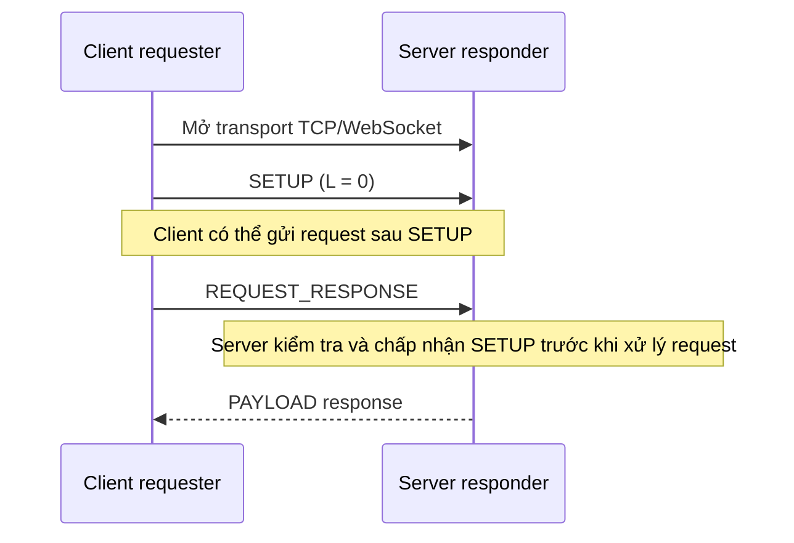
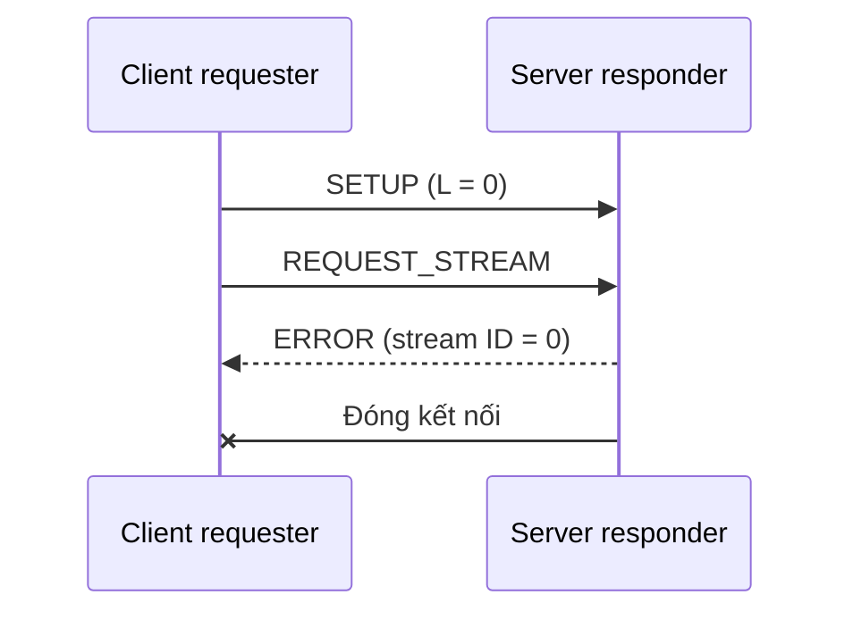
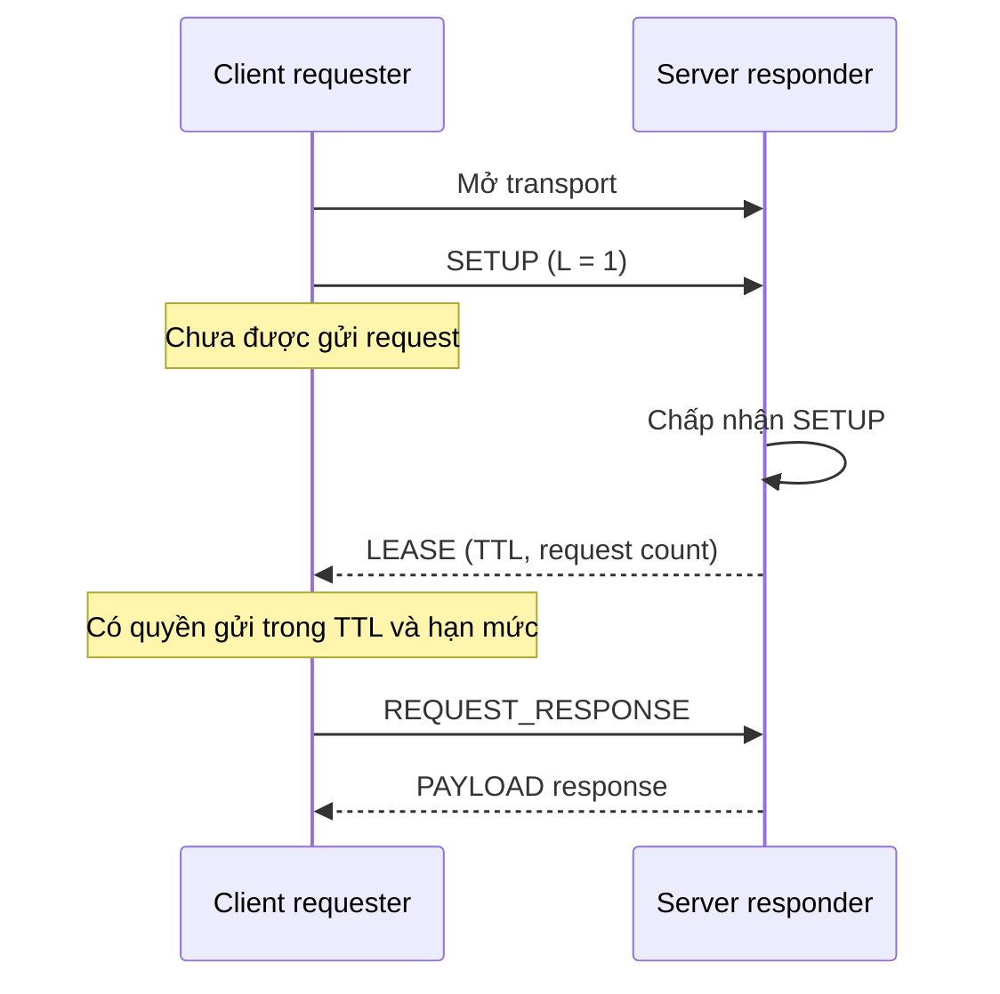

# Thời điểm cho phép gửi yêu cầu sau khi thiết lập kết nối

Khi một client mở kết nối TCP hoặc WebSocket tới RSocket server, việc transport đã kết nối chưa có nghĩa là ứng dụng đã hoàn tất thiết lập phiên RSocket. Trên kết nối mới, bên khởi tạo phải gửi frame `SETUP` để thống nhất tham số giao thức. Sau đó, thời điểm được phép gửi request phụ thuộc vào việc kết nối có bật cơ chế cấp quyền bằng `LEASE` hay không và ứng dụng có bước khởi tạo phiên riêng hay không.

Hiểu đúng các mốc này giúp tránh gửi request quá sớm, tránh chờ một tín hiệu không tồn tại và xử lý chính xác trường hợp server từ chối thiết lập phiên.

## 1. Phân biệt kết nối transport và phiên RSocket

Một phiên RSocket qua TCP hoặc WebSocket có thể được nhìn theo các mốc sau:

1. **Transport connected:** TCP socket hoặc WebSocket đã mở. Hai bên có kênh truyền frame, nhưng giao thức RSocket chưa nhất thiết được thiết lập.
2. **SETUP sent/received:** bên khởi tạo gửi frame `SETUP` đầu tiên; bên nhận đọc frame này để biết các tham số của phiên.
3. **SETUP accepted or rejected:** bên nhận kiểm tra tham số và chính sách kết nối. Nếu chấp nhận, hai phía có thể tiến tới trao đổi request theo quy tắc giao thức. Nếu từ chối, bên nhận gửi `ERROR` ở cấp kết nối rồi đóng kết nối.
4. **Lease granted (nếu bật leasing):** requester chỉ được gửi request khi nhận được `LEASE` còn hiệu lực và còn hạn mức.
5. **Application ready:** các bước khởi tạo nghiệp vụ như xác thực, đăng ký session, nạp ngữ cảnh tenant hoặc chuẩn bị tài nguyên đã hoàn tất.

```text
Client / requester                         Server / responder
       |                                           |
       |----------- TCP / WebSocket -------------->|
       |                                           |
       |--------------- SETUP -------------------->|
       |       (MIME types, keepalive, metadata)   |
       |                                           |
       |                         kiểm tra SETUP    |
       |                                           |
       |<----------- ERROR (nếu từ chối) -----------|  -> đóng kết nối
       |                                           |
       |        Nếu không dùng LEASE:               |
       |---- REQUEST_* có thể gửi sau SETUP ------->|
       |                                           |
       |        Nếu dùng LEASE:                     |
       |<--------------- LEASE --------------------|
       |---- REQUEST_* trong hạn mức ------------->|
       |                                           |
       |<---------- PAYLOAD / COMPLETE ------------|
```

Transport connected chỉ xác nhận tầng vận chuyển đã mở. Ứng dụng vẫn cần xử lý lỗi thiết lập RSocket, chính sách lease và trạng thái sẵn sàng nghiệp vụ.

## 2. SETUP là frame đầu tiên của một kết nối mới

Trong một kết nối RSocket mới, client khởi tạo phải gửi `SETUP` với stream ID bằng `0`. Frame này mang các tham số để hai phía thống nhất cách vận hành, thường gồm:

- Phiên bản hoặc các tham số giao thức cần thiết.
- Data MIME type và metadata MIME type.
- Khoảng thời gian keepalive và giới hạn thời gian sống của kết nối.
- Cờ cho biết requester có sử dụng cơ chế leasing hay không.
- Setup payload tùy chọn, có thể mang dữ liệu hoặc metadata cấp kết nối.

`SETUP` là frame đầu tiên trên kết nối mới. Server cần xử lý frame này trước khi xử lý các request tiếp theo. Nếu nội dung không hợp lệ hoặc có tham số không được hỗ trợ, server có thể từ chối thiết lập.

Một điểm dễ nhầm: giao thức RSocket không định nghĩa frame `SETUP_ACK` riêng. Vì vậy client không nên chờ một thông điệp có tên `SETUP_ACK` trước khi gửi request. Khi không dùng leasing, giao thức cho phép client gửi request sau khi đã gửi `SETUP`; các frame được giữ đúng thứ tự trên transport nên server nhận `SETUP` trước request. Nếu server từ chối, nó trả về lỗi ở cấp kết nối.

## 3. Không bật LEASE: có thể gửi request sau SETUP

Nếu cờ `L` trong frame `SETUP` không được bật, requester không yêu cầu peer cấp lease để điều tiết số request mới. Khi đó:

- Client-side requester có thể gửi request ngay sau khi gửi `SETUP`; không cần đợi một frame xác nhận setup riêng.
- Server-side requester có thể bắt đầu gửi request sau khi server đã nhận và chấp nhận `SETUP`.
- Nếu server không chấp nhận setup, server gửi `ERROR` có stream ID `0` và đóng kết nối. Request đang được gửi hoặc chờ phản hồi phải được xử lý như lỗi kết nối.

Trình tự không dùng lease:



Nếu server từ chối thiết lập:



Client có thể nhận ra setup được chấp nhận khi nhận response cho một request, nhận `LEASE`, hoặc nhận được một request do phía kia khởi tạo. Ngược lại, `ERROR` ở stream ID `0` báo lỗi cấp kết nối, trong đó có thể là lỗi thiết lập phiên. Vì không có setup acknowledgment riêng, ứng dụng phải quan sát kết quả giao tiếp và lỗi kết nối thay vì đợi một ACK giả định.

## 4. Bật LEASE: phải chờ quyền gửi request

Leasing là cơ chế để một phía giới hạn số request mới mà phía còn lại được phép khởi tạo trong một khoảng thời gian. Khi requester bật cờ `L` trong `SETUP`, requester cam kết tuân thủ lease do peer cấp.

Một frame `LEASE` cung cấp hai thông tin quan trọng:

- **TTL:** khoảng thời gian lease còn hiệu lực.
- **Request count:** số request tối đa được phép khởi tạo trong lease đó.

Khi cờ `L` được bật:

- Client requester phải đợi server responder gửi `LEASE` trước khi client gửi request.
- Nếu server requester muốn gửi request ngược về client, server cũng phải đợi client responder cấp `LEASE`.
- Client responder phải gửi `LEASE` sau khi nhận `SETUP` có bật cờ `L`.
- Khi lease hết hạn hoặc đã dùng hết số request được cấp, requester phải đợi lease tiếp theo trước khi khởi tạo request mới.

Trình tự cơ bản với lease:



Ví dụ server cấp lease có TTL 10 giây và hạn mức 20 request. Client có thể khởi tạo tối đa 20 request trong khoảng lease còn hiệu lực. Nếu đã dùng hết 20 request trước khi hết 10 giây, client vẫn phải chờ lease mới. Nếu 10 giây trôi qua khi mới dùng 5 request, các quyền còn lại cũng hết hiệu lực.

Lease điều tiết số request mới được khởi tạo, không thay thế backpressure của Reactive Streams. Với `REQUEST_STREAM` hoặc `REQUEST_CHANNEL`, demand vẫn điều khiển số phần tử dữ liệu mà responder được phát trong stream. Một request stream có thể phát nhiều phần tử nhưng chỉ tiêu thụ một quyền request khi được khởi tạo theo lease.

## 5. Hai chiều có thể khởi tạo request

Sau khi thiết lập, RSocket là giao thức hai chiều. Vai trò client và server chỉ mô tả bên khởi tạo kết nối ban đầu; cả hai phía đều có thể trở thành requester hoặc responder cho từng stream.

Vì vậy cần xét riêng quyền gửi request ở mỗi chiều:

| Chiều request | Không bật leasing | Bật leasing |
| --- | --- | --- |
| Client gửi request tới server | Client có thể gửi sau khi gửi `SETUP`; server xử lý sau khi chấp nhận setup | Client đợi `LEASE` do server gửi |
| Server gửi request tới client | Server có thể gửi sau khi nhận và chấp nhận `SETUP` | Server đợi `LEASE` do client gửi |

Không nên hiểu `LEASE` server gửi cho client là quyền hai chiều. Mỗi responder cấp lease cho requester ở phía đối diện; mỗi hướng có hạn mức và thời gian hiệu lực riêng.

## 6. Spring RSocket: requester được tạo chưa chắc đã kết nối

Trong Spring, `RSocketRequester` cung cấp API mức cao để gửi object và nhận response. Cần phân biệt việc tạo requester với việc mở kết nối thực tế.

Ví dụ:

```java
RSocketRequester requester = RSocketRequester.builder()
        .tcp("localhost", 7000);

Mono<OrderView> response = requester
        .route("orders.find")
        .data(new FindOrderCommand("ORD-2026-0018"))
        .retrieveMono(OrderView.class);
```

Trong cách dùng builder này, requester có thể được tạo trước; kết nối được thiết lập một cách lười khi có request được subscribe. Vì vậy việc khởi tạo biến `requester` không chứng minh transport đã kết nối hoặc phiên đã sẵn sàng. Khi `response` được subscribe, Spring thực hiện kết nối và gửi request theo vòng đời RSocket.

Với ứng dụng cần quản lý vòng đời kết nối rõ ràng, hãy theo dõi các tín hiệu kết nối, lỗi và đóng kết nối mà API của phiên bản Spring/RSocket đang dùng cung cấp. Tránh dùng `Thread.sleep` hoặc một khoảng delay cố định để phỏng đoán rằng setup đã hoàn tất; độ trễ mạng và thời gian xử lý phía server không cố định.

## 7. @ConnectMapping và readiness phía server

Spring hỗ trợ `@ConnectMapping` để xử lý sự kiện thiết lập kết nối và nội dung của frame `SETUP`. Đây là nơi phù hợp để xác thực dữ liệu setup, đăng ký session, tạo ngữ cảnh kết nối hoặc chuẩn bị tài nguyên cần thiết.

Ví dụ một handler chỉ hoàn tất khi quá trình chuẩn bị session hoàn thành:

```java
@Controller
public class SessionController {

    private final SessionService sessionService;

    public SessionController(SessionService sessionService) {
        this.sessionService = sessionService;
    }

    @ConnectMapping
    Mono<Void> onConnect() {
        return sessionService.initializeSession();
    }
}
```

`@ConnectMapping` xử lý setup ở cấp ứng dụng. Spring cần hoàn tất việc xử lý kết nối này trước khi bắt đầu xử lý các request thông thường trên kết nối. Vì thế, nếu session cần xác thực hoặc khởi tạo bất đồng bộ, hãy trả về `Mono<Void>` đại diện cho toàn bộ công việc cần hoàn thành. Nếu quá trình này lỗi, lỗi phải được xử lý như lỗi thiết lập kết nối.

Không nên chờ một request khác hoàn tất ngay bên trong chính `@ConnectMapping` nếu request đó cần được xử lý trên cùng kết nối. Request sẽ phụ thuộc vào việc hoàn tất handler setup, tạo ra tình huống chờ lẫn nhau. Nếu cần khởi chạy một request ngay khi kết nối được tạo, hãy tách việc khởi chạy đó khỏi luồng hoàn tất của handler setup và xử lý bất đồng bộ theo mô hình phù hợp.

## 8. Khi nào cần một tín hiệu READY ở cấp ứng dụng?

RSocket protocol readiness và business readiness là hai khái niệm khác nhau.

- Protocol readiness cho biết kết nối đã vượt qua các quy tắc `SETUP` và `LEASE` cần thiết để khởi tạo request.
- Business readiness cho biết ứng dụng đã xác thực danh tính, nạp quyền, đăng ký topic, tải cấu hình tenant hoặc chuẩn bị tài nguyên nghiệp vụ.

Nếu client cần biết chắc server đã hoàn tất các bước nghiệp vụ trước khi gửi lệnh quan trọng, hãy thiết kế một tín hiệu ở cấp ứng dụng. Ví dụ, server có thể cung cấp route `session.ready` trả về thông tin phiên sau khi khởi tạo xong; client chỉ bắt đầu gửi lệnh nghiệp vụ sau khi nhận kết quả thành công.

```text
Transport connected
        |
        v
SETUP sent / accepted
        |
        v
LEASE received (nếu bật)
        |
        v
Request session.ready
        |
        v
Server xác thực và chuẩn bị nghiệp vụ
        |
        v
Response READY
        |
        v
Cho phép gửi lệnh nghiệp vụ
```

Không cần thêm route READY nếu việc hoàn tất `@ConnectMapping` đã đáp ứng yêu cầu và client không cần tín hiệu xác nhận riêng. Chỉ thêm bước handshake nghiệp vụ khi client thực sự phải biết trạng thái đó để quyết định hành động.

## 9. Xử lý từ chối setup, timeout và đóng kết nối

Server có thể từ chối `SETUP` vì nhiều lý do:

- Phiên bản hoặc nội dung setup không hợp lệ.
- Data MIME type hoặc metadata MIME type không được hỗ trợ.
- Metadata xác thực không hợp lệ hoặc không đủ quyền tạo session.
- Chính sách server không cho phép kết nối mới.
- Quá trình chuẩn bị session trong handler setup thất bại.

Lỗi setup là lỗi cấp kết nối, thường được biểu diễn bằng frame `ERROR` có stream ID `0`, sau đó kết nối bị đóng. Ứng dụng nên phân loại lỗi để quyết định có thử lại hay không. Ví dụ, lỗi do token hết hạn cần lấy thông tin xác thực mới; lỗi do MIME type không hỗ trợ cần sửa cấu hình; lỗi tạm thời có thể thử lại với backoff.

Không nên retry vô hạn hoặc retry dồn dập. Hãy đặt timeout cho kết nối và bước khởi tạo nghiệp vụ, dùng backoff có jitter cho lỗi tạm thời, giới hạn số lần thử và giải phóng tài nguyên của kết nối cũ trước khi tạo kết nối mới.

Khi kết nối bị đóng hoặc mất mạng, trạng thái lease cũ không nên được xem là quyền vô thời hạn. Khi tạo kết nối mới, client phải thực hiện quy trình `SETUP` mới; nếu sử dụng session resumption thì phải tuân theo quy trình `RESUME` và trạng thái phiên được giao thức hỗ trợ. Việc khôi phục transport không đồng nghĩa mọi quyền nghiệp vụ hoặc đăng ký ứng dụng đều tự động còn hiệu lực.

## 10. Kiểm thử thời điểm được phép gửi request

Kiểm thử cần xác minh cả thứ tự frame và hành vi ứng dụng, không chỉ kiểm tra rằng một request cuối cùng nhận được response.

| Trường hợp | Điều cần xác minh |
| --- | --- |
| Setup hợp lệ, không bật `L` | Client có thể gửi request sau `SETUP`; server xử lý setup trước request |
| Setup không hợp lệ | Server gửi lỗi cấp kết nối và đóng kết nối; request thất bại rõ ràng |
| Bật `L`, chưa nhận `LEASE` | Requester chưa khởi tạo request mới |
| Bật `L`, đã nhận `LEASE` | Requester chỉ gửi trong TTL và hạn mức được cấp |
| Lease hết hạn hoặc hết count | Request mới chờ lease tiếp theo |
| Requester hai chiều | Mỗi chiều tuân thủ lease do responder đối diện cấp |
| `@ConnectMapping` đang chạy | Handler nghiệp vụ thông thường chưa được xử lý trước khi setup handler hoàn tất |
| Khởi tạo nghiệp vụ lỗi | Kết nối hoặc handshake nghiệp vụ báo lỗi đúng chính sách |
| TCP và WebSocket | Cả hai transport có cùng hành vi giao thức quan sát được |

Với kiểm thử tích hợp, có thể ghi lại timestamp và loại sự kiện ở hai phía: transport connected, `SETUP` received, setup handler completed, `LEASE` received, request accepted và session ready. Log nên dùng correlation ID và tránh ghi token hoặc metadata nhạy cảm.

## 11. Quy tắc thực hành

- Không xem sự kiện TCP/WebSocket connected là bằng chứng phiên RSocket đã sẵn sàng.
- Gửi `SETUP` làm frame đầu tiên của kết nối RSocket mới.
- Không chờ `SETUP_ACK`, vì giao thức không có frame xác nhận riêng này.
- Không bật leasing: client có thể gửi request sau khi gửi `SETUP`; server chỉ xử lý sau khi chấp nhận setup.
- Có bật leasing: chỉ gửi request sau khi nhận `LEASE` còn hiệu lực và còn hạn mức từ peer tương ứng.
- Để `@ConnectMapping` hoàn tất xác thực và chuẩn bị session trước khi xử lý request thông thường.
- Nếu nghiệp vụ cần xác nhận trạng thái sẵn sàng, định nghĩa tín hiệu READY riêng và chỉ dùng khi cần thiết.
- Xử lý `ERROR` stream ID `0`, timeout, đóng kết nối và reconnect như các sự kiện vòng đời phiên.

Thời điểm gửi request vì vậy không được quyết định bằng một khoảng chờ tùy ý. Hãy dựa vào trạng thái giao thức (`SETUP`, `LEASE`), trạng thái khởi tạo của Spring và điều kiện sẵn sàng mà nghiệp vụ thực sự yêu cầu.
