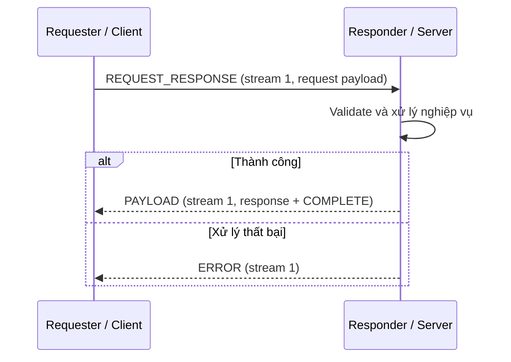

# Thiết kế thao tác truy vấn hoặc lệnh cần xác nhận kết quả

RSocket request-response phù hợp khi một phía gửi một yêu cầu và cần nhận đúng một kết quả để tiếp tục công việc. Mô hình này thường dùng cho truy vấn có kết quả rõ ràng hoặc lệnh cần xác nhận đã được xử lý, chẳng hạn đọc hồ sơ thiết bị, kiểm tra hạn mức, tính phí, giữ chỗ hoặc xác nhận một giao dịch. Client gửi một payload trên stream mới; responder trả một payload phản hồi hoặc tín hiệu lỗi. Hai phía không cần duy trì một luồng dữ liệu nhiều phần tử như request-stream hay request-channel.

Điểm quan trọng khi thiết kế là xác định chính xác ý nghĩa của phản hồi. Một phản hồi thành công có thể có nghĩa là dữ liệu đã được đọc, lệnh đã được chấp nhận, hay thay đổi đã được commit. Ba ý nghĩa này khác nhau. Với thao tác có tác động phụ, API cần nói rõ thời điểm xác nhận, cách xử lý timeout và khả năng gửi lại yêu cầu. RSocket cung cấp cơ chế request-response và cancellation; tính đúng đắn của nghiệp vụ, tính idempotent và việc xử lý kết quả không chắc chắn vẫn thuộc trách nhiệm của ứng dụng.

## 1. Request-response hoạt động như thế nào?

Trong mô hình request-response, requester mở một stream mới bằng frame `REQUEST_RESPONSE`, mang payload đầu vào. Responder xử lý yêu cầu và gửi tối đa một payload kết quả trong frame `PAYLOAD` có cờ hoàn tất. Nếu xử lý thất bại, responder gửi lỗi cho stream đó. Mỗi request-response có stream ID riêng, nên nhiều yêu cầu có thể chạy đồng thời trên cùng một kết nối TCP hoặc WebSocket.



Các đặc điểm chính:

- Một request mở một stream mới và mang một payload yêu cầu.
- Responder trả một payload kết quả; không phát chuỗi payload liên tiếp trong interaction này.
- Requester có thể hủy stream khi không còn cần kết quả.
- Lỗi của một request được gắn với stream tương ứng; nó không nhất thiết làm đóng toàn bộ kết nối.
- Không cần gửi `REQUEST_N` để lấy thêm response payload vì response chỉ có một phần tử.

Request-response không phải là một lời gọi đồng bộ theo nghĩa thread phải chờ. Ở API reactive, client nhận một `Mono<T>`; thread gọi có thể tiếp tục công việc khác và subscriber xử lý kết quả khi nó đến. `Mono` biểu diễn kết quả tối đa một phần tử, nhưng contract nghiệp vụ nên quy định rõ trường hợp thành công, không tìm thấy, từ chối và lỗi kỹ thuật.

## 2. Khi nào nên chọn request-response?

Hãy dùng request-response khi mỗi lần gọi có đầu vào hữu hạn, kết quả đơn lẻ và thời gian xử lý dự kiến có giới hạn.

| Nhu cầu | Ví dụ | Lý do phù hợp |
|---|---|---|
| Truy vấn một đối tượng | `customer.get`, `device.status` | Một yêu cầu trả về một bản ghi hoặc trạng thái |
| Tính toán | `price.calculate`, `risk.evaluate` | Một đầu vào tạo một kết quả tính toán |
| Kiểm tra điều kiện | `quota.check`, `permission.evaluate` | Cần một quyết định rõ ràng để tiếp tục |
| Lệnh cần xác nhận | `inventory.reserve`, `payment.authorize` | Client cần biết kết quả xử lý hoặc mã xác nhận |
| Cập nhật có kết quả | `profile.update`, `device.configure` | Server có thể trả trạng thái mới hoặc phiên bản đã cập nhật |

Một số tình huống phù hợp hơn với interaction model khác:

- Nếu client chỉ gửi sự kiện và không cần response nghiệp vụ, cân nhắc fire-and-forget.
- Nếu server cần phát nhiều kết quả theo thời gian, dùng request-stream.
- Nếu client và server cần gửi nhiều payload theo cả hai chiều, dùng request-channel.
- Nếu lệnh khởi chạy công việc dài và client chỉ cần mã tác vụ, có thể dùng request-response để trả `jobId` sau khi chấp nhận, rồi dùng request-response để truy vấn trạng thái hoặc request-stream để theo dõi tiến độ.

Đừng giữ một request-response mở trong nhiều phút chỉ để chờ một công việc nền. Một tương tác dài hạn làm tăng số stream đang hoạt động và khiến timeout, reconnect, cancellation cùng vòng đời tài nguyên khó quản lý hơn.

## 3. Thiết kế contract cho request và response

Contract nên mô tả mục tiêu nghiệp vụ, dữ liệu đầu vào, dữ liệu đầu ra và các kết quả có thể xảy ra. Tên route cần ổn định và thể hiện hành động hoặc truy vấn, ví dụ `orders.get`, `inventory.reserve` hoặc `payment.authorize`.

Ví dụ contract cho lệnh giữ hàng:

```java
public record ReserveInventoryCommand(
    String sku,
    int quantity,
    String warehouseId
) {}

public record ReservationResult(
    String reservationId,
    String status,
    int reservedQuantity,
    String message
) {}
```

`ReservationResult` có thể biểu diễn các kết quả nghiệp vụ đã dự kiến như `RESERVED`, `REJECTED` hoặc `INSUFFICIENT_STOCK`. Khi đó client nhận được một kết quả có cấu trúc và không cần diễn giải chuỗi lỗi tùy ý.

Nên quyết định rõ các điểm sau trước khi công bố route:

1. **Tên và phiên bản route:** route có ổn định giữa các lần triển khai không; thay đổi contract có tương thích ngược không?
2. **Trường bắt buộc:** trường nào phải có, giá trị nào hợp lệ, giới hạn độ dài và số lượng là bao nhiêu?
3. **Kết quả thành công:** response xác nhận đã đọc, đã chấp nhận hay đã commit thay đổi?
4. **Kết quả nghiệp vụ không thành công:** không tìm thấy, hết hàng hoặc không đủ quyền được biểu diễn thành response có trạng thái hay lỗi?
5. **Tính nhất quán:** response có chứa ID, version hoặc timestamp để client xác định kết quả đã áp dụng ở phiên bản nào không?
6. **Tương thích:** trường mới có giá trị mặc định không; client cũ xử lý trường chưa biết thế nào?

Với lệnh có tác động phụ, response nên mang mã tham chiếu ổn định như `reservationId` hoặc `paymentId`. Client có thể dùng mã đó để truy vấn lại nếu mất response sau khi server đã hoàn tất thao tác.

## 4. Phân biệt kết quả nghiệp vụ và lỗi kỹ thuật

Không phải mọi kết quả không như mong đợi đều là lỗi giao thức hoặc exception. Hãy phân loại rõ:

| Tình huống | Cách biểu diễn thường phù hợp |
|---|---|
| Tìm thấy đối tượng | Response có dữ liệu và trạng thái thành công |
| Không tìm thấy | Response có trạng thái `NOT_FOUND`, hoặc lỗi nghiệp vụ theo contract đã thống nhất |
| Không đủ hàng / không đủ hạn mức | Response có trạng thái từ chối và lý do có mã rõ ràng |
| Request sai định dạng | Lỗi validation được ánh xạ thành lỗi ứng dụng hoặc response lỗi theo contract |
| Database không khả dụng | Lỗi kỹ thuật; có thể retry nếu thao tác an toàn |
| Server gặp lỗi ngoài dự kiến | Lỗi ứng dụng; log nội bộ đầy đủ và trả thông tin an toàn cho client |
| Kết nối bị đóng trước phản hồi | Client nhận lỗi transport hoặc timeout; kết quả nghiệp vụ có thể chưa xác định |

Nếu dùng response DTO cho kết quả nghiệp vụ, nên có trường `status` hoặc mã kết quả ổn định, không phụ thuộc vào câu thông báo dành cho người dùng. Nếu dùng error signal, server nên ánh xạ exception sang thông tin lỗi phù hợp và không để stack trace, câu SQL hay dữ liệu bí mật lộ ra ngoài.

`Mono.empty()` không nên được dùng tùy tiện để biểu diễn mọi trường hợp không tìm thấy hoặc từ chối. Hãy định nghĩa rõ empty completion có ý nghĩa gì trong contract; với API cần một xác nhận rõ ràng, một response DTO có trạng thái thường dễ hiểu và dễ kiểm thử hơn.

## 5. Triển khai responder bằng Spring Boot

Spring Messaging ánh xạ route RSocket vào phương thức có `@MessageMapping`. Với request-response, phương thức có thể trả về một đối tượng hoặc `Mono<T>`. Dùng `Mono` khi công việc bất đồng bộ, chẳng hạn truy vấn database reactive hoặc gọi dịch vụ khác qua WebClient.

```java
import org.springframework.messaging.handler.annotation.MessageMapping;
import org.springframework.messaging.handler.annotation.Payload;
import org.springframework.stereotype.Controller;
import reactor.core.publisher.Mono;

@Controller
public class InventoryController {
    private final InventoryService inventoryService;

    public InventoryController(InventoryService inventoryService) {
        this.inventoryService = inventoryService;
    }

    @MessageMapping("inventory.reserve")
    public Mono<ReservationResult> reserve(
            @Payload ReserveInventoryCommand command) {
        return inventoryService.reserve(command);
    }
}
```

Service nên chứa logic nghiệp vụ và trả kết quả reactive:

```java
public interface InventoryService {
    Mono<ReservationResult> reserve(ReserveInventoryCommand command);
}
```

Trong ứng dụng thật, service cần xác thực dữ liệu, kiểm tra quyền, thực hiện thay đổi trong transaction phù hợp và chỉ phát response sau khi đạt điều kiện xác nhận đã cam kết. Không gọi `block()` trong controller hoặc trên EventLoop. Nếu dùng thư viện blocking chưa thể thay thế, hãy cô lập lời gọi đó trên scheduler phù hợp và giới hạn concurrency.

Với truy vấn, handler có thể đơn giản hơn:

```java
@MessageMapping("device.status")
public Mono<DeviceStatus> getStatus(@Payload DeviceQuery query) {
    return deviceService.findStatus(query.deviceId());
}
```

`Mono` giúp biểu diễn kết quả bất đồng bộ. Khi truy vấn hoàn tất, Spring/RSocket gửi một response payload; khi publisher phát lỗi, framework chuyển lỗi thành tín hiệu lỗi của stream theo cấu hình xử lý lỗi.

## 6. Gọi request-response từ RSocketRequester

Ở phía client, `RSocketRequester` cung cấp API theo route và kiểu kết quả mong đợi. `retrieveMono` phù hợp với request-response:

```java
import java.time.Duration;
import reactor.core.publisher.Mono;

Mono<ReservationResult> result = requester
    .route("inventory.reserve")
    .data(new ReserveInventoryCommand("SKU-42", 2, "WH-HCM"))
    .retrieveMono(ReservationResult.class)
    .timeout(Duration.ofSeconds(3));
```

Client không cần tự tạo `REQUEST_RESPONSE` frame hoặc quản lý stream ID. Framework chuyển lời gọi route thành frame, giải mã payload phản hồi và phát kết quả qua `Mono`.

Đừng gọi `.block()` trong đường xử lý reactive chỉ để lấy kết quả. Có thể kết hợp với các thao tác khác bằng operator:

```java
Mono<CheckoutView> checkout = cartService.load(cartId)
    .flatMap(cart -> requester
        .route("pricing.calculate")
        .data(new PriceQuery(cart.items()))
        .retrieveMono(PriceQuote.class)
        .map(quote -> CheckoutView.from(cart, quote))
    );
```

Trong ví dụ, kết quả tính giá được kết hợp vào dữ liệu giỏ hàng khi nó đến. Pipeline không cần giữ thread chờ response mạng. Nếu một bước upstream lỗi, lỗi được truyền xuống và cần được xử lý tại ranh giới phù hợp.

## 7. Timeout và ngân sách thời gian

Request-response thường có thời hạn hữu hạn. Client nên đặt timeout dựa trên mục tiêu độ trễ của ứng dụng và thời gian cần thiết cho các công đoạn downstream. Ví dụ một request có ngân sách 2 giây có thể phân bổ cho xác thực, truy vấn dữ liệu, gọi dịch vụ khác và truyền response.

```java
Mono<OrderView> order = requester
    .route("orders.get")
    .data(new OrderQuery(orderId))
    .retrieveMono(OrderView.class)
    .timeout(Duration.ofSeconds(2));
```

`timeout` ở client giới hạn thời gian chờ của subscriber. Khi hết thời gian, pipeline phát lỗi timeout và hủy subscription upstream. Việc hủy có thể khiến thư viện gửi `CANCEL` cho stream nếu request còn hoạt động. Tuy nhiên, client timeout không chứng minh server chưa thực hiện tác động phụ. Server có thể đã commit giao dịch nhưng response bị trễ hoặc bị mất trên đường truyền.

Nếu ứng dụng truyền deadline hoặc timeout budget qua metadata, cần định nghĩa rõ đơn vị, múi giờ hoặc cách biểu diễn thời điểm, chính sách giảm ngân sách qua từng hop và hành vi khi deadline đã hết. RSocket không tự áp dụng một deadline nghiệp vụ chung cho mọi request chỉ vì client gọi `.timeout(...)`.

Không nên đặt timeout quá ngắn khiến request hợp lệ thường xuyên bị hủy. Cũng không nên đặt timeout quá dài khiến stream bị treo và chiếm tài nguyên. Hãy đo latency percentile, phân biệt thời gian chờ mạng với thời gian xử lý và đặt timeout theo từng route.

## 8. Retry, idempotency và kết quả không chắc chắn

Retry là quyết định của ứng dụng. RSocket không tự bảo đảm một lệnh chỉ được thực hiện đúng một lần. Khi client không nhận được response, có ít nhất ba khả năng:

1. Server chưa nhận được request.
2. Server đã nhận nhưng chưa hoàn tất xử lý.
3. Server đã hoàn tất và commit thay đổi, nhưng response không đến được client.

Nếu client gửi lại lệnh ở trường hợp thứ ba, tác động phụ có thể xảy ra lần thứ hai. Vì vậy, retry một lệnh tạo giao dịch, trừ tiền hoặc giữ chỗ cần cơ chế idempotency.

Một mẫu phổ biến là client tạo idempotency key duy nhất cho một ý định nghiệp vụ và gửi nó trong metadata của request. Server lưu key cùng trạng thái xử lý và kết quả đã tạo. Nếu nhận lại cùng key với cùng nội dung, server trả lại kết quả trước đó; nếu cùng key nhưng nội dung khác, server từ chối để tránh dùng lại key sai mục đích.

```java
Mono<ReservationResult> reserve(String idempotencyKey,
                                ReserveInventoryCommand command) {
    return reservationRepository.findByKey(idempotencyKey)
        .flatMap(existing -> Mono.just(existing.toResult()))
        .switchIfEmpty(Mono.defer(() ->
            reservationRepository.reserveOnce(idempotencyKey, command)
        ));
}
```

Đây là pseudocode minh họa. Trong triển khai thật, thao tác kiểm tra key, tạo reservation và lưu kết quả phải được bảo vệ bởi transaction hoặc ràng buộc unique ở database để hai request đồng thời cùng key không thể tạo hai lần tác động phụ. Cần lưu cả hash của nội dung lệnh để phát hiện key bị tái sử dụng với payload khác.

Retry chỉ nên áp dụng cho lỗi có khả năng phục hồi, giới hạn số lần thử và có backoff:

```java
Mono<ReservationResult> result = sendReserveCommand(command, key)
    .retryWhen(Retry.backoff(2, Duration.ofMillis(200))
        .maxBackoff(Duration.ofSeconds(2))
        .filter(this::isTransientFailure));
```

Mỗi lần retry phải dùng cùng idempotency key cho cùng một ý định nghiệp vụ. Không retry validation error, lỗi phân quyền hoặc kết quả từ chối nghiệp vụ. Với thao tác không idempotent và không có cơ chế deduplication, hãy trả trạng thái không chắc chắn để client tra cứu bằng mã tham chiếu thay vì tự gửi lệnh mới.

## 9. Cancellation và vòng đời thao tác

Requester có thể hủy request-response nếu không còn cần kết quả, chẳng hạn người dùng rời màn hình hoặc timeout xảy ra. Hủy subscription có thể được truyền qua frame `CANCEL` đến responder. Service phía server nên hỗ trợ cancellation nếu thao tác còn có thể dừng an toàn.

Cancellation không phải rollback giao dịch. Nếu lệnh đã commit trước khi nhận được cancel, server không thể giả vờ rằng thay đổi chưa xảy ra. Với truy vấn đọc, hủy thường giúp dừng truy vấn hoặc giải phóng tài nguyên. Với lệnh ghi, cần xác định điểm commit và trạng thái kết quả rõ ràng.

Một số nguyên tắc:

- Giải phóng tài nguyên và dừng công việc upstream khi cancellation đến mà thao tác còn có thể dừng.
- Không bỏ qua lỗi hoặc cancellation bằng cách giữ subscription vô thời hạn.
- Không dùng cancellation như cơ chế hoàn tác nghiệp vụ.
- Với lệnh dài, tạo job và trả mã tham chiếu sớm; cho phép client truy vấn trạng thái riêng.
- Ghi nhận các trạng thái `ACCEPTED`, `RUNNING`, `COMPLETED`, `FAILED` nếu nghiệp vụ cần theo dõi tiến trình.

## 10. Metadata, xác thực và phân quyền

Request-response có thể mang metadata cùng payload đầu vào. Metadata thường chứa route, trace ID, tenant hoặc idempotency key. Trong Spring, có thể gắn metadata vào request:

```java
Mono<ReservationResult> result = requester
    .route("inventory.reserve")
    .metadata(new IdempotencyMetadata(key), IDEMPOTENCY_MIME)
    .metadata(new TraceMetadata(traceId), TRACE_MIME)
    .data(command)
    .retrieveMono(ReservationResult.class);
```

Các MIME type tùy chỉnh phải được thống nhất và đăng ký codec/metadata extractor ở cả hai phía. Metadata là dữ liệu do client gửi, vì vậy server vẫn phải xác thực principal và kiểm tra quyền đối với từng lệnh. Không được tin tenant ID hoặc role trong metadata như bằng chứng xác thực.

Không ghi token, mật khẩu hoặc toàn bộ metadata nhạy cảm vào log. Dùng TLS cho TCP hoặc WebSocket khi cần bảo vệ data và metadata trên đường truyền. Giới hạn kích thước payload và metadata để tránh request quá lớn làm cạn bộ nhớ.

## 11. Xử lý lỗi và quan sát

Ở phía client, có thể phân loại lỗi theo nhóm:

| Nhóm lỗi | Hành động gợi ý |
|---|---|
| Validation / business rejection | Hiển thị hoặc xử lý theo mã kết quả; không retry tự động |
| Authentication / authorization | Làm mới credential nếu chính sách cho phép hoặc từ chối thao tác |
| Timeout | Xác định kết quả có chắc chắn không; truy vấn theo idempotency key hoặc reference ID |
| Transport disconnect | Thử kết nối lại theo chính sách; tránh gửi lệnh ghi mới với key khác |
| Transient downstream failure | Retry có giới hạn nếu thao tác idempotent |
| Unexpected application error | Ghi log có correlation ID và trả lỗi an toàn |

Ở phía server, log route, stream ID nếu có thể lấy an toàn, correlation ID, thời gian xử lý, kết quả và mã lỗi. Không ghi payload nhạy cảm. Các metric nên bao gồm:

- Số request theo route và trạng thái kết quả.
- Latency p50/p95/p99 theo route.
- Số timeout, cancellation và lỗi transport.
- Tỷ lệ retry và số request được deduplicate bằng idempotency key.
- Số request đang hoạt động và mức concurrency của dependency downstream.
- Kích thước payload/metadata và lỗi giải mã.

Khi một kết nối phục vụ nhiều stream, đừng chỉ đo latency tổng của connection. Cần theo dõi từng request/route để tìm ra dependency nào làm tăng độ trễ.

## 12. Kiểm thử request-response

Một bộ kiểm thử nên bao gồm cả contract, lỗi và hành vi thời gian:

1. **Thành công:** request hợp lệ trả đúng một response payload với các trường theo contract.
2. **Validation:** thiếu trường hoặc dữ liệu sai định dạng được xử lý đúng và không tạo tác động phụ.
3. **Business rejection:** hết hàng hoặc không đủ quyền trả trạng thái/mã lỗi nhất quán.
4. **Timeout:** client timeout đúng ngân sách; xác minh hành vi server và kết quả nghiệp vụ sau khi client hủy.
5. **Cancellation:** công việc đọc bị dừng khi client hủy; lệnh ghi không bị hiểu nhầm là rollback.
6. **Retry:** lỗi tạm thời được retry theo giới hạn; lỗi không retry không tạo tải lặp.
7. **Idempotency:** gửi cùng key đồng thời hoặc gửi lại sau khi response bị mất không tạo hai tác động phụ.
8. **Concurrency:** nhiều request-response chạy đồng thời trên một kết nối không trộn dữ liệu hoặc metadata.
9. **Compatibility:** client và server ở các phiên bản contract khác nhau xử lý trường mới hoặc trường thiếu đúng quy tắc.

`StepVerifier` có thể kiểm tra `Mono` phát một giá trị, hoàn tất, phát lỗi hoặc bị hủy. Kiểm thử tích hợp RSocket nên chạy requester và responder thật qua transport đã chọn, vì unit test service không xác minh được routing, serialization, metadata và vòng đời stream.

## 13. Quy tắc thiết kế thực tế

1. Chọn request-response cho thao tác có một yêu cầu và một kết quả hữu hạn.
2. Định nghĩa response để phân biệt thành công, từ chối nghiệp vụ và lỗi kỹ thuật.
3. Với lệnh ghi, làm rõ response xác nhận accepted hay committed.
4. Đặt timeout theo ngân sách độ trễ; hiểu rằng timeout phía client không chứng minh server chưa commit.
5. Dùng idempotency key và lưu kết quả để retry an toàn cho thao tác có tác động phụ.
6. Hủy subscription khi không cần kết quả, nhưng không coi cancellation là rollback.
7. Giữ đường xử lý non-blocking; cô lập API blocking nếu chưa thể thay thế.
8. Dùng request metadata cho trace, tenant và idempotency; xác thực và ủy quyền ở phía server.
9. Theo dõi latency, timeout, cancellation, retry và kết quả deduplication theo route.
10. Chuyển sang mô hình job hoặc streaming nếu công việc kéo dài hoặc cần nhiều cập nhật tiến độ.

Request-response là lựa chọn rõ ràng cho truy vấn và lệnh cần xác nhận kết quả. Khi contract nói rõ ý nghĩa response, timeout và lỗi được xử lý theo từng tầng, còn thao tác ghi có idempotency, client có thể nhận kết quả tin cậy mà không cần chặn thread. Đây là nền tảng hữu ích cho các API realtime như kiểm tra trạng thái, tính toán, giữ chỗ và xác nhận lệnh trong hệ thống RSocket.
