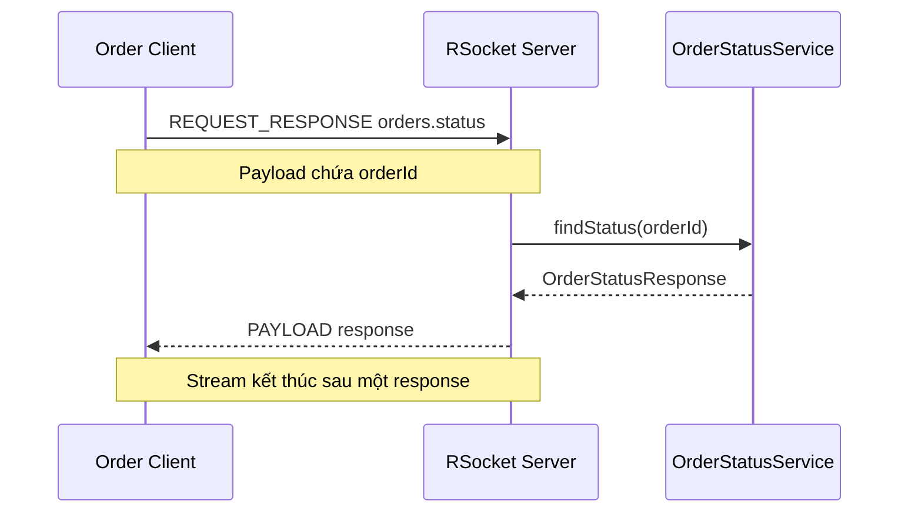

# Thực hành truy vấn trạng thái đơn hàng bằng request-response

Trong hệ thống bán hàng, client thường cần hỏi server trạng thái hiện tại của một đơn hàng: đơn đã được tiếp nhận, thanh toán, giao cho đơn vị vận chuyển hay đã giao thành công. Đây là một truy vấn có đầu vào đơn và kết quả đơn, vì vậy kiểu tương tác RSocket `request-response` là lựa chọn phù hợp.

Trong bài thực hành này, ta xây dựng một RSocket server bằng Spring Boot với route `orders.status`, sau đó viết client Java gửi mã đơn hàng và nhận đúng một phản hồi. Bài tập tập trung vào luồng dữ liệu từ client tới handler và quay lại, cách biểu diễn kết quả nghiệp vụ, xử lý lỗi và kiểm thử publisher reactive.

## 1. Mục tiêu và hợp đồng tương tác

Sau khi hoàn thành, bạn có thể:

- Chọn `request-response` cho thao tác truy vấn có một request và tối đa một response.
- Khai báo route RSocket bằng `@MessageMapping` trong Spring.
- Gửi payload từ client bằng `RSocketRequester`.
- Nhận kết quả dưới dạng `Mono` và xử lý kết quả bất đồng bộ.
- Phân biệt trạng thái đơn hàng không tồn tại với lỗi giao tiếp hoặc lỗi xử lý.
- Kiểm thử kết quả bằng Reactor Test.

Hợp đồng của ví dụ:

| Thành phần | Giá trị |
|---|---|
| Route | `orders.status` |
| Request | `OrderStatusRequest` gồm `orderId` |
| Response | `OrderStatusResponse` gồm `orderId`, `status`, `updatedAt`, `message` |
| Kiểu tương tác | Request-response |
| Transport | TCP |
| Số response | Tối đa một response cho mỗi request |

Ví dụ request:

```json
{
  "orderId": "ORD-1002"
}
```

Ví dụ response:

```json
{
  "orderId": "ORD-1002",
  "status": "SHIPPED",
  "updatedAt": "2026-11-22T08:30:00Z",
  "message": "Đơn hàng đã được bàn giao cho đơn vị vận chuyển"
}
```

`status` là trạng thái nghiệp vụ do ứng dụng quy định. Có thể dùng các giá trị `CREATED`, `PAID`, `PACKING`, `SHIPPED`, `DELIVERED`, `CANCELLED` và `NOT_FOUND`. Các giá trị này không phải mã lỗi chuẩn của giao thức RSocket.

## 2. Request-response hoạt động như thế nào?

Client gửi frame `REQUEST_RESPONSE` trên một stream RSocket. Server xử lý request và trả về tối đa một frame `PAYLOAD` response; response đánh dấu hoàn tất bằng cờ `COMPLETE`. Nếu xử lý thất bại, stream kết thúc bằng frame `ERROR`.



Trong Spring, client thường thấy kết quả dưới dạng `Mono<OrderStatusResponse>`. `Mono` biểu diễn tối đa một phần tử hoặc một lỗi. Nó không phải một danh sách và cũng không phải luồng cập nhật liên tục.

Nếu yêu cầu nghiệp vụ cần nhận nhiều lần thay đổi trạng thái của đơn hàng theo thời gian, `request-stream` sẽ phù hợp hơn. Bài này chỉ hỏi trạng thái tại thời điểm truy vấn nên dùng request-response.

## 3. Chuẩn bị dự án Spring Boot

Tạo một ứng dụng Spring Boot có dependency RSocket. Với Gradle và Spring Boot dependency management đã được cấu hình, dependency chính có thể khai báo như sau:

```groovy
dependencies {
    implementation 'org.springframework.boot:spring-boot-starter-rsocket'
    testImplementation 'org.springframework.boot:spring-boot-starter-test'
    testImplementation 'io.projectreactor:reactor-test'
}
```

Starter cung cấp tích hợp RSocket cho Spring Boot. Ứng dụng dùng Jackson hoặc message codec tương ứng để chuyển DTO Java thành payload và ngược lại. Hãy bảo đảm client và server thống nhất định dạng dữ liệu, thông thường là JSON trong ví dụ này.

Cấu hình server trong `src/main/resources/application.properties`:

```properties
spring.rsocket.server.transport=tcp
spring.rsocket.server.port=7000
```

Server sẽ lắng nghe kết nối RSocket qua TCP trên cổng `7000`. Nếu cổng đã được ứng dụng khác sử dụng, hãy chọn một cổng khác và cập nhật địa chỉ client tương ứng.

## 4. Khai báo request và response DTO

Tạo hai kiểu dữ liệu để mô tả hợp đồng. Đặt mỗi `public record` trong một file Java riêng (`OrderStatusRequest.java` và `OrderStatusResponse.java`). Dùng Java record giúp DTO ngắn gọn và bất biến:

```java
import java.time.Instant;

public record OrderStatusRequest(String orderId) {
}

public record OrderStatusResponse(
    String orderId,
    String status,
    Instant updatedAt,
    String message
) {
}
```

`OrderStatusRequest` chỉ mang thông tin cần thiết để tra cứu. `OrderStatusResponse` trả về mã đơn, trạng thái hiện tại, thời điểm cập nhật và thông điệp hiển thị. Trong ứng dụng lớn, nên đưa các DTO vào package contract riêng để client và server có thể chia sẻ hoặc quản lý phiên bản hợp đồng rõ ràng.

Không nên trả toàn bộ entity đơn hàng nếu client chỉ cần trạng thái. Response tối giản giảm lượng dữ liệu truyền, tránh vô tình lộ các trường nội bộ và giúp hợp đồng API ổn định hơn khi mô hình lưu trữ thay đổi.

## 5. Xây dựng service tra cứu trạng thái

Để tập trung vào RSocket, ta dùng dữ liệu mẫu trong bộ nhớ. Trong hệ thống thật, service có thể truy vấn database hoặc gọi một dịch vụ đơn hàng khác theo API reactive.

```java
import java.time.Instant;
import java.util.Map;
import org.springframework.stereotype.Service;
import reactor.core.publisher.Mono;

@Service
public class OrderStatusService {

    private final Map<String, OrderStatusResponse> orders = Map.of(
        "ORD-1001", new OrderStatusResponse(
            "ORD-1001", "PAID",
            Instant.parse("2026-11-22T08:00:00Z"),
            "Đơn hàng đã được thanh toán"
        ),
        "ORD-1002", new OrderStatusResponse(
            "ORD-1002", "SHIPPED",
            Instant.parse("2026-11-22T08:30:00Z"),
            "Đơn hàng đã được bàn giao cho đơn vị vận chuyển"
        )
    );

    public Mono<OrderStatusResponse> findStatus(String orderId) {
        if (orderId == null || orderId.isBlank()) {
            return Mono.error(
                new IllegalArgumentException("orderId không được để trống")
            );
        }

        OrderStatusResponse response = orders.get(orderId);
        if (response != null) {
            return Mono.just(response);
        }

        return Mono.just(new OrderStatusResponse(
            orderId,
            "NOT_FOUND",
            null,
            "Không tìm thấy đơn hàng"
        ));
    }
}
```

Ví dụ trả `NOT_FOUND` như một response nghiệp vụ để client có thể hiển thị kết quả truy vấn bình thường. Ngược lại, `orderId` trống là request không hợp lệ nên service phát lỗi. Trong hệ thống thật, cần thống nhất quy ước lỗi với client: trường hợp nào là kết quả nghiệp vụ, trường hợp nào kết thúc stream bằng lỗi RSocket.

## 6. Tạo RSocket endpoint bằng @MessageMapping

Tạo controller để nhận request trên route `orders.status`:

```java
import org.springframework.messaging.handler.annotation.MessageMapping;
import org.springframework.stereotype.Controller;
import reactor.core.publisher.Mono;

@Controller
public class OrderStatusController {

    private final OrderStatusService orderStatusService;

    public OrderStatusController(OrderStatusService orderStatusService) {
        this.orderStatusService = orderStatusService;
    }

    @MessageMapping("orders.status")
    public Mono<OrderStatusResponse> getStatus(
        OrderStatusRequest request
    ) {
        return orderStatusService.findStatus(request.orderId());
    }
}
```

Spring đọc route từ metadata RSocket, chuyển data payload thành `OrderStatusRequest`, sau đó gọi phương thức handler. Giá trị `Mono<OrderStatusResponse>` được Spring chuyển thành response cho tương tác request-response.

Tên route là hợp đồng giữa client và server. Nếu client gửi `order.status` trong khi server đăng ký `orders.status`, kết nối vẫn có thể được thiết lập nhưng request không tìm thấy handler phù hợp. Hãy quản lý route như một phần của API contract và tránh viết chuỗi route rải rác trong nhiều nơi.

## 7. Viết client bằng RSocketRequester

Client tạo kết nối tới server, gửi request lên route và yêu cầu giải mã response thành `OrderStatusResponse`:

```java
import org.springframework.messaging.rsocket.RSocketRequester;
import reactor.core.publisher.Mono;

public class OrderStatusClient {

    private final RSocketRequester requester;

    public OrderStatusClient(String host, int port) {
        this.requester = RSocketRequester.builder()
            .connectTcp(host, port)
            .block();
    }

    public Mono<OrderStatusResponse> findStatus(String orderId) {
        return requester.route("orders.status")
            .data(new OrderStatusRequest(orderId))
            .retrieveMono(OrderStatusResponse.class);
    }
}
```

Constructor dùng `.block()` để ví dụ đơn giản hóa việc tạo client đồng bộ. Trong ứng dụng reactive, nên tạo kết nối dưới dạng `Mono<RSocketRequester>` rồi ghép với pipeline nghiệp vụ, hoặc khởi tạo và quản lý requester ở lifecycle phù hợp. Không gọi `block()` trên event-loop thread.

Phương thức `findStatus` trả về `Mono`, do đó chưa chặn thread và chỉ thực thi khi publisher được subscribe. Có thể sử dụng kết quả trong một service khác bằng cách ghép `flatMap`, `map` hoặc các toán tử Reactor thay vì chặn để lấy giá trị ngay lập tức.

Ví dụ chạy client độc lập trong một tác vụ dòng lệnh:

```java
OrderStatusClient client = new OrderStatusClient("localhost", 7000);

client.findStatus("ORD-1002")
    .doOnNext(System.out::println)
    .block();
```

Đây là cách gọi thuận tiện để minh họa và thử nghiệm thủ công. Ứng dụng chạy lâu dài cần quản lý vòng đời kết nối và đóng tài nguyên RSocket khi dừng. Không tạo một kết nối mới cho mỗi lần truy vấn nếu có thể tái sử dụng một requester đang hoạt động.

## 8. Chạy thử luồng request-response

Khởi chạy Spring Boot server trước. Khi server đã lắng nghe trên TCP port `7000`, chạy client và truy vấn `ORD-1002`.

Luồng xử lý diễn ra như sau:

1. Client kết nối TCP và hoàn tất setup RSocket.
2. Client gửi request lên route `orders.status` với payload chứa `orderId = ORD-1002`.
3. Spring ánh xạ route tới `OrderStatusController.getStatus`.
4. Controller gọi `OrderStatusService.findStatus`.
5. Service trả về một `OrderStatusResponse` trong `Mono`.
6. Spring mã hóa response thành payload RSocket và gửi về client.
7. Client giải mã payload thành `OrderStatusResponse`; stream kết thúc sau response đó.

Kết quả mong đợi có trạng thái `SHIPPED`:

```text
OrderStatusResponse[
  orderId=ORD-1002,
  status=SHIPPED,
  updatedAt=2026-11-22T08:30:00Z,
  message=Đơn hàng đã được bàn giao cho đơn vị vận chuyển
]
```

Thử truy vấn `ORD-1001` để nhận trạng thái `PAID`. Thử truy vấn `ORD-9999` để nhận `NOT_FOUND`. Ba kết quả này chứng minh client và server thống nhất route, payload và response schema.

## 9. Kiểm thử publisher bằng StepVerifier

Có thể kiểm tra publisher client mà không cần gọi `.block()` bằng Reactor Test. Khi server đang chạy, kiểm thử tương tác thật qua RSocket như sau:

```java
import org.junit.jupiter.api.Test;
import org.springframework.messaging.rsocket.RSocketRequester;
import reactor.test.StepVerifier;

class OrderStatusClientIntegrationTest {

    @Test
    void shouldReturnCurrentOrderStatus() {
        RSocketRequester requester = RSocketRequester.builder()
            .connectTcp("localhost", 7000)
            .block();

        StepVerifier.create(
                requester.route("orders.status")
                    .data(new OrderStatusRequest("ORD-1002"))
                    .retrieveMono(OrderStatusResponse.class)
            )
            .expectNextMatches(response ->
                "ORD-1002".equals(response.orderId())
                    && "SHIPPED".equals(response.status())
            )
            .verifyComplete();
    }
}
```

Đây là integration test yêu cầu server mẫu đang chạy ở `localhost:7000`. Trong bộ kiểm thử tự động của dự án, nên khởi tạo server cho test bằng cấu hình test phù hợp và quản lý việc đóng requester sau khi kiểm thử để tránh rò rỉ kết nối.

Ngoài trường hợp thành công, nên kiểm thử thêm:

- Mã đơn không tồn tại trả về `NOT_FOUND` theo hợp đồng nghiệp vụ.
- `orderId` rỗng làm publisher phát lỗi validation.
- Server không hoạt động khiến thao tác connect hoặc request phát lỗi transport.
- Client gửi sai route khiến tương tác không được ánh xạ tới handler.
- Payload không tương thích codec khiến quá trình giải mã thất bại.

## 10. Xử lý timeout và lỗi ở client

Một truy vấn trạng thái thường cần thời hạn phản hồi rõ ràng. Có thể áp dụng `timeout` cho publisher và ghi log lỗi:

```java
import java.time.Duration;

Mono<OrderStatusResponse> result = requester.route("orders.status")
    .data(new OrderStatusRequest("ORD-1002"))
    .retrieveMono(OrderStatusResponse.class)
    .timeout(Duration.ofSeconds(3))
    .doOnError(error -> log.warn(
        "Không thể truy vấn trạng thái đơn hàng", error
    ));
```

Timeout ở client kết thúc việc chờ của publisher theo thời hạn đã đặt. Tùy thời điểm và trạng thái stream, việc hủy tương tác có thể được gửi tới peer. Timeout không chứng minh server chưa xử lý request; server có thể đã hoàn thành nhưng phản hồi đến muộn. Với truy vấn đọc trạng thái, có thể cân nhắc retry có giới hạn nếu phù hợp tải hệ thống. Không retry vô hạn vì điều đó có thể làm tăng tải khi server đang quá tải.

Nên phân biệt các nhóm kết quả:

| Tình huống | Biểu hiện phía client | Hướng xử lý |
|---|---|---|
| Tìm thấy đơn | `Mono` phát một response | Hiển thị trạng thái |
| Không tìm thấy đơn | Response có `status = NOT_FOUND` | Thông báo không tồn tại |
| Request không hợp lệ | `Mono` phát lỗi | Kiểm tra dữ liệu đầu vào |
| Server hoặc transport lỗi | `Mono` phát lỗi kết nối/giao thức | Ghi log, kiểm tra kết nối và áp dụng retry có giới hạn nếu phù hợp |
| Hết thời gian chờ | `TimeoutException` ở phía client | Hiển thị trạng thái chưa lấy được; không suy đoán đơn hàng thất bại |

Đừng biến mọi lỗi thành `NOT_FOUND`. Lỗi kết nối, timeout hoặc lỗi server không nói lên rằng đơn hàng không tồn tại. Nếu gộp chúng thành cùng một response, client sẽ hiển thị sai trạng thái nghiệp vụ.

## 11. Các lưu ý khi đưa vào ứng dụng thật

Ví dụ dùng map trong bộ nhớ chỉ nhằm minh họa. Khi chuyển sang hệ thống thực, cần chú ý một số điểm:

- **Nguồn dữ liệu:** dùng repository hoặc service nghiệp vụ để truy vấn trạng thái hiện tại; tránh truy vấn đồng bộ chặn event loop.
- **Hợp đồng DTO:** quản lý phiên bản request/response và định dạng JSON hoặc codec khác giữa client, server.
- **Bảo mật:** xác thực client, kiểm tra quyền xem đơn hàng theo người dùng/tenant và bảo vệ transport bằng TLS.
- **Quan sát:** ghi route, correlation ID, thời gian xử lý, kết quả và loại lỗi; không ghi token hoặc payload nhạy cảm.
- **Kết nối:** tái sử dụng requester, đặt timeout hợp lý và quản lý đóng kết nối theo lifecycle ứng dụng.
- **Mở rộng:** nếu cần nhận cập nhật liên tục, bổ sung route stream riêng thay vì biến request-response thành polling không giới hạn.

Một request-response trả về trạng thái tại thời điểm server xử lý request. Nó không bảo đảm client sẽ tự nhận các thay đổi xảy ra sau thời điểm đó. Nếu giao diện cần luôn hiển thị trạng thái mới nhất, có thể kết hợp truy vấn ban đầu bằng request-response với subscription request-stream để nhận các thay đổi tiếp theo.

## 12. Kết luận

Truy vấn trạng thái đơn hàng là ví dụ điển hình cho `request-response`: client gửi một request chứa mã đơn hàng, server xử lý và trả tối đa một response. Trong Spring, `@MessageMapping("orders.status")` ánh xạ route tới handler; `RSocketRequester` gửi request và nhận kết quả dưới dạng `Mono<OrderStatusResponse>`.

Khi thiết kế hợp đồng, hãy phân biệt kết quả nghiệp vụ như `NOT_FOUND` với lỗi giao tiếp hoặc lỗi xử lý. Kiểm thử cả trường hợp thành công, dữ liệu không hợp lệ, route sai và timeout sẽ giúp xác nhận luồng realtime hoạt động đúng từ transport, setup, route đến payload và response.
