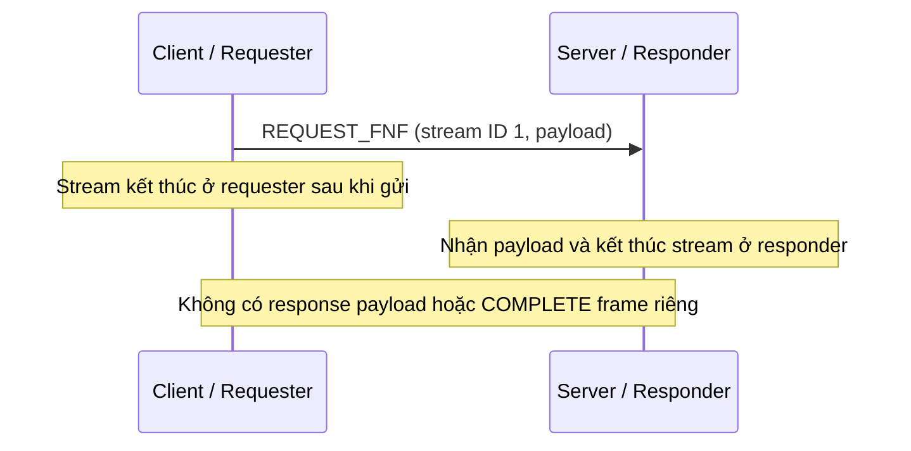

# Mô hình fire-and-forget và trình tự REQUEST_FNF

RSocket hỗ trợ `fire-and-forget` cho trường hợp một peer gửi một thông điệp ứng dụng tới peer còn lại và không cần nhận payload phản hồi. Request được mở bằng frame `REQUEST_FNF`. Sender gửi một payload, responder nhận payload rồi kết thúc tương tác; giao thức không tạo response stream để trả kết quả nghiệp vụ.

Mô hình này phù hợp với sự kiện không quan trọng tới mức phải xác nhận đồng bộ, chẳng hạn telemetry phụ, log sự kiện hoặc thông báo có thể được xử lý bất đồng bộ. Vì không có phản hồi, sender không biết chắc nghiệp vụ phía nhận đã được lưu hoặc xử lý thành công. Cần hiểu rõ giới hạn đó trước khi dùng fire-and-forget cho lệnh hoặc dữ liệu quan trọng.

## Mục tiêu học tập

Sau bài học, người học có thể:

- Giải thích ý nghĩa và vòng đời của interaction model `fire-and-forget`.
- Nhận diện frame `REQUEST_FNF`, stream ID và payload của nó.
- Mô tả trình tự gửi một chiều và lý do không có response payload.
- Phân biệt hoàn tất thao tác gửi với việc nghiệp vụ phía nhận đã xử lý thành công.
- Chọn trường hợp phù hợp, quản lý tải gửi và thiết kế idempotency khi cần retry.
- Triển khai fire-and-forget bằng RSocket Java và Spring Boot.
- Kiểm thử, giám sát và chẩn đoán tương tác một chiều.

## 1. Fire-and-forget giải quyết bài toán nào?

Trong một hệ thống realtime, không phải thông điệp nào cũng cần kết quả trả về. Ví dụ, dịch vụ cảm biến phát sự kiện `temperature_sampled` mỗi khi có số đo mới. Một dịch vụ phân tích có thể nhận sự kiện để cập nhật thống kê; bên gửi không cần chờ một response cho từng mẫu.

Nếu dùng request-response, server phải tạo response và client phải giữ trạng thái chờ, ghép response với request rồi xử lý kết quả. Với fire-and-forget, hai bên bỏ qua phần response này. Điều đó giúp giảm lưu lượng mạng và chi phí xử lý ở cả hai phía khi nghiệp vụ không cần phản hồi.

Một tương tác fire-and-forget có các đặc điểm:

- Một peer khởi tạo request bằng một payload.
- Peer nhận request xử lý payload theo logic ứng dụng.
- Sender không yêu cầu payload phản hồi.
- Tương tác kết thúc sau khi request được gửi ở phía requester và được nhận ở phía responder theo vòng đời protocol.
- Không có `REQUEST_N` để cấp nhu cầu response vì responder không phát chuỗi payload trên stream này.

Fire-and-forget không có nghĩa là dữ liệu được xử lý tức thì hoặc chắc chắn được lưu bền vững. Nó mô tả hình dạng tương tác ở tầng giao thức: gửi một chiều, không chờ response.

## 2. Frame REQUEST_FNF

`REQUEST_FNF` là frame mở đầu cho một tương tác fire-and-forget. Trong RSocket protocol, frame type của nó là `0x05`.

| Trường | Ý nghĩa |
|---|---|
| Stream ID | Số dương, nhận diện tương tác; stream ID 0 dành cho các frame connection-level |
| Frame Type | `REQUEST_FNF` (`0x05`) |
| `M` (Metadata) | Cho biết request có metadata hay không |
| `F` (Follows) | Cho biết request còn fragment tiếp theo hay không |
| Metadata và Request Data | Nội dung của payload khởi tạo, gồm metadata tùy chọn và data ứng dụng |

Mô hình rút gọn:

```text
+--------------------------------------------------+
| Stream ID > 0                                     |
+--------------------------------------------------+
| Frame Type = REQUEST_FNF | M | F | Flags          |
+--------------------------------------------------+
| Metadata Length (nếu M = 1)                      |
+--------------------------------------------------+
| Metadata bytes (nếu có)                          |
+--------------------------------------------------+
| Request Data                                     |
+--------------------------------------------------+
```

Stream ID được requester cấp khi mở tương tác. Trên một connection, client thường khởi tạo stream bằng ID lẻ và server khởi tạo stream bằng ID chẵn; ID 0 không được dùng cho request stream. Vì vậy, `REQUEST_FNF` là một stream-level request dù không có response stream.

Một request logic chỉ mang một payload. Nếu payload lớn phải phân mảnh, frame đầu tiên vẫn là `REQUEST_FNF` với cờ `F`; các fragment tiếp theo được gửi bằng `PAYLOAD` cho tới fragment cuối. Phân mảnh không biến fire-and-forget thành một chuỗi thông điệp ứng dụng độc lập.

## 3. Trình tự REQUEST_FNF

Sau khi transport và RSocket session đã sẵn sàng, requester gửi `REQUEST_FNF` với stream ID dương và payload. Responder nhận request, chuyển payload tới handler ứng dụng rồi kết thúc stream ở phía mình. Requester cũng kết thúc stream ở phía gửi sau khi request được gửi.



Ở góc nhìn protocol, chuỗi tương tác chỉ có một request frame `REQUEST_FNF`. Khi responder nhận frame, stream kết thúc tại responder; khi requester gửi frame, stream kết thúc tại requester. Không có `PAYLOAD` phản hồi, `COMPLETE` riêng hay `REQUEST_N` cho tương tác này.

Nếu cần server xác nhận rằng event đã được lưu, hãy dùng request-response hoặc một kênh xác nhận riêng. Không nên tự suy diễn một ACK từ việc connection vẫn mở.

## 4. Không có response nghĩa là không có xác nhận nghiệp vụ

Đây là điểm cần nhớ nhất khi thiết kế fire-and-forget. API gửi có thể báo rằng thao tác gửi đã hoàn tất ở phía local, nhưng nó không chứng minh handler phía server đã hoàn tất nghiệp vụ.

Phân biệt ba trạng thái:

| Trạng thái | Có thể kết luận từ fire-and-forget? |
|---|---|
| Ứng dụng local đã gọi API và runtime hoàn tất thao tác gửi | Có, theo semantics của API/implementation |
| Peer đã nhận và dispatch request | Sender không có response nghiệp vụ để xác nhận |
| Server đã commit dữ liệu hoặc hoàn thành side effect | Không thể xác nhận qua chính tương tác FNF |

Đặc tả RSocket mô tả fire-and-forget là best effort. Request có thể không được xử lý, chẳng hạn khi SETUP bị từ chối, request sai định dạng hoặc connection gặp sự cố. Vì không có response, sender cũng không thể biết chắc request đã được xử lý đến đâu nếu kết nối mất quanh thời điểm gửi.

Không nên hứa hẹn exactly-once hoặc at-least-once chỉ vì dùng RSocket. Nếu ứng dụng tự retry khi không thấy trạng thái mong muốn, có thể xảy ra tình huống server đã xử lý lần đầu nhưng client không biết và gửi lại lần nữa. Với thao tác có thể retry, hãy gắn event ID duy nhất và thiết kế consumer idempotent hoặc deduplicate ở phía nhận.

## 5. Khi nào nên và không nên dùng?

| Tình huống | Mức độ phù hợp | Lý do |
|---|---|---|
| Gửi telemetry phụ hoặc số liệu quan sát có thể mất | Phù hợp | Không cần response cho từng mẫu |
| Gửi log sự kiện không quan trọng | Phù hợp | Có thể chấp nhận best effort |
| Thông báo UI không yêu cầu xác nhận xử lý | Có thể phù hợp | Bên gửi không cần kết quả nghiệp vụ |
| Lệnh thanh toán, chuyển tiền hoặc thay đổi trạng thái quan trọng | Không phù hợp nếu dùng riêng | Cần xác nhận kết quả và xử lý lỗi rõ ràng |
| Tạo đơn hàng cần biết server đã nhận | Không phù hợp nếu dùng riêng | Nên dùng request-response hoặc workflow có ACK bền vững |
| Truyền liên tục nhiều phần tử theo một tương tác | Không phù hợp | Cân nhắc request-stream hoặc request-channel tùy hướng dữ liệu |

Một cách chọn nhanh:

- Cần một kết quả từ server: `request-response`.
- Cần gửi một thông điệp và chấp nhận không có xác nhận: `fire-and-forget`.
- Cần gửi một yêu cầu và nhận nhiều kết quả: `request-stream`.
- Cần hai phía trao đổi chuỗi payload: `request-channel`.

## 6. Fire-and-forget khác METADATA_PUSH như thế nào?

Cả `REQUEST_FNF` và `METADATA_PUSH` đều không có response payload, nhưng phạm vi và nội dung khác nhau:

| Tiêu chí | `REQUEST_FNF` | `METADATA_PUSH` |
|---|---|---|
| Stream ID | Số dương | Bằng 0 |
| Frame type | `0x05` | `0x0C` |
| Nội dung | Một request payload, có thể gồm data và metadata | Chỉ metadata, không có data payload |
| Phạm vi | Một tương tác ứng dụng | Connection-level |
| Mục đích | Gửi event/command một chiều | Thông báo metadata dùng chung cho connection |

Ví dụ, `REQUEST_FNF` có thể gửi event `device.overheated` với data gồm device ID và nhiệt độ. `METADATA_PUSH` có thể cập nhật metadata context cho connection như locale mặc định. Không dùng metadata push để thay thế một event nghiệp vụ có data.

## 7. Backpressure, tải gửi và LEASE

RSocket dùng `REQUEST_N` để điều tiết số payload responder được phép phát trên các stream có dữ liệu phản hồi, chẳng hạn request-stream và request-channel. Fire-and-forget không có response payload nên không có cơ chế request-N theo stream này.

Điều đó có nghĩa là sender có thể tạo nhiều request FNF liên tiếp. Nếu producer phát nhanh hơn khả năng xử lý của server, hàng đợi hoặc tài nguyên phía nhận có thể tăng. TCP flow control điều tiết byte trên transport, nhưng không phải giới hạn nghiệp vụ cho số event đang chờ xử lý.

Một số cách kiểm soát tải:

- Dùng queue có giới hạn và xác định chính sách khi queue đầy: từ chối, bỏ mẫu, ghi local hoặc chuyển sang batch.
- Giới hạn concurrency khi phát nhiều request từ một `Flux`.
- Gộp các sự kiện có thể tổng hợp thành batch để giảm số request.
- Giới hạn kích thước payload và tần suất gửi.
- Theo dõi queue depth, thời gian xử lý, tỷ lệ lỗi và số event bị drop ở phía server.

Nếu connection dùng LEASE, số lượng request FNF cũng thuộc số request mà requester được phép gửi trong thời gian LEASE. LEASE giới hạn số request, không phải số payload response. Khi hết quota, requester phải chờ LEASE mới trước khi gửi request tiếp theo.

## 8. Triển khai bằng RSocket Java

Ở API lõi RSocket Java, `RSocket.fireAndForget(Payload)` trả về `Mono<Void>`. Mono này biểu diễn quá trình gửi request ở phía requester; nó không mang kết quả xử lý nghiệp vụ của responder.

```java
import io.rsocket.RSocket;
import io.rsocket.Payload;
import io.rsocket.util.DefaultPayload;
import reactor.core.publisher.Mono;

public Mono<Void> publishDeviceEvent(RSocket requester, DeviceEvent event) {
    // Ví dụ này gửi data, không kèm metadata.
    Payload payload = DefaultPayload.create(event.toJson());

    return requester.fireAndForget(payload);
}
```

Ví dụ trên gửi data và không kèm metadata. Nếu ứng dụng cần route hoặc metadata tùy chỉnh ở API RSocket cấp thấp, hãy mã hóa chúng theo metadata MIME type đã khai báo (thường dùng composite metadata khi cần route); chuỗi `application/json` là MIME type, không phải nội dung metadata. Có thể dùng codec hoặc `Payload` builder phù hợp với phiên bản thư viện đang dùng.

## 9. Triển khai bằng Spring Boot

Ở phía client, `RSocketRequester` cung cấp `send()` để thực hiện fire-and-forget:

```java
public Mono<Void> publish(DeviceEvent event) {
    return requester
            .route("devices.events")
            .data(event)
            .send();
}
```

Route được dùng để server chọn handler; `.data(event)` cung cấp data của request payload. `send()` trả `Mono<Void>` vì client không nhận payload response.

Ở phía server, handler có thể xử lý event và trả `Mono<Void>`:

```java
@Controller
public class DeviceEventController {

    private final DeviceEventService eventService;

    public DeviceEventController(DeviceEventService eventService) {
        this.eventService = eventService;
    }

    @MessageMapping("devices.events")
    public Mono<Void> receive(@Payload DeviceEvent event) {
        return eventService.accept(event);
    }
}
```

`eventService.accept(...)` có thể ghi event vào queue hoặc lưu trữ theo chính sách của ứng dụng. Completion của `Mono<Void>` phía server là tín hiệu nội bộ cho runtime/handler; nó không trở thành response nghiệp vụ cho client FNF.

### Giới hạn concurrency khi gửi một luồng event

Nếu producer tạo nhiều event, có thể dùng `flatMap` với giới hạn concurrency để không khởi tạo quá nhiều thao tác gửi cùng lúc:

```java
public Mono<Void> publishAll(Flux<DeviceEvent> events) {
    return events
            .flatMap(this::publish, 32)
            .then();
}
```

Con số `32` chỉ là ví dụ. Giá trị thực tế phải dựa trên khả năng của server, kích thước payload, giới hạn queue và phép đo tải. Nếu cần giữ thứ tự event, dùng `concatMap` hoặc một chiến lược partition theo device/key thay vì `flatMap` đồng thời.

## 10. Xử lý lỗi và độ tin cậy

Do không có response payload, sender không có kênh để nhận xác nhận nghiệp vụ hoặc kết quả xử lý cho từng request. Thiết kế nên chia trách nhiệm rõ ràng:

- **Phía sender**: phát hiện lỗi khi tạo hoặc gửi request, áp dụng timeout/retry phù hợp và ghi event ID để hỗ trợ đối soát.
- **Phía responder**: xác thực payload, xử lý lỗi nghiệp vụ, ghi log/metric và đưa event lỗi vào dead-letter queue nếu cần.
- **Tầng nghiệp vụ**: xác định event nào được phép mất, event nào phải có ACK hoặc lưu bền vững.

Nếu event quan trọng, nên dùng request-response để nhận kết quả rõ ràng hoặc xây dựng workflow có event ID, durable queue và acknowledgement ở tầng ứng dụng. Nếu vẫn gửi FNF rồi retry khi có nghi ngờ, consumer phải idempotent để hạn chế side effect trùng lặp.

Không nên tự động retry mọi lỗi. Ví dụ, lỗi serialization hoặc payload không hợp lệ sẽ không biến mất khi gửi lại cùng nội dung. Lỗi transport tạm thời có thể cho phép retry, nhưng do không có ACK, cần chấp nhận khả năng event đã được xử lý trước khi connection mất.

## 11. Bảo mật và quan sát

Fire-and-forget vẫn là request ứng dụng và phải tuân theo chính sách xác thực, phân quyền, TLS và giới hạn tài nguyên của hệ thống.

- Xác thực requester trước khi cho phép gửi event.
- Kiểm tra quyền trên route và dữ liệu event; không tin tenant ID chỉ vì client gửi trong payload.
- Giới hạn kích thước và tốc độ để tránh event flood.
- Không ghi token hoặc dữ liệu nhạy cảm vào log dạng rõ.
- Gắn event ID, source, timestamp và schema version để hỗ trợ tracing và deduplication.
- Đo số request nhận, số event xử lý thành công, số event bị từ chối, thời gian xử lý và queue depth ở phía responder.

Vì client không nhận response nghiệp vụ, số lượng `Mono<Void>` hoàn tất ở client không thay thế metric xử lý thành công ở server. Muốn biết event đã được xử lý, hãy quan sát hoặc xác nhận ở phía nhận.

## 12. Kiểm thử fire-and-forget

Một bài kiểm thử tích hợp nên xác minh cả semantics giao thức và hành vi nghiệp vụ:

1. **Kiểm tra frame**: request mở bằng `REQUEST_FNF` (`0x05`) với stream ID dương.
2. **Kiểm tra payload**: data và metadata được serialize theo MIME type đã thống nhất.
3. **Kiểm tra một chiều**: responder nhận đúng một event và không phát response payload.
4. **Kiểm tra kết thúc stream**: requester kết thúc sau khi gửi, responder kết thúc khi nhận request.
5. **Kiểm tra tải**: phát burst event và xác minh giới hạn queue/concurrency hoạt động.
6. **Kiểm tra LEASE**: nếu bật LEASE, requester không vượt số request được cấp.
7. **Kiểm tra lỗi**: payload sai định dạng, route không hợp lệ, handler thất bại và connection bị đóng.
8. **Kiểm tra retry**: mô phỏng mất kết nối quanh thời điểm gửi và xác minh deduplication/idempotency.

| Triệu chứng | Nơi cần kiểm tra |
|---|---|
| Client Mono hoàn tất nhưng không thấy event trong DB | Server handler, queue, transaction và metric xử lý; completion ở client không phải business ACK |
| Event xuất hiện hai lần | Retry, producer phát trùng hoặc thiếu deduplication |
| Server quá tải khi có burst | Queue depth, concurrency, rate limit và batch |
| Route không vào handler | Routing metadata và `@MessageMapping` |
| Request bị từ chối khi bật LEASE | Quota và TTL trong LEASE frame |
| Event mất khi connection đóng | Best-effort semantics, thời điểm gửi và chính sách lưu/retry |

## Kết luận

Fire-and-forget dùng `REQUEST_FNF` (`0x05`) để gửi một payload ứng dụng trên một stream có ID dương và không chờ response payload. Đây là mô hình nhẹ cho event không cần xác nhận, nhưng mang semantics best effort: sender không thể kết luận nghiệp vụ phía nhận đã hoàn tất chỉ từ việc thao tác gửi kết thúc. Hãy chọn FNF cho dữ liệu có thể chấp nhận mất, kiểm soát tốc độ gửi, quan sát ở phía responder và dùng request-response hoặc acknowledgement bền vững cho thao tác quan trọng.

## Tài liệu tham khảo

- [RSocket Protocol – REQUEST_FNF và Stream Lifetimes](https://rsocket.io/about/protocol/)
- [RSocket Motivations – Fire-and-forget](https://rsocket.io/about/motivations/)
