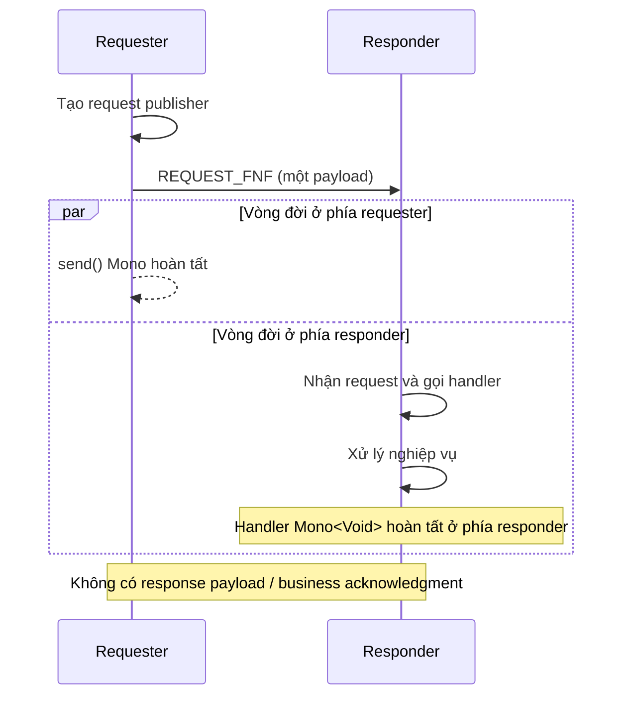

# Ý nghĩa hoàn tất gửi ở phía gọi và giới hạn xác nhận nghiệp vụ

RSocket **Fire-and-Forget (FNF)** dùng để gửi một thông điệp một chiều khi bên gửi không cần nhận kết quả từ bên nhận. Trong Spring, bên gọi dùng `send()` và nhận về `Mono<Void>`. Khi `Mono` hoàn tất, điều đó chỉ cho biết thao tác gửi thông điệp đã hoàn tất thành công ở phía gọi; nó **không xác nhận** rằng responder đã nhận, xử lý, lưu dữ liệu hay hoàn thành nghiệp vụ.

Đây là ranh giới quan trọng khi thiết kế hệ thống realtime. FNF phù hợp với thông tin có thể chấp nhận mất hoặc không cần xác nhận từng lần gửi. Với thao tác như tạo đơn hàng, ghi nhận thanh toán hoặc lưu audit bắt buộc, ứng dụng cần một cơ chế xác nhận rõ ràng hơn.

## 1. Fire-and-Forget hoạt động như thế nào?

FNF là một trong bốn kiểu tương tác chính của RSocket. Requester gửi một yêu cầu kèm payload ban đầu bằng frame `REQUEST_FNF`. Responder nhận yêu cầu và kết thúc stream phía mình sau khi nhận frame. Requester cũng kết thúc stream ngay sau khi gửi. Không có luồng payload phản hồi cho tương tác này.



Hai mốc hoàn tất trong sơ đồ thuộc hai phía độc lập:

- `send()` hoàn tất ở requester sau khi thao tác gửi thông điệp thành công theo API client.
- Publisher của handler hoàn tất ở responder sau khi công việc mà handler đã compose hoàn tất ở phía server.

RSocket không truyền sự kiện hoàn tất của handler ngược về requester trong tương tác FNF. Vì thế, bên gọi không thể suy ra kết quả nghiệp vụ từ việc `send()` đã hoàn tất.

## 2. `Mono<Void>` từ `send()` xác nhận điều gì?

Spring cung cấp phương thức `send()` cho Fire-and-Forget. Phương thức này trả về `Mono<Void>` để biểu diễn kết quả của thao tác gửi. Tài liệu Spring nêu rõ Mono này chỉ cho biết thông điệp đã được gửi thành công, không cho biết thông điệp đã được xử lý.

Có thể phân biệt các trạng thái sau:

| Quan sát ở phía gọi | Có thể kết luận | Không thể kết luận |
|---|---|---|
| Đã tạo `Mono<Void>` | Đã mô tả một thao tác gửi trong pipeline reactive | Thông điệp đã được gửi; publisher có thể chưa được subscribe |
| `send()` hoàn tất | API client báo thao tác gửi thành công | Server đã nhận hoặc handler đã chạy |
| `send()` phát lỗi | Client quan sát được lỗi trong quá trình tạo/gửi request hoặc kết nối | Chắc chắn server chưa nhận hoặc chưa tạo side effect |
| Không nhận được lỗi từ `send()` | Thao tác gửi phía client không báo lỗi | Nghiệp vụ ở server đã thành công hoặc đã commit |

Với Reactor, publisher là lazy. Nếu tạo `Mono<Void>` nhưng không subscribe hoặc không compose nó vào một pipeline được subscribe, thao tác gửi sẽ không được thực thi. Trong ứng dụng Spring WebFlux, nên trả `Mono` cho lớp gọi hoặc kết hợp nó với pipeline hiện có thay vì subscribe tùy tiện bên trong service.

Ví dụ:

```java
public Mono<Void> publishTyping(TypingEvent event) {
    return requester.route("presence.typing")
        .data(event)
        .send()
        .doOnSuccess(ignored -> log.debug("Typing event sent"))
        .doOnError(error -> log.warn("Could not send typing event", error));
}
```

`doOnSuccess` ở đây chỉ nên được hiểu là dấu mốc gửi phía client hoàn tất. Không đặt log như `Order saved` hoặc `Payment completed` tại vị trí này, vì nó khẳng định một kết quả mà FNF không cung cấp.

## 3. Hoàn tất ở responder cũng không phải xác nhận gửi về requester

Ở phía server, handler thường nhận FNF bằng `@MessageMapping` và trả `Mono<Void>`:

```java
@Controller
public class PresenceController {

    private final PresenceService presenceService;

    public PresenceController(PresenceService presenceService) {
        this.presenceService = presenceService;
    }

    @MessageMapping("presence.typing")
    public Mono<Void> typing(TypingEvent event) {
        return presenceService.updateTypingState(event)
            .doOnError(error -> log.error("Cannot update typing state", error));
    }
}
```

Trong ví dụ, publisher trả về từ `updateTypingState` được compose vào handler. Khi publisher hoàn tất, server biết phần công việc mà service biểu diễn đã hoàn tất ở phía server. Nếu service chỉ xếp một tác vụ vào hàng đợi nội bộ rồi trả `Mono.empty()`, mốc hoàn tất chỉ phản ánh việc xếp hàng đó; nó không có nghĩa tác vụ nền đã được xử lý xong.

Ngay cả khi handler hoàn tất sau khi ghi cơ sở dữ liệu, requester FNF cũng không nhận được thông báo đó. Muốn bên gọi quan sát kết quả, ứng dụng cần thiết kế một tương tác có phản hồi hoặc một cơ chế xác nhận riêng.

Lỗi trong handler cũng không phải là business response mà requester có thể dựa vào. Server cần tự ghi log, đo metric, gửi cảnh báo hoặc chuyển thông điệp lỗi vào luồng xử lý nội bộ phù hợp. Không nên giả định lỗi bất đồng bộ ở handler sẽ làm `send()` phía client phát lỗi.

## 4. Vì sao gửi thành công vẫn có thể không được xử lý?

FNF được định nghĩa theo hướng **best effort**. Tài liệu giao thức RSocket mô tả rằng yêu cầu FNF có thể không được xử lý, ví dụ khi `SETUP` bị từ chối hoặc thông điệp không đúng định dạng. Vì không có phản hồi ứng dụng, requester không có bằng chứng đầu-cuối để xác định responder đã thực hiện nghiệp vụ hay chưa.

Một số tình huống thường gặp:

1. **Kết nối chưa được thiết lập hợp lệ:** server từ chối `SETUP`, nên yêu cầu không được xử lý như một tương tác RSocket hợp lệ.
2. **Kết nối bị ngắt quanh thời điểm gửi:** client có thể đã chuyển dữ liệu cho transport nhưng kết nối mất trước khi responder xử lý xong.
3. **Thông điệp không hợp lệ:** route, metadata hoặc payload không thể giải mã hay không đáp ứng quy tắc của ứng dụng.
4. **Handler hoặc dịch vụ phía server gặp lỗi:** request đã tới server nhưng xử lý thất bại.
5. **Tác vụ chỉ mới được xếp hàng:** handler hoàn tất sau khi enqueue, còn worker phía sau có thể thất bại hoặc bị dừng.

TCP cung cấp truyền byte có thứ tự trong một kết nối còn hoạt động, nhưng điều đó không biến FNF thành cơ chế xác nhận nghiệp vụ hay lưu trữ bền vững. Khi kết nối bị đứt, bên gửi không có response để phân biệt trường hợp server chưa nhận với trường hợp server đã xử lý nhưng phản hồi không tồn tại.

## 5. Retry có thể tạo ra thông điệp trùng lặp

Khi `send()` phát lỗi, không phải lúc nào requester cũng biết thông điệp đã tới responder hay chưa. Nếu tự động gửi lại, ứng dụng có thể tạo ra hai lần xử lý cho cùng một sự kiện. Ngược lại, nếu không gửi lại, một thông điệp có thể bị mất trong tình huống lỗi trước khi responder nhận được nó.

Vì vậy, không thể suy ra bảo đảm *at-most-once*, *at-least-once* hoặc *exactly-once* chỉ từ việc dùng FNF. Chính sách retry phải dựa trên yêu cầu nghiệp vụ và cơ chế chống trùng lặp ở phía nhận.

Nếu chọn retry, hãy thiết kế handler có tính idempotent. Một cách phổ biến là gắn `eventId` duy nhất cho mỗi sự kiện và lưu dấu xử lý ở phía server:

```java
public Mono<Void> handle(AuditEvent event) {
    return processedEventRepository.existsById(event.eventId())
        .flatMap(alreadyProcessed -> {
            if (alreadyProcessed) {
                return Mono.empty();
            }

            return auditRepository.save(toRecord(event))
                .then(processedEventRepository.markProcessed(event.eventId()));
        });
}
```

Đây là ví dụ minh họa ý tưởng chống xử lý lặp; triển khai thật cần bảo đảm kiểm tra và ghi dấu được thực hiện nguyên tử, thường bằng unique constraint hoặc transaction. Chỉ kiểm tra tồn tại rồi ghi riêng rẽ có thể vẫn gặp race condition khi hai bản sao tới đồng thời.

Với sự kiện quan trọng, có thể dùng transactional outbox để ghi sự kiện cùng transaction với dữ liệu nghiệp vụ rồi chuyển tiếp bằng một tiến trình publisher. Nếu cần lưu trữ bền vững, retry, dead-letter và theo dõi consumer, một message broker được cấu hình phù hợp thường là lựa chọn tốt hơn FNF trực tiếp.

## 6. Khi nào nên dùng Fire-and-Forget?

FNF phù hợp khi mất một thông điệp riêng lẻ không làm sai trạng thái nghiệp vụ cốt lõi và requester không cần kết quả ngay.

| Tình huống | Mức độ phù hợp | Lý do |
|---|---|---|
| Sự kiện người dùng đang gõ (`typing`) | Cao | Trạng thái ngắn hạn, thông điệp mới sẽ nhanh chóng thay thế thông điệp cũ |
| Tín hiệu presence tạm thời | Cao nếu có cơ chế hết hạn | Có thể cập nhật lại ở lần heartbeat tiếp theo |
| Metric hoặc telemetry không trọng yếu | Cao | Có thể chấp nhận mất một số mẫu |
| Cache invalidation có thể tái tạo | Tùy thiết kế | Cần cơ chế làm mới hoặc kiểm tra lại khi mất tín hiệu |
| Tạo đơn hàng hoặc thanh toán | Thấp | Cần xác nhận kết quả và xử lý lỗi rõ ràng |
| Audit bắt buộc hoặc thông báo pháp lý | Thấp | Cần lưu trữ, truy vết và chứng minh đã tiếp nhận/xử lý |

Không quyết định chỉ dựa trên việc dữ liệu có “quan trọng” hay không. Hãy xác định hậu quả nếu thông điệp bị mất, bị trùng hoặc xử lý chậm. Nếu hậu quả cần được quan sát và khắc phục, FNF trực tiếp thường không đủ.

## 7. Khi nào cần request-response hoặc cơ chế xác nhận khác?

Nếu caller cần biết server đã chấp nhận hoặc hoàn tất một nghiệp vụ, dùng `request-response` và định nghĩa rõ ý nghĩa của response. Ví dụ response có thể phân biệt `ACCEPTED` (đã tiếp nhận), `COMMITTED` (đã commit) hoặc `REJECTED` (bị từ chối). Đừng dùng một giá trị `OK` mơ hồ nếu các trạng thái này có ý nghĩa khác nhau.

Client gửi lệnh và chờ receipt:

```java
Mono<CommandReceipt> submit(OrderCommand command) {
    return requester.route("orders.submit")
        .data(command)
        .retrieveMono(CommandReceipt.class);
}
```

Server chỉ phát receipt sau khi đạt mốc mà hợp đồng API đã cam kết:

```java
@MessageMapping("orders.submit")
public Mono<CommandReceipt> submit(OrderCommand command) {
    return orderService.submitAndCommit(command)
        .map(orderId -> new CommandReceipt(orderId, "COMMITTED"));
}
```

Trong ví dụ, `COMMITTED` chỉ đúng nếu `submitAndCommit` thực sự hoàn tất transaction trước khi phát kết quả. Nếu server chỉ mới xếp lệnh vào queue, response nên nói rõ là `ACCEPTED` và trả về mã theo dõi để client truy vấn trạng thái sau.

| Nhu cầu | Cách tiếp cận |
|---|---|
| Chỉ gửi tín hiệu, không cần xác nhận | Fire-and-Forget |
| Cần biết server đã xử lý tới một mốc nghiệp vụ | Request-Response với receipt được định nghĩa rõ |
| Cần cập nhật liên tục trạng thái xử lý | Request-Stream hoặc một kênh sự kiện có correlation ID |
| Cần lưu trữ bền vững và retry khi consumer lỗi | Message broker, outbox và cơ chế xác nhận của broker |

## 8. Quan sát và vận hành FNF

Vì requester không nhận business acknowledgment, hệ thống cần quan sát cả hai phía:

- **Phía requester:** đếm số lần tạo request, số lần `send()` hoàn tất, số lỗi gửi và số lần retry.
- **Phía responder:** đếm số request nhận được, số handler thành công/thất bại, thời gian xử lý và số thông điệp bị loại do validation.
- **Đối chiếu:** gắn `eventId` hoặc correlation ID để so sánh số sự kiện phát ra với số sự kiện đã xử lý. ID giúp truy vết và chống trùng lặp; nó không tự tạo ra xác nhận.
- **Cảnh báo:** theo dõi chênh lệch giữa lượng gửi và lượng xử lý, queue backlog, tỷ lệ lỗi handler và thời gian xử lý.

Tránh ghi log “đã xử lý” ở phía requester ngay sau `send()`. Dùng các trạng thái tách biệt như `send_completed`, `received`, `processing_succeeded` và `processing_failed` ở đúng thành phần quan sát được trạng thái đó.

## 9. Checklist trước khi chọn Fire-and-Forget

- [ ] Mất một thông điệp riêng lẻ có được nghiệp vụ chấp nhận không?
- [ ] Caller có thực sự không cần response hoặc business acknowledgment không?
- [ ] Pipeline `Mono<Void>` có được subscribe hoặc compose đúng cách không?
- [ ] Handler phía server có thực hiện công việc bên trong publisher được trả về không?
- [ ] Có log, metric và cảnh báo ở phía responder không?
- [ ] Nếu retry, handler có idempotent và có cơ chế chống xử lý trùng không?
- [ ] Nếu sự kiện cần lưu bền vững, đã cân nhắc outbox hoặc message broker chưa?
- [ ] Tên log và metric có phân biệt hoàn tất gửi với hoàn tất nghiệp vụ không?

FNF giúp gửi thông điệp một chiều với chi phí giao thức thấp và không cần chờ response. Tuy nhiên, hoàn tất `send()` chỉ là tín hiệu ở phía gọi. Khi thiết kế, hãy đặt mốc xác nhận ở đúng nơi thực sự biết kết quả và chọn request-response hoặc hệ thống messaging bền vững nếu nghiệp vụ cần bảo đảm tiếp nhận, xử lý và truy vết.

## Tài liệu tham khảo

- [RSocket Protocol — Request Fire-and-Forget](https://rsocket.io/about/protocol/)
- [Spring Framework — RSocket, Fire-and-Forget và `send()`](https://docs.spring.io/spring-framework/reference/rsocket.html)
