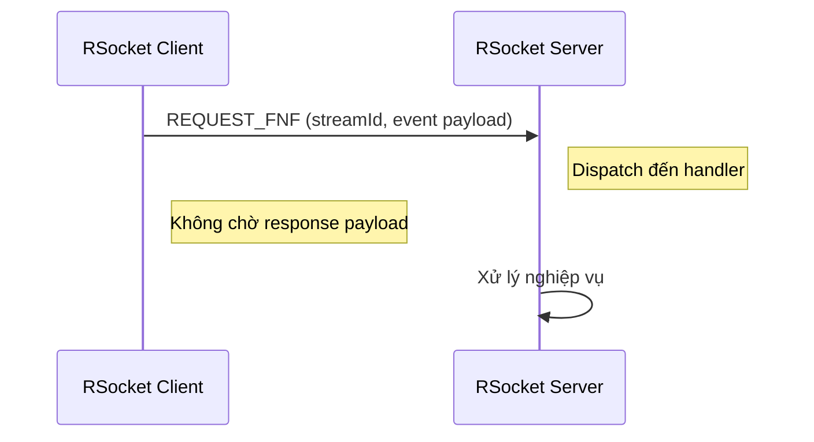
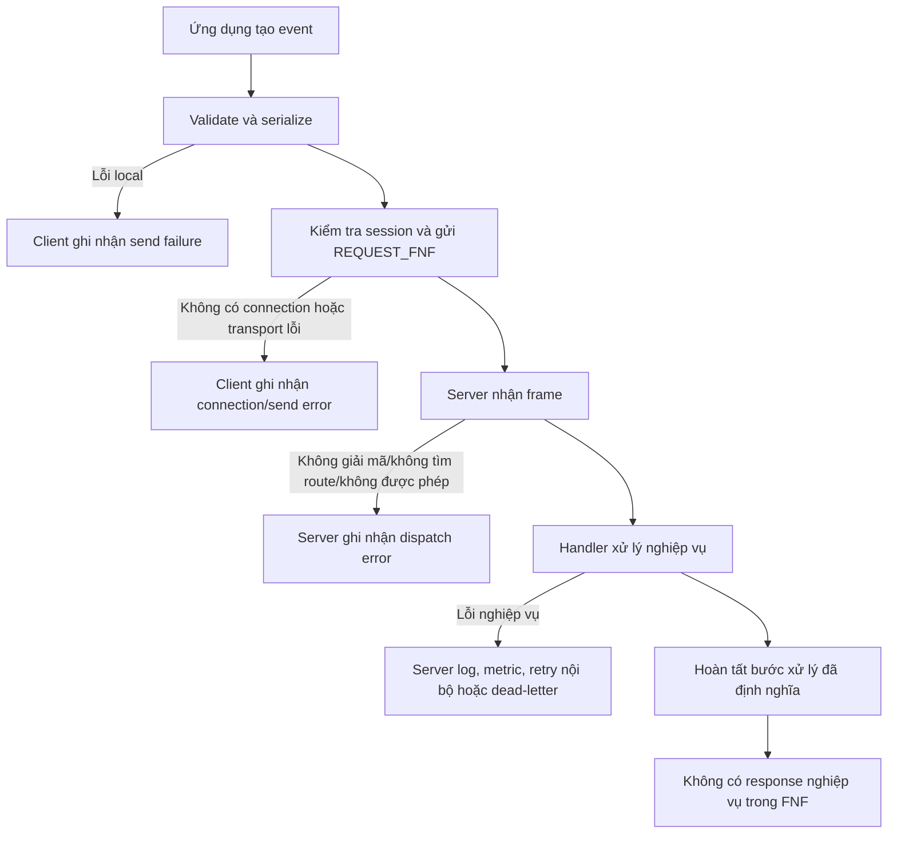
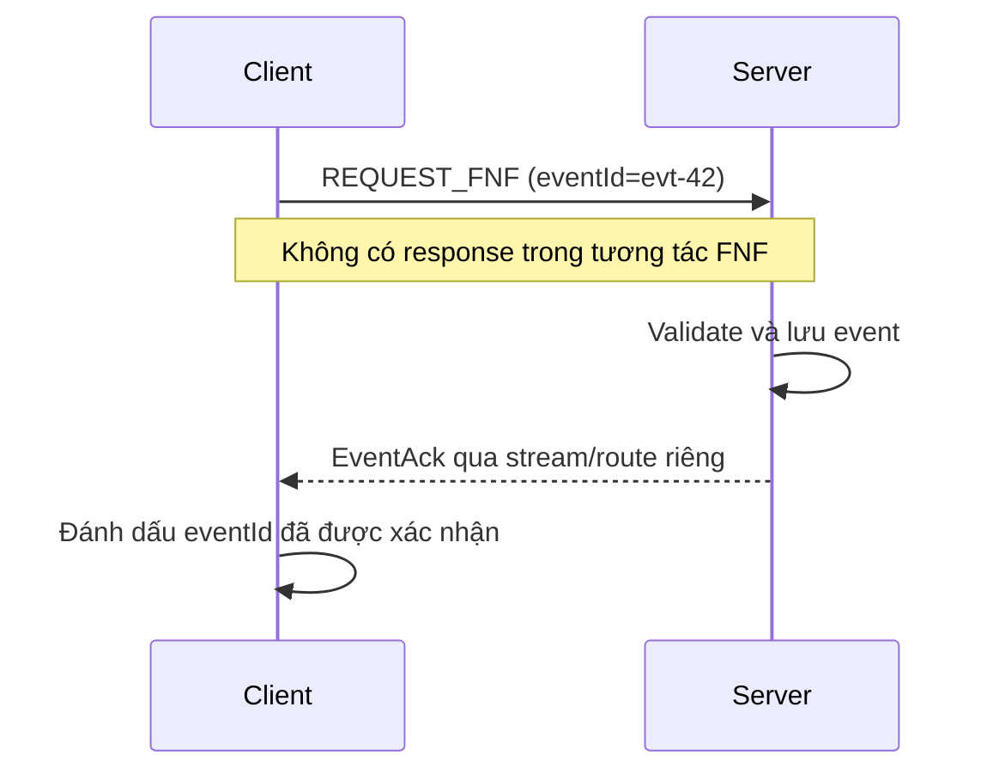

# Quan sát lỗi gửi, lỗi kết nối và lỗi xử lý phía nhận

Fire-and-forget (FNF) phù hợp khi client cần gửi một thông điệp mà không cần nhận kết quả nghiệp vụ ngay trong cùng tương tác. Ví dụ, ứng dụng gửi telemetry, ghi nhận một sự kiện người dùng hoặc phát tín hiệu cập nhật không cần phản hồi đồng bộ. Mô hình này giảm chi phí chờ response, nhưng cũng làm cho việc phát hiện lỗi khác với request-response: bên gửi không có response payload để xác nhận server đã xử lý thành công.

Khi vận hành FNF, cần phân biệt ít nhất ba nhóm lỗi: lỗi xảy ra ở client khi chuẩn bị hoặc gửi thông điệp; lỗi transport/kết nối khiến việc chuyển thông điệp bị gián đoạn; và lỗi xảy ra sau khi server đã nhận thông điệp nhưng xử lý nghiệp vụ thất bại. Ba nhóm này xuất hiện ở các thời điểm khác nhau và có mức độ quan sát khác nhau. Nếu chỉ ghi một log “send completed”, hệ thống có thể tưởng dữ liệu đã được lưu trong khi server chưa hề xử lý.

Bài này trình bày vòng đời FNF, cách phân loại và quan sát lỗi ở client/server, ví dụ Java Spring Boot, chiến lược retry và idempotency, cùng cách kiểm thử để không đánh đồng việc gửi thành công với xử lý thành công.

## 1. FNF có xác nhận điều gì?

Trong RSocket, client mở một tương tác fire-and-forget bằng frame `REQUEST_FNF`. Frame mang một payload và không yêu cầu response payload nghiệp vụ. Server nhận thông điệp rồi chuyển cho handler tương ứng. Khác với request-response, không có một response stream thông thường để server trả kết quả xử lý cho client.



Điểm quan trọng là phải phân biệt các mốc sau:

1. Ứng dụng tạo được payload và gọi API gửi.
2. Client serialize payload và chấp nhận thao tác gửi.
3. Frame được ghi qua transport hoặc được runtime bàn giao cho tầng gửi.
4. Server nhận frame và dispatch đến route/handler.
5. Handler hoàn tất xử lý nghiệp vụ, chẳng hạn lưu database hoặc publish sang broker.

Một tín hiệu hoàn tất ở client thường chỉ xác nhận thao tác gửi ở phía client đã hoàn thành theo hợp đồng của thư viện. Nó không phải acknowledgement rằng database phía server đã commit hoặc công việc nghiệp vụ đã thành công. FNF không cung cấp bảo đảm giao hàng bền vững, exactly-once hay xác nhận xử lý đầu cuối.

Vì vậy, FNF phù hợp với dữ liệu có thể chấp nhận mất, có thể khôi phục từ nguồn khác, hoặc được bảo vệ bằng một cơ chế xác nhận/đối soát riêng. Nếu mỗi thông điệp bắt buộc phải có kết quả, hãy chọn request-response hoặc một hệ thống messaging có acknowledgement và lưu bền vững phù hợp.

## 2. Vòng đời gửi và các điểm có thể phát sinh lỗi

Để quan sát lỗi, hãy nhìn vào đường đi của thông điệp từ client đến nơi xử lý cuối cùng:



Các điểm lỗi thường gặp:

| Giai đoạn | Ví dụ lỗi | Nơi có thể quan sát |
|---|---|---|
| Tạo payload | Dữ liệu thiếu field, giá trị không hợp lệ | Client trước khi gọi RSocket |
| Serialize | Codec không hỗ trợ kiểu dữ liệu, lỗi encoding | Client/runtime |
| Mở tương tác | Chưa setup xong, session đã đóng hoặc không thể tạo request | Client/RSocket runtime |
| Gửi qua transport | Socket đóng, reset, timeout hoặc backpressure ở tầng gửi | Client transport/runtime |
| Nhận và dispatch | Metadata không hợp lệ, route không tồn tại, payload decode lỗi | Server/RSocket runtime |
| Xác thực/ủy quyền | Token hết hạn, client không có quyền gọi route | Server security/handler |
| Xử lý nghiệp vụ | Database lỗi, broker từ chối, validation nghiệp vụ thất bại | Server handler/service |
| Lưu/forward | Commit thất bại, outbox hoặc dead-letter không ghi được | Server persistence/messaging |

Không phải mọi lỗi đều xuất hiện ở cùng một phía. Lỗi serialize có thể xảy ra trước khi frame rời client; lỗi kết nối thường thấy ở client transport; lỗi xử lý sau khi server nhận payload cần được ghi nhận ở server. Với FNF, không thể dựa vào response để gom toàn bộ kết quả thành một tín hiệu duy nhất.

## 3. Lỗi gửi ở phía client

Lỗi gửi là lỗi xảy ra khi client chưa thể hoàn thành việc bàn giao thông điệp cho tầng gửi theo hợp đồng API. Một số nguyên nhân thường gặp:

- Dữ liệu đầu vào không hợp lệ hoặc không serialize được.
- Client chưa thiết lập xong RSocket session hoặc session đã bị đóng.
- Transport không thể ghi frame do kết nối bị đóng/reset.
- Client phát thông điệp nhanh hơn khả năng tiếp nhận của tầng gửi và buffer/queue bị giới hạn.
- Metadata không thể serialize/encode khiến client không tạo được payload hợp lệ. Route không tồn tại thường chỉ được phát hiện ở server khi dispatch.

Với Spring `RSocketRequester`, `send()` trả về `Mono<Void>` cho thao tác FNF. Có thể gắn log/metric cho tín hiệu hoàn tất hoặc lỗi của publisher:

```java
Mono<Void> sendTelemetry(TelemetryEvent event) {
    return requester
        .route("telemetry.ingest")
        .data(event)
        .send()
        .doOnSuccess(ignored ->
            log.debug("FNF send completed, eventId={}", event.eventId())
        )
        .doOnError(error ->
            log.warn("FNF send failed locally, eventId={}",
                event.eventId(), error)
        );
}
```

`doOnSuccess` ở đây chỉ đánh dấu publisher gửi hoàn tất theo semantics của client API. Nó không chứng minh handler server đã chạy hoặc dữ liệu đã commit. Tên metric và log nên thể hiện đúng mốc này, chẳng hạn `fnf_send_completed`, thay vì `event_processed_successfully`.

### 3.1. Phải subscribe hoặc compose publisher

Reactor publisher là lazy: nếu không có subscriber hoặc không được compose vào một pipeline đang được subscribe, thao tác gửi có thể không chạy. Trong controller WebFlux, nên trả `Mono<Void>` về framework hoặc compose vào pipeline hiện tại:

```java
@Service
class TelemetryPublisher {

    private final RSocketRequester requester;

    TelemetryPublisher(RSocketRequester requester) {
        this.requester = requester;
    }

    Mono<Void> publish(TelemetryEvent event) {
        return requester
            .route("telemetry.ingest")
            .data(event)
            .send();
    }
}
```

Không nên gọi `.subscribe()` tùy tiện bên trong một request handler chỉ để “cho chạy nền”. Cách đó tách lỗi khỏi lifecycle của request, làm khó quản lý cancellation, backpressure và shutdown. Nếu cần xử lý nền, hãy đưa công việc vào một queue/background component có lifecycle và cơ chế quan sát rõ ràng.

### 3.2. Xử lý lỗi gửi

Có thể phân loại lỗi để ghi metric, retry có giới hạn hoặc đưa sự kiện vào hàng đợi cục bộ:

```java
Mono<Void> publish(TelemetryEvent event) {
    return requester
        .route("telemetry.ingest")
        .data(event)
        .send()
        .onErrorResume(error -> {
            log.error("Unable to send eventId={}", event.eventId(), error);
            return retryQueue.enqueue(event);
        });
}
```

Ví dụ này giả định `retryQueue.enqueue` lưu bền vững hoặc có chính sách rõ ràng. Một queue chỉ nằm trong bộ nhớ có thể mất dữ liệu khi process dừng. Nếu queue cũng lỗi, lỗi đó cần được ghi nhận và đưa ra quyết định phù hợp như trả lỗi cho caller, phát cảnh báo hoặc từ chối nhận thêm dữ liệu.

Không nên retry vô hạn ngay trên event loop. Hãy dùng retry có giới hạn, exponential backoff, jitter và giới hạn số sự kiện đang chờ. Khi kết nối phục hồi, queue có thể phát lại theo thứ tự hoặc theo partition key nếu nghiệp vụ yêu cầu.

## 4. Lỗi kết nối và ranh giới không chắc chắn

Lỗi kết nối có thể xảy ra trước, trong hoặc ngay sau khi client gửi frame. Ví dụ, socket bị reset đúng lúc client đang ghi `REQUEST_FNF`. Khi đó client có thể biết thao tác gửi thất bại, nhưng không phải lúc nào cũng biết server đã nhận frame trước khi đường truyền bị ngắt hay chưa.

Đây là ranh giới không chắc chắn quan trọng nhất của FNF:

- Nếu lỗi xảy ra trước khi frame được bàn giao cho transport, thông điệp chưa được gửi.
- Nếu transport báo lỗi trong lúc ghi, trạng thái giao hàng có thể không xác định.
- Nếu client đã hoàn tất gửi ở phía local rồi connection mất ngay sau đó, server có thể đã nhận, đang xử lý hoặc chưa kịp xử lý.

Vì không có acknowledgement nghiệp vụ, client không thể suy ra chắc chắn trạng thái cuối cùng chỉ từ connection close. Nếu tự động gửi lại mọi event sau reconnect, một event đã được xử lý có thể bị gửi trùng. Nếu không gửi lại, một event chưa đến server có thể bị mất.

```mermaid
sequenceDiagram
    participant C as Client
    participant N as Network
    participant S as Server
    C->>N: REQUEST_FNF (eventId=evt-42)
    alt Frame chưa đến server
        N--xS: Connection bị ngắt
        Note over C: Client thấy lỗi transport; server chưa nhận event
    else Server đã nhận frame
        N->>S: REQUEST_FNF (eventId=evt-42)
        S->>S: Xử lý event
        N--xC: Connection bị ngắt trước khi client biết trạng thái
        Note over C,S: Client không có business acknowledgement để xác nhận kết quả
    end
```

### 4.1. Phân biệt lỗi connection với lỗi request

Một connection có thể mang nhiều stream. Khi transport đóng, nhiều tương tác đang chạy cùng bị ảnh hưởng. Với FNF, thao tác đã được gửi không có response payload để xác nhận; các request-response hoặc stream khác có thể có lỗi rõ ràng hơn thông qua publisher của chúng.

Nên theo dõi riêng:

- Số lần kết nối được thiết lập và đóng.
- Số lần reconnect, thời gian reconnect và nguyên nhân đóng.
- Số FNF send publisher báo lỗi.
- Số event được xếp vào retry queue và số event phát lại.
- Số event server thực sự nhận và xử lý thành công/thất bại.

Không dùng một metric `connection_success` để đại diện cho `event_delivery_success`. Hai metric đo hai sự kiện khác nhau.

### 4.2. Reconnect không tự khôi phục FNF đã gửi

Reconnect tạo một connection/session mới hoặc khôi phục phiên theo khả năng resume của implementation. Nó không tự động phát lại những FNF trước đó mà client không biết chắc đã đến server hay chưa. Nếu cần phát lại, ứng dụng phải lưu event và quyết định gửi lại theo chính sách riêng.

Với event có thể mất, có thể chấp nhận bỏ qua sau khi ghi nhận lỗi. Với event quan trọng, hãy lưu event trước khi gửi, giữ event chưa được xác nhận trong outbox/retry store và có cơ chế xác nhận ở tầng ứng dụng. Chỉ đánh dấu hoàn tất sau khi nhận acknowledgement nghiệp vụ tương ứng.

## 5. Lỗi xử lý phía nhận

Lỗi xử lý phía nhận xảy ra sau khi server đã nhận frame và bắt đầu dispatch hoặc chạy handler. Ví dụ:

- Route không tồn tại hoặc metadata không hợp lệ.
- Payload không deserialize được thành kiểu dữ liệu mong muốn.
- Client không được phép gửi event đến route.
- Validation nghiệp vụ thất bại.
- Database timeout, transaction rollback hoặc broker không sẵn sàng.
- Handler bị lỗi do bug hoặc tài nguyên server cạn kiệt.

FNF không có response payload nghiệp vụ để trả trạng thái thành công/thất bại về client. Do đó, server phải tự quan sát lỗi bằng log, metric, tracing và cơ chế lưu lỗi phù hợp. Một lỗi handler không được biến thành một business acknowledgement mà client có thể dựa vào nếu ứng dụng không thiết kế kênh xác nhận riêng.

### 5.1. Handler Spring Boot

Một handler FNF thường nhận một payload và trả `Mono<Void>`:

```java
@Controller
class TelemetryController {

    private final TelemetryService telemetryService;

    TelemetryController(TelemetryService telemetryService) {
        this.telemetryService = telemetryService;
    }

    @MessageMapping("telemetry.ingest")
    Mono<Void> ingest(TelemetryEvent event) {
        return telemetryService.persist(event)
            .doOnSuccess(ignored ->
                log.debug("Telemetry processed, eventId={}", event.eventId())
            )
            .doOnError(error ->
                log.error("Telemetry processing failed, eventId={}",
                    event.eventId(), error)
            );
    }
}
```

Handler ghi log thành công sau khi `persist` hoàn tất, thay vì ghi ngay khi nhận frame. Nếu `persist` là thao tác reactive và chỉ hoàn tất sau commit, log đó phản ánh mốc xử lý tốt hơn. Nếu service chỉ enqueue vào broker, log nên ghi rõ `queued` hoặc `published_to_broker`, không gọi chung là `processed`.

### 5.2. Chuyển lỗi vào dead-letter hoặc error store

Nếu muốn server tiếp tục hoạt động và lưu lại event thất bại để điều tra/phát lại, có thể xử lý lỗi ở handler:

```java
@MessageMapping("telemetry.ingest")
Mono<Void> ingest(TelemetryEvent event) {
    return telemetryService.persist(event)
        .onErrorResume(error -> {
            log.error("Persist failed, eventId={}", event.eventId(), error);
            return deadLetterStore.save(event, error).then();
        });
}
```

Nếu dead-letter store lưu thành công, handler hoàn tất nhưng điều đó chỉ cho biết event đã được ghi vào nơi lưu lỗi; event chưa được xử lý nghiệp vụ chính. Metric phải tách `processed`, `dead_lettered` và `dead_letter_write_failed`.

Nếu việc ghi dead-letter cũng thất bại, không nên âm thầm nuốt lỗi. Hãy để lỗi đi đến cơ chế xử lý lỗi tập trung của server, phát cảnh báo và bảo đảm có đủ thông tin để điều tra. Tuy nhiên, client FNF vẫn không có response nghiệp vụ chuẩn để biết server đã ghi dead-letter hay chưa.

### 5.3. Lỗi xảy ra trước khi vào handler

Không phải lỗi nhận nào cũng chạy qua `@MessageMapping`. Lỗi deserialize, giải mã metadata, định tuyến hoặc xác thực có thể xảy ra trước khi method handler được gọi. Vì vậy, chỉ đặt `doOnError` trong handler là chưa đủ.

Hãy kết hợp:

- Error handler của RSocket server/transport theo implementation.
- Exception handler của Spring Messaging cho lỗi có thể ánh xạ ở tầng message.
- Log của codec/decoder và security filter.
- Metric cho route không tìm thấy, decode failure, authentication failure và connection error.
- Correlation ID hoặc event ID trong metadata/payload để nối log client với log server.

Đừng giả định mọi lỗi phía server đều có thể trả về cho client FNF. Nếu cần caller biết event đã được chấp nhận hoặc xử lý, phải thiết kế acknowledgement riêng.

## 6. Bảng phân loại lỗi và cách phản ứng

| Nhóm lỗi | Ví dụ | Nơi xử lý chính | Phản ứng thường dùng |
|---|---|---|---|
| Validation phía client | Event thiếu ID hoặc dữ liệu sai | Client trước khi gửi | Từ chối sớm, ghi metric validation failure |
| Serialization | Codec không hỗ trợ kiểu payload | Client | Sửa schema/codec; không retry cùng payload lỗi |
| Chưa có session | Client gửi trước khi setup xong | Client | Chờ kết nối sẵn sàng hoặc đưa vào queue có giới hạn |
| Transport/send | Socket reset, timeout, write failure | Client | Retry có giới hạn; đánh dấu trạng thái giao hàng chưa chắc chắn |
| Decode/route | Payload lỗi, route không tồn tại | Server runtime | Log, metric, cảnh báo; kiểm tra version/schema/route |
| Authentication/authorization | Token sai hoặc thiếu quyền | Server security | Từ chối, ghi audit; không retry mù |
| Business processing | Database hoặc service downstream lỗi | Server handler | Retry nội bộ có giới hạn, transaction, DLQ/error store |
| Duplicate event | Client phát lại sau khi mất kết nối | Server nghiệp vụ | Idempotency key, deduplication và lưu kết quả |
| Overload | Queue/buffer đầy, server quá tải | Cả hai phía | Giới hạn rate, backpressure ở tầng phù hợp, load shedding |

Việc phân loại giúp chọn đúng nơi sửa. Ví dụ, lỗi serializer không thể được khắc phục bằng reconnect; lỗi database phía nhận không thể được xác nhận bằng `send()` thành công ở client; lỗi authorization không nên được retry vô hạn.

## 7. Thiết kế xác nhận khi FNF chưa đủ

Nếu hệ thống chỉ cần phát telemetry có thể mất, FNF có thể là lựa chọn phù hợp. Nếu thông điệp quan trọng, cần xác định chính xác mức xác nhận mong muốn:

| Mức xác nhận | Ý nghĩa | Cách triển khai |
|---|---|---|
| Local send completion | Client đã hoàn tất thao tác gửi theo API local | Theo dõi publisher `send()` |
| Server received | Server đã nhận và chấp nhận event | Gửi acknowledgement nghiệp vụ riêng hoặc dùng request-response |
| Persisted | Event đã được lưu bền vững | Acknowledgement chỉ phát sau commit hoặc broker xác nhận durable publish |
| Processed | Nghiệp vụ đã hoàn tất | Phản hồi trạng thái xử lý qua request-response, event callback hoặc status query |

### 7.1. Chuyển sang request-response nếu cần xác nhận ngay

Nếu client cần biết server đã nhận/lưu event, dùng request-response sẽ rõ ràng hơn:

```java
Mono<IngestReceipt> sendImportantEvent(ImportantEvent event) {
    return requester
        .route("events.ingest")
        .data(event)
        .retrieveMono(IngestReceipt.class);
}
```

Server chỉ trả `IngestReceipt` sau khi đạt mốc xác nhận đã thống nhất, ví dụ database commit hoặc broker durable acknowledgement. Tên receipt cần nói rõ nó xác nhận `accepted`, `persisted` hay `processed`; không nên gộp các trạng thái khác nhau thành `success`.

### 7.2. Giữ FNF và xác nhận qua kênh riêng

Trong một số hệ thống, client vẫn muốn gửi không chờ trên đường chính nhưng cần biết kết quả sau đó. Có thể gửi FNF kèm `eventId`, rồi server phát một event acknowledgement qua stream đã đăng ký hoặc cho client truy vấn trạng thái bằng `eventId`.



Kênh acknowledgement cần có correlation ID, trạng thái rõ ràng, timeout và cách khôi phục khi client offline. Nếu acknowledgement cũng có thể bị mất, client phải có thể truy vấn lại trạng thái theo event ID. Cơ chế này phức tạp hơn request-response nhưng có thể phù hợp khi tách đường gửi khỏi đường nhận trạng thái.

### 7.3. Outbox và broker bền vững

Với event quan trọng, client hoặc service phát event có thể ghi event vào outbox trong cùng transaction với thay đổi dữ liệu nghiệp vụ. Một publisher nền đọc outbox và gửi đến broker hoặc server. Sau khi nhận xác nhận durable từ broker/đích, publisher đánh dấu bản ghi đã gửi. Consumer xử lý theo kiểu idempotent và có DLQ cho event không thể xử lý.

Outbox giúp tránh tình huống database commit nhưng event không được phát, hoặc event được phát dù transaction nghiệp vụ rollback. Tuy nhiên, outbox không tự tạo exactly-once end-to-end; consumer vẫn cần deduplication/idempotency vì publisher có thể phát lại sau khi mất acknowledgement.

## 8. Retry, backoff và idempotency

Retry FNF cần xử lý bài toán không chắc chắn: khi lỗi xuất hiện, client có thể không biết server đã nhận hay chưa. Gửi lại có thể khắc phục mất event nhưng cũng có thể tạo duplicate.

### 8.1. Gắn event ID ổn định

Mỗi event quan trọng nên có ID duy nhất được tạo trước lần gửi đầu tiên. Khi retry, giữ nguyên ID đó. Server lưu ID đã xử lý hoặc dùng unique constraint để phát hiện duplicate.

```java
public record TelemetryEvent(
    String eventId,
    String deviceId,
    Instant occurredAt,
    BigDecimal value
) {}
```

Không tạo event ID mới cho mỗi lần retry; nếu làm vậy, server không nhận ra các lần gửi là cùng một event.

### 8.2. Retry có giới hạn

Ví dụ chính sách retry phía client:

```java
Mono<Void> publishWithRetry(TelemetryEvent event) {
    return requester
        .route("telemetry.ingest")
        .data(event)
        .send()
        .retryWhen(Retry.backoff(3, Duration.ofMillis(200))
            .maxBackoff(Duration.ofSeconds(3))
            .jitter(0.5)
            .filter(this::isTransientSendFailure));
}
```

Đây là ví dụ minh họa retry lỗi gửi được client quan sát. Vì không có business acknowledgement, retry vẫn có thể phát lại một event mà server đã nhận trước khi connection bị ngắt. Do đó, chỉ dùng với event có idempotency/deduplication hoặc event chấp nhận duplicate. `isTransientSendFailure` cần loại trừ lỗi payload, schema, route và authorization không thể khắc phục bằng chờ.

Không nên retry lỗi vĩnh viễn như dữ liệu sai hoặc thiếu quyền. Khi queue đầy hoặc server quá tải, cần giới hạn số lần retry và thời gian lưu event để tránh tạo một đợt tải lớn hơn sau khi hệ thống phục hồi.

### 8.3. Deduplication phía nhận

Một cách đơn giản là lưu `eventId` với unique constraint:

```java
Mono<Void> persistOnce(TelemetryEvent event) {
    return repository.insertIfAbsent(
        event.eventId(), event.deviceId(), event.occurredAt(), event.value()
    ).then();
}
```

`insertIfAbsent` đại diện cho thao tác atomic do repository/database cung cấp. Không nên triển khai deduplication bằng cách chỉ đọc xem ID có tồn tại rồi mới insert nếu hai request có thể chạy đồng thời; race condition có thể cho phép cả hai cùng insert.

## 9. Quan sát bằng log, metric và tracing

FNF cần quan sát ở cả hai đầu. Log client cho biết ứng dụng đã tạo/gửi event ra sao; log server cho biết event có đến, được dispatch và xử lý đến đâu. Hai phía nên chia sẻ `eventId` hoặc `correlationId` để nối trace.

### 9.1. Log có cấu trúc

Các field nên có:

- `eventId`: định danh ổn định của event.
- `route`: route RSocket nhận event.
- `deviceId` hoặc `tenantId`: phạm vi nghiệp vụ cần thiết, tránh ghi thông tin nhạy cảm.
- `phase`: `created`, `send_started`, `send_completed`, `send_failed`, `received`, `processed`, `dead_lettered`.
- `errorType` và `errorCode`: loại lỗi đã phân loại.
- `connectionId` hoặc thông tin phiên đã được phép log: giúp đối chiếu connection event.
- `attempt`: số lần phát, nếu có retry.
- `durationMs`: thời gian tại từng chặng.

Không ghi toàn bộ payload nếu có dữ liệu nhạy cảm. Event ID, route và metadata đã lọc thường đủ để liên kết log. Không dùng event ID làm metric label nếu cardinality quá cao; event ID phù hợp hơn cho log và trace.

### 9.2. Metric cần tách theo mốc

| Metric gợi ý | Ý nghĩa |
|---|---|
| `fnf_send_attempt_total` | Số lần client bắt đầu gửi FNF. |
| `fnf_send_completed_total` | Số publisher gửi hoàn tất ở client. |
| `fnf_send_failed_total` | Số lỗi gửi mà client quan sát được. |
| `fnf_server_received_total` | Số event server đã nhận/dispatch được. |
| `fnf_handler_success_total` | Số event hoàn tất bước xử lý nghiệp vụ đã định nghĩa. |
| `fnf_handler_failed_total` | Số event handler xử lý thất bại. |
| `fnf_dead_letter_total` | Số event được chuyển vào error store/DLQ. |
| `fnf_retry_queue_depth` | Số event đang chờ phát lại. |
| `rsocket_connection_close_total` | Số connection đóng, phân theo nguyên nhân đã chuẩn hóa. |

Nếu `fnf_send_completed_total` tăng nhưng `fnf_server_received_total` không tăng tương ứng, cần điều tra transport, dispatch hoặc sai lệch metric. Nếu server received tăng nhưng handler success giảm và handler failed tăng, vấn đề nằm sau bước nhận. Các metric này không tự chứng minh event nào bị mất; dùng log/trace theo event ID để điều tra một trường hợp cụ thể.

### 9.3. Tracing qua client và server

Đưa trace context hoặc correlation ID vào metadata theo convention thống nhất. Client tạo span cho thao tác gửi; server tạo span cho nhận và xử lý event. Vì FNF không có response, trace có thể kết thúc ở phía gửi trước khi span xử lý server hoàn tất hoặc thậm chí trước khi server nhận event. Cần dùng propagation context để nối các span nếu thư viện và instrumentation hỗ trợ.

Không nên giả định một trace span phía client hoàn tất là toàn bộ công việc server đã xong. Nếu muốn đo end-to-end processing latency, cần có span phía nhận và metric được ghi tại mốc xử lý tương ứng.

## 10. Kiểm thử các loại lỗi FNF

Kiểm thử FNF cần xác minh cả đường gửi, đường nhận và trường hợp không chắc chắn:

1. **Payload không hợp lệ:** xác minh client validation/serialization fail trước khi gửi.
2. **Chưa có connection:** gọi send khi session chưa sẵn sàng; xác minh lỗi được ghi nhận hoặc event được giữ trong queue theo chính sách.
3. **Connection đóng khi gửi:** mô phỏng socket reset; xác minh client quan sát send failure và không đánh dấu event là processed.
4. **Server nhận nhưng handler lỗi:** làm database/service ném lỗi; xác minh server ghi metric/log hoặc chuyển DLQ.
5. **Route/codec lỗi:** gửi route hoặc schema không khớp; xác minh lỗi dispatch được quan sát dù handler không chạy.
6. **Mất kết nối sau khi server nhận:** ngắt kết nối sau receive nhưng trước khi xử lý hoàn tất; xác minh client không suy diễn trạng thái và retry không gây duplicate.
7. **Queue đầy:** mô phỏng server quá tải; xác minh giới hạn buffer, cảnh báo và hành vi từ chối/load shedding.
8. **Dead-letter store lỗi:** xác minh lỗi lưu lỗi không bị nuốt âm thầm.
9. **Duplicate event:** gửi hai lần cùng event ID; xác minh deduplication chỉ cho phép một lần áp dụng nghiệp vụ.
10. **Shutdown:** dừng client/server khi còn event trong queue; xác minh drain hoặc lưu trạng thái theo chính sách.

### 10.1. Kiểm thử handler bằng Reactor Test

```java
@Test
void persistsTelemetryEvent() {
    TelemetryEvent event = new TelemetryEvent(
        "evt-100", "device-42", Instant.parse("2026-01-01T00:00:00Z"),
        new BigDecimal("21.5")
    );

    StepVerifier.create(controller.ingest(event))
        .verifyComplete();

    verify(telemetryService).persist(event);
}
```

Kiểm thử này xác minh handler gọi service và hoàn tất publisher. Nó chưa chứng minh RSocket frame đã đi qua transport hoặc client có thể quan sát kết quả server. Cần integration test với RSocket client/server thật để kiểm tra route, codec, kết nối và lỗi transport.

### 10.2. Kiểm thử lỗi xử lý và DLQ

```java
@Test
void sendsFailedEventToDeadLetterStore() {
    TelemetryEvent event = sampleEvent("evt-101");
    when(telemetryService.persist(event))
        .thenReturn(Mono.error(new DataAccessException("database unavailable") {}));
    when(deadLetterStore.save(eq(event), any()))
        .thenReturn(Mono.empty());

    StepVerifier.create(controller.ingest(event))
        .verifyComplete();

    verify(deadLetterStore).save(eq(event), any());
}
```

Kiểm thử này xác minh chính sách chuyển lỗi vào DLQ của ví dụ. Trong production, cần thêm test khi DLQ cũng lỗi và xác minh metric `dead_letter_write_failed` được tăng.

## 11. Checklist vận hành

Trước khi triển khai FNF, hãy xác định:

- Event có thể mất không? Nếu không, đâu là nơi lưu bền vững trước khi gửi?
- Client cần biết local send completion, server received, persisted hay processed?
- `send()` được compose/subscribe ở đâu và lỗi publisher được xử lý thế nào?
- Kết nối đóng giữa lúc gửi có tạo trạng thái giao hàng không xác định không?
- Retry có giới hạn, backoff, jitter và bộ lọc lỗi tạm thời không?
- Event có ID ổn định và server có deduplication/idempotency không?
- Lỗi decode, route, authorization và handler được quan sát ở lớp nào?
- Có DLQ/error store và quy trình replay/điều tra không?
- Metric phân biệt send attempt, send completion, server receive và handler outcome không?
- Shutdown có drain queue hoặc lưu event chưa gửi không?

## 12. Kết luận

Fire-and-forget giúp gửi thông điệp mà không phải chờ response nghiệp vụ. Đổi lại, bên gửi không có xác nhận đầu cuối rằng server đã nhận, lưu hoặc xử lý event. Lỗi local/serialize và lỗi gửi có thể quan sát ở client; lỗi transport tạo ra trạng thái giao hàng không chắc chắn; lỗi dispatch và xử lý nghiệp vụ cần được quan sát ở server.

Hãy đặt tên log và metric theo đúng mốc: `send_completed` không phải `processed`. Với event có thể mất, FNF đơn giản và hiệu quả. Với event quan trọng, cần event ID ổn định, retry có giới hạn, idempotency, outbox/DLQ hoặc acknowledgement qua request-response/kênh riêng. Thiết kế đúng ranh giới xác nhận giúp hệ thống realtime phát hiện lỗi chính xác mà không tạo duplicate hoặc âm thầm đánh mất dữ liệu.
