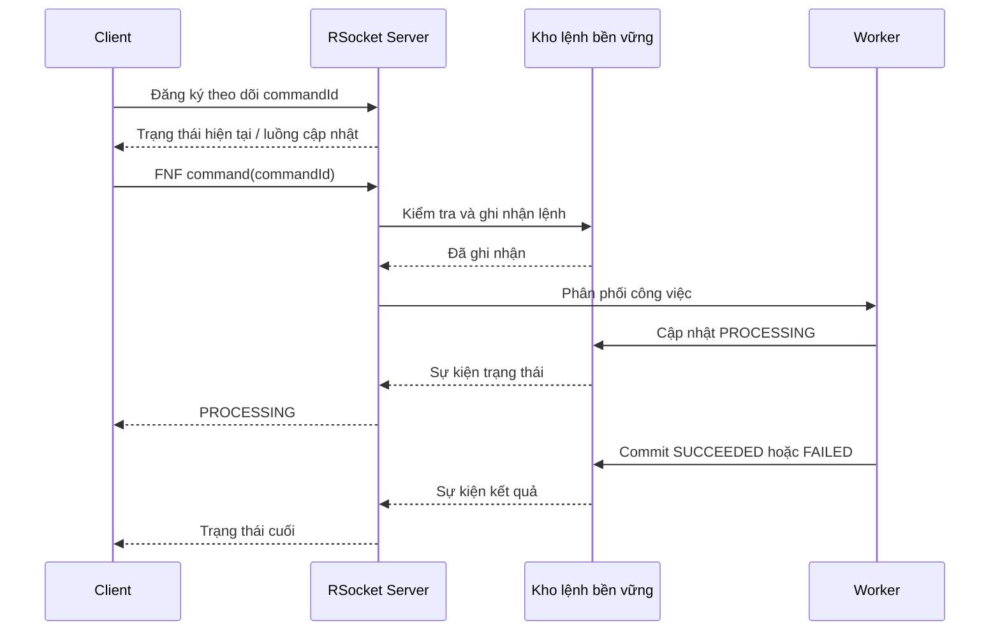

# Thiết kế xác nhận ở tầng ứng dụng khi cần biết kết quả xử lý

## Mục tiêu bài học

Fire-and-forget (FNF) cho phép một phía gửi một payload mà không chờ phản hồi nghiệp vụ trong cùng tương tác. Điều này giúp gửi tín hiệu nhanh và đơn giản, nhưng cũng tạo ra một câu hỏi quan trọng: nếu client cần biết server đã nhận lệnh, đã lưu lệnh hay đã thực hiện xong công việc, ta phải thiết kế cơ chế xác nhận ở đâu?

Sau bài này, bạn có thể:

- Phân biệt hoàn tất thao tác gửi với xác nhận server đã xử lý nghiệp vụ.
- Chọn giữa request-response, truy vấn trạng thái và luồng cập nhật trạng thái.
- Thiết kế mã lệnh, mã tương quan và khóa idempotency để hỗ trợ retry an toàn.
- Xác định thời điểm xác nhận phù hợp với ranh giới lưu trữ và xử lý.
- Xử lý timeout, kết nối bị ngắt, gửi trùng và lỗi nghiệp vụ.
- Triển khai một API xác nhận bằng Spring Boot và RSocket.

## FNF xác nhận điều gì và không xác nhận điều gì?

Trong RSocket, request-fire-and-forget là một kiểu tương tác một chiều. Requester gửi một payload; responder xử lý theo hợp đồng của ứng dụng và không gửi payload phản hồi cho request đó.

Ví dụ client gửi tín hiệu làm mới cache:

```java
Mono<Void> sent = requester
    .route("cache.invalidate")
    .data(new CacheInvalidation("product:42"))
    .send();
```

Publisher `Mono<Void>` của API client cho biết thao tác gửi theo vòng đời của client đã hoàn tất hoặc phát sinh lỗi. Nó không mang kết quả nghiệp vụ như “cache đã được làm mới”, “lệnh đã được lưu bền vững” hay “xử lý đã thành công”. Sau khi gửi xong, client không thể suy ra trạng thái xử lý ở server chỉ từ việc publisher hoàn tất.

Cần phân biệt các mốc sau:

| Mốc | Ý nghĩa | Có thể suy ra từ FNF không? |
|---|---|---|
| Client tạo lệnh | Ứng dụng đã tạo payload và chuẩn bị gửi | Có, ở phía client |
| Client hoàn tất thao tác gửi | API gửi phía client hoàn tất theo hợp đồng thư viện | Có thể quan sát ở phía client |
| Server nhận và giải mã payload | Payload đã đến responder và được giải mã | Không có xác nhận nghiệp vụ trả về cho requester |
| Server chấp nhận lệnh | Lệnh hợp lệ và đã được ghi nhận theo chính sách của ứng dụng | Không |
| Công việc bắt đầu | Worker đã bắt đầu thực thi | Không |
| Công việc hoàn tất | Kết quả nghiệp vụ đã được commit hoặc xác định thất bại | Không |

Khi một kết nối bị ngắt quanh thời điểm gửi, client có thể không biết server đã nhận payload hay chưa. Nếu tự động gửi lại, server có thể nhận lệnh trùng. Đây là trạng thái kết quả chưa xác định; nó không đồng nghĩa chắc chắn với thất bại.

Vì vậy, FNF phù hợp khi bên gửi chấp nhận không nhận kết quả xử lý cho từng thông điệp, chẳng hạn tín hiệu best-effort, telemetry có thể mất một phần hoặc thông báo không quan trọng. Khi kết quả ảnh hưởng đến tiền, dữ liệu, quyền truy cập hoặc trạng thái nghiệp vụ, cần có xác nhận được thiết kế rõ ràng.

## Chọn đúng loại xác nhận

Không phải mọi hệ thống đều cần chờ đến khi toàn bộ công việc hoàn tất. Hãy xác định điều mà bên gửi thực sự cần biết.

| Mức xác nhận | Câu hỏi được trả lời | Ví dụ trạng thái |
|---|---|---|
| Đã tiếp nhận | Server đã xác thực, kiểm tra và ghi nhận lệnh chưa? | `ACCEPTED`, `REJECTED` |
| Đã xếp hàng | Công việc đã được lưu vào hàng đợi bền vững chưa? | `QUEUED` |
| Đang xử lý | Worker đã bắt đầu thực hiện chưa? | `PROCESSING` |
| Kết quả cuối | Nghiệp vụ đã thành công hay thất bại? | `SUCCEEDED`, `FAILED` |

Một phản hồi `ACCEPTED` chỉ có nghĩa server đã chấp nhận lệnh theo hợp đồng đã công bố. Nó không được diễn giải thành `SUCCEEDED`. Nếu API chỉ xác nhận đã lưu vào hàng đợi, tài liệu và tên trạng thái phải nói đúng điều đó.

Có ba cách triển khai phổ biến:

1. **Dùng request-response ngay từ đầu:** client gửi lệnh và nhận xác nhận tiếp nhận hoặc từ chối. Cách này phù hợp khi server có thể quyết định nhanh.
2. **Gửi lệnh rồi truy vấn trạng thái:** client nhận mã lệnh, sau đó gọi route trạng thái khi cần. Cách này đơn giản và phù hợp với công việc chạy lâu.
3. **Gửi lệnh rồi theo dõi luồng cập nhật:** client đăng ký request-stream để nhận các thay đổi trạng thái. Cách này hữu ích khi cần cập nhật realtime cho nhiều bước xử lý.

Nếu cần xác nhận, request-response thường là lựa chọn tự nhiên hơn FNF. Chỉ nên giữ FNF cho lệnh khi có một kênh xác nhận độc lập được thiết kế và vận hành đầy đủ.

## Mô hình lệnh và xác nhận

Một hợp đồng lệnh nên mang định danh ổn định. Ví dụ:

```java
import java.time.Instant;

record RebuildCommand(
    String commandId,
    String idempotencyKey,
    String target
) {}

record SubmissionAck(
    String commandId,
    String state,
    Instant acceptedAt
) {}

record StatusQuery(String commandId) {}

record JobStatus(
    String commandId,
    String state,
    String detail,
    Instant updatedAt
) {}
```

Các trường có vai trò khác nhau:

- `commandId` định danh một lệnh trong hệ thống, được dùng để truy vấn trạng thái và liên kết log.
- `idempotencyKey` nhận diện cùng một ý định nghiệp vụ khi client gửi lại do timeout hoặc mất kết nối.
- `state` mô tả mốc xử lý đã đạt được.
- `acceptedAt` và `updatedAt` giúp người dùng hiểu thời điểm trạng thái được ghi nhận.

Trong hệ thống nhiều tenant, khóa idempotency cần được giới hạn theo phạm vi thích hợp, chẳng hạn kết hợp tenant, loại lệnh và khóa do client cung cấp. Không dùng một giá trị dễ đoán làm quyền truy cập vào dữ liệu trạng thái.

## Cách 1: xác nhận tiếp nhận bằng request-response

Đây là lựa chọn tốt khi server có thể xác thực, kiểm tra và ghi nhận lệnh trong thời gian ngắn. Handler chỉ trả `ACCEPTED` sau khi lệnh đã được lưu theo chính sách bền vững của hệ thống.

Ví dụ phía server:

```java
import org.springframework.messaging.handler.annotation.MessageMapping;
import org.springframework.stereotype.Controller;
import reactor.core.publisher.Mono;

@Controller
class JobController {

    private final JobService jobService;

    JobController(JobService jobService) {
        this.jobService = jobService;
    }

    @MessageMapping("jobs.submit")
    Mono<SubmissionAck> submit(RebuildCommand command) {
        return jobService.acceptOnce(command)
            .map(job -> new SubmissionAck(
                job.commandId(),
                "ACCEPTED",
                job.acceptedAt()
            ));
    }

    @MessageMapping("jobs.status")
    Mono<JobStatus> status(StatusQuery query) {
        return jobService.findStatus(query.commandId());
    }
}
```

Phía client:

```java
Mono<SubmissionAck> accepted = requester
    .route("jobs.submit")
    .data(command)
    .retrieveMono(SubmissionAck.class);

Mono<JobStatus> currentStatus = accepted.flatMap(ack ->
    requester
        .route("jobs.status")
        .data(new StatusQuery(ack.commandId()))
        .retrieveMono(JobStatus.class)
);
```

Ở đây, `acceptOnce` cần bảo đảm lệnh được kiểm tra và ghi nhận một cách nhất quán. Nếu công việc được đưa vào hàng đợi, xác nhận chỉ nên được trả sau khi thao tác ghi hàng đợi hoặc outbox đã thành công theo cam kết của hệ thống.

Không nên giữ request-response mở trong nhiều phút chỉ để chờ một tác vụ nền. Hãy xác nhận tiếp nhận nhanh, trả mã lệnh và cung cấp route trạng thái cho client.

## Cách 2: theo dõi kết quả bằng request-stream

Với tác vụ chạy lâu, server có thể cung cấp luồng trạng thái. Client gửi mã lệnh để đăng ký theo dõi:

```java
record WatchJob(String commandId) {}

@MessageMapping("jobs.watch")
Flux<JobStatus> watch(WatchJob request) {
    return jobService.watch(request.commandId());
}
```

Client nhận nhiều trạng thái:

```java
Flux<JobStatus> updates = requester
    .route("jobs.watch")
    .data(new WatchJob(commandId))
    .retrieveFlux(JobStatus.class);
```

Một luồng có thể phát `QUEUED`, `PROCESSING`, rồi `SUCCEEDED` hoặc `FAILED`. Khi đạt trạng thái cuối, client có thể hủy subscription hoặc để server hoàn tất luồng.

Cần tính đến việc client có thể ngắt kết nối trong lúc theo dõi. Nếu trạng thái chỉ được phát như sự kiện tạm thời, client có thể bỏ lỡ cập nhật cuối. Một thiết kế an toàn thường kết hợp:

- Lưu trạng thái hiện tại có thể truy vấn bằng `commandId`.
- Cho phép stream phát trạng thái hiện tại trước, sau đó phát các thay đổi tiếp theo.
- Nếu cần phát lại chính xác, lưu lịch sử sự kiện và hỗ trợ cursor hoặc sequence number.
- Khi reconnect, client truy vấn trạng thái hiện tại hoặc tiếp tục từ cursor đã lưu.

Nếu client đăng ký stream sau khi lệnh đã hoàn tất, server vẫn cần trả trạng thái cuối từ kho trạng thái. Không nên phụ thuộc vào việc client phải luôn online để nhận đúng một sự kiện duy nhất.

## Cách 3: giữ FNF và dùng kênh xác nhận độc lập

Một số kiến trúc cần gửi FNF vì requester không cần giữ request-response cho từng lệnh. Khi đó, có thể gửi lệnh qua FNF và nhận trạng thái qua một request-stream, request-channel hoặc hệ thống sự kiện riêng.

Sơ đồ luồng:



Kênh xác nhận độc lập cần có cách liên kết phản hồi với lệnh ban đầu. Dùng `commandId` hoặc `correlationId` để client biết trạng thái nào thuộc lệnh nào. Nếu một client gửi nhiều lệnh đồng thời, không ghép phản hồi chỉ theo thứ tự đến.

Mô hình này có nhiều thành phần hơn request-response. Chỉ chọn khi có lý do kiến trúc rõ ràng, chẳng hạn client đã duy trì một stream realtime dùng chung cho nhiều lệnh.

## Thời điểm xác nhận và tính bền vững

Xác nhận phải gắn với một cam kết cụ thể. Nếu server trả `ACCEPTED` trước khi lưu lệnh, tiến trình có thể dừng ngay sau đó và làm mất công việc dù client đã nhận xác nhận.

Một quy trình tiếp nhận đáng tin cậy thường gồm:

1. Xác thực người gửi và kiểm tra quyền thực hiện lệnh.
2. Kiểm tra cấu trúc, giới hạn và điều kiện nghiệp vụ.
3. Kiểm tra khóa idempotency để phát hiện yêu cầu đã xử lý.
4. Ghi lệnh hoặc bản ghi outbox trong transaction phù hợp.
5. Chỉ trả xác nhận tiếp nhận sau khi transaction commit.
6. Worker lấy công việc, cập nhật trạng thái và lưu kết quả cuối.

Nếu cần cập nhật cơ sở dữ liệu và phát thông điệp sang broker, hãy xem xét Transactional Outbox. Nó giúp tránh khoảng hở giữa việc commit dữ liệu nghiệp vụ và việc phát sự kiện. Chi tiết triển khai phụ thuộc vào cơ sở dữ liệu và broker của hệ thống.

Không có một xác nhận chung cho mọi giai đoạn. Ví dụ:

- `ACCEPTED`: server đã ghi nhận lệnh.
- `QUEUED`: công việc đã được lưu để worker xử lý.
- `SUCCEEDED`: kết quả nghiệp vụ đã được commit.
- `FAILED`: đã xác định lỗi cuối cùng theo chính sách retry.

Tên trạng thái cần có định nghĩa rõ ràng, tránh dùng các từ mơ hồ như `OK` hoặc `DONE` khi chúng không chỉ ra cam kết nào đã đạt được.

## Retry, timeout và xử lý lệnh trùng

Timeout chỉ cho biết client không nhận được kết quả trong khoảng thời gian chờ. Nó không chứng minh server chưa xử lý lệnh. Có thể server đã commit, nhưng phản hồi bị mất; cũng có thể lệnh chưa đến server.

Để xử lý tình huống này:

- Client tạo một `commandId` và `idempotencyKey` ổn định cho một ý định nghiệp vụ.
- Khi retry cùng ý định, client gửi lại cùng khóa idempotency.
- Server đặt ràng buộc duy nhất trên phạm vi khóa thích hợp để hai yêu cầu đồng thời không tạo hai công việc.
- Nếu khóa đã tồn tại, server trả lại trạng thái hoặc kết quả của lệnh cũ.
- Client dùng route trạng thái để phân biệt `PROCESSING`, `SUCCEEDED` và `FAILED`.

Không tạo khóa idempotency mới cho mỗi lần retry. Làm như vậy khiến server xem mỗi lần gửi là một lệnh hoàn toàn khác.

Phân loại lỗi trước khi retry:

| Loại lỗi | Hướng xử lý |
|---|---|
| Payload sai hoặc không đủ quyền | Từ chối; sửa dữ liệu hoặc quyền trước khi gửi lại |
| Lỗi tạm thời như mất kết nối hoặc quá tải | Retry có giới hạn, exponential backoff và jitter |
| Timeout với kết quả chưa xác định | Tra cứu theo commandId/idempotencyKey trước khi tạo lệnh mới |
| Lỗi nghiệp vụ không thể khắc phục | Đánh dấu FAILED và trả lý do phù hợp |
| Cùng một lệnh được gửi nhiều lần | Trả trạng thái/kết quả đã ghi nhận, không thực hiện tác dụng phụ lần nữa |

Idempotency không tự xuất hiện chỉ vì payload có một trường `idempotencyKey`. Server phải lưu khóa, trạng thái và kết quả liên quan, đồng thời xử lý an toàn các yêu cầu đồng thời. Thời gian lưu khóa cần dài hơn khoảng thời gian mà client hoặc hạ tầng có thể retry.

## Giới hạn tốc độ và bảo vệ server

FNF không có luồng phản hồi để requester điều chỉnh tốc độ theo từng phần tử như request-stream hoặc request-channel. Nếu client gửi nhanh hơn khả năng xử lý, server có thể tích tụ hàng đợi, tăng độ trễ hoặc cạn tài nguyên.

Các biện pháp thường cần có:

- Giới hạn số lệnh theo client, tenant hoặc route.
- Dùng hàng đợi có dung lượng hữu hạn và chính sách từ chối khi đầy.
- Giới hạn kích thước payload và tốc độ gửi.
- Batch các sự kiện nhỏ nếu nghiệp vụ cho phép.
- Dùng lease nếu implementation và cấu hình RSocket hỗ trợ, đồng thời hiểu giới hạn của lease.
- Theo dõi số lệnh nhận, bị từ chối, đang chờ và thời gian xử lý.

Nếu bên gửi cần điều tiết theo demand hoặc cần biết khi server sẵn sàng nhận phần tử tiếp theo, hãy cân nhắc request-stream hoặc request-channel. Đừng dùng FNF cho một luồng dữ liệu lớn không giới hạn mà không có cơ chế quota và kiểm soát tải ở tầng ứng dụng.

## Bảo mật và khả năng quan sát

Một route xác nhận trạng thái có thể tiết lộ dữ liệu nghiệp vụ. Server cần kiểm tra người gọi có quyền xem lệnh tương ứng hay không; biết `commandId` không nên tự động đồng nghĩa với quyền truy cập.

Không đưa token, dữ liệu nhạy cảm hoặc toàn bộ payload nghiệp vụ vào log. Hãy ghi các trường phục vụ điều tra như:

- `commandId` và `correlationId`.
- Loại lệnh và route.
- Tenant hoặc danh tính đã được chuẩn hóa theo chính sách log.
- Trạng thái trước/sau và thời điểm chuyển trạng thái.
- Số lần retry, thời gian xử lý và mã lỗi đã phân loại.

Các metric hữu ích gồm tỷ lệ lệnh được chấp nhận, bị từ chối, thất bại, số lệnh tồn đọng, độ trễ từ `ACCEPTED` đến trạng thái cuối và số yêu cầu trùng được loại bỏ.

## Checklist thiết kế

Trước khi chọn FNF hoặc triển khai xác nhận, hãy trả lời:

1. Bên gửi cần biết đã gửi, đã tiếp nhận, đã xếp hàng hay đã hoàn tất?
2. Nếu không nhận được xác nhận, kết quả có thể là chưa biết hay phải được xác định ngay?
3. Có thể gửi lại cùng lệnh mà không tạo tác dụng phụ trùng lặp không?
4. Trạng thái lệnh được lưu ở đâu và tồn tại trong bao lâu?
5. Client lấy lại trạng thái sau reconnect bằng cách nào?
6. Ai được phép gửi lệnh và ai được phép đọc trạng thái?
7. Server giới hạn tốc độ và xử lý hàng đợi đầy như thế nào?

Nếu chỉ cần gửi tín hiệu best-effort, FNF là lựa chọn gọn. Nếu cần xác nhận tiếp nhận, dùng request-response. Nếu cần theo dõi một tác vụ chạy lâu, kết hợp mã lệnh với truy vấn trạng thái hoặc request-stream. Nếu cần lưu giữ và phân phối công việc bền vững qua nhiều dịch vụ, hãy cân nhắc broker và mô hình outbox.

## Bài tập tự kiểm tra

**Tình huống:** Một client gửi lệnh tạo báo cáo bằng FNF. Kết nối bị ngắt ngay sau khi gửi. Client không biết server đã lưu lệnh hay chưa.

- Vì sao không thể kết luận lệnh đã thất bại chỉ từ lỗi kết nối?
- Bạn sẽ dùng trường nào để nhận diện cùng một ý định nghiệp vụ khi retry?
- Server cần ghi dữ liệu gì trước khi trả `ACCEPTED`?
- Client sẽ truy vấn trạng thái nào để biết báo cáo đã hoàn tất?
- Nếu client mất kết nối khi đang nhận stream trạng thái, làm thế nào để lấy lại trạng thái cuối?

Một thiết kế tốt phải trả lời được các câu hỏi này mà không dựa vào giả định rằng mạng luôn ổn định hoặc client luôn trực tuyến.

