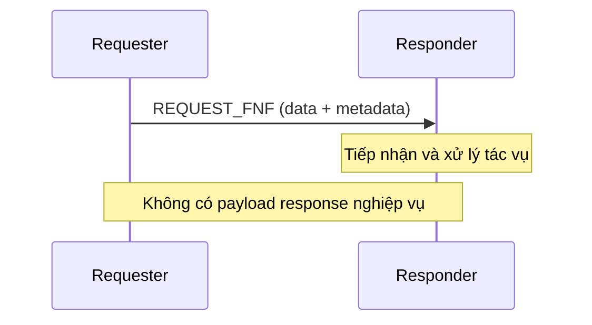

# Kiểm soát tốc độ gửi khi mô hình không có luồng phản hồi

Fire-and-forget (FNF) là mô hình tương tác một chiều của RSocket: requester gửi một request và không chờ payload phản hồi nghiệp vụ. Mô hình này phù hợp với sự kiện hoặc thông báo mà bên gửi không cần kết quả xử lý ngay, chẳng hạn telemetry, tín hiệu trạng thái hoặc một lệnh không cần phản hồi trực tiếp. Tuy nhiên, vì không có luồng phản hồi để bên nhận điều tiết người gửi, ứng dụng phải chủ động kiểm soát tốc độ phát và khả năng tiếp nhận.

Trong module `INTEGRATION_REALTIME_RSOCKET`, client và server Java thường dùng Spring Boot, Reactor và RSocket qua TCP hoặc WebSocket. Bài học này tập trung vào cách kiểm soát số thông điệp và tốc độ gửi FNF, cách giới hạn hàng đợi và concurrency, cách server bảo vệ tài nguyên khi quá tải, cũng như cách xử lý độ tin cậy khi người gửi không nhận được xác nhận nghiệp vụ.

## 1. Fire-and-forget hoạt động như thế nào?

RSocket định nghĩa frame `REQUEST_FNF` để khởi tạo một tương tác fire-and-forget. Requester gửi payload gồm data và có thể có metadata; responder nhận request và thực hiện xử lý theo handler. Theo mô hình này, responder không gửi một payload response nghiệp vụ như request-response hoặc request-stream.



Trong Spring, `RSocketRequester` cung cấp `.send()` để thực hiện tương tác FNF:

```java
Mono<Void> sent = requester
    .route("telemetry.ingest")
    .data(new TelemetryEvent("sensor-17", 27.5))
    .send();
```

`Mono<Void>` biểu diễn việc gửi hoàn tất ở phía client theo API. Khi publisher hoàn tất, client có thể biết thao tác gửi cục bộ đã kết thúc; điều đó không chứng minh handler phía server đã xử lý xong, dữ liệu đã được lưu bền vững hoặc nghiệp vụ đã commit.

Đây là khác biệt quan trọng giữa ba khái niệm:

- **Gửi thành công ở client:** thư viện client đã hoàn tất thao tác gửi theo hợp đồng API.
- **Được peer tiếp nhận:** frame đã đến và được xử lý ở tầng giao thức phía nhận.
- **Nghiệp vụ hoàn tất:** server đã xác thực, xử lý và lưu kết quả theo yêu cầu nghiệp vụ.

FNF không cung cấp response payload để xác nhận trạng thái cuối cùng. Vì vậy, không được dùng việc `Mono<Void>` hoàn tất làm bằng chứng rằng nghiệp vụ ở server đã thành công.

## 2. Vì sao FNF cần kiểm soát tốc độ chủ động?

Với request-response, requester nhận một kết quả cho mỗi request. Với request-stream, requester nhận một dòng dữ liệu và có thể điều tiết nhu cầu nhận phần tử. Với FNF, không có response stream để bên nhận gửi tín hiệu nhu cầu theo từng payload cho requester.

Nếu client phát 5.000 sự kiện mỗi giây trong khi server chỉ xử lý được 1.000 sự kiện mỗi giây, phần chênh lệch có thể tích tụ trong socket buffer, hàng đợi xử lý hoặc bộ nhớ của ứng dụng. Khi tình trạng kéo dài, hệ thống có thể tăng độ trễ, tăng bộ nhớ, từ chối kết nối hoặc mất dữ liệu tùy chính sách hàng đợi.

Các yếu tố cần đo lường gồm:

- Số thông điệp trên giây (messages per second).
- Số byte trên giây và kích thước payload trung bình, lớn nhất.
- Số thao tác gửi đang chờ hoàn tất ở client.
- Độ sâu hàng đợi và tuổi của thông điệp cũ nhất.
- Tốc độ tiếp nhận, xử lý và lưu bền vững ở server.
- Số sự kiện bị bỏ, gộp, từ chối hoặc hết hạn.

Chỉ theo dõi số request mỗi giây có thể chưa đủ. Một thông điệp vài trăm byte và một thông điệp vài megabyte có chi phí rất khác nhau. Hệ thống có tải không đồng nhất nên cân nhắc giới hạn cả số lượng và tổng dung lượng byte.

## 3. Phân biệt backpressure với rate limiting

Backpressure và rate limiting có liên quan nhưng không giống nhau.

| Cơ chế | Mục tiêu | Cách hoạt động |
| --- | --- | --- |
| Backpressure | Phối hợp tốc độ phát và tiêu thụ trong một pipeline reactive. | Subscriber yêu cầu số phần tử bằng `request(n)`; publisher phát theo nhu cầu. |
| Rate limiting | Giới hạn tốc độ trong một khoảng thời gian. | Cho phép tối đa N thao tác trong một giây hoặc theo một cửa sổ thời gian. |
| Concurrency limiting | Giới hạn số thao tác đang hoạt động cùng lúc. | Chỉ cho phép tối đa K thao tác gửi hoặc xử lý đồng thời. |
| Queue bound | Giới hạn số phần tử đang chờ. | Từ chối, bỏ, gộp hoặc làm chậm nguồn khi hàng đợi đầy. |

Trong pipeline Reactor, `request(n)` và các toán tử như `limitRate` điều tiết nhu cầu giữa các publisher và subscriber. Chúng không tự tạo ra một giới hạn thời gian như 100 thông điệp mỗi giây. `flatMap` với giới hạn concurrency giới hạn số publisher con đang hoạt động, nhưng cũng không đảm bảo một quota messages-per-second.

Với FNF, có thể dùng backpressure ở pipeline phía gửi để kiểm soát tốc độ lấy phần tử từ nguồn. Tuy nhiên, đây là điều tiết giữa các thành phần trong client. Nó không phải tín hiệu phản hồi từ server cho biết server còn đủ khả năng tiếp nhận hay không.

## 4. Điều tiết tốc độ ở phía gửi

Client nên kiểm soát tốc độ trước khi tạo và gửi quá nhiều tương tác FNF. Các chiến lược thường dùng gồm:

### Pacing theo khoảng thời gian

Nếu hệ thống cần gửi tối đa khoảng 20 sự kiện mỗi giây, có thể giãn cách thời điểm phát sự kiện khoảng 50 ms. Kết hợp `delayElements` với `concatMap` giúp gửi tuần tự và giữ khoảng cách giữa các lần phát:

```java
import java.time.Duration;
import reactor.core.publisher.Flux;
import reactor.core.publisher.Mono;

Mono<Void> sendEvents(Flux<TelemetryEvent> events) {
    return events
        .delayElements(Duration.ofMillis(50))
        .concatMap(event -> requester
            .route("telemetry.ingest")
            .data(event)
            .send(), 1)
        .then();
}
```

Ví dụ này giãn cách các sự kiện ở phía client và chỉ đăng ký một thao tác gửi trong pipeline tại một thời điểm. Tốc độ thực tế có thể thấp hơn 20 sự kiện mỗi giây nếu thao tác gửi mất thời gian. Khoảng 50 ms là pacing mục tiêu, không phải cam kết chính xác về thời gian trên mạng hoặc tốc độ xử lý ở server.

### Giới hạn số thao tác gửi đồng thời

Nếu muốn tận dụng khả năng gửi song song nhưng vẫn giới hạn số thao tác gửi đang hoạt động, có thể dùng `flatMap` với concurrency rõ ràng:

```java
Mono<Void> sendEvents(Flux<TelemetryEvent> events) {
    return events
        .flatMap(this::sendOne, 8)
        .then();
}

Mono<Void> sendOne(TelemetryEvent event) {
    return requester
        .route("telemetry.ingest")
        .data(event)
        .send();
}
```

Con số `8` giới hạn số publisher gửi đang được subscribe đồng thời trong pipeline này. Nó không phải giới hạn server xử lý đồng thời tám nghiệp vụ. Vì `send()` không chờ xác nhận nghiệp vụ, publisher có thể hoàn tất ngay khi thao tác gửi cục bộ hoàn thành; do đó concurrency này chỉ kiểm soát giai đoạn gửi mà API biểu diễn.

### Rate limiter theo quota

Khi cần giới hạn chính xác hơn theo quota, có thể dùng thuật toán token bucket hoặc sliding window trong thành phần rate limiter.

- **Token bucket:** token được bổ sung theo tốc độ cấu hình. Mỗi lần gửi tiêu thụ một token; dung lượng bucket cho phép một burst ngắn.
- **Leaky bucket:** thông điệp được đưa vào hàng đợi và phát ra theo nhịp ổn định, giúp làm phẳng burst.
- **Sliding window:** giới hạn số thông điệp trong một cửa sổ thời gian trượt, ví dụ tối đa 600 sự kiện trong 60 giây.

Rate limiter nên áp dụng theo phạm vi cần bảo vệ, chẳng hạn mỗi thiết bị, mỗi tenant hoặc mỗi kết nối. Nếu nhiều instance client cùng gửi về một server, giới hạn cục bộ trên từng client không đảm bảo tổng tải toàn hệ thống nằm dưới quota. Khi cần quota toàn cục, phải có cơ chế phối hợp ở server hoặc một dịch vụ rate limit dùng chung.

## 5. Giới hạn hàng đợi và chọn chính sách khi đầy

Nếu nguồn phát sự kiện nhanh hơn tốc độ gửi, client có thể giữ sự kiện trong hàng đợi. Hàng đợi phải có giới hạn rõ ràng; hàng đợi không giới hạn chỉ trì hoãn thời điểm hết bộ nhớ.

Khi hàng đợi đầy, ứng dụng cần chọn chính sách theo ý nghĩa dữ liệu:

| Chính sách | Hành vi | Phù hợp khi |
| --- | --- | --- |
| Reject | Từ chối nhận thêm sự kiện và báo lỗi cho thành phần tạo dữ liệu. | Sự kiện quan trọng và upstream có thể xử lý lỗi. |
| Drop newest | Bỏ sự kiện mới đến khi hàng đợi đầy. | Dữ liệu cũ đang chờ có giá trị hơn dữ liệu mới. |
| Drop oldest | Bỏ sự kiện cũ nhất để giữ dữ liệu gần hiện tại. | Dashboard chỉ cần trạng thái mới nhất. |
| Latest/coalesce | Gộp nhiều cập nhật thành giá trị mới nhất theo khóa. | Nhiều sự kiện liên tiếp thay thế trạng thái trước đó. |
| Persist | Ghi vào kho bền vững để gửi sau. | Không được mất sự kiện và chấp nhận độ trễ. |

Ví dụ, nhiệt độ hiện tại của một cảm biến có thể được gộp theo `deviceId`: nếu hàng đợi đã có một cập nhật chưa gửi cho thiết bị đó, cập nhật mới thay thế giá trị cũ. Ngược lại, sự kiện thanh toán hoặc lệnh điều khiển không nên bị bỏ hoặc gộp nếu mỗi sự kiện đều có ý nghĩa độc lập.

Nếu dùng Reactor `onBackpressureBuffer(maxSize)`, cần chọn kích thước hữu hạn và quyết định rõ hành vi khi buffer tràn. Mặc định báo lỗi khi vượt giới hạn có thể phù hợp hơn việc âm thầm bỏ dữ liệu; nếu chọn drop hoặc latest, hãy ghi metric và bảo đảm nghiệp vụ cho phép.

## 6. Bảo vệ phía nhận bằng admission control

Client pacing giúp giảm tải nhưng không thể là lớp bảo vệ duy nhất. Server cần tự kiểm soát tài nguyên vì client có thể cấu hình sai, gửi burst hoặc không tuân thủ quota.

Các biện pháp phía nhận gồm:

- Giới hạn số kết nối và số stream đang hoạt động.
- Giới hạn số FNF được chấp nhận theo giây trên từng principal, tenant hoặc route.
- Giới hạn kích thước data và metadata của mỗi payload.
- Dùng hàng đợi có giới hạn cho công việc cần xử lý bất đồng bộ.
- Giới hạn concurrency của các tác vụ CPU, I/O và truy cập cơ sở dữ liệu.
- Áp dụng timeout, circuit breaker và bulkhead cho dịch vụ phụ thuộc.
- Ghi metric cho số sự kiện nhận, xử lý, thất bại, bị bỏ hoặc quá hạn.

Vì FNF không có response payload nghiệp vụ, server không thể dùng một response bình thường cho từng sự kiện để yêu cầu client giảm tốc hoặc thông báo rằng sự kiện đã bị loại bỏ. Nếu ứng dụng cần phản hồi trạng thái tiếp nhận, hãy dùng request-response, request-stream hoặc một kênh acknowledgement riêng.

Một handler Spring có thể trả `Mono<Void>` để biểu diễn công việc xử lý bất đồng bộ mà không tạo response data:

```java
import org.springframework.messaging.handler.annotation.MessageMapping;
import org.springframework.stereotype.Controller;
import reactor.core.publisher.Mono;

@Controller
class TelemetryController {
    private final TelemetryService telemetryService;

    TelemetryController(TelemetryService telemetryService) {
        this.telemetryService = telemetryService;
    }

    @MessageMapping("telemetry.ingest")
    Mono<Void> ingest(TelemetryEvent event) {
        return telemetryService.accept(event);
    }
}
```

Service phía server vẫn cần thực hiện admission control và giới hạn công việc. Không nên đưa toàn bộ payload vào một hàng đợi không giới hạn rồi trả về ngay, vì điều đó chỉ chuyển tình trạng quá tải sang bộ nhớ của server.

## 7. Chọn FNF hay mô hình có xác nhận?

FNF phù hợp khi người gửi không cần biết kết quả xử lý của từng thông điệp. Nếu nghiệp vụ cần biết server đã nhận hoặc đã commit sự kiện, cần chọn cơ chế xác nhận rõ ràng.

| Nhu cầu | Mô hình nên cân nhắc | Lý do |
| --- | --- | --- |
| Gửi tín hiệu trạng thái không quan trọng từng mẫu | Fire-and-forget | Không cần response cho mỗi sự kiện; có thể gộp hoặc bỏ mẫu theo chính sách. |
| Gửi lệnh và cần biết đã được chấp nhận | Request-response | Server trả kết quả chấp nhận hoặc từ chối. |
| Gửi nhiều phần tử và cần phản hồi theo luồng | Request-channel | Hai phía trao đổi dữ liệu hai chiều và có thể gửi acknowledgement ở tầng ứng dụng. |
| Phát sự kiện liên tục từ server cho client | Request-stream | Client nhận dòng dữ liệu và điều tiết nhu cầu response. |
| Sự kiện phải được giao bền vững | Durable broker/outbox hoặc giao thức có acknowledgement | Có lưu trữ, retry và xác nhận theo chính sách rõ ràng. |

Không nên dùng FNF cho một nghiệp vụ mà người gửi phải biết kết quả cuối cùng, chẳng hạn trừ tiền, đặt hàng hoặc thay đổi cấu hình quan trọng, trừ khi có một cơ chế xác nhận độc lập được thiết kế rõ ràng.

## 8. Độ tin cậy, retry và xử lý trùng

TCP bảo toàn thứ tự byte trong một kết nối đang hoạt động, nhưng điều đó không tạo ra cam kết lưu bền vững cho một thông điệp FNF. Nếu kết nối bị ngắt đúng lúc gửi, client có thể không biết server đã nhận hay chưa. Nếu client gửi lại, server có thể xử lý hai lần; nếu client không gửi lại, sự kiện có thể bị mất.

Do đó, retry FNF có thể tạo ra trạng thái không chắc chắn. Ứng dụng cần phân loại dữ liệu:

- Dữ liệu có thể mất: có thể bỏ qua khi lỗi hoặc chỉ gửi lại trong một khoảng thời gian ngắn.
- Dữ liệu có thể gộp: giữ trạng thái mới nhất theo khóa và gửi lại khi kết nối phục hồi.
- Dữ liệu không được mất: ghi vào outbox hoặc durable queue trước khi gửi; chỉ đánh dấu hoàn tất sau khi nhận acknowledgement nghiệp vụ từ bên nhận hoặc broker.

Nếu có thể gửi trùng, server nên xử lý idempotent. Một sự kiện có thể mang `eventId` duy nhất và `aggregateId` để xác định phạm vi nghiệp vụ:

```java
public record TelemetryEvent(
    String eventId,
    String deviceId,
    long sequence,
    double temperature
) {}
```

Server có thể lưu `eventId` đã xử lý hoặc kiểm tra sequence theo thiết bị để phát hiện trùng và sự kiện đến trễ. Cơ chế chống trùng phải được thực hiện cùng transaction hoặc thao tác lưu bền vững phù hợp; chỉ kiểm tra trong bộ nhớ của một instance không đủ khi có nhiều server.

FNF không cung cấp exactly-once processing. Muốn đạt hành vi gần với exactly-once ở tầng nghiệp vụ, hệ thống vẫn cần định danh sự kiện, lưu trữ bền vững, acknowledgement, idempotency và quy tắc retry.

## 9. Ví dụ pipeline gửi telemetry có pacing

Giả sử thiết bị tạo telemetry liên tục. Client muốn phát tối đa khoảng 10 sự kiện mỗi giây và giữ thứ tự gửi. Có thể đặt pacing 100 ms giữa các sự kiện và tuần tự hóa thao tác gửi:

```java
import java.time.Duration;
import reactor.core.publisher.Flux;
import reactor.core.publisher.Mono;

Mono<Void> publishTelemetry(Flux<TelemetryEvent> source) {
    return source
        .onBackpressureBuffer(200)
        .delayElements(Duration.ofMillis(100))
        .concatMap(event -> requester
            .route("telemetry.ingest")
            .data(event)
            .send(), 1)
        .then();
}
```

Trong ví dụ, buffer có giới hạn 200 phần tử. Khi buffer tràn theo chính sách mặc định của overload này, pipeline báo lỗi thay vì tiếp tục tăng bộ nhớ không giới hạn. `delayElements` giãn cách việc phát và `concatMap` giữ thứ tự đăng ký gửi. Cần xử lý lỗi buffer tràn ở tầng gọi để ghi metric, dừng nguồn hoặc chuyển dữ liệu sang kho bền vững.

Đây là ví dụ pacing đơn giản cho một nguồn và một client. Hệ thống có quota phức tạp nên dùng rate limiter theo tenant/route, cân nhắc payload byte và phối hợp với admission control phía server. Pacing ở client không thay thế giới hạn tài nguyên ở phía nhận.

## 10. Quan sát và vận hành luồng FNF

Vì không có response nghiệp vụ cho từng request, hệ thống cần metric và log phù hợp để người vận hành biết luồng đang hoạt động ra sao.

Các chỉ số nên theo dõi:

- `fnf.sent`: số sự kiện client đã gửi theo route hoặc tenant.
- `fnf.send.error`: số lỗi gửi ở client hoặc lỗi giao thức quan sát được.
- `fnf.received`: số request FNF server đã tiếp nhận.
- `fnf.processed`: số sự kiện server xử lý thành công ở tầng nghiệp vụ.
- `fnf.rejected`: số sự kiện bị admission control từ chối hoặc không được xếp hàng.
- `fnf.dropped`: số sự kiện bị bỏ hoặc gộp theo chính sách.
- `fnf.queue.depth` và `fnf.queue.age`: độ sâu và tuổi phần tử trong hàng đợi.
- `fnf.processing.duration`: thời gian xử lý phía server.

Nên dùng event ID hoặc correlation ID để đối chiếu log giữa các dịch vụ. Không ghi token, payload nhạy cảm hoặc dữ liệu cá nhân không cần thiết. Khi có retry, cần phân biệt lần gửi và event ID để nhận ra một sự kiện được gửi nhiều lần.

Một dashboard vận hành tốt nên cho thấy chênh lệch giữa số sự kiện gửi, nhận, xử lý, từ chối và bỏ. Nếu số nhận tăng nhưng số xử lý không theo kịp, queue depth và queue age sẽ cảnh báo server đang bị quá tải trước khi bộ nhớ hoặc độ trễ vượt ngưỡng nguy hiểm.

## 11. Kiểm thử tốc độ gửi và quá tải

Kiểm thử FNF cần bao gồm cả tốc độ bình thường, burst và tình huống server chậm. Các bài kiểm thử nên xác nhận:

- Pacing phía client giữ tốc độ gửi trong giới hạn mục tiêu ở điều kiện ổn định.
- Concurrency giới hạn số publisher gửi đang hoạt động theo cấu hình.
- Buffer không vượt kích thước tối đa; hành vi khi đầy đúng chính sách.
- Server áp dụng quota theo route, tenant hoặc principal.
- Server không tạo hàng đợi không giới hạn khi downstream chậm.
- Sự kiện bị drop hoặc coalesce được đếm và có thể truy vết.
- Khi kết nối ngắt, client xử lý sự kiện chưa rõ trạng thái theo chính sách retry đã chọn.
- Event ID giúp server chống xử lý trùng khi có gửi lại.
- Nếu nghiệp vụ yêu cầu xác nhận, hệ thống dùng cơ chế acknowledgement thay vì dựa vào hoàn tất `Mono<Void>` phía client.

Không nên chỉ đo số lần gọi `.send()`. Hãy đo cả thời điểm gửi, số byte, thời điểm server nhận và thời điểm nghiệp vụ xử lý xong. Các phép đo ở hai phía giúp phân biệt tắc nghẽn mạng, hàng đợi server và xử lý nghiệp vụ chậm.

## 12. Những lỗi thường gặp

**Cho rằng FNF hoàn tất nghĩa là server đã xử lý xong.** `Mono<Void>` phía client không phải acknowledgement nghiệp vụ. Nếu cần xác nhận, dùng request-response hoặc kênh acknowledgement riêng.

**Gửi theo tốc độ nguồn mà không giới hạn.** Nguồn realtime có thể phát nhanh hơn server. Hãy đặt pacing, rate limit, concurrency limit và giới hạn hàng đợi.

**Dùng `limitRate` như giới hạn thông điệp mỗi giây.** `limitRate` điều tiết nhu cầu upstream theo lô; nó không phải bộ giới hạn thời gian. Dùng pacing hoặc rate limiter cho quota theo thời gian.

**Dùng concurrency như rate limit.** Giới hạn tám thao tác đang hoạt động không có nghĩa chỉ gửi tám sự kiện mỗi giây. Thời gian hoàn tất của thao tác có thể thay đổi.

**Dùng hàng đợi không giới hạn.** Buffer không giới hạn chỉ trì hoãn lỗi cạn bộ nhớ. Luôn đặt capacity và chính sách khi đầy.

**Retry mù quáng sau khi mất kết nối.** Client có thể không biết server đã nhận sự kiện chưa. Retry có thể tạo bản ghi hoặc hành động trùng; dùng event ID và idempotency.

**Dùng FNF cho giao dịch cần xác nhận.** Các hành động quan trọng cần response hoặc acknowledgement bền vững để bên gửi biết trạng thái xử lý.

## 13. Ghi nhớ

- Fire-and-forget gửi một request bằng `REQUEST_FNF` và không có payload response nghiệp vụ.
- `Mono<Void>` từ `.send()` biểu diễn hoàn tất thao tác gửi theo API client, không chứng minh server đã commit nghiệp vụ.
- Không có response stream để server điều tiết nhu cầu từng sự kiện; client cần chủ động pacing và giới hạn tốc độ.
- Backpressure trong pipeline, rate limiting, concurrency limiting và queue bound giải quyết các vấn đề khác nhau.
- Hàng đợi phải có giới hạn và chính sách rõ ràng: reject, drop, coalesce hoặc persist.
- Server vẫn cần admission control, quota, giới hạn concurrency và quan sát quá tải.
- Retry FNF có thể gây mất hoặc trùng sự kiện; dùng event ID, idempotency và durable outbox khi dữ liệu quan trọng.
- Khi cần xác nhận tiếp nhận hoặc hoàn tất nghiệp vụ, hãy dùng request-response, request-channel hoặc cơ chế acknowledgement riêng.
