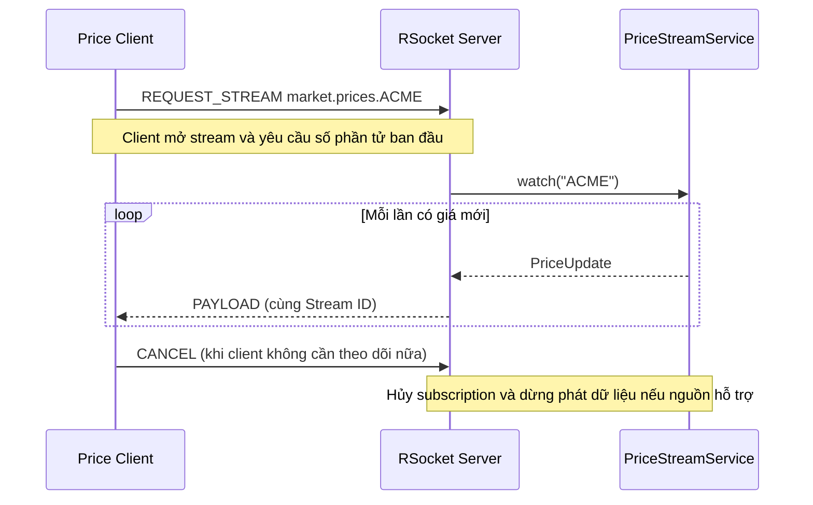

# Thực hành theo dõi giá hoặc trạng thái thay đổi theo thời gian

Một màn hình theo dõi giá cổ phiếu, tỷ giá hoặc trạng thái xử lý đơn hàng cần nhận nhiều bản cập nhật sau một lần đăng ký. Nếu client liên tục gọi một API truy vấn đơn lẻ theo chu kỳ, hệ thống phải tạo nhiều request và vẫn có thể bỏ lỡ thay đổi giữa hai lần hỏi. RSocket `request-stream` phù hợp hơn khi server cần phát một luồng response liên tục trên cùng một tương tác.

Trong bài thực hành này, ta xây dựng một RSocket server bằng Spring Boot để phát giá mô phỏng của một mã hàng. Client đăng ký route `market.prices.{symbol}`, nhận nhiều `PriceUpdate` dưới dạng `Flux` và chủ động dừng sau một số phần tử. Qua ví dụ, bạn sẽ thấy vòng đời của một stream, cách điều tiết luồng dữ liệu và cách hủy subscription khi không còn cần cập nhật.

## 1. Mục tiêu và hợp đồng stream

Sau khi hoàn thành, bạn có thể:

- Chọn `request-stream` cho một request mở ra nhiều response theo thời gian.
- Khai báo handler trả về `Flux` bằng `@MessageMapping`.
- Đăng ký stream từ client bằng `RSocketRequester.retrieveFlux`.
- Hiểu demand, `REQUEST_N` và backpressure ở mức ứng dụng.
- Hủy stream khi màn hình rời đi hoặc người dùng không còn theo dõi.
- Kiểm thử luồng reactive bằng `StepVerifier`.

Hợp đồng của ví dụ:

| Thành phần | Giá trị |
|---|---|
| Route mẫu | `market.prices.ACME` |
| Route template phía server | `market.prices.{symbol}` |
| Request | Tên mã cần theo dõi, được đưa vào route |
| Response | `PriceUpdate` gồm symbol, price, observedAt, sequence |
| Kiểu tương tác | Request-stream |
| Transport | TCP |
| Số response | Nhiều response trên cùng một stream cho tới khi hoàn tất hoặc bị hủy |

Giá trong bài là dữ liệu mô phỏng để học cách truyền stream, không phải giá thị trường thực. Khi tích hợp nguồn giá thật, service sẽ lấy dữ liệu từ feed hoặc hệ thống sự kiện phù hợp.

## 2. Request-stream hoạt động như thế nào?

Client gửi một request để mở stream. Server phát nhiều payload response trên cùng `Stream ID`; stream có thể tiếp tục trong thời gian dài cho đến khi server hoàn tất, xảy ra lỗi hoặc client hủy. Một lần đăng ký không tạo một request mới cho từng phần tử.



Ở phía Java, `Flux<PriceUpdate>` biểu diễn một luồng gồm không, một hoặc nhiều phần tử. Trong Spring RSocket, handler trả về `Flux` được ánh xạ thành tương tác request-stream. Phía client cũng nhận `Flux` khi gọi `retrieveFlux(PriceUpdate.class)`.

So sánh với request-response: request-response trả tối đa một response rồi kết thúc; request-stream trả nhiều response trên một stream. Nếu chỉ cần hỏi giá hiện tại một lần, request-response là đủ. Nếu muốn theo dõi các thay đổi tiếp theo mà không liên tục gửi request mới, request-stream là lựa chọn phù hợp.

## 3. Chuẩn bị dự án Spring Boot

Tạo ứng dụng Spring Boot có starter RSocket. Với Gradle và Spring Boot dependency management đã được cấu hình:

```groovy
dependencies {
    implementation 'org.springframework.boot:spring-boot-starter-rsocket'
    testImplementation 'org.springframework.boot:spring-boot-starter-test'
    testImplementation 'io.projectreactor:reactor-test'
}
```

Cấu hình server trong `src/main/resources/application.properties`:

```properties
spring.rsocket.server.transport=tcp
spring.rsocket.server.port=7000
```

Server lắng nghe RSocket qua TCP tại cổng `7000`. Client và server cần thống nhất codec cho payload; ví dụ dưới đây dùng DTO Java và message codec JSON được cấu hình trong ứng dụng Spring.

## 4. Định nghĩa dữ liệu PriceUpdate

Tạo file `PriceUpdate.java` để mô tả một lần cập nhật giá:

```java
import java.math.BigDecimal;
import java.time.Instant;

public record PriceUpdate(
    String symbol,
    BigDecimal price,
    Instant observedAt,
    long sequence
) {
}
```

`symbol` xác định mã đang được theo dõi. `price` dùng `BigDecimal` để tránh sai số nhị phân thường gặp khi biểu diễn số thập phân bằng `double`. `observedAt` ghi thời điểm tạo bản cập nhật và `sequence` giúp client nhận biết thứ tự phần tử trong ví dụ.

Trong ứng dụng thực tế, có thể bổ sung nguồn dữ liệu, đơn vị tiền tệ, thị trường, mã sự kiện hoặc phiên bản schema. Chỉ đưa các trường client thực sự cần vào payload để giảm lưu lượng và giữ hợp đồng rõ ràng.

## 5. Tạo nguồn dữ liệu reactive

Để minh họa một feed liên tục, service phát một giá mô phỏng mỗi giây. Giá bắt đầu từ một mức cơ sở và tăng nhẹ theo số thứ tự phần tử:

```java
import java.math.BigDecimal;
import java.time.Duration;
import java.time.Instant;
import java.util.Locale;
import java.util.Map;
import org.springframework.stereotype.Service;
import reactor.core.publisher.Flux;

@Service
public class PriceStreamService {

    private static final Map<String, BigDecimal> BASE_PRICES = Map.of(
        "ACME", new BigDecimal("101.20"),
        "GLOB", new BigDecimal("54.80")
    );

    public Flux<PriceUpdate> watch(String requestedSymbol) {
        if (requestedSymbol == null || requestedSymbol.isBlank()) {
            return Flux.error(
                new IllegalArgumentException("symbol không được để trống")
            );
        }

        String symbol = requestedSymbol.toUpperCase(Locale.ROOT);
        BigDecimal basePrice = BASE_PRICES.get(symbol);

        if (basePrice == null) {
            return Flux.error(
                new IllegalArgumentException("Mã không được hỗ trợ: " + symbol)
            );
        }

        return Flux.interval(Duration.ofSeconds(1))
            .onBackpressureLatest()
            .map(sequence -> {
                BigDecimal change = BigDecimal.valueOf(sequence)
                    .multiply(new BigDecimal("0.05"));
                return new PriceUpdate(
                    symbol,
                    basePrice.add(change),
                    Instant.now(),
                    sequence
                );
            });
    }
}
```

`Flux.interval` tạo publisher lazy: nguồn chỉ bắt đầu phát khi có subscriber. `onBackpressureLatest()` đặt chính sách giữ phần tử mới nhất khi consumer chậm; các tick cũ có thể bị bỏ qua thay vì tích lũy thành hàng đợi không giới hạn. Đây là nguồn mô phỏng có nhịp phát cố định, không phải cách đọc một feed giao dịch thật. Nếu mã không tồn tại, service trả publisher lỗi; server sẽ kết thúc stream tương ứng bằng lỗi RSocket.

Khi nối với nguồn giá thực, service thường chuyển callback, message broker hoặc API sự kiện thành `Flux`. Cần xác định chính sách khi nguồn phát nhanh hơn tốc độ tiêu thụ: giữ hàng đợi có giới hạn, chỉ giữ giá mới nhất, bỏ mẫu cũ hay báo lỗi. Không để bộ đệm tăng vô hạn khi client chậm.

## 6. Ánh xạ route bằng @MessageMapping

Tạo controller để nhận mã symbol từ route và trả về stream:

```java
import org.springframework.messaging.handler.annotation.DestinationVariable;
import org.springframework.messaging.handler.annotation.MessageMapping;
import org.springframework.stereotype.Controller;
import reactor.core.publisher.Flux;

@Controller
public class PriceStreamController {

    private final PriceStreamService priceStreamService;

    public PriceStreamController(PriceStreamService priceStreamService) {
        this.priceStreamService = priceStreamService;
    }

    @MessageMapping("market.prices.{symbol}")
    public Flux<PriceUpdate> watchPrice(
        @DestinationVariable("symbol") String symbol
    ) {
        return priceStreamService.watch(symbol);
    }
}
```

Khi client gửi route `market.prices.ACME`, Spring lấy giá trị `ACME` cho biến `symbol`, gọi handler và chuyển từng phần tử của `Flux` thành payload RSocket. Mỗi phần tử thuộc cùng tương tác stream cho đến khi stream kết thúc hoặc bị hủy.

Route là một phần của hợp đồng. Client cần gửi đúng cấu trúc `market.prices.{symbol}`; nếu tên route không khớp, handler có thể không được tìm thấy dù transport và phiên RSocket đã kết nối thành công.

## 7. Đăng ký stream từ client bằng RSocketRequester

Client tạo kết nối tới server rồi đăng ký route. `retrieveFlux` giải mã từng payload thành `PriceUpdate`:

```java
import org.springframework.messaging.rsocket.RSocketRequester;
import reactor.core.publisher.Flux;

public class PriceStreamClient {

    private final RSocketRequester requester;

    public PriceStreamClient(String host, int port) {
        this.requester = RSocketRequester.builder()
            .connectTcp(host, port)
            .block();
    }

    public Flux<PriceUpdate> watch(String symbol) {
        return requester.route("market.prices." + symbol)
            .retrieveFlux(PriceUpdate.class);
    }
}
```

Constructor dùng `.block()` để đơn giản hóa ví dụ chạy độc lập. Trong ứng dụng reactive, nên giữ kết nối dưới dạng `Mono<RSocketRequester>` hoặc khởi tạo requester trong lifecycle phù hợp; tránh gọi `block()` trên event-loop thread. Requester có thể được tái sử dụng cho nhiều stream trên cùng kết nối.

Ví dụ nhận năm bản cập nhật rồi dừng:

```java
RSocketRequester.builder()
    .connectTcp("localhost", 7000)
    .flatMapMany(requester ->
        requester.route("market.prices.ACME")
            .retrieveFlux(PriceUpdate.class)
            .take(5)
    )
    .doOnNext(update -> System.out.println(
        update.symbol() + " " + update.price() + " @ " + update.observedAt()
    ))
    .blockLast();
```

`take(5)` kết thúc phía client sau năm phần tử và hủy subscription upstream. Với một stream RSocket đang hoạt động, việc hủy được truyền thành frame `CANCEL` để server có thể dừng công việc phát dữ liệu cho stream đó. Nếu client muốn tiếp tục theo dõi, nó có thể tạo một subscription mới.

## 8. Demand và backpressure trong request-stream

Request-stream có cơ chế điều tiết luồng ở tầng giao thức. Khi client mở stream, frame `REQUEST_STREAM` mang số lượng phần tử ban đầu mà client sẵn sàng nhận. Khi cần thêm dữ liệu, client gửi frame `REQUEST_N` để tăng demand. Server không nên phát vượt quá số phần tử mà client đã yêu cầu.

Trong ứng dụng Spring/Reactor, lập trình viên thường không tự tạo các frame `REQUEST_N`. Nhu cầu từ subscriber được truyền qua Reactive Streams; thư viện RSocket và lớp tích hợp Spring đảm nhiệm việc ánh xạ demand thành cơ chế flow control của giao thức.

Ví dụ giới hạn tốc độ yêu cầu theo từng nhóm:

```java
Flux<PriceUpdate> updates = requester.route("market.prices.ACME")
    .retrieveFlux(PriceUpdate.class)
    .limitRate(16);
```

`limitRate(16)` điều chỉnh cách subscriber yêu cầu phần tử upstream theo nhóm, giúp kiểm soát lượng dữ liệu được yêu cầu tại một thời điểm. Giá trị phù hợp phụ thuộc kích thước payload, tốc độ xử lý và độ trễ của ứng dụng; không có một con số tối ưu cho mọi stream.

Backpressure chỉ hiệu quả khi các publisher và nguồn dữ liệu phía server tôn trọng demand. Một adapter kết nối tới API callback hoặc feed không có khả năng tạm dừng có thể vẫn cần buffer có giới hạn hoặc chính sách drop. Ví dụ feed giá có thể chọn giữ giá mới nhất cho mỗi symbol thay vì xếp hàng mọi thay đổi cũ, trong khi stream giao dịch tài chính cần cân nhắc bảo toàn từng sự kiện. Chọn chính sách theo yêu cầu nghiệp vụ.

## 9. Kiểm thử stream với StepVerifier

Có thể kiểm thử service độc lập mà không cần mở kết nối mạng. Dùng virtual time để kiểm tra publisher theo thời gian mà không phải chờ từng giây thực:

```java
import java.time.Duration;
import org.junit.jupiter.api.Test;
import reactor.test.StepVerifier;

import static org.junit.jupiter.api.Assertions.assertEquals;

class PriceStreamServiceTest {

    private final PriceStreamService service = new PriceStreamService();

    @Test
    void shouldEmitThreePriceUpdates() {
        StepVerifier.withVirtualTime(() ->
                service.watch("ACME").take(3)
            )
            .thenAwait(Duration.ofSeconds(3))
            .assertNext(update -> {
                assertEquals("ACME", update.symbol());
                assertEquals(0, update.sequence());
            })
            .expectNextCount(2)
            .verifyComplete();
    }

    @Test
    void shouldRejectUnknownSymbol() {
        StepVerifier.create(service.watch("UNKNOWN"))
            .expectError(IllegalArgumentException.class)
            .verify();
    }
}
```

`take(3)` làm stream kết thúc sau ba phần tử để test có điểm dừng xác định. Virtual time cho phép kiểm tra các publisher dựa trên scheduler thời gian mà không chờ ba giây thực. Test thứ hai xác nhận mã không được hỗ trợ kết thúc stream bằng lỗi.

Ngoài unit test service, nên có integration test chạy server và client qua TCP để kiểm tra route, codec, setup và truyền payload. Một bài kiểm thử hữu ích là nhận vài phần tử rồi hủy subscription, sau đó xác nhận server dừng công việc gắn với stream đó. Không nên chỉ kiểm tra rằng client nhận được phần tử đầu tiên.

## 10. Xử lý hoàn tất, lỗi và hủy stream

Một stream có ba kết quả kết thúc phổ biến:

| Tình huống | Biểu hiện ở client | Hành vi mong đợi |
|---|---|---|
| Server hoàn tất | `onComplete` | Stream kết thúc bình thường |
| Server phát lỗi | `onError` | Stream kết thúc với lỗi; xử lý theo loại lỗi |
| Client không còn cần dữ liệu | Hủy subscription | Client gửi `CANCEL`; server dừng xử lý nếu nguồn hỗ trợ |

Với feed giá liên tục, server có thể không chủ động hoàn tất. Client phải hủy khi người dùng rời màn hình, đổi symbol hoặc ứng dụng đóng. Trong giao diện reactive, gắn vòng đời subscription với vòng đời màn hình hoặc component để tránh stream chạy nền ngoài ý muốn.

Ví dụ đổi từ mã `ACME` sang `GLOB` cần hủy subscription cũ trước khi đăng ký stream mới. Nếu giữ cả hai stream mà không chủ ý, client sẽ tiếp tục nhận dữ liệu từ cả hai mã và tăng tải mạng cũng như xử lý.

Không nên tự động retry mọi lỗi vô hạn. Nếu stream lỗi do mã không hợp lệ hoặc quyền truy cập bị từ chối, retry cùng route sẽ tiếp tục thất bại. Nếu lỗi do kết nối tạm thời, có thể tạo lại session và đăng ký lại với backoff, nhưng cần xác định có bỏ lỡ dữ liệu trong khoảng mất kết nối hay không. Với feed có yêu cầu không mất sự kiện, cần cursor/sequence và cơ chế replay từ nguồn dữ liệu.

## 11. Mở rộng từ giá mô phỏng sang trạng thái đơn hàng

Cùng một mô hình request-stream có thể dùng để theo dõi trạng thái đơn hàng. Thay vì phát `PriceUpdate`, server phát `OrderStatusUpdate` mỗi khi trạng thái thay đổi. Route có thể là `orders.watch.{orderId}` và client đăng ký một lần để nhận các sự kiện như `PAID`, `PACKING`, `SHIPPED` và `DELIVERED`.

Điểm khác biệt nằm ở chính sách dữ liệu. Với giá thị trường, có thể chỉ cần giá mới nhất nếu mục tiêu là hiển thị bảng giá. Với trạng thái đơn hàng, thường cần bảo toàn thứ tự sự kiện và tránh bỏ qua chuyển trạng thái quan trọng. Vì vậy, nguồn dữ liệu, buffer, replay và định danh sequence phải được chọn theo yêu cầu nghiệp vụ.

Nếu client cần trạng thái ban đầu cộng với các thay đổi sau đó, server có thể phát snapshot đầu tiên rồi tiếp tục phát sự kiện cập nhật trong cùng stream. Hãy định nghĩa rõ ý nghĩa của từng phần tử và cách client xử lý khi stream bị ngắt giữa chừng.

## 12. Những lưu ý khi triển khai thực tế

- **Nguồn dữ liệu:** dùng broker, database change stream hoặc feed chuyên dụng thay cho timer mô phỏng.
- **Backpressure:** đặt giới hạn buffer và chọn chính sách giữ, gộp hoặc bỏ dữ liệu theo nghiệp vụ.
- **Tài nguyên:** hủy subscription khi client rời màn hình hoặc không còn theo dõi symbol.
- **Bảo mật:** xác thực client, kiểm tra quyền truy cập từng symbol/đơn hàng và bảo vệ transport bằng TLS.
- **Quan sát:** ghi route, symbol, số phần tử, thời gian stream, số lần cancel và loại lỗi; tránh log payload nhạy cảm.
- **Phục hồi:** dùng sequence hoặc cursor nếu client cần tiếp tục từ vị trí đã nhận sau khi mất kết nối.
- **Khả năng mở rộng:** giới hạn số stream đồng thời trên mỗi client và theo dõi số subscriber của mỗi nguồn dữ liệu.

Một stream dài hạn giữ tài nguyên ở cả client và server. Cần có giới hạn kết nối, chính sách idle timeout, keepalive và cơ chế cleanup khi subscriber biến mất. Khi nhiều client theo dõi cùng một symbol, cân nhắc chia sẻ một nguồn feed upstream thay vì mở một kết nối tới nguồn dữ liệu cho từng client.

## 13. Kết luận

`request-stream` cho phép client gửi một request rồi nhận nhiều response trên cùng một stream RSocket. Trong ví dụ, `@MessageMapping("market.prices.{symbol}")` trả `Flux<PriceUpdate>`, còn client dùng `RSocketRequester.retrieveFlux` để đăng ký theo dõi. `take`, `limitRate` và cơ chế demand giúp kiểm soát vòng đời cũng như lượng dữ liệu tiêu thụ.

Khi xây dựng stream realtime, hãy xác định rõ nguồn dữ liệu, chính sách backpressure, cách kết thúc hoặc hủy stream và cách phục hồi sau mất kết nối. Những quyết định này giúp ứng dụng theo dõi dữ liệu liên tục mà vẫn kiểm soát được tài nguyên và tính đúng đắn của dữ liệu.
