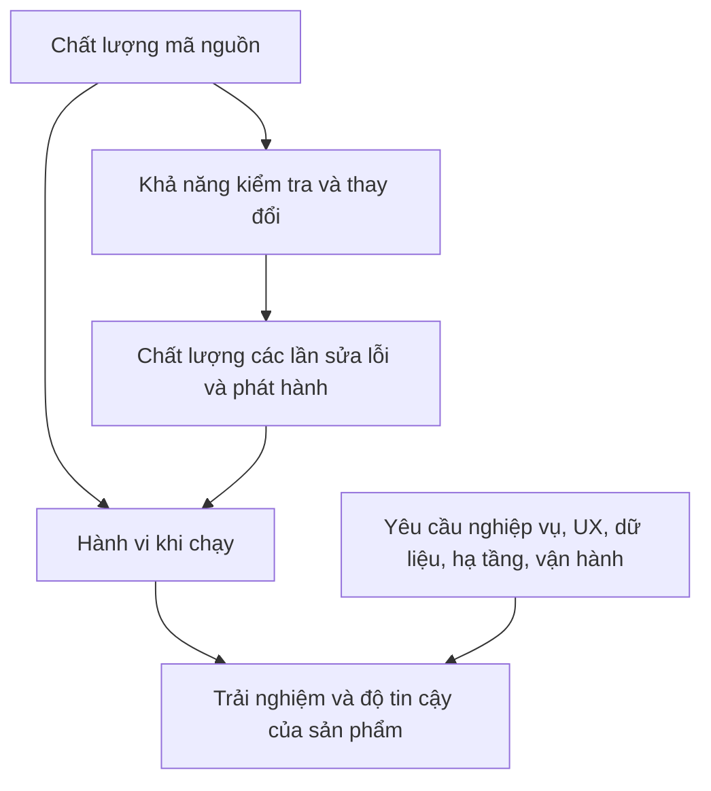

# Mối liên hệ giữa chất lượng mã và chất lượng sản phẩm

## 1. Mục tiêu bài học

Trong phần **Nhập môn** của module **CODE_QUALITY_FUNDAMENTALS**, chúng ta tìm hiểu vì sao việc viết mã **đáng tin cậy, dễ hiểu và dễ thay đổi** có ảnh hưởng đến sản phẩm mà người dùng nhận được. Hai khái niệm *chất lượng mã nguồn* và *chất lượng sản phẩm* liên quan chặt chẽ, nhưng không đồng nghĩa.

Sau bài học, bạn có thể:

- Phân biệt chất lượng của phần mã bên trong với chất lượng sản phẩm được người dùng và các bên liên quan đánh giá.
- Giải thích các cơ chế mà tính đúng đắn, khả năng bảo trì, kiểm thử, bảo mật và hiệu năng của mã tác động đến sản phẩm.
- Phân tích tình huống một chương trình có mã dễ đọc nhưng vẫn tạo ra trải nghiệm không tốt, hoặc một sản phẩm đang chạy ổn nhưng tiềm ẩn rủi ro khi thay đổi.
- Chọn bằng chứng để đánh giá **cả mã nguồn lẫn kết quả sản phẩm**, tránh kết luận chỉ từ một chỉ số.

## 2. Hai lớp chất lượng nhìn từ hai góc độ

**Chất lượng mã nguồn (code quality)** là mức độ mã đáp ứng các yêu cầu kỹ thuật và giúp nhóm phát triển hiểu, kiểm tra, sửa lỗi và thay đổi nó một cách an toàn. Các thuộc tính thường xét gồm tính đúng đắn, tính dễ đọc, khả năng kiểm thử, khả năng bảo trì, tính an toàn và hiệu quả tài nguyên.

**Chất lượng sản phẩm (product quality)** là mức độ **sản phẩm hoàn chỉnh** đáp ứng nhu cầu và kỳ vọng hợp lý của người dùng, khách hàng cùng các bên liên quan trong bối cảnh sử dụng cụ thể. Người dùng thường đánh giá sản phẩm qua khả năng giải quyết công việc, hành vi đúng, tốc độ phản hồi, độ ổn định, mức độ dễ dùng, sự an toàn và hỗ trợ khi xảy ra sự cố.

Sự khác biệt nằm ở **đối tượng được đánh giá**:

| Góc nhìn | Chất lượng mã nguồn | Chất lượng sản phẩm |
| --- | --- | --- |
| Đối tượng | Cách hệ thống được hiện thực và duy trì bằng mã | Kết quả mà toàn bộ sản phẩm mang đến trong sử dụng thực tế |
| Câu hỏi trung tâm | Người phát triển có thể tin vào, hiểu, kiểm thử và sửa mã an toàn không? | Người dùng có hoàn thành công việc đúng, thuận tiện và tin cậy không? |
| Bằng chứng điển hình | Review, kiểm thử, phân tích tĩnh, cấu trúc phụ thuộc, tốc độ sửa đổi, lỗi hồi quy | Tỷ lệ hoàn thành tác vụ, lỗi sản xuất, hiệu năng đầu cuối, phản hồi người dùng, yêu cầu hỗ trợ |
| Phạm vi | Mã nguồn và những tương tác kỹ thuật liên quan | Mã, kiến trúc, hạ tầng, dữ liệu, giao diện, nội dung, quy trình vận hành và giá trị nghiệp vụ |
| Người quan tâm | Lập trình viên, người kiểm thử, kiến trúc sư, nhóm vận hành | Người dùng, chủ sản phẩm, khách hàng, đội hỗ trợ và cả nhóm kỹ thuật |

Ví dụ, một màn hình đặt hàng có thể được xây dựng bằng các lớp Java đặt tên rõ ràng, có kiểm thử và ít phụ thuộc. Nếu nút thanh toán khó tìm, phí giao hàng hiển thị sai hoặc hệ thống thường xuyên hết hàng mà vẫn cho đặt, người dùng vẫn có lý do đánh giá sản phẩm kém. Ngược lại, một trang đặt hàng hiện tại có thể rất dễ dùng và hiếm gặp lỗi, nhưng bên trong lại chứa logic chồng chéo, khiến mọi lần thay đổi chính sách giá đều tiềm ẩn rủi ro.

## 3. Mã nguồn ảnh hưởng đến sản phẩm bằng cách nào?

Ảnh hưởng của mã đến sản phẩm có **hai con đường chính**:

1. **Ảnh hưởng trực tiếp đến hành vi khi chạy:** một nhánh tính tiền sai, xử lý ngoại lệ không phù hợp, chậm phản hồi hoặc kiểm soát quyền không đúng có thể gây lỗi cho người dùng ngay lập tức.
2. **Ảnh hưởng gián tiếp qua khả năng thay đổi:** mã khó hiểu và khó kiểm thử làm chậm sửa lỗi, tăng khả năng lỗi hồi quy và khiến nhóm ngại điều chỉnh sản phẩm theo nhu cầu mới.

Có thể hình dung quan hệ như sau:



Sơ đồ là cách **giải thích cơ chế ảnh hưởng**, không phải công thức bảo đảm: tăng một chỉ số chất lượng mã không tự động làm người dùng hài lòng hơn. Những yếu tố nằm ngoài đoạn mã cụ thể vẫn có thể quyết định trải nghiệm thực tế.

### Liên hệ các thuộc tính bằng kết quả cụ thể

| Thuộc tính của mã | Cơ chế tác động | Điều người dùng có thể nhận thấy |
| --- | --- | --- |
| **Tính đúng đắn** | Hiện thực đúng quy tắc nghiệp vụ, điều kiện biên và hợp đồng dữ liệu | Đơn hàng, số dư hoặc quyền truy cập được xử lý đúng |
| **Độ tin cậy và xử lý lỗi** | Kiểm soát ngoại lệ, giới hạn lỗi và duy trì trạng thái hợp lệ | Ít giao dịch hỏng, thông báo lỗi rõ hơn và khả năng khôi phục tốt hơn |
| **Khả năng kiểm thử** | Phát hiện sai lệch trước khi phát hành và khi sửa quy tắc | Ít lỗi hồi quy lọt đến người dùng hơn khi bộ kiểm thử phù hợp |
| **Độ rõ ràng và khả năng bảo trì** | Giúp xác định nơi cần sửa và hiểu phạm vi ảnh hưởng | Sửa lỗi, bổ sung tính năng nhanh hơn và ít tạo thêm vấn đề |
| **Tính an toàn** | Hạn chế lỗ hổng do mã và xử lý dữ liệu/ủy quyền không phù hợp | Giảm nguy cơ lộ dữ liệu hoặc thao tác trái phép |
| **Hiệu quả tài nguyên** | Tránh công việc thừa, giảm chi phí tính toán ở điểm nghẽn | Thời gian phản hồi và khả năng phục vụ tải có thể tốt hơn |

Các liên hệ này là **khả năng tác động**, không phải quan hệ một chiều chắc chắn. Chẳng hạn, kiểm thử nhiều chưa chắc phát hiện sai sót nếu test chỉ kiểm tra đúng điều mà lập trình viên đã hiểu nhầm từ yêu cầu.

## 4. Ví dụ Java: một ký tự so sánh có thể thành lỗi sản phẩm

Giả sử cửa hàng quy định phí giao hàng như sau:

- Đơn có tổng tiền hàng **từ 500.000 VND trở lên** được miễn phí giao hàng.
- Đơn dưới ngưỡng phải trả **30.000 VND** phí giao hàng.
- Tổng tiền hàng đầu vào được tính theo VND và không được âm.

Một đoạn mã có thể trông gọn và dễ đọc nhưng lại sai ngay tại ranh giới:

```java
static long shippingFee(long subtotalVnd) {
    if (subtotalVnd > 500_000) { // Sai: 500.000 phải được miễn phí.
        return 0;
    }
    return 30_000;
}
```

Người dùng có đơn đúng **500.000 VND** bị thu thừa **30.000 VND**. Đây trước hết là lỗi về **tính đúng đắn của mã**, và biểu hiện ra ngoài là lỗi của **sản phẩm thanh toán**. Việc mã chỉ có vài dòng, đặt tên dễ hiểu hoặc chạy nhanh không bù được hậu quả này.

Một phiên bản diễn đạt rõ chính sách và xử lý đầu vào bị cấm là:

```java
public final class ShippingFeePolicy {
    private static final long FREE_SHIPPING_FROM_VND = 500_000;
    private static final long STANDARD_SHIPPING_FEE_VND = 30_000;

    private ShippingFeePolicy() {
    }

    public static long calculate(long subtotalVnd) {
        if (subtotalVnd < 0) {
            throw new IllegalArgumentException("subtotalVnd must not be negative");
        }

        if (subtotalVnd >= FREE_SHIPPING_FROM_VND) {
            return 0;
        }
        return STANDARD_SHIPPING_FEE_VND;
    }
}
```

**Tại sao mã này hữu ích cho chất lượng sản phẩm?** Quy tắc miễn phí được đặt tên; điều kiện tại ngưỡng phản ánh đúng câu “từ ... trở lên”; giá trị âm bị từ chối rõ ràng; hàm không phụ thuộc vào mạng hay cơ sở dữ liệu nên dễ kiểm tra bằng đầu vào xác định.

Tuy nhiên, việc sửa mã chỉ có ý nghĩa khi chính sách thực sự là **`>= 500_000`** và đầu vào âm được coi là lỗi. Nếu yêu cầu nghiệp vụ khác, mã phải tuân theo yêu cầu đã được xác nhận. Đặt tên hằng số và tách lớp không bảo đảm rằng quy tắc đã được hiểu đúng.

### Kiểm thử ranh giới với JUnit 5

```java
import static org.junit.jupiter.api.Assertions.assertEquals;
import static org.junit.jupiter.api.Assertions.assertThrows;

import org.junit.jupiter.api.Test;

class ShippingFeePolicyTest {
    @Test
    void freeShippingStartsAtFiveHundredThousand() {
        assertEquals(30_000, ShippingFeePolicy.calculate(499_999));
        assertEquals(0, ShippingFeePolicy.calculate(500_000));
        assertEquals(0, ShippingFeePolicy.calculate(500_001));
    }

    @Test
    void rejectsNegativeSubtotal() {
        assertThrows(IllegalArgumentException.class,
            () -> ShippingFeePolicy.calculate(-1));
    }
}
```

Những kiểm thử trên giúp bảo vệ quy tắc trước lỗi hồi quy. Chúng không chứng minh toàn bộ luồng thanh toán đã đúng: tổng tiền hàng có thể bị tính sai ở bước trước, giao diện có thể hiển thị khác kết quả backend, hoặc phương thức thanh toán có thể thu sai tiền. Do đó cần thêm kiểm thử tích hợp, kiểm thử đầu cuối hoặc đối soát giao dịch tùy mức độ rủi ro.

### Khi sản phẩm thay đổi yêu cầu

Giả sử sau này cửa hàng hỗ trợ mức phí riêng cho khách hàng thành viên. Một hàm có trách nhiệm rõ và các kiểm thử bảo vệ quy tắc cũ giúp nhóm nhận ra cần thay đổi đầu vào, logic nào và những trường hợp nào phải xác nhận lại. Trái lại, nếu điều kiện `500_000` bị sao chép trong nhiều service, controller và giao diện, việc cập nhật có nguy cơ bỏ sót, tạo ra các kết quả không thống nhất.

Đây là tác động **gián tiếp** của chất lượng mã đến sản phẩm: mã dễ thay đổi giúp nhóm triển khai nhu cầu mới an toàn hơn, dù bản thân người dùng không nhìn thấy cấu trúc lớp Java.

## 5. Những trường hợp không thể đồng nhất hai loại chất lượng

### Trường hợp A: mã dễ bảo trì nhưng sản phẩm chưa hữu ích

Một ứng dụng đặt lịch có kiến trúc rõ, kiểm thử tốt và thời gian phản hồi thấp. Tuy nhiên, sản phẩm thiếu chức năng hủy lịch mà người dùng cần mỗi ngày. Mã có thể được đánh giá tốt ở nhiều thuộc tính kỹ thuật, nhưng **sự phù hợp với nhu cầu người dùng** vẫn thấp. Vấn đề phải được giải quyết từ lựa chọn sản phẩm và yêu cầu, không chỉ bằng refactor.

### Trường hợp B: sản phẩm đang tốt, mã tiềm ẩn nợ kỹ thuật

Một trang thương mại điện tử có tỷ lệ thanh toán thành công cao. Nhưng quy tắc giảm giá được sao chép ở năm vị trí và không có kiểm thử ranh giới. Người dùng hiện tại có thể chưa thấy vấn đề; rủi ro xuất hiện khi chiến dịch khuyến mãi thay đổi. Chất lượng sản phẩm **ở thời điểm hiện tại** không xóa đi chi phí và rủi ro cho các lần phát hành tiếp theo.

### Trường hợp C: mã tốt nhưng sản phẩm vẫn gặp sự cố

Một service xử lý đúng và có kiểm thử, song hệ thống hết dung lượng lưu trữ hoặc nhà cung cấp thanh toán ngừng hoạt động. Người dùng vẫn không hoàn thành được giao dịch. Chất lượng sản phẩm phụ thuộc cả kiến trúc tổng thể, năng lực hạ tầng, quy trình vận hành và việc xử lý sự cố; không thể quy mọi lỗi sản phẩm cho một đoạn mã.

### Trường hợp D: tối ưu mã làm giảm trải nghiệm

Nhóm thêm cache để tăng tốc hiển thị giá. Thời gian phản hồi giảm, nhưng giá trong cache không được làm mới khi khuyến mãi thay đổi. Người dùng thấy giá cũ và có thể bị tính tiền khác khi thanh toán. Ở đây **cải thiện hiệu năng cục bộ** lại tạo vấn đề về tính đúng đắn và độ tin cậy của sản phẩm. Cần làm rõ quy tắc nhất quán dữ liệu và đo cả kết quả nghiệp vụ trước khi chấp nhận tối ưu hóa.

## 6. Chất lượng mã tạo giá trị theo thời gian

Trong một phiên bản sản phẩm, người dùng thường chú ý chức năng hoạt động ra sao. Qua nhiều phiên bản, **khả năng sửa đổi an toàn** cũng trở thành yếu tố quyết định. Một chính sách kinh doanh có thể đổi liên tục, hệ điều hành và thư viện có thể được nâng cấp, hay một lỗ hổng cần được xử lý khẩn cấp.

Mã dễ hiểu và có thể kiểm chứng giúp quá trình thay đổi diễn ra với ít rủi ro hơn:

| Giai đoạn | Vấn đề khi mã khó thay đổi | Lợi ích khi chất lượng mã phù hợp |
| --- | --- | --- |
| Phân tích yêu cầu mới | Khó xác định quy tắc hiện có nằm ở đâu | Dễ tìm nơi xử lý và hiểu hành vi liên quan |
| Triển khai | Phụ thuộc chằng chịt; sửa một nơi ảnh hưởng nhiều nơi | Ranh giới trách nhiệm và hợp đồng rõ hơn |
| Xác minh | Thiếu điểm kiểm thử, phải kiểm tra thủ công nhiều | Có kiểm thử hồi quy và dữ liệu kiểm thử có ý nghĩa |
| Phát hành | Lỗi khó dự báo, khó quay lui hoặc khoanh vùng | Có cơ sở đánh giá rủi ro và quan sát sự cố |
| Bảo trì lâu dài | Chi phí hiểu và sửa mã tăng sau nhiều lần vá | Có thể bổ sung chức năng mà vẫn kiểm soát độ phức tạp |

Tuy vậy, không nên suy ra rằng càng nhiều lớp, nhiều mẫu thiết kế hoặc càng nhiều kiểm thử thì chất lượng sản phẩm càng tốt. Trừu tượng không cần thiết cũng khiến nhóm mất thời gian hiểu và sửa. Mục tiêu là **mức độ cấu trúc đủ phục vụ những yêu cầu có thật và rủi ro cần kiểm soát**.

## 7. Đánh giá mối liên hệ bằng bằng chứng

Một nhóm phát triển cần nhìn đồng thời các chỉ báo kỹ thuật và sản phẩm. Mỗi chỉ báo chỉ phản ánh một phần vấn đề:

| Nhóm bằng chứng | Ví dụ | Giới hạn |
| --- | --- | --- |
| Mã nguồn và kiểm thử | Review, độ phức tạp, cảnh báo phân tích tĩnh, kiểm thử trường hợp biên, kiểm thử hồi quy | Chỉ số đẹp không chứng minh đúng nhu cầu nghiệp vụ hay trải nghiệm đầu cuối |
| Khả năng thay đổi | Thời gian sửa lỗi, thời gian từ thay đổi đến phát hành, tần suất lỗi hồi quy | Bị ảnh hưởng bởi quy mô công việc, quy trình và chất lượng yêu cầu |
| Chạy trong môi trường thật | Tỷ lệ lỗi, độ trễ p95/p99, khả năng phục hồi, sự cố bảo mật | Cần phân biệt lỗi mã với vấn đề hạ tầng, dữ liệu hoặc bên thứ ba |
| Kết quả người dùng | Tỷ lệ hoàn thành tác vụ, tỷ lệ giao dịch thành công, số yêu cầu hỗ trợ, phản hồi về dễ dùng | Còn phụ thuộc giá, thiết kế trải nghiệm, nhu cầu thị trường và nhiều yếu tố khác |

Ví dụ, sau khi nhóm làm rõ một chính sách phí, bổ sung kiểm thử ranh giới và triển khai bản sửa lỗi, có thể theo dõi hai phía:

1. **Phía kỹ thuật:** kiểm thử bắt được sai lệch ở ngưỡng, không xuất hiện lỗi hồi quy liên quan và mã có thể được chỉnh sửa trong phạm vi dự kiến.
2. **Phía sản phẩm:** giảm số giao dịch tính sai phí, giảm khiếu nại liên quan hoặc tăng tỷ lệ thanh toán hoàn tất trong nhóm khách hàng bị ảnh hưởng.

Nếu chỉ thấy số khiếu nại giảm, chưa đủ kết luận **duy nhất** việc cải thiện mã đã gây ra thay đổi; có thể đồng thời có điều chỉnh giao diện hoặc chính sách. Để đánh giá tác động, cần xác định mốc trước/sau, nhóm người dùng bị ảnh hưởng, thay đổi đi kèm và khả năng ghi nhận sự cố. Còn nếu chỉ thấy kiểm thử mới chuyển xanh, ta mới biết hành vi đã qua những phép kiểm tra đó, chưa biết toàn bộ sản phẩm có được cải thiện trong thực tế hay không.

### Chọn ưu tiên phù hợp với rủi ro

Không phải mọi vấn đề về mã có mức ưu tiên như nhau. Có thể dùng ba câu hỏi trước khi quyết định sửa ngay, đưa vào kế hoạch hay tiếp tục theo dõi:

1. **Tác động:** Vấn đề có thể dẫn tới sai tiền, mất dữ liệu, lộ thông tin, gián đoạn giao dịch hay chỉ là bất tiện khi đọc mã?
2. **Khả năng xảy ra và phạm vi ảnh hưởng:** Đường chạy này có được dùng thường xuyên không, có nhiều người phụ thuộc vào nó không, và sự cố có dễ lan rộng không?
3. **Chi phí và rủi ro khi sửa:** Có kiểm thử hỗ trợ không, thay đổi có làm ảnh hưởng hành vi khác không và có thể triển khai, quan sát, quay lui an toàn không?

Những lỗi có thể gây hậu quả lớn cho khách hàng thường cần ưu tiên cao hơn một vấn đề trình bày mã thuần túy. Tuy nhiên, một đoạn mã khó hiểu nằm ở chức năng được sửa mỗi tuần vẫn có thể là nguồn rủi ro lâu dài, đáng cải thiện trong phạm vi phù hợp.

## 8. Quy trình kết nối cải thiện mã với giá trị sản phẩm

Khi đề xuất refactor hoặc khắc phục vấn đề kỹ thuật, hãy kết nối quyết định với kết quả mong muốn:

1. **Xác định hành vi hoặc rủi ro:** Nêu rõ lỗi hoặc khó khăn nào đang ảnh hưởng đến người dùng, phát hành hay vận hành. Ví dụ: chính sách phí giao hàng liên tục sai ở điều kiện biên.
2. **Tìm nguyên nhân tại đúng lớp:** Phân biệt yêu cầu nghiệp vụ chưa rõ, cài đặt sai, thiếu kiểm thử, dữ liệu sai hoặc sự cố hạ tầng. Một vấn đề sản phẩm có thể có nhiều nguyên nhân.
3. **Chọn thay đổi nhỏ, kiểm chứng được:** Bổ sung hợp đồng, làm rõ quy tắc, tách trách nhiệm hoặc tối ưu một điểm nghẽn đã được đo. Tránh mở rộng sửa đổi quá phạm vi cần thiết.
4. **Bảo vệ hành vi:** Kiểm thử các trường hợp quan trọng và kiểm tra tác động tích hợp, đặc biệt với chức năng có rủi ro cao.
5. **Đo kết quả thực tế:** Theo dõi cả chỉ báo kỹ thuật và sản phẩm liên quan sau phát hành. Nếu kết quả chưa đạt, điều tra nguyên nhân tiếp theo thay vì mặc định thay đổi mã đã đủ.

Quy trình này giúp trả lời được câu hỏi: **“Thay đổi mã này làm sản phẩm đáng tin cậy hơn hoặc dễ phát triển hơn bằng cơ chế nào, và chúng ta sẽ biết điều đó qua bằng chứng gì?”**

## 9. Tự kiểm tra kiến thức

**Câu 1.** Một hệ thống có cấu trúc lớp rõ ràng, kiểm thử tự động đầy đủ theo đặc tả, nhưng người dùng không tìm được chức năng họ cần. Vấn đề thuộc chất lượng nào?

**Câu 2.** Một sản phẩm đang hoạt động ổn định, nhưng mỗi lần thay chính sách khuyến mãi lại phải sửa logic tương tự ở nhiều chỗ. Điều này có ý nghĩa gì đối với chất lượng sản phẩm về lâu dài?

**Câu 3.** Vì sao phép kiểm thử `shippingFee(500_000)` có thể mang lại giá trị sản phẩm lớn hơn việc chỉ đổi tên biến cho dễ đọc trong tình huống trên?

**Câu 4.** Sau khi thay một phép tra cứu tuyến tính bằng cache, p95 độ trễ giảm nhưng số khiếu nại về giá sai tăng. Có nên giữ nguyên tối ưu hóa chỉ vì hệ thống nhanh hơn không?

**Gợi ý trả lời:** (1) Sản phẩm chưa đáp ứng nhu cầu hoặc khả năng sử dụng; mã rõ ràng chưa giải quyết được vấn đề lựa chọn chức năng hay UX. (2) Mã khó thay đổi gây nguy cơ lỗi hồi quy, chậm phát hành và giảm chất lượng trong các phiên bản tiếp theo. (3) Kiểm thử bảo vệ điều kiện biên có thể gây thu phí sai thực tế; đổi tên hỗ trợ đọc hiểu nhưng không tự chứng minh đúng quy tắc. (4) Cần ưu tiên điều tra tính đúng đắn và nhất quán giá, cân nhắc tác động đến người dùng, rồi mới quyết định có giữ hoặc điều chỉnh tối ưu hóa.

## 10. Ghi nhớ

**Chất lượng mã nguồn là một nền tảng quan trọng của chất lượng sản phẩm, nhưng không phải toàn bộ chất lượng sản phẩm.** Mã đúng và đáng tin giúp bảo vệ hành vi hiện tại; mã dễ hiểu, dễ kiểm thử và dễ thay đổi giúp bảo vệ những lần phát hành tiếp theo. Sản phẩm còn phụ thuộc vào việc hiểu đúng nhu cầu, thiết kế trải nghiệm, dữ liệu, hạ tầng và vận hành. Muốn kết luận một cải thiện kỹ thuật có giá trị, hãy liên hệ nó với **rủi ro được giảm, hành vi được bảo vệ và kết quả người dùng có thể kiểm chứng**.
