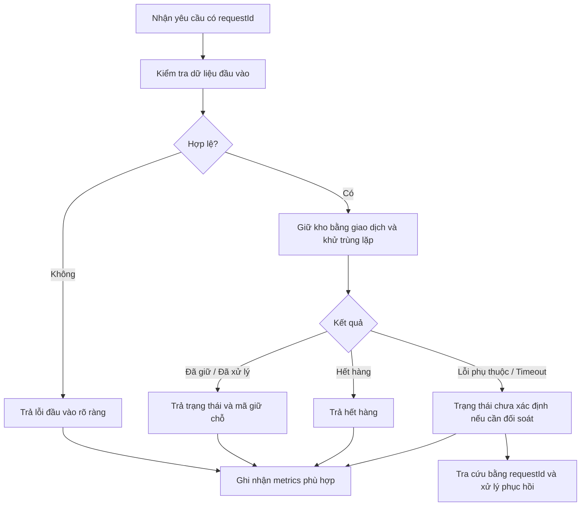

# Người đọc, người sửa và người vận hành cần gì từ mã nguồn?

## 1. Mã nguồn phục vụ nhiều người trong suốt vòng đời phần mềm

Khi viết một tính năng, lập trình viên thường tập trung vào câu hỏi: *"Chương trình có chạy đúng yêu cầu hiện tại không?"* Nhưng khi tính năng được bàn giao, câu hỏi thay đổi. Một người khác cần đọc để hiểu vì sao hệ thống hoạt động như vậy; người tiếp theo cần sửa khi quy tắc kinh doanh đổi; người trực vận hành phải giải thích vì sao yêu cầu của khách hàng thất bại lúc nửa đêm.

Trong module `CODE_QUALITY_FUNDAMENTALS`, mục tiêu là **hiểu những thuộc tính quyết định mã nguồn có đáng tin cậy, dễ hiểu và dễ thay đổi hay không**. Để đánh giá các thuộc tính đó, cần nhìn mã nguồn từ góc độ ít nhất ba nhóm công việc:

| Góc nhìn | Câu hỏi trung tâm | Giá trị mong đợi từ mã nguồn |
| --- | --- | --- |
| **Người đọc** | "Tôi có thể hiểu hệ thống đang làm gì và tại sao không?" | Ý định rõ ràng, cấu trúc dễ lần theo, hợp đồng và giả định được thể hiện |
| **Người sửa** | "Tôi có thể thay đổi hành vi cần thiết mà biết phạm vi ảnh hưởng không?" | Ranh giới trách nhiệm rõ, phụ thuộc kiểm soát được, kiểm thử đủ tin cậy |
| **Người vận hành** | "Khi chạy thật có vấn đề, tôi nhận biết, khoanh vùng và khôi phục ra sao?" | Tín hiệu quan sát hữu ích, lỗi có ý nghĩa, cơ chế phục hồi và triển khai an toàn |

Đây là **vai trò theo hoạt động**, không nhất thiết là ba chức danh riêng. Một lập trình viên có thể vừa đọc, sửa, triển khai và trực sự cố. Người kiểm thử, người review, người hỗ trợ khách hàng hay kỹ sư bảo mật cũng có những nhu cầu giao nhau với ba góc nhìn này.

Điểm quan trọng là: một đoạn mã chạy đúng trên máy tác giả **chưa chứng minh** rằng người khác hiểu đúng, có thể thay đổi an toàn, hoặc xử lý được sự cố khi phần mềm đi vào vận hành.

## 2. Người đọc cần hiểu ý định, hợp đồng và luồng xử lý

Người đọc có thể là người mới vào nhóm, người review pull request, người tìm nguyên nhân lỗi hoặc chính tác giả sau vài tháng. Họ không chỉ muốn biết *cú pháp đang làm gì*; họ cần xây dựng một mô hình đúng về **ý nghĩa** của đoạn mã.

### 2.1. Những câu hỏi người đọc phải trả lời được

- **Đoạn mã chịu trách nhiệm gì?** Điểm bắt đầu và điểm kết thúc của chức năng ở đâu?
- **Đầu vào hợp lệ là gì?** Trường nào bắt buộc, giá trị biên nào được chấp nhận?
- **Đầu ra và lỗi có ý nghĩa gì?** Khi hết hàng, timeout hoặc dữ liệu không tồn tại thì chuyện gì xảy ra?
- **Bất biến nào phải luôn đúng?** Chẳng hạn, tồn kho không được âm và cùng một mã yêu cầu không được trừ kho hai lần.
- **Nó phụ thuộc vào những gì?** Database, API, đồng hồ hệ thống, cấu hình, giao dịch hay tác dụng phụ nào?
- **Tại sao lại chọn cách này?** Có ràng buộc tương thích, nghiệp vụ hoặc vận hành nào không thể nhìn thấy qua cú pháp?

Các dấu hiệu giúp người đọc trả lời gồm tên gọi có nghĩa, hàm có mục đích rõ, kiểu dữ liệu phản ánh miền nghiệp vụ, dòng điều khiển đơn giản, quy ước nhất quán và ví dụ kiểm thử thể hiện trường hợp đặc biệt.

### 2.2. Tên gọi tốt giúp bộc lộ quy tắc

Xét hai đoạn xử lý giả định cùng một quy tắc:

```java
// Khó hiểu ý định: 30 là gì, false có nghĩa gì?
if (d > 30 && !f) {
    p = p * 0.9;
}
```

```java
// Dễ lần theo mục đích hơn:
boolean qualifiesForLoyaltyDiscount =
        membershipDays > MIN_MEMBERSHIP_DAYS_FOR_DISCOUNT
        && !hasActivePromotion;

if (qualifiesForLoyaltyDiscount) {
    discountedPrice = originalPrice.multiply(LOYALTY_DISCOUNT_FACTOR);
}
```

Ở phiên bản thứ hai, người đọc nhận ra quy tắc về số ngày thành viên và khuyến mãi. Đoạn mã chỉ mang tính minh họa cho **khả năng diễn đạt ý định**; trong hệ thống tính tiền thật cần định nghĩa cách làm tròn, độ chính xác, đồng tiền và kiểm chứng hằng số với quy tắc nghiệp vụ. Tên gọi tốt không tự bảo đảm thuật toán đúng.

Tên, kiểu và cấu trúc nên trả lời câu hỏi *"Đây là khái niệm gì?"* thay vì chỉ mô tả chi tiết máy móc. Ví dụ `remainingSeats`, `retryableFailure` hoặc `reservationStatus` cung cấp nhiều ngữ cảnh hơn `count`, `flag` hay `result`.

### 2.3. Bình luận giải thích lý do, không lặp lại câu lệnh

Bình luận như `// tăng biến i lên 1` hầu như không giúp hiểu hơn câu lệnh `i++`. Trong khi đó, bình luận **"Giữ trường JSON cũ vì ứng dụng di động phiên bản trước vẫn gửi tên này"** giải thích một ràng buộc quan trọng mà người sửa rất dễ vô tình phá vỡ.

Tài liệu hữu ích thường nằm gần nơi quyết định được áp dụng: hợp đồng ở public API, ví dụ ở test, lý do bất thường ở bình luận hoặc ghi chú quyết định kỹ thuật. Hạn chế tài liệu dài nhưng nhanh lỗi thời; nếu có sự khác nhau giữa tài liệu và hành vi thực tế, người đọc cần biết nguồn nào là chuẩn để kiểm chứng.

## 3. Người sửa cần giới hạn tác động và kiểm chứng thay đổi

Một người có thể hiểu mã nguồn hôm nay nhưng vẫn gặp khó khi sửa nó ngày mai. **Khả năng thay đổi (changeability/modifiability)** còn phụ thuộc vào việc các trách nhiệm có bị trộn lẫn không, các mô-đun có phụ thuộc chặt vào nhau không và kiểm thử có chỉ ra hành vi cần giữ nguyên không.

Ví dụ, một phương thức vừa kiểm tra đơn hàng, tính thuế, trừ kho, gửi email và ghi log sẽ buộc người sửa quy tắc thuế phải lần theo cả kho hàng, hệ thống email và cách xử lý lỗi. Điều đó làm phạm vi thay đổi khó dự đoán, nhất là khi test không cô lập được các phần.

### 3.1. Những đặc điểm giúp sửa mã an toàn

| Đặc điểm | Lợi ích khi sửa | Dấu hiệu cần chú ý |
| --- | --- | --- |
| **Một trách nhiệm rõ ràng** | Biết nơi cần thay đổi quy tắc | Một hàm xử lý nhiều nghiệp vụ không liên quan |
| **Ranh giới và hợp đồng ổn định** | Hạn chế tác động lên caller | Một sửa đổi trong nội bộ làm thay đổi API hoặc ý nghĩa lỗi |
| **Phụ thuộc thể hiện rõ** | Thay thế được thành phần khi kiểm thử | Gọi trực tiếp singleton, đọc biến toàn cục, tự tạo client ở mọi nơi |
| **Logic nghiệp vụ tách khỏi I/O** | Kiểm thử quy tắc nhanh, không cần hạ tầng thật | Mọi test đều phải khởi động database hoặc gọi mạng |
| **Bất biến được bảo vệ** | Giữ tính đúng đắn sau thay đổi | Nhiều đường ghi có thể bỏ qua validation |
| **Kiểm thử hành vi quan trọng** | Phát hiện hồi quy trong điều kiện thực tế | Chỉ có test đường đi thành công, thiếu giá trị biên |
| **Thay đổi nhỏ, review được** | Dễ nhận diện sai lệch và rollback | Một PR vừa đổi API, schema, tên biến và thuật toán |

Thiết kế tốt không nhất thiết có thật nhiều lớp hoặc interface. Nếu một hàm ngắn xử lý một quy tắc rõ ràng, tạo thêm nhiều lớp trừu tượng chỉ để "đúng mẫu thiết kế" có thể khiến người đọc phải nhảy tệp nhiều hơn mà chưa giảm rủi ro thay đổi. **Ranh giới phù hợp với nhu cầu thực tế** quan trọng hơn số lượng thành phần.

### 3.2. Khả năng thay đổi đòi hỏi hiểu hợp đồng đang được sử dụng

Một thay đổi có thể biên dịch được nhưng vẫn phá vỡ hành vi đã có. Chẳng hạn, API cũ trả danh sách rỗng khi không có dữ liệu; API mới ném ngoại lệ. Caller trước đây có thể coi danh sách rỗng là trường hợp nghiệp vụ bình thường.

Trước khi sửa, người phát triển cần biết:

1. **Hành vi nào phải giữ?** Bao gồm kết quả, điều kiện lỗi, thứ tự, định dạng dữ liệu, thời gian phản hồi nếu có cam kết.
2. **Ai đang phụ thuộc?** API client, job theo lịch, service khác, quy tắc vận hành hoặc báo cáo?
3. **Chỉ báo nào xác nhận thay đổi đúng?** Unit test, contract test, integration test, kiểm thử đồng thời, log và số liệu sau triển khai?
4. **Có đường quay lui không?** Bản cũ có đọc dữ liệu do bản mới tạo ra không?

Kiểm thử hữu ích phải mô tả hành vi, chứ không chỉ phản chiếu từng câu lệnh hiện tại. Một test được viết đúng theo một lỗi sai sẽ làm lỗi sai có vẻ "được bảo vệ".

## 4. Người vận hành cần thấy, hiểu và xử lý hành vi khi chạy thật

Hệ thống được vận hành trong điều kiện không thể kiểm soát hoàn toàn: lưu lượng tăng, dịch vụ đối tác chậm, mạng gián đoạn, cấu hình khác môi trường thử nghiệm, dữ liệu có lịch sử dài và triển khai có nhiều phiên bản chạy đồng thời.

**Khả năng vận hành (operability)** là mức độ hệ thống có thể được theo dõi, điều chỉnh, chẩn đoán và khôi phục khi cần. Nó chịu ảnh hưởng trực tiếp từ những quyết định trong mã nguồn: cách phân loại lỗi, cách đặt timeout, ranh giới giao dịch, sự kiện được ghi nhận và cách thay đổi cấu hình.

### 4.1. Người vận hành cần những câu trả lời nào?

| Câu hỏi khi có sự cố | Mã nguồn và hệ thống cần hỗ trợ như thế nào? |
| --- | --- |
| "Có sự cố thật không?" | Chỉ số lỗi, latency, tỷ lệ hoàn tất nghiệp vụ và cảnh báo có ngưỡng rõ |
| "Ảnh hưởng đến ai?" | Phân loại thao tác, nhóm endpoint, số lượng yêu cầu lỗi, tương quan theo thời gian |
| "Lỗi xuất phát ở đâu?" | Log có ngữ cảnh, trace qua thành phần, mã lỗi ổn định, phân biệt lỗi nghiệp vụ và lỗi hạ tầng |
| "Dữ liệu có bị sai không?" | Bất biến được kiểm tra, trạng thái giao dịch và cơ chế đối soát |
| "Có thể giảm tác động ngay không?" | Timeout hợp lý, giới hạn tài nguyên, feature flag hoặc cách giảm chức năng đã được thiết kế |
| "Có thể phục hồi an toàn không?" | Retry có điều kiện, thao tác lặp an toàn, quy trình khôi phục và rollback được kiểm chứng |
| "Làm sao biết đã hết lỗi?" | Tín hiệu phục hồi, dashboard, kiểm tra sau triển khai và tiêu chí đóng sự cố |

Nhật ký có ích cần ghi **đủ ngữ cảnh để tìm lại một thao tác** mà tránh để lộ mật khẩu, token, thông tin thẻ thanh toán và dữ liệu cá nhân không cần thiết. Ví dụ, `requestId`, mã lỗi và tên bước xử lý thường hữu ích hơn việc ghi toàn bộ payload đầu vào.

### 4.2. Lỗi phải có ý nghĩa rõ ràng

Xét ví dụ:

```java
try {
    reserveInventory(order);
} catch (Exception e) {
    return true; // Che giấu sự cố: bên gọi tưởng giữ kho thành công.
}
```

Người đọc không biết lỗi nào có thể xảy ra; người sửa khó xác định hợp đồng; người vận hành không thể truy vết sự cố; khách hàng có thể nhận xác nhận sai. Đây là một vấn đề chất lượng ảnh hưởng **cả ba góc nhìn**.

Hành vi phù hợp hơn cần phân biệt ít nhất: đầu vào không hợp lệ, kết quả nghiệp vụ (ví dụ hết hàng), lỗi phụ thuộc tạm thời và trạng thái chưa thể xác nhận. Không nên đổi mọi lỗi thành giá trị thành công, cũng không nên ném thông điệp nội bộ chứa thông tin nhạy cảm thẳng ra client.

Lưu ý rằng một `catch` có log không tự làm hệ thống đáng tin cậy. Nếu lỗi xảy ra sau khi hệ thống đã thay đổi dữ liệu nhưng trước lúc trả phản hồi, người vận hành còn cần biết thao tác đã hoàn tất hay chưa để tránh thực hiện lại gây tác dụng phụ trùng lặp.

## 5. Ví dụ xuyên suốt: chức năng giữ chỗ hàng tồn kho

Giả sử có một tính năng **giữ hàng để chuẩn bị đặt đơn**. Hợp đồng nghiệp vụ ở mức khái quát là: yêu cầu phải có mã hàng, số lượng dương và mã yêu cầu; hệ thống chỉ báo đã giữ hàng khi thao tác thật sự được xác nhận; cùng một yêu cầu không được trừ tồn kho hai lần; kết quả hết hàng phải được phân biệt với lỗi dịch vụ.

### 5.1. Phiên bản khiến cả ba nhóm gặp khó

```java
public boolean process(String x, int n) {
    try {
        return db.reserve(x, n);
    } catch (Exception e) {
        return false;
    }
}
```

Mã này ngắn nhưng giấu nhiều vấn đề:

- **Người đọc:** `process`, `x`, `n` và `false` không diễn đạt nghiệp vụ; không biết `false` là hết hàng, đầu vào sai hay database lỗi.
- **Người sửa:** không rõ điều kiện số lượng, quy tắc gọi lặp và transaction đang nằm ở đâu; sửa một đường gọi có thể làm trừ kho hai lần.
- **Người vận hành:** sự cố bị nuốt, không có thông tin để phân biệt hết hàng bình thường với database không sẵn sàng; hệ thống có thể đánh mất dấu vết để đối soát.

Đổi tên hàm sẽ giúp người đọc phần nào, nhưng **không đủ**. Cần làm rõ hợp đồng và hành vi lỗi từ ranh giới nghiệp vụ đến phần lưu trữ.

### 5.2. Biểu diễn hợp đồng rõ ràng hơn bằng Java

Ví dụ sau sử dụng Java 17 trở lên. Phần repository là **hợp đồng trừu tượng**; để đưa vào production cần một triển khai có giao dịch, kiểm soát đồng thời và lưu bền vững.

```java
import java.util.Objects;

enum ReservationStatus {
    RESERVED,
    OUT_OF_STOCK,
    ALREADY_PROCESSED
}

record ReservationResult(
        ReservationStatus status,
        String reservationId) {
}

interface InventoryRepository {
    // Phải bảo vệ tồn kho không âm và chống xử lý trùng requestId.
    ReservationResult reserveAtomically(
            String sku, int quantity, String requestId);
}

public final class ReservationService {
    private final InventoryRepository repository;

    public ReservationService(InventoryRepository repository) {
        this.repository = Objects.requireNonNull(repository);
    }

    public ReservationResult reserve(
            String sku, int quantity, String requestId) {

        if (sku == null || sku.isBlank()) {
            throw new IllegalArgumentException("Mã hàng không hợp lệ");
        }
        if (quantity <= 0) {
            throw new IllegalArgumentException("Số lượng phải dương");
        }
        if (requestId == null || requestId.isBlank()) {
            throw new IllegalArgumentException("Thiếu mã yêu cầu");
        }

        return repository.reserveAtomically(sku, quantity, requestId);
    }
}
```

Thay đổi cốt lõi nằm ở **ý nghĩa** của các thành phần: `reserve` nói rõ hành động; `ReservationStatus` phân biệt các kết quả nghiệp vụ; điều kiện đầu vào nằm ngay ở ranh giới; repository thể hiện yêu cầu giữ kho nguyên tử thay vì để service tự đọc số lượng rồi ghi lại một cách dễ xung đột.

Ví dụ này chưa chứng minh rằng tính nguyên tử hoặc tính lặp an toàn đã được thực hiện. Tên `reserveAtomically` là **một lời cam kết cần được kiểm thử ở lớp lưu trữ**. Chẳng hạn, triển khai có thể cần giao dịch, câu lệnh cập nhật có điều kiện, ràng buộc unique trên mã yêu cầu và quy tắc xử lý khi cùng một `requestId` được gửi với nội dung khác nhau.

### 5.3. Mỗi vai trò đọc ví dụ theo một cách khác

**Người đọc** có thể xác định ba điều kiện đầu vào và ba kết quả nghiệp vụ từ tên, kiểu dữ liệu và cấu trúc. Họ vẫn cần tài liệu nói rõ `ALREADY_PROCESSED` trả lại định danh giữ chỗ nào và ý nghĩa của `reservationId` khi hết hàng.

**Người sửa** có thể thay đổi quy tắc kiểm tra số lượng tại `ReservationService`, nhưng nếu sửa chính sách cấp phát kho thì phải kiểm tra cả giao dịch trong `InventoryRepository`. Một interface chỉ giúp phân tách trách nhiệm; nó không tự đảm bảo các bên hiểu hợp đồng giống nhau.

**Người vận hành** cần nhiều hơn kết quả Java: mã yêu cầu có thể truy vết, metrics cho tỷ lệ `OUT_OF_STOCK` so với lỗi phụ thuộc, thông tin đối soát khi timeout và quy trình retry an toàn. Đối với lỗi kết nối, timeout không chứng minh việc giữ kho đã thất bại; bên nhận có thể đã ghi dữ liệu nhưng phản hồi bị mất. Khi đó phải tra cứu kết quả bằng mã yêu cầu trước khi kết luận hoặc phát lại theo cơ chế khử trùng lặp đáng tin cậy.

### 5.4. Kiểm thử thể hiện hợp đồng cho người sửa

```java
import static org.junit.jupiter.api.Assertions.*;

import java.util.concurrent.atomic.AtomicBoolean;
import org.junit.jupiter.api.Test;

class ReservationServiceTest {
    @Test
    void rejectsInvalidQuantityBeforeCallingRepository() {
        AtomicBoolean wasCalled = new AtomicBoolean(false);
        InventoryRepository fakeRepository = (sku, qty, requestId) -> {
            wasCalled.set(true);
            return new ReservationResult(ReservationStatus.RESERVED, "res-1");
        };

        ReservationService service = new ReservationService(fakeRepository);

        assertThrows(IllegalArgumentException.class,
                () -> service.reserve("sku-1", 0, "req-1"));
        assertFalse(wasCalled.get());
    }
}
```

Test xác nhận rằng đầu vào không hợp lệ bị chặn **trước khi có tác dụng phụ**. Kiểm thử này không thể chứng minh kho không bị trừ âm hoặc thao tác không bị xử lý trùng khi có hai yêu cầu đồng thời. Những cam kết đó phải được kiểm thử ở lớp repository thật và ở ranh giới tích hợp, đặc biệt bằng các ca cạnh tranh và thử lại sau timeout.

### 5.5. Bổ sung tín hiệu vận hành ở ranh giới hệ thống

Luồng xử lý có thể tổ chức như sau:



Ranh giới HTTP hoặc message consumer cần chuyển đổi kết quả thành mã phản hồi và dữ liệu có hợp đồng ổn định. Nên ghi nhận metrics theo loại kết quả, đo thời gian xử lý, liên kết log/trace bằng `requestId` hoặc correlation ID, và không ghi tràn nội dung yêu cầu có dữ liệu nhạy cảm. Việc ghi log cũng cần tần suất và mức độ phù hợp để tránh quá tải hệ thống trong sự cố.

Không nên coi `OUT_OF_STOCK` là một lỗi hạ tầng chỉ vì không giữ được hàng. Trạng thái nghiệp vụ hợp lệ và sự cố vận hành khác nhau cả về cách cảnh báo lẫn phương án xử lý.

## 6. Những nhu cầu thường xung đột và cách đánh đổi

Một lựa chọn giúp một vai trò có thể tăng chi phí cho vai trò khác. Chất lượng mã nguồn không phải là tối đa hóa từng thuộc tính một cách độc lập.

| Tình huống | Lợi ích muốn đạt | Nguy cơ hoặc chi phí | Cách quyết định |
| --- | --- | --- | --- |
| Tách mọi thao tác thành nhiều lớp rất nhỏ | Dễ cô lập khi thay đổi | Người đọc phải lần qua quá nhiều tệp | Chỉ trừu tượng hóa ở ranh giới có trách nhiệm hoặc biến thể thật |
| Ghi log thật chi tiết | Dễ tìm nguyên nhân khi sự cố | Rò rỉ dữ liệu, chi phí lưu trữ, khó tìm tín hiệu | Ghi ngữ cảnh tối thiểu hữu ích, lọc dữ liệu nhạy cảm, lấy mẫu khi cần |
| Bắt tất cả ngoại lệ để trả mã ổn định | API trông đơn giản | Che giấu lỗi lập trình và đánh mất trạng thái thực | Phân loại lỗi, ánh xạ có chủ đích tại ranh giới, giữ ngữ cảnh nội bộ |
| Tối ưu hiệu năng sớm | Có thể giảm độ trễ | Code phức tạp, khó sửa mà chưa rõ nút thắt | Đo trước, cải thiện đường nóng có bằng chứng |
| Đổi public API cho "sạch" hơn | Dễ dùng ở phiên bản mới | Phá caller cũ và triển khai cuốn chiếu | Đặt lộ trình chuyển đổi, kiểm thử hợp đồng, có tiêu chí ngừng hỗ trợ |
| Viết lại cả module trước hạn phát hành | Cơ hội thiết kế nhất quán | Phạm vi kiểm chứng rộng, hồi quy khó phát hiện | Chia thành thay đổi nhỏ, ưu tiên tính đúng đắn và đường khôi phục |
| Thêm hệ thống giám sát phong phú | Tăng khả năng phát hiện sự cố | Tốn tài nguyên và công sức vận hành | Chọn tín hiệu gắn với tác động người dùng và hành động xử lý |

Ví dụ, yêu cầu "tối ưu mọi truy vấn" không nên được ưu tiên tự động hơn lỗi thanh toán trùng. Ngược lại, một tính năng thường xuyên bị chậm do truy vấn nặng có thể cần đo đạc, lập kế hoạch chỉ mục hoặc thay đổi kiến trúc, ngay cả khi code hiện tại rất dễ đọc. **Bối cảnh quyết định mức ưu tiên**, và ưu tiên cần được giải thích bằng rủi ro, bằng chứng và chi phí thực hiện.

## 7. Định nghĩa chất lượng bằng bằng chứng kiểm chứng được

Các nhận xét như "đọc khá dễ", "dễ bảo trì" hoặc "ổn định" có thể là điểm khởi đầu, nhưng cần chuyển thành câu hỏi có thể kiểm tra. Mỗi vai trò nên có ít nhất một dạng bằng chứng phù hợp:

| Vai trò | Bằng chứng có thể thu thập | Giới hạn cần nhớ |
| --- | --- | --- |
| Người đọc | Người review diễn giải đúng luồng và quy tắc; tên/hợp đồng rõ; tài liệu khớp test | Điểm số lint hoặc ít dòng code không chứng minh người khác hiểu đúng |
| Người sửa | Thay đổi một quy tắc trong phạm vi nhỏ; regression/contract test phát hiện sai lệch; mức độ phụ thuộc có thể kiểm soát | Nhiều unit test chưa chắc phủ được lỗi tích hợp hoặc đồng thời |
| Người vận hành | Truy vết được một yêu cầu; nhận biết tỷ lệ lỗi; đối soát trạng thái; khôi phục theo quy trình đã thử | Có dashboard nhưng không có chỉ số liên quan đến người dùng vẫn chưa đủ |

### Các lớp kiểm thử trả lời những câu hỏi khác nhau

- **Unit test:** logic và điều kiện biên trong một đơn vị nhỏ có đúng không?
- **Integration test:** giao dịch database, message queue hoặc phụ thuộc ngoài có tuân thủ hợp đồng không?
- **Contract test:** bên cung cấp và bên sử dụng API có cùng hiểu dữ liệu, mã lỗi và ý nghĩa hành vi không?
- **Concurrency/failure test:** khi có yêu cầu cùng lúc, timeout hoặc dừng tiến trình, bất biến và khả năng phục hồi có còn đúng không?
- **Kiểm tra sau triển khai:** chỉ số nghiệp vụ, lỗi và latency thực tế có nằm trong mức chấp nhận không?

Không phải phần mềm nào cũng cần mọi loại kiểm thử với quy mô như nhau. Hãy ưu tiên những tình huống mà thất bại có hậu quả lớn, khó phát hiện hoặc khó khôi phục. Một test xác nhận "hàm trả `true`" có thể ít giá trị hơn test xác nhận "không thể giữ cùng một món hàng vượt quá tồn kho dưới hai yêu cầu đồng thời".

### Chỉ số vận hành cần có định nghĩa rõ

Một hệ thống có thể có nhiều phản hồi HTTP 200 nhưng vẫn trả kết quả nghiệp vụ sai. Vì vậy, chỉ số nên gắn với hành vi quan trọng: tỷ lệ đặt đơn được xác nhận đúng, tỷ lệ timeout, số yêu cầu tồn ở trạng thái chờ đối soát, số lần retry hoặc độ trễ ở phân vị phù hợp. Các mục tiêu dịch vụ (**SLO**) cần quy định cửa sổ đo, mẫu số, trường hợp loại trừ và ngưỡng chấp nhận. Không nên coi một kết quả "hết hàng" đúng nghiệp vụ là cùng loại với lỗi không kết nối được database.

## 8. Quy trình đọc, sửa và triển khai một thay đổi thực tế

Giả sử nhóm yêu cầu bổ sung quy tắc: "Không giữ hàng vượt quá giới hạn mỗi khách". Để thay đổi an toàn, ba góc nhìn cần được kết nối thành một luồng công việc:

1. **Đọc hợp đồng hiện tại:** xác định khi nào được giữ kho, lỗi nào đã có, nơi nào tạo và kiểm tra mã yêu cầu.
2. **Làm rõ quy tắc mới:** giới hạn là theo khách, theo đơn hay trong một khoảng thời gian? Nếu đạt giới hạn, trả kết quả gì? Lỗi này khác hết hàng thế nào?
3. **Xác định ranh giới lưu dữ liệu:** cần kiểm tra giới hạn ở transaction hay chỉ ở lớp Java? Hai yêu cầu đồng thời có vượt được giới hạn không?
4. **Đặt kiểm thử hồi quy:** giữ nguyên hành vi cũ và thêm ca giá trị biên, gọi lặp, xung đột đồng thời, kết nối lỗi.
5. **Triển khai thay đổi có phạm vi rõ:** đặt quy tắc mới ở nơi chịu trách nhiệm; cập nhật hợp đồng nếu có trạng thái mới; không đổi định dạng với client cũ khi chưa có lộ trình chuyển tiếp.
6. **Bổ sung khả năng quan sát:** phân biệt `LIMIT_REACHED`, `OUT_OF_STOCK` và lỗi hạ tầng; cập nhật metrics, dashboard hay runbook khi ảnh hưởng vận hành.
7. **Review theo ba góc nhìn:** reviewer hiểu ý nghĩa không, test bảo vệ bất biến không, người trực sự cố có tra cứu và phục hồi được không?
8. **Phát hành và theo dõi:** triển khai từng bước nếu cần; xác nhận tỷ lệ lỗi và kết quả nghiệp vụ; có kế hoạch rollback hoặc vô hiệu hóa tính năng phù hợp.

Không nên giữ "hợp đồng trong đầu" của một cá nhân. Khi quy tắc mới đã được xác nhận, hãy để tên, kiểu dữ liệu, test, tài liệu và tín hiệu vận hành thể hiện cùng một cách hiểu.

## 9. Các dấu hiệu cảnh báo chất lượng thấp

| Dấu hiệu trong mã nguồn | Người đọc bị ảnh hưởng | Người sửa bị ảnh hưởng | Người vận hành bị ảnh hưởng |
| --- | --- | --- | --- |
| Tên biến mơ hồ, số kỳ diệu | Không biết ý nghĩa quy tắc | Dễ thay đổi nhầm điều kiện | Khó giải thích vì sao kết quả bất thường |
| Hàm dài trộn nghiệp vụ và I/O | Khó lần theo luồng | Phải sửa nhiều trách nhiệm cùng lúc | Không rõ bước nào đã hoàn tất khi lỗi |
| `catch (Exception)` rồi trả mặc định | Không biết lỗi nào có thể xảy ra | Test có thể bỏ sót thất bại | Che giấu sự cố, đối soát khó |
| Phụ thuộc ẩn, đọc cấu hình ở nhiều nơi | Không biết nguồn dữ liệu thực | Test khó cô lập, thay đổi lan rộng | Khó tái hiện chênh lệch môi trường |
| Thiếu test trường hợp biên | Không thấy hợp đồng lỗi | Hồi quy khó phát hiện | Lỗi chỉ xuất hiện khi chạy thật |
| Thiếu mã tương quan và metrics | Luồng qua hệ thống khó nhận biết | Không biết tác động sau sửa | Khó khoanh vùng và khôi phục |
| Phá hợp đồng khi nâng phiên bản | Ý nghĩa API trở nên mâu thuẫn | Nhiều caller cũ hỏng | Rollout và rollback tiềm ẩn gián đoạn |

Một dấu hiệu riêng lẻ không đủ để kết luận một module "kém chất lượng". Ví dụ, hàm dài có thể vẫn rõ ràng nếu thuật toán tuần tự và dễ theo dõi; một số hệ thống nhỏ chưa cần tracing phân tán. Cần xem tần suất thay đổi, hệ quả khi sai, quy mô, điều kiện vận hành và phản hồi từ những người thực sự sử dụng mã.

## 10. Câu hỏi tự đánh giá

**Tình huống 1 — Người đọc.** Một phương thức tên `update` nhận năm tham số kiểu `String`, trả `boolean` và có nhiều nhánh điều kiện. Bạn chưa biết `false` có nghĩa gì. Hãy liệt kê ít nhất ba câu hỏi cần hỏi trước khi sửa và đề xuất cách biểu diễn đầu vào, kết quả rõ hơn mà không tự làm thay đổi hợp đồng đang dùng.

**Tình huống 2 — Người sửa.** Một yêu cầu mới làm thay đổi cách tính giá. Hiện hàm tính giá gọi database và gửi email ngay bên trong. Bạn cần chia trách nhiệm như thế nào để có thể kiểm thử logic tính giá độc lập? Những kiểm thử tích hợp nào vẫn phải giữ?

**Tình huống 3 — Người vận hành.** Lúc 2 giờ sáng, tỷ lệ lỗi của API tạo đơn tăng, nhưng log chỉ ghi "operation failed". Hãy xác định ít nhất bốn tín hiệu hoặc cơ chế giúp phân biệt đầu vào sai, hết hàng, timeout và lỗi database; nêu cách ghi ngữ cảnh mà không lộ dữ liệu nhạy cảm.

**Tình huống 4 — Cả ba góc nhìn.** Một lập trình viên đề xuất đổi API đang trả `null` khi không tìm thấy thành ném exception để "mã sạch hơn". Hãy phân tích khả năng phá vỡ hành vi của caller cũ, phương án chuyển đổi, bộ kiểm thử cần thiết và những điều người vận hành phải biết khi triển khai.

Với mỗi tình huống, một câu trả lời tốt phải nói rõ **hợp đồng hiện tại**, **nguy cơ khi thay đổi**, **cách kiểm chứng** và **tác động lên những người sẽ làm việc với mã sau đó**.

## 11. Ghi nhớ

Mã nguồn chất lượng cao là mã giúp **người đọc hiểu đúng**, **người sửa thay đổi có kiểm soát** và **người vận hành nhận biết, xử lý, phục hồi khi có sự cố**. Ba nhu cầu này hỗ trợ lẫn nhau: hợp đồng rõ giúp viết test đúng; test tin cậy giúp sửa an toàn; ranh giới lỗi và trạng thái rõ giúp vận hành chẩn đoán nhanh; dữ liệu vận hành lại cho nhóm biết điểm nào cần cải thiện.

Khi đánh giá một thay đổi, đừng chỉ hỏi "code có chạy không?". Hãy hỏi thêm: **người kế tiếp có hiểu hành vi và lý do không; có kiểm chứng được khi sửa không; và khi chạy thật có đủ cơ sở để phát hiện, giới hạn tác động, khôi phục hay không?** Đó là cách liên kết khả năng hiểu, khả năng thay đổi và độ tin cậy thành chất lượng thực tế của phần mềm.
