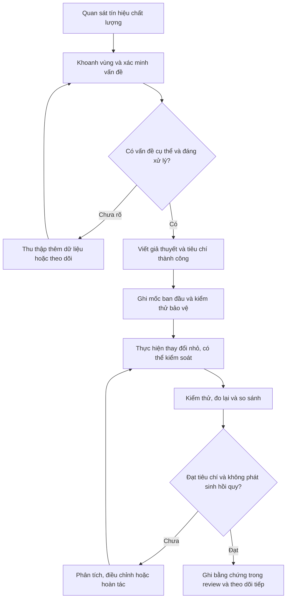

# Lộ trình từ nhận diện vấn đề đến cải thiện có bằng chứng

Một đoạn mã có thể chạy đúng hôm nay nhưng vẫn gây khó khăn cho những lần thay đổi tiếp theo: sửa một quy tắc phải đụng đến nhiều nơi, lỗi cũ liên tục xuất hiện lại, hoặc mỗi lần sửa đều mất nhiều thời gian để kiểm tra. Ngược lại, một đoạn mã trông dài chưa chắc là vấn đề cần xử lý ngay nếu nó ổn định, dễ kiểm chứng và hiếm khi thay đổi.

Trong **nhập môn chất lượng mã nguồn (Code Quality Fundamentals)**, cải thiện chất lượng là một quá trình có chủ đích: **nhận diện tín hiệu → xác minh vấn đề → thiết lập mốc ban đầu → chọn thay đổi phù hợp → kiểm chứng kết quả → lưu lại bằng chứng**. Mục tiêu là làm cho hệ thống dễ hiểu, dễ thay đổi và đáng tin cậy hơn trong bối cảnh thực tế, thay vì chỉ làm cho mã “đẹp” hơn theo cảm nhận cá nhân.

## 1. Xác định “chất lượng” theo tác động cần cải thiện

Chất lượng mã nguồn có nhiều chiều, và mỗi chiều cần loại bằng chứng phù hợp:

| Chiều chất lượng | Câu hỏi cần trả lời | Bằng chứng có thể sử dụng |
| --- | --- | --- |
| **Tính đúng đắn** (*correctness*) | Chức năng có cho kết quả đúng, kể cả ở trường hợp biên? | Kiểm thử hành vi, lỗi tái hiện được, điều kiện nghiệm thu |
| **Dễ bảo trì** (*maintainability*) | Có thể hiểu và thay đổi một quy tắc mà ít gây ảnh hưởng dây chuyền? | Phạm vi thay đổi, số vị trí chứa cùng một quy tắc, phản hồi review, lịch sử lỗi khi sửa |
| **Dễ kiểm thử** (*testability*) | Có thể kiểm tra kết quả một cách độc lập, ổn định? | Kiểm thử tự động, khả năng cô lập thành phần, tỉ lệ kiểm thử không ổn định |
| **Hiệu năng** (*performance*) | Chương trình có đạt yêu cầu về thời gian và tài nguyên? | Thời gian đáp ứng, thông lượng, bộ nhớ, số truy vấn với cùng khối lượng công việc |
| **Độ tin cậy** (*reliability*) | Hệ thống có hoạt động ổn định khi gặp lỗi hoặc tải thực tế? | Sự cố, tần suất lỗi, thời gian phục hồi, thử nghiệm các đường lỗi |
| **An toàn** (*security*) | Dữ liệu và thao tác có được xử lý theo các ràng buộc an toàn? | Kiểm tra quyền truy cập, kiểm thử đầu vào bất thường, phân tích bảo mật, đánh giá rủi ro |

Không một con số đơn lẻ nào đại diện đầy đủ cho chất lượng. Ví dụ, **độ bao phủ kiểm thử cao** không đảm bảo rằng các phép kiểm thử đã kiểm tra đúng yêu cầu; **độ phức tạp cao** là tín hiệu cần xem xét chứ chưa tự động chứng minh có lỗi. Trước khi sửa, hãy xác định tác động nào đang gây chi phí hoặc rủi ro cho người dùng và nhóm phát triển.

## 2. Bản đồ quy trình từ phát hiện đến xác nhận



Các bước tạo thành một vòng lặp. Khi kết quả không đạt, nhóm cần xem lại giả thuyết hoặc cách đo; không nên tiếp tục sửa chỉ vì đã đầu tư công sức vào giải pháp đầu tiên.

## 3. Bước 1 — Nhận diện tín hiệu và xác minh vấn đề

Tín hiệu ban đầu có thể đến từ báo lỗi, phản hồi của người sử dụng, nhận xét trong code review, kiểm thử tự động, công cụ phân tích tĩnh hoặc khó khăn lặp lại khi bảo trì. Hãy phân biệt **tín hiệu** với **vấn đề đã được xác minh**:

| Tín hiệu quan sát | Cần xác minh điều gì? | Ví dụ tác động đủ cụ thể |
| --- | --- | --- |
| Một quy tắc nghiệp vụ xuất hiện ở nhiều nơi | Các bản sao có thể sai khác khi thay đổi không? | Cập nhật mức phí ở một hàm nhưng bỏ sót hàm khác |
| Một phương thức dài và nhiều nhánh | Những nhánh nào khó hiểu, dễ bỏ sót hoặc không có kiểm thử? | Sửa một trường hợp làm sai trường hợp khác |
| Một kiểm thử thỉnh thoảng thất bại | Có phụ thuộc thời gian, thứ tự chạy, dữ liệu hoặc môi trường? | CI báo lỗi không ổn định, làm giảm độ tin cậy của cảnh báo |
| Một API có thời gian phản hồi cao | Chậm ở đường đi nào, trên bộ dữ liệu và tải nào? | Thời gian đáp ứng vượt mục tiêu đã thống nhất |
| Nhiều cảnh báo từ công cụ phân tích | Cảnh báo nào liên quan đến rủi ro thực tế? | Đầu vào không hợp lệ đi vào đường xử lý quan trọng |

Một cách mô tả vấn đề tốt gồm ba phần: **ngữ cảnh**, **hiện tượng tái hiện được** và **tác động**. Chẳng hạn:

> Trong chức năng tính phí vận chuyển, cùng một ngưỡng khối lượng được kiểm tra ở hai nhánh. Khi điều chỉnh bảng phí, người sửa phải đồng bộ nhiều giá trị; việc bỏ sót một nhánh có thể khiến hai loại giao hàng xử lý không nhất quán.

Câu trên nêu được rủi ro cụ thể. Câu “đoạn mã này xấu, cần refactor” không cho biết điều gì cần kiểm chứng sau khi sửa.

**Câu hỏi trước khi hành động:** Vấn đề xuất hiện trong trường hợp nào? Có thể tái hiện hoặc chỉ ra bằng dữ liệu nào? Ai hoặc bước công việc nào bị ảnh hưởng? Nếu chưa có bằng chứng đủ mạnh, có thể ghi nhận và quan sát thêm thay vì vội thay đổi.

## 4. Bước 2 — Đặt giả thuyết, giới hạn phạm vi và ưu tiên

Một giả thuyết cải thiện cần liên hệ thay đổi dự kiến với kết quả có thể quan sát:

> **Nếu** đưa ngưỡng khối lượng và mức giảm giá thành các hằng số có tên, đồng thời tách cách tính phí cơ bản, **thì** người bảo trì sẽ nhận diện và điều chỉnh quy tắc tại ít vị trí hơn, **trong khi** kết quả tính phí cho các tổ hợp đầu vào vẫn giữ nguyên.

Đặt điều kiện thành công **trước** khi sửa:

1. Tất cả tổ hợp giao hàng thường/nhanh, hàng nhẹ/nặng và có/không là thành viên cho ra phí như trước.
2. Đầu vào khối lượng không hợp lệ vẫn bị từ chối.
3. Ngưỡng tính phí được định nghĩa ở một nơi có tên rõ nghĩa.
4. Không thay đổi giao diện hàm hoặc quy tắc nghiệp vụ ngoài phạm vi đã chọn.

Khi có nhiều vấn đề, ưu tiên theo **mức tác động × khả năng xảy ra**, rồi cân nhắc chi phí sửa, độ chắc chắn của bằng chứng và khả năng kiểm soát rủi ro. Không nhất thiết phải áp dụng một công thức chấm điểm cố định.

| Tình huống | Hướng ưu tiên |
| --- | --- |
| Lỗi chức năng đã tái hiện, ảnh hưởng người dùng | Ưu tiên cao; sửa lỗi và bổ sung kiểm thử hồi quy |
| Quy tắc trùng lặp tại điểm thường xuyên thay đổi | Ưu tiên khi có kế hoạch thay đổi liên quan; gom trách nhiệm và kiểm tra hành vi |
| Một phương thức khó hiểu nhưng ổn định, ít được chạm tới | Ghi nhận, cân nhắc sửa khi có nhu cầu thực tế hoặc rủi ro tăng |
| Chỉ có tranh luận về cách đặt tên hoặc sở thích định dạng | Dựa vào quy ước nhóm và công cụ định dạng; tránh mở rộng phạm vi thay đổi |

Nếu đang xử lý một lỗi sản xuất, cần xác định cách phục hồi nhanh và cách kiểm chứng sửa lỗi. Nếu đang **refactor** (thay đổi cấu trúc nhưng giữ nguyên hành vi quan sát được), cần có kiểm thử bảo vệ hành vi. Trộn refactor với thay đổi nghiệp vụ trong cùng một lần sửa sẽ làm khó xác định nguyên nhân khi có sai lệch.

## 5. Bước 3 — Thiết lập mốc ban đầu (*baseline*)

Baseline là tình trạng **trước khi sửa**, được ghi bằng cùng tiêu chí mà bạn dự định dùng sau khi sửa. Nếu không có baseline, câu “đã cải thiện nhiều” rất khó kiểm chứng.

Với từng giả thuyết, chỉ chọn phép đo đủ để trả lời câu hỏi đang xét:

| Mục tiêu | Trước khi sửa nên lưu | Sau khi sửa cần so sánh |
| --- | --- | --- |
| Bảo toàn hành vi | Các trường hợp kiểm thử, đầu vào/đầu ra mong đợi, lỗi đã tái hiện | Cùng tập trường hợp đều đạt; lỗi được ngăn tái diễn |
| Giảm phân tán quy tắc | Những vị trí cùng chứa một quy tắc hoặc hằng số | Quy tắc có điểm quản lý rõ ràng, không còn bản sao gây rủi ro |
| Giảm lỗi phát sinh từ thay đổi | Những loại lỗi từng xảy ra và cách tái hiện | Kiểm thử hồi quy bảo vệ đúng loại lỗi đó; tiếp tục theo dõi sau khi tích hợp |
| Cải thiện hiệu năng | Dữ liệu đầu vào, môi trường, phiên bản, số lần chạy, phân bố thời gian | Đo lại bằng điều kiện tương đương; xem cả độ biến thiên, không chỉ giá trị trung bình |

Với thời gian đáp ứng, số liệu p50/p95 hoặc phân bố các lần chạy thường hữu ích hơn một số đo đơn lẻ. Với khả năng bảo trì, nhận xét của người review và độ tập trung của quy tắc có thể hỗ trợ lập luận, nhưng những chỉ số như số dòng mã hoặc thời gian hoàn thành PR còn bị ảnh hưởng bởi quy mô công việc, con người và môi trường. **Ghi rõ hạn chế của phép đo** thay vì coi tương quan là quan hệ nhân quả.

## 6. Bước 4 — Thay đổi nhỏ, có kiểm thử bảo vệ: ví dụ Java

Xét một **tình huống minh họa giả định**: phí vận chuyển phụ thuộc vào khối lượng, hình thức giao hàng và tư cách thành viên. Quy tắc được dùng trong ví dụ:

- Hàng có khối lượng tối đa 1.000 g: giao thường 15.000 đồng, giao nhanh 30.000 đồng.
- Hàng trên 1.000 g: giao thường 25.000 đồng, giao nhanh 45.000 đồng.
- Thành viên được giảm 5.000 đồng, bất kể loại giao hàng.
- Khối lượng không dương là đầu vào không hợp lệ.

### 6.1. Mã trước khi cải thiện

```java
public class ShippingFeeCalculator {
    public int shippingFee(int weightGrams, boolean express, boolean member) {
        if (weightGrams <= 0) {
            throw new IllegalArgumentException("weightGrams must be positive");
        }

        int fee;
        if (express) {
            if (weightGrams > 1000) {
                fee = 45000;
            } else {
                fee = 30000;
            }
        } else {
            if (weightGrams > 1000) {
                fee = 25000;
            } else {
                fee = 15000;
            }
        }

        if (member) {
            fee -= 5000;
        }
        return fee;
    }
}
```

Đoạn mã trên vẫn cho ra kết quả đúng theo quy tắc minh họa. Tuy nhiên, điều kiện `weightGrams > 1000` lặp lại; các giá trị số không giải thích vai trò; hai nhóm quyết định phí bị lồng vào nhau. Đây là **ứng viên cải thiện khả năng bảo trì**, chưa phải bằng chứng có lỗi chức năng.

### 6.2. Kiểm thử ghi nhận hành vi trước khi sửa

Ví dụ sử dụng JUnit 5. Tập kiểm thử bao phủ tám tổ hợp chính và một trường hợp đầu vào không hợp lệ:

```java
import static org.junit.jupiter.api.Assertions.assertEquals;
import static org.junit.jupiter.api.Assertions.assertThrows;

import org.junit.jupiter.api.Test;
import org.junit.jupiter.params.ParameterizedTest;
import org.junit.jupiter.params.provider.CsvSource;

class ShippingFeeCalculatorTest {
    private final ShippingFeeCalculator calculator = new ShippingFeeCalculator();

    @ParameterizedTest
    @CsvSource({
        "1000, false, false, 15000",
        "1000, false, true, 10000",
        "1001, false, false, 25000",
        "1001, false, true, 20000",
        "1000, true, false, 30000",
        "1000, true, true, 25000",
        "1001, true, false, 45000",
        "1001, true, true, 40000"
    })
    void keepsShippingFeePolicy(
            int weightGrams, boolean express, boolean member, int expected) {
        assertEquals(expected, calculator.shippingFee(weightGrams, express, member));
    }

    @Test
    void rejectsNonPositiveWeight() {
        assertThrows(IllegalArgumentException.class,
                () -> calculator.shippingFee(0, false, false));
    }
}
```

Kiểm tra tại **1.000 g** và **1.001 g** làm rõ ranh giới `>`; đây là nơi dễ vô tình đổi nghĩa thành `>=`. Đối với mã thực tế, cần bổ sung các biên và bất biến liên quan đến yêu cầu thật (chẳng hạn giới hạn khối lượng, tiền tệ, làm tròn, dữ liệu ngoại lệ). Tập kiểm thử trên chứng minh các trường hợp được nêu, không chứng minh mọi đầu vào có thể có.

### 6.3. Mã sau khi cải thiện

```java
public class ShippingFeeCalculator {
    private static final int HEAVY_WEIGHT_THRESHOLD_GRAMS = 1_000;
    private static final int MEMBER_DISCOUNT_VND = 5_000;

    public int shippingFee(int weightGrams, boolean express, boolean member) {
        if (weightGrams <= 0) {
            throw new IllegalArgumentException("weightGrams must be positive");
        }

        boolean heavy = weightGrams > HEAVY_WEIGHT_THRESHOLD_GRAMS;
        int baseFee = baseFee(heavy, express);
        return member ? baseFee - MEMBER_DISCOUNT_VND : baseFee;
    }

    private int baseFee(boolean heavy, boolean express) {
        if (express) {
            return heavy ? 45_000 : 30_000;
        }
        return heavy ? 25_000 : 15_000;
    }
}
```

Thay đổi này làm rõ hai khái niệm *ngưỡng khối lượng* và *giảm giá thành viên*, đồng thời tách việc chọn mức phí cơ bản khỏi áp dụng giảm giá. Giao diện `shippingFee(...)` và quy tắc đầu ra được giữ nguyên. Bốn mức phí vẫn là các giá trị cấu hình trực tiếp trong phương thức `baseFee`; nếu có nhu cầu cập nhật thường xuyên hoặc nhiều nơi cùng sử dụng bảng phí, bước cải thiện tiếp theo có thể là đưa chúng vào một cấu trúc chính sách có tên. Không cần thiết kế thêm cấu trúc đó khi chưa có nhu cầu rõ ràng.

**Trình tự thực hành:** chạy bộ kiểm thử với phiên bản cũ để xác nhận baseline → áp dụng refactor nhỏ → chạy lại đúng bộ kiểm thử → review diff để phát hiện thay đổi ngoài phạm vi. Nếu kiểm thử báo khác biệt, hãy điều tra hoặc hoàn tác trước khi tiếp tục. Hai đoạn mã và bộ kiểm thử ở đây là ví dụ để học cách lập bằng chứng; không phải báo cáo về một lần chạy thực tế.

## 7. Bước 5 — Đánh giá kết quả bằng bằng chứng phù hợp

Sau khi thay đổi, cần trả lời cả hai câu hỏi: **Hành vi có còn đúng không?** và **vấn đề chất lượng đã chọn có thực sự giảm không?** Một bảng đánh giá cho ví dụ trên có thể chuẩn bị như sau:

| Tiêu chí | Baseline (mã trước) | Kỳ vọng sau refactor | Cách xác nhận |
| --- | --- | --- | --- |
| Hành vi tính phí | Tám tổ hợp đầu vào theo quy tắc minh họa | Cả tám kết quả giữ nguyên | Chạy kiểm thử tham số hóa trước và sau |
| Kiểm tra đầu vào | `weightGrams <= 0` ném ngoại lệ | Không thay đổi | Chạy kiểm thử ngoại lệ và bổ sung biên nếu cần |
| Định nghĩa ngưỡng | Số `1000` xuất hiện ở hai nhánh | Một hằng số có tên và một phép so sánh | Đọc diff, kiểm tra số vị trí định nghĩa quy tắc |
| Cách tổ chức logic | Chọn phí và giảm giá nằm trong cùng một luồng lồng nhánh | Tách rõ phí cơ bản và giảm giá | Review khả năng đọc hiểu và thay đổi |
| Tác động ngoài phạm vi | Không dự kiến thay đổi API | Chữ ký công khai giữ nguyên | So sánh interface và nơi gọi liên quan |

Đây là **tiêu chí kiểm chứng**, chưa phải kết quả đo của một dự án. Khi thực hiện thật, ghi kết quả chạy (thời điểm, commit, môi trường, báo cáo kiểm thử nếu có) vào PR hoặc nhật ký thay đổi. Nếu mục tiêu là hiệu năng, nên so sánh trên cùng thiết bị, cấu hình, dữ liệu và tải; đo nhiều lần, đồng thời kiểm tra sử dụng tài nguyên và các trường hợp biên. Đừng kết luận “nhanh hơn 20%” khi chưa có kết quả đo lặp lại đủ tin cậy.

Một cải thiện được chấp nhận khi:

1. Bằng chứng sau thay đổi đáp ứng tiêu chí đã đặt trước.
2. Các kiểm thử hồi quy và kiểm tra liên quan đều đạt.
3. Không có thay đổi nghiệp vụ hoặc ảnh hưởng phụ không được giải thích.
4. Người review có thể hiểu vấn đề, phạm vi sửa và lý do tin rằng rủi ro đã giảm.

Nếu chỉ giảm được số dòng mã nhưng tạo ra tên khó hiểu, che giấu trách nhiệm hoặc làm khó kiểm thử, mục tiêu chất lượng có thể chưa đạt. Đánh giá phải trở lại vấn đề ban đầu, thay vì chạy theo một con số thuận tiện.

## 8. Bước 6 — Ghi lại quyết định, chia sẻ và theo dõi

Một pull request hoặc ghi chú thay đổi nên đủ thông tin để người không tham gia từ đầu vẫn kiểm tra được lập luận. Mẫu ngắn dưới đây có thể sử dụng:

```text
Vấn đề:
- Tín hiệu và tác động quan sát được là gì?

Giả thuyết:
- Thay đổi nào dự kiến giải quyết được nguyên nhân nào?

Baseline:
- Trường hợp tái hiện, phép đo và điều kiện đo trước khi sửa.

Thay đổi:
- Những phần nào đã sửa; phạm vi nào được giữ nguyên?

Bằng chứng sau thay đổi:
- Kết quả kiểm thử/đo, so sánh với baseline, liên kết báo cáo.

Rủi ro và theo dõi:
- Điều gì còn chưa được chứng minh; cần quan sát gì sau khi tích hợp?
```

Sau khi tích hợp, tiếp tục theo dõi đúng loại tín hiệu từng dẫn đến thay đổi. Ví dụ, với lỗi tái diễn, kiểm tra xem lỗi có xuất hiện lại ở các phiên bản sau; với thay đổi hiệu năng, xem số liệu trong tải thực tế. Sự cải thiện bền vững cần một vòng phản hồi, không dừng ở thời điểm PR được chấp nhận.

## 9. Những sai lầm thường gặp

| Sai lầm | Vì sao rủi ro | Cách xử lý |
| --- | --- | --- |
| Refactor mọi nơi có “code smell” | Tốn công nhưng không chứng minh được tác động | Khoanh vùng theo tần suất thay đổi, lỗi và chi phí bảo trì |
| Viết kiểm thử sau khi đã đổi hành vi | Dễ vô thức kiểm tra hành vi mới thay vì hành vi cần giữ | Ghi lại yêu cầu, test và baseline trước khi refactor |
| Dùng coverage hoặc số dòng mã làm mục tiêu duy nhất | Có thể tối ưu chỉ số mà không nâng chất lượng | Ghép chỉ số với trường hợp nghiệp vụ và review chất lượng kiểm thử |
| Thay nhiều thứ cùng lúc | Khó truy nguyên khi kết quả khác đi | Chia thay đổi nhỏ, có điểm kiểm chứng giữa các bước |
| Đo trước và sau ở hai điều kiện khác nhau | So sánh dễ sai lệch | Giữ điều kiện tương đương, lưu môi trường và khối lượng mẫu |
| Tuyên bố thành công chỉ vì CI xanh | CI chỉ kiểm tra những điều đã được cấu hình để kiểm tra | Đối chiếu thêm với mục tiêu, rủi ro và phản hồi thực tế |
| Không lưu kết quả hoặc giả định | Người khác không thể tái kiểm chứng | Ghi ngắn gọn phương pháp, kết quả, hạn chế trong PR |

## 10. Bài tập vận dụng

**Tình huống:** Một phương thức xử lý đơn hàng dài khoảng 180 dòng, có nhiều điều kiện lồng nhau. Công cụ phân tích đánh dấu độ phức tạp cao. Nhóm dự kiến bổ sung một loại khuyến mãi trong tuần tới.

Hãy thử trả lời bốn câu hỏi trước khi viết mã:

1. Dấu hiệu nào đã biết, và cần thu thập thêm bằng chứng gì để xác định rủi ro khi thêm khuyến mãi?
2. Hành vi nào cần được khóa bằng kiểm thử trước khi sửa cấu trúc (ví dụ: đơn không có khuyến mãi, điều kiện biên, quy tắc kết hợp giảm giá)?
3. Thay đổi nhỏ đầu tiên là gì để cô lập phần tính khuyến mãi mà không làm đổi kết quả hiện tại?
4. Sau khi sửa, bằng chứng nào đủ để khẳng định việc bổ sung khuyến mãi an toàn và dễ kiểm tra hơn?

**Hướng tự đối chiếu:** Một câu trả lời tốt không kết luận “180 dòng là sai” chỉ từ số dòng. Nó chỉ rõ đường đi nghiệp vụ sắp thay đổi, thu thập ví dụ đầu vào/đầu ra, xác định các quy tắc dễ va chạm, viết kiểm thử bảo vệ, thực hiện từng thay đổi nhỏ và báo cáo kết quả kiểm tra trên cùng một bộ trường hợp. Công cụ phân tích giúp xác định nơi cần xem xét, còn kết luận phải dựa vào rủi ro và bằng chứng trong bối cảnh cụ thể.

## 11. Ghi nhớ khi bắt đầu cải thiện chất lượng mã

- **Nêu vấn đề bằng tác động**, không chỉ bằng sở thích hoặc tên một “code smell”.
- **Đặt tiêu chí trước khi sửa** để có cách kiểm chứng thành công hoặc thất bại.
- **Bảo vệ hành vi hiện tại** bằng các trường hợp kiểm thử có ý nghĩa trước khi refactor.
- **Sửa với phạm vi nhỏ** để dễ review, đối chiếu và hoàn tác khi cần.
- **Đo lại trong điều kiện tương đương**, công khai giới hạn của bằng chứng.
- **Lưu kết quả và tiếp tục theo dõi** để cải thiện có thể được người khác kiểm tra và duy trì.

Chất lượng mã nguồn được cải thiện đáng tin cậy khi nhóm có thể trả lời một chuỗi câu hỏi rõ ràng: *Vấn đề thực sự là gì? Vì sao sửa theo cách này? Trước khi sửa tình trạng ra sao? Sau khi sửa điều gì đã thay đổi, điều gì được giữ nguyên, và bằng chứng nào xác nhận điều đó?*
