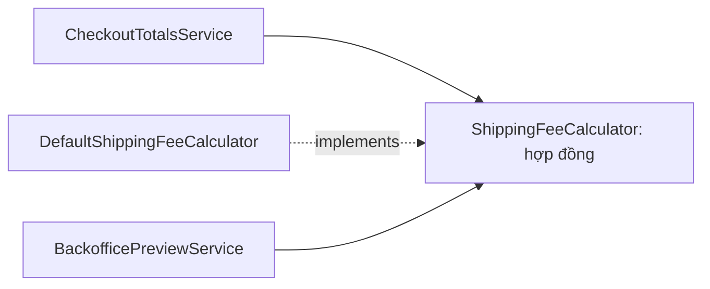

# API như ranh giới giao tiếp giữa các phần mã

> **Chương:** Hợp đồng API  
> **Học phần:** CODE_QUALITY_FUNDAMENTALS — Hiểu những thuộc tính quyết định mã nguồn có đáng tin cậy, dễ hiểu và dễ thay đổi hay không.

Khi xây dựng ứng dụng, các phần mã phải cộng tác: màn hình gọi nghiệp vụ, nghiệp vụ cần tính giá, thành phần lưu trữ cung cấp dữ liệu, và đôi khi cả một dịch vụ khác xử lý thanh toán. Nếu mọi phần đều trực tiếp biết cấu trúc nội bộ của nhau, một thay đổi nhỏ có thể kéo theo hàng loạt chỉnh sửa ngoài dự kiến.

**API** (*Application Programming Interface*) là **ranh giới giao tiếp được công bố** giữa bên cung cấp khả năng và bên sử dụng khả năng đó. API xác định cách gọi, dữ liệu đi qua ranh giới, kết quả nhận được và những hành vi mà bên sử dụng được quyền dựa vào. Phần cài đặt phía sau API có thể thay đổi, miễn là những cam kết liên quan vẫn được giữ.

Trong bài này, API không chỉ là REST hay HTTP. Một phương thức `public` trong Java, một `interface` giữa các module, một thư viện, hoặc một endpoint giữa các dịch vụ đều có thể tạo thành API. Tính chất chung là **có người gọi và có một hợp đồng giao tiếp**.

Sau bài học, bạn có thể:

- Xác định API nằm ở đâu trong một hệ thống Java và phân biệt giao diện công khai với chi tiết cài đặt.
- Mô tả hợp đồng API qua **đầu vào, đầu ra, ngoại lệ, tác dụng phụ và giới hạn sử dụng**.
- Tổ chức phụ thuộc để bên dùng API không cần biết cấu trúc nội bộ của bên cung cấp.
- Phân biệt thay đổi cài đặt với thay đổi có thể phá vỡ hợp đồng.
- Thiết kế kiểm thử xác nhận hành vi tại ranh giới, kể cả khi có lỗi.

## 1. API là một ranh giới, không chỉ là một URL

Xét lời gọi Java:

```java
long shippingFeeVnd = shippingFeeCalculator.calculateFeeVnd(
        subtotalAfterDiscountVnd,
        DeliveryMode.STANDARD);
```

Bên gọi chỉ cần biết:

1. Có một thao tác `calculateFeeVnd(...)` để tính phí giao hàng.
2. Đầu vào gồm tổng tiền sau giảm giá, tính bằng VND, và loại giao hàng.
3. Kết quả trả về là phí tính bằng VND.
4. Những đầu vào nào hợp lệ, khi nào có ngoại lệ, và phép tính có tác dụng phụ hay không.

Bên gọi **không cần biết** bên cung cấp tính bằng `if`, `switch`, bảng chính sách hay một đối tượng khác. Nếu thay cách tính nhưng giữ đúng hợp đồng, bên gọi có thể tiếp tục hoạt động mà không cần sửa.

Các kiểu ranh giới thường gặp:

| Dạng API | Bên cung cấp | Bên sử dụng | Hình thức giao tiếp |
| --- | --- | --- | --- |
| **API trong lớp** | Đối tượng Java | Phương thức khác | Phương thức, tham số, kiểu trả về, ngoại lệ |
| **API của module/thư viện** | Module Java hoặc thư viện | Module/thư viện khác | Các kiểu, lớp, phương thức được công bố |
| **API giữa các tầng** | Thành phần nghiệp vụ hoặc lưu trữ | Thành phần ở tầng khác | Interface, lớp dịch vụ, DTO, hợp đồng hành vi |
| **API qua mạng** | Dịch vụ HTTP/gRPC hoặc hệ thống bên ngoài | Client từ tiến trình khác | Đường dẫn/thao tác, dữ liệu truyền, mã lỗi, phiên bản |
| **API sự kiện** | Bên phát sự kiện | Bên tiêu thụ | Tên sự kiện, schema, ngữ nghĩa thời điểm và giao nhận |

Những dạng này khác về công nghệ, nhưng đều cần **ranh giới có nghĩa ổn định**. Chẳng hạn, phương thức Java gọi đồng bộ không đối mặt với timeout mạng như HTTP; API qua mạng còn cần mô tả khả năng thử lại và trạng thái chưa xác định khi kết nối lỗi.

### API và chi tiết cài đặt

Ví dụ:

```java
public interface CustomerLookup {
    CustomerView findById(String customerId);
}
```

Hợp đồng được công bố qua tên, kiểu dữ liệu, tài liệu và hành vi của `findById`. Bên trong có thể dùng SQL, cache hay một dịch vụ khác. Cấu trúc bảng, câu truy vấn và thuật toán cache là **chi tiết cài đặt** nếu chúng không được đưa vào cam kết cho bên gọi.

Điều đó không có nghĩa cứ viết một `interface` là đã có ranh giới tốt. Nếu `CustomerView` chứa những đối tượng của ORM, hoặc phương thức buộc người gọi hiểu trạng thái transaction nội bộ, API vẫn rò rỉ chi tiết cài đặt.

## 2. Hợp đồng API gồm những gì?

Chữ ký phương thức (*signature*) cho biết một phần **hình dạng** giao tiếp. Tính đúng đắn của người dùng API còn phụ thuộc vào **ngữ nghĩa** mà chữ ký không diễn đạt hết.

| Phần hợp đồng | Câu hỏi cần trả lời | Ví dụ |
| --- | --- | --- |
| **Mục đích** | Khả năng này dùng để làm gì? | Tính phí giao hàng của báo giá hiện tại |
| **Đầu vào** | Kiểu, đơn vị, miền hợp lệ và cách hiểu? | `subtotalAfterDiscountVnd >= 0`; `mode` không `null` |
| **Kết quả** | Giá trị có ý nghĩa gì, tính bằng đơn vị nào? | Phí vận chuyển không âm, tính bằng VND |
| **Trường hợp không có dữ liệu** | `null`, danh sách rỗng, `Optional.empty()` biểu thị gì? | Không tìm thấy khách là kết quả hợp lệ hay lỗi? |
| **Ngoại lệ/thất bại** | Báo lỗi nào và khi nào? | Đầu vào âm bị từ chối; phụ thuộc bên ngoài không khả dụng |
| **Tác dụng phụ** | Ghi dữ liệu, gửi sự kiện hoặc thay đổi trạng thái nào? | Truy vấn không thay đổi dữ liệu; đặt hàng có thể tạo bản ghi |
| **Thứ tự, tính lặp lại** | Gọi hai lần hoặc gọi đồng thời có tác động gì? | Tạo thanh toán cần chính sách chống xử lý trùng |
| **Ràng buộc sử dụng** | Quyền truy cập, thời gian tồn tại, phiên bản, giới hạn gọi? | Chỉ người có quyền mới xem được đơn hàng |

Lời hứa về **hành vi quan sát được** quan trọng không kém kiểu dữ liệu. Ví dụ, đổi phương thức từ trả danh sách rỗng khi không tìm thấy sang ném ngoại lệ có thể làm hỏng người gọi, dù tên và tham số không thay đổi.

### Tiền điều kiện và hậu điều kiện

Với hàm tính phí:

```text
Tiền điều kiện:
    subtotalAfterDiscountVnd >= 0
    mode thuộc các kiểu giao hàng được hỗ trợ và khác null

Khi trả về bình thường:
    feeVnd >= 0
    feeVnd đúng với chính sách dành cho mode và số tiền đầu vào

Khi đầu vào không hợp lệ:
    API báo lỗi theo hợp đồng

Tác dụng phụ:
    không thay đổi trạng thái và không gọi dịch vụ bên ngoài
```

Một hợp đồng đầy đủ phải trả lời câu hỏi **“người gọi có thể tin điều gì sau lời gọi?”**. Nếu không biết câu trả lời, người gọi thường phải đọc mã nội bộ để đoán; khi đó ranh giới chưa bảo vệ được sự độc lập.

## 3. Ví dụ Java: một ranh giới tính phí giao hàng

Giả sử hệ thống báo giá và hệ thống xem trước đơn hàng đều cần phí vận chuyển theo **cùng một chính sách minh họa**:

- Tổng tiền hàng sau giảm giá `subtotalAfterDiscountVnd` là số nguyên VND không âm.
- Giao hàng tiêu chuẩn tốn **30.000 VND**, nhưng miễn phí nếu tổng tiền đạt **500.000 VND**.
- Giao hàng nhanh tốn **50.000 VND**, không áp dụng ngưỡng miễn phí tiêu chuẩn.
- Hàm tính phí không ghi dữ liệu hay thực hiện I/O.

Đây chỉ là quy tắc giả định để giải thích thiết kế API; một sản phẩm thật có thể còn nhiều điều kiện vùng, thuế và phí khác.

### 3.1. Công bố kiểu dữ liệu và hợp đồng

Ví dụ đặt hai khai báo dưới đây trong hai tệp Java tương ứng:

```java
// DeliveryMode.java
public enum DeliveryMode {
    STANDARD,
    EXPRESS
}
```

```java
// ShippingFeeCalculator.java
public interface ShippingFeeCalculator {
    /**
     * Trả phí giao hàng tính bằng VND theo chính sách hiện tại.
     *
     * @param subtotalAfterDiscountVnd tổng tiền hàng sau giảm giá, không âm
     * @param mode chế độ giao hàng, không được null
     * @return phí giao hàng không âm, tính bằng VND
     * @throws IllegalArgumentException nếu tổng tiền âm hoặc mode không hỗ trợ
     * @throws NullPointerException nếu mode là null
     *
     * Không ghi trạng thái hoặc thực hiện I/O.
     */
    long calculateFeeVnd(
            long subtotalAfterDiscountVnd,
            DeliveryMode mode);
}
```

Hai tên `subtotalAfterDiscountVnd` và `calculateFeeVnd` làm rõ **ngữ nghĩa của số tiền**, không chỉ kiểu `long`. Tài liệu xác định đầu vào không hợp lệ và tác dụng phụ. Bên gọi không cần quan tâm cách chọn phí.

### 3.2. Ẩn thuật toán sau hợp đồng

```java
// DefaultShippingFeeCalculator.java
import java.util.Objects;

public final class DefaultShippingFeeCalculator
        implements ShippingFeeCalculator {

    private static final long STANDARD_FEE_VND = 30_000L;
    private static final long EXPRESS_FEE_VND = 50_000L;
    private static final long FREE_STANDARD_THRESHOLD_VND = 500_000L;

    @Override
    public long calculateFeeVnd(
            long subtotalAfterDiscountVnd,
            DeliveryMode mode) {

        if (subtotalAfterDiscountVnd < 0L) {
            throw new IllegalArgumentException("Negative subtotal");
        }
        Objects.requireNonNull(mode, "mode");

        switch (mode) {
            case EXPRESS:
                return EXPRESS_FEE_VND;
            case STANDARD:
                return subtotalAfterDiscountVnd >= FREE_STANDARD_THRESHOLD_VND
                        ? 0L
                        : STANDARD_FEE_VND;
            default:
                throw new IllegalArgumentException("Unsupported delivery mode");
        }
    }
}
```

`DefaultShippingFeeCalculator` giữ các hằng số và quyết định tính phí. Nếu sau này cần thay thuật toán tính phí, có thể làm trong lớp này hoặc thay bằng một triển khai khác **mà vẫn giữ hợp đồng đầu vào, kết quả và lỗi đã công bố**.

Đừng nhầm “ẩn chi tiết” với “giấu quy tắc quan trọng”. Điều kiện nghiệp vụ phải có nơi sở hữu rõ ràng, được kiểm thử và có tài liệu tương ứng. API chỉ giúp người gọi không phải tự cài đặt lại quy tắc.

### 3.3. Bên dùng API không cần biết chi tiết phía sau

```java
// CheckoutTotalsService.java
import java.util.Objects;

public final class CheckoutTotalsService {
    private final ShippingFeeCalculator shippingFeeCalculator;

    public CheckoutTotalsService(ShippingFeeCalculator shippingFeeCalculator) {
        this.shippingFeeCalculator =
                Objects.requireNonNull(shippingFeeCalculator, "shippingFeeCalculator");
    }

    public long calculateTotalVnd(
            long subtotalVnd,
            long discountVnd,
            DeliveryMode mode) {

        if (subtotalVnd < 0L || discountVnd < 0L
                || discountVnd > subtotalVnd) {
            throw new IllegalArgumentException("Invalid subtotal or discount");
        }
        Objects.requireNonNull(mode, "mode");

        long subtotalAfterDiscountVnd = subtotalVnd - discountVnd;
        long shippingFeeVnd = shippingFeeCalculator.calculateFeeVnd(
                subtotalAfterDiscountVnd, mode);

        if (shippingFeeVnd < 0L) {
            throw new IllegalStateException("Shipping fee contract was violated");
        }
        return Math.addExact(subtotalAfterDiscountVnd, shippingFeeVnd);
    }
}
```

Trong phiên bản này, `CheckoutTotalsService` biết **hợp đồng tính phí** và các dữ liệu nó cần truyền. Nó không import hằng số phí, không tự kiểm tra ngưỡng miễn phí, và không cần biết chính sách được cài đặt bằng `switch`.

Từng thành phần giữ trách nhiệm riêng:

| Thành phần | Điều nó biết và quyết định | Điều không cần biết |
| --- | --- | --- |
| `CheckoutTotalsService` | Kiểm tra tổng tiền, tính sau giảm giá, cộng phí vào tổng | Cách chọn mức phí từng loại giao hàng |
| `ShippingFeeCalculator` | Hợp đồng tính phí cho bên sử dụng | Checkout sẽ hiển thị kết quả ra sao |
| `DefaultShippingFeeCalculator` | Cách thực hiện chính sách phí hiện tại | Dữ liệu đơn hàng được lưu ở bảng nào |

`Math.addExact(...)` được dùng để phát hiện tràn số nguyên thay vì âm thầm trả về giá trị sai. Đây là phần hợp đồng về tổng tiền mà bên gọi dịch vụ checkout cần biết nếu muốn xử lý các trường hợp vượt giới hạn.

### 3.4. Nhìn hướng phụ thuộc



Hai nơi sử dụng có thể phụ thuộc vào **một hợp đồng chung**. Thành phần cung cấp triển khai hợp đồng đó. Điều này giảm nhu cầu cho hai nơi tự biết các quy tắc hoặc chi tiết kỹ thuật.

Tuy nhiên, việc thêm một `interface` **không tự động cải thiện cấu trúc**. Nếu chỉ có một triển khai nhỏ, dùng trong một chỗ và không có ranh giới cần ổn định, gọi trực tiếp một lớp có API rõ ràng có thể đơn giản hơn. Hãy đưa interface vào khi nó thể hiện **ranh giới và quan hệ phụ thuộc có ý nghĩa**, thay vì chỉ để tăng số tệp.

## 4. Ranh giới tốt kiểm soát sự lan truyền thay đổi

Giả sử chính sách phí tiêu chuẩn đổi ngưỡng từ **500.000** lên **600.000 VND**. Nếu checkout tự tính phí, màn hình xem trước cũng tự tính và báo cáo cũng có logic riêng, thay đổi đòi hỏi tìm và sửa từng bản sao. Khi chính sách tập trung sau một API phù hợp, bên sử dụng tiếp tục gọi cùng phương thức, còn logic phí do thành phần sở hữu chính sách cập nhật.

Nhưng **không phải mọi thay đổi đều không ảnh hưởng tới người gọi**. Cần phân biệt:

| Thay đổi | Có thể chỉ thuộc phía triển khai? | Điều cần kiểm tra |
| --- | --- | --- |
| Đổi từ `if` sang `switch` nhưng giữ kết quả | Có | Trường hợp biên, ngoại lệ và tác dụng phụ vẫn giống |
| Tối ưu thuật toán tính phí, giữ ngữ nghĩa | Có | Kết quả cho cùng đầu vào và giới hạn được bảo toàn |
| Đổi ngưỡng tính phí theo yêu cầu nghiệp vụ | Chữ ký giữ nguyên, **ngữ nghĩa thay đổi** | Bên sử dụng có cần biết chính sách mới, dữ liệu lịch sử phải giữ thế nào? |
| Thêm loại `SAME_DAY` vào `DeliveryMode` | Có thể tác động nhiều bên | Mọi triển khai, `switch`, client và kiểm thử xử lý giá trị mới ra sao? |
| Đổi đơn vị từ VND sang đơn vị nhỏ hơn khác | Thường là thay đổi hợp đồng | Tên, dữ liệu, giao tiếp và nơi tính tiền cần được cập nhật |
| Đổi `null` từ “không tìm thấy” sang ném ngoại lệ | Là thay đổi hợp đồng hành vi | Các caller đang xử lý `null` và ngoại lệ thế nào? |
| Thêm lời gọi ghi dữ liệu vào hàm vốn thuần | Là thay đổi tác dụng phụ | Caller có còn an toàn khi gọi nhiều lần hoặc retry không? |

Điểm mấu chốt: **giữ nguyên chữ ký không đồng nghĩa giữ nguyên hợp đồng**. Một API có thể tương thích về cú pháp nhưng thay đổi ngữ nghĩa. Độ ổn định cần được đánh giá từ các điều mà người sử dụng thực sự dựa vào.

### Tránh để API “rò rỉ” nội bộ

Một thiết kế dễ gây phụ thuộc:

```java
// Ví dụ không nên công bố cho mọi nơi sử dụng:
public HibernateEntity findCustomerEntityById(long id);
```

Nếu phía sử dụng dựa vào proxy ORM, session hoặc cấu trúc bảng, việc đổi cách lưu trữ có thể phá vỡ nhiều nơi. Tùy hệ thống, một đối tượng kết quả chỉ chứa dữ liệu cần thiết có thể phù hợp hơn:

```java
public CustomerView findCustomerById(long customerId);
```

`CustomerView` nên công bố các trường và bất biến cần dùng, cùng hợp đồng về khả năng thay đổi, trạng thái “không tìm thấy” và lỗi truy vấn. Đây là ví dụ khái niệm; việc chọn DTO không có nghĩa phải sao chép tất cả trường của entity nội bộ.

## 5. Hợp đồng thất bại cũng là một phần của API

Một API có thể trả đúng kết quả ở đường thành công nhưng khiến hệ thống khó tin cậy vì báo lỗi mơ hồ. Ví dụ:

```java
List<OrderView> listOrders(String customerId);
```

Cần phân biệt ít nhất:

- Truy vấn thành công và **không có đơn hàng**: có thể trả danh sách rỗng.
- Truy vấn thất bại do nguồn dữ liệu không khả dụng: báo lỗi, không âm thầm trả `List.of()`.
- `customerId` không hợp lệ: xử lý theo tiền điều kiện đã công bố.

Nếu dịch vụ nuốt lỗi kết nối rồi trả danh sách rỗng, người gọi sẽ hiểu nhầm “không có đơn” với “không thể lấy đơn”. Đó là **vi phạm hợp đồng kết quả**, ngay cả khi phương thức vẫn trả đúng kiểu `List<OrderView>`.

### API có tác dụng phụ cần hợp đồng mạnh hơn

Đối với API như `reserveInventory(orderId)`, `chargePayment(request)` hoặc `publishEvent(...)`, cần nói rõ:

1. Khi nào thao tác được xem là thành công?
2. Khi thất bại, trạng thái có thay đổi một phần không?
3. Có thể gọi lại cùng yêu cầu an toàn không? Có cần khóa idempotency?
4. Khi timeout hoặc mất kết nối, bên gọi biết chắc kết quả chưa, hay phải tra cứu/đối soát?
5. Cách người gọi xác định lỗi nào có thể thử lại và lỗi nào phải dừng?

Không nhận được phản hồi thanh toán **không chứng minh tiền chưa bị thu**. Nếu API chỉ trả `true/false` mà không thể biểu diễn trạng thái chưa xác định, người gọi có thể xử lý sai và phát sinh giao dịch trùng. Hợp đồng của thao tác từ xa cần phù hợp với khả năng giao nhận và cơ chế xác nhận thực tế.

Sự nhất quán về kiểu ngoại lệ, mã lỗi hoặc trạng thái kết quả giúp người gọi chọn phản ứng an toàn. Tuy nhiên, **quy tắc lỗi cần phản ánh sự thật**, không chỉ khiến phản hồi đẹp hoặc dễ xử lý bằng một nhánh mặc định.

## 6. Từ API Java sang HTTP API: ranh giới vẫn cần ngữ nghĩa

Khi hai phần mã nằm ở hai tiến trình khác nhau, ranh giới API thường gồm giao thức, dữ liệu truyền, bảo mật, giới hạn thời gian và cách báo lỗi.

Giả sử chức năng báo giá được mở qua HTTP:

```http
POST /v1/shipping/quote HTTP/1.1
Content-Type: application/json

{
  "subtotalAfterDiscountVnd": 500000,
  "deliveryMode": "STANDARD"
}
```

Một phản hồi thành công giả định:

```http
HTTP/1.1 200 OK
Content-Type: application/json

{
  "shippingFeeVnd": 0,
  "currency": "VND"
}
```

Nếu đầu vào không hợp lệ, có thể trả `400 Bad Request` với mã lỗi nghiệp vụ nhất quán. Nếu phụ thuộc bắt buộc tạm thời không khả dụng, có thể trả `503 Service Unavailable` tùy hợp đồng của dịch vụ. Không nên trả `200 OK` kèm phí bằng 0 chỉ vì hệ thống không tính được phí.

Đây là **ví dụ hợp đồng HTTP**, không phải yêu cầu cụ thể của một ứng dụng thực tế. Cần xác định thêm quyền truy cập, giới hạn payload, thời hạn yêu cầu, dữ liệu nhạy cảm, khả năng retry và phiên bản giao thức. Dù JSON có cùng trường với tham số Java, khi đi qua mạng sẽ có các rủi ro mới như timeout, phiên bản client khác nhau và lỗi tuần tự hóa.

### API boundary và trust boundary có liên quan nhưng khác nhau

Một `interface` Java giúp tách cấu trúc phụ thuộc; nó **không tự bảo vệ** dữ liệu từ bên ngoài. Ở HTTP boundary, hệ thống phải xác thực và kiểm tra quyền, kiểm tra dữ liệu đầu vào, áp dụng giới hạn phù hợp và không tin vào các trường do client tự khai báo khi chúng có thể bị giả mạo.

Ví dụ, một request mang `customerId` không tự chứng minh người gửi có quyền xem đơn của khách đó. Quyền truy cập cần được xác minh ở nơi có trách nhiệm, dựa trên thông tin danh tính đáng tin cậy và quy tắc hệ thống.

## 7. Thiết kế API: công bố đủ, tránh ràng buộc thừa

Một API hữu ích cần **đủ thông tin cho người sử dụng**, nhưng không nên cam kết những chi tiết mà người sử dụng không cần.

| Quyết định thiết kế | API dễ sử dụng hơn khi... | Dấu hiệu nên xem lại |
| --- | --- | --- |
| **Tên** | Phản ánh ý định và đơn vị: `calculateFeeVnd` | `process()`, `handle()`, `getData()` không rõ nghĩa |
| **Tham số** | Biểu diễn đúng miền giá trị, ràng buộc rõ | Nhiều cờ `boolean` mơ hồ, tham số cùng kiểu dễ truyền nhầm |
| **Kiểu kết quả** | Phân biệt các kết quả có ý nghĩa | `null`, `false`, `0` dùng cho cả hợp lệ và lỗi |
| **Tác dụng phụ** | Nêu rõ phần trạng thái bị thay đổi | Tên hàm gợi ý chỉ đọc nhưng lại ghi dữ liệu |
| **Ngoại lệ** | Có quy tắc rõ và giữ nguyên nguyên nhân cần thiết | Bắt toàn bộ lỗi rồi trả kết quả mặc định |
| **Khả năng thay đổi** | Chỉ công bố điều caller thật sự cần dựa vào | Rò rỉ entity ORM, transaction hoặc cấu trúc nội bộ |
| **Kích thước API** | Cung cấp các thao tác gắn với trách nhiệm của thành phần | “God interface” có hàng chục phương thức không liên quan |

### Đừng tạo “interface cho tất cả”

Ví dụ, một phương thức nội bộ một dòng chỉ được một nơi gọi có thể đơn giản hơn khi là một phương thức của lớp cụ thể. Thêm interface, factory và nhiều lớp bao mà không tạo ranh giới hợp đồng có ý nghĩa sẽ làm tăng số chỗ người đọc phải tìm.

Tương tự, một API quá chung:

```java
Object execute(String operation, Object[] args);
```

khó cho người gọi biết kiểu dữ liệu, lỗi và kết quả được phép. Nó đánh mất nhiều lợi ích của hệ thống kiểu Java. Một API chuyên biệt với tên và kiểu có nghĩa thường dễ đọc, dễ kiểm thử và dễ thay đổi hơn.

### Ranh giới theo trách nhiệm

Không nên đưa mọi thao tác của giỏ hàng, khách hàng, thanh toán và kho vào một interface chỉ vì cùng được dùng bởi `CheckoutService`. Các thao tác đó có chủ sở hữu, hợp đồng thất bại và nhịp thay đổi khác nhau. Ranh giới rõ giúp người sửa biết thành phần nào có quyền quyết định quy tắc.

## 8. Kiểm thử hợp đồng ở phía cung cấp và phía sử dụng

Một API có giao diện rõ vẫn cần **bằng chứng** rằng triển khai thật và nơi gọi sử dụng đúng hợp đồng.

### 8.1. Kiểm thử triển khai tính phí

```java
import static org.junit.jupiter.api.Assertions.assertEquals;
import static org.junit.jupiter.api.Assertions.assertThrows;

import org.junit.jupiter.api.Test;

class DefaultShippingFeeCalculatorTest {
    private final ShippingFeeCalculator calculator =
            new DefaultShippingFeeCalculator();

    @Test
    void standardFeeAppliesJustBelowThreshold() {
        assertEquals(30_000L, calculator.calculateFeeVnd(
                499_999L, DeliveryMode.STANDARD));
    }

    @Test
    void standardShippingIsFreeAtThreshold() {
        assertEquals(0L, calculator.calculateFeeVnd(
                500_000L, DeliveryMode.STANDARD));
    }

    @Test
    void expressShippingHasItsOwnFee() {
        assertEquals(50_000L, calculator.calculateFeeVnd(
                600_000L, DeliveryMode.EXPRESS));
    }

    @Test
    void negativeAmountIsRejected() {
        assertThrows(IllegalArgumentException.class,
                () -> calculator.calculateFeeVnd(
                        -1L, DeliveryMode.STANDARD));
    }
}
```

Các giá trị mong đợi đến từ **quy tắc nghiệp vụ đã nêu**, không được đọc lại từ chính hằng số của lớp triển khai. Nếu kiểm thử lấy `STANDARD_FEE_VND` từ mã đang được kiểm tra làm kết quả mong đợi, cùng một lỗi có thể tồn tại ở cả hai phía mà kiểm thử không phát hiện.

### 8.2. Kiểm thử nơi sử dụng API

Hàm tính phí đúng vẫn không cứu được một caller truyền nhầm **tổng tiền trước giảm giá**. Ta cần kiểm tra lời gọi tại ranh giới:

```java
import static org.junit.jupiter.api.Assertions.assertEquals;
import static org.junit.jupiter.api.Assertions.assertThrows;

import org.junit.jupiter.api.Test;

class CheckoutTotalsServiceTest {
    @Test
    void passesSubtotalAfterDiscountToShippingPolicy() {
        ShippingFeeCalculator feeCalculator = (subtotalVnd, mode) -> {
            assertEquals(500_000L, subtotalVnd);
            assertEquals(DeliveryMode.STANDARD, mode);
            return 30_000L;
        };
        CheckoutTotalsService checkout = new CheckoutTotalsService(feeCalculator);

        assertEquals(530_000L, checkout.calculateTotalVnd(
                600_000L, 100_000L, DeliveryMode.STANDARD));
    }

    @Test
    void rejectsInvalidDiscountBeforeCallingPolicy() {
        ShippingFeeCalculator mustNotBeCalled = (subtotalVnd, mode) -> {
            throw new AssertionError("Policy must not be called");
        };
        CheckoutTotalsService checkout =
                new CheckoutTotalsService(mustNotBeCalled);

        assertThrows(IllegalArgumentException.class,
                () -> checkout.calculateTotalVnd(
                        100_000L, 100_001L, DeliveryMode.STANDARD));
    }
}
```

Ở test thứ nhất, `30_000L` là kết quả do **test double** chủ động trả để xác minh cách caller cộng phí. Nó không phải kết quả mà chính sách thật phải trả tại 500.000 VND; kiểm thử chính sách thực tế ở phần trước khẳng định phí phải là 0. Hai phép thử kiểm tra **hai hợp đồng khác nhau**: một bên triển khai đúng chính sách, bên còn lại truyền và sử dụng đúng giá trị từ API.

Khi tích hợp toàn hệ thống, vẫn nên kiểm tra đường đi thực tế để bảo đảm caller nối đúng triển khai mặc định và không nhầm phiên bản chính sách.

### 8.3. Contract test giữa các dịch vụ

Với HTTP API, kiểm thử hợp đồng có thể xác minh cùng một bộ tình huống trên phía cung cấp và các client liên quan: cấu trúc request/response, mã trạng thái, lỗi, trường tùy chọn và quy tắc tương thích phiên bản.

Ví dụ, provider công bố `shippingFeeVnd` là số nguyên không âm, nhưng client mới lại gửi chuỗi `"500000"` thay cho số `500000` ở tham số đầu vào. Nếu không có quy ước chuyển đổi, hai bên đã không tuân cùng schema dù từng bên có thể chạy unit test riêng.

Kiểm thử hợp đồng bổ sung cho kiểm thử đơn vị, nhưng không thay thế các kiểm thử tích hợp đối với hành vi phụ thuộc hạ tầng, quyền truy cập hoặc tác dụng phụ liên dịch vụ.

## 9. Tương thích và phiên bản API khi hệ thống phát triển

Một API có thể được dùng bởi nhiều phiên bản ứng dụng, nhiều module và cả những client không triển khai cùng lúc. Khi sửa, cần phân biệt:

- **Tương thích ở mức nguồn:** mã của bên dùng có còn biên dịch nếu dựng lại?
- **Tương thích nhị phân:** mã đã biên dịch có thể tiếp tục liên kết với phiên bản thư viện mới không?
- **Tương thích dữ liệu/giao thức:** thông điệp và schema cũ có còn được chấp nhận không?
- **Tương thích hành vi:** đầu vào hợp lệ cũ có còn ý nghĩa và kết quả như cam kết không?

Trong Java, đổi tên hoặc bỏ một phương thức `public`, đổi kiểu tham số hoặc kiểu trả về có thể làm hỏng nơi gọi. Một thay đổi tưởng chừng bổ sung nhỏ vào `interface` cũng có thể buộc các lớp triển khai hiện có cập nhật; dùng `default method` có thể giảm một số tác động nhưng không tự bảo đảm thiết kế hay hành vi đúng.

Trong HTTP API, thêm trường tùy chọn có thể ít rủi ro hơn đổi tên trường bắt buộc, nhưng vẫn phải xét client có từ chối trường lạ, có phụ thuộc thứ tự dữ liệu hay cách xác thực chữ ký hay không. Không được mặc định mọi thay đổi “thêm mới” đều an toàn.

### Chính sách cũ và dữ liệu lịch sử

Giả sử ngưỡng miễn phí giao hàng đổi theo ngày. API tính phí **cho báo giá mới** có thể dùng chính sách hiện hành, trong khi hóa đơn đã chốt phải giữ **phí thực tế đã thu**. Nếu báo cáo lịch sử gọi lại API chính sách mới để tính phí cũ, kết quả có thể sai dù API vẫn thực hiện đúng việc “tính theo chính sách hiện tại”.

Hợp đồng nên phân biệt rõ thời điểm và mục đích:

```text
calculateFeeForNewQuote(...)  -> sử dụng chính sách hiện hành
loadChargedShippingFee(...)   -> đọc phí đã ghi nhận trong giao dịch
```

Tên ở đây chỉ minh họa ý định. Trong hệ thống thực tế, điều kiện về ngày hiệu lực, phiên bản chính sách và dữ liệu giao dịch phải được xác định cụ thể.

## 10. Quy trình thiết kế một API nội bộ dễ sử dụng

Có thể dùng một quy trình ngắn trước khi công bố phương thức cho module khác:

1. **Xác định người sử dụng:** ai gọi, họ cần giải quyết việc gì, và họ thực sự cần biết dữ liệu nào?
2. **Nêu trách nhiệm:** viết một câu diễn đạt khả năng mà API sở hữu; tránh gom nhiều nghiệp vụ không liên quan.
3. **Mô tả hợp đồng:** đầu vào hợp lệ, đơn vị, hậu điều kiện, kết quả rỗng, ngoại lệ, tác dụng phụ và yêu cầu gọi lặp.
4. **Chọn kiểu dữ liệu:** dùng tên và kiểu thể hiện ý nghĩa; tránh để caller phải đoán `long` là tiền gì hoặc `boolean` biểu thị trường hợp nào.
5. **Ẩn chi tiết cài đặt:** không công bố cấu trúc lưu trữ, session hoặc những đối tượng chỉ có nghĩa trong một tầng nội bộ nếu caller không cần.
6. **Xác định hướng phụ thuộc:** đặt hợp đồng ở nơi phù hợp để phần dùng không phụ thuộc vào chi tiết triển khai.
7. **Kiểm thử cả hai phía:** phía cung cấp giữ đúng quy tắc; phía sử dụng truyền dữ liệu và xử lý kết quả/lỗi đúng cách.
8. **Dự tính thay đổi:** biết ai quản lý phiên bản, cách thêm khả năng mới và cách giữ dữ liệu hoặc client cũ hoạt động khi cần.

Trong một dự án nhỏ, nhiều bước này có thể chỉ là vài dòng Javadoc và một bộ kiểm thử. Với API mạng hoặc API được nhiều đội sử dụng, chúng cần được ghi thành hợp đồng có thể truy vết và được kiểm tra giữa các bên.

## 11. Những ngộ nhận thường gặp

### “API chỉ là endpoint HTTP”

Một interface Java, lớp dịch vụ dùng chung hoặc thư viện có phương thức công khai cũng có người cung cấp, người sử dụng và hợp đồng. HTTP chỉ thêm những vấn đề đặc thù của mạng và giao thức.

### “Có interface là đã giảm coupling”

Nếu interface phơi bày entity lưu trữ, các kiểu của framework hoặc quá nhiều thao tác không liên quan, caller vẫn biết quá nhiều về phía triển khai. Tách bằng tên interface là chưa đủ; **nội dung hợp đồng và hướng phụ thuộc** mới quyết định chất lượng ranh giới.

### “Giữ chữ ký là giữ tương thích”

Đổi giá trị trả về, ngoại lệ, đơn vị tiền, thứ tự tác dụng phụ hoặc cách xử lý `null` có thể phá người gọi dù chữ ký không đổi. Cần đánh giá tương thích hành vi.

### “API càng chung càng có thể tái sử dụng”

Một API chỉ có `execute(Object)` hoặc nhiều cờ điều khiển có thể dễ dùng lại về mặt cú pháp nhưng khiến người gọi mất thông tin kiểu và hợp đồng. Tái sử dụng tốt bắt đầu từ **khái niệm chung thực sự**.

### “Mọi API đều cần nhiều lớp interface và adapter”

Số lớp không đo chất lượng thiết kế. Một phương thức `public` có tên và hợp đồng rõ ràng trong lớp nhỏ có thể đủ tốt. Chỉ thêm tầng gián tiếp khi nó giải quyết nhu cầu thay đổi, kiểm thử hoặc phân định trách nhiệm cụ thể.

### “Trả giá trị mặc định sẽ giúp client ít phải xử lý lỗi”

Nếu giá trị mặc định cũng là kết quả hợp lệ, nó có thể che thất bại. Chẳng hạn, trả `0` khi không thể tính phí sẽ khiến checkout tưởng khách được miễn phí. Hợp đồng lỗi rõ ràng giúp client đưa ra quyết định an toàn hơn.

### “Kiểm thử API chung là đủ, không cần test caller”

Caller có thể đưa nhầm tham số, hiểu sai đơn vị hoặc bỏ qua lỗi. Phải xác minh cả việc **cung cấp đúng hành vi** và **sử dụng đúng hành vi** ở những ranh giới có rủi ro đáng kể.

## 12. Checklist khi review API giữa các phần mã

| Câu hỏi | Dấu hiệu cần điều tra |
| --- | --- |
| Có thể nói API cung cấp khả năng gì trong một câu không? | Tên mơ hồ, nhiều trách nhiệm |
| Người gọi có biết chính xác ý nghĩa và đơn vị của đầu vào không? | Tham số `long`, `String`, `boolean` dễ nhầm |
| Kết quả có phân biệt thành công, không có dữ liệu và thất bại không? | `null` hoặc `0` mang nhiều nghĩa |
| Ngoại lệ và bảo đảm sau lỗi có rõ không? | Caller phải đoán có cần retry/rollback |
| API có tác dụng phụ gì và gọi lại có an toàn không? | Ghi dữ liệu hoặc gọi dịch vụ ẩn |
| Kiểu dữ liệu công bố có phụ thuộc ORM/framework nội bộ không? | Caller buộc biết cách lưu trữ |
| Hướng phụ thuộc có phù hợp không? | Interface dùng chung import ngược thành phần UI |
| Có thay đổi nào chỉ giữ tương thích cú pháp nhưng đổi hành vi? | Ngưỡng, đơn vị, ý nghĩa `null` hoặc loại ngoại lệ đổi |
| Có kiểm thử bên cung cấp và nơi sử dụng không? | Chỉ kiểm tra một lớp mà bỏ tích hợp |
| Ai sở hữu hợp đồng và quản lý phiên bản? | Nhiều nơi tự sửa chính sách hoặc schema |

## 13. Bài tập áp dụng

Một ứng dụng bán hàng có đoạn mã sau trong phần tạo đơn:

```java
void checkout(Order order) {
    long shippingFee = shippingRepository.lookupFee(
            order.getZoneId(), order.getSubtotalVnd());
    if (shippingFee < 0) {
        shippingFee = 0;
    }
    order.setShippingFeeVnd(shippingFee);
    orderRepository.save(order);
}
```

Giả sử `shippingRepository.lookupFee(...)` trả phí không âm khi tra cứu thành công, nhưng một triển khai cũ dùng `-1` để biểu diễn việc không kết nối được hệ thống tính phí. Mã trên đang **biến thất bại thành miễn phí giao hàng**. Ngoài ra, tên `getSubtotalVnd()` chưa nói rõ tổng tiền trước hay sau giảm giá.

Hãy thực hiện:

1. Xác định **hai ranh giới API** trong ví dụ: bên tạo đơn với thành phần tính phí, và bên tạo đơn với thành phần lưu đơn. Mỗi ranh giới cần cam kết điều gì?
2. Thiết kế chữ ký cho một `ShippingFeeCalculator` hoặc `ShippingQuoteGateway` có tên tham số diễn đạt rõ **tổng tiền sau giảm giá** và loại giao hàng.
3. Quy định cách phân biệt **phí thực sự bằng 0**, **khu vực không hỗ trợ**, **lỗi tạm thời** và **trạng thái chưa xác định** nếu có lời gọi qua mạng.
4. Viết lại luồng checkout để **không lưu đơn với phí bằng 0 khi chưa lấy được kết quả hợp lệ**. Nêu trạng thái nào có thể đã thay đổi nếu bước lưu đơn thất bại.
5. Viết ba kiểm thử: phí hợp lệ bằng 0, phí hợp lệ lớn hơn 0 và hệ thống tính phí gặp lỗi. Với nhánh lỗi, xác nhận thao tác lưu **không được gọi** nếu đó là hợp đồng bạn chọn.
6. Giả sử vài tháng sau chính sách đổi cách tính phí, hãy phân biệt thay đổi nào thuộc phần cài đặt, thay đổi nào thuộc hợp đồng và dữ liệu nào cần giữ để hóa đơn cũ không bị tính lại.

**Câu hỏi mở rộng:** Nếu dịch vụ tính phí được tách thành HTTP service, hãy bổ sung hợp đồng request/response, mã lỗi phù hợp, timeout và quy tắc retry. Giải thích vì sao client vẫn phải kiểm tra dữ liệu nhận được và vì sao thông báo “không có phí” không thể suy ra từ lỗi kết nối.

Một lời giải tốt giúp người gọi biết **cần cung cấp gì, có thể tin điều gì và phải xử lý thế nào khi thất bại**, đồng thời cho phép thành phần tính phí thay đổi cài đặt mà không làm rò rỉ chi tiết sang checkout.

## Ghi nhớ

API là **ranh giới giao tiếp và hợp đồng hành vi** giữa các phần mã, không chỉ là URL hay chữ ký phương thức. API có chất lượng giúp người gọi hiểu đầu vào, kết quả, ngoại lệ và tác dụng phụ mà không phụ thuộc vào cách cài đặt phía sau. Hãy thiết kế ranh giới theo trách nhiệm, giữ hướng phụ thuộc rõ ràng, công bố đúng ngữ nghĩa và kiểm thử cả bên cung cấp lẫn bên sử dụng. Khi ranh giới ổn định và trung thực, các phần của hệ thống có thể được sửa đổi và kiểm chứng với ít ảnh hưởng dây chuyền hơn.
