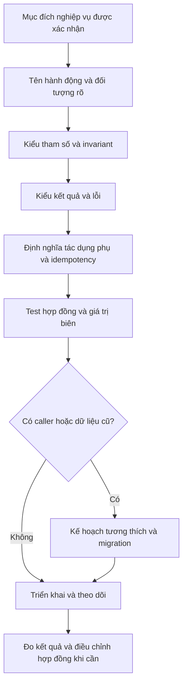

# Tên gọi, kiểu tham số và giá trị trả về thể hiện ý định

## 1. Hợp đồng API bắt đầu từ điều người gọi có thể hiểu và tin tưởng

Một phương thức công khai là điểm tiếp xúc giữa hai phần mềm, hai nhóm phát triển hoặc hai thời điểm trong vòng đời sản phẩm. Khi đọc `calculate(String x, double y)`, người gọi phải đoán `x` là mã đơn hàng hay mã khách hàng, `y` là tỷ lệ hay số tiền, và kết quả được tính theo quy tắc nào. Khi đọc `calculateShippingFee(OrderSubtotal subtotal, DeliveryMode mode)`, một phần ý định đã xuất hiện ngay trong chữ ký.

Trong module `CODE_QUALITY_FUNDAMENTALS`, mục tiêu là **hiểu những thuộc tính quyết định mã nguồn có đáng tin cậy, dễ hiểu và dễ thay đổi hay không**. Thuộc chương **Hợp đồng API**, bài này tập trung vào cách **tên gọi, kiểu tham số và giá trị trả về** giúp diễn đạt những cam kết mà bên cung cấp API phải thực hiện và bên sử dụng có quyền dựa vào.

**Hợp đồng API** không chỉ là hàm có thể gọi hoặc JSON có thể phân tích cú pháp. Nó gồm: đầu vào hợp lệ, kết quả có nghĩa gì, lỗi được biểu diễn thế nào, tác dụng phụ nào có thể xảy ra, những bất biến nào được giữ, và điều gì được duy trì qua các phiên bản. Một chữ ký được thiết kế tốt giúp nhiều quy tắc trở nên rõ trước khi phải đọc code bên trong.

Ví dụ, hai cách khai báo dưới đây có mức thông tin rất khác nhau:

```java
boolean process(String id, int n, boolean f);

CancellationResult cancelOrder(CancelOrderCommand command);
```

Với chữ ký đầu, người gọi khó biết `n` là số lượng hay số lần thử; `f` có ý nghĩa nào; `false` nghĩa là yêu cầu bị từ chối hay dịch vụ gặp lỗi. Chữ ký sau ít nhất thể hiện hành động và mô hình dữ liệu riêng. Tuy vậy, **một tên rõ không đủ để chứng minh hợp đồng đúng**: `CancellationResult` phải phân biệt kết quả nghiệp vụ quan trọng; cách xử lý timeout và lặp yêu cầu vẫn cần được thiết kế, tài liệu hóa và kiểm thử.

Sau bài học, người học có thể:

- Đánh giá tên phương thức và tên miền nghiệp vụ có diễn đạt hành vi, trạng thái và tác dụng phụ hay không.
- Chọn kiểu tham số giúp tránh nhầm giá trị, sai đơn vị, trạng thái không hợp lệ và danh sách tham số khó hiểu.
- Thiết kế kiểu trả về để phân biệt có/không có dữ liệu, kết quả nghiệp vụ, lỗi và trạng thái chưa xác định.
- Đọc và viết ví dụ Java có hợp đồng rõ, cùng ca kiểm thử minh họa hành vi công khai.
- Nhận diện thay đổi API có nguy cơ phá tương thích dù cú pháp hoặc mã nguồn trông đơn giản hơn.

## 2. Một chữ ký nên trả lời được những câu hỏi nào?

Trước khi công bố API, hãy đứng ở góc nhìn của một người chỉ thấy tài liệu và chữ ký phương thức:

| Thành phần | Câu hỏi của người gọi | Ví dụ nên được thể hiện |
| --- | --- | --- |
| **Tên hành động** | Phương thức tra cứu, tính toán, xác nhận hay thay đổi dữ liệu? | `findOrderById`, `calculateTax`, `cancelOrder` |
| **Đối tượng tác động** | Hành động áp dụng lên đối tượng nghiệp vụ nào? | `orderId`, `customerId`, `paymentRequest` |
| **Kiểu dữ liệu đầu vào** | Giá trị hợp lệ là gì, đơn vị và trạng thái nào được chấp nhận? | `Duration`, `Money`, `OrderId`, `DeliveryMode` |
| **Kết quả trả về** | Thành công được xác nhận, không tìm thấy, từ chối hoặc chưa rõ kết quả? | `Optional<Order>`, `CancellationResult` |
| **Tác dụng phụ** | Có ghi dữ liệu, gửi mạng, phát thông báo hay tạo giao dịch không? | `reserveInventory` gợi ý có thay đổi trạng thái |
| **Hành vi lỗi** | Dữ liệu sai, lỗi nghiệp vụ, timeout và lỗi lập trình được phân biệt ra sao? | Ngoại lệ hợp lệ, kiểu kết quả có trạng thái |
| **Ràng buộc thời gian** | Có timeout, bất đồng bộ, yêu cầu idempotency hoặc giao dịch không? | `CompletableFuture<Quote>`, `requestId`, tài liệu hợp đồng |

Không phải mọi quy tắc đều nhét được vào tên hoặc chữ ký. Những điều như “cùng một yêu cầu không được trừ tiền hai lần”, “mã lỗi có ổn định giữa các phiên bản không” hoặc “được phép retry trong trường hợp nào” cần **hợp đồng rõ ở tài liệu, kiểm thử và nơi thực thi**.

Cách kiểm tra nhanh: người gọi có thể chọn dữ liệu đúng và xử lý mọi kết quả hợp lệ **mà không phải mở implementation** hay không? Nếu luôn phải đọc implementation để biết phải truyền gì, hợp đồng có thể còn thiếu ngữ nghĩa.

## 3. Đặt tên theo hành vi thật, đặc biệt là tác dụng phụ

### 3.1. Động từ giúp phân biệt truy vấn và thay đổi

| Dạng tên | Ý định thường gợi ra | Điều cần kiểm chứng |
| --- | --- | --- |
| `findOrderById` | Tìm một đơn, có thể không tồn tại | Hành vi không tìm thấy được biểu diễn thế nào? |
| `getRequiredOrder` | Truy xuất một đơn bắt buộc phải có | Nếu thiếu thì ném lỗi gì? |
| `calculateShippingFee` | Tính kết quả từ đầu vào | Có đọc cấu hình và có tác dụng phụ không? |
| `validateOrder` | Kiểm tra dữ liệu hoặc quy tắc | Trả lỗi hay ném ngoại lệ; có ghi dữ liệu không? |
| `reserveInventory` | Thực hiện thay đổi tồn kho/giữ chỗ | Có giao dịch, chống xử lý trùng và trạng thái chưa rõ không? |
| `publishOrderCreated` | Phát sự kiện | Kết quả là đã ghi bền vững, đã gửi hay đã được tiêu thụ? |
| `cancelOrder` | Yêu cầu hủy đơn | Hủy có thể bị từ chối; gọi lại có an toàn không? |

Tên `process`, `handle`, `run` hoặc `execute` không tự động sai. Chúng hợp lý khi ngữ cảnh đã rất cụ thể, chẳng hạn một interface `MessageHandler` có phương thức `handle(Message)`. Nhưng khi một service chứa nhiều nghiệp vụ, `process(String)` không giúp caller phân biệt thao tác và hậu quả.

Đừng đặt tên `isOrderValid` cho phương thức vừa kiểm tra vừa lưu đơn hàng. Tên dạng câu hỏi gợi ra một phép kiểm tra; nếu có tác dụng phụ, cần thiết kế và đặt tên để caller có thể nhận biết.

### 3.2. Boolean chỉ tốt khi câu hỏi thực sự có hai kết quả

```java
boolean canCancelOrder(Order order);
boolean isPaymentCaptured(Payment payment);
boolean hasOutstandingBalance(Customer customer);
```

Các tên này diễn đạt mệnh đề rõ. Tuy nhiên, nếu yêu cầu thanh toán có thể ở trạng thái `CAPTURED`, `DECLINED`, `PENDING_RECONCILIATION`, một `boolean wasPaid` không thể phản ánh đầy đủ hợp đồng. Trạng thái chưa rõ không phải đơn giản là `false`.

Tránh phủ định kép như `if (!isNotAllowed)`; tránh tên `isSuccessful` nếu “thành công” chưa được định nghĩa. Đừng biến một nghiệp vụ ba trạng thái thành boolean chỉ để tên ngắn.

### 3.3. Sự nhất quán quan trọng hơn sở thích cá nhân

Nếu toàn hệ thống gọi một đối tượng là `reservation`, việc một API mới gọi cùng đối tượng là `booking` có thể khiến người đọc tưởng đó là hai khái niệm khác nhau. Hãy thống nhất thuật ngữ miền nghiệp vụ, tên trạng thái và cách gọi thao tác ở code, tài liệu và hợp đồng mạng.

Với thư viện Java công khai, chọn tên ổn định vì đổi tên phương thức có thể làm code của caller không biên dịch hoặc bytecode cũ không liên kết được. Việc “tên mới hay hơn” cần được cân cùng chi phí chuyển đổi.

## 4. Kiểu tham số: tận dụng hệ thống kiểu để ngăn nhầm lẫn

Một chữ ký chỉ dùng kiểu nguyên thủy có thể cho phép nhiều giá trị **hợp lệ về cú pháp nhưng sai về ý nghĩa**.

### 4.1. Primitive obsession: nhiều giá trị cùng kiểu nhưng khác nghĩa

```java
void transfer(String fromId, String toId, long amount, long timeout);
```

Caller có thể đảo `fromId` với `toId` mà trình biên dịch không phát hiện; `amount` là số tiền đơn vị chính hay nhỏ nhất? `timeout` là giây hay mili giây? Không có gì trong chữ ký bảo vệ các nhầm lẫn đó.

Một hướng rõ hơn là dùng các kiểu miền nghiệp vụ:

```java
record AccountId(String value) {}
record TransferAmount(long minorUnits, String currencyCode) {}

void transfer(
        AccountId sourceAccount,
        AccountId destinationAccount,
        TransferAmount amount,
        java.time.Duration timeout);
```

Các `record` ở đây chỉ nhằm minh họa ý nghĩa kiểu dữ liệu. Bản production phải kiểm tra giá trị rỗng, đơn vị tiền tệ, giới hạn và quy tắc chính xác. Không được cho rằng chỉ tạo `record` là đã có validation hoặc bất biến.

Nếu dùng `BigDecimal` cho tiền, cần gắn đơn vị tiền tệ và quy tắc làm tròn; nếu dùng `long` ở đơn vị nhỏ nhất, phải xác định đơn vị cho từng loại tiền và giới hạn tránh tràn số.

### 4.2. Đơn vị là một phần của hợp đồng

```java
void setTimeout(long value);               // Mơ hồ
void setTimeoutMillis(long timeoutMillis); // Rõ đơn vị hơn
void setTimeout(java.time.Duration timeout); // Kiểu diễn đạt ý định
```

Nếu tham số là số nguyên ở ranh giới HTTP, tên `timeoutMillis` có thể cần thiết. Trong miền nghiệp vụ Java, `Duration` thường rõ hơn vì không buộc mọi caller tự nhớ quy đổi. Với mốc thời gian, dùng `Instant` hoặc kiểu ngày/lịch phù hợp; không nhầm `Instant` (mốc) với `Duration` (khoảng).

Một bug chuyển `30` giây sang `30` mili giây có thể không bị trình biên dịch phát hiện; vì vậy cả tên, kiểu, tài liệu và kiểm thử ranh giới đều quan trọng.

### 4.3. Tránh tham số điều khiển mơ hồ

```java
createOrder(customerId, items, true, false);
```

Hai giá trị cuối nghĩa là “gửi email”, “giữ kho”, “bỏ qua kiểm tra” hay “đơn thử nghiệm”? Caller không thể tự hiểu từ lời gọi. Nếu hành vi là những lựa chọn miền nghiệp vụ khác nhau, cân nhắc:

```java
enum NotificationPolicy { SEND_CONFIRMATION, SKIP_CONFIRMATION }
enum ReservationPolicy { RESERVE_NOW, RESERVE_LATER }

createOrder(customerId, items,
        NotificationPolicy.SEND_CONFIRMATION,
        ReservationPolicy.RESERVE_NOW);
```

Nếu nhiều tham số luôn đi cùng nhau và có bất biến chung, một kiểu request có tên có thể tốt hơn nhiều tham số rời. Đừng tạo enum mới cho mọi boolean nội bộ; điều quan trọng là **tránh nhầm lẫn tại ranh giới người khác phải sử dụng**.

### 4.4. Nhóm tham số thành một yêu cầu có ý nghĩa

```java
cancelOrder(String orderId, String requestId, String reason,
            String operatorId, boolean notifyCustomer);
```

Khi chữ ký có nhiều giá trị cùng kiểu, đổi thứ tự hoặc thêm tham số dễ gây lỗi. Một `CancelOrderCommand` có thể gom dữ liệu và giữ quy tắc valid:

```java
record CancelOrderCommand(
        OrderId orderId,
        RequestId requestId,
        String reason,
        NotificationPolicy notificationPolicy) {}
```

Cần phân biệt: kiểu command giúp thể hiện tập dữ liệu **của một hành động nghiệp vụ**, còn DTO tổng quát chứa hàng chục trường tùy chọn có thể che khuất hơn cả danh sách tham số. Tạo command khi các trường thực sự thuộc về một hợp đồng thống nhất.

## 5. Nullability và dữ liệu không tồn tại cần được định nghĩa

Java cho phép truyền `null` cho nhiều kiểu tham chiếu; chữ ký thường không biểu thị rõ có chấp nhận hay không. Vì thế cần đặt quy tắc nhất quán và kiểm tra ở ranh giới.

| Tình huống | Cách biểu diễn thường hữu ích | Hợp đồng cần nói rõ |
| --- | --- | --- |
| Không tìm thấy một thực thể | `Optional<Order>` | Không tồn tại là kết quả bình thường |
| Tìm thấy danh sách rỗng | `List<Order>` rỗng | Không có phần tử, không đồng nghĩa lỗi truy vấn |
| Thiếu trường bắt buộc | Validation / exception có nghĩa | Đầu vào bị từ chối; không tiếp tục tác dụng phụ |
| Lỗi database | Exception hoặc error result được phân loại | Không được biến thành “không tìm thấy” |
| Có giá trị tùy chọn trong request | Field tùy chọn với quy ước rõ | Không gửi trường, gửi null và gửi rỗng có nghĩa gì? |
| Kết quả chưa xác định sau timeout | Kiểu trạng thái riêng | Không kết luận thất bại nghiệp vụ |

Ví dụ:

```java
java.util.Optional<Order> findOrderById(OrderId orderId);
java.util.List<Order> findOrdersForCustomer(CustomerId customerId);
```

`Optional.empty()` phù hợp khi một đơn không tồn tại là tình huống dự kiến. Nếu truy vấn lỗi vì mất kết nối, trả `Optional.empty()` sẽ làm caller tưởng “không có đơn”; đó là một hành vi sai hợp đồng. Tương tự, một danh sách rỗng chỉ có nghĩa khi truy vấn **thành công và không tìm thấy bản ghi**.

Không nên dùng `Optional` như một lời giải tự động cho mọi tham số hoặc trường dữ liệu. Tập trung vào việc chọn cách diễn đạt rõ cho trường hợp vắng dữ liệu ở **ranh giới API**.

## 6. Kiểu trả về: cho người gọi đủ thông tin để quyết định

### 6.1. Tránh trả `boolean` khi nghiệp vụ có nhiều kết quả

Hãy xét API:

```java
boolean cancel(String orderId);
```

`true` có thể là đã hủy, đã nhận yêu cầu hủy hoặc chỉ gửi thành công một lệnh tới queue. `false` có thể là đơn đã hủy trước đó, không đủ quyền, quá hạn hủy, đơn không tồn tại hoặc dịch vụ lỗi. Nếu caller cần phân biệt để hiển thị thông báo và retry an toàn, boolean thiếu thông tin.

Thay vào đó, biểu diễn kết quả có nghĩa:

```java
enum CancellationOutcome {
    CANCELLED,
    ALREADY_CANCELLED,
    NOT_ALLOWED,
    PENDING_RECONCILIATION
}
```

`PENDING_RECONCILIATION` mô tả tình huống **chưa xác định liệu thao tác ngoài đã hoàn thành**, chẳng hạn mất phản hồi sau khi gửi yêu cầu qua mạng. Nếu API hoàn toàn đồng bộ trong một transaction cục bộ và có thể xác định kết quả, không cần tạo trạng thái này. Chỉ thêm trạng thái phù hợp với mô hình lỗi thật.

### 6.2. Phân biệt thành công nghiệp vụ với lỗi kỹ thuật

- **Thành công nghiệp vụ**: thao tác hoàn tất theo hợp đồng, ví dụ `CANCELLED`.
- **Kết quả nghiệp vụ hợp lệ nhưng không thực hiện**: đơn không được hủy vì đã giao, ví dụ `NOT_ALLOWED`.
- **Không có dữ liệu**: đối tượng không tồn tại, có thể là `Optional.empty()` hoặc kết quả `NOT_FOUND` tùy hợp đồng.
- **Lỗi đầu vào**: sai định dạng, thiếu trường, vi phạm bất biến, cần từ chối có thông tin.
- **Lỗi hạ tầng**: database không sẵn sàng, mạng lỗi, timeout; không được ngụy trang thành từ chối nghiệp vụ.
- **Kết quả chưa xác định**: yêu cầu ngoài có thể đã chạy dù client không nhận được phản hồi; cần đối soát/idempotency.

Một kiểu kết quả tốt cho phép bên gọi chọn hành động đúng. Nhưng **kiểu chỉ mô tả**, không tự thực thi bảo đảm về transaction, lưu bền vững hay đối soát. Trách nhiệm đó thuộc về triển khai phía sau hợp đồng.

### 6.3. Dùng kiểu trả về ổn định và có ngữ nghĩa

```java
Object getResult();                 // Caller phải ép kiểu và đoán ý nghĩa
java.util.Map<String, Object> getResult(); // Key và giá trị không được bảo vệ bởi kiểu
OrderSummary getOrderSummary(OrderId id);  // Hợp đồng có hình dạng cụ thể
```

Dùng `Object` hoặc `Map<String, Object>` đôi khi phù hợp với dữ liệu động có schema bên ngoài, nhưng không nên chọn chỉ vì chưa xác định mô hình kết quả. `OrderSummary` với trường và bất biến có tên giúp review, kiểm thử và refactor rõ ràng hơn.

Với collection, cân nhắc trả `List` hoặc `Set` theo ngữ nghĩa thứ tự và tính duy nhất; không trả implementation cụ thể như `ArrayList` trừ khi hợp đồng thật sự cần nó. Với kết quả bất đồng bộ, `CompletableFuture<T>` cho biết lời gọi trả về tương lai thay vì dữ liệu đã có ngay, nhưng vẫn cần tài liệu về lỗi, timeout và tính hủy bỏ.

## 7. Ví dụ Java hoàn chỉnh: API hủy đơn có ý định rõ

Giả sử một hệ thống cho phép hủy đơn qua một dịch vụ ngoài. Các điều kiện được **giả định cho bài học**:

1. Mã đơn và mã yêu cầu đều bắt buộc, không được rỗng.
2. Phía thực thi phải dùng mã yêu cầu để nhận diện các lần gọi lặp của **cùng một yêu cầu logic**.
3. Kết quả có thể là đã hủy, đã hủy trước đó, không được phép hủy, hoặc chờ đối soát khi chưa biết kết quả.
4. API ở tầng service không tự coi timeout là `NOT_ALLOWED`; điều đó sẽ sai nghiệp vụ.
5. Hành vi thực thi giao dịch, lưu trạng thái và đối soát nằm sau ranh giới `CancellationGateway`.

Ví dụ Java 17 sau thể hiện **tên, kiểu tham số và kết quả**. Mọi khai báo nằm trong một tệp `CancellationService.java`:

```java
import java.util.Objects;

public final class CancellationService {
    public record OrderId(String value) {
        public OrderId {
            if (value == null || value.isBlank()) {
                throw new IllegalArgumentException("orderId must not be blank");
            }
        }
    }

    public record RequestId(String value) {
        public RequestId {
            if (value == null || value.isBlank()) {
                throw new IllegalArgumentException("requestId must not be blank");
            }
        }
    }

    public record CancelOrderCommand(OrderId orderId, RequestId requestId) {
        public CancelOrderCommand {
            Objects.requireNonNull(orderId, "orderId");
            Objects.requireNonNull(requestId, "requestId");
        }
    }

    public enum CancellationOutcome {
        CANCELLED,
        ALREADY_CANCELLED,
        NOT_ALLOWED,
        PENDING_RECONCILIATION
    }

    public record CancellationResult(
            OrderId orderId,
            CancellationOutcome outcome) {
        public CancellationResult {
            Objects.requireNonNull(orderId, "orderId");
            Objects.requireNonNull(outcome, "outcome");
        }
    }

    public interface CancellationGateway {
        CancellationResult cancelOnce(CancelOrderCommand command);
    }

    private final CancellationGateway gateway;

    public CancellationService(CancellationGateway gateway) {
        this.gateway = Objects.requireNonNull(gateway, "gateway");
    }

    public CancellationResult cancelOrder(CancelOrderCommand command) {
        Objects.requireNonNull(command, "command");

        CancellationResult result = Objects.requireNonNull(
                gateway.cancelOnce(command), "gateway result");

        if (!result.orderId().equals(command.orderId())) {
            throw new IllegalStateException("Mismatched orderId from gateway");
        }
        return result;
    }
}
```

Ở đây:

- `OrderId` và `RequestId` tránh nhầm hai chuỗi mã có ý nghĩa khác nhau; constructor kiểm tra rỗng.
- `CancelOrderCommand` nhóm các dữ liệu thuộc cùng hành động; caller không cần nhớ thứ tự hai tham số `String`.
- `cancelOrder` diễn đạt đây là một **lệnh thay đổi trạng thái**, không phải truy vấn thuần.
- `CancellationOutcome` diễn đạt bốn kết quả quan trọng mà boolean khó phân biệt.
- `CancellationResult` gắn kết quả với đúng đơn hàng và kiểm tra giá trị bắt buộc.
- `CancellationGateway` là ranh giới có mục đích: nơi xử lý giao tiếp ngoài, idempotency và trạng thái chưa xác định.
- `CancellationService` không nuốt mọi exception rồi trả kết quả thành công; nó bảo vệ một số điều kiện của hợp đồng đầu ra.

**Giới hạn phải hiểu rõ:** bản thân interface `cancelOnce` không bảo đảm gọi lặp an toàn. Triển khai thật cần lưu bền vững quan hệ giữa `RequestId`, nội dung yêu cầu và kết quả; xử lý trùng lặp đồng thời; nếu timeout mà bên nhận đã hủy đơn, hệ thống phải có cơ chế tra cứu/đối soát. Có thể cần transaction, unique constraint, outbox hoặc cơ chế tương đương tùy kiến trúc. Không thể chỉ nhìn chữ ký mà khẳng định các bảo đảm vận hành đã hoàn thành.

### 7.1. Cách dùng mà caller có thể đọc được

```java
var orderId = new CancellationService.OrderId("order-42");
var requestId = new CancellationService.RequestId("request-2026-42");
var command = new CancellationService.CancelOrderCommand(orderId, requestId);

CancellationService.CancellationResult result =
        cancellationService.cancelOrder(command);

switch (result.outcome()) {
    case CANCELLED -> showMessage("Đã hủy đơn");
    case ALREADY_CANCELLED -> showMessage("Đơn đã được hủy trước đó");
    case NOT_ALLOWED -> showMessage("Đơn không thể hủy ở trạng thái hiện tại");
    case PENDING_RECONCILIATION ->
            showMessage("Yêu cầu đang được kiểm tra, không gửi lại tùy tiện");
}
```

`showMessage` và biến `cancellationService` đại diện cho các thành phần phía caller, không nằm trong tệp `CancellationService.java` ở trên. Đoạn minh họa nhấn mạnh rằng mỗi kết quả được xử lý theo đúng ngữ nghĩa; một caller khác có thể ghi log, cập nhật UI hoặc phát sự kiện dựa theo cùng hợp đồng.

### 7.2. Kiểm thử hợp đồng ở tầng service bằng JUnit 5

```java
import static org.junit.jupiter.api.Assertions.*;
import org.junit.jupiter.api.Test;

class CancellationServiceTest {
    @Test
    void rejectsBlankOrderId() {
        assertThrows(IllegalArgumentException.class,
                () -> new CancellationService.OrderId("  "));
    }

    @Test
    void returnsExplicitBusinessOutcome() {
        CancellationService.CancellationGateway gateway = command ->
                new CancellationService.CancellationResult(
                        command.orderId(),
                        CancellationService.CancellationOutcome.NOT_ALLOWED);

        var service = new CancellationService(gateway);
        var command = new CancellationService.CancelOrderCommand(
                new CancellationService.OrderId("order-42"),
                new CancellationService.RequestId("req-42"));

        var result = service.cancelOrder(command);

        assertEquals(CancellationService.CancellationOutcome.NOT_ALLOWED,
                result.outcome());
    }

    @Test
    void refusesMismatchedGatewayResult() {
        CancellationService.CancellationGateway gateway = command ->
                new CancellationService.CancellationResult(
                        new CancellationService.OrderId("other-order"),
                        CancellationService.CancellationOutcome.CANCELLED);

        var service = new CancellationService(gateway);
        var command = new CancellationService.CancelOrderCommand(
                new CancellationService.OrderId("order-42"),
                new CancellationService.RequestId("req-42"));

        assertThrows(IllegalStateException.class,
                () -> service.cancelOrder(command));
    }
}
```

Các test kiểm tra validation, một kết quả nghiệp vụ và một bất biến về mã đơn. Chúng **không chứng minh** idempotency, giao dịch hoặc đối soát trong triển khai thực; các bảo đảm đó đòi hỏi integration test có database/cổng ngoài hoặc mô phỏng mất phản hồi và xử lý đồng thời.

## 8. Hợp đồng API còn bao gồm hành vi không thể hiện hết trong kiểu

Kiểu dữ liệu mạnh giúp giảm nhiều sai lầm nhưng không tự trả lời mọi câu hỏi. Bên cung cấp API nên mô tả rõ:

| Nội dung hợp đồng | Ví dụ cần được nêu |
| --- | --- |
| Điều kiện trước (*precondition*) | `quantity > 0`; mã đơn phải đúng định dạng |
| Điều kiện sau (*postcondition*) | Trả `CANCELLED` khi đã lưu được trạng thái hủy theo cam kết |
| Bất biến (*invariant*) | Một `RequestId` không được gắn với hai yêu cầu logic khác nhau |
| Lỗi đầu vào | Ném `IllegalArgumentException` hoặc trả lỗi validation có cấu trúc |
| Lỗi hạ tầng | Timeout không bị biến thành `NOT_ALLOWED` |
| Tác dụng phụ | Ghi trạng thái, gửi sự kiện, yêu cầu cổng ngoài |
| Trình tự / thời gian | Kết quả là đã hoàn tất hay chỉ mới được tiếp nhận để xử lý? |
| Tính lặp an toàn | Retry với cùng khóa có tạo thêm tác dụng phụ không? |
| Quyền truy cập | Người gọi có được phép hủy đơn này không? |
| Phiên bản | Hành vi nào được giữ với caller cũ? |

Một API tên `createPayment` trả HTTP 202 “Accepted” không có nghĩa là thanh toán đã hoàn tất. Tương tự, nhận được HTTP 200 từ một dịch vụ ngoài chưa đủ chứng minh một thay đổi nghiệp vụ đã được ghi bền vững nếu hợp đồng bên ngoài chỉ xác nhận đã tiếp nhận. Cần gắn tên và trạng thái với **điểm cam kết thật** trong hệ thống.

### 8.1. Lỗi phải được ánh xạ có chủ đích tại ranh giới HTTP

Một ví dụ ánh xạ **phụ thuộc hợp đồng cụ thể**:

| Tình huống | Phản hồi có thể phù hợp | Điều cần giữ |
| --- | --- | --- |
| Request sai định dạng hoặc thiếu trường | HTTP 400 với lỗi validation | Không thực hiện tác dụng phụ |
| Thiếu quyền | HTTP 403 (nếu đã xác thực và biết tài nguyên) | Không tiết lộ dữ liệu ngoài quyền |
| Không tìm thấy đối tượng | HTTP 404 trong hợp đồng phù hợp | Không nhầm với lỗi database |
| Xung đột trạng thái hiện tại | HTTP 409 nếu mô hình tài nguyên phù hợp | Diễn đạt điều kiện xung đột |
| Đã tiếp nhận xử lý bất đồng bộ | HTTP 202 cùng trạng thái/địa chỉ tra cứu | Không báo hoàn tất khi mới tiếp nhận |
| Phụ thuộc tạm thời không sẵn sàng | HTTP 503 khi phù hợp | Retry có giới hạn, tránh phát sinh tác dụng phụ trùng |

Bảng này là ví dụ thiết kế API, **không phải quy định bắt buộc một-một** cho mọi nghiệp vụ và framework. Trường hợp “đã hủy từ trước” có thể được coi là thành công idempotent hoặc là một kết quả riêng tùy hợp đồng. Việc chọn HTTP status cần nhất quán với tài liệu của hệ thống và hành vi client hiện có.

### 8.2. Đừng dùng exception như một nơi giấu mọi trạng thái

Một API chỉ ném `RuntimeException` khi gặp bất kỳ tình huống nào buộc caller phải bắt lỗi rộng, phân tích chuỗi message và khó phân biệt trạng thái. Ngược lại, xây hàng chục exception cho các kết quả bình thường cũng làm API khó sử dụng.

Chọn **enum/kiểu kết quả** cho các khả năng nghiệp vụ mà caller phải quyết định thường xuyên; chọn **ngoại lệ có ý nghĩa** cho đầu vào sai hoặc thất bại không thể tiếp tục, tùy quy ước API. Có thể sử dụng mô hình `Result<T, E>` nếu dự án đã có, nhưng không cần tự tạo framework generic lớn chỉ để xử lý một phương thức.

## 9. Tương thích: cải thiện tên hoặc kiểu trả về vẫn có thể phá API

### 9.1. Những thay đổi tưởng nhỏ nhưng có tác động lớn

| Thay đổi | Rủi ro |
| --- | --- |
| `find(String)` đổi thành `find(OrderId)` | Caller Java cũ cần biên dịch lại hoặc chuyển đổi tham số |
| `Order` đổi thành `Optional<Order>` | Caller cũ không còn xử lý được kiểu trả về như trước; bytecode cũ có thể không liên kết được |
| `getTimeoutMillis()` thành `getTimeoutSeconds()` | Nếu chỉ đổi tên mà không đổi đơn vị thực, hợp đồng trở thành sai |
| `false` trước đây nghĩa “không tìm thấy”, nay nghĩa “lỗi mạng” | Thay đổi ngữ nghĩa dù chữ ký không đổi |
| Trả danh sách rỗng thay vì ném lỗi khi truy vấn thất bại | Che giấu lỗi hạ tầng thành kết quả nghiệp vụ |
| Đổi tên trường JSON từ `customerId` sang `id` | Client cũ có thể không phân tích được |
| Thêm enum value mới | Caller có thể không xử lý được trạng thái lạ, đặc biệt khi dùng switch không có phương án tương thích |

Tên tham số trong Java **thường không thuộc chữ ký phương thức ở mức biên dịch**, nhưng có thể xuất hiện trong tài liệu, metadata reflection hoặc cơ chế binding của framework nếu được cấu hình. Vì thế, việc đổi tên tham số nội bộ có thể an toàn với Java caller thông thường nhưng không nên khẳng định luôn an toàn với mọi cách tích hợp.

### 9.2. Tiến hóa hợp đồng theo từng bước

Giả sử thư viện lâu đời cung cấp:

```java
// Hợp đồng cũ: trả null nếu không tìm thấy.
Order findOrder(String orderId);
```

Nhóm muốn người dùng mới xử lý vắng dữ liệu bằng kiểu `Optional<Order>`, đồng thời dùng `OrderId` có validation. Một hướng chuyển đổi:

```java
@Deprecated(since = "2.0")
Order findOrder(String orderId);

java.util.Optional<Order> findOrderById(OrderId orderId);
```

Các khai báo trên là **phác thảo API**, với `Order` và `OrderId` được định nghĩa trong thư viện. Cần cung cấp adapter hoặc implementation thật cho cả hai phương thức, test hành vi cũ, cập nhật tài liệu và xác định khi nào caller có thể chuyển đổi. Dấu `@Deprecated` không tự bảo đảm rằng xóa API cũ ở bản tiếp theo là an toàn.

Nếu hợp đồng là API HTTP, có thể hỗ trợ trường cũ trong giai đoạn chuyển tiếp, cung cấp versioned endpoint hoặc thực hiện chiến lược expand–migrate–contract. Tương thích phải được kiểm chứng bằng dữ liệu và caller thực tế, kể cả những phiên bản mobile chưa cập nhật.

### 9.3. Không nên thêm overload gây mơ hồ

```java
void send(String message);
void send(java.util.Map<String, String> options);
```

Lời gọi `send(null)` bị mơ hồ vì cả hai overload đều nhận kiểu tham chiếu nhưng không kiểu nào cụ thể hơn kiểu kia. Khi thêm overload, cần đánh giá đường gọi hiện có, cách suy diễn kiểu và tình huống `null`. Đôi khi **tên phương thức khác nhau, nêu rõ ý định** tốt hơn nhiều overload có ngữ nghĩa xa nhau.

## 10. Đánh đổi: rõ ý định nhưng vẫn giữ API vừa đủ đơn giản

Không nên biến mọi chuỗi thành một lớp riêng hoặc mọi kết quả thành một hierarchy lớn. Mục tiêu là giảm **rủi ro nhầm lẫn có tác động**, không phải tăng số kiểu dữ liệu cho bằng nhau.

| Quyết định | Lợi ích | Chi phí / giới hạn | Khi nên cân nhắc |
| --- | --- | --- | --- |
| Kiểu `OrderId` thay `String` | Không nhầm với `CustomerId`; có thể validate | Thêm kiểu và chuyển đổi ở ranh giới | Nhiều mã khác nhau, nhầm lẫn gây lỗi |
| Dùng `Duration` thay `long` | Tránh sai đơn vị | Cần chuyển đổi khi giao tiếp với API nhận số | Thời gian có ý nghĩa nghiệp vụ |
| Command record thay danh sách tham số | Nhóm dữ liệu, rõ ràng khi thêm quy tắc | Cần thêm kiểu dữ liệu | Nhiều tham số liên quan hoặc có bất biến |
| Enum outcome thay boolean | Biểu diễn nhiều trạng thái | Caller phải xử lý các kết quả khác nhau | Nghiệp vụ thật có hơn hai khả năng |
| `Optional<T>` khi không tìm thấy | Vắng dữ liệu được thể hiện rõ | Cần quy ước nhất quán với API | Không tồn tại là trường hợp dự kiến |
| Result generic nhiều tầng | Có thể thống nhất xử lý lỗi | Dễ tạo framework quá mức | Nhiều API thật chia sẻ một hợp đồng lỗi ổn định |
| Interface ranh giới gateway | Cô lập tích hợp bên ngoài | Thêm tầng cần bảo trì | Có dependency ngoại vi hoặc nhiều implementation đáng kể |

Với một hàm nội bộ chỉ tính tổng hai số nguyên, `sum(int a, int b)` có thể hoàn toàn đủ. Với hệ thống tài chính có nhiều đồng tiền, `transfer(long a, long b)` lại không đủ an toàn. Chọn độ mạnh của hợp đồng dựa trên **tác động khi dùng sai, phạm vi sử dụng và khả năng thay đổi**, không theo sở thích tuyệt đối.

## 11. Một quy trình thiết kế và review API thực dụng

1. **Viết một câu mục đích:** “API này cho phép [ai] thực hiện [hành vi] trên [đối tượng] và nhận [kết quả có nghĩa].”
2. **Liệt kê đầu vào hợp lệ:** tên trường, đơn vị, kiểu, ràng buộc rỗng, quyền và quan hệ giữa các giá trị.
3. **Chọn tên và kiểu bộc lộ ý định:** không dùng `String`, `long`, `boolean` cho nhiều khái niệm khó phân biệt nếu có nguy cơ nhầm.
4. **Vẽ các kết quả nghiệp vụ:** thành công, không tìm thấy, bị từ chối, trạng thái chờ; chỉ đưa vào những trường hợp có thật.
5. **Phân biệt thất bại kỹ thuật:** timeout, lỗi truy cập dữ liệu và lỗi lập trình; không giả làm từ chối nghiệp vụ.
6. **Xác định tác dụng phụ và điểm cam kết:** “đã tiếp nhận” khác “đã hoàn tất”; thao tác lặp có an toàn hay không.
7. **Kiểm thử tại ranh giới:** ca hợp lệ, giá trị biên, thiếu dữ liệu, các kết quả nghiệp vụ và sai lệch kết quả từ dependency.
8. **Đánh giá tương thích:** caller cũ, thư viện biên dịch sẵn, dữ liệu JSON, phiên bản API và trường hợp enum mới.
9. **Đặt hợp đồng cạnh nơi dùng:** Javadoc/OpenAPI, ví dụ gọi và ca kiểm thử cần được cập nhật cùng code.
10. **Quan sát sau phát hành:** metrics lỗi, trạng thái nghiệp vụ và tần suất API cũ; xác nhận hành vi thực khớp hợp đồng.



Người review nên hỏi bằng ngôn ngữ cụ thể: “`requestId` có được dùng để chống trùng ở phía thực thi không?”, “`PENDING_RECONCILIATION` được lưu và tra cứu ra sao?”, “`Optional.empty()` có thể xuất hiện khi truy vấn database lỗi không?”, “`amount` dùng đơn vị gì?”. Những câu hỏi đó có giá trị hơn nhận xét chung chung rằng “chữ ký chưa sạch”.

## 12. Bài tập tình huống tự đánh giá

### Bài 1 — Hai mã đều là chuỗi

API hiện tại là `void move(String from, String to, String id)`. Trong hệ thống kho, `from` và `to` là mã vị trí, còn `id` là mã kiện hàng. Hãy đặt lại tên phương thức và các tham số, cân nhắc `LocationId` và `PackageId`, rồi chỉ ra bất biến cần kiểm tra và test khi vô tình đảo hai vị trí.

### Bài 2 — Thời gian và đơn vị

Một phương thức `setRetryDelay(long delay)` nhận giá trị từ JSON là giây, nhưng chuyển thẳng sang `Thread.sleep(delay)`. Hãy đề xuất hợp đồng HTTP và chữ ký Java với `Duration`, cách chuyển đổi đúng đơn vị, và test với `delay = 2`.

### Bài 3 — Boolean thiếu trạng thái

Một API thanh toán `boolean charge(PaymentRequest request)` trả `false` khi thẻ bị từ chối **hoặc** khi mất phản hồi cổng thanh toán. Hãy liệt kê trạng thái hợp lệ, chọn mô hình kết quả, mô tả idempotency key và phân biệt trường hợp được phép thử lại.

### Bài 4 — Tên tốt nhưng triển khai sai

Một phương thức `Optional<Order> findOrderById(OrderId id)` bắt mọi `Exception` rồi trả `Optional.empty()`. Hãy chỉ ra vì sao tên/kiểu có vẻ rõ nhưng hợp đồng vẫn sai; đề xuất test phân biệt không tìm thấy với database không sẵn sàng.

### Bài 5 — Tương thích public API

Thư viện có `User getUser(String id)` trả `null` khi không tìm thấy. Nhóm muốn đổi thành `Optional<User> getUser(UserId id)`. Hãy xác định rủi ro tương thích, thiết kế API chuyển tiếp, kiểm thử hai hợp đồng và tiêu chí gỡ bỏ hàm cũ.

### Bài 6 — Lựa chọn độ mạnh của kiểu

Một ứng dụng quản lý ghi chú nội bộ có hàm `renameNote(String noteId, String newTitle)`; một ứng dụng tài chính có hàm `transfer(String accountId, long amount)`. Hãy so sánh hậu quả nếu caller truyền nhầm, phạm vi sử dụng và chi phí thêm value object; giải thích vì sao hai API có thể cần các mức bảo vệ khác nhau.

Với mỗi tình huống, câu trả lời nên xác định **ý định**, **hợp đồng đầu vào/đầu ra**, **tác dụng phụ**, **tương thích** và **cách kiểm chứng**.

## 13. Ghi nhớ

- **Tên gọi** nói lên hành động và đối tượng; đừng dùng tên gợi truy vấn cho thao tác có tác dụng phụ hoặc tên quá chung khi caller cần phân biệt.
- **Kiểu tham số** có thể ngăn nhầm định danh, đơn vị, trạng thái và tổ hợp giá trị không hợp lệ. Dùng kiểu mạnh có chọn lọc, ở những nơi nó bảo vệ rủi ro thật.
- **Kiểu trả về** phải thể hiện những tình huống mà caller cần phân biệt; `false` và `null` hiếm khi đủ để biểu diễn lỗi nghiệp vụ, lỗi hạ tầng và kết quả chưa xác định cùng lúc.
- **Hợp đồng là nhiều hơn chữ ký:** validation, bất biến, lỗi, idempotency, tác dụng phụ, quyền và điểm cam kết phải có cách thực thi và kiểm chứng.
- **API là cam kết lâu dài:** đổi tên, kiểu tham số, giá trị trả về hoặc ý nghĩa của lỗi có thể phá caller cũ ngay cả khi implementation mới trông gọn hơn.
- **Chất lượng nằm ở khả năng sử dụng đúng:** một API tốt giúp người mới hiểu cần truyền gì, có thể nhận gì, cần làm gì tiếp theo và có thể tin vào bảo đảm nào mà không phải đoán từ implementation.

Khi thiết kế API, hãy đặt mình vào vị trí một người không thể đọc mã bên trong. Nếu chỉ từ tên, kiểu, tài liệu và test công khai, người đó có thể dùng API đúng, xử lý các kết quả quan trọng và biết ranh giới của cam kết, thì hợp đồng đã hỗ trợ đáng kể cho **độ tin cậy, khả năng đọc và khả năng thay đổi** của toàn bộ phần mềm.
