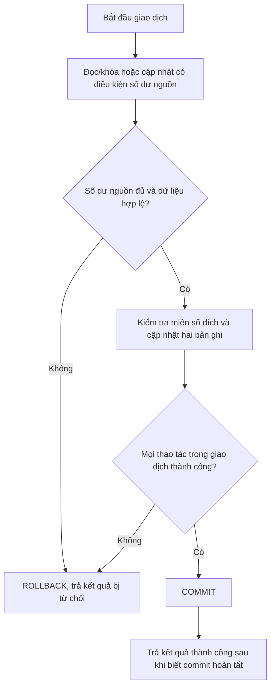
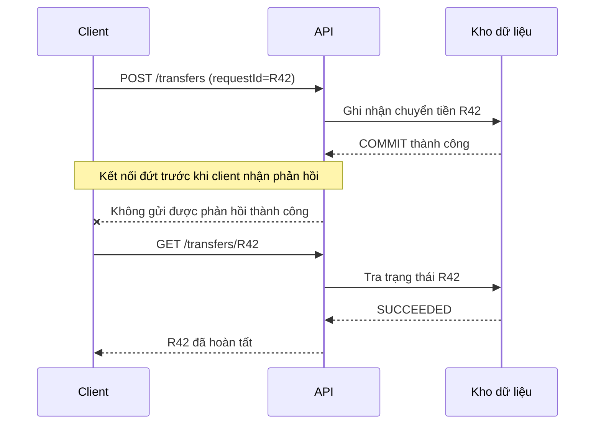

# Hậu điều kiện và bảo đảm sau khi thao tác thất bại

Một API chuyển tiền trả về lỗi. Người gọi thử lại vì tin rằng giao dịch đầu tiên chưa thực hiện, nhưng số dư lại bị trừ hai lần. Ở tình huống khác, một phương thức Java ném ngoại lệ “không đủ tiền” sau khi đã trừ số dư nguồn. Cả hai trường hợp cho thấy **biết thao tác thất bại chưa đủ**; bên gọi còn cần biết **điều gì đã thay đổi, điều gì được bảo toàn và có an toàn khi thử lại không**.

Trong chương **Hợp đồng API** của module **CODE_QUALITY_FUNDAMENTALS**, việc diễn đạt hậu điều kiện và bảo đảm khi thất bại giúp xây dựng mã nguồn **đáng tin cậy, dễ hiểu và dễ thay đổi**. Một hợp đồng tốt không chỉ mô tả kết quả lúc thành công. Nó còn làm rõ **trạng thái và tác dụng phụ có thể quan sát được sau từng loại lỗi**.

## 1. Hợp đồng API phải mô tả cả hai đường đi

**Tiền điều kiện** (*precondition*) là điều kiện đầu vào và trạng thái cần thỏa trước khi thực hiện thao tác hợp lệ. **Hậu điều kiện** (*postcondition*) là điều được bảo đảm sau khi thao tác kết thúc theo cách đã quy định. **Bất biến** (*invariant*) là quan hệ về trạng thái phải được giữ tại những ranh giới đã xác định.

Ví dụ, xét `transfer(amount)` chuyển một số tiền giữa hai số dư do cùng đối tượng quản lý. Hợp đồng minh họa:

- **Tiền điều kiện cho thành công:** `amount > 0`, số dư nguồn đủ tiền và phép cộng vào số dư đích không vượt giới hạn kiểu số.
- **Hậu điều kiện khi thành công:** số dư nguồn giảm đúng `amount`; số dư đích tăng đúng `amount`.
- **Bất biến:** hai số dư đều không âm, không có tiền tự sinh ra hay mất đi do thao tác chuyển nội bộ.
- **Bảo đảm khi bị từ chối:** nếu số tiền không hợp lệ, không đủ tiền hoặc vượt miền số, **cả hai số dư giữ nguyên**.

Viết theo ký hiệu, với `S` là số dư nguồn, `T` là số dư đích, `a` là số tiền, và `old(x)` biểu thị giá trị ngay trước lời gọi:

```text
Thành công:
    S_after = old(S) - a
    T_after = old(T) + a

Thất bại thuộc các trường hợp đã định nghĩa:
    S_after = old(S)
    T_after = old(T)
```

Ký hiệu `old` chỉ dùng để giải thích hợp đồng, **không phải cú pháp Java**. Trong hệ thống thật, hợp đồng cũng cần xác định “trạng thái quan sát được” gồm những gì: số dư trong bộ nhớ, bản ghi cơ sở dữ liệu, sự kiện đã phát, khoản tiền đã thu ở đối tác hay chỉ kết quả API.

### 1.1. Vì sao “ném ngoại lệ” chưa nói đủ?

Hai phương thức cùng ném `IllegalStateException` có thể để lại hai trạng thái khác nhau:

| Kết quả khi lỗi | Điều bên gọi biết | Điều còn phải được xác định |
| --- | --- | --- |
| Kiểm tra đầu vào rồi ném lỗi | Yêu cầu không hợp lệ | Có chắc không có cập nhật nào trước khi kiểm tra? |
| Đã sửa một trường rồi ném lỗi | Một phần thao tác có thể đã diễn ra | Bất biến nào còn đúng; có thể thử lại không? |
| Gửi lệnh đến dịch vụ ngoài rồi timeout | Không nhận được kết quả cuối cùng | Dịch vụ ngoài đã thực hiện lệnh chưa? |
| Cập nhật DB thành công, gửi thông báo thất bại | Dữ liệu chính đã đổi, tác dụng phụ phụ thất bại | Trả trạng thái nào; gửi lại thế nào để tránh lặp? |

**Ngoại lệ, mã HTTP hay thông báo lỗi** là một phần của hợp đồng, nhưng **không tự chứng minh trạng thái đã được hoàn nguyên**. Tên lỗi càng chung chung, người dùng API càng khó quyết định bước xử lý tiếp theo.

### 1.2. Tách hậu điều kiện thành công và thất bại

Có thể ghi hợp đồng theo cấu trúc:

```text
Operation: reserveStock(orderId, quantity)

Input:
    orderId hợp lệ, quantity > 0

Success:
    orderId có đúng một reservation mới với quantity đã yêu cầu;
    lượng hàng sẵn giảm tương ứng; trả reservationId.

Rejected (không đủ hàng):
    không tạo reservation; lượng hàng sẵn không đổi;
    trả mã INSUFFICIENT_STOCK.

Unknown (timeout sau khi gửi lệnh):
    chưa thể xác nhận reservation đã tạo hay chưa;
    dùng requestId để tra trạng thái, không tự tạo lệnh mới.
```

Ba kết quả này mang **nghĩa khác nhau**. Nếu không phân biệt, client có thể hiểu “không nhận được phản hồi” thành “chưa có tác dụng phụ”, dẫn đến đặt giữ hàng trùng.

## 2. Các mức bảo đảm khi thao tác thất bại

Trong lập trình có ngoại lệ, người ta thường dùng các mức **exception safety guarantees** để mô tả hậu quả của lỗi. Đây là khung tư duy hữu ích cho API, nhưng tên gọi này **không phải các mã trạng thái HTTP chuẩn** và cần được cụ thể hóa theo từng hệ thống.

| Mức bảo đảm | Sau khi thất bại, bên gọi được tin điều gì? | Ví dụ |
| --- | --- | --- |
| **Không có bảo đảm trạng thái rõ ràng** | Trạng thái có thể bị thay đổi hoặc hỏng; khó đoán các bước tiếp theo | Trừ tiền nguồn rồi lỗi trước khi cộng tiền đích |
| **Cơ bản** (*basic guarantee*) | Bất biến được giữ, tài nguyên được quản lý hợp lệ; **một phần trạng thái có thể đã thay đổi** | Một batch nhập thành công 4/10 bản ghi, còn 6 bản ghi bị từ chối; dữ liệu vẫn nhất quán |
| **Mạnh** (*strong guarantee*) | Trong phạm vi đã cam kết, lỗi để lại trạng thái **quan sát được như trước lời gọi** | Chuyển tiền bị từ chối: cả hai số dư không đổi |
| **Không ném lỗi** (*no-throw guarantee*) | Thao tác hoàn tất mà không phát sinh ngoại lệ trong mô hình lỗi và phạm vi đã quy định | Phương thức trả về trạng thái tại chỗ đã được thiết kế để không thất bại trong điều kiện dự kiến |

**Bảo đảm cơ bản không có nghĩa là thao tác “chắc chắn chưa làm gì”.** Nó chỉ bảo đảm các bất biến đã nêu vẫn đúng. Một API xử lý batch có thể cho phép **thành công một phần** nếu kết quả chỉ ra chính xác phần đã hoàn tất và phần chưa hoàn tất.

**Bảo đảm mạnh cần có phạm vi.** Chẳng hạn, thay đổi số dư giao dịch có thể được hoàn nguyên khi thất bại, nhưng log kiểm toán vẫn ghi nhận một lần thử bị từ chối. Nếu log nằm ngoài trạng thái được cam kết “không đổi”, hợp đồng phải nói rõ. Một API phát email trước khi lỗi sẽ khó bảo đảm “không có tác dụng phụ” vì không thể thu hồi email đã gửi.

**Không ném ngoại lệ cũng không đồng nghĩa luôn thành công.** Một API trả `Result.failure(...)` có thể không ném lỗi nhưng vẫn biểu diễn thất bại nghiệp vụ; nó vẫn cần quy định trạng thái còn lại. Các sự cố nghiêm trọng như mất điện hoặc hỏng tiến trình nằm ngoài giả định của nhiều bảo đảm cấp phương thức.

### 2.1. Bảo đảm nào phù hợp với loại thao tác nào?

| Loại thao tác | Hợp đồng thường hữu ích | Ranh giới cần lưu ý |
| --- | --- | --- |
| Phép tính thuần | Đầu vào sai bị từ chối, không có trạng thái ngoài bị thay đổi | Không che giấu mutable global state hoặc I/O |
| Cập nhật một đối tượng trong bộ nhớ | Bảo đảm mạnh cho các lỗi dự kiến | Khóa và khả năng quan sát từ nhiều luồng |
| Import hàng loạt | Bảo đảm cơ bản với kết quả từng bản ghi, **hoặc** mạnh với toàn batch | Phải chọn và công bố chính sách partial success |
| Thao tác trong một giao dịch DB | All-or-nothing đối với các thay đổi **thuộc đúng giao dịch đó** | Side effect ngoài DB không tự được rollback |
| Gọi dịch vụ ngoài | Hợp đồng về trạng thái thành công/thất bại/chưa rõ và cách đối soát | Timeout không xác định thành công hay thất bại |

Khi thiết kế, hãy chọn mức bảo đảm mà **người gọi thực sự cần**. Một API chỉ đọc dữ liệu thường dễ cam kết không thay đổi trạng thái hơn một quy trình nhiều dịch vụ; cố áp dụng cùng một khẩu hiệu “mọi lỗi đều rollback toàn bộ” sẽ làm sai lệch kỳ vọng.

## 3. Ví dụ Java: một thao tác chuyển số dư phải giữ bất biến

Xét mô hình học tập gồm **hai số dư không âm nằm trong cùng một đối tượng Java**. Ta chưa xét ngân hàng thật, cơ sở dữ liệu hoặc cổng thanh toán. Mô hình này giúp kiểm tra trực tiếp hậu điều kiện và bảo đảm mạnh đối với các lỗi được định nghĩa.

### 3.1. Một cách cài đặt sai: cập nhật từng phần

```java
// Ví dụ lỗi: KHÔNG dùng trong triển khai thật.
void transferBroken(long amount) {
    sourceBalance -= amount;
    if (amount > sourceBalance) {
        throw new IllegalStateException("insufficient funds");
    }
    targetBalance += amount;
}
```

Vấn đề: điều kiện được kiểm tra **sau khi đã trừ**. Với số dư nguồn ban đầu 100 và `amount = 70`, sau phép trừ `sourceBalance = 30` rồi điều kiện `70 > 30` khiến phương thức ném ngoại lệ. Kết quả là **đã mất 70 từ nguồn nhưng đích chưa nhận gì**. Ngoài ra mã chưa xét số tiền âm hay tràn số ở đích.

Sửa mỗi thông báo lỗi không giải quyết hậu quả. Cần **xác định hết điều kiện có thể từ chối trước khi cập nhật**, sau đó thực hiện phần cập nhật như một thao tác có ranh giới rõ.

### 3.2. Triển khai có bảo đảm mạnh cho lỗi dự kiến

Ví dụ chạy với Java 17 hoặc phiên bản mới hơn, tệp `TransferLedger.java`:

```java
package com.example.contracts;

public final class TransferLedger {
    private long sourceBalance;
    private long targetBalance;

    public record Balances(long source, long target) {}

    public TransferLedger(long sourceBalance, long targetBalance) {
        if (sourceBalance < 0 || targetBalance < 0) {
            throw new IllegalArgumentException("balances must be non-negative");
        }
        this.sourceBalance = sourceBalance;
        this.targetBalance = targetBalance;
    }

    public synchronized Balances snapshot() {
        return new Balances(sourceBalance, targetBalance);
    }

    public synchronized void transfer(long amount) {
        if (amount <= 0) {
            throw new IllegalArgumentException("amount must be positive");
        }
        if (amount > sourceBalance) {
            throw new IllegalStateException("insufficient funds");
        }

        // Tính hết giá trị mới trước khi sửa các trường.
        long nextSource = sourceBalance - amount;
        long nextTarget = Math.addExact(targetBalance, amount);

        sourceBalance = nextSource;
        targetBalance = nextTarget;
    }
}
```

Lập luận về tính đúng đắn:

1. Constructor từ chối số dư âm, vì vậy hai số dư ban đầu không âm.
2. `transfer` kiểm tra `amount > 0` và `amount <= sourceBalance`. Do đó `sourceBalance - amount` không âm.
3. `Math.addExact` kiểm tra tràn số khi cộng vào đích. Nếu vượt `Long.MAX_VALUE`, Java ném `ArithmeticException` **trước khi có gán trạng thái nào**.
4. Sau khi có đủ hai giá trị mới hợp lệ, hai phép gán primitive `long` không ném các lỗi nghiệp vụ vừa nêu.
5. `synchronized` khiến các lời gọi `transfer` và `snapshot` trên **chính đối tượng đó** không xen kẽ nhau; người đọc không nhận ảnh chụp trạng thái ở giữa hai phép gán khi chỉ truy cập qua các phương thức được cung cấp.

Với `S`, `T` là các số dư trước lời gọi, và `a` là số tiền hợp lệ:

```text
Khi thành công:
    source_after = S - a
    target_after = T + a
    source_after >= 0, target_after >= 0
    (source_after + target_after) trong số học chính xác
        = S + T

Khi lỗi IllegalArgumentException, IllegalStateException,
hoặc ArithmeticException trong Math.addExact:
    source_after = S
    target_after = T
```

Dòng “tổng không đổi” được hiểu theo **số học chính xác**, vì `S + T` có thể lớn hơn `Long.MAX_VALUE` dù mỗi số dư riêng vẫn biểu diễn được trong `long`. Không nên dùng phép cộng `long` thông thường để kiểm thử tổng nếu chưa bảo đảm nó không tràn số.

**Giới hạn:** mô hình này chỉ bảo vệ hai số dư nằm trong **một đối tượng của một tiến trình JVM** và các lỗi dự kiến đã liệt kê. Nó không đảm bảo giao dịch bền vững sau mất điện, không bảo vệ cùng một tài khoản được lưu ở nhiều tiến trình, và không biểu diễn các sự cố ngoài mô hình như tiến trình bị kết thúc giữa thao tác. Bảo đảm đã tuyên bố không mở rộng vô điều kiện đến toàn hệ thống.

### 3.3. Kiểm thử cả đường thành công và đường lỗi

Tệp `TransferLedgerTest.java` cùng package, dùng JUnit 5:

```java
package com.example.contracts;

import static org.junit.jupiter.api.Assertions.assertEquals;
import static org.junit.jupiter.api.Assertions.assertThrows;

import org.junit.jupiter.api.Test;

class TransferLedgerTest {
    @Test
    void transfersExactlyTheRequestedAmount() {
        TransferLedger ledger = new TransferLedger(100, 40);

        ledger.transfer(70);

        assertEquals(new TransferLedger.Balances(30, 110),
                ledger.snapshot());
    }

    @Test
    void insufficientFundsLeavesBothBalancesUnchanged() {
        TransferLedger ledger = new TransferLedger(100, 40);
        var before = ledger.snapshot();

        assertThrows(IllegalStateException.class,
                () -> ledger.transfer(101));

        assertEquals(before, ledger.snapshot());
    }

    @Test
    void invalidAmountLeavesBothBalancesUnchanged() {
        TransferLedger ledger = new TransferLedger(100, 40);
        var before = ledger.snapshot();

        assertThrows(IllegalArgumentException.class,
                () -> ledger.transfer(0));
        assertThrows(IllegalArgumentException.class,
                () -> ledger.transfer(-1));

        assertEquals(before, ledger.snapshot());
    }

    @Test
    void overflowLeavesBothBalancesUnchanged() {
        TransferLedger ledger = new TransferLedger(100, Long.MAX_VALUE);
        var before = ledger.snapshot();

        assertThrows(ArithmeticException.class,
                () -> ledger.transfer(1));

        assertEquals(before, ledger.snapshot());
    }

    @Test
    void transferOfEntireSourceBalanceIsAllowed() {
        TransferLedger ledger = new TransferLedger(100, 40);

        ledger.transfer(100);

        assertEquals(new TransferLedger.Balances(0, 140),
                ledger.snapshot());
    }
}
```

Kiểm thử `assertEquals(before, ledger.snapshot())` là một cách trực tiếp để kiểm tra **bảo đảm trạng thái không đổi khi lỗi**. Kiểm thử chỉ xem `assertThrows(...)` có thành công hay không sẽ bỏ lỡ lỗi cập nhật dở dang. Các ví dụ trên là mã học tập; chưa có kết quả chạy JUnit trong dự án thực tế và chưa bao phủ kiểm thử tranh chấp luồng hoặc lỗi hạ tầng.

## 4. Bảo đảm ở cấp cơ sở dữ liệu: rollback có phạm vi

Với cơ sở dữ liệu quan hệ, chuyển tiền giữa hai bản ghi thường cần thực hiện trong **một giao dịch phù hợp**, cùng kiểm tra điều kiện và kiểm soát truy cập đồng thời.

Sơ đồ ý tưởng:



Giao dịch tạo ranh giới cho các cập nhật **thuộc giao dịch đó**. Muốn bảo đảm hai số dư nhất quán dưới nhiều yêu cầu đồng thời, còn phải chọn cơ chế thích hợp: khóa hàng, cập nhật có điều kiện kèm kiểm tra số dòng bị ảnh hưởng, mức cô lập hoặc kiểm tra phiên bản. Một cặp `SELECT` và `UPDATE` rời rạc không tự bảo vệ khỏi hai giao dịch cùng thấy số dư cũ.

Một ví dụ SQL **mang tính ý tưởng**, không gắn với một hệ quản trị cụ thể:

```sql
-- Trong một transaction; cả hai update phải thành công
-- và thỏa các điều kiện hợp lệ trước khi COMMIT.
UPDATE wallet
SET balance = balance - :amount
WHERE wallet_id = :source_id
  AND balance >= :amount;

-- Kiểm tra số dòng được cập nhật đúng bằng 1.
-- Kiểm tra khả năng cộng ở đích theo kiểu dữ liệu/schema.
UPDATE wallet
SET balance = balance + :amount
WHERE wallet_id = :target_id;

-- Nếu bất cứ điều kiện nào không đạt: ROLLBACK.
-- Nếu mọi điều kiện đều đạt: COMMIT.
```

Đoạn trên **chưa phải mã SQL đầy đủ để chạy độc lập**: còn cần kiểm tra `amount > 0`, nguồn/đích khác nhau, tồn tại của đích, khả năng chống tràn, kiểm tra số dòng cập nhật cả hai phía, cách bắt lỗi, giao dịch và mức cô lập đúng cho DBMS. Nếu không đáp ứng, tuyên bố “mọi lỗi đều rollback” chưa được chứng minh.

### 4.1. Khi ngoại lệ xảy ra trước hoặc sau commit

| Thời điểm phát hiện lỗi | Trạng thái có thể còn lại | Bảo đảm nên ghi |
| --- | --- | --- |
| Kiểm tra đầu vào trước giao dịch | Chưa có cập nhật nào | Từ chối; không thay đổi dữ liệu |
| Trong giao dịch trước commit | Có các thay đổi chưa commit | Rollback các thay đổi thuộc giao dịch, nếu rollback hoàn tất |
| Sau khi DB đã commit nhưng trước khi phản hồi tới client | DB đã đổi, client có thể không biết | Cần truy vấn trạng thái theo định danh thao tác |
| Ghi DB xong nhưng gửi email ngoài DB thất bại | DB đã đổi; email chưa gửi hoặc trạng thái chưa rõ | Nêu rõ email được gửi lại thế nào; rollback DB không thu hồi email |
| Tiến trình chết khi commit đang diễn ra | Phản hồi có thể không cho biết DB đã commit hay chưa | Khôi phục bằng tra cứu kết quả bền vững, không suy đoán |

Ngay cả khi một lệnh `COMMIT` trả lỗi hoặc kết nối bị cắt, client **không nên mặc nhiên kết luận** giao dịch chắc chắn chưa diễn ra. Có hệ thống cần tra trạng thái hoặc đối soát bằng một mã yêu cầu ổn định. Bảo đảm mạnh trong nội bộ một transaction không tự trở thành bảo đảm mạnh đối với toàn bộ yêu cầu HTTP.

## 5. API mạng: phân biệt bị từ chối, đã thành công và chưa biết

Trong hệ thống nhiều thành phần, phản hồi mạng không phải lúc nào cũng phản ánh kết quả cuối cùng. Ví dụ trình tự:



Từ phía client, **timeout nghĩa là không nhận được phản hồi đúng hạn**. Nó không chứng minh lệnh đã thất bại; server có thể chưa nhận, đang xử lý, đã commit hoặc đã trả phản hồi nhưng phản hồi bị mất.

Vì vậy một API thao tác có tác dụng phụ thường cần ba nhóm kết quả logic:

| Nhóm | Ý nghĩa | Hành động an toàn cho bên gọi |
| --- | --- | --- |
| **SUCCEEDED** | Hệ thống đã xác nhận hậu điều kiện thành công | Nhận kết quả và không tạo lại thao tác tương đương |
| **REJECTED / FAILED với trạng thái rõ** | Hệ thống xác nhận không áp dụng thay đổi đã cam kết, hoặc công bố rõ phần đã thực hiện | Sửa đầu vào, xử lý lỗi hoặc thử lại theo chính sách |
| **PENDING / UNKNOWN** | Chưa có kết quả cuối cùng đáng tin cậy | Tra trạng thái/đối soát theo mã yêu cầu; tránh sinh thao tác mới |

Đây là **nhóm ý nghĩa nghiệp vụ**, không phải bộ mã HTTP bắt buộc. Có thể dùng `201 Created` khi tài nguyên tạo thành công, `202 Accepted` khi yêu cầu mới được nhận và đang xử lý, mã `4xx` cho lỗi đầu vào/trạng thái nghiệp vụ phù hợp, hoặc `5xx` cho lỗi hạ tầng. Nhưng **mã trạng thái không đủ**; phần mô tả API phải quy định dữ liệu trả về và ý nghĩa tác dụng phụ.

### 5.1. Ví dụ hợp đồng HTTP rõ về hậu quả khi lỗi

Giả sử API tạo chuyển tiền trả thông tin ở dạng sau:

```json
{
  "requestId": "R42",
  "status": "REJECTED",
  "error": {
    "code": "INSUFFICIENT_FUNDS",
    "message": "Số dư nguồn không đủ"
  },
  "balanceChangeApplied": false
}
```

Trường `balanceChangeApplied: false` chỉ được trả khi **server xác minh chắc chắn** chưa thực hiện thay đổi tương ứng. Nếu kết quả chưa rõ, phản hồi phải diễn đạt trạng thái chưa rõ và cung cấp cách đối soát, ví dụ:

```json
{
  "requestId": "R42",
  "status": "PENDING",
  "statusUrl": "/transfers/R42"
}
```

Không nên trả `balanceChangeApplied: false` chỉ vì tầng API bắt được `TimeoutException`. Nếu không có dữ liệu đáng tin cậy, trường ấy sẽ hứa một điều mà triển khai không thể bảo đảm.

### 5.2. Idempotency giúp giảm nguy cơ xử lý lặp

**Idempotency** là tính chất mà việc áp dụng một thao tác nhiều lần có **tác dụng đã cam kết tương đương một lần**. Ví dụ, một yêu cầu chuyển tiền gắn `requestId` hoặc khóa idempotency ổn định để server nhận ra những lần gửi lại cùng thao tác logic.

Một hợp đồng đủ rõ cần quy định:

1. **Phạm vi khóa:** khóa là duy nhất trên người dùng, tài khoản hay toàn hệ thống?
2. **Ràng buộc payload:** gửi lại cùng khóa nhưng dữ liệu khác bị từ chối hay được xử lý theo chính sách nào?
3. **Lưu trữ kết quả:** trạng thái `PENDING`/`SUCCEEDED`/`REJECTED` được ghi bền vững và liên kết với hiệu ứng chính ra sao?
4. **Thời gian duy trì:** kết quả và khóa có hiệu lực bao lâu; sau khi hết hạn bên gọi phải làm gì?
5. **Cạnh tranh đồng thời:** hai yêu cầu cùng khóa đến cùng lúc có thể cùng thực hiện hay không?

Chỉ thêm header `Idempotency-Key` mà không triển khai cơ chế ghi nhận, khóa tranh chấp và truy hồi kết quả thì **chưa tạo ra bảo đảm không thực hiện lặp**.

Phân biệt thêm: một phương thức HTTP `GET` được thiết kế không thay đổi tài nguyên theo hợp đồng HTTP, trong khi `POST` thường có tác dụng phụ. Nhưng việc retry có an toàn trong từng tình huống còn phụ thuộc **ngữ nghĩa cụ thể và cơ chế xử lý**; không suy đoán chỉ từ động từ HTTP.

## 6. Tác dụng phụ bên ngoài: không phải thứ gì cũng hoàn tác được

Một nghiệp vụ tạo đơn có thể cần lưu đơn, giữ hàng, thu tiền và gửi thông báo. Khi có lỗi sau bước thứ ba, “rollback” có thể chỉ hoàn tác phần dữ liệu cục bộ, còn **lệnh thu tiền ở nhà cung cấp đã hoàn tất**.

```text
Bước 1: Tạo đơn                 -> thành công
Bước 2: Giữ tồn kho             -> thành công
Bước 3: Thu/ủy quyền thanh toán  -> thành công
Bước 4: Ghi CONFIRMED           -> thất bại
```

Nếu trả lời “giao dịch hoàn toàn thất bại, không có gì xảy ra”, client có thể thử thanh toán lại và tạo thêm tác dụng phụ. Một hợp đồng thực tế phải có cách biểu diễn trạng thái trung gian, đối soát khoản đã thu, lệnh bù trừ khi cần và cơ chế không thực hiện lặp.

**Compensation** (thao tác bù trừ) có thể là nhả giữ hàng hoặc yêu cầu hoàn khoản thanh toán. Nó **không giống rollback nguyên tử**: thao tác bù trừ chạy sau, có thể thất bại, và những tác dụng phụ đã quan sát được (ví dụ email đã gửi) không thể biến mất. Vì vậy cần theo dõi và đối soát cho đến khi đạt trạng thái cuối cùng.

### 6.1. Trách nhiệm theo từng ranh giới

| Thành phần | Hợp đồng cần làm rõ |
| --- | --- |
| Hàm tính phí thuần | Kết quả chính xác, đầu vào hợp lệ; không có side effect |
| Đối tượng đơn hàng | Trạng thái hợp lệ và chuyển trạng thái cho phép |
| Kho dữ liệu | Điều kiện commit/rollback, khóa và tính bền vững |
| Dịch vụ thanh toán ngoài | Mã yêu cầu, kết quả đã biết/chưa rõ, đối soát và thử lại |
| Điều phối nghiệp vụ | Thứ tự bước, trạng thái trung gian, phương án bù trừ và khôi phục |
| API phục vụ client | Kết quả có ý nghĩa, cách tra cứu, hành động được phép khi lỗi |

Nếu một thành phần chỉ đảm bảo “lưu một hàng vào DB”, bên gọi không thể tự suy ra rằng “đặt hàng đã hoàn tất ở mọi dịch vụ”. Mỗi tầng cần **công bố bảo đảm đúng phạm vi** và tầng điều phối phải xác định cách kết hợp chúng.

## 7. Thiết kế bảng hậu điều kiện trước khi cài đặt

Với một API có tác dụng phụ, có thể lập bảng gồm **tình huống, tác dụng phụ, phản hồi, hành động tiếp theo**. Ví dụ minh họa cho thao tác đặt giữ tồn kho:

| Tình huống | Hậu điều kiện / trạng thái sau thao tác | Phản hồi có thể dùng | Cách xử lý |
| --- | --- | --- | --- |
| Số lượng âm hoặc bằng 0 | Không tạo reservation | Lỗi đầu vào, có thể là `400` | Gửi yêu cầu đúng |
| Không đủ tồn kho trước khi giữ | Không thay đổi hàng đã giữ | Kết quả từ chối nghiệp vụ, có thể là `409` | Điều chỉnh số lượng hoặc chờ hàng |
| Giữ hàng thành công | Có reservation ứng với `requestId`; tồn kho được trừ một lần | `201` hoặc kết quả thành công | Tiếp tục quy trình |
| Đã tiếp nhận, xử lý bất đồng bộ | Chưa cam kết đã hoàn tất | `202` kèm URL trạng thái | Tra cứu thay vì tạo yêu cầu mới |
| Timeout trên đường gọi | Trạng thái **chưa xác định** từ phía bên gọi | Không có phản hồi hoặc phản hồi báo chưa rõ | Tra cứu bằng mã idempotency |
| Gọi lại với khóa đã thành công | Không tạo reservation thứ hai | Trả lại trạng thái/kết quả đã ghi | Dùng kết quả trước |
| Gọi lại cùng khóa nhưng payload khác | Không được âm thầm tái sử dụng kết quả cho nghiệp vụ khác | Lỗi xung đột theo hợp đồng | Tạo khóa mới khi thực sự là thao tác mới |

Các mã HTTP trên là **ví dụ lựa chọn phổ biến tùy thiết kế**, không phải công thức bắt buộc. Quan trọng hơn mã số là bảo đảm nào được công bố và liệu server có dữ liệu để thực hiện bảo đảm đó hay không.

## 8. Cách kiểm thử hậu điều kiện khi thất bại

Đừng chỉ kiểm tra **thao tác đã báo lỗi**. Cần kiểm tra **trạng thái sau lỗi** và **khả năng khôi phục**:

| Mức kiểm thử | Kiểm tra nên có | Loại lỗi phát hiện |
| --- | --- | --- |
| **Unit test** | Đầu vào sai; không đủ số dư; tràn số; snapshot trước/sau | Cập nhật dở dang và vi phạm bất biến trong một đối tượng |
| **Integration test** | Lỗi trong giao dịch; một lệnh update thất bại; rollback; xung đột đồng thời | Dữ liệu bị commit một phần hoặc giao dịch cách ly không phù hợp |
| **Contract/API test** | Mã lỗi, body, `requestId`, giá trị trạng thái được xác nhận | Response hứa sai về tác dụng phụ |
| **Retry/idempotency test** | Gửi lại cùng khóa, payload giống/khác, hai request cạnh tranh | Áp dụng tác dụng phụ hai lần |
| **Failure injection** | Ngắt kết nối trước/sau commit, timeout khi gọi dịch vụ ngoài | Nhầm trạng thái không rõ thành thất bại chắc chắn |
| **End-to-end test** | Thanh toán xong nhưng ghi đơn lỗi; đối soát và bù trừ | Không có đường xử lý sau lỗi giữa nhiều dịch vụ |

### 8.1. Dùng ảnh chụp trạng thái để kiểm thử bảo đảm mạnh

Mẫu kiểm thử:

```java
var before = ledger.snapshot();

assertThrows(IllegalStateException.class,
        () -> ledger.transfer(tooLargeAmount));

assertEquals(before, ledger.snapshot());
```

Khi dữ liệu có nhiều bảng hoặc nhiều bản ghi, ảnh chụp cần bao phủ **mọi trạng thái thuộc phạm vi đã cam kết**. So sánh chỉ một trường có thể bỏ sót lỗi thay đổi ở trường khác.

### 8.2. Kiểm thử bảo đảm cơ bản khác bảo đảm mạnh

Với API nhập batch được phép **thành công một phần**, yêu cầu có thể là “bốn bản ghi đầu đã lưu và sáu bản ghi còn lại chưa được xử lý, không có bản ghi trùng, báo cáo chỉ rõ từng kết quả”. Kiểm thử phải kiểm tra **bất biến và báo cáo chính xác**, không ép toàn bộ batch giữ nguyên sau một lỗi.

Với API hứa **all-or-nothing**, chính bài kiểm thử tương tự phải xác nhận **không bản ghi nào** được commit nếu một phần thất bại. Chọn kỳ vọng sai có thể biến một triển khai đúng hợp đồng thành “lỗi giả”.

### 8.3. Chú ý các ranh giới thời điểm

Các điểm cần chủ động thử: trước khi sửa trạng thái; sau cập nhật thứ nhất nhưng trước cập nhật thứ hai; ngay trước commit; sau commit nhưng trước phản hồi; ngay sau gửi lệnh dịch vụ ngoài; và khi thao tác khôi phục thất bại. Lỗi xảy ra ở các thời điểm này thường làm lộ ra **chỗ hợp đồng chưa định nghĩa trạng thái trung gian**.

Nếu quy trình cho phép nhiều thao tác đồng thời, thêm kiểm thử hai yêu cầu cùng số dư hoặc cùng mã idempotency. Kiểm thử đơn luồng thành công **không đủ** để khẳng định tính nguyên tử dưới cạnh tranh.

## 9. Những ngộ nhận phổ biến

| Ngộ nhận | Vì sao nguy hiểm | Cách sửa cách nghĩ |
| --- | --- | --- |
| “Có exception nghĩa là không thay đổi gì.” | Có thể đã ghi DB, gọi dịch vụ khác hoặc cập nhật một phần | Đọc và kiểm chứng hậu điều kiện cho từng đường lỗi |
| “Rollback DB sẽ hoàn tác mọi thứ.” | Email, HTTP call và cập nhật hệ thống ngoài không thuộc giao dịch cục bộ | Xác định ranh giới transaction và phương án đối soát |
| “Timeout chắc chắn là thất bại.” | Yêu cầu có thể đã được xử lý, phản hồi bị mất | Dùng mã yêu cầu để tra cứu kết quả |
| “Thêm idempotency key là đủ.” | Server có thể chưa lưu kết quả hoặc chưa chống xử lý cạnh tranh | Thiết kế lưu trạng thái bền vững và chống thực hiện trùng |
| “Tất cả API phải có bảo đảm mạnh.” | Batch hoặc luồng nhiều bước có thể công bố kết quả một phần hợp lệ | Chọn mức bảo đảm theo trách nhiệm và nhu cầu bên gọi |
| “Không ném lỗi nghĩa là không thể thất bại.” | Có thể trả giá trị `Failure` hoặc trạng thái chưa rõ | Phân biệt kênh báo lỗi với hậu quả trạng thái |
| “Kiểm thử thấy lỗi là đủ.” | Không đo được dữ liệu còn lại sau lỗi | Chụp trạng thái trước/sau và kiểm tra bất biến |
| “Thử lại an toàn với mọi lỗi 5xx.” | Server có thể đã commit trước khi mất kết nối | Xác định retry policy và cách tra cứu kết quả |

## 10. Bài tập vận dụng

**Tình huống:** API `POST /enrollments` đăng ký một học viên vào lớp còn chỗ. Nghiệp vụ yêu cầu một học viên chỉ có **một đăng ký hợp lệ** cho mỗi lớp; lớp không được vượt số chỗ. API lần lượt kiểm tra còn chỗ, tạo bản ghi đăng ký, trừ số chỗ rồi gửi email.

Một số tình huống xảy ra:

1. Học viên gửi số lượng chỗ không hợp lệ.
2. Hai học viên cùng đăng ký **suất cuối**.
3. Tạo đăng ký thành công nhưng trừ số chỗ thất bại.
4. Cơ sở dữ liệu commit thành công nhưng phản hồi HTTP bị mất.
5. Email xác nhận thất bại sau khi đăng ký thành công.
6. Client gửi lại cùng yêu cầu với cùng mã idempotency, và sau đó thử cùng mã nhưng đổi học viên.

Hãy thực hiện:

1. Viết **hậu điều kiện thành công** cho đăng ký và bất biến về sức chứa, tính duy nhất.
2. Với mỗi tình huống, nêu **trạng thái có thể quan sát**, phản hồi phù hợp và liệu thao tác có thể thử lại ngay hay phải tra cứu.
3. Xác định những cập nhật nào bắt buộc nằm **trong cùng một giao dịch hoặc cập nhật có điều kiện** để giữ số chỗ và đăng ký nhất quán.
4. Chọn nơi sở hữu mã idempotency, cách lưu kết quả, cách chống hai request cùng khóa chạy đồng thời.
5. Đề xuất ít nhất **sáu kiểm thử** bao gồm đầu vào sai, đăng ký trùng, tranh chấp suất cuối, rollback, timeout sau commit và email gửi lại.

**Gợi ý tự đối chiếu:** Nếu đăng ký và trừ chỗ nằm trong cùng transaction phù hợp, lỗi trước commit có thể hoàn nguyên các thay đổi DB. Sau commit nhưng trước HTTP response, client cần **tra cứu bằng mã yêu cầu**, không gửi một thao tác mới với khóa mới. Email có thể được phát qua outbox hoặc một cơ chế gửi lại bền vững; lỗi email không nên tự động làm mất đăng ký đã hoàn tất nếu hợp đồng không quy định như vậy. Với suất cuối, phải bảo vệ **điều kiện còn chỗ tại thời điểm cập nhật** và ràng buộc duy nhất trên dữ liệu, thay vì chỉ đọc số chỗ rồi kiểm tra bằng `if` ở tầng Java.

## 11. Ghi nhớ

- **Hậu điều kiện thành công** cho biết kết quả chính xác và tác dụng phụ được phép khi thao tác hoàn tất.
- **Bảo đảm khi thất bại** cho biết trạng thái nào phải giữ nguyên, trạng thái nào có thể đã đổi, và bên gọi nên xử lý ra sao.
- **Bảo đảm mạnh** là trạng thái thuộc phạm vi cam kết không đổi sau lỗi đã xác định; **bảo đảm cơ bản** vẫn cho phép thay đổi một phần nhưng giữ bất biến.
- **Rollback có giới hạn** trong giao dịch và hệ thống cụ thể; API có tác dụng phụ ngoài ranh giới đó cần chính sách khôi phục, đối soát và idempotency.
- **Không nhận được phản hồi không chứng minh thao tác chưa xảy ra**. Trạng thái chưa rõ là một kết quả cần được thiết kế rõ.
- **Kiểm thử phải kiểm tra hậu quả sau lỗi**, không chỉ kiểm tra mã lỗi hoặc ngoại lệ.

Một hợp đồng API đáng tin cậy giúp người gọi trả lời ba câu hỏi sau mọi lời gọi: **đã hoàn tất điều gì, còn điều gì chưa chắc chắn, và bước tiếp theo nào an toàn?** Khi câu trả lời được đặc tả và kiểm chứng, thay đổi triển khai sẽ ít tạo ra lỗi khó phát hiện ở các đường thất bại.
