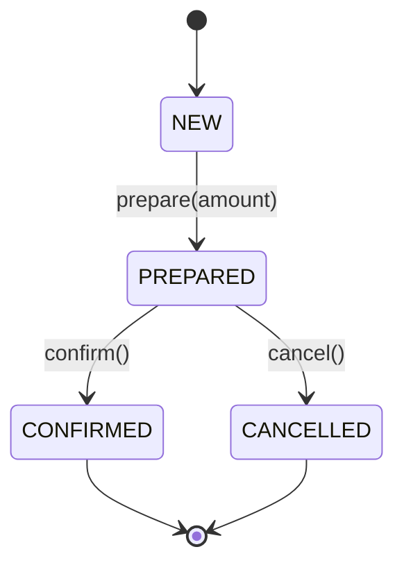
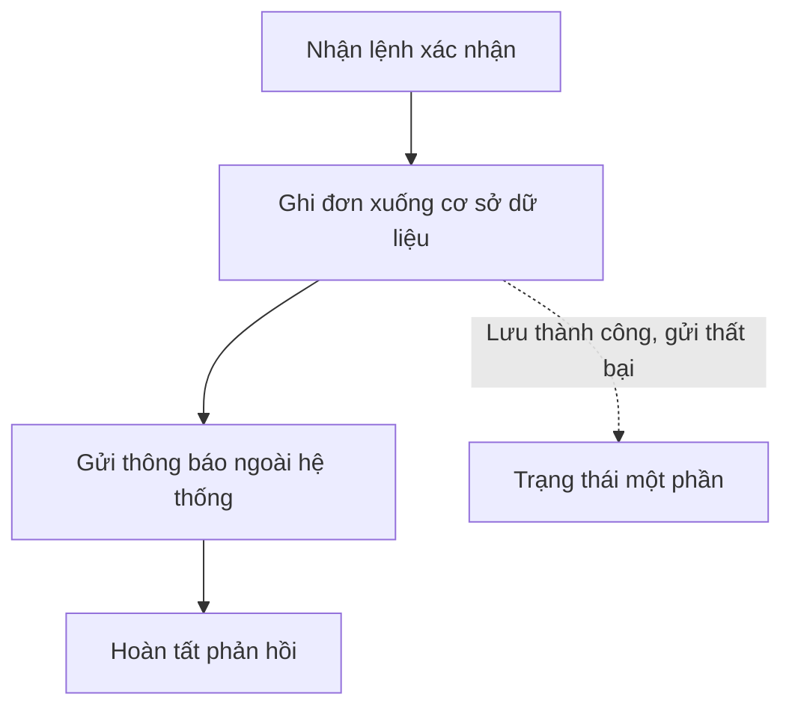

# Hợp đồng về luồng thực thi, thứ tự và tính đồng thời

Một phương thức Java có thể khai báo tham số và kiểu trả về rất rõ ràng nhưng vẫn chưa cho biết cách sử dụng an toàn. Chẳng hạn, sau khi tạo đối tượng đặt chỗ, có được gọi `confirm()` ngay không? `cancel()` có được phép gọi sau `confirm()` không? Nếu hai luồng gọi hai phương thức này cùng lúc, hệ thống bảo đảm điều gì? Một phương thức trả về `CompletableFuture` đã hoàn tất thao tác hay chỉ mới lên lịch thực hiện?

Trong chương **Hợp đồng API** của `CODE_QUALITY_FUNDAMENTALS`, chúng ta tìm hiểu **hợp đồng về luồng thực thi, thứ tự và tính đồng thời**: những quy tắc quy định *khi nào* một thao tác được gọi, *trạng thái nào* phải có trước/sau lời gọi, *các lời gọi có thể chồng lấn ra sao* và *điều gì được bảo đảm khi xử lý bất đồng bộ*. Các quy tắc này ảnh hưởng trực tiếp đến việc mã nguồn có **đáng tin cậy, dễ hiểu và dễ thay đổi** hay không.

Mục tiêu của bài học là giúp bạn thiết kế và đọc những API không chỉ đúng về chữ ký, mà còn rõ về **vòng đời, tiền điều kiện, thứ tự, quyền truy cập đồng thời, xử lý thất bại và phạm vi bảo đảm**.

## 1. Hợp đồng API không dừng ở tham số và kết quả

Hãy xem chữ ký:

```java
void confirm(String reservationId);
```

Chữ ký cho biết thao tác nhận một mã đặt chỗ và không trả giá trị, nhưng không trả lời được nhiều câu hỏi quan trọng:

- Chỉ được xác nhận sau khi đặt chỗ đã ở trạng thái `PREPARED` hay bất cứ lúc nào?
- Có thể xác nhận lặp lại không? Nếu lặp lại, lời gọi sau có gây tác dụng phụ mới không?
- Hai lời gọi `confirm` đồng thời với cùng mã đặt chỗ được xử lý thế nào?
- Khi phương thức trả về, trạng thái đã được ghi bền vững hay chỉ cập nhật trong bộ nhớ?
- Nếu xảy ra exception sau khi gọi dịch vụ bên ngoài, liệu giao dịch có thể đã hoàn tất một phần?
- Có thể gọi từ nhiều luồng không? Callback, nếu có, chạy trên luồng nào?

**Hợp đồng thực thi** là phần mô tả những quy tắc mà bên gọi và bên triển khai cùng phải tuân theo để hành vi có thể dự đoán được. Nó bổ sung cho hợp đồng kiểu dữ liệu.

| Thành phần của hợp đồng | Câu hỏi cần làm rõ | Ví dụ |
| --- | --- | --- |
| **Tiền điều kiện (precondition)** | Điều gì phải đúng trước lời gọi? | Chỉ `confirm()` khi đã `prepare()` thành công |
| **Hậu điều kiện (postcondition)** | Sau khi thành công, trạng thái nào được bảo đảm? | Trạng thái chuyển thành `CONFIRMED` |
| **Thứ tự (ordering)** | Các thao tác phải xảy ra theo trình tự nào? | Phải lưu đơn thành công trước khi gửi xác nhận |
| **Tính nguyên tử (atomicity)** | Có thể quan sát trạng thái trung gian hay không? | Kiểm tra và chuyển trạng thái dưới cùng khóa |
| **Đồng thời (concurrency)** | Những lời gọi đồng thời có được phép và có an toàn không? | Mỗi instance cho phép nhiều luồng gọi nhưng chỉ một chuyển trạng thái thành công |
| **Khả năng nhìn thấy (visibility)** | Khi một luồng cập nhật, luồng khác thấy kết quả theo quy tắc nào? | Truy cập trạng thái dưới cùng monitor |
| **Thất bại (failure semantics)** | Khi lỗi, trạng thái có thay đổi không? | Lời gọi sai thứ tự ném `IllegalStateException` và giữ trạng thái cũ |
| **Phạm vi bảo đảm (scope)** | Quy tắc đúng trong một object, một JVM hay nhiều tiến trình? | `synchronized` chỉ phối hợp các luồng trên cùng instance |

Nếu hợp đồng không nói rõ các yếu tố quan trọng, mỗi người sử dụng có thể tự suy đoán và viết mã dựa trên một giả định khác nhau. Lỗi dễ xuất hiện khi hệ thống chuyển từ thử nghiệm tuần tự sang môi trường nhiều yêu cầu đồng thời.

## 2. Hợp đồng về thứ tự: một API có vòng đời

Một số API chỉ có ý nghĩa nếu phương thức được gọi theo trình tự hợp lệ. Ví dụ:

- Kết nối: `open → use → close`.
- Giao dịch: `begin → write → commit/rollback`.
- Quy trình đặt chỗ: `prepare → confirm/cancel`.
- Tải tệp nhiều phần: `start → uploadPart → complete`.

Đây là **hợp đồng theo thời gian (temporal contract)**: tính hợp lệ của một lời gọi phụ thuộc vào **lịch sử các lời gọi trước đó**, không chỉ phụ thuộc vào giá trị tham số.

### 2.1. Biểu diễn vòng đời bằng máy trạng thái

Giả sử một đối tượng đặt chỗ có bốn trạng thái:

| Trạng thái | Ý nghĩa | Thao tác tiếp theo hợp lệ |
| --- | --- | --- |
| `NEW` | Vừa tạo, chưa chuẩn bị | `prepare(amount)` |
| `PREPARED` | Đã chuẩn bị với số tiền hợp lệ | `confirm()` hoặc `cancel()` |
| `CONFIRMED` | Đã xác nhận, trạng thái kết thúc | Không có thao tác chuyển trạng thái tiếp |
| `CANCELLED` | Đã hủy, trạng thái kết thúc | Không có thao tác chuyển trạng thái tiếp |



Bất cứ lời gọi nào không tương ứng với mũi tên được cho phép đều là **sai thứ tự** trong hợp đồng minh họa này. Chẳng hạn, `confirm()` trước `prepare()` hoặc `cancel()` sau `confirm()` phải được xử lý rõ thay vì âm thầm cho qua.

Một API không có ranh giới trạng thái dễ xuất hiện lỗi như xác nhận hai lần, hủy một giao dịch đã hoàn tất hoặc ghi đè trạng thái cuối cùng bằng cập nhật đến muộn.

### 2.2. Ví dụ Java 17: trạng thái và chuyển đổi được bảo vệ

Để tập trung vào hợp đồng, ví dụ chỉ thay đổi **trạng thái trong bộ nhớ của một instance**, không xử lý thanh toán hoặc lưu dữ liệu thực.

```java
enum ReservationState {
    NEW, PREPARED, CONFIRMED, CANCELLED
}

/**
 * Quy trình đặt chỗ chỉ trong bộ nhớ của một instance.
 *
 * <p>Vòng đời: NEW -> PREPARED -> CONFIRMED hoặc CANCELLED.
 * Mỗi phương thức chuyển trạng thái là nguyên tử đối với các phương thức
 * khác trên cùng instance; nhiều luồng có thể gọi đồng thời.
 *
 * <p>Không bảo đảm lưu bền vững hoặc điều phối giữa các JVM khác nhau.
 */
final class ReservationWorkflow {
    private ReservationState state = ReservationState.NEW;
    private long amountVnd;

    /**
     * @throws IllegalStateException nếu trạng thái khác NEW
     * @throws IllegalArgumentException nếu amountVnd không dương
     */
    synchronized void prepare(long amountVnd) {
        requireState(ReservationState.NEW);
        if (amountVnd <= 0) {
            throw new IllegalArgumentException("Amount must be positive");
        }

        this.amountVnd = amountVnd;
        state = ReservationState.PREPARED;
    }

    /**
     * @throws IllegalStateException nếu chưa PREPARED hoặc đã kết thúc
     */
    synchronized void confirm() {
        requireState(ReservationState.PREPARED);
        state = ReservationState.CONFIRMED;
    }

    /**
     * @throws IllegalStateException nếu chưa PREPARED hoặc đã kết thúc
     */
    synchronized void cancel() {
        requireState(ReservationState.PREPARED);
        state = ReservationState.CANCELLED;
    }

    synchronized ReservationState state() {
        return state;
    }

    synchronized long preparedAmountVnd() {
        if (state == ReservationState.NEW) {
            throw new IllegalStateException("Reservation not prepared");
        }
        return amountVnd;
    }

    private void requireState(ReservationState expected) {
        if (state != expected) {
            throw new IllegalStateException(
                    "Expected " + expected + ", actual " + state);
        }
    }
}
```

**Điểm cần quan sát:**

1. `prepare` chỉ thành công ở trạng thái `NEW` và chỉ lưu số tiền dương.
2. `confirm` và `cancel` chỉ thành công ở `PREPARED`. Hai thao tác là **hai nhánh loại trừ nhau**, mỗi instance chỉ đi vào một trạng thái cuối.
3. Lời gọi sai thứ tự ném `IllegalStateException`; phần kiểm tra thực hiện trước khi sửa trạng thái, nên lỗi theo đường này **không làm thay đổi trạng thái**.
4. Các phương thức đọc và ghi trạng thái đều `synchronized`, sử dụng **monitor của cùng instance**.
5. Phương thức `preparedAmountVnd` minh họa hợp đồng đọc: trước `prepare` thì không có số tiền hợp lệ để trả; sau đó số tiền vẫn có thể được đọc, kể cả ở trạng thái cuối. Đây là lựa chọn cụ thể của API minh họa.

**Lưu ý về ý nghĩa:** `confirm()` ở ví dụ chỉ cập nhật trường `state` trong bộ nhớ. Không được hiểu nó đã xác nhận đặt chỗ bền vững trên cơ sở dữ liệu hay thu tiền thành công. Muốn có những bảo đảm đó phải thiết kế thêm hợp đồng của hệ thống lưu trữ, giao dịch và dịch vụ bên ngoài.

### 2.3. Tên và Javadoc phải thể hiện hợp đồng

Một mô tả kiểu “Xác nhận đặt chỗ” là chưa đủ khi thao tác phụ thuộc vào trạng thái. Javadoc nên nói rõ **tiền điều kiện**, **kết quả thành công**, **cách báo lỗi** và **đặc tính đồng thời** có ý nghĩa.

Ví dụ:

```java
/**
 * Chuyển PREPARED thành CONFIRMED trong bộ nhớ.
 *
 * <p>Chỉ một trong confirm() hoặc cancel() có thể chuyển thành công
 * trên cùng instance. Nếu hai lời gọi đến đồng thời, thao tác lấy
 * monitor trước được xử lý trước; thứ tự đến của các luồng không
 * được bảo đảm.
 *
 * @throws IllegalStateException nếu trạng thái hiện tại không là PREPARED
 */
synchronized void confirm() {
    // Triển khai chuyển trạng thái ở ví dụ phía trên.
}
```

Đây là **mẫu Javadoc minh họa**, không phải bản định nghĩa phương thức thứ hai cần thêm vào lớp. Nội dung nói rõ điều bên gọi có thể dựa vào và điều không nên suy ra.

Comment nên giải thích những quy tắc **khó suy ra trực tiếp từ chữ ký**. Không cần ghi “increment counter” phía trên mỗi phép cộng, nhưng cần ghi “không được xác nhận lần hai” nếu đó là một phần hợp đồng nghiệp vụ.

## 3. Tính đồng thời: an toàn luồng không đồng nghĩa với thứ tự mong muốn

**Thread-safe (an toàn luồng)** nghĩa là một thành phần đáp ứng hợp đồng đã công bố khi được truy cập đồng thời theo cách hợp lệ. Điều đó **không** có nghĩa mọi thao tác sẽ diễn ra theo thứ tự người dùng mong đợi.

Trong `ReservationWorkflow`, nếu hai luồng cùng gọi `confirm()` và `cancel()` khi trạng thái đang là `PREPARED`:

- Một trong hai phương thức giành được monitor trước, kiểm tra trạng thái và chuyển sang trạng thái cuối.
- Phương thức còn lại giành monitor sau, thấy trạng thái đã đổi và ném `IllegalStateException`.
- Kết quả cuối sẽ là `CONFIRMED` **hoặc** `CANCELLED`, tùy thứ tự thực thi thực tế.
- Không có cam kết luồng gọi `confirm()` trước về mặt thời gian thực sẽ luôn được xử lý trước, trừ khi có cơ chế điều phối thứ tự được thiết kế riêng.

`synchronized` giúp đảm bảo **không xảy ra hai chuyển trạng thái thành công** trên cùng instance. Nó không quyết định **nhánh nào phải thắng** nếu hai yêu cầu đến đồng thời.

### 3.1. Kiểm thử thứ tự tuần tự

```java
import static org.junit.jupiter.api.Assertions.assertEquals;
import static org.junit.jupiter.api.Assertions.assertThrows;

import org.junit.jupiter.api.Test;

class ReservationWorkflowTest {
    @Test
    void requiresPrepareBeforeConfirmAndRejectsLaterCancel() {
        ReservationWorkflow workflow = new ReservationWorkflow();

        assertThrows(IllegalStateException.class, workflow::confirm);
        assertEquals(ReservationState.NEW, workflow.state());

        workflow.prepare(150_000L);
        assertEquals(150_000L, workflow.preparedAmountVnd());
        workflow.confirm();

        assertEquals(ReservationState.CONFIRMED, workflow.state());
        assertThrows(IllegalStateException.class, workflow::cancel);
        assertEquals(ReservationState.CONFIRMED, workflow.state());
    }

    @Test
    void rejectedPrepareDoesNotAdvanceState() {
        ReservationWorkflow workflow = new ReservationWorkflow();

        assertThrows(IllegalArgumentException.class,
                () -> workflow.prepare(0L));
        assertEquals(ReservationState.NEW, workflow.state());
    }
}
```

Kiểm thử JUnit 5 xác nhận các tiền điều kiện và hậu điều kiện có thể quan sát được. Đặc biệt, sau khi một lời gọi bị từ chối, trạng thái vẫn phải đúng như hợp đồng.

### 3.2. Kiểm thử cạnh tranh mà không giả định luồng thắng

Một kiểm thử nhiều luồng nên kiểm tra **bất biến** mà hệ thống hứa hẹn, thay vì giả định bộ lập lịch sẽ cho một luồng cụ thể chạy trước. Đoạn sau kiểm tra rằng chỉ một trong hai lời gọi kết thúc thành công:

```java
import static org.junit.jupiter.api.Assertions.assertEquals;
import static org.junit.jupiter.api.Assertions.assertTrue;

import java.util.concurrent.CountDownLatch;
import java.util.concurrent.ExecutorService;
import java.util.concurrent.Executors;
import java.util.concurrent.Future;
import java.util.concurrent.TimeUnit;
import org.junit.jupiter.api.Test;

class ReservationWorkflowConcurrentTest {
    @Test
    void onlyOneTerminalTransitionSucceeds() throws Exception {
        ReservationWorkflow workflow = new ReservationWorkflow();
        workflow.prepare(150_000L);

        CountDownLatch start = new CountDownLatch(1);
        ExecutorService pool = Executors.newFixedThreadPool(2);

        try {
            Future<Boolean> confirmed = pool.submit(() -> {
                start.await();
                try {
                    workflow.confirm();
                    return true;
                } catch (IllegalStateException rejected) {
                    return false;
                }
            });

            Future<Boolean> cancelled = pool.submit(() -> {
                start.await();
                try {
                    workflow.cancel();
                    return true;
                } catch (IllegalStateException rejected) {
                    return false;
                }
            });

            start.countDown();

            int successCount =
                    (confirmed.get(5, TimeUnit.SECONDS) ? 1 : 0)
                    + (cancelled.get(5, TimeUnit.SECONDS) ? 1 : 0);

            assertEquals(1, successCount);
            assertTrue(workflow.state() == ReservationState.CONFIRMED
                    || workflow.state() == ReservationState.CANCELLED);
        } finally {
            pool.shutdownNow();
        }
    }
}
```

`CountDownLatch` cho hai công việc chờ cùng một tín hiệu bắt đầu. Nó **không cam kết hai CPU thực thi đúng cùng một thời điểm**, nhưng giúp kiểm tra các kết quả cho phép khi có cạnh tranh. `Future.get(timeout)` tránh chờ vô hạn trong kiểm thử. Bộ kiểm thử này chứng minh hành vi cho những lần chạy được thực hiện; một lần chạy thành công **không phải bằng chứng toán học** rằng không thể tồn tại race condition nào khác.

Nếu hợp đồng yêu cầu `confirm` luôn ưu tiên `cancel` hoặc yêu cầu xử lý theo **thứ tự nhận yêu cầu**, thiết kế hiện tại **chưa đủ**. Khi đó cần hàng đợi, cơ chế quyết định thứ tự hoặc một bộ xử lý tuần tự có hợp đồng rõ.

## 4. Tính nguyên tử, khả năng nhìn thấy và tính thứ tự trong Java

Ba khái niệm thường bị nhập nhằng khi đánh giá mã nhiều luồng:

| Thuộc tính | Câu hỏi | Ví dụ |
| --- | --- | --- |
| **Atomicity** | Một thao tác có bị quan sát hoặc chen ngang ở trạng thái trung gian không? | Kiểm tra `available > 0` và giảm tồn kho trong cùng vùng khóa |
| **Visibility** | Luồng khác có thấy giá trị cập nhật theo các quy tắc bộ nhớ không? | Ghi dưới monitor và đọc dưới cùng monitor |
| **Ordering** | Các thao tác có quan hệ trước–sau nào được đảm bảo? | Xử lý `prepare` hoàn tất trước khi gọi `confirm` trên cùng luồng |

Java Memory Model định nghĩa những quan hệ **happens-before** giúp lập trình viên xác định thay đổi khi nào được nhìn thấy bởi các luồng khác. Một ví dụ quan trọng: việc nhả monitor bằng `synchronized` *happens-before* một lần lấy lại chính monitor đó sau này. Do đó, khi mọi truy cập liên quan được đồng bộ nhất quán, luồng sau thấy các cập nhật phù hợp với hợp đồng khóa.

### 4.1. `volatile` đảm bảo điều gì?

`volatile` hữu ích cho một số cờ trạng thái đơn giản khi nhiều luồng cần quan sát thay đổi:

```java
final class StopSignal {
    private volatile boolean stopRequested;

    void requestStop() {
        stopRequested = true;
    }

    boolean shouldStop() {
        return stopRequested;
    }
}
```

Một lần ghi vào trường `volatile` *happens-before* các lần đọc trường đó ở phía sau theo thứ tự đồng bộ của Java Memory Model. Điều này hỗ trợ khả năng nhìn thấy cờ dừng giữa các luồng.

Nhưng **`volatile` không tự biến thao tác đọc–sửa–ghi phức hợp thành nguyên tử**:

```java
final class UnsafeCounter {
    private volatile int count;

    void increment() {
        count++;  // Đọc, cộng, ghi: có thể mất cập nhật khi chạy đồng thời.
    }

    int count() {
        return count;
    }
}
```

Hai luồng có thể cùng đọc `count == 0` rồi đều ghi `1`, dù kỳ vọng tổng là `2`. Với bộ đếm đơn giản, `AtomicInteger.incrementAndGet()` có thể phù hợp. Với bất biến nhiều trường hoặc nhiều thao tác, cần một cơ chế phối hợp bảo vệ **toàn bộ điều kiện và chuyển đổi**, chẳng hạn khóa hoặc giao dịch.

### 4.2. Collection đồng thời chưa bảo đảm toàn bộ nghiệp vụ là nguyên tử

`ConcurrentHashMap` hỗ trợ truy cập đồng thời an toàn cho các thao tác mà API định nghĩa. Nhưng một quy trình như:

```java
if (!cache.containsKey(key)) {
    cache.put(key, computeValue());
}
```

không tự bảo đảm chỉ một luồng thực hiện `computeValue()`, vì có khoảng trống giữa kiểm tra và ghi. Khi hợp đồng yêu cầu thao tác kết hợp, xem xét `computeIfAbsent` theo ngữ nghĩa phù hợp và xác nhận các ràng buộc về hàm mapping, tác dụng phụ và khả năng thực thi lại. Không nên đưa các thao tác I/O khó kiểm soát vào những callback nguyên tử của collection nếu chưa hiểu rõ ngữ nghĩa và tác động khóa/chờ.

## 5. Hợp đồng bất đồng bộ: thứ tự phụ thuộc khác với chạy song song

API bất đồng bộ tạo thêm một lớp hợp đồng: **lúc nào công việc bắt đầu**, **lúc nào một stage được coi là hoàn tất**, **stage tiếp theo có phụ thuộc stage trước không**, **lỗi lan truyền thế nào** và **callback chạy ở đâu**.

### 5.1. Ví dụ: lưu đơn xong mới gửi xác nhận

Đối với một ứng dụng nội bộ đơn giản, giả sử cần lưu đơn trước rồi mới gửi thông báo xác nhận.

```java
import java.util.Objects;
import java.util.concurrent.CompletableFuture;
import java.util.concurrent.Executor;

record Order(String id) {}

interface OrderStore {
    void save(Order order);
}

interface ConfirmationSender {
    void send(Order order);
}

final class SaveThenNotify {
    private final OrderStore store;
    private final ConfirmationSender sender;
    private final Executor executor;

    SaveThenNotify(
            OrderStore store,
            ConfirmationSender sender,
            Executor executor) {
        this.store = Objects.requireNonNull(store);
        this.sender = Objects.requireNonNull(sender);
        this.executor = Objects.requireNonNull(executor);
    }

    /**
     * Lưu đơn rồi gửi xác nhận sau khi lưu thành công.
     *
     * <p>Future hoàn tất bình thường sau khi cả hai thao tác kết thúc.
     * Nếu lưu thất bại, bước gửi không được chạy.
     * Nếu gửi thất bại, đơn có thể đã được lưu.
     */
    CompletableFuture<Void> saveThenNotify(Order order) {
        Objects.requireNonNull(order, "order");

        return CompletableFuture
                .runAsync(() -> store.save(order), executor)
                .thenRunAsync(() -> sender.send(order), executor);
    }
}
```

Ở đây:

- `runAsync` lên lịch công việc lưu đơn qua executor được truyền vào.
- `thenRunAsync` chỉ chạy bước gửi sau khi stage lưu **hoàn tất bình thường**. Nó biểu diễn rõ quan hệ phụ thuộc **save → notify**.
- Nếu `store.save` ném exception, chuỗi future kết thúc bất thường và bước gửi bị bỏ qua.
- Nếu `sender.send` thất bại, future trả về thất bại **sau khi bước lưu đã có thể hoàn thành**. Không được suy ra toàn bộ quy trình đã được rollback.
- Đối tượng `Order` là một `record` chứa `String` bất biến trong ví dụ, nên không bị thay đổi sau khi giao cho công việc bất đồng bộ. Với dữ liệu mutable, cần xác định bên nào sở hữu snapshot trước khi xếp hàng.

**Quan trọng:** Gọi `saveThenNotify(order)` trả về một `CompletableFuture` thường **trước khi công việc hoàn tất**. Nếu một API HTTP trả “đã xử lý thành công” ngay sau lời gọi này mà chưa theo dõi kết quả, hợp đồng công khai có thể gây hiểu lầm.

### 5.2. Những cách kết hợp future khác nhau bảo đảm điều gì?

| Cách kết hợp | Hành vi chính | Cạm bẫy |
| --- | --- | --- |
| `thenApply` / `thenRun` | Bước sau phụ thuộc kết quả hoàn tất bình thường của bước trước | Không mặc định tạo luồng mới; callback có thể chạy trên luồng hoàn tất stage hoặc luồng đăng ký nếu stage đã xong |
| `thenApplyAsync(..., executor)` / `thenRunAsync(..., executor)` | Bước sau được lên lịch bất đồng bộ trên executor được chỉ định khi điều kiện kích hoạt đạt | Lên lịch không có nghĩa ngay lập tức được CPU chạy |
| `thenCompose` | Nối một stage tạo ra `CompletionStage` khác thành một chuỗi phụ thuộc | Cần xử lý cả lỗi và việc hủy theo hợp đồng |
| `CompletableFuture.allOf(a, b)` | Tạo stage tổng hợp hoàn tất khi các stage đầu vào hoàn tất, trừ ngữ nghĩa thất bại tương ứng | Không có nghĩa `a` chạy trước `b`; chúng có thể chạy đồng thời |
| `exceptionally` / `handle` | Xử lý lỗi hoặc kết quả ở một stage | Nếu trả giá trị thay thế, có thể biến thất bại thành kết quả thành công; phải diễn đạt rõ chính sách |

Nếu thứ tự là yêu cầu nghiệp vụ, hãy **mã hóa phụ thuộc vào cấu trúc future** thay vì giả định thứ tự nộp hai công việc cho executor cũng là thứ tự chúng hoàn tất.

### 5.3. Callback, thread affinity và reentrancy

Một API nhận callback cần nói rõ ít nhất:

- Callback có thể được gọi **đồng bộ ngay trong lời gọi đăng ký**, hay chỉ sau này?
- Callback có thể chạy trên **luồng nào**? Trên một executor riêng, trên luồng I/O hay trên luồng gọi?
- Callback có được gọi nhiều lần không và có thể chồng lấn với chính nó không?
- Callback có thể gọi lại vào API đang thực hiện callback hay không (**reentrancy**)?
- Khi callback ném exception, API xử lý thế nào?

Ví dụ, giao diện GUI thường yêu cầu cập nhật trạng thái hiển thị trên luồng UI. Một thư viện phát sự kiện từ luồng nền mà không công bố đặc tính đó có thể khiến người sử dụng vô tình cập nhật UI sai luồng.

Trong Java, các continuation dạng không có hậu tố `Async` của `CompletableFuture` **không hứa luôn chạy trên luồng gọi**. Nếu cần xác định executor, truyền executor tường minh vào phương thức `...Async` thích hợp; vẫn cần quản lý vòng đời executor và áp lực tải.

## 6. Chia sẻ trạng thái giữa tác vụ bất đồng bộ

Ngay cả khi thứ tự future đã rõ, dữ liệu truyền qua các stage vẫn cần có hợp đồng sở hữu.

Ví dụ:

```java
import java.util.ArrayList;
import java.util.List;
import java.util.concurrent.CompletableFuture;

List<String> mutableSkus = new ArrayList<>(List.of("SKU-A"));

CompletableFuture<Void> work = CompletableFuture.runAsync(() -> {
    // Dữ liệu đọc được phụ thuộc thời điểm công việc thực sự chạy.
    System.out.println(mutableSkus);
});

mutableSkus.add("SKU-B");
```

Hai thao tác `runAsync` và `add` có thể xen kẽ. Nếu bên gọi sửa `mutableSkus` trong khi tác vụ đang đọc, trạng thái quan sát có thể thay đổi theo lịch chạy và có thể có data race. Tham chiếu được lambda giữ lại **không phải snapshot**.

Nếu tác vụ cần dữ liệu cố định tại thời điểm đặt lịch, có thể tạo một bản chụp:

```java
List<String> snapshot = List.copyOf(mutableSkus);

CompletableFuture<Void> work = CompletableFuture.runAsync(() -> {
    System.out.println(snapshot);
});
```

Vì phần tử `String` bất biến và danh sách snapshot không cho sửa, mã đọc có hợp đồng ổn định hơn. Nếu phần tử bên trong là đối tượng mutable, `List.copyOf` **không sao chép sâu**; cần xem lại quyền sở hữu hoặc kiểu dữ liệu.

## 7. Tính nguyên tử trong một JVM khác với giao dịch phân tán

Một lỗi thiết kế thường gặp là chuyển logic vào một phương thức `synchronized` rồi xem toàn bộ nghiệp vụ đã nguyên tử, kể cả gọi cơ sở dữ liệu và dịch vụ ngoài.

Thực tế, `synchronized` trên instance chỉ điều phối **các luồng dùng chung monitor đó trong cùng JVM**. Nó không cung cấp giao dịch giữa nhiều database, không khóa được instance tương ứng ở máy chủ khác và không tự hoàn tác email đã gửi.

Xét một quy trình:



Nếu `B` thành công và `C` thất bại, cần có quy tắc: đơn được xem là đã tạo chưa, có gửi lại thông báo không, làm sao tránh gửi trùng? Khóa Java không trả lời được những câu hỏi này.

Trong hệ thống phân tán, hợp đồng có thể cần:

- **Transaction** trong cơ sở dữ liệu để giữ bất biến của một đơn vị dữ liệu.
- **Optimistic locking/version** để phát hiện cập nhật đồng thời vào cùng tài nguyên.
- **Idempotency key** hoặc định danh thao tác để tránh thực hiện lặp một hành động có tác dụng phụ.
- **Outbox hoặc hàng đợi** để xử lý việc phát sự kiện/thông báo khi hệ thống khác tạm lỗi.
- **Cơ chế kiểm tra trạng thái** khi timeout khiến kết quả ở phía dịch vụ ngoài chưa xác định.

Không có giải pháp nào trong số này tự đảm bảo mọi thao tác phân tán là “exactly once” chỉ bằng một tên gọi. Phải mô tả **phạm vi đảm bảo, trường hợp thất bại và trách nhiệm xử lý trùng lặp** theo kiến trúc cụ thể.

### 7.1. Thứ tự cập nhật giữa nhiều yêu cầu HTTP

Giả sử hai client gần như đồng thời gửi lệnh cập nhật đơn hàng:

1. Client A đổi địa chỉ giao hàng.
2. Client B hủy đơn.

Nếu không có hợp đồng về cạnh tranh, kết quả có thể phụ thuộc thứ tự xử lý tại server. Thứ tự gói tin tới một proxy hoặc việc A bấm nút trước **không mặc nhiên** bảo đảm lệnh A được commit trước trong cơ sở dữ liệu.

Một hợp đồng rõ có thể dùng **version của tài nguyên**: client gửi phiên bản đã đọc, server chỉ cập nhật nếu phiên bản hiện tại còn đúng. Khi version không khớp, server trả lỗi xung đột thích hợp để client đọc lại và quyết định. Dù vậy, version không thay thế quy tắc nghiệp vụ về việc “đơn đã hủy thì có thể đổi địa chỉ không?”.

Nếu API yêu cầu “hủy phải được xử lý trước cập nhật địa chỉ”, nhóm phải thiết kế cơ chế **quyết định thứ tự có thẩm quyền** ở nơi sở hữu trạng thái. Không nên ngầm dựa vào tốc độ mạng, thứ tự callback hoặc khóa của một process đơn lẻ.

## 8. Những từ dễ gây hiểu nhầm trong hợp đồng đồng thời

Một số thuật ngữ nên được dùng chính xác:

| Thuật ngữ | Ý nghĩa cần kiểm tra | Không được tự suy ra |
| --- | --- | --- |
| **Thread-safe** | Hành vi đáp ứng hợp đồng khi nhiều luồng truy cập đúng cách | Tất cả lời gọi có thứ tự nghiệp vụ như mong muốn |
| **Atomic** | Phạm vi thao tác được quan sát như một đơn vị | Các tác dụng phụ ngoài JVM được rollback theo |
| **Non-blocking** | Thuật toán/API không chặn luồng theo nghĩa đã định | Không có độ trễ hoặc không dùng bất kỳ tài nguyên nào |
| **Asynchronous** | Công việc và việc nhận kết quả có thể tách rời theo thời gian | Công việc đã hoàn tất khi phương thức trả về |
| **Idempotent** | Thực hiện lặp cùng thao tác cho cùng tác động quan sát theo hợp đồng | Không phát sinh thêm log, chi phí hoặc sự kiện phụ trong mọi trường hợp |
| **Ordered** | Có quan hệ thứ tự được định nghĩa cho một phạm vi cụ thể | Mọi yêu cầu toàn hệ thống đều theo thứ tự thời gian thực |
| **Immutable** | Trạng thái quan sát của đối tượng không đổi | Mọi thành phần bên trong tự động bất biến sâu |
| **Eventually consistent** | Những bản sao có thể hội tụ theo các giả định cụ thể | Đọc ngay lập tức đã thấy cập nhật mới |

Một API ghi “thread-safe” mà không nêu **instance nào**, **thao tác nào** và **khi nào** có thể được gọi vẫn là tài liệu thiếu. Tương tự, “thực hiện theo thứ tự” cần nêu đó là **thứ tự gửi, thứ tự bắt đầu, thứ tự commit hay thứ tự phát sự kiện**.

## 9. Các sai lầm thường gặp

### 9.1. Nghĩ rằng truyền tham số `final` khiến đối tượng không đổi

`final` ngăn gán lại biến hoặc trường tham chiếu, không ngăn thay đổi nội dung `ArrayList` hay đối tượng mutable được tham chiếu. Nếu một tác vụ nền cần snapshot, phải thiết kế hợp đồng sao chép và sở hữu dữ liệu.

### 9.2. Chỉ kiểm tra trạng thái ở phía client

Client có thể kiểm tra “đang ở PREPARED” rồi cho phép `confirm()`, nhưng trạng thái trên server có thể đã đổi do yêu cầu khác. **Ranh giới có thẩm quyền xử lý chuyển trạng thái** cần xác nhận lại tiền điều kiện theo cơ chế nguyên tử thích hợp.

### 9.3. Dùng `Thread.sleep` để “đảm bảo bước A xong trước B”

Tạm dừng một khoảng thời gian không xác lập quan hệ hoàn tất giữa hai công việc. Khi cần chờ, dùng hợp đồng hoàn thành (future, latch, join, message acknowledgment hoặc transaction) phù hợp; khi cần thứ tự, mã hóa quan hệ phụ thuộc trực tiếp.

### 9.4. Đồng bộ một phần của một thao tác lớn

Khóa chỉ quanh `get` nhưng để `put` ở ngoài vẫn có thể cho phép hai luồng xen vào và vi phạm bất biến. Khóa phải bảo vệ **toàn bộ bước kiểm tra–quyết định–cập nhật**; với nhiều trạng thái chung, quy tắc khóa phải nhất quán.

### 9.5. Gọi dịch vụ mạng trong vùng khóa quá rộng

Giữ monitor trong khi gọi mạng có thể làm các luồng khác chờ rất lâu và tăng nguy cơ deadlock hoặc nghẽn tài nguyên. Thường nên tách bước cập nhật trạng thái trong bộ nhớ khỏi I/O, sau đó dùng trạng thái trung gian, transaction hoặc cơ chế phối hợp phù hợp. Cách tách phải giữ đúng bảo đảm nghiệp vụ, không chỉ chuyển lời gọi ra khỏi `synchronized` một cách máy móc.

### 9.6. Nuốt lỗi của tác vụ bất đồng bộ

Nếu gọi `saveThenNotify` nhưng bỏ qua future trả về, hệ thống có thể không phát hiện việc lưu hoặc gửi thất bại. Thiết kế cần nêu ai chịu trách nhiệm quan sát kết quả, ghi lỗi, thử lại và quyết định phản hồi cho người dùng.

### 9.7. Coi lỗi timeout là chắc chắn thao tác chưa diễn ra

Timeout chỉ cho biết bên gọi không nhận được kết quả đúng hạn. Với thao tác có tác dụng phụ như thanh toán, không thể mặc định thất bại rồi gửi lại ngay. Hợp đồng cần cơ chế xác minh và idempotency khi phù hợp.

## 10. Checklist thiết kế và review hợp đồng thực thi

Khi viết một API có trạng thái hoặc xử lý đồng thời, hãy kiểm tra:

1. **Vòng đời:** Có những trạng thái nào, phương thức nào hợp lệ ở mỗi trạng thái?
2. **Tiền điều kiện:** Được kiểm tra ở phía sở hữu trạng thái hay chỉ được giả định?
3. **Hậu điều kiện:** Lời gọi trả về thành công nghĩa là cập nhật bộ nhớ, lưu bền vững hay hoàn tất cả tác dụng phụ?
4. **Thứ tự:** Bước nào phải trước bước nào? Quan hệ này được mã hóa bằng gì, và bảo đảm thuộc phạm vi nào?
5. **Đồng thời:** Hai lời gọi chồng lấn có được phép không? Nếu có, kết quả nào hợp lệ và bên nào quyết định thứ tự?
6. **Nguyên tử và visibility:** Cơ chế đồng bộ bảo vệ toàn bộ bất biến hay chỉ một phép đọc/ghi?
7. **Bất đồng bộ:** Callback chạy lúc nào, luồng nào? Kết quả và exception đi đâu? Ai quản lý executor?
8. **Thất bại:** Một bước lỗi thì những bước trước đã hoàn tất được giữ hay hoàn tác? Có nguy cơ thực hiện trùng khi retry?
9. **Dữ liệu dùng chung:** Đầu vào được giữ tham chiếu hay snapshot, và ai có quyền sửa?
10. **Phạm vi đảm bảo:** Thiết kế đúng trong một object, một JVM, một database hay nhiều dịch vụ?
11. **Kiểm thử:** Có kiểm thử sai thứ tự, xung đột, dữ liệu biên, lỗi stage, cạnh tranh và hành vi sau khi thất bại không?
12. **Tài liệu:** Người dùng API có thể biết những quy tắc trên chỉ từ public API/Javadoc và tài liệu liên quan không?

Hãy ưu tiên những bảo đảm mà ứng dụng **thật sự cần và có thể kiểm chứng**. Tài liệu quá chi tiết nhưng không được thực thi có thể gây nguy hiểm vì tạo cảm giác an toàn giả.

## 11. Bài tập tự đánh giá

**Câu 1.** Một API có `connect()`, `send()` và `close()`. Người viết chỉ mô tả tham số của `send()`. Cần bổ sung thông tin gì?

*Gợi ý:* Thứ tự hợp lệ, cách xử lý gọi `send` trước `connect` hoặc sau `close`, tính idempotent của `close`, trạng thái sau lỗi, đặc tính đồng thời và việc `send` trả về đã bảo đảm gửi hoàn tất hay chỉ xếp hàng.

**Câu 2.** Hai luồng cùng gọi `confirm` và `cancel` trên một `ReservationWorkflow` đang `PREPARED`. Vì sao không thể khẳng định `confirm` luôn thắng?

*Gợi ý:* `synchronized` loại trừ thực thi đồng thời dưới cùng monitor, nhưng không bảo đảm luồng nào lấy monitor trước. Hợp đồng cho phép chỉ một chuyển đổi thành công, không ưu tiên một nhánh.

**Câu 3.** Có nên thay tất cả `synchronized` bằng `volatile` để tăng tốc nếu một phương thức kiểm tra số dư rồi trừ tiền?

*Gợi ý:* Không. `volatile` hỗ trợ visibility và thứ tự bộ nhớ nhưng không làm chuỗi kiểm tra–trừ tiền nguyên tử. Cần cơ chế phối hợp toàn bộ bất biến, có thể ở transaction nếu dữ liệu được nhiều tiến trình cùng sử dụng.

**Câu 4.** Khi dùng `CompletableFuture.allOf(saveFuture, emailFuture)`, có thể chắc chắn lưu đơn xong trước khi gửi email không?

*Gợi ý:* Không. `allOf` phối hợp kết quả hoàn thành, không thiết lập quan hệ thứ tự giữa hai công việc đã được bắt đầu độc lập. Hãy xây chuỗi phụ thuộc như `thenRunAsync` sau khi lưu thành công hoặc chọn cơ chế đáng tin cậy hơn nếu nghiệp vụ yêu cầu.

**Câu 5.** `saveThenNotify` trả future thất bại do gửi email. Điều đó có nghĩa đơn chưa lưu?

*Gợi ý:* Không. Stage lưu có thể đã thành công. Lỗi ở bước gửi không tự rollback bước lưu. Cần thiết kế trạng thái, cơ chế gửi lại hoặc outbox theo yêu cầu.

**Câu 6.** Có thể dùng `synchronized` trên service Java để bảo đảm hai máy chủ cùng xử lý đặt hàng không bán quá tồn kho không?

*Gợi ý:* Không. Monitor chỉ hoạt động trong phạm vi các luồng dùng cùng instance ở một JVM. Cần bảo vệ dữ liệu chung tại database hoặc thành phần sở hữu tồn kho.

**Câu 7.** Một callback có thể chạy ngay trong phương thức `registerListener` hoặc chạy ở luồng khác sau đó, nhưng tài liệu không nói gì. Rủi ro là gì?

*Gợi ý:* Bên gọi có thể chưa hoàn tất khởi tạo trạng thái khi callback xuất hiện, hoặc cập nhật dữ liệu sai luồng, gây reentrancy hay race condition. Hợp đồng cần mô tả thời điểm và ngữ cảnh thực thi callback.

**Câu 8.** Vì sao test dùng `Thread.sleep(100)` rồi mong thứ tự lời gọi nhất định có thể không đáng tin cậy?

*Gợi ý:* Thời gian nghỉ không xác nhận một sự kiện thực sự hoàn tất; máy chậm hoặc tải thay đổi có thể cho lịch chạy khác. Dùng tín hiệu hoàn thành và xác minh bất biến theo hợp đồng.

## Ghi nhớ

**Hợp đồng API bao gồm cả điều kiện theo thời gian và quy tắc truy cập đồng thời.** Một phương thức có chữ ký đúng vẫn khó dùng an toàn nếu không rõ trạng thái nào cho phép gọi, thao tác nào phải diễn ra trước, điều gì được bảo đảm sau khi trả về và các lời gọi đồng thời tương tác ra sao.

Hãy biến những quy tắc quan trọng thành **hợp đồng được thể hiện trong API, kiểm tra trạng thái, cơ chế đồng bộ và kiểm thử**. Dùng từ ngữ chính xác: thread-safe không tự bảo đảm thứ tự nghiệp vụ; bất đồng bộ không đồng nghĩa hoàn tất; khóa trong một JVM không thay thế giao dịch phân tán. Khi trình tự và phạm vi bảo đảm được nói rõ, người sử dụng API có thể xây dựng hệ thống **dễ hiểu, dễ sửa và đáng tin cậy hơn**.
