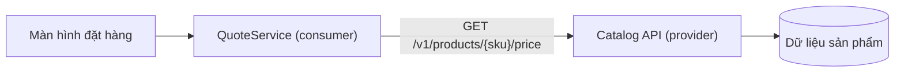
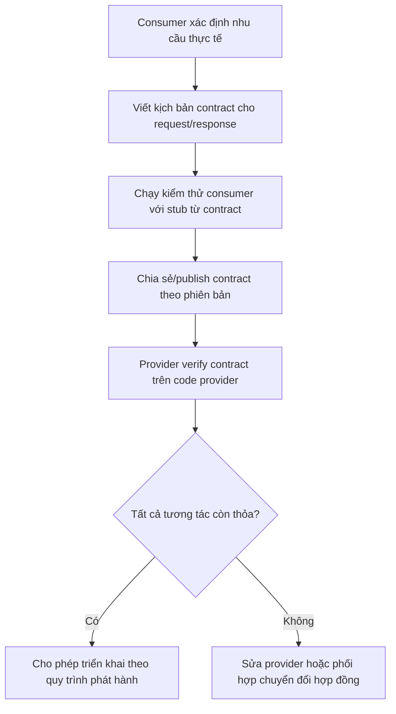

# Kiểm chứng API từ góc nhìn mã gọi

Một API có thể chạy ổn định, trả HTTP `200 OK` và có tài liệu đầy đủ, nhưng ứng dụng gọi nó vẫn bị lỗi. Dịch vụ danh mục sản phẩm đổi trường `amountMinor` thành `price`; phía gọi không đọc được giá. Dịch vụ trả số tiền theo đơn vị đồng trong khi phía gọi hiểu là nghìn đồng; mọi request đều thành công nhưng báo giá sai. Hoặc phía gọi xem lỗi `503` như sản phẩm không tồn tại, khiến người dùng bị thông báo sai dù sự cố chỉ tạm thời.

Những lỗi này cho thấy **hợp đồng API phải được kiểm chứng từ góc nhìn của mã sử dụng API** (*consumer*), chứ không chỉ từ điều mà bên cung cấp (*provider*) nghĩ mình đang trả về. Trong chương **Hợp đồng API** của **CODE_QUALITY_FUNDAMENTALS**, bài học tập trung vào cách diễn tả và kiểm chứng những kỳ vọng thiết yếu này. Mục tiêu của học phần là hiểu các thuộc tính quyết định mã nguồn **đáng tin cậy, dễ hiểu và dễ thay đổi** đến mức nào. Khi hợp đồng rõ ràng, các bên phát hiện thay đổi gây lỗi sớm hơn và biết chính xác phải sửa hay phối hợp ở đâu.

## Mục tiêu học tập

Sau bài này, bạn có thể:

1. Phân biệt **hành vi provider công bố** với **những điều consumer thật sự phụ thuộc**.
2. Xác định hợp đồng cho đầu vào, đầu ra, lỗi, tác dụng phụ và các thuộc tính vận hành có ảnh hưởng đến consumer.
3. Thiết kế kiểm thử cho mã gọi API, từ unit test với stub đến kiểm chứng hợp đồng ở provider.
4. Giải thích **consumer-driven contract testing** và giới hạn của việc chỉ dùng mock hoặc chỉ kiểm tra schema.
5. Đánh giá thay đổi API nào có khả năng phá vỡ consumer, kể cả khi thay đổi có vẻ nhỏ.
6. Biết cách xây dựng bộ kiểm chứng phù hợp trong CI và xử lý sự khác biệt giữa bản hợp đồng với hệ thống chạy thật.

## 1. Consumer, provider và hợp đồng là gì?

**Provider** là thành phần cung cấp một API; **consumer** là thành phần gọi và dựa vào kết quả của API đó. Hai vai trò có thể xuất hiện giữa các microservice, giữa frontend và backend, hoặc giữa những module Java trong cùng một ứng dụng.

**Hợp đồng API** (*API contract*) mô tả những cam kết có thể quan sát ở ranh giới giữa hai bên: request nào hợp lệ, response nào sẽ nhận được, các giá trị mang ý nghĩa gì, lỗi được biểu diễn như thế nào và thao tác có tạo tác dụng phụ gì.

Ví dụ:



`QuoteService` cần đơn giá để tính báo giá. Nó không cần biết provider dùng bảng SQL nào, cache nào hoặc công thức nội bộ nào để tìm ra đơn giá. Nhưng nó **cần biết chắc** kiểu của giá, đơn vị tiền, mã sản phẩm, quy tắc sản phẩm không tồn tại và các trường hợp provider tạm thời không phục vụ được.

### Ba lớp cam kết cần tách bạch

| Lớp cam kết | Câu hỏi | Ví dụ |
| --- | --- | --- |
| **Cú pháp và cấu trúc** | HTTP method, đường dẫn, header, kiểu trường, mã trạng thái có đúng không? | `GET /v1/products/SKU-42/price` trả JSON có `amountMinor` là số nguyên. |
| **Ngữ nghĩa nghiệp vụ** | Các giá trị và trường hợp có ý nghĩa gì? | `amountMinor=129900` với `currency=VND` nghĩa là 129.900 VND. |
| **Hành vi khi vận hành** | Consumer có thể xử lý lỗi, timeout, retry và thay đổi phiên bản thế nào? | `404` là không có SKU; `503` nghĩa là chưa có kết quả đáng tin cậy ở lần gọi này. |

Chỉ kiểm tra JSON có thể parse thành công là **chưa đủ**: hai hệ thống có thể cùng chấp nhận một số nhưng hiểu khác đơn vị đo. Ngược lại, chỉ kiểm thử quy tắc tính tổng trong `QuoteService` cũng không chứng minh provider trả đúng cấu trúc JSON.

## 2. Bắt đầu từ điều mã gọi thật sự cần

Giả sử consumer đang tính báo giá cho một SKU và số lượng. Các kỳ vọng được hai bên thống nhất trong **ví dụ minh họa**:

- Consumer gửi `GET /v1/products/{sku}/price` với header `Accept: application/json`.
- Nếu SKU tồn tại, provider trả `200` cùng JSON gồm `sku`, `amountMinor` và `currency`.
- `amountMinor` là số nguyên không âm; hệ thống ví dụ chỉ hỗ trợ `VND` và dùng đơn vị đồng. Tích hợp thực tế phải định nghĩa đơn vị nhỏ nhất và quy tắc tiền tệ cho từng loại tiền.
- Trường `sku` trong response phải đại diện đúng SKU đã yêu cầu.
- Nếu SKU không tồn tại, provider trả `404` cùng mã lỗi máy có thể đọc `PRODUCT_NOT_FOUND`.
- Nếu provider tạm thời không phục vụ được, consumer xử lý lỗi như **không có báo giá**, thay vì tự giả định đơn giá bằng 0.
- Báo giá dùng công thức `totalMinor = amountMinor * quantity`; `quantity > 0` và phép nhân phải được kiểm tra tràn số.

Ví dụ giao tiếp thành công:

```http
GET /v1/products/SKU-42/price HTTP/1.1
Accept: application/json
```

```http
HTTP/1.1 200 OK
Content-Type: application/json
```

```json
{
  "sku": "SKU-42",
  "amountMinor": 129900,
  "currency": "VND",
  "priceVersion": "P-17"
}
```

`priceVersion` là một trường bổ sung mà consumer hiện tại **không cần** để tính tổng. Nó có thể được dùng cho nghiệp vụ giữ nguyên giá, nhưng không nên buộc test của consumer thất bại chỉ vì provider thêm một trường không liên quan. Ví dụ lỗi:

```http
HTTP/1.1 404 Not Found
Content-Type: application/json
```

```json
{
  "code": "PRODUCT_NOT_FOUND",
  "message": "No product for requested SKU"
}
```

**Chú ý:** Đây là hợp đồng giả định của ví dụ, không phải chuẩn bắt buộc của mọi API danh mục sản phẩm. Nếu provider thực tế dùng `200` kèm `found=false` hoặc trả đối tượng lỗi khác, consumer phải theo **hợp đồng đã thống nhất**, không tự dựa vào ví dụ này.

### Ma trận kỳ vọng theo tình huống

| Tình huống | Provider cần thể hiện | Consumer cần phản ứng |
| --- | --- | --- |
| SKU có giá hợp lệ. | `200`, đúng SKU, giá nguyên không âm, tiền tệ được hỗ trợ. | Tính và trả báo giá, có kiểm tra tràn số. |
| SKU không tồn tại. | `404`, mã `PRODUCT_NOT_FOUND`. | Báo “không tìm thấy sản phẩm”; không coi là lỗi giá bằng 0. |
| Dữ liệu response thiếu `amountMinor`. | Không đạt hợp đồng thành công. | Phát hiện lỗi hợp đồng, không dùng giá mặc định. |
| Giá âm hoặc `currency` khác giá trị đã hỗ trợ. | Không đạt hợp đồng ngữ nghĩa của ví dụ. | Từ chối response không hợp lệ, ghi nhận lỗi tích hợp. |
| Provider lỗi `503` hoặc timeout. | Không bảo đảm có kết quả trong lần gọi. | Xử lý trạng thái không sẵn sàng; có thể retry khi an toàn và trong giới hạn. |
| Provider bổ sung trường không liên quan. | Vẫn thỏa các trường bắt buộc. | Tiếp tục dùng được nếu parser chấp nhận trường bổ sung. |

Điều quan trọng là phải thống nhất **consumer quan tâm hành vi nào**, không chụp toàn bộ response tại một thời điểm rồi mặc định mọi byte trong đó đều là hợp đồng.

## 3. Biểu diễn những giả định thành hợp đồng có thể kiểm chứng

Một đặc tả hữu ích cần nói rõ hơn tên trường. Ví dụ:

| Thành phần | Quy tắc minh họa | Vì sao mã gọi cần? |
| --- | --- | --- |
| `sku` đầu vào | Chuỗi định danh sản phẩm không rỗng, thuộc định dạng SKU đã công bố. | Tạo URL hợp lệ, tránh gọi nhầm tài nguyên. |
| `sku` đầu ra | Tương ứng SKU đã yêu cầu. | Tránh báo giá nhầm sản phẩm do cache/mapping. |
| `amountMinor` | Số nguyên không âm, theo đơn vị nhỏ nhất đã công bố. | Không tạo giá âm, không nhầm đơn vị. |
| `currency` | Mã tiền tệ đã thống nhất, ví dụ `VND`. | Không cộng hoặc nhân tiền tệ không được hỗ trợ. |
| `404` | Không tìm thấy SKU; mã lỗi ổn định `PRODUCT_NOT_FOUND`. | Phân biệt dữ liệu vắng mặt với lỗi hạ tầng. |
| `429` / `503` | Lỗi tạm thời theo hợp đồng provider. | Quyết định thông báo hoặc retry có giới hạn. |
| Timeout | Consumer chưa nhận được kết quả đúng hạn. | Tránh coi timeout là một giá trị nghiệp vụ. |
| Thêm trường JSON | Consumer không cần liệt kê đủ mọi trường. | Cho phép provider mở rộng không gây lỗi. |

Từ ma trận này có thể viết kịch bản chấp nhận:

```text
Given Catalog API có SKU-42, giá 129900 VND
When  QuoteService yêu cầu giá cho SKU-42 và số lượng 2
Then  QuoteService tạo báo giá tổng 259800 VND
And   không tự thay đổi đơn giá nhận được
```

Một kịch bản lỗi:

```text
Given Catalog API trả 404, code PRODUCT_NOT_FOUND cho SKU-404
When  QuoteService yêu cầu báo giá SKU-404
Then  lời gọi báo giá thất bại theo lỗi sản phẩm không tồn tại
And   không trả báo giá có đơn giá 0
```

Đặc tả có thể nằm trong OpenAPI, tài liệu hợp đồng, các kịch bản kiểm thử hoặc công cụ contract testing. Dù ở định dạng nào, **kỳ vọng phải có cùng ý nghĩa** giữa bên gọi và bên cung cấp.

## 4. Kiểm thử ở tầng consumer: bảo vệ cách mã gọi sử dụng kết quả

Ở tầng ứng dụng, có thể tách hành vi gọi API khỏi logic tính toán bằng một interface nhỏ:

```java
import java.util.Objects;

record ProductPrice(String sku, long amountMinor, String currency) {
    public ProductPrice {
        if (sku == null || sku.isBlank()) {
            throw new IllegalArgumentException("SKU is required");
        }
        if (amountMinor < 0) {
            throw new IllegalArgumentException("Price must be non-negative");
        }
        if (currency == null || currency.isBlank()) {
            throw new IllegalArgumentException("Currency is required");
        }
    }
}

interface ProductPricePort {
    ProductPrice findPrice(String sku);
}

record Quote(String sku, int quantity, long totalMinor, String currency) {}

final class QuoteService {
    private final ProductPricePort prices;

    QuoteService(ProductPricePort prices) {
        this.prices = Objects.requireNonNull(prices);
    }

    Quote quote(String sku, int quantity) {
        if (sku == null || sku.isBlank() || quantity <= 0) {
            throw new IllegalArgumentException("Invalid quote request");
        }
        ProductPrice price = Objects.requireNonNull(
                prices.findPrice(sku), "Provider returned null price");
        if (!sku.equals(price.sku())) {
            throw new IllegalStateException("SKU mismatch");
        }
        if (!"VND".equals(price.currency())) {
            throw new IllegalStateException("Unsupported currency");
        }
        long total = Math.multiplyExact(price.amountMinor(), quantity);
        return new Quote(sku, quantity, total, price.currency());
    }
}
```

Đây là mã ứng dụng Java 17, không phụ thuộc HTTP client. Nó cho thấy **những giả định consumer thật sự dùng**: SKU phải đúng, tiền tệ phù hợp, giá không âm và phép nhân không tràn. Interface `ProductPricePort` được đặt theo **nhu cầu của consumer**; một HTTP adapter bên ngoài sẽ có nhiệm vụ chuyển HTTP/JSON thành `ProductPrice`, đồng thời ánh xạ `404`, timeout và các lỗi khác theo hợp đồng.

### Unit test với fake: kiểm tra consumer sử dụng dữ liệu thế nào

```java
import static org.junit.jupiter.api.Assertions.*;

import java.util.concurrent.atomic.AtomicInteger;
import org.junit.jupiter.api.Test;

class QuoteServiceTest {
    @Test
    void computesQuoteFromContractFields() {
        ProductPricePort port = sku ->
                new ProductPrice("SKU-42", 129_900L, "VND");
        Quote result = new QuoteService(port).quote("SKU-42", 2);

        assertEquals(259_800L, result.totalMinor());
        assertEquals("SKU-42", result.sku());
        assertEquals("VND", result.currency());
    }

    @Test
    void rejectsInvalidInputBeforeCallingApi() {
        AtomicInteger calls = new AtomicInteger();
        ProductPricePort port = sku -> {
            calls.incrementAndGet();
            return new ProductPrice(sku, 10L, "VND");
        };

        assertThrows(IllegalArgumentException.class,
                () -> new QuoteService(port).quote("SKU-42", 0));
        assertEquals(0, calls.get());
    }

    @Test
    void rejectsMismatchedProductAndUnsupportedCurrency() {
        ProductPricePort wrongProduct = sku ->
                new ProductPrice("OTHER", 100L, "VND");
        assertThrows(IllegalStateException.class,
                () -> new QuoteService(wrongProduct).quote("SKU-42", 1));

        ProductPricePort wrongCurrency = sku ->
                new ProductPrice(sku, 100L, "USD");
        assertThrows(IllegalStateException.class,
                () -> new QuoteService(wrongCurrency).quote("SKU-42", 1));
    }

    @Test
    void rejectsOverflowInsteadOfReturningIncorrectTotal() {
        ProductPricePort port = sku ->
                new ProductPrice(sku, Long.MAX_VALUE, "VND");
        assertThrows(ArithmeticException.class,
                () -> new QuoteService(port).quote("SKU-42", 2));
    }
}
```

Các unit test này có giá trị vì chúng chứng minh **mã gọi dùng giá theo hợp đồng đã giả định**. Tuy nhiên, fake được viết ngay trong test **không chứng minh provider thật trả dữ liệu như fake**. Nếu provider đổi `amountMinor` thành `amount`, unit test ở trên vẫn có thể xanh; lỗi chỉ lộ ra khi HTTP adapter hoặc môi trường tích hợp thực sự gặp response mới.

Đây là lý do cần thêm **kiểm thử hợp đồng ở ranh giới giao tiếp**.

## 5. Kiểm tra giao thức ở ranh giới HTTP

HTTP adapter là nơi ràng buộc giữa kiểu Java và định dạng bên ngoài. Nó chịu trách nhiệm tối thiểu:

1. Tạo request đúng method, path, header, authentication và quy tắc mã hóa tham số.
2. Nhận diện status trước khi parse JSON thành response thành công.
3. Kiểm tra Content-Type khi hợp đồng yêu cầu JSON và kiểm tra trường bắt buộc có kiểu đúng.
4. Phân biệt các trạng thái lỗi; không dùng `null` hoặc giá 0 như cách chung cho mọi lỗi.
5. Ánh xạ dữ liệu nhận được vào kiểu miền có invariant rõ ràng, ví dụ `ProductPrice`.
6. Tôn trọng timeout, retry và định danh yêu cầu theo hợp đồng khi thao tác có tác dụng phụ.

### Kiểm chứng request và response thực tế

Một kiểm thử ở ranh giới adapter có thể dựng **HTTP stub server** trên máy chạy test. Stub phản hồi theo hợp đồng; kiểm thử gọi adapter Java qua HTTP thật rồi xem **request mà stub đã nhận**.

```text
QuoteService
    |
    v
HttpProductPriceAdapter  -- HTTP request thật --> Stub HTTP server
    |                                         |
    | <------ HTTP response theo kịch bản ----|
    v
ProductPrice / lỗi đã ánh xạ
```

Các assertion có ý nghĩa:

| Mục kiểm tra | Ví dụ kỳ vọng |
| --- | --- |
| Method và path | `GET /v1/products/SKU-42/price`. |
| Header | `Accept: application/json`; header xác thực khi cần. |
| Response thành công | `200` có `sku`, `amountMinor` nguyên, `currency`. |
| JSON có trường mở rộng | Thêm `priceVersion` không làm consumer lỗi nếu contract cho phép. |
| Trường bắt buộc không tồn tại | Adapter báo lỗi hợp đồng, không dùng giá 0. |
| Trường sai kiểu | `amountMinor: "129900"` phải được xử lý theo schema đã thỏa thuận; không tự ép kiểu ngoài hợp đồng. |
| Trường sai ngữ nghĩa | `amountMinor: -1` bị từ chối dù kiểu số nguyên đúng. |
| Lỗi không tồn tại | `404` kèm mã lỗi được ánh xạ thành lỗi không có SKU. |
| Lỗi tạm thời | `503` hoặc timeout không được ánh xạ thành `ProductPrice`. |

Với REST API dùng JSON, có thể sử dụng công cụ như WireMock hoặc một stub HTTP đơn giản. Phần quan trọng không phải tên công cụ mà là **đã kiểm tra đoạn mã thực sự gửi request và parse response**, thay vì chỉ gọi một fake Java bỏ qua HTTP.

### Cẩn trọng với giá trị mặc định khi parse

Giả sử mã DTO dùng kiểu nguyên thủy:

```java
record PriceResponse(String sku, long amountMinor, String currency) {}
```

Nếu thư viện ánh xạ JSON đang sử dụng biến **trường vắng mặt** thành giá trị mặc định `0` của `long`, response thiếu `amountMinor` có thể bị hiểu là sản phẩm miễn phí. Hành vi parse thực tế phụ thuộc vào thư viện và cấu hình; không nên đoán rằng mọi mapper xử lý giống nhau.

Hãy kiểm thử bằng dữ liệu thiếu trường, `null`, sai kiểu và số vượt phạm vi. Có thể đọc cấu trúc JSON để kiểm tra sự hiện diện/kiểu trước khi chuyển vào domain model, hoặc cấu hình deserializer từ chối dữ liệu không hợp lệ. Chỉ sau khi parse và kiểm tra đầy đủ mới tạo `ProductPrice`.

Tương tự, khi xử lý JSON có thêm trường, hãy chủ động quyết định adapter có cho phép hay không. Hợp đồng consumer chỉ nên chặt ở những gì thực sự cần, nhưng không được buông lỏng các trường quyết định tiền, định danh hoặc quyền truy cập.

## 6. Consumer-driven contract testing: ai kiểm chứng điều gì?

**Consumer-driven contract testing** là cách một hoặc nhiều consumer mô tả những tương tác mà họ dựa vào. Các tương tác được dùng để xác minh phía provider còn thực hiện đúng những cam kết ấy hay không.

Một quy trình khái quát:



Công cụ như Pact có thể hỗ trợ mô hình này, nhưng quy trình không phụ thuộc bắt buộc vào một công cụ. Điều quan trọng là **cùng một tập kỳ vọng** được tiêu thụ trong kiểm thử consumer và kiểm chứng trên provider, tránh hai phía tự viết hai bản đặc tả khác nhau rồi tưởng rằng đã thống nhất.

### Một interaction contract minh họa

Mô tả dưới đây là **ví dụ ý niệm**, không phải cú pháp cấu hình Pact hay OpenAPI:

```yaml
interaction: consumer requests price for an existing SKU
providerState: SKU-42 exists and has price 129900 VND
request:
  method: GET
  path: /v1/products/SKU-42/price
  headers:
    Accept: application/json
response:
  status: 200
  headers:
    Content-Type: application/json
  body:
    sku: SKU-42
    amountMinor: 129900
    currency: VND
matchers:
  sku: equals "SKU-42"
  amountMinor: non-negative integer
  currency: equals "VND"
```

Provider phải chuẩn bị **provider state** phù hợp để interaction có thể chạy lại, chẳng hạn dữ liệu thử của `SKU-42` được cô lập khỏi sản phẩm thật. Nếu dữ liệu thử phụ thuộc vào lịch trình hoặc cơ sở dữ liệu thay đổi bất ngờ, test sẽ chập chờn và không còn là bằng chứng rõ ràng về hợp đồng.

### Contract test kiểm tra điều gì và không kiểm tra điều gì?

| Loại kiểm thử | Kiểm tra mạnh nhất | Chưa bảo đảm |
| --- | --- | --- |
| **Consumer unit test** dùng fake Java | Consumer tính toán và phản ứng đúng với dữ liệu/lỗi giả định. | Provider có thật sự gửi response đó hay không. |
| **HTTP adapter test** dùng stub | Request được mã hóa đúng, response/lỗi được parse và ánh xạ đúng. | Provider thật đã đáp ứng tương tác đó. |
| **Provider contract verification** | Provider có đáp ứng các interaction đã công bố trong môi trường kiểm chứng. | Toàn bộ luồng nghiệp vụ, mọi tải, mọi dữ liệu production. |
| **Integration test** với provider hoặc DB thực | Tích hợp giữa các thành phần trong một môi trường xác định. | Mọi lỗi vận hành hoặc mọi cấu hình ngoài môi trường test. |
| **End-to-end test** | Một luồng sử dụng đầy đủ đi qua nhiều thành phần. | Bao phủ mọi tổ hợp input hay mọi thay đổi contract. |

Một test xanh chỉ có ý nghĩa trong **phạm vi hợp đồng, trạng thái provider và môi trường đã kiểm tra**. Contract test không thay thế kiểm thử bảo mật, hiệu năng, quy tắc đồng thời hoặc tính đúng đắn nghiệp vụ sâu bên trong provider.

## 7. Những giả định ngầm thường gây lỗi cho consumer

### 7.1. Tên trường, kiểu và tính bắt buộc

`amountMinor` đổi tên thành `amount` là thay đổi rõ ràng gây lỗi. Nhưng biến số nguyên thành chuỗi hoặc đổi `null` thành trường không tồn tại cũng có thể phá vỡ deserializer và nhánh xử lý.

Phải phân biệt:

| Trạng thái trong JSON | Diễn giải có thể có | Điều cần chốt |
| --- | --- | --- |
| Không có trường `discount` | Không được cung cấp thông tin. | Có được phép vắng mặt không? |
| `"discount": null` | Có trường nhưng giá trị không xác định. | Có khác “không có trường” không? |
| `"discount": 0` | Giá trị có mặt, bằng 0. | Có nghĩa là không giảm giá hay chưa tính? |
| `"discount": "0"` | Giá trị là chuỗi. | Schema có cho phép hay phải từ chối? |

Không nên chỉ kiểm tra response mẫu có field mà không định nghĩa *required*, *nullable* và các giá trị đặc biệt. Consumer có thể không cần trường `discount`, nhưng nếu cần thì phải mô tả thật rõ.

### 7.2. Đơn vị và giới hạn số

Các số trong JSON không mang sẵn đơn vị. `amount=125` có thể có nghĩa 125 đồng, 125 cent hoặc 1,25 đơn vị tiền. Mã gọi cần biết:

- Đơn vị biểu diễn và quy tắc làm tròn.
- Giá có thể bằng 0 hoặc âm không.
- Kiểu số và giới hạn giá trị.
- Những trường số nào cần được xử lý bằng `long`, `BigDecimal` hoặc kiểu giá trị tiền tệ.

Với Java, `Math.multiplyExact` giúp phát hiện tràn `long` khi tính tổng. Trong môi trường JavaScript, số nguyên JSON quá lớn còn có thể vượt độ chính xác của `Number`; consumer ở các ngôn ngữ khác nhau có thể cần quy tắc serialization khác.

### 7.3. Ngày giờ và múi giờ

API trả `"2026-11-16T09:30:00Z"` khác về ý nghĩa với `"2026-11-16 09:30:00"` không có thông tin múi giờ. Nếu consumer cần thời điểm tuyệt đối, có thể dùng định dạng ISO 8601 có offset và ánh xạ sang `Instant`. Kiểm thử cần bao gồm offset khác 0 và ngày chuyển đổi giữa các múi giờ, không chỉ một mẫu UTC.

### 7.4. Danh sách rỗng, phân trang và sắp xếp

`[]` có thể là kết quả hợp lệ; `null` chưa chắc tương đương. Nếu consumer gọi API phân trang, phải thống nhất cursor, điểm kết thúc, thứ tự ổn định và hành vi khi dữ liệu thay đổi giữa hai lần gọi. Nếu ứng dụng dựa vào thứ tự mà API không cam kết, việc provider đổi câu SQL có thể làm hệ thống sai dù JSON schema không thay.

### 7.5. Mã lỗi và khả năng retry

Nếu trước đây `404` nghĩa là “không có sản phẩm” nhưng provider chuyển sang `200` với `price=null`, consumer phải đổi logic. Nếu provider dùng `429` cho giới hạn tốc độ, caller cần biết có thể retry không, có `Retry-After` không và deadline tổng của yêu cầu là bao nhiêu.

**Timeout không chứng minh provider chưa xử lý yêu cầu.** Với GET chỉ đọc, thử lại thường đơn giản hơn. Với POST tạo đơn, thanh toán hoặc đặt hàng, mã gọi cần hợp đồng **idempotency key** hoặc cơ chế đối soát để tránh nhân tác dụng phụ khi response bị mất.

## 8. Tương thích ngược dưới góc nhìn consumer

Một thay đổi được gọi là *backward compatible* nếu các consumer hiện đang được hỗ trợ vẫn sử dụng API đúng theo hợp đồng cũ. Trong thực tế, mức độ tương thích phụ thuộc vào việc họ đang dựa vào những gì.

| Thay đổi ở provider | Thường tương thích khi nào? | Rủi ro với consumer |
| --- | --- | --- |
| Thêm trường response tùy chọn. | Consumer bỏ qua trường không cần thiết và parser cho phép. | Parser từ chối trường lạ hoặc giả định cấu trúc cố định. |
| Thêm giá trị enum. | Contract cho phép giá trị mới và consumer có nhánh xử lý. | `switch`/mapping không biết trạng thái mới. |
| Đổi tên trường bắt buộc. | Có giai đoạn hỗ trợ cả tên cũ và mới. | Consumer đọc trường cũ bị thiếu. |
| Đổi kiểu số thành chuỗi. | Consumer được cập nhật hoặc hỗ trợ cả hai theo hợp đồng. | Parse thất bại hoặc mất khả năng so sánh/tính toán. |
| Đổi ý nghĩa trường nhưng giữ tên/kiểu. | Hiếm khi an toàn nếu consumer dựa vào nghĩa cũ. | Dễ gây lỗi dữ liệu im lặng. |
| Thêm trường bắt buộc vào request. | Có giá trị mặc định tương thích hoặc hỗ trợ version cũ. | Client cũ gửi thiếu trường và bị từ chối. |
| Thay `404` bằng `200` với null. | Chỉ khi consumer đã hỗ trợ cả hai. | Nhánh xử lý lỗi đổi ý nghĩa. |
| Bỏ endpoint cũ. | Tất cả consumer được hỗ trợ đã chuyển xong. | Request thất bại tức thì. |

**Thêm trường hoặc giá trị enum không phải lúc nào cũng an toàn.** Ví dụ parser dùng cấu hình không chấp nhận trường lạ, hoặc code dùng `switch` không có nhánh mặc định cho enum mới. Khi đánh giá tương thích, cần biết phiên bản consumer đang chạy thực tế, không chỉ nhìn vào mong muốn của người sửa provider.

### Chiến lược mở rộng và thu hẹp

Một thay đổi có thể được triển khai theo nhiều giai đoạn (*expand–migrate–contract*):

1. **Expand:** provider hỗ trợ cấu trúc cũ và mới, chẳng hạn trả đồng thời `amountMinor` và trường mới trong thời gian chuyển đổi.
2. **Migrate:** consumer được cập nhật và kiểm chứng bằng contract test; hệ thống quan sát các phiên bản đang sử dụng.
3. **Contract:** chỉ xóa tương thích cũ sau khi đã xác nhận các consumer thuộc phạm vi hỗ trợ không còn phụ thuộc.

Khi cần thay đổi ngữ nghĩa lớn, một version API mới có thể phù hợp hơn. Nhưng version trong URL không tự giải quyết vấn đề nếu tài liệu, kiểm chứng và kế hoạch chuyển đổi thiếu thống nhất.

## 9. Tránh hai kiểu kiểm thử hợp đồng thiếu hiệu quả

### Khớp quá chặt với hiện trạng

Giả sử test so sánh toàn bộ JSON bằng chuỗi:

```java
assertEquals(
        "{\"sku\":\"SKU-42\",\"amountMinor\":129900,\"currency\":\"VND\"}",
        responseBody);
```

Kiểm thử này có thể thất bại chỉ vì provider đổi thứ tự field, thêm khoảng trắng hoặc thêm `priceVersion`, dù consumer vẫn đọc được và không thay đổi hành vi. Contract test nên parse JSON và so sánh **trường cần thiết** theo kiểu và ngữ nghĩa, trừ khi chính thứ tự/chuỗi byte là một phần của hợp đồng (ví dụ chữ ký số).

### Khớp quá lỏng và bỏ qua ràng buộc

Ngược lại:

```java
assertEquals(200, statusCode);
```

Test này chưa xác nhận rằng giá có tồn tại, không âm, đúng SKU và đúng đơn vị. Provider có thể trả `{"price": "free"}` mà test vẫn xanh. Cần chọn một tập matcher **đủ chặt với hành vi consumer phụ thuộc** và **đủ mở để không cản thay đổi vô hại**.

Một contract test tốt có thể cố định `sku == "SKU-42"` theo provider state, kiểm tra `amountMinor` là số nguyên hợp lệ và `currency == "VND"`, còn bỏ qua trường mới mà consumer không đọc.

## 10. Đưa hợp đồng vào quy trình phát triển

Hợp đồng có giá trị hơn khi kiểm chứng được trước khi hai hệ thống triển khai không tương thích.

```text
Thay đổi nhu cầu consumer
         |
         v
Cập nhật contract + test phía consumer
         |
         v
Chạy test consumer với stub
         |
         v
Provider verify contract trên bản build dự kiến
         |
         v
Kiểm tra phiên bản đang/chuẩn bị triển khai
         |
         v
Cho phép phát hành theo chính sách CI/CD
```

Một quy trình nên trả lời được:

- **Ai sở hữu hợp đồng?** Consumer xác định nhu cầu; provider xác nhận hành vi có thể cung cấp; hai bên cùng thống nhất thay đổi.
- **Kiểm chứng trên bản nào?** Provider cần verify trên code/build sẽ phát hành, cùng phiên bản contract mà consumer liên quan sử dụng.
- **Kiểm chứng trong trạng thái nào?** Dữ liệu mẫu/provider state cần rõ ràng và lặp lại được.
- **Khi test thất bại?** Chỉ ra interaction nào, request/response nào sai, có phá consumer đang hoạt động hay không.
- **Ai là consumer đang được hỗ trợ?** Khi có nhiều consumer/phiên bản, cần kiểm tra ma trận phiên bản, không chỉ consumer mới nhất.
- **Làm sao phát hiện lệch môi trường?** Kết hợp kiểm thử tích hợp, quan sát lỗi parse/mapping, log có correlation ID và theo dõi tỷ lệ lỗi sau deploy.

### Ma trận kiểm chứng gợi ý

| Kiểm chứng | Bên thường chạy | Khi nào? |
| --- | --- | --- |
| Unit test logic `QuoteService` | Consumer | Mỗi thay đổi mã ứng dụng. |
| Test HTTP adapter với stub | Consumer | Khi thay request, parser, xử lý lỗi hoặc SDK. |
| Test consumer contract | Consumer | Khi mô tả tương tác cần provider bảo đảm. |
| Verify provider với contract đã công bố | Provider | Trước khi phát hành provider hoặc khi contract thay đổi. |
| Integration/E2E trọng yếu | Một hoặc hai bên | Với luồng quan trọng và trước phát hành theo chiến lược test. |
| Theo dõi lỗi tích hợp khi vận hành | Hai bên | Liên tục sau triển khai, theo ngân sách quan sát phù hợp. |

Không nên chạy mọi loại kiểm thử với tất cả tổ hợp môi trường nếu chi phí vượt lợi ích. Ưu tiên những ranh giới có lịch sử lỗi tương thích, nhiều consumer, dữ liệu quan trọng hoặc tác dụng phụ lớn.

## 11. Sai lầm thường gặp

**“Provider đã có unit test nên hợp đồng với client chắc đúng.”** Unit test nội bộ có thể kiểm tra thuật toán đúng mà không kiểm tra field JSON, HTTP status hoặc serializer thực sự xuất ra.

**“Consumer test với mock xanh nghĩa là tích hợp đã ổn.”** Mock do chính consumer tạo chỉ phản ánh giả định của consumer. Cần provider contract verification hoặc integration test để kiểm tra giả định có thật.

**“Cùng kiểu dữ liệu nghĩa là cùng ngữ nghĩa.”** Hai phía đều dùng `long` nhưng một bên biểu diễn đồng, bên kia biểu diễn nghìn đồng vẫn cho kết quả sai. Hợp đồng phải ghi rõ đơn vị và quy tắc.

**“Chỉ cần snapshot toàn bộ response.”** Snapshot quá chặt có thể làm test thất bại khi thêm trường hoặc thay thứ tự vô hại, khiến nhóm né test. Kiểm tra theo hành vi mà consumer thật sự dựa vào.

**“Mọi thay đổi bổ sung đều tương thích.”** Enum mới, field bắt buộc mới hoặc status code mới vẫn có thể phá consumer hiện hữu.

**“Có OpenAPI là đã kiểm chứng hợp đồng.”** OpenAPI mô tả kỳ vọng nhưng không tự bảo đảm provider đang chạy tuân thủ; cần kiểm chứng schema, ngữ nghĩa quan trọng và hành vi mã lỗi bằng test thực tế.

**“HTTP 200 là thành công nghiệp vụ.”** Response 200 thiếu giá, sai loại tiền hoặc thiếu dữ liệu bắt buộc vẫn không sử dụng an toàn được.

**“Lỗi provider có thể thay bằng giá mặc định.”** Giá 0 là một giá trị nghiệp vụ có ý nghĩa; dùng nó để che timeout hoặc parse thất bại có thể tạo báo giá sai và khó phát hiện.

## 12. Quy trình thực hành khi tích hợp một API mới

1. **Liệt kê điều consumer sẽ dùng.** Tên trường, kiểu, đơn vị, trạng thái lỗi, phân trang, thời gian và tác dụng phụ.
2. **Viết hợp đồng từ các kịch bản thực tế.** Gồm thành công, không tìm thấy, dữ liệu không hợp lệ, lỗi tạm thời và giá trị biên.
3. **Tách mã gọi HTTP khỏi logic nghiệp vụ.** Dùng adapter/port phù hợp để logic không phải tự parse JSON hoặc phân biệt status ở nhiều nơi.
4. **Viết unit test cho cách consumer sử dụng dữ liệu.** Kiểm tra tính toán, lỗi và việc không gọi provider khi đầu vào sai.
5. **Kiểm tra request/response thật ở adapter.** Bao gồm method/path/header, parse và ánh xạ lỗi, thiếu field, sai kiểu và trường bổ sung.
6. **Chia sẻ contract để provider verify.** Mỗi tương tác phải có provider state xác định và matcher phản ánh kỳ vọng thật.
7. **Đánh giá thay đổi tương thích trước deploy.** Xét cả consumer cũ, thay đổi ngữ nghĩa và thời gian cần giữ hợp đồng cũ.
8. **Kết hợp test với quan sát vận hành.** Theo dõi lỗi tích hợp, dữ liệu sai và trạng thái phiên bản triển khai.

## 13. Câu hỏi tự kiểm tra

**Câu 1.** `QuoteServiceTest` dùng fake trả `ProductPrice("SKU-42", 129900, "VND")` và chạy xanh. Điều đó đã chứng minh Catalog API thật trả `amountMinor` không?

*Gợi ý:* Chưa. Unit test chỉ chứng minh consumer xử lý dữ liệu giả định đúng. Cần test adapter và provider verification hoặc integration test để biết provider tuân thủ JSON contract.

**Câu 2.** Provider thêm trường `priceVersion` vào response thành công. Contract test của consumer có nên thất bại?

*Gợi ý:* Nếu consumer không dựa vào trường này và hợp đồng cho phép mở rộng, test không nên thất bại chỉ vì trường mới. Tuy nhiên phải xác minh parser thực tế có chấp nhận trường lạ hay không.

**Câu 3.** Response có `amountMinor: -50` và HTTP 200. Vì sao không thể tạo báo giá?

*Gợi ý:* Giá trị đáp ứng kiểu số nhưng vi phạm bất biến của hợp đồng ví dụ. Kiểm tra status code đơn thuần không đủ; cần validation ngữ nghĩa.

**Câu 4.** Provider đổi `404 PRODUCT_NOT_FOUND` thành `200` với `{"sku":"SKU-42","amountMinor":null}`. Đây là thay đổi vô hại không?

*Gợi ý:* Không mặc nhiên. Consumer cũ có thể phân biệt lỗi theo status và dùng `long` không nullable. Cần kiểm tra các consumer đang được hỗ trợ và có kế hoạch chuyển đổi.

**Câu 5.** Một contract test so sánh nguyên văn chuỗi JSON và thất bại khi provider thêm dấu cách. Điều đó phản ánh API lỗi không?

*Gợi ý:* Không, trừ khi byte của payload là một phần hợp đồng. Nên kiểm tra cấu trúc và trường consumer thực sự cần theo ngữ nghĩa JSON.

**Câu 6.** Sau timeout ở API tạo đơn hàng, có thể gửi POST lần nữa tùy ý không?

*Gợi ý:* Không. Timeout không chứng minh yêu cầu trước chưa xử lý. Consumer cần hợp đồng idempotency key hoặc tra cứu trạng thái để tránh tạo trùng đơn.

## Ghi nhớ

- **Hợp đồng API từ phía consumer** là tập những điều mã gọi thực sự cần provider bảo đảm, gồm cấu trúc, ngữ nghĩa, lỗi và những ràng buộc vận hành quan trọng.
- **Unit test dùng fake** chứng minh logic consumer; **adapter test** kiểm chứng mã hóa/giải mã HTTP; **provider verification** kiểm tra provider đáp ứng tương tác; **integration/E2E** kiểm chứng những phạm vi rộng hơn.
- **Contract test cần vừa đủ chặt** để bắt thay đổi có thể làm hỏng consumer, vừa đủ mở để chấp nhận bổ sung không ảnh hưởng.
- **Tương thích ngược phụ thuộc consumer đang chạy**, không chỉ nhìn vào schema mới. Những thay đổi giữ nguyên kiểu nhưng đổi đơn vị hoặc ý nghĩa vẫn có thể gây lỗi lớn.
- **Hợp đồng cần được kiểm chứng liên tục**, có provider state tái tạo được, quản lý phiên bản và tín hiệu giám sát tích hợp sau triển khai.

**Câu hỏi cần đặt trước khi sửa một API:** “Mã gọi nào đang dựa vào hành vi này, nó sẽ nhận được điều gì sau thay đổi, và kiểm thử nào chứng minh nó vẫn hoạt động đúng?”
